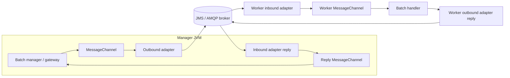
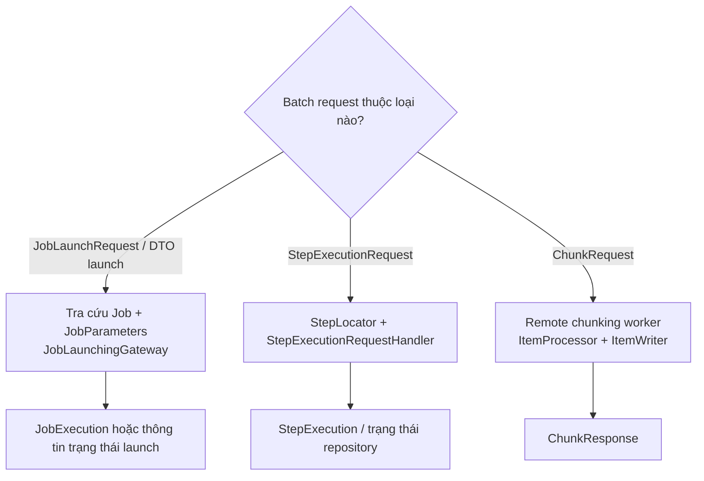
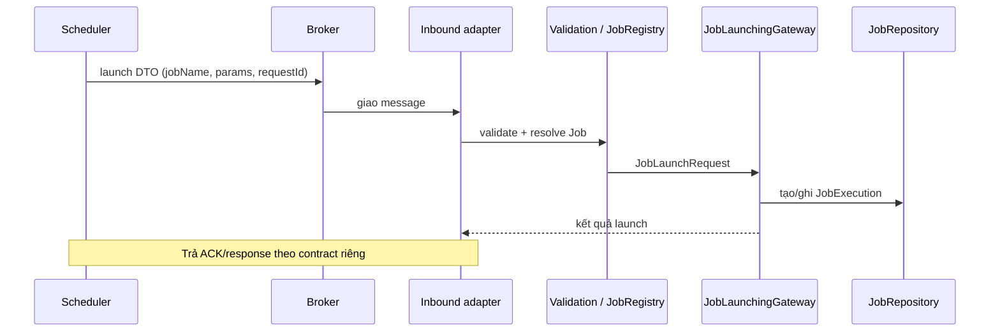
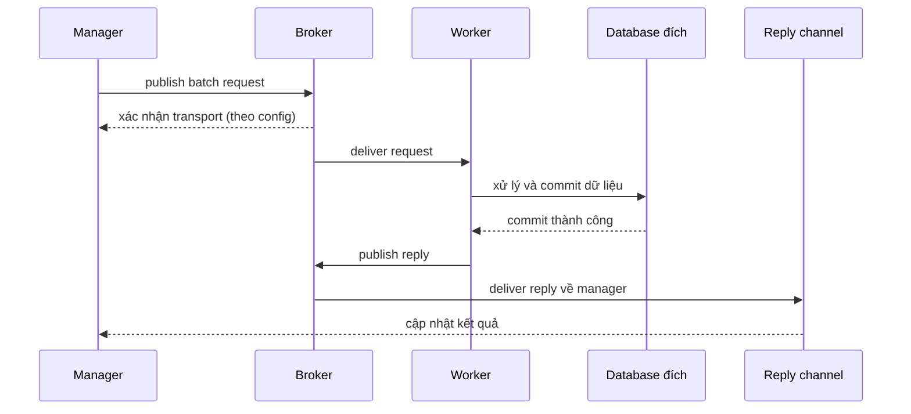

# Channel adapter cho batch request

## 1. Vì sao batch request cần channel adapter?

Trong chương **Spring Batch Integration** của module **SPRING_BATCH_SCALING_OPERATIONS**, chúng ta học cách mở rộng Spring Batch cho dữ liệu lớn bằng nhiều thread, parallel steps, partitioning và xử lý phân tán. Một manager có thể cần yêu cầu ứng dụng khác khởi chạy job, chạy worker step hoặc xử lý một chunk. Nhưng đối tượng Java trong JVM của manager **không tự đi qua mạng** tới worker.

Spring Integration giải quyết ranh giới này bằng **message**, **channel** và **channel adapter**:

- `MessageChannel` là điểm giao nhận message **bên trong application context**.
- **Outbound channel adapter** lấy message từ Spring Integration channel và chuyển nó sang hệ thống ngoài, như JMS broker hoặc AMQP exchange.
- **Inbound channel adapter** nhận dữ liệu/message từ hệ thống ngoài rồi phát một Spring Integration message vào channel nội bộ.
- **Gateway/service activator** xử lý yêu cầu nghiệp vụ, ví dụ khởi chạy job, xử lý `StepExecutionRequest` hoặc xử lý `ChunkRequest`.

**Channel adapter không tự hiểu toàn bộ Spring Batch.** Nó vận chuyển message qua biên hệ thống; những thành phần Batch Integration mới quyết định message mang ý nghĩa *khởi chạy job*, *thực thi step* hay *xử lý chunk*. Thiết kế đúng cần phối hợp cả hai lớp.

Sau bài học, bạn sẽ có thể:

1. Phân biệt inbound/outbound adapter, channel, gateway và message handler.
2. Nhận diện `JobLaunchRequest`, `StepExecutionRequest` và `ChunkRequest`, không gửi nhầm payload giữa các flow.
3. Ghép request/reply channel qua JMS/AMQP cho remote partitioning và remote chunking.
4. Hiểu nơi dùng `JobLaunchingGateway`, `StepExecutionRequestHandler`, `RemoteChunkingManagerStepBuilder` và worker flow.
5. Thiết kế correlation, serialization, transport durability, backpressure, timeout và dead-letter queue.
6. Đo bottleneck, phục hồi sau lỗi, bảo vệ `JobRepository` và thực hiện retry/restart không gây tác dụng phụ trùng lặp.

> **Ý cốt lõi:** Adapter chỉ đưa message **vào/ra một ứng dụng**. Một request gửi thành công tới broker **không đồng nghĩa** job, step hay chunk đã xử lý và commit. Muốn biết kết quả phải có giao thức reply/trạng thái phù hợp cùng dữ liệu được lưu bền vững.

## 2. Bốn lớp trách nhiệm cần tách bạch



Sơ đồ mô tả mô hình **request/reply hai chiều**. Một số mô hình không cần reply message cho từng yêu cầu: ví dụ `RemoteStep` trong Spring Batch 6.x theo dõi trạng thái `StepExecution` qua repository. Vì vậy không nên sao chép y nguyên đường reply của remote chunking vào remote step.

| Lớp | Ví dụ | Việc phải làm | Việc không tự làm |
| --- | --- | --- | --- |
| Batch request | `JobLaunchRequest`, `StepExecutionRequest`, `ChunkRequest` | Mô tả công việc và định danh | Vận chuyển qua mạng |
| Channel nội bộ | `DirectChannel`, `QueueChannel` | Kết nối các endpoint Spring Integration | Xuyên JVM chỉ bằng tên channel |
| Channel adapter | JMS/AMQP inbound/outbound adapters | Trao đổi message với broker/transport | Checkpoint batch và idempotency nghiệp vụ |
| Batch handler/gateway | `JobLaunchingGateway`, `StepExecutionRequestHandler`, worker chunk processor | Thực thi yêu cầu theo API Batch | Tự tạo transport, quota, distributed transaction |

### 2.1. Chiều inbound/outbound luôn tính theo ứng dụng đang xét

Đối với manager, **gửi request** là outbound, **nhận response** là inbound. Đối với worker, **nhận request** là inbound, **gửi response** là outbound. Không định nghĩa inbound/outbound theo “request là inbound” một cách chung chung.

```text
                        REQUEST
  Manager OUTBOUND adapter ----------> Broker
                                          |
                           Worker INBOUND adapter
                                          |
                           Batch handler xử lý
                                          |
                           Worker OUTBOUND adapter
                                          |
  Manager INBOUND adapter <----------- Broker
                         RESPONSE
```

Hai bean `DirectChannel` cùng tên `batchRequests` ở hai JVM **không thể tự liên lạc**. Chúng chỉ nối được khi có adapter/transport và cùng một hợp đồng destination, payload, header.

### 2.2. Channel adapter khác gateway

Spring Integration có hai khái niệm dễ nhầm:

- **Channel adapter** thường kết nối message flow với một tài nguyên ngoài theo một chiều, ví dụ nhận JMS message vào channel hoặc gửi channel message ra JMS.
- **Messaging gateway** biểu diễn thao tác request/reply, có thể tương quan request với response và trả kết quả cho caller.

`JobLaunchingGateway` là thành phần Batch Integration nhận yêu cầu launch job và trả kết quả phù hợp với cách `JobLauncher` được cấu hình. Nó **không thay thế** JMS inbound/outbound adapter khi yêu cầu launch job phải đi qua broker từ hệ thống khác.

Nếu hệ thống muốn nhận một message chỉ để **khởi chạy job**, có thể đủ dùng inbound adapter + handler/gateway. Nếu muốn trao đổi kết quả về caller, cần thiết kế return channel, reply adapter và chính sách chờ phù hợp.

## 3. Ba loại batch request không được đánh đồng

| Loại request | Dùng khi nào | Dữ liệu đặc trưng | Thành phần tiếp nhận |
| --- | --- | --- | --- |
| `JobLaunchRequest` | Một hệ thống yêu cầu khởi chạy **Job** | Job và `JobParameters` | `JobLaunchingGateway` / job-launching handler |
| `StepExecutionRequest` | Manager yêu cầu worker chạy **StepExecution** | Tên worker step, ID `JobExecution` và `StepExecution` | `StepExecutionRequestHandler` |
| `ChunkRequest<T>` | Manager remote chunking giao **chunk item** | Collection item, định danh/correlation cần thiết cho chunk | Worker flow/handler của remote chunking |

### 3.1. Khởi chạy job từ message

Đây là tình huống **job orchestration**: một hệ thống bên ngoài phát sự kiện “chạy đối soát ngày 2026-11-26”. Ứng dụng batch nhận sự kiện, tìm đúng bean `Job` và tạo `JobParameters`.

Với Spring Batch Integration có:

```java
import org.springframework.batch.integration.launch.JobLaunchRequest;
import org.springframework.batch.integration.launch.JobLaunchingGateway;
```

Một `JobLaunchRequest` trong ứng dụng thường được tạo từ một đối tượng `Job` và `JobParameters`. **Không nên mặc định serialize nguyên bean Java `Job` sang broker để chạy ở JVM khác.** Đối với message bên ngoài, nên dùng một DTO/hợp đồng đơn giản mang `jobName`, tham số hợp lệ và `requestId`; ứng dụng nhận message **tự tra cứu Job tại địa phương**, rồi mới chuyển thành `JobLaunchRequest`.

### 3.2. Remote partitioning và remote step execution

`StepExecutionRequest` yêu cầu worker thực thi một step đã được xác định ở `JobRepository`; worker tìm `Step` bằng `StepLocator` và sử dụng execution/context tương ứng.

Với **remote partitioning**, mỗi worker execution đại diện một partition/dải dữ liệu. Manager có thể gửi nhiều request và nhận `StepExecution` kết quả qua message, tùy handler.

Với **remote step execution** được giới thiệu qua `RemoteStep` từ **Spring Batch 6.0**, manager ủy quyền **cả một step** sang worker và theo dõi repository. Mô hình này không tự biến step thành nhiều partition.

### 3.3. Remote chunking

`ChunkRequest<T>` mang item thực tế của một chunk; manager đọc nguồn, gom chunk, dùng `ChunkMessageChannelItemWriter` gửi request. Worker processor/writer xử lý chunk và gửi `ChunkResponse` về manager để tổng hợp.

**Mỗi chunk không mặc định là một `StepExecution` riêng**. Vì vậy không dùng `StepExecutionRequestHandler` để xử lý `ChunkRequest` và cũng không gửi `StepExecutionRequest` vào queue dành cho worker chunk processor.



## 4. Luồng job-launch request từ một ứng dụng khác

Giả sử một dịch vụ scheduler gửi JSON:

```json
{
  "requestId": "finance-close-20261126-v1",
  "jobName": "dailySettlementJob",
  "parameters": {
    "businessDate": "2026-11-26"
  }
}
```

Đây là **hợp đồng đề xuất**, không phải hình dạng serialized chính thức của `JobLaunchRequest`. Điểm quan trọng là chỉ truyền những dữ liệu đơn giản, đủ định danh một lần chạy, và không trao quyền cho caller thực thi bean tùy ý.

Luồng:

1. Inbound adapter nhận message từ queue `batch.jobs.launch`.
2. Bộ chuyển đổi/validator kiểm tra `jobName` có trong allowlist, tham số có schema hợp lệ, `requestId` không vượt giới hạn và caller có quyền yêu cầu.
3. Ứng dụng dùng `JobRegistry` (hoặc một registry job nội bộ đã cấu hình) để tìm `Job` tương ứng.
4. Tạo `JobParameters` với identifying parameters ổn định cho `JobInstance`, rồi tạo `JobLaunchRequest`.
5. `JobLaunchingGateway` gọi `JobLauncher`.
6. Ghi nhận `JobExecutionId`/kết quả launch, quản lý response và theo dõi trạng thái hoàn tất theo yêu cầu nghiệp vụ.



**Bắt đầu chạy thành công khác hoàn thành thành công.** Nếu `JobLauncher` được cấu hình bất đồng bộ, kết quả trả về cho caller có thể chỉ phản ánh job đã được nhận/khởi động; cần truy vấn `JobRepository` hoặc nhận event để biết job `COMPLETED`/`FAILED`. Với launcher đồng bộ, endpoint nhận message có thể bị giữ trong thời gian job chạy, điều này gây áp lực cho consumer và timeout — cần chọn mô hình phù hợp.

### 4.1. Ví dụ phần gateway nội bộ

Với API Spring Batch Integration tương ứng Spring Batch **5.2.x**:

```java
import org.springframework.batch.core.launch.JobLauncher;
import org.springframework.batch.integration.launch.JobLaunchingGateway;
import org.springframework.context.annotation.Bean;
import org.springframework.integration.dsl.IntegrationFlow;
import org.springframework.messaging.MessageChannel;

@Bean
JobLaunchingGateway jobLaunchingGateway(JobLauncher jobLauncher) {
    return new JobLaunchingGateway(jobLauncher);
}

@Bean
IntegrationFlow launchJobsFlow(
        MessageChannel launchJobRequests,
        JobLaunchingGateway jobLaunchingGateway) {
    return IntegrationFlow.from(launchJobRequests)
        // Channel này PHẢI nhận JobLaunchRequest đã validate/resolve.
        .handle(jobLaunchingGateway)
        .get();
}
```

Đây là phần **nội bộ JVM**. Inbound adapter, transformer từ DTO sang `JobLaunchRequest`, error channel và reply destination phải được ghép bổ sung. Đối với ứng dụng có nhiều `MessageChannel` bean, dùng `@Qualifier` để tránh injection mơ hồ.

## 5. Channel adapter cho StepExecutionRequest qua JMS

Phần này minh họa cách nối **remote partitioning** giữa manager và worker. Ví dụ hướng tới **Spring Batch 5.2.x + Spring Integration 6.x + Jakarta JMS**. Thư viện JMS client, broker và dependency phải tương thích; các overload của Java DSL cần kiểm tra theo phiên bản patch đang dùng.

### 5.1. Định nghĩa destinations và contract

```text
Queue batch.partition.requests:
    manager --> worker
    Payload: StepExecutionRequest

Queue batch.partition.replies:
    worker --> manager
    Payload: kết quả StepExecution (theo giao thức handler)
```

Hai queue có mục đích khác nhau; không dùng một queue chung cho cả request/reply. Trong ứng dụng thật, tên destination còn phải được cấp quyền producer/consumer thích hợp và có chính sách retention, TTL, DLQ, monitoring.

### 5.2. Manager: channel nội bộ và adapter ra/vào broker

```java
import jakarta.jms.ConnectionFactory;
import org.springframework.beans.factory.annotation.Qualifier;
import org.springframework.context.annotation.Bean;
import org.springframework.context.annotation.Configuration;
import org.springframework.integration.channel.DirectChannel;
import org.springframework.integration.channel.QueueChannel;
import org.springframework.integration.dsl.IntegrationFlow;
import org.springframework.integration.jms.dsl.Jms;
import org.springframework.messaging.MessageChannel;
import org.springframework.messaging.PollableChannel;

@Configuration
class PartitionManagerMessagingConfig {

    @Bean("partitionRequests")
    MessageChannel partitionRequests() {
        return new DirectChannel();
    }

    @Bean("partitionReplies")
    PollableChannel partitionReplies() {
        return new QueueChannel(500);
    }

    @Bean
    IntegrationFlow partitionRequestsToJms(
            @Qualifier("partitionRequests") MessageChannel requests,
            ConnectionFactory connectionFactory) {

        return IntegrationFlow.from(requests)
            .handle(Jms.outboundAdapter(connectionFactory)
                .destination("batch.partition.requests"))
            .get();
    }

    @Bean
    IntegrationFlow partitionRepliesFromJms(
            ConnectionFactory connectionFactory,
            @Qualifier("partitionReplies") PollableChannel replies) {

        return IntegrationFlow.from(
                Jms.messageDrivenChannelAdapter(connectionFactory)
                    .destination("batch.partition.replies"))
            .channel(replies)
            .get();
    }
}
```

**Giải thích:**

- `partitionRequests` là channel mà manager builder/handler dùng để phát request.
- `Jms.outboundAdapter(...)` nhận message từ channel và gửi tới queue ở broker.
- `Jms.messageDrivenChannelAdapter(...)` nhận reply từ broker rồi đẩy vào `partitionReplies`.
- `QueueChannel` là kênh pollable trong application context manager, **không phải durable broker queue**; sức chứa 500 chỉ là ví dụ giới hạn buffer nội bộ.
- Nếu manager gặp sự cố, message nằm trong `QueueChannel` nội bộ có thể mất; độ bền end-to-end còn phụ thuộc JMS acknowledgment, transaction và cơ chế request/reply recovery.

Mã trên chỉ là **phần transport**. Nó chưa có cấu hình `RemotePartitioningManagerStepBuilderFactory`, `Partitioner`, `JobRepository`, listener, reply correlation hoặc cách serialize message. Các phần đó phải được triển khai riêng.

### 5.3. Worker: nhận request rồi xử lý

Ở worker, một `StepExecutionRequestHandler` có nhiệm vụ tìm đúng step và execution. Ví dụ cấu hình cốt lõi:

```java
import org.springframework.batch.core.repository.JobRepository;
import org.springframework.batch.integration.partition.BeanFactoryStepLocator;
import org.springframework.batch.integration.partition.StepExecutionRequestHandler;
import org.springframework.batch.integration.partition.StepLocator;
import org.springframework.beans.factory.BeanFactory;
import org.springframework.context.annotation.Bean;

@Bean
StepLocator workerStepLocator(BeanFactory beanFactory) {
    BeanFactoryStepLocator locator = new BeanFactoryStepLocator();
    locator.setBeanFactory(beanFactory);
    return locator;
}

@Bean
StepExecutionRequestHandler workerStepHandler(
        JobRepository jobRepository,
        StepLocator workerStepLocator) {

    StepExecutionRequestHandler handler =
        new StepExecutionRequestHandler();
    handler.setJobRepository(jobRepository);
    handler.setStepLocator(workerStepLocator);
    return handler;
}
```

Ghép inbound request và outbound reply:

```java
import jakarta.jms.ConnectionFactory;
import org.springframework.batch.integration.partition.StepExecutionRequestHandler;
import org.springframework.context.annotation.Bean;
import org.springframework.integration.dsl.IntegrationFlow;
import org.springframework.integration.jms.dsl.Jms;

@Bean
IntegrationFlow workerPartitionFlow(
        ConnectionFactory connectionFactory,
        StepExecutionRequestHandler workerStepHandler) {

    return IntegrationFlow.from(
            Jms.messageDrivenChannelAdapter(connectionFactory)
                .destination("batch.partition.requests"))
        .handle(workerStepHandler, "handle")
        .handle(Jms.outboundAdapter(connectionFactory)
            .destination("batch.partition.replies"))
        .get();
}
```

**Hợp đồng bắt buộc:** Worker phải có bean `Step` nghiệp vụ mang tên mà manager đã gửi trong `StepExecutionRequest`. Nó cũng cần truy cập `JobRepository` chứa metadata của worker execution/context, cùng các dependency để chạy reader/processor/writer.

Trong ứng dụng thực tế, cấu hình inbound endpoint về **consumer concurrency**, transaction, acknowledgement, error channel, retry/DLQ, serializer và header mapper là bắt buộc. Khi dùng default message-driven listener với lỗi, **cách xử lý/ack phụ thuộc transaction và container config**; đừng mặc định exception luôn dẫn tới redelivery.

### 5.4. Kết nối transport với remote partitioning manager step

Với builder Spring Batch Integration 5.2, cấu trúc định hướng:

```java
import org.springframework.batch.core.Step;
import org.springframework.batch.core.partition.support.Partitioner;
import org.springframework.batch.integration.partition.RemotePartitioningManagerStepBuilderFactory;
import org.springframework.messaging.MessageChannel;

@Bean
Step remotePartitionManager(
        RemotePartitioningManagerStepBuilderFactory factory,
        Partitioner orderPartitioner,
        @Qualifier("partitionRequests") MessageChannel requests,
        @Qualifier("partitionReplies") MessageChannel replies) {

    return factory.get("remotePartitionManager")
        .partitioner("orderWorkerStep", orderPartitioner)
        .gridSize(4)
        .outputChannel(requests)
        .inputChannel(replies)
        .build();
}
```

Ví dụ chưa khai báo bean `orderPartitioner` và worker `orderWorkerStep`. Builder/wiring thay đổi giữa các đời Spring Batch, nên không sao chép máy móc vào 6.x. Điểm cần hiểu là **builder quản lý phần Batch**, còn các adapter JMS ở trên nối kênh Batch vào middleware.

## 6. Channel adapter cho remote chunking

Remote chunking cũng có request/reply, nhưng payload và đơn vị xử lý **khác hoàn toàn**.

```text
Remote chunking:
  Manager:
    reader -> gom chunk -> ChunkMessageChannelItemWriter
           -> outbound adapter -> queue chunk.requests

  Worker:
    inbound adapter -> ChunkRequest
    -> ItemProcessor -> ItemWriter nghiệp vụ
    -> ChunkResponse -> outbound adapter -> queue chunk.replies

  Manager:
    inbound adapter -> reply channel
    -> tổng hợp kết quả chunk và hoàn thành step
```

### 6.1. Ví dụ manager step Spring Batch 5.2

```java
import org.springframework.batch.core.Step;
import org.springframework.batch.core.repository.JobRepository;
import org.springframework.batch.integration.chunk.RemoteChunkingManagerStepBuilder;
import org.springframework.batch.item.ItemReader;
import org.springframework.messaging.MessageChannel;
import org.springframework.messaging.PollableChannel;
import org.springframework.transaction.PlatformTransactionManager;

@Bean
Step remoteChunkManager(
        JobRepository jobRepository,
        PlatformTransactionManager transactionManager,
        ItemReader<Order> orderReader,
        MessageChannel chunkRequests,
        PollableChannel chunkReplies) {

    return new RemoteChunkingManagerStepBuilder<Order, Order>(
            "remoteChunkManager", jobRepository)
        .chunk(200)
        .reader(orderReader)
        .outputChannel(chunkRequests)
        .inputChannel(chunkReplies)
        .transactionManager(transactionManager)
        .build();
}
```

`RemoteChunkingManagerStepBuilder` tự dùng `ChunkMessageChannelItemWriter` ở manager; **không chèn thêm một writer JDBC nghiệp vụ vào manager**. Reader vẫn ở manager, còn worker thực thi processor/writer nghiệp vụ.

`chunkRequests` phải nối outbound adapter; `chunkReplies` phải nhận inbound response từ broker. Với Spring Batch 5.2, reply channel ở manager dùng kiểu pollable theo API builder. Không nhầm `PollableChannel` nội bộ với JMS queue — adapter là thành phần nối hai khái niệm này.

### 6.2. Worker flow và adapter

Với `RemoteChunkingWorkerBuilder`:

```java
import org.springframework.batch.integration.chunk.RemoteChunkingWorkerBuilder;
import org.springframework.batch.item.ItemProcessor;
import org.springframework.batch.item.ItemWriter;
import org.springframework.integration.dsl.IntegrationFlow;
import org.springframework.messaging.MessageChannel;

@Bean
IntegrationFlow orderWorkerFlow(
        MessageChannel workerChunkRequests,
        MessageChannel workerChunkReplies,
        ItemProcessor<Order, ProcessedOrder> processor,
        ItemWriter<ProcessedOrder> writer) {

    return new RemoteChunkingWorkerBuilder<Order, ProcessedOrder>()
        .inputChannel(workerChunkRequests)
        .outputChannel(workerChunkReplies)
        .itemProcessor(processor)
        .itemWriter(writer)
        .build();
}
```

Inbound JMS/AMQP adapter phải đẩy `ChunkRequest<Order>` vào `workerChunkRequests`; outbound adapter nhận `ChunkResponse` từ `workerChunkReplies` để gửi về manager. `Order` và `ProcessedOrder` trong mã là DTO nghiệp vụ do ứng dụng cung cấp.

**Không chia sẻ request queue** của remote partitioning với remote chunking nếu không có router/contract rõ: handler partition mong `StepExecutionRequest`, còn worker chunking mong `ChunkRequest`.

## 7. Correlation và reply: điều kiện để manager biết kết quả

Trong hệ thống nhiều worker, các chunk hoặc partition có thể hoàn tất **không theo thứ tự gửi**:

```text
Gửi request:     A  B  C  D
Nhận reply:         C  A  D  B
```

Manager cần phân biệt:

1. Reply thuộc **JobExecution/StepExecution** nào?
2. Reply phản hồi request hoặc chunk nào?
3. Reply là kết quả hoàn tất, lỗi, bản sao do redelivery hay message của lần chạy trước?
4. Khi đủ kết quả mới tổng hợp được không? Nếu thiếu, đến khi nào timeout/escalate?

### 7.1. Các định danh nên theo dõi

| Định danh | Dùng để làm gì? | Lưu ý |
| --- | --- | --- |
| `jobExecutionId` | Gắn vào lần chạy job cụ thể | Không nhầm với `JobInstance` |
| `stepExecutionId` | Gắn với step/partition execution | Có thể thay đổi khi restart |
| Partition key | Nhận diện phạm vi nghiệp vụ được giao | Phải ổn định cho cùng JobInstance |
| Request ID / chunk ID | Tương quan từng yêu cầu | Cần quy tắc đủ duy nhất và ổn định khi replay |
| Correlation headers | Cho router/aggregator nối response với request | Phải được bảo toàn qua adapter và serializer |
| Trace ID | Nối log manager, broker, worker | Không thay thế idempotency key |

**Đừng lấy JMSMessageID và xem đó là khóa nghiệp vụ cố định xuyên mọi lần retry.** Một lần publish lại có thể nhận ID vận chuyển mới dù request logic vẫn như cũ. Khóa dedup/idempotency phải được thiết kế dựa trên đơn vị công việc có ý nghĩa.

### 7.2. Header mapping khi qua JMS

Spring Integration mapping giữa Spring Message headers và JMS headers/properties **không nhất thiết giữ lại mọi header**. Những header như `correlationId`, `sequenceNumber`, `sequenceSize` hoặc custom routing headers phải được kiểm chứng theo adapter và phiên bản.

Với các nhánh Spring Integration mới, mặc định header mapper có thể khác những ví dụ cũ. Khi dùng JMS cho remote chunking, tài liệu Batch Integration nhắc tới nhu cầu bảo đảm các header phục vụ correlation/sequence được ánh xạ thích hợp. **Không dựa vào default header mapping nếu flow cần một header cụ thể**: hãy cấu hình mapper tương thích và test request/reply thật qua broker.

Ví dụ luồng kiểm thử:

```text
1. Manager gửi ChunkRequest #47 (jobExecution=123).
2. Worker 2 nhận và xử lý #47.
3. Broker trả ChunkResponse #47 về manager.
4. Manager correlation xác định đúng chunk #47 / jobExecution=123.
5. Phát lại response #47 -> hệ thống không ghi đè kết quả của chunk khác.
6. Gửi response của jobExecution=122 -> không bị gán nhầm vào job 123.
```

Đây là test tích hợp quan trọng hơn việc chỉ unit test `.send()` lên `DirectChannel`.

## 8. Serialization và bảo mật batch request

Message được đưa qua broker thường phải serialize payload. Những lỗi hay gặp:

- Manager gửi Java object từ một phiên bản thư viện, worker dùng class khác phiên bản hoặc khác package.
- DTO không có hợp đồng version/schema rõ, dẫn tới deserialize lỗi sau rolling deployment.
- Header cần cho correlation bị bỏ qua hoặc chuyển sai kiểu.
- Message chứa quá nhiều item, vượt giới hạn broker hoặc tạo áp lực heap/GC.
- Gửi cả object graph của `Job`, datasource hoặc proxy Spring thay vì định danh đơn giản.
- Cho phép deserialize kiểu Java tùy ý từ message không đáng tin, mở ra rủi ro bảo mật.

### 8.1. Contract đề xuất

Với job launch, ưu tiên DTO rõ ràng:

```json
{
  "schemaVersion": 1,
  "requestId": "run-20261126-settlement",
  "type": "JOB_LAUNCH",
  "jobName": "settlementJob",
  "parameters": {
    "businessDate": "2026-11-26",
    "sourceVersion": "snapshot-20261126"
  }
}
```

Với `StepExecutionRequest` và `ChunkRequest` do Spring Batch Integration định nghĩa, dùng serializer/hợp đồng mà **cả hai node thực sự hỗ trợ**. Không tự sửa payload framework mà không cập nhật handler tương ứng.

### 8.2. Quy tắc bảo mật

- Giới hạn queue/destination theo quyền producer và consumer.
- Sử dụng TLS/mTLS hoặc cơ chế xác thực transport được hạ tầng hỗ trợ.
- Không đưa password, access token hay PII không cần thiết vào request/headers/log.
- Validate job name, params, kích thước payload và business scope trước khi chạy.
- Giới hạn type được deserialize; với message bên ngoài, ưu tiên schema JSON/Avro/Protobuf có kiểm soát hơn Java deserialization không giới hạn.
- Dùng audit log riêng cho người/ứng dụng yêu cầu launch và kết quả thực thi.

## 9. Transaction, acknowledgement, retry và dead-letter queue

Channel adapter chỉ là một mắt xích giữa nhiều hệ thống:



**Không có transaction ACID tự động bao trùm toàn bộ chuỗi trên.** Tùy cấu hình:

- Publish request sang broker có transaction/ack của broker.
- Worker nhận/ack message theo listener container và chính sách redelivery.
- Writer giao dịch với database đích qua transaction manager của worker.
- Reply publish có thể nằm ngoài transaction ghi DB.
- Manager cập nhật `JobRepository` theo transaction metadata riêng.

### 9.1. Các cửa sổ lỗi nguy hiểm

| Tình huống | Trạng thái có thể xảy ra | Yêu cầu thiết kế |
| --- | --- | --- |
| Manager gửi request nhưng mất kết nối trước khi xác nhận | Broker có thể đã nhận dù manager không biết | Request ID ổn định, dedup và đối chiếu |
| Worker nhận nhưng crash trước khi xử lý | Message có thể được giao lại theo ack config | Redelivery và giới hạn retry |
| Worker commit DB rồi crash trước khi ack/reply | Dữ liệu đã ghi, manager chưa biết | Idempotent writer, reconciliation |
| Worker trả reply nhưng manager tắt đột ngột | Reply có thể tồn ở broker hoặc mất theo config | Durable reply, correlation và recovery |
| Poison message lỗi deserialize mãi | Consumer có thể retry vô tận | Retry budget, DLQ, alert và replay có kiểm soát |
| Nhiều worker nhận cùng request do replay | Nguy cơ cùng ghi một miền dữ liệu | Lock/fencing theo partition hoặc idempotency |

`At-least-once delivery` không đồng nghĩa `exactly-once business effect`. Với job lớn, hãy coi redelivery/restart là tình huống bình thường cần kiểm thử.

### 9.2. ACK không đồng nghĩa hoàn tất nghiệp vụ

Một inbound adapter có thể ack message theo transaction listener; cách ack phụ thuộc cấu hình. ACK xác nhận **việc nhận/xử lý của transport theo chính sách đó**, không tự chứng minh toàn bộ job hoặc một chuỗi transaction sau đó đều hoàn tất.

Với job launch, **ACK message khởi chạy** có thể hợp lý ngay sau khi job được đăng ký, nhưng cần cách riêng để quan sát job `COMPLETED` hoặc `FAILED`. Với remote chunking, manager còn cần `ChunkResponse` và tổng hợp các chunk chưa hoàn tất.

### 9.3. Không retry tất cả lỗi theo một quy tắc

Phân loại:

| Loại lỗi | Ví dụ | Hành động thường phù hợp |
| --- | --- | --- |
| Tạm thời | Timeout kết nối broker, database deadlock | Retry giới hạn với backoff |
| Quá tải | API trả `429`, broker queue quá dài | Rate limit, backpressure, Retry-After |
| Hợp đồng lỗi | DTO không parse được, sai schema version | DLQ/quarantine, sửa producer/consumer |
| Không được phép | Job name ngoài allowlist, quyền không đủ | Reject/audit, không retry vô hạn |
| Nghiệp vụ lỗi | Item sai dữ liệu, khóa không hợp lệ | Skip/fail theo policy đã định nghĩa |
| Kết quả không rõ | Worker đã commit nhưng reply mất | Truy vấn metadata/đích, không replay mù |

## 10. Backpressure và giới hạn lượng request

Khi manager có thể sinh yêu cầu nhanh hơn worker xử lý, backlog tăng:

```text
Manager tạo 600 chunk/phút
Worker xử lý 450 chunk/phút
=> backlog tăng ~150 chunk/phút (nếu tốc độ giữ nguyên)
```

Sau 20 phút, có thể tồn 3.000 chunk đang chờ. Nếu message chứa 500 item/chunk, mỗi item gồm dữ liệu lớn, áp lực broker memory/disk và thời gian restart có thể rất đáng kể.

### 10.1. Các nút điều khiển khác nhau

| Biến | Điều khiển | Lưu ý |
| --- | --- | --- |
| `gridSize` | Gợi ý số partition cho partitioner | Không giới hạn request/s |
| `chunkSize` | Số item/chunk trong remote chunking | Ảnh hưởng payload size và replay cost |
| Broker queue quota / TTL | Sức chứa và tuổi message | Queue đầy phải có chính sách lỗi/backpressure |
| Listener concurrency | Số consumer xử lý message | Không vượt DB/API quota |
| `QueueChannel` capacity | Buffer nội bộ JVM | Không thay thế persistent broker queue |
| Polling / timeout | Thời gian chờ phản hồi | Không chứng minh worker đã dừng |
| Producer rate limit | Tốc độ publish request | Kiểm tra tác động tới transaction/checkpoint |

Không đặt `QueueChannel` vô hạn chỉ để tránh lỗi ngay lập tức. Buffer nội bộ lớn có thể làm cạn heap; còn queue broker tăng mãi chỉ chuyển nút thắt sang ổ đĩa và làm trễ SLA.

### 10.2. Một cách ước lượng năng lực

Với remote chunking, thông lượng toàn pipeline (item/s) trong điều kiện ổn định bị giới hạn gần đúng bởi:

\[
R_{\text{job}} \lesssim \min(R_{\text{reader}},\ R_{\text{publish}},\
R_{\text{broker}},\ R_{\text{workers}},\ R_{\text{destination}}).
\]

Giả sử manager đọc 8.000 item/s nhưng broker chỉ truyền ổn định 5.000 item/s và database đích ghi 3.000 item/s. Thêm worker chỉ hữu ích khi công suất tổng hiện tại của worker thấp hơn **3.000 item/s**; nếu database đã là nút thắt, queue chỉ dài thêm.

### 10.3. Khi nào remote partitioning đỡ tải broker hơn?

Remote partitioning thường gửi request ở cấp **partition**, worker tự đọc/ghi dữ liệu; remote chunking gửi **mỗi chunk item** qua broker. Với 10 triệu item và chunk 500, remote chunking có thể phát khoảng 20.000 request chunk chứa dữ liệu, trong khi remote partitioning có thể chỉ có vài chục request partition (không tính retry và các message bổ sung).

Đây là ví dụ **khác đơn vị giao việc**, không phải bảo đảm mô hình nào nhanh hơn. Remote partitioning yêu cầu worker đọc được dữ liệu nguồn và phân vùng độc lập; remote chunking hữu ích khi cần reader tập trung.

## 11. Quan sát end-to-end: request vào, worker xử lý, reply về

### 11.1. Metric tối thiểu

| Vị trí | Metric | Mục đích |
| --- | --- | --- |
| Manager producer | Request/s, publish latency, publish failures | Nút thắt ở phía phát yêu cầu? |
| Broker | Queue depth, oldest message age, redelivery, DLQ | Worker có theo kịp, có poison message? |
| Worker consumer | Active consumers, handler duration, failure rate | Đủ consumer và tài nguyên xử lý? |
| Batch metadata | `JobExecution`/`StepExecution` status, counters | Kết quả batch thực tế là gì? |
| Reply pipeline | Outstanding requests, response latency, correlation errors | Có reply mất/trễ/sai job không? |
| Database | Connection pending, lock wait, IOPS, commit time | Đích có bị bão hòa? |
| Độ đúng dữ liệu | Business key trùng/thiếu, checksum | Retry/restart có đúng không? |

Nếu có dùng tracing, đưa `traceId` và các định danh execution/request vào log ở manager, adapter, worker. Nhưng **không nhầm trace ID với idempotency key**: trace phục vụ quan sát, còn idempotency phải bền vững và ổn định theo đơn vị nghiệp vụ.

### 11.2. Truy vấn JobRepository

```sql
SELECT
    STEP_EXECUTION_ID,
    JOB_EXECUTION_ID,
    STEP_NAME,
    STATUS,
    EXIT_CODE,
    READ_COUNT,
    WRITE_COUNT,
    COMMIT_COUNT,
    ROLLBACK_COUNT,
    START_TIME,
    END_TIME
FROM BATCH_STEP_EXECUTION
WHERE JOB_EXECUTION_ID = ?
ORDER BY STEP_EXECUTION_ID;
```

Với partitioning, thường có manager step và nhiều `workerStep:partitionN`; không cộng `READ_COUNT` ở manager đã tổng hợp với mọi worker rồi coi đó là số item duy nhất. Với remote chunking, số chunk request không tương đương số worker `StepExecution`.

**Metadata không cho biết trực tiếp mọi message đã phát lại bao nhiêu lần.** Muốn debug giao thức phải kết hợp broker metrics và correlation logs.

## 12. Lỗi cấu hình thường gặp và cách chẩn đoán

| Biểu hiện | Nguyên nhân có thể | Cách kiểm tra |
| --- | --- | --- |
| Manager gửi message nhưng worker không nhận | Sai destination/binding, thiếu inbound adapter | Kiểm tra queue, consumer, quyền, logs |
| Hai JVM cùng khai báo `DirectChannel` tên giống nhưng không trao đổi | Chưa có transport adapter | Bổ sung JMS/AMQP adapter thực |
| Worker nhận payload nhưng handler báo sai kiểu | Trộn `ChunkRequest` với `StepExecutionRequest` | Tách queue hoặc dùng router có contract |
| Không tìm được worker `Step` | `StepLocator` không thấy bean hoặc tên không khớp | Kiểm tra tên step, bean context |
| Worker xử lý xong nhưng manager vẫn chờ | Reply bị mất, mapping/correlation lỗi | Theo dõi reply queue/headers |
| Reply của job khác bị nhận nhầm | Thiếu correlation/jobExecutionId | Test nhiều job cùng lúc và routing |
| `ClassNotFoundException` trên worker | DTO/framework khác version | Kiểm tra BOM, serialized contract |
| JMS adapter lỗi deserialize | Payload không tương thích hoặc type không cho phép | Schema/version/allowlist |
| DLQ tăng nhanh | Poison message hoặc lỗi worker lặp lại | Đọc root cause, phân loại và replay an toàn |
| Queue tăng nhưng throughput không tăng | Database/API/worker quá tải | Đo DB lock, consumer duration, quota |
| Job launch request gửi lại chạy job không mong muốn | Thiếu request dedup/identifying parameters | JobInstance semantics và idempotency |
| Worker ghi DB xong nhưng request được phát lại | ACK/reply bị mất | Unique key, transaction, idempotency |
| Spring Batch 6 code không compile trên 5.2 | API đổi theo major/minor | Đối chiếu version artifact/Javadoc |

## 13. Kiểm thử tích hợp và fault injection

**Tình huống:** Ứng dụng A quản lý batch job xử lý 2 triệu hóa đơn. A dùng remote partitioning chia dữ liệu thành tám partition; hai worker JVM nhận request qua broker JMS, đọc/ghi dữ liệu và trả reply. Một dịch vụ scheduler còn có thể gửi request khởi chạy job mới.

Thiết kế các phép thử:

1. **Đúng đường:** Gửi một `JobLaunchRequest` (hoặc DTO launch chuyển thành request nội bộ), xác nhận tạo đúng `JobInstance`/`JobExecution`, không tự tạo thêm job không nằm trong allowlist.
2. **Đúng routing:** Gửi tám `StepExecutionRequest` có partition contexts; xác nhận request đi tới worker hợp lệ, worker tìm đúng bean `Step`, response trả về manager.
3. **Sai contract:** Gửi nhầm `ChunkRequest` tới queue partitioning; hệ thống phải reject/quarantine rõ ràng, không ép kiểu tùy tiện.
4. **Thiếu reply:** Chặn đường reply sau khi worker đã commit; kiểm tra trạng thái repository, nguy cơ manager timeout và cách tránh chạy trùng.
5. **Broker redelivery:** Làm worker crash sau ghi DB trước ACK/reply; xác nhận replay không tạo kết quả trùng business key.
6. **Adapter restart:** Restart riêng manager khi broker còn message; xác nhận durable queue và correlation hoạt động đúng.
7. **Nhiều job đồng thời:** Chạy hai `JobExecution` dùng chung queue; bảo đảm reply/status không bị quy nhầm.
8. **Header mapping:** Dùng JMS thật để kiểm tra các header correlation/sequence cần thiết đi qua cả outbound và inbound adapter.
9. **Quá tải:** Giảm số worker hoặc giảm DB pool để backlog tăng; đo queue age, thời gian hoàn tất và hành vi backpressure.
10. **Poison message:** Gửi payload sai schema; xác nhận retry bị giới hạn, DLQ nhận message và không làm kẹt toàn bộ consumer.
11. **Restart:** Sửa lỗi rồi restart cùng `JobInstance`; các partition hoàn thành thường được bỏ qua và phần lỗi được phục hồi theo checkpoint.
12. **Đối soát:** So sánh business ID đầu vào và đầu ra; không coi tổng message ACK là số bản ghi đã xử lý đúng.

### Câu hỏi tự kiểm tra

1. Vì sao chỉ khai báo `DirectChannel` trên manager và worker không làm chúng giao tiếp qua mạng?
2. Inbound adapter tại worker có chức năng gì, và outbound adapter tại manager có chức năng gì?
3. `JobLaunchRequest` khác `StepExecutionRequest` và `ChunkRequest` ở đơn vị công việc nào?
4. Vì sao không nên serialize nguyên bean `Job` sang JMS queue khi nhận yêu cầu từ hệ thống bên ngoài?
5. Worker xử lý `ChunkRequest` có cần tạo một `StepExecution` mới cho từng chunk không?
6. Một reply đến chậm hoặc bị phát lại có thể gây vấn đề gì nếu thiếu correlation?
7. Khi nào nên dùng `PollableChannel` và vì sao nó không thay thế broker queue bền vững?
8. Tại sao message ACK không phải là bằng chứng database đích đã commit?
9. Nếu worker đã commit DB rồi crash trước reply, cần cơ chế gì để replay an toàn?
10. Những metric nào giúp xác định bottleneck ở producer, broker, worker hay database?
11. Một request `RemoteStep` (6.x) có tự tạo nhiều partition như remote partitioning không?
12. Khi tăng số JMS consumer mà throughput không tăng, nên kiểm tra những giới hạn nào?

## 14. Tài liệu tham khảo

- [Spring Batch Reference — Spring Batch Integration](https://docs.spring.io/spring-batch/reference/spring-batch-integration.html).
- [Spring Batch Reference — Launching Jobs Through Messages](https://docs.spring.io/spring-batch/reference/spring-batch-integration/launching-jobs-through-messages.html).
- [Spring Batch Reference — Externalizing Batch Process Execution](https://docs.spring.io/spring-batch/reference/spring-batch-integration/externalizing-execution.html).
- [Spring Batch 5.2 — Scaling and Parallel Processing](https://docs.spring.io/spring-batch/reference/5.2/scalability.html).
- [Spring Integration Reference — JMS Support](https://docs.spring.io/spring-integration/reference/jms.html).
- [Spring Integration Reference — AMQP Support](https://docs.spring.io/spring-integration/reference/amqp.html).
- [Spring Integration Reference — Channels](https://docs.spring.io/spring-integration/reference/channel.html).

**Ghi nhớ:** Channel adapter là cầu nối giữa **Spring Integration MessageChannel nội bộ** và **middleware bên ngoài**. Khi vận hành batch phân tán, manager và worker phải nối đúng chiều inbound/outbound, gửi đúng loại `JobLaunchRequest`, `StepExecutionRequest` hoặc `ChunkRequest`, và xử lý reply/correlation theo giao thức phù hợp. Adapter không thay thế `JobRepository`, checkpoint, transaction, retry/restart hay idempotency. Hãy thiết kế message contract và quan sát end-to-end trước khi tăng số worker hoặc số request.
