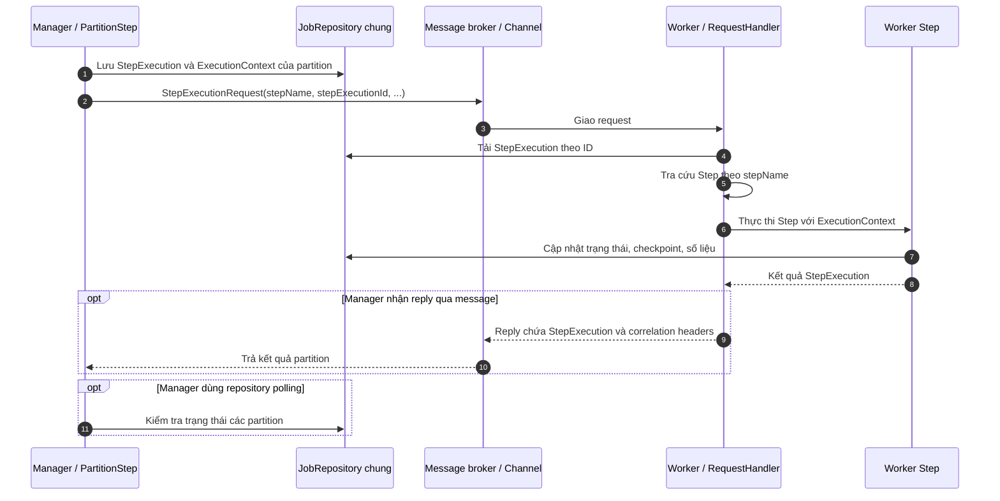

# `StepExecutionRequest` message trong Spring Batch remote partitioning

Trong **SPRING_BATCH_SCALING_OPERATIONS**, việc xử lý workload dữ liệu lớn có thể được mở rộng bằng multi-threaded step, parallel steps, partitioning hoặc phân tán qua nhiều JVM. Khi dùng **remote partitioning**, manager chia tập dữ liệu thành các partition, còn mỗi worker thực thi một Spring Batch step hoàn chỉnh với reader, processor và writer riêng. Chủ đề của chương **Thông điệp phân tán** là cách các thành phần trao đổi thông điệp để kích hoạt và theo dõi công việc ấy.

**`StepExecutionRequest` là thông điệp yêu cầu worker thực thi một `StepExecution` đã được tạo và lưu trong metadata của Spring Batch.** Nó đóng vai trò tham chiếu đến công việc, không phải gói chứa toàn bộ dữ liệu đầu vào hoặc một chunk item. Hiểu đúng ranh giới này giúp thiết kế queue, đối soát kết quả, xử lý lỗi và restart đáng tin cậy.

## 1. `StepExecutionRequest` nằm ở đâu trong kiến trúc?

Trong remote partitioning, manager sử dụng `Partitioner` để tạo các `ExecutionContext` theo từng partition, rồi Spring Batch tạo các bản ghi `StepExecution` tương ứng. `MessageChannelPartitionHandler` hoặc builder remote partitioning gửi yêu cầu đến worker qua Spring Integration. Worker nhận request, xác định worker step cần chạy và dùng metadata chung để tải thông tin của partition.



Trình tự tổng quát là:

1. Manager tạo phạm vi dữ liệu cho mỗi partition, ví dụ ID từ 1 đến 100.000 và 100.001 đến 200.000.
2. `JobRepository` lưu `StepExecution` cùng `ExecutionContext` chứa các ranh giới. Mỗi partition có một `StepExecution` riêng.
3. Manager gửi request có định danh step và step execution qua messaging middleware (ví dụ JMS/AMQP).
4. Worker nhận request, tải metadata của partition, gọi worker step và lưu tiến độ/điểm checkpoint thông qua Spring Batch.
5. Manager thu hồi kết quả bằng reply aggregation hoặc truy vấn trạng thái từ repository, tùy cấu hình.

Đây là **điều phối việc thực thi step**. Nó khác **remote chunking**, nơi manager gửi từng chunk item sang worker. Trong remote partitioning, worker thường tự đọc, xử lý và ghi phần dữ liệu của mình.

## 2. Cấu trúc message và khác biệt API giữa các phiên bản

Class thuộc package:

```java
org.springframework.batch.integration.partition.StepExecutionRequest
```

`StepExecutionRequest` thực thi `Serializable`, nhưng format bytes thực tế trên wire phụ thuộc message converter, adapter và broker đã cấu hình. Không mặc định coi một object Java là JSON hoặc bảo đảm tương thích serialization giữa các phiên bản.

**Spring Batch 5.2.x:**

```java
StepExecutionRequest request = new StepExecutionRequest(
        "workerStep", 42L, 101L);

String stepName = request.getStepName();        // workerStep
Long jobExecutionId = request.getJobExecutionId();  // 42
Long stepExecutionId = request.getStepExecutionId(); // 101
```

**Spring Batch 6.x:**

```java
StepExecutionRequest request = new StepExecutionRequest(
        "workerStep", 101L);

String stepName = request.getStepName();         // workerStep
Long stepExecutionId = request.getStepExecutionId(); // 101
```

Sự khác biệt là **bắt buộc kiểm tra phiên bản**: API 5.2 có `jobExecutionId` trong constructor/request; API 6.x chỉ yêu cầu `stepName` và `stepExecutionId`. Không sao chép nguyên code constructor hoặc serializer của phiên bản này sang phiên bản kia. Với 6.x, repository có API tra cứu `StepExecution` theo ID, nên thông điệp không cần mang `jobExecutionId` như trước.

| Thành phần | Ý nghĩa | Điều không nên suy diễn |
| --- | --- | --- |
| `stepName` | Tên logic của worker `Step` mà `StepLocator` phải tìm được | Không phải tên queue hoặc mặc định bằng tên đầy đủ của partition execution |
| `stepExecutionId` | ID của bản ghi `StepExecution` cần chạy trong repository | Không phải ID item, phạm vi dữ liệu, hay khóa tương quan reply |
| `jobExecutionId` (5.2.x) | ID `JobExecution` bao quanh request | Không thay thế cho `StepExecution` và `ExecutionContext` |
| Message headers | Metadata do tầng messaging gắn thêm, gồm correlation/sequence nếu dùng aggregation | Không phải các field của class `StepExecutionRequest` |

**Ví dụ biểu diễn để hiểu nội dung (không phải JSON schema hoặc wire format do Spring Batch mặc định áp đặt):**

```json
{
  "type": "StepExecutionRequest",
  "stepName": "workerStep",
  "stepExecutionId": 101
}
```

Giả sử repository có `StepExecution #101` mang tên partition `workerStep:partition0`, với `ExecutionContext`:

```text
startId = 1
endId   = 100000
```

Request chỉ cần trỏ tới ID `101` và tên bean step `workerStep`. Các ranh giới `startId`, `endId` được worker đọc qua metadata/`StepExecutionContext`; **chúng không nằm trong payload request**. Nhờ đó message nhỏ và công việc có metadata để theo dõi, restart.

## 3. `StepExecutionRequestHandler` thực hiện những gì?

Đầu mối nhận request ở worker là:

```java
org.springframework.batch.integration.partition.StepExecutionRequestHandler
```

Nó có phương thức `handle(StepExecutionRequest request)` trả về `StepExecution` và sử dụng `StepLocator` để tìm instance `Step` tương ứng với `stepName`. Worker cần truy cập **cùng kho Spring Batch metadata** với manager. Nếu worker đọc một `JobRepository` khác, `stepExecutionId` từ manager sẽ không chỉ ra đúng bản ghi cần chạy.

Ví dụ cấu hình handler với **Spring Batch 5.2.x**:

```java
@Bean
public StepExecutionRequestHandler requestHandler(
        JobExplorer jobExplorer,
        StepLocator stepLocator) {

    StepExecutionRequestHandler handler = new StepExecutionRequestHandler();
    handler.setJobExplorer(jobExplorer);
    handler.setStepLocator(stepLocator);
    return handler;
}
```

Với **Spring Batch 6.x**, API chuyển sang sử dụng `JobRepository`:

```java
@Bean
public StepExecutionRequestHandler requestHandler(
        JobRepository jobRepository,
        StepLocator stepLocator) {

    StepExecutionRequestHandler handler = new StepExecutionRequestHandler();
    handler.setJobRepository(jobRepository);
    handler.setStepLocator(stepLocator);
    return handler;
}
```

Ví dụ `StepLocator` sử dụng các bean trong Spring context:

```java
@Bean
public StepLocator stepLocator(BeanFactory beanFactory) {
    BeanFactoryStepLocator locator = new BeanFactoryStepLocator();
    locator.setBeanFactory(beanFactory);
    return locator;
}
```

Các đoạn Java trên là **mảnh cấu hình minh họa theo phiên bản**, cần import tương ứng và có bean `workerStep`, repository, transaction manager, channel/broker trước khi chạy. Đừng tạo cả hai bean `requestHandler` cùng tên trong một ứng dụng. Khi dùng `RemotePartitioningWorkerStepBuilder`, phần thiết lập handler và `IntegrationFlow` có thể được builder tạo giúp; không cần luôn tự đăng ký handler thủ công.

### Luồng nhận request và phát reply

Ở mức Spring Integration, luồng worker tương đương với dạng khái niệm sau:

```java
// Minh họa flow; các channel phải nối tới adapter của broker thực tế.
@Bean
public IntegrationFlow workerRequestFlow(
        @Qualifier("incomingRequests") MessageChannel incomingRequests,
        @Qualifier("outgoingReplies") MessageChannel outgoingReplies,
        StepExecutionRequestHandler requestHandler) {

    return IntegrationFlow.from(incomingRequests)
            .handle(requestHandler, "handle")
            .channel(outgoingReplies)
            .get();
}
```

`incomingRequests` được nối từ adapter nhận message của worker; `outgoingReplies` nối tới adapter gửi reply. Nếu manager dùng **polling JobRepository** để nhận trạng thái thì không cần cấu hình reply channel này theo cách tương tự; lựa chọn do thiết kế manager/worker quyết định.

## 4. Manager tạo và phát request như thế nào?

Các thành phần chính:

| Thành phần | Vai trò |
| --- | --- |
| `Partitioner` | Trả về ánh xạ `partitionName -> ExecutionContext` cho mỗi phần việc |
| `PartitionStep` và `StepExecutionSplitter` | Tạo/chia các execution của partition và quản lý vòng đời |
| `MessageChannelPartitionHandler` | Gửi `StepExecutionRequest` qua channel và chờ/thu hồi trạng thái |
| `MessagingTemplate` và adapter | Nối channel với middleware như JMS hoặc AMQP |
| `JobRepository` | Lưu metadata có thể truy vấn lại khi lỗi/restart |

Ví dụ **mảnh cấu hình manager** dùng builder có sẵn trong Spring Batch 5.2.x/6.x:

```java
@Bean
public Step managerStep(
        JobRepository jobRepository,
        Partitioner partitioner,
        @Qualifier("outgoingRequests") MessageChannel requests,
        @Qualifier("incomingReplies") MessageChannel replies) {

    return new RemotePartitioningManagerStepBuilder("managerStep", jobRepository)
            .partitioner("workerStep", partitioner)
            .gridSize(8)
            .outputChannel(requests)
            .inputChannel(replies)
            .build();
}
```

Builder này cấu hình `MessageChannelPartitionHandler` để tạo và gửi request. `gridSize` là gợi ý số partition muốn tạo, không đồng nhất với số JVM worker hoặc số thread thực sự chạy. `Partitioner` có thể quyết định số partition và phạm vi dữ liệu dựa trên tài nguyên thực tế.

Trong ứng dụng thật, cần thêm `Partitioner`, các bean Spring Batch, worker step và **adapter cho broker**. Hai channel ở manager tương ứng với kênh request đi ra và reply đi vào; ở worker là request đi vào và reply đi ra. Các kênh giữa hai JVM phải được nối qua middleware, không thể chỉ đặt tên giống nhau trong hai Spring context mà tự liên lạc được.

### Request payload khác message envelope

Khi manager chờ đủ replies để tổng hợp, Spring Integration có thể dùng các message headers như `correlationId`, `sequenceNumber`, `sequenceSize` để gom đúng các phần. Đây là **thuộc tính của message envelope**, không thay cho `stepExecutionId` trong payload.

```text
Manager                                Worker
StepExecutionRequest + headers  --->  StepExecutionRequestHandler
                                  ->  StepExecution + reply headers
StepExecution aggregator        <---  Reply channel
```

**Chú ý JMS:** nếu sử dụng adapter nhận JMS reply, phải bảo toàn các header dùng để correlate/aggregate. Theo tài liệu Spring Batch 6.x, `DefaultJmsHeaderMapper` ở các phiên bản Spring Integration mới có thể không tự mang theo các custom header cần thiết; có thể cấu hình allowlist gồm `correlationId`, `sequenceNumber`, `sequenceSize` (hoặc wildcard khi phù hợp với chính sách tin cậy). Nếu mất `correlationId`, aggregator có thể không ghép được reply và manager chờ đến timeout. Kiểm tra mapping ở cả chiều gửi và nhận khi đổi broker/serializer.

## 5. Ví dụ xử lý 3 partition của một bảng dữ liệu

Một job cần chuyển đổi 300.000 bản ghi giao dịch. Manager chia dữ liệu thành ba miền ID độc lập; reader ở worker truy vấn theo giới hạn trong `StepExecutionContext`.

| Partition | `StepExecution` (ví dụ) | Context được lưu tại repository | Request gửi qua queue |
| --- | --- | --- | --- |
| `partition0` | ID 101 | `startId=1`, `endId=100000` | `workerStep`, ID `101` |
| `partition1` | ID 102 | `startId=100001`, `endId=200000` | `workerStep`, ID `102` |
| `partition2` | ID 103 | `startId=200001`, `endId=300000` | `workerStep`, ID `103` |

Worker nào nhận request ID 102 thì tải metadata ID 102, lấy `startId=100001`, `endId=200000` rồi xử lý đúng phạm vi. Nếu có hai worker cùng cạnh tranh trên một queue dạng competing consumers, middleware phân phối mỗi lần nhận cho một consumer tùy cơ chế giao hàng. Không nên dựa vào worker cố định để gắn với một partition; worker có thể thay đổi sau khi restart.

Với reader dùng scope thích hợp, các tham số có thể được bind từ context:

```java
@Bean
@StepScope
public ItemReader<TransactionRow> partitionReader(
        @Value("#{stepExecutionContext['startId']}") Long startId,
        @Value("#{stepExecutionContext['endId']}") Long endId,
        DataSource dataSource) {

    // Tạo reader đọc WHERE id BETWEEN :startId AND :endId,
    // sắp xếp theo khóa ổn định và cấu hình restart/checkpoint.
    return createRangeReader(dataSource, startId, endId);
}
```

`createRangeReader` là hàm **placeholder** cho reader do ứng dụng triển khai; ví dụ chỉ minh họa cách nhận dữ liệu từ `stepExecutionContext`, không phải đoạn cấu hình đầy đủ có thể chạy ngay. Cần bảo đảm các miền không chồng nhau/không bỏ sót, dữ liệu nguồn có quy tắc nhất quán khi thay đổi trong lúc job chạy, và reader lưu checkpoint đúng khi restart.

## 6. Trường hợp message đến muộn, đến trùng hoặc bị mất

Remote partitioning có thể dựa vào metadata trong `JobRepository` để khôi phục phần việc khi worker lỗi và job restart. Tuy vậy, không nên diễn giải điều đó thành bảo đảm **exactly-once** cho mọi tác dụng phụ bên ngoài.

| Sự cố | Điều có thể xảy ra | Thiết kế/kiểm tra cần có |
| --- | --- | --- |
| Request đến trùng do broker redelivery hoặc retry gửi | Hai lần giao message cùng nhắc đến một `StepExecution` | Quan sát trạng thái trong repository; bảo đảm worker/logic không chạy đồng thời gây trùng ghi; dùng idempotency cho side effect |
| Worker chết khi đang xử lý | `StepExecution` chưa hoàn tất, các chunk có thể rollback hoặc đã commit một phần | Dùng reader/writer restartable, kiểm tra trạng thái và chạy restart theo Spring Batch |
| Request bị thất lạc hoặc không tới worker | Manager không nhận đủ kết quả/trạng thái hợp lệ | Timeout, alert, kiểm tra queue/adapter và restart job; không chỉ chờ vô hạn |
| Worker không tìm thấy `stepName` | Handler không định vị được bean worker step | Đồng nhất tên step giữa manager và worker; kiểm tra deployment/version |
| Worker trỏ nhầm database metadata | `StepExecution` ID không tồn tại hoặc thuộc job khác | Manager và workers dùng đúng `JobRepository` chung; kiểm soát quyền và môi trường |
| Reply đã gửi nhưng mất header tương quan | Aggregator không phân nhóm được replies | Bảo toàn `correlationId`, `sequenceNumber`, `sequenceSize` trên đường truyền |
| Ghi database đích thành công nhưng reply thất bại | Manager có thể coi partition chưa kết thúc/không nhận đủ replies | Đối chiếu trạng thái repository và kết quả đã commit; thiết kế output idempotent |
| Một partition chạy lâu bất thường | Manager chờ reply hoặc polling quá hạn | Đo duration từng partition, chọn timeout/poll interval theo phân bố tải |

Trạng thái ở repository giúp điều phối restart **từng partition**, nhưng chất lượng phục hồi còn phụ thuộc reader, writer, transaction, ranh giới partition và dịch vụ bên ngoài. Ví dụ worker gọi API thanh toán không hỗ trợ idempotency thì nhận lại request có thể làm phát sinh giao dịch trùng dù message mang đúng ID.

### Cần phân biệt ba loại định danh

1. **`stepExecutionId`:** xác định một bản ghi metadata và execution cụ thể cần xử lý.
2. **`correlationId`:** thuộc header messaging, giúp đối chiếu/gom replies về đúng luồng yêu cầu của manager. Không được mặc định bằng `stepExecutionId`.
3. **Business idempotency key:** khóa nghiệp vụ ổn định để tránh ghi trùng ở hệ thống đích (ví dụ `transactionId` hoặc tổ hợp `jobInstance` + mã nghiệp vụ), cần đánh giá theo quy tắc tái chạy.

Không sử dụng duy nhất offset của consumer, message ID ngẫu nhiên hoặc thread ID làm khóa chống trùng nghiệp vụ. Một logical operation có thể đi qua nhiều lần gửi/nhận message và nhiều lần chạy lại chunk.

## 7. Hai cách manager thu hồi trạng thái

`MessageChannelPartitionHandler` hỗ trợ hai hướng thiết kế, tùy version/cấu hình:

| Tiêu chí | Reply channel + aggregation | Polling `JobRepository` |
| --- | --- | --- |
| Nguồn kết quả manager theo dõi | Replies do worker gửi sau khi xử lý | Metadata `StepExecution` được worker cập nhật |
| Cấu hình cần chú ý | Channel hai chiều, headers correlation/sequence, timeout aggregation | Kho repository chung, poll interval, tổng thời gian chờ |
| Điểm dễ lỗi | Mất/dẫn nhầm replies, sai header mapper, aggregator state | Poll quá dày gây tải DB hoặc quá thưa gây trễ phát hiện hoàn tất |
| Phù hợp khi | Đã có messaging request/reply và cần phản hồi từ workers | Muốn giảm yêu cầu vận hành reply channel, hạ tầng metadata đủ sức chịu tải |

Ví dụ manager 8 partition nhưng chỉ có 4 worker, mỗi worker xử lý tuần tự thì sẽ có request chờ queue. Tăng `gridSize` lên 64 chỉ tạo thêm overhead điều phối nếu DB kết nối, I/O hoặc tốc độ writer đang là nút thắt. Cần đo **throughput, thời gian partition, độ sâu queue, worker concurrency, số DB connection, lock/wait, CPU/heap, timeout và chi phí polling** trước khi mở rộng.

Trong môi trường production, manager không nên tái sử dụng một handler chứa trạng thái aggregation cho nhiều step execution đồng thời nếu implementation không bảo đảm cô lập kết quả. Javadoc của `MessageChannelPartitionHandler` khuyến nghị cân nhắc scope theo step/job khi dùng reply channel để tránh replies bị lẫn giữa các lần chạy.

## 8. Khả năng tương thích và an toàn vận hành

**Version contract.** Nếu manager và worker đóng gói phiên bản Spring Batch khác nhau, cần thống nhất trước payload converter/schema và metadata repository. Ví dụ, constructor 3 tham số của 5.2 đã đổi thành 2 tham số ở 6.x; một hệ thống chuyển byte object trực tiếp có thể lỗi khi nâng cấp từng phía. Kiểm thử end-to-end xuyên broker cho đúng version thực tế.

**Bảo vệ message channel.** Chỉ cho các service được phép phát yêu cầu vào queue; xác thực/kết nối bảo mật tới broker và repository. Worker nên chỉ expose những `Step` hợp lệ qua `StepLocator`; không cho input không tin cậy quyết định tên bean bất kỳ hay tham số truy vấn ngoài phạm vi được phê duyệt.

**Kho metadata chung.** Các worker phải truy cập cùng logical JobRepository với manager, dùng schema/migration tương thích. Cân nhắc connection pool và contention khi tăng số partition hoặc tần suất checkpoint; repository vừa phục vụ phục hồi, vừa có thể trở thành điểm nghẽn hiệu năng.

**Tách miền dữ liệu và tính đúng đắn.** Nếu các partition ghi cùng bảng, cần unique key, transaction và chiến lược conflict phù hợp. Các khoảng ID chỉ tách biệt nếu điều kiện lọc thật sự không trùng; xử lý dữ liệu cập nhật liên tục có thể cần snapshot hoặc ranh giới thời gian ổn định.

**Quan sát vận hành.** Ghi log có cấu trúc kèm `jobExecutionId` (nếu có thể tra từ metadata), `stepExecutionId`, tên worker step và partition; đo queue lag, số request nhận lại, thời gian xử lý từng partition, lỗi broker, lỗi repository, item read/write/skip và trạng thái cuối cùng. Không log nguyên dữ liệu nhạy cảm hoặc coi số request nhận được là số bản ghi đã commit.

## 9. Quy trình kiểm thử thực tế

Với một dataset thử nghiệm có 300.000 ID và ba partition đã mô tả:

1. **Happy path:** chạy manager và ít nhất hai worker; xác minh ba `StepExecution` được lưu, đúng ba phạm vi, tổng bản ghi sau commit bằng đầu vào kỳ vọng và không có ID trùng.
2. **Thêm worker:** tăng từ một lên ba worker với cùng `gridSize`; đo throughput và giới hạn DB để xác nhận hiệu quả song song.
3. **Broker redelivery:** tạo điều kiện giao lại một request khi worker vừa nhận; bảo đảm không phát sinh thêm tác dụng phụ nghiệp vụ và trạng thái metadata cuối nhất quán.
4. **Worker failure/restart:** dừng worker giữa chunk, sau đó restart job hợp lệ; xác minh partition tiếp tục theo checkpoint, tránh bỏ sót/ghi trùng.
5. **Reply/correlation:** khi dùng aggregation, chủ động làm mất header `correlationId` ở môi trường test để thấy failure mode; cấu hình mapper đầy đủ rồi kiểm tra replies gom đúng.
6. **Mất kết nối repository:** kiểm tra cách worker fail, timeout, cảnh báo và khả năng phục hồi sau sự cố DB; không dựa vào queue để bảo toàn checkpoint.
7. **Chênh lệch version:** kiểm thử wire format, mapping và API của cả manager lẫn worker trước khi rolling upgrade.

### Checklist trước khi triển khai

- [ ] `stepName` tìm được worker `Step` thực sự qua `StepLocator`.
- [ ] Manager và workers dùng đúng một logical `JobRepository` và metadata schema tương thích.
- [ ] `ExecutionContext` của từng partition được lưu đầy đủ trước khi worker chạy.
- [ ] Message converter/serializer và phiên bản API được kiểm tra xuyên broker.
- [ ] Đã chọn rõ **reply aggregation** hoặc **repository polling**, cấu hình thời gian chờ phù hợp.
- [ ] Header tương quan/sequence đi qua đầy đủ nếu nhận replies bằng messaging.
- [ ] Reader, processor, writer restartable hoặc có cơ chế xử lý lặp an toàn.
- [ ] Có deduplication/idempotency và transaction phù hợp cho side effects.
- [ ] Partition không chồng dữ liệu; DB, broker và worker pool chịu được concurrency dự kiến.
- [ ] Có log/metric/alert theo `stepExecutionId`, queue lag, timeout và kết quả cuối.

## 10. Tự diễn giải một sự cố

Giả sử manager phát request cho partition #102. Worker đã xử lý và commit xong, nhưng adapter JMS làm rơi `correlationId` trên reply. Manager báo timeout dù dữ liệu đích đã có đủ. Tại sao?

`StepExecutionRequest` mang ID giúp worker tìm đúng execution; việc **phát hiện hoàn tất ở manager** lại phụ thuộc cơ chế thu hồi trạng thái. Nếu thiết kế dùng aggregation thì reply thiếu header có thể không được ghép với đợt yêu cầu đúng. Hướng chẩn đoán là đối chiếu `StepExecution` tại repository, kiểm tra cấu hình header mapper và timeout của reply flow, rồi xác minh khả năng restart/idempotency; không vội gửi một request mới chỉ vì không nhận reply.

**Ghi nhớ:** `StepExecutionRequest` là lệnh tham chiếu đến một `StepExecution` trong repository chung. Thành công của remote partitioning đến từ sự phối hợp giữa **metadata**, **message delivery**, **xử lý step đúng phạm vi**, **thu hồi trạng thái** và **khả năng restart an toàn**. Đo nút thắt thực tế trước khi tăng số partition hay số worker.

## Tài liệu tham khảo chính thức

- [Spring Batch 5.2.x — `StepExecutionRequest` API](https://docs.spring.io/spring-batch/docs/5.2.x/api/org/springframework/batch/integration/partition/StepExecutionRequest.html): ba trường định danh trong phiên bản 5.2.
- [Spring Batch 6.x — `StepExecutionRequest` API](https://docs.spring.io/spring-batch/reference/api/org/springframework/batch/integration/partition/StepExecutionRequest.html): constructor hai tham số và các getters.
- [Spring Batch Integration — Externalizing Batch Process Execution](https://docs.spring.io/spring-batch/reference/spring-batch-integration/externalizing-execution.html): remote partitioning, luồng request/reply và cấu hình qua Spring Integration.
- [Spring Batch — `MessageChannelPartitionHandler` API](https://docs.spring.io/spring-batch/reference/api/org/springframework/batch/integration/partition/MessageChannelPartitionHandler.html): hai cách thu hồi kết quả từ worker.
- [Spring Batch — Scalability and Parallel Processing](https://docs.spring.io/spring-batch/reference/scalability.html): phân biệt partitioning, remote chunking và các cơ chế mở rộng khác.
