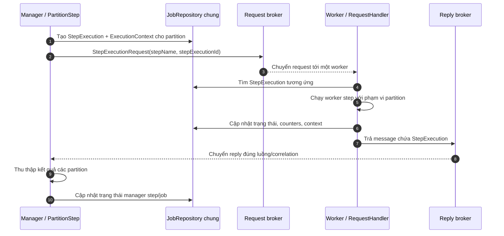

# StepExecution reply message trong Spring Batch Remote Partitioning

Trong mô hình **remote partitioning**, một Spring Batch job chia dữ liệu thành nhiều partition, gửi yêu cầu thực thi đến các worker và tổng hợp kết quả để quyết định trạng thái của manager step. **StepExecution reply message** là thông điệp worker gửi ngược về manager sau khi xử lý một partition, với payload biểu diễn kết quả thực thi của partition đó. Nó thuộc luồng **điều phối batch**, không phải message chứa từng bản ghi nghiệp vụ.

Chủ đề này nằm trong chương **Thông điệp phân tán** của module **SPRING_BATCH_SCALING_OPERATIONS**: mở rộng Spring Batch cho dữ liệu lớn bằng multi-threaded step, parallel steps, partitioning và xử lý phân tán. Hiểu reply message giúp thiết kế cơ chế chờ kết quả, đo nút thắt ở broker/worker/repository, tránh lỗi đồng bộ trạng thái, và lựa chọn cách retry/restart phù hợp với tài nguyên thực tế.

## 1. Bối cảnh: reply message xuất hiện ở đâu?

Giả sử job nhập 12 triệu giao dịch. Manager phân chia dữ liệu thành tám khoảng ID; mỗi khoảng tương ứng một `StepExecution`. Các worker có thể chạy trên những tiến trình hoặc máy khác nhau, mỗi worker thực thi một Spring Batch step thông thường với reader, processor và writer của riêng partition.

Các thành phần chủ chốt:

| Thành phần | Vai trò |
| --- | --- |
| `PartitionStep` / manager step | Tạo các partition, gửi công việc và tổng hợp trạng thái thực thi. |
| `Partitioner` và `StepExecutionSplitter` | Định nghĩa phạm vi từng partition bằng `ExecutionContext` và các `StepExecution` tương ứng. |
| `StepExecutionRequest` | Yêu cầu do manager phát đi, mang tên worker step cần chạy và định danh `StepExecution` đã được tạo. |
| `StepExecutionRequestHandler` | Nhận request ở worker, tìm step cần thực thi, lấy metadata của partition và trả về `StepExecution` kết quả. |
| **StepExecution reply message** | Message chứa `StepExecution` trả về từ handler, đi trên luồng phản hồi của worker. |
| `MessageChannelPartitionHandler` | Gửi request; chờ và tập hợp các phản hồi hoặc truy vấn trạng thái từ repository. |
| `JobRepository` dùng chung | Lưu metadata bền vững về `JobExecution`, `StepExecution`, `ExecutionContext`; hỗ trợ theo dõi và restart. |
| Broker và Spring Integration adapters | Vận chuyển message giữa các tiến trình: ví dụ JMS, AMQP/RabbitMQ hoặc cơ chế tương đương phù hợp với hệ thống. |

**Phân biệt quan trọng:** Remote partitioning gửi yêu cầu **chạy một step cho một partition** và nhận `StepExecution`. Trong *remote chunking*, manager gửi các chunk dữ liệu cho worker; giao thức trả lời thuộc xử lý chunk (ví dụ `ChunkResponse`), không phải StepExecution reply của remote partitioning. Hai mô hình có mục tiêu mở rộng khác nhau.

## 2. Trình tự request → thực thi → reply → tổng hợp



Diễn giải:

1. Manager gọi partitioner để tạo các phân đoạn độc lập, ví dụ `minId` và `maxId`. Mỗi phân đoạn được ánh xạ đến một `StepExecution` trong repository chung.
2. Manager gửi `StepExecutionRequest` (thường chứa tên worker step và ID của `StepExecution`), không cần gửi toàn bộ tập dữ liệu hay một bản sao đầy đủ của metadata.
3. Worker nhận request, thông qua `StepExecutionRequestHandler` định vị step và metadata liên quan, thực thi đúng partition.
4. Khi step kết thúc, worker cập nhật trạng thái trong repository và handler trả về một đối tượng `StepExecution`. Khi bật reply flow, đối tượng này được đóng gói trong message đi về manager.
5. Manager thu thập các reply thuộc **cùng lần chạy**, kết hợp kết quả các partition và kết thúc manager step theo trạng thái tổng hợp. Không nên kết luận job thành công chỉ vì broker đã ACK request.

Thứ tự nhận reply có thể khác thứ tự gửi request: partition nhỏ thường hoàn tất trước. Vì vậy, logic tổng hợp phải dựa vào **định danh và correlation**, không giả định FIFO ở các worker độc lập.

## 3. Một reply message chứa gì?

Trong tích hợp chuẩn Spring Batch, `StepExecutionRequestHandler.handle(StepExecutionRequest)` trả về **`StepExecution`**. Khi vận chuyển qua Spring Integration, đó là payload logic của reply; biểu diễn trên dây (Java serialization, JSON hoặc converter tùy chỉnh) tùy vào broker và cấu hình message converter.

| Nhóm thông tin | Ví dụ từ `StepExecution` | Ý nghĩa |
| --- | --- | --- |
| Định danh | `id`, `stepName`, `jobExecutionId` (qua quan hệ với job) | Biết partition nào đã hoàn tất, thuộc job execution nào. |
| Trạng thái batch | `BatchStatus.COMPLETED`, `FAILED`, `STOPPED` | Trạng thái vòng đời của partition; phải xét khi tổng hợp. |
| Kết quả điều khiển | `ExitStatus` và `exitDescription` | Diễn giải kết quả và hỗ trợ quyết định luồng job; không đồng nhất máy móc với `BatchStatus`. |
| Chỉ số xử lý | `readCount`, `writeCount`, `filterCount`, `skipCount`, `commitCount`, `rollbackCount` | Đo chất lượng và hiệu năng của partition. |
| Thời gian | Thời điểm bắt đầu/kết thúc, thời gian cập nhật nếu có | Xác định partition chậm và độ trễ xử lý. |
| Ngữ cảnh | `ExecutionContext` | Các giá trị kỹ thuật như khoảng ID và checkpoint phục vụ khởi động lại. |

Ví dụ sau là **bản chiếu để quan sát/log**, không phải schema JSON mặc định mà Spring Batch bắt buộc phát lên broker:

```json
{
  "headers": {
    "correlationId": "job-901:managerStep",
    "sequenceNumber": 3,
    "sequenceSize": 4
  },
  "payloadProjection": {
    "stepExecutionId": 4103,
    "stepName": "workerStep:partition2",
    "batchStatus": "COMPLETED",
    "exitCode": "COMPLETED",
    "readCount": 250000,
    "writeCount": 249800,
    "filterCount": 200,
    "skipCount": 0,
    "commitCount": 500
  }
}
```

Lưu ý:

- `correlationId` và các thông tin sequence là **message headers** do luồng tích hợp cấp/phối hợp để ghép reply; tên header, cách ánh xạ và giá trị cụ thể phụ thuộc phiên bản Spring Batch/Spring Integration và cấu hình. Không tự đặt một chuỗi bất kỳ rồi giả định framework sẽ hiểu.
- `stepExecutionId` giúp đối chiếu chính xác với partition đã được manager tạo; `stepName` của bản ghi execution có thể chứa hậu tố partition, khác với tên bean worker step dùng khi định tuyến request.
- Bản thân `StepExecution` có thể chứa liên kết tới nhiều metadata khác. Tránh log toàn bộ payload/`ExecutionContext` vào log tập trung, vì dễ làm log phình to hoặc lộ dữ liệu nhạy cảm.
- **Reply không thay thế `JobRepository`.** Đây là tín hiệu báo kết quả qua kênh điều phối; repository chung là nguồn trạng thái bền vững để kiểm tra và restart.

## 4. Correlation và aggregation: manager biết đã đủ kết quả bằng cách nào?

Với một manager step, giả sử tạo bốn partition: `p0`, `p1`, `p2` và `p3`. Một cách theo dõi hợp lý là lưu tập các ID dự kiến và so với các reply đã nhận:

```text
Expected StepExecution IDs: {4101, 4102, 4103, 4104}
Nhận lần 1: 4103 COMPLETED  -> còn {4101, 4102, 4104}
Nhận lần 2: 4101 COMPLETED  -> còn {4102, 4104}
Nhận lần 3: 4104 FAILED     -> còn {4102}
Nhận lần 4: 4102 COMPLETED  -> đủ 4; manager phải xét FAILED
```

Trong Spring Batch, `MessageChannelPartitionHandler` cùng các integration flow hỗ trợ việc thu nhận/tổng hợp reply. Khi nhiều job chạy đồng thời, cần giữ tương quan đúng **job execution + manager step**, tránh lấy nhầm phản hồi của job khác. Các headers tương quan và sequence phải được bảo toàn qua outbound/inbound adapters; nếu broker converter làm rơi headers, manager có thể không ghép đủ reply dù worker đã chạy xong.

Tập hợp **đủ số lượng** vẫn chưa đồng nghĩa với **thành công**:

- Mỗi phản hồi phải thuộc đúng lượt thực thi/partition mong đợi; reply lặp không được tính là một partition mới.
- Phải xét `BatchStatus` và `ExitStatus` của từng `StepExecution`, sau đó áp dụng quy tắc tổng hợp của `StepExecutionAggregator` / `PartitionStep`.
- Reply đến muộn sau khi manager đã timeout hoặc bước chạy đã restart cần được xử lý theo ngữ cảnh lần chạy. Không tự ý sửa trạng thái job dựa vào message cũ.

Nếu tùy biến aggregator, cần kiểm tra số partition thực sự nhận được và trạng thái của từng partition; không dùng cách `receivedCount == gridSize` đơn thuần để suy ra rằng tất cả partition đều thành công. `gridSize` là gợi ý cho splitter, số partition thực tế phụ thuộc partitioner và cách chia việc.

## 5. Hai cơ chế lấy kết quả: reply channel và repository polling

Spring Batch hỗ trợ hai hướng theo dõi remote partitioning:

| Tiêu chí | Nhận **StepExecution reply message** | **Polling JobRepository** |
| --- | --- | --- |
| Cách manager nhận kết quả | Worker gửi reply qua kênh phản hồi; manager đợi/tổng hợp. | Manager định kỳ đọc trạng thái các `StepExecution` đã tạo từ repository. |
| Độ trễ phát hiện hoàn tất | Thường thấp khi broker và adapters hoạt động ổn định. | Phụ thuộc chu kỳ poll và thời gian truy vấn DB. |
| Hạ tầng | Cần request path **và** reply path, routing/correlation đúng. | Cần request path; worker có thể bỏ qua reply channel. |
| Rủi ro nổi bật | Reply thất lạc, đến trễ, trùng, lệch correlation, timeout. | Tăng tải DB khi nhiều partition và poll quá dày. |
| Hợp khi | Cần phản hồi kịp thời, đã có broker và giám sát messaging tốt. | Muốn giảm số đường message, repository đủ khả năng chịu tải đọc. |

Với chế độ polling, `RemotePartitioningWorkerStepBuilder` có thể dùng `NullChannel` khi không khai báo output channel; manager vẫn chờ các `StepExecution` cập nhật trong repository. Với reply-driven, phải cấu hình cả kênh phản hồi từ worker tới manager.

**Không nên cấu hình lẫn lộn hai cơ chế rồi cho rằng cả hai đều tham gia vào quyết định hoàn tất.** Xác định rõ mode thực tế của `MessageChannelPartitionHandler`, cách builder thiết lập nó và đường chờ kết quả. API/chi tiết cấu hình có thể khác giữa Spring Batch 5.x và 6.x; khi triển khai cần bám đúng phiên bản đang dùng.

## 6. Cấu hình minh họa bằng Java

Ví dụ rút gọn sau dùng phong cách builder của **Spring Batch 5.x** với `spring-batch-integration`. Các bean `partitioner`, `reader`, `processor`, `writer`, adapter và broker cần được khai báo trong ứng dụng thực tế. Phần mã nhằm chỉ ra chính xác **hướng kênh** và nơi reply được bật, chưa phải ứng dụng hoàn chỉnh có thể chạy độc lập.

### 6.1. Manager: gửi request, nhận reply

```java
@Bean
Step managerStep(
        JobRepository jobRepository,
        Partitioner partitioner,
        @Qualifier("managerRequestsOut") MessageChannel requestsOut,
        @Qualifier("managerRepliesIn") MessageChannel repliesIn) {

    return new RemotePartitioningManagerStepBuilder(
            "managerStep", jobRepository)
        .partitioner("workerStep", partitioner)
        .gridSize(8)
        .outputChannel(requestsOut) // Manager -> broker -> worker
        .inputChannel(repliesIn)    // Worker -> broker -> manager
        .build();
}
```

### 6.2. Worker: xử lý partition, phát reply

```java
@Bean
Step workerStep(
        JobRepository jobRepository,
        JobExplorer jobExplorer,
        BeanFactory beanFactory,
        PlatformTransactionManager transactionManager,
        @Qualifier("workerRequestsIn") MessageChannel requestsIn,
        @Qualifier("workerRepliesOut") MessageChannel repliesOut,
        ItemReader<Order> reader,
        ItemProcessor<Order, OrderResult> processor,
        ItemWriter<OrderResult> writer) {

    return new RemotePartitioningWorkerStepBuilder(
            "workerStep", jobRepository)
        .jobExplorer(jobExplorer)
        .beanFactory(beanFactory)
        .inputChannel(requestsIn)  // Broker -> worker
        .outputChannel(repliesOut)  // Worker -> broker -> manager
        .<Order, OrderResult>chunk(500, transactionManager)
        .reader(reader)
        .processor(processor)
        .writer(writer)
        .build();
}
```

Ở Spring Batch 5.x, worker builder tạo flow để nhận `StepExecutionRequest`, gọi `StepExecutionRequestHandler`, sau đó chuyển `StepExecution` trả về tới output channel. Vì vậy, ví dụ **không cần tự gọi** `StepExecutionRequestHandler.handle(...)` trong writer hay processor. Các worker cần trỏ tới cùng metadata database mà manager sử dụng; mỗi partition phải đọc đúng phạm vi do `ExecutionContext` quy định.

### 6.3. Kết nối qua middleware

```text
Ứng dụng manager                            Ứng dụng worker
managerRequestsOut                          workerRequestsIn
       |                                           ^
       v                                           |
 outbound adapter -> broker.requests -> inbound adapter

managerRepliesIn                            workerRepliesOut
       ^                                           |
       |                                           v
 inbound adapter <- broker.replies  <- outbound adapter
```

`MessageChannel` là abstraction **trong** ứng dụng, nên hai tiến trình không tự động chia sẻ cùng một bean channel. Các adapters/broker mới thật sự nối đường truyền phân tán. Phải bảo toàn headers tương quan/sequence, chọn converter tương thích và tổ chức consumer để mỗi request được giao đúng một worker tại một thời điểm. Reply cũng phải được chuyển về đúng manager đang chờ, nhất là khi có nhiều instance manager.

Nếu muốn dùng **repository polling**, manager dùng cấu hình polling của builder/handler (như `pollInterval(...)` và `timeout(...)` theo API phiên bản tương ứng) và worker không cần kênh phát reply. Đừng chuyển sang polling chỉ bằng cách xóa `inputChannel` mà chưa kiểm tra handler thực sự được cấu hình theo mode đó.

## 7. Khi có lỗi: reply, metadata và retry/restart tương tác ra sao?

Ba điều kiện khác nhau phải được tách biệt: **worker có chạy không**, **metadata đã cập nhật không**, và **manager có nhận được reply không**.

| Tình huống | Có thể quan sát | Cách xử lý |
| --- | --- | --- |
| Worker hoàn tất, reply tới đúng manager | Repository và reply đều ghi `COMPLETED`. | Nhận và tổng hợp bình thường, đối chiếu ID để phát hiện thiếu partition. |
| Worker xử lý thất bại nhưng vẫn gửi reply | Reply chứa `StepExecution` có trạng thái lỗi. | Đánh dấu tổng hợp thất bại theo quy tắc job; điều tra exception và restart phần chưa hoàn tất. |
| Worker chết trước khi gửi reply | Manager chờ/timeout; repository có thể còn `STARTED` hoặc trạng thái khác. | Kiểm tra broker, log worker, repository; áp dụng cơ chế phục hồi và restart có kiểm soát. |
| Worker commit xong nhưng reply mất | Metadata có thể là `COMPLETED` trong khi manager chưa nhận. | Không kết luận business step chưa chạy; xác minh repository trước khi retry thủ công. |
| Broker redeliver request | Một partition có thể bị nhận lại. | Dựa trên `StepExecution`/repository để kiểm soát vòng đời; thiết kế xử lý ghi idempotent để tránh tác dụng phụ lặp. |
| Reply trùng hoặc đến sau timeout | Manager có thể thấy reply dư, hoặc không còn phiên chờ tương ứng. | Không cộng hai lần; theo dõi correlation, ID, thời điểm nhận và vòng đời manager. |
| Reply sai correlation/header bị mất | Worker có thể đã hoàn tất nhưng manager không ghép reply được. | Kiểm tra header mapper, converter, inbound adapter và topology reply. |
| Một partition rất chậm | Các partition khác xong nhưng manager vẫn chờ phần còn lại. | Đo phân bố thời gian, phát hiện dữ liệu lệch tải, điều chỉnh cách partition và tài nguyên. |

Một request đã được broker ACK **không có nghĩa** partition đã `COMPLETED`. Ngược lại, manager timeout **không tự động hủy** giao dịch mà worker đang xử lý. Tại thời điểm điều tra, trạng thái trong repository và tài nguyên đích phải được xem cùng nhau.

### Retry/restart an toàn

1. **Retry trong step** (ví dụ lỗi mạng tạm thời khi xử lý từng item) phải có giới hạn, backoff và phân biệt lỗi có thể thử lại với lỗi dữ liệu vĩnh viễn.
2. **Retry ở broker** chỉ xử lý vấn đề chuyển/nhận message; không mặc định an toàn nếu phần ghi dữ liệu đã commit. Cần idempotency hoặc khóa nghiệp vụ phù hợp.
3. **Restart job** cần dựa vào cùng `JobInstance`/tham số định danh và metadata repository; Spring Batch dùng trạng thái các partition để tránh xử lý lại những phần đã hoàn tất khi cấu hình đúng. Không khởi chạy một job instance mới với tham số khác rồi mong cơ chế restart tự nhận biết các partition cũ.
4. **Exactly-once ở dữ liệu đích** không thể suy ra chỉ từ việc nhận một reply hoặc broker báo gửi thành công. Với hệ thống ngoài (HTTP, storage, DB khác), cần khóa duy nhất, upsert, transactional outbox hoặc cơ chế bù trừ tùy nghiệp vụ.

Đặt giới hạn retry và chính sách dead-letter queue (DLQ) cho message bất thường; cảnh báo khi request không có kết quả cuối cùng sau ngưỡng xử lý. DLQ là cơ chế điều tra, không tự động thay đổi `BatchStatus` trong repository.

## 8. Thread safety và dữ liệu theo từng partition

Việc mỗi partition có một `StepExecution` riêng không đảm bảo các bean ứng dụng tự động thread-safe.

- Với worker chạy song song trên cùng JVM, reader/writer có state chia sẻ cần được tạo riêng theo step/partition (thường dùng `@StepScope`) hoặc được thiết kế thread-safe có chủ đích.
- Đọc partition dựa vào tham số trong `stepExecutionContext` (ví dụ `minId`/`maxId`); bảo đảm các khoảng không giao nhau nếu yêu cầu mỗi bản ghi chỉ xử lý một lần.
- Không ghi counters hoặc trạng thái `StepExecution` của partition A từ worker của partition B. `ExecutionContext` nên chứa state checkpoint nhỏ, phù hợp để serialize và lưu repository.
- Nếu dùng nhiều thread trong chính worker step, đọc kỹ thread safety của `ItemReader`, `ItemProcessor` và `ItemWriter`. Remote partitioning và multi-threaded step là hai mức đồng thời riêng biệt; kết hợp chúng làm tăng áp lực lên connection pool và dữ liệu đích.

Một reply thành công không chứng minh dữ liệu không bị trùng; tính đúng đắn còn phụ thuộc phân vùng đầu vào, transaction boundary, idempotency và khả năng restart của reader/writer.

## 9. Đo vận hành: biết tắc ở worker, broker hay repository

Với workload lớn, nên ghi nhận metric theo `jobExecutionId`, `managerStep` và `stepExecutionId` hoặc một correlation key đủ ổn định. Tránh đưa ID partition có cardinality quá cao vào mọi chuỗi metric tổng hợp; dùng tracing/log có cấu trúc cho chi tiết.

| Phép đo | Câu hỏi trả lời |
| --- | --- |
| Thời gian request nằm trong broker trước khi được worker nhận | Worker thiếu năng lực hay broker có backlog? |
| Thời gian thực thi từng partition | Có partition bị lệch tải hay query/IO chậm không? |
| Thời gian từ worker kết thúc đến manager nhận reply | Reply channel, converter hay consumer có nghẽn không? |
| Số request đã gửi / reply hợp lệ / partition kết thúc | Có thất lạc, trùng hoặc thiếu correlation không? |
| Thời gian truy vấn/ghi `JobRepository`, DB connection usage | Metadata database có thành nút thắt khi tăng worker không? |
| `readCount`, `writeCount`, skip/rollback theo partition | Chênh lệch dữ liệu hay lỗi có tập trung ở partition nào? |
| Số message retry, DLQ, reply muộn và timeout | Cơ chế phục hồi có đang ổn định không? |

Ví dụ: manager tạo 16 partition, 15 partition hoàn tất sau 40 giây, partition cuối mất 7 phút. Tăng thêm 16 worker khó cải thiện thời gian kết thúc job nếu partition cuối bị giới hạn bởi một truy vấn DB hoặc có lượng dữ liệu gấp nhiều lần các partition khác. Cần đo dữ liệu phân bố theo partition trước khi tăng concurrency.

**Nguyên tắc sizing:** tổng thread/worker đồng thời phải nằm trong khả năng chịu tải của DB, API đích, connection pool và broker. Tăng `gridSize` chỉ làm tăng số partition được đề xuất, không bảo đảm tăng throughput tuyến tính.

## 10. Bài thực hành suy luận trạng thái

Giả sử manager tạo bốn partition đọc theo ID:

| Partition | `StepExecution` ID | Phạm vi | Kết quả worker |
| --- | ---: | --- | --- |
| `p0` | 4101 | 1–250.000 | `COMPLETED` |
| `p1` | 4102 | 250.001–500.000 | `COMPLETED` |
| `p2` | 4103 | 500.001–750.000 | `FAILED` do dữ liệu không hợp lệ |
| `p3` | 4104 | 750.001–1.000.000 | `COMPLETED` |

Worker có thể gửi reply theo thứ tự `4104, 4101, 4103, 4102`. Manager phải tương quan chúng với bốn StepExecution mong đợi; kết quả tổng hợp phải phản ánh partition `4103` thất bại. Khi sửa dữ liệu và restart đúng job instance, cần kiểm tra metadata để chỉ tái chạy phần được phép/chưa hoàn tất theo cơ chế restart, thay vì phát lại thủ công cả bốn request.

Thử tự trả lời:

1. Nếu cả bốn `StepExecution` trong repository đều `COMPLETED` nhưng manager chỉ nhận ba reply, nên kiểm tra những điểm nào trước khi chạy lại?
2. Nếu cùng một reply ID xuất hiện hai lần, vì sao không thể cộng số reply để kết luận đã hoàn tất bốn partition?
3. Nếu bỏ reply channel để dùng polling, các phép đo nào sẽ tăng ở metadata database và điều gì quyết định chu kỳ poll?
4. Nếu một partition vẫn báo `STARTED` sau khi worker crash, yếu tố nào phải được kiểm tra trước khi cho phép restart?

**Gợi ý:** Hãy đối chiếu danh sách StepExecution ID, trạng thái và checkpoint trong repository, log của worker, header/correlation qua broker và quy tắc idempotency của writer. Một lỗi ở đường reply có thể là lỗi điều phối, không phải lỗi xử lý nghiệp vụ.

## 11. Các lỗi thiết kế thường gặp

- **Nhầm StepExecution reply với dữ liệu nghiệp vụ:** khiến message khổng lồ, converter phức tạp và khó kiểm soát restart.
- **Chỉ dựa vào ACK của broker:** không biết partition đã commit dữ liệu và cập nhật repository hay chưa.
- **Gom reply theo thứ tự hoặc chỉ đếm message:** dễ sai khi phân tán, có retry, nhận trùng hoặc nhiều job chạy đồng thời.
- **Không dùng chung JobRepository:** manager và worker không có cùng góc nhìn về StepExecution; restart không thể đáng tin cậy.
- **Timeout quá ngắn:** manager báo lỗi dù worker còn chạy; có thể dẫn đến thao tác chạy lại không an toàn.
- **Retry không idempotent:** làm trùng cập nhật tại hệ thống đích sau khi worker đã xử lý nhưng mất reply.
- **Tăng worker mà không đo:** chuyển nút thắt từ CPU sang DB metadata, business DB, API hoặc broker.

## 12. Tài liệu tham khảo

- [Spring Batch – Scaling and Parallel Processing](https://docs.spring.io/spring-batch/reference/scalability.html): kiến trúc partitioning và phân biệt với remote chunking.
- [StepExecutionRequestHandler API (Spring Batch 5.2)](https://docs.spring.io/spring-batch/docs/5.2.2/api/org/springframework/batch/integration/partition/StepExecutionRequestHandler.html): handler nhận request và trả `StepExecution`.
- [RemotePartitioningManagerStepBuilder API (Spring Batch 5.2)](https://docs.spring.io/spring-batch/docs/current/api/org/springframework/batch/integration/partition/RemotePartitioningManagerStepBuilder.html): các kênh request/reply, polling và timeout.
- [RemotePartitioningWorkerStepBuilder API (Spring Batch 5.2)](https://docs.spring.io/spring-batch/docs/current/api/org/springframework/batch/integration/partition/RemotePartitioningWorkerStepBuilder.html): nhận request, chạy worker và xuất reply.
- [MessageChannelPartitionHandler API](https://docs.spring.io/spring-batch/docs/current/api/org/springframework/batch/integration/partition/MessageChannelPartitionHandler.html): hai cách nhận kết quả worker qua reply channel hoặc repository polling.

> **Ghi nhớ:** Một StepExecution reply message là **kết quả thực thi của một partition** gửi ngược về manager. Nó giúp đồng bộ luồng điều phối, nhưng tính đúng đắn khi chạy dữ liệu lớn vẫn dựa trên metadata dùng chung, correlation chính xác, transaction, idempotency và cơ chế retry/restart được thiết kế nhất quán.
