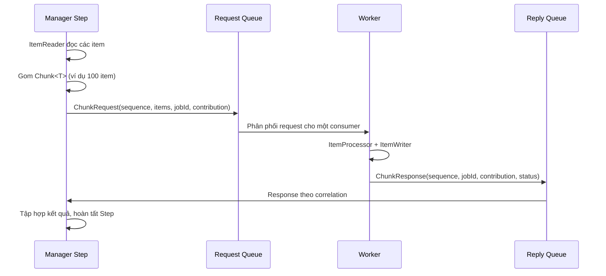
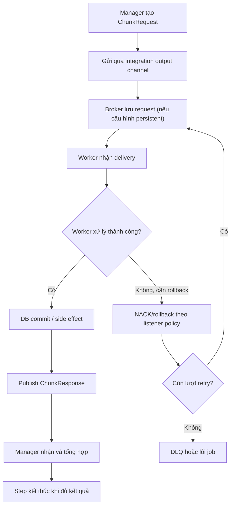

# Chunk request message trong Spring Batch Remote Chunking

## 1. Chunk request message là gì?

**Chunk request message** là thông điệp mà **manager** gửi tới **worker** trong kiến trúc *remote chunking* của Spring Batch. Thay vì trực tiếp xử lý và ghi các item, manager đọc dữ liệu, gom chúng thành một `Chunk`, bao bọc trong `ChunkRequest<T>` rồi chuyển qua middleware (ví dụ JMS hoặc AMQP). Worker nhận thông điệp, xử lý/ghi chunk và trả về `ChunkResponse` để manager tổng hợp kết quả.

Ví dụ một job cần xử lý 1.000.000 giao dịch, reader chỉ mất vài mili-giây để đọc 100 ID nhưng việc xác thực/ghi mỗi giao dịch tốn nhiều thời gian. Với `chunkSize = 100`, manager có thể tạo khoảng 10.000 request để nhiều worker xử lý song song. Các request có thể đến worker khác nhau và phản hồi có thể trở về **không theo thứ tự gửi**.

Đây là bài thuộc chương **Thông điệp phân tán** của module `SPRING_BATCH_SCALING_OPERATIONS`: mở rộng Spring Batch cho dữ liệu lớn bằng multi-threaded step, parallel steps, partitioning và mô hình phân tán; đo bottleneck, bảo đảm thread safety, retry/restart và vận hành job theo tài nguyên thực tế.

Kết thúc bài, bạn cần:

- Đọc được các thành phần thật của `ChunkRequest<T>` trong Spring Batch 5.x.
- Phân biệt ID của job, số thứ tự chunk, JMS message ID và các header correlation.
- Hiểu đường đi manager → broker → worker → reply và thời điểm request có thể bị giao lại.
- Thiết kế serialization, giới hạn payload, idempotency, retry/restart và quan sát đúng.
- Viết một kiểm tra contract cho request thay vì chỉ tin rằng broker đã nhận message.

> **Phiên bản:** nội dung và API chính xác theo **Spring Batch 5.2.x**, Spring Batch Integration, Spring Integration 6.x và Java 17+. Ở Spring Batch 6.x, một số tên API đã thay đổi (ví dụ accessor của `ChunkRequest`); không trộn code ví dụ của các major version.

## 2. Vị trí của `ChunkRequest` trong kiến trúc



Trong Spring Batch 5.2:

1. Manager dùng `ItemReader` để đọc item, sau đó `ChunkMessageChannelItemWriter` tạo `ChunkRequest` và gửi qua `MessageChannel`.
2. Spring Integration adapter gửi message qua middleware; broker phân phối request tới worker đang tiêu thụ.
3. `ChunkProcessorChunkHandler` phía worker gọi processor/writer được cấu hình, sử dụng `StepContribution` để ghi nhận đóng góp của chunk.
4. Worker gửi `ChunkResponse` về manager. `ChunkMessageChannelItemWriter` thu thập các kết quả này và tích hợp vào quá trình thực thi step.

**Đặc điểm quan trọng:** một `ChunkRequest` là **đơn vị xử lý/điều phối**, không phải một `StepExecution` riêng. Trong remote chunking thông thường, manager giữ `JobRepository` và reader; worker xử lý chunk từ request. Với *remote partitioning*, worker nhận phạm vi partition và thường tự chạy một worker step với trạng thái riêng.

## 3. Cấu trúc `ChunkRequest<T>` trong Spring Batch 5.2

Lớp `org.springframework.batch.integration.chunk.ChunkRequest<T>` là một đối tượng `Serializable`. Javadoc 5.2 mô tả chữ ký constructor:

```java
public ChunkRequest(
        int sequence,
        Chunk<? extends T> items,
        long jobId,
        StepContribution stepContribution);
```

Và các accessor:

```java
int getSequence();
Chunk<? extends T> getItems();
long getJobId();
StepContribution getStepContribution();
```

| Trường | Kiểu | Ý nghĩa trong giao thức |
| --- | --- | --- |
| `sequence` | `int` | Số thứ tự request do manager tạo trong phạm vi cơ chế theo dõi chunk |
| `items` | `Chunk<? extends T>` | Các item cần worker xử lý/ghi, kèm metadata nội bộ của `Chunk` nếu có |
| `jobId` | `long` | ID dùng liên kết yêu cầu với job; trong triển khai writer 5.2, đó là **JobInstance ID**, không phải JMS message ID |
| `stepContribution` | `StepContribution` | Đóng góp/trạng thái bước được gửi đi để worker cập nhật và phản hồi cho manager |

### 3.1. `sequence` không phải JMS message ID

`sequence` giúp phân biệt các chunk request trong giao thức Spring Batch. Chẳng hạn request thứ 7 có thể chứa ID `601–700`. Nếu một message được broker **redeliver**, request vẫn có thể mang `sequence = 7` dù người nhận là worker khác.

Đừng mặc định rằng `sequence` duy nhất trên toàn bộ hệ thống, qua mọi job và mọi lần chạy. Đối với log và theo dõi request, nên ghi kèm `jobId`, tên step/run và attempt hoặc identifier tương ứng.

### 3.2. `jobId` là ID nào?

Tên `getJobId()` trong API 5.2 dễ làm nhầm với `JobExecutionId`. Trong cách manager writer tạo `ChunkRequest`, giá trị này được lấy từ **JobInstance ID**. Một `JobInstance` có thể có **nhiều `JobExecution`** khi restart, vì vậy `jobId` không đủ tự nó phân biệt từng lần thử lại.

| Định danh | Ý nghĩa | Ổn định qua restart của cùng job instance? |
| --- | --- | --- |
| `JobInstance ID` | Xác định một instance của job theo identifying `JobParameters` | **Có** |
| `JobExecution ID` | Xác định một lần thực thi/attempt của instance | **Không**; lần restart tạo execution khác |
| `ChunkRequest.sequence` | Nhận diện thứ tự chunk trong cơ chế writer | Không nên coi là ID nghiệp vụ vĩnh viễn khi đổi cấu hình/replay |
| `JMSMessageID` hoặc ID vận chuyển | Định danh message trên broker | Có thể thay đổi khi request được tạo/gửi lại |
| Khóa nghiệp vụ như `orderId` | Nhận diện đơn vị công việc phải xử lý | Do ứng dụng định nghĩa và phải ổn định |

Kể từ Spring Batch 6, accessor tương ứng được đặt tên rõ hơn là `getJobInstanceId()`. Không dùng accessor đó trong một ví dụ nhắm trực tiếp tới Spring Batch 5.2.

### 3.3. `items` không chỉ là danh sách `List<T>`

Trong Spring Batch 5.x, giá trị là `Chunk<? extends T>`. Nó bao bọc các item và có một số thông tin phục vụ cơ chế chunk-oriented processing. Thay đổi tùy tiện payload thành `List<T>` hoặc Java array trước khi gửi có thể phá hợp đồng mà worker builder mong đợi.

Nếu T là một entity JPA gắn lazy proxy hoặc object graph lớn, việc serialize có thể chậm, lỗi hoặc làm lộ dữ liệu không cần thiết. Tốt hơn là gửi **memento/DTO nhỏ, ổn định** — ví dụ `OrderRef(orderId, version)` — và để worker tải phần dữ liệu cần thiết từ nguồn phù hợp. Tuy nhiên, cách dùng ID khiến worker phải đọc thêm DB/network, cần đo để xác nhận không tạo bottleneck mới.

### 3.4. `StepContribution` không phải transaction phân tán

`StepContribution` dùng ghi nhận đóng góp của phần công việc vào kết quả step, chẳng hạn read/write/filter/skip theo cơ chế Batch. Worker dùng đối tượng trong request và gửi contribution cập nhật về trong `ChunkResponse` để manager tổng hợp.

**Không** hiểu trường này là bảo đảm rằng transaction của manager và transaction DB của worker là một transaction chung. Nó là dữ liệu giao thức/phần đóng góp thống kê, không phải trình quản lý giao dịch hai pha.

## 4. Ví dụ tạo và kiểm tra request

Thông thường **không tự khởi tạo `ChunkRequest` trong code ứng dụng**: `ChunkMessageChannelItemWriter` của manager làm việc đó. Tuy nhiên, có thể tạo mẫu trong **unit test** để hiểu contract. Giả sử test đã xây một `StepExecution stepExecution` hợp lệ, có `JobInstance`:

```java
import org.springframework.batch.core.StepContribution;
import org.springframework.batch.core.StepExecution;
import org.springframework.batch.integration.chunk.ChunkRequest;
import org.springframework.batch.item.Chunk;

// Bên trong unit test: stepExecution đã được tạo với JobExecution/JobInstance.
StepContribution contribution = stepExecution.createStepContribution();
long jobInstanceId = stepExecution.getJobExecution()
        .getJobInstance().getId();

ChunkRequest<Long> request = new ChunkRequest<>(
        7,
        Chunk.of(1001L, 1002L, 1003L),
        jobInstanceId,
        contribution);

assert request.getSequence() == 7;
assert request.getJobId() == jobInstanceId;
assert request.getItems().size() == 3;
assert request.getStepContribution() == contribution;
```

Đây là mã **minh họa thành phần message trong test**, không có mục đích thay thế `ChunkMessageChannelItemWriter` ở production. Trong Java, `assert` có thể bị tắt nếu không bật `-ea`; trong test thật hãy dùng JUnit `assertEquals`/`assertSame` và thêm các tình huống serialization/replay.

Nếu muốn ghi log ở ranh giới Spring Integration, đọc trường an toàn:

```java
import org.springframework.batch.integration.chunk.ChunkRequest;
import org.springframework.messaging.Message;

public static String requestSummary(Message<?> message) {
    if (!(message.getPayload() instanceof ChunkRequest<?> request)) {
        return "unexpected-payload=" +
                message.getPayload().getClass().getSimpleName();
    }
    return "jobInstanceId=" + request.getJobId()
            + ", sequence=" + request.getSequence()
            + ", itemCount=" + request.getItems().size();
}
```

**Không log toàn bộ `request.getItems()`** khi chunk chứa PII, token hoặc thông tin tài chính. `ChunkRequest.toString()` có thể hữu ích cho chẩn đoán, nhưng vẫn nên có chính sách log rõ ràng; chỉ ghi ID cần thiết, kích thước và thời gian.

## 5. Ai tạo message và ai xử lý message?

Với Spring Batch 5.2, manager builder cung cấp `ChunkMessageChannelItemWriter`. Worker builder tạo integration flow sử dụng `ChunkProcessorChunkHandler` để gọi processor/writer. Ứng dụng cần nối hai phía bằng message channel và adapter; không phải tự viết giao thức request/reply từ đầu.

### 5.1. Manager tạo `ChunkRequest` tự động

Đoạn cấu hình sau giả định đã có `ItemReader<Long> orderIdReader`, `JobRepository`, transaction manager, `ConnectionFactory` và các bean channel do Spring Boot/Spring Integration cung cấp:

```java
import org.springframework.batch.core.step.tasklet.TaskletStep;
import org.springframework.batch.integration.chunk.RemoteChunkingManagerStepBuilderFactory;
import org.springframework.batch.integration.config.annotation.EnableBatchIntegration;
import org.springframework.batch.item.ItemReader;
import org.springframework.beans.factory.annotation.Qualifier;
import org.springframework.context.annotation.Bean;
import org.springframework.context.annotation.Configuration;
import org.springframework.integration.channel.DirectChannel;
import org.springframework.integration.channel.QueueChannel;

@Configuration
@EnableBatchIntegration
public class ManagerChunkRequestConfig {

    @Bean
    public DirectChannel outgoingChunkRequests() {
        return new DirectChannel();
    }

    @Bean
    public QueueChannel incomingChunkReplies() {
        return new QueueChannel(200); // Chỉ minh họa, lưu trong RAM.
    }

    @Bean
    public TaskletStep chunkManagerStep(
            RemoteChunkingManagerStepBuilderFactory factory,
            @Qualifier("orderIdReader") ItemReader<Long> reader,
            @Qualifier("outgoingChunkRequests") DirectChannel outgoingChunkRequests,
            @Qualifier("incomingChunkReplies") QueueChannel incomingChunkReplies) {

        return factory.<Long, Long>get("chunkManagerStep")
                .chunk(100)
                .reader(reader)
                .outputChannel(outgoingChunkRequests)
                .inputChannel(incomingChunkReplies)
                .throttleLimit(8)
                .build();
    }
}
```

Khi builder này chạy, nó tự tạo writer chuyển chunk thành `ChunkRequest`. Vì vậy, trong manager step không cần `.writer(...)` nghiệp vụ riêng; việc xử lý/ghi chính được đẩy sang worker.

- `chunk(100)` tạo request chứa tối đa 100 item (chunk cuối có thể ít hơn).
- `throttleLimit(8)` giới hạn số request đang pending theo cơ chế manager; đây **không phải** số worker JMS.
- `outgoingChunkRequests` nhận payload cần gửi ra broker.
- `incomingChunkReplies` là `PollableChannel` manager dùng để thu `ChunkResponse`.

**Điểm kiểm soát quan trọng:** reader phải tạo đầu vào có thứ tự/tập bản ghi ổn định nếu job cần restart, và bean reader có trạng thái thường phải dùng `@StepScope` hoặc cách khởi tạo tương đương. Việc checkpoint manager không tự bảo đảm dữ liệu nguồn không thay đổi khi worker đồng thời cập nhật các bản ghi.

### 5.2. Worker xử lý chính `ChunkRequest` đó

Worker có một request input channel, một reply output channel và writer thực hiện công việc. Với Spring Batch 5.2:

```java
import org.springframework.batch.integration.chunk.RemoteChunkingWorkerBuilder;
import org.springframework.batch.item.ItemWriter;
import org.springframework.beans.factory.annotation.Qualifier;
import org.springframework.context.annotation.Bean;
import org.springframework.context.annotation.Configuration;
import org.springframework.integration.channel.DirectChannel;
import org.springframework.integration.config.EnableIntegration;
import org.springframework.integration.dsl.IntegrationFlow;

@Configuration
@EnableIntegration
public class WorkerChunkRequestConfig {

    @Bean
    public DirectChannel incomingChunkRequests() {
        return new DirectChannel();
    }

    @Bean
    public DirectChannel outgoingChunkReplies() {
        return new DirectChannel();
    }

    @Bean
    public IntegrationFlow chunkWorker(
            @Qualifier("incomingChunkRequests") DirectChannel requests,
            @Qualifier("outgoingChunkReplies") DirectChannel replies,
            ItemWriter<Long> orderWriter) {

        return new RemoteChunkingWorkerBuilder<Long, Long>()
                .itemWriter(orderWriter)
                .inputChannel(requests)
                .outputChannel(replies)
                .build();
    }
}
```

Nếu cần xử lý trước khi ghi, bổ sung `.itemProcessor(processor)`. Trong flow do builder tạo, handler đọc `ChunkRequest` và sinh `ChunkResponse`; bạn không cần tự tạo `ChunkResponse` cho tình huống thông thường.

Code trên chỉ minh họa **phần Spring Batch Integration**. Bạn vẫn cần tạo các `IntegrationFlow` nối output/input channels với middleware và triển khai bean `ItemWriter<Long>` cùng transaction thích hợp. Worker không nhất thiết có `JobRepository` riêng khi chỉ nhận remote chunk requests.

### 5.3. Nối request/reply bằng JMS adapter

Ví dụ có cùng JMS broker và hai destination:

```text
batch.chunk.requests  : manager -> worker(s)
batch.chunk.replies   : worker(s) -> manager
```

Cấu hình hai đường one-way bằng Spring Integration:

```java
import jakarta.jms.ConnectionFactory;
import org.springframework.beans.factory.annotation.Qualifier;
import org.springframework.context.annotation.Bean;
import org.springframework.integration.channel.DirectChannel;
import org.springframework.integration.channel.QueueChannel;
import org.springframework.integration.dsl.IntegrationFlow;
import org.springframework.integration.jms.dsl.Jms;

// Trong ứng dụng manager:
@Bean
public IntegrationFlow managerRequestToJms(
        ConnectionFactory cf,
        @Qualifier("outgoingChunkRequests") DirectChannel requests) {
    return IntegrationFlow.from(requests)
            .handle(Jms.outboundAdapter(cf)
                    .destination("batch.chunk.requests"))
            .get();
}

@Bean
public IntegrationFlow jmsReplyToManager(
        ConnectionFactory cf,
        @Qualifier("incomingChunkReplies") QueueChannel replies) {
    return IntegrationFlow
            .from(Jms.messageDrivenChannelAdapter(cf)
                    .destination("batch.chunk.replies"))
            .channel(replies)
            .get();
}

// Trong ứng dụng worker (bean ở class cấu hình riêng):
@Bean
public IntegrationFlow jmsRequestToWorker(
        ConnectionFactory cf,
        @Qualifier("incomingChunkRequests") DirectChannel requests) {
    return IntegrationFlow
            .from(Jms.messageDrivenChannelAdapter(cf)
                    .destination("batch.chunk.requests"))
            .channel(requests)
            .get();
}

@Bean
public IntegrationFlow workerReplyToJms(
        ConnectionFactory cf,
        @Qualifier("outgoingChunkReplies") DirectChannel replies) {
    return IntegrationFlow.from(replies)
            .handle(Jms.outboundAdapter(cf)
                    .destination("batch.chunk.replies"))
            .get();
}
```

Đây là **mẫu tích hợp các bean trong hai ứng dụng riêng**, không phải bốn bean cùng chạy trong một context. Các destination cần được provisioning, JMS `ConnectionFactory`, serializer/converter và header mapper cần cấu hình thống nhất. Đối với request queue, dùng **competing consumers**: nhiều worker subscribe cùng một queue, nhưng mỗi *lần delivery* thuộc về một consumer.

## 6. ChunkRequest ở tầng Batch khác JMS Message ở tầng broker

Một `ChunkRequest<Long>` là **payload nghiệp vụ của giao thức Spring Batch Integration**, còn JMS message là **phong bì vận chuyển** có ID, header, properties, delivery mode, redelivery flag và thời gian hết hạn theo broker/client.

```text
JMS message (phong bì vận chuyển)
  JMSMessageID            : ID do provider cung cấp
  JMSCorrelationID        : Header JMS, nếu được cấu hình
  JMSRedelivered          : Cờ redelivery, nếu provider gắn
  JMSDeliveryMode         : PERSISTENT/NON_PERSISTENT
  application properties : các header map được từ Spring Integration
  payload/body:
    ChunkRequest<T>
      jobId                : JobInstance ID (API 5.2)
      sequence             : số thứ tự chunk
      items                : Chunk<T>
      stepContribution     : StepContribution
```

**Phân biệt ba tầng nhận dạng:**

1. **Bản ghi nghiệp vụ:** `orderId`, `eventId` hoặc một operation key do hệ thống sở hữu.
2. **Chunk trong giao thức:** `jobId` + `sequence` và các thông tin execution/correlation liên quan.
3. **Message trên transport:** `JMSMessageID`, `JMSCorrelationID` và thuộc tính delivery.

Không dùng `JMSMessageID` làm khóa idempotency duy nhất: cùng một công việc có thể được dựng lại thành JMS message mới sau restart. Cũng không dùng độc lập `sequence` làm khóa duy nhất toàn hệ thống, vì sequence có thể lặp giữa các job/step/run.

### 6.1. Header correlation và sequence

Spring Integration dùng các header như `correlationId`, `sequenceNumber` và `sequenceSize` cho nhiều cơ chế nhóm message. Chúng **không phải** bốn trường của `ChunkRequest`. Spring Batch Integration có cách liên hệ các `ChunkResponse` tới request tương ứng; nếu adapter làm rơi những header đang được flow sử dụng, việc trả lời/tổng hợp có thể lỗi.

`correlationId` ở Spring Integration **không mặc định đồng nghĩa** JMS `JMSCorrelationID`. Cần kiểm tra `DefaultJmsHeaderMapper` trong version đang chạy. Ví dụ với một số phiên bản Spring Integration mới, inbound JMS properties cần được allowlist tường minh để giữ `correlationId`/`sequenceNumber`/`sequenceSize`; tránh cấu hình chỉ dựa vào giả định của bản thư viện khác.

### 6.2. Giới hạn kích thước message

Với `chunkSize = 500` và mỗi DTO có kích thước trung bình 20 KB, riêng item đã gần 10 MB trước overhead serialization. Các giới hạn cần cân nhắc:

- Broker có thể từ chối body quá lớn hoặc tiêu thụ nhiều disk/memory.
- Bên gửi/nhận có thể tạo nhiều bản copy của payload khi serialize/deserialize.
- Redelivery phải gửi/đọc lại cả chunk, tăng chi phí khôi phục.
- Một chunk quá lớn có thể khiến worker chậm, vượt timeout hoặc tạo long-tail.

Đo **số byte sau serialization**, latency và memory thực tế khi chọn chunk size. Đưa ID/DTO gọn có thể giảm network, nhưng nếu mỗi worker lại phải đọc DB nặng thì tổng throughput vẫn có thể bị giới hạn.

### 6.3. Serialization và bảo mật

`ChunkRequest<T>` trong Spring Batch 5.2 hỗ trợ `Serializable`; điều đó **không bảo đảm mọi kiểu T đều serialize được** hoặc phù hợp đi qua network. Java `ObjectMessage` có thể là lựa chọn demo, nhưng production nên xem xét codec có schema/version rõ ràng và allowlist các class được deserialize; không chấp nhận deserialize Java object từ nguồn không tin cậy.

Nếu manager và worker deploy không đồng thời, thay đổi class/field trong DTO có thể làm request đang nằm trong broker không đọc được sau upgrade. Cần chiến lược compatibility, versioned schema, blue/green hoặc drain queue trước khi thay đổi không tương thích.

## 7. Trạng thái của request: gửi, nhận, xử lý, phản hồi

Trong hệ thống phân tán, một request có thể trải qua nhiều trạng thái mà không có một transaction bao trùm tất cả:



Đây là sơ đồ **nghiệp vụ khái quát**. Thứ tự ACK request, commit DB và publish reply trên thực tế phụ thuộc transaction và cấu hình Spring Integration/broker. Đường `DB commit → publish reply` có **failure window**: nếu process chết ngay sau DB commit, broker có thể phát lại request mặc dù side effect đã tồn tại.

### 7.1. Các trạng thái không được đồng nhất

| Quan sát | Có thể kết luận gì? | Chưa thể kết luận gì? |
| --- | --- | --- |
| `outputChannel.send(...)` trả thành công | Flow tại thời điểm gửi đã chấp nhận message theo semantics channel | Broker đã lưu bền hay worker đã xử lý |
| Broker đánh dấu request delivered | Một consumer đã được giao message | Worker đã commit DB |
| Request ACK | Delivery được xác nhận với broker | Mọi side effect ngoài DB đã xảy ra đúng một lần |
| Worker log “write succeeded” | Logic của worker báo thành công ở điểm log | Reply đã đến đúng manager và được lưu bền |
| Manager nhận `ChunkResponse` | Có phản hồi của request được tương quan | Không tự chứng minh dữ liệu đích không bị duplicate |
| Manager `StepExecution=COMPLETED` | Step hoàn tất theo trạng thái/thống kê Batch | Exactly-once của mọi hệ thống ngoài Batch |

**Không dùng `QueueChannel` RAM làm bằng chứng đã lưu message bền.** Đặc biệt với reply path, inbound adapter có thể ACK JMS reply rồi đưa vào queue RAM; manager crash trước khi đọc sẽ làm mất một phản hồi đã rời broker.

### 7.2. Redelivery không làm `sequence` trở thành số lần thử

Giả sử `ChunkRequest(jobId=501, sequence=12)` được worker A nhận. A commit DB nhưng crash trước khi reply; broker giao lại cùng payload cho worker B. Lúc này:

```text
delivery 1: jobId=501, sequence=12, consumer=A, attempt=1
delivery 2: jobId=501, sequence=12, consumer=B, attempt=2
```

Hai delivery có thể mang **cùng `jobId`/`sequence`**; `sequence` không tự tăng để biểu thị số lần retry. `JMSRedelivered` có thể cung cấp tín hiệu rằng một message đã được giao lại, nhưng không phải bằng chứng đầy đủ về side effect đã commit. Cần theo dõi attempt/dedup riêng nếu nghiệp vụ yêu cầu.

### 7.3. `ChunkResponse` báo gì?

Trong Spring Batch 5.2, `ChunkResponse` thể hiện kết quả xử lý với các thuộc tính liên quan tới `sequence`, `jobId`, `StepContribution`, trạng thái thành công/lỗi và thông tin redelivery nếu có. Worker trả response để manager cập nhật thống kê theo giao thức. **Response thành công chỉ phản ánh kết quả handler nhìn thấy**; khi có lỗi mạng/crash, response có thể không đến manager hoặc bị nhận nhầm nếu reply infrastructure cấu hình sai.

Vì vậy, manager cần một **kênh reply đúng**, correlation tương thích và cơ chế chờ có timeout/recovery. Không tự suy ra “request queue đã rỗng” tức mọi chunk đều hoàn thành thành công.

## 8. Đảm bảo tính đúng: at-least-once, idempotency và transaction

### 8.1. Vì sao cùng một `ChunkRequest` có thể bị xử lý hai lần?

Một chuỗi sự cố:

```text
1. Manager tạo ChunkRequest #12 chứa [order-71, order-72]
2. Broker giao request cho worker A
3. Worker A thực thi UPDATE/INSERT và DB COMMIT thành công
4. Worker A crash trước khi ACK hoặc publish ChunkResponse
5. Broker redeliver request #12 cho worker B
6. Worker B xử lý lại [order-71, order-72]
```

Nếu writer là `UPDATE account SET balance = balance - amount`, hai lần xử lý có thể trừ tiền hai lần. Đây không phải lỗi riêng của JMS hay Spring Batch: **DB transaction và message ACK/reply không mặc định là một transaction nguyên tử**.

### 8.2. Thiết kế operation key thay vì dựa vào message ID

Xác định một khóa **nghiệp vụ** ổn định cho mỗi side effect, ví dụ `(batchRunKey, orderId, operationType)`. Ghi marker trong cùng transaction với cập nhật nghiệp vụ:

```sql
CREATE TABLE processed_operation (
    batch_run_key VARCHAR(100) NOT NULL,
    order_id BIGINT NOT NULL,
    operation_type VARCHAR(30) NOT NULL,
    processed_at TIMESTAMP NOT NULL,
    PRIMARY KEY (batch_run_key, order_id, operation_type)
);
```

Một thuật toán xử lý trong transaction:

```text
BEGIN TRANSACTION
  TRY INSERT operation_key với unique constraint
  IF operation_key đã tồn tại và đã hoàn tất:
      KHÔNG áp dụng side effect một lần nữa
  ELSE:
      ÁP DỤNG side effect
      GHI trạng thái operation hoàn tất
COMMIT
```

Đây là **pseudo-code**: trong SQL thực tế phải dùng cú pháp insert-if-absent và xử lý unique violation/locking đúng loại DB. Marker và side effect **phải commit trong cùng transaction**; nếu không có thể tạo “đã xử lý” nhưng chưa thực hiện nghiệp vụ, hoặc ngược lại.

Nếu worker gọi dịch vụ ngoài transaction DB, cần API idempotency key hoặc transactional outbox/inbox cùng reconciliation. Không dùng đơn thuần `JMSMessageID` làm operation key vì request có thể được dựng lại với message vận chuyển mới. `(jobId, sequence)` có thể dùng để quan sát chunk trong một run/step đã chốt, nhưng để bảo vệ nghiệp vụ qua nhiều lần restart/rerun, **khóa theo bản ghi/operation** thường an toàn và ổn định hơn.

### 8.3. Phân biệt retry, skip và redelivery

Có thể có ba tầng:

- **Spring Batch manager** có retry/skip cho quá trình đọc/gửi hoặc cơ chế fault tolerance của step.
- **Worker** có thể retry lỗi processor/writer theo cấu hình handler/transaction.
- **Broker** có thể redeliver request khi delivery bị rollback hoặc consumer không ACK.

Kết hợp retry không giới hạn ở cả ba tầng gây *retry storm*, tốn DB/broker và dễ tạo side effect trùng. Cần phân loại lỗi:

| Lỗi | Có nên tự thử lại? | Điều kiện |
| --- | --- | --- |
| Database timeout tạm thời | Có, giới hạn lần và backoff | Writer có idempotency, transaction rollback rõ |
| Mất kết nối broker | Có, khi reconnect | Gửi persistent và xác định message có thể đã được chấp nhận |
| Payload không deserialize được | Thường không retry vô hạn | Chuyển DLQ, cảnh báo, sửa schema/codec |
| ID nghiệp vụ không hợp lệ | Theo chính sách skip/kiểm soát dữ liệu | Có audit và giới hạn số item bỏ qua |
| Duplicate operation key đã hoàn tất | Không áp dụng side effect lần hai | Phản hồi theo hợp đồng để manager nhận biết |
| Worker đã commit nhưng reply bị mất | Không mù quáng phát lại | Tra/reconcile trạng thái trước; replay phải idempotent |

### 8.4. Message bền vững và DLQ

Để remote chunking có thể chịu broker/worker restart, middleware cần các thiết lập tương ứng với **mức độ tin cậy mong muốn**:

- Durable destination hoặc queue, persistent delivery và broker storage được giám sát.
- ACK/transaction của listener bảo đảm exception được truyền đúng tới container để rollback/redelivery; tránh error flow nuốt lỗi rồi ACK.
- Redelivery delay/backoff, giới hạn số lần thử và dead-letter queue cho poison request.
- TTL phù hợp; request hết hạn khi worker đang chậm có thể gây mất việc.
- Quota message size/broker disk, TLS, ACL và credential rotation.

Không phải mọi transport dùng cùng khái niệm “ACK”, “prefetch” hay “persistent” giống nhau. Với JMS và AMQP, cần đối chiếu semantics thực tế của broker/client adapter và kiểm thử sự cố trên phiên bản đang dùng.

## 9. Restart của manager và vòng đời request

Manager dùng `ItemReader` có state và `JobRepository` để lưu tiến độ trong `StepExecutionContext`. Nếu job phải restart **cùng `JobInstance`**, logic reader phải thấy một tập nguồn có thứ tự và ý nghĩa ổn định.

Giả sử reader dùng:

```sql
SELECT id FROM orders
WHERE status = 'NEW'
ORDER BY id;
```

Worker lại cập nhật `status = 'PROCESSED'` khi nhận chunk. Nếu manager hoặc job phải restart, tập `status='NEW'` đã thay đổi, gây lệch vị trí checkpoint hoặc thay đổi các chunk được tạo. Nên chốt **snapshot/manifest/watermark** hoặc một miền ID ổn định, không để điều kiện truy vấn phụ thuộc trạng thái đang bị worker thay đổi.

Ví dụ quản lý theo một miền ID và snapshot rõ:

```sql
SELECT id
FROM orders
WHERE id >= :minId
  AND id < :maxIdExclusive
ORDER BY id;
```

Query trên cố định **miền khóa**; nếu các bản ghi trong khoảng vẫn bị chèn/xóa/sửa ảnh hưởng tập kết quả, cần thêm cơ chế snapshot/staging tương ứng. Chốt `MIN/MAX` một lần **không tự tạo snapshot nhất quán**.

### 9.1. Không dựa vào duy nhất `sequence` khi replay

Sau khi job restart, các request có thể được dựng lại từ checkpoint theo ngữ cảnh khác. Thứ tự chunk và ID của message có thể khác dù item nguồn tương ứng cùng công việc. Vì vậy:

1. Lưu metadata job và identifying parameters bền vững.
2. Dùng operation key theo bản ghi để worker idempotent.
3. Có chiến lược phân biệt request/reply **stale** còn trong broker từ lần thực thi lỗi.
4. Không xóa queue “cho sạch” trước khi đối soát dữ liệu và trạng thái của job.
5. Khi thay DTO hoặc chunk size, đánh giá tương thích với các message đang tồn trong broker và chính sách restart.

### 9.2. Reply là một phần của recovery, không phải “phụ kiện”

Nếu manager nhận reply bằng `QueueChannel` RAM, broker có thể đã ACK reply mà manager chưa ghi nhận. Đối với production, cân nhắc message-backed `PollableChannel`, persistent message store hoặc một kiến trúc ACK/recovery được thử nghiệm. Thiết kế reply routing theo manager/job run, tránh nhiều manager đồng thời cạnh tranh nhận sai phản hồi từ một queue chung.

Một yêu cầu thời gian chờ phản hồi phải có giới hạn và cảnh báo. **Timeout không chứng minh worker chưa commit DB**; khi sửa lỗi/retry, cần tra cứu idempotency/audit và những request còn trong queue trước khi chạy lại.

## 10. Kiểm thử contract của `ChunkRequest`

Thay vì chỉ kiểm tra queue nhận được một message, bài test đáng tin nên xác minh **cả payload, identity, header và kết quả nghiệp vụ**.

### 10.1. Kiểm tra hình dạng request

Tạo một `ChunkRequest<Long>` trong unit test theo ví dụ ở mục 4. Test cần xác nhận:

1. `getItems()` trả đúng `Chunk` và danh sách ID được giao.
2. `getSequence()` trả số thứ tự mong đợi.
3. `getJobId()` khớp JobInstance ID phù hợp context test.
4. `getStepContribution()` không null, vẫn mang cấu trúc dùng cho xử lý/trả response.
5. Khi qua serializer/converter lựa chọn và được giải mã, kiểu payload vẫn tương thích với `ChunkRequest<Long>`. Nếu payload không tương thích, lỗi phải được phát hiện có kiểm soát, không bị âm thầm bỏ qua.

**Không nên giả định kiểm tra `getJobId()==42` đủ để chứng minh request thuộc đúng lần chạy:** JobInstance có thể được restart và tạo một JobExecution mới. Với cùng nguồn có thể có nhiều step khác nhau; trong hệ thống tổng quát, cần thêm context/correlation mà giao thức và ứng dụng sử dụng.

### 10.2. Kiểm tra đi qua transport

Với manager–worker qua JMS, chặn message hoặc log cấu trúc (không log PII) tại bốn vị trí:

```text
A. Manager outgoing channel (trước JMS outbound adapter)
B. Worker incoming channel (sau JMS inbound adapter)
C. Worker outgoing reply channel (trước JMS outbound adapter)
D. Manager incoming reply channel (sau JMS inbound adapter)
```

Ở A và B, xác minh `ChunkRequest` vẫn có đúng sequence, jobId, item count và step contribution. Ở C và D, xác minh `ChunkResponse` có sequence/jobId/contribution và trạng thái kết quả phù hợp. Kiểm tra header correlation/sequence mà flow thực tế sử dụng. Nếu có nhiều request cùng lúc, **thứ tự reply có thể khác thứ tự request**; test không nên ép thứ tự khi giao thức không yêu cầu.

### 10.3. Kịch bản nhiều chunk

Giả sử có 250 ID đầu vào, `chunkSize=100`:

| Request dự kiến | Số item | Kết quả cần xác minh |
| --- | ---: | --- |
| Chunk thứ nhất | 100 | ID được gửi một lần theo kế hoạch |
| Chunk thứ hai | 100 | Không trùng hoặc bỏ sót ID so với chunk thứ nhất |
| Chunk cuối | 50 | Không thêm item giả để đủ 100 |
| **Tổng** | **250** | Tập ID ở các request đúng bằng tập nguồn |

Không nhất thiết các worker hoàn thành ba chunk theo thứ tự 1–2–3. Nếu có redelivery, kiểm tra **số hiệu ứng nghiệp vụ được commit**, không chỉ đếm số lần worker nhận request.

### 10.4. Kiểm tra crash ở từng ranh giới

| Điểm gây lỗi thử nghiệm | Kết quả cần quan sát |
| --- | --- |
| Trước khi manager gửi request tới broker | Đường gửi/rollback/restart không làm mất chunk |
| Khi broker đã nhận request nhưng chưa giao worker | Persistent delivery còn hiệu lực qua broker restart |
| Worker sau khi nhận nhưng trước DB commit | Transaction rollback, request redelivery hoặc lỗi có kiểm soát |
| Worker sau DB commit nhưng trước JMS reply/ACK | Request có thể được giao lại; idempotency ngăn side effect trùng |
| Worker gửi reply nhưng manager chưa poll | Reply recovery/durability theo kiến trúc đã chọn |
| Hai manager đồng thời dùng reply infrastructure | Không có reply nào bị route/ACK nhầm |
| Payload không deserialize được | Retry có giới hạn, DLQ và cảnh báo thay vì kẹt vô hạn |
| Job restart cùng JobInstance với input cố định | Không bỏ sót hoặc nhân đôi kết quả nghiệp vụ |

Đây là những **failure injection tests**, chỉ thực hiện trong môi trường test/staging có dữ liệu có thể khôi phục.

## 11. Quan sát, backpressure và hiệu năng

### 11.1. Chỉ số theo từng `ChunkRequest`

Một bản log/tracing tối thiểu có thể gồm:

```text
jobInstanceId=501
managerStep=chunkManagerStep
chunkSequence=12
itemCount=100
payloadBytes=14820
messageDeliveryAttempt=2
workerInstance=worker-b
receivedAt=...
businessCommittedAt=...
replyPublishedAt=...
```

`payloadBytes` cần lấy từ dữ liệu đã serialize; `messageDeliveryAttempt` chỉ là metric do hệ thống/broker adapter cung cấp (không phải field bắt buộc của `ChunkRequest`). Không đặt toàn bộ payload vào log; gắn một trace ID riêng nếu cần quan sát xuyên hệ thống.

### 11.2. Giới hạn số request đang chờ

Trong Spring Batch 5.2, manager builder có `throttleLimit` để giới hạn số request chunk đang pending. Với `throttleLimit=8`, giới hạn này không đồng nghĩa có đúng tám worker. Khi worker chậm hoặc broker nghẽn, một giới hạn hợp lý giúp tránh tích lũy quá nhiều request trong middleware.

Giả sử 1.000.000 item, `chunkSize=100` tạo khoảng 10.000 request. Nếu payload trung bình 40 KB, dữ liệu request đi qua broker xấp xỉ **400 MB**, chưa tính reply, header và redelivery. Giảm kích thước DTO, chọn chunk size hợp lý và kiểm tra memory/disk quota quan trọng hơn chỉ tăng số consumer.

### 11.3. Chi phí request trên mạng

Độ trễ tổng của một chunk có thể được tách:

\[
T_{\mathrm{chunk}} \approx T_{\mathrm{serialize}} +
T_{\mathrm{queue\ wait}} +
T_{\mathrm{network}} +
T_{\mathrm{process/write}} +
T_{\mathrm{reply}}
\]

Trong thực tế các chặng có thể chồng lấp, công thức là **cách phân tích bottleneck**, không phải mô hình đo thời gian tuyệt đối. Khi `Tprocess/write` nhỏ hơn chi phí gửi/nhận, remote chunking có thể chậm hơn xử lý tại chỗ. Khi xử lý/ghi nặng hơn nhiều, chia chunk qua middleware giúp khai thác nhiều worker hiệu quả.

Theo dõi ít nhất throughput item/s, số request/s, kích thước message, ready/unacked queue depth, worker busy ratio, p95 chunk latency, reply pending, retries/DLQ, CPU, GC, DB connection wait và số bản ghi đích duy nhất.

### 11.4. Đối soát với metadata Batch

Truy vấn metadata thông dụng:

```sql
SELECT STEP_NAME, STATUS, READ_COUNT, WRITE_COUNT,
       COMMIT_COUNT, ROLLBACK_COUNT
FROM BATCH_STEP_EXECUTION
WHERE JOB_EXECUTION_ID = :jobExecutionId
ORDER BY STEP_NAME;
```

Manager có thể tổng hợp `StepContribution` từ reply của worker; `WRITE_COUNT` không nhất thiết tương đương số lệnh SQL đã commit của từng worker. Để xác minh chính xác, kết hợp metadata với **bảng đích, operation ledger, broker message counts và audit**. Việc read count bằng write count không chứng minh không có replay nếu hai lần xử lý bị bù bởi thao tác idempotent hoặc skip.

## 12. Các lỗi thường gặp với chunk request message

| Triệu chứng | Nguyên nhân khả dĩ | Hướng xử lý |
| --- | --- | --- |
| Worker nhận message nhưng không chạy handler | Payload không phải `ChunkRequest`, flow sai channel hoặc converter sai | Đối chiếu type ở A/B, listener subscription và wiring builder |
| `ClassCastException`, không deserialize được | Manager/worker lệch DTO, Java class version hoặc codec | Dùng schema version rõ, allowlist, kiểm thử deploy tương thích |
| Manager không khớp reply | Header/identity bị mất, reply route sai hoặc đến từ run khác | Kiểm tra correlation và payload tại C/D; tách reply routing |
| Một chunk được worker khác chạy lại | Broker redelivery sau rollback/ACK thất bại | Thiết kế idempotency; phân biệt delivery attempt và commit |
| Có duplicate sau khi worker crash | DB đã commit nhưng reply/ACK bị mất | Operation key/unique constraint, reconciliation |
| Request queue rỗng nhưng job chưa hoàn thành | Có message đang unacked hoặc reply đang pending | Đo in-flight và reply channel, không chỉ ready count |
| Tăng chunk size gây lỗi broker | Payload quá lớn, TTL/size/quota giới hạn | Đo bytes sau serialize, giảm chunk, dùng DTO gọn |
| Nhiều worker nhưng throughput không tăng | Manager reader, serialization, network hoặc DB là bottleneck | Đo từng chặng, tăng đúng tài nguyên bị giới hạn |
| Job restart xử lý thiếu/trùng | Input đã biến động, checkpoint không tương thích, stale messages | Cố định nguồn, idempotency, cleanup/reconciliation có kiểm soát |
| Response mất sau khi vào manager RAM | `QueueChannel` không bền, JMS inbound ACK quá sớm | Thiết kế durable reply path và thử crash trước poll |
| Poison message redeliver vô hạn | Thiếu retry limit/DLQ hoặc error flow nuốt exception | Xác định transaction boundary, bounded retry, DLQ và alert |

## 13. Checklist triển khai

- [ ] Manager dùng `ChunkMessageChannelItemWriter` qua builder, không tự tạo DTO thay thế `ChunkRequest`.
- [ ] Đã hiểu chính xác `sequence`, `items`, `jobId` (JobInstance ID trong 5.2) và `StepContribution`.
- [ ] Mọi worker dùng phiên bản Spring Batch Integration và schema payload tương thích.
- [ ] `Chunk` chứa item gọn, không lộ thông tin nhạy cảm/đối tượng không serialize được.
- [ ] Request dùng queue với competing consumers; không broadcast cùng chunk cho toàn bộ worker.
- [ ] Header routing/correlation sống sót qua outbound/inbound adapters ở cả request và reply.
- [ ] Đã đo message bytes, chunk size, pending requests, worker capacity và DB throughput.
- [ ] Broker có persistence, ACK/redelivery policy, bounded retry, DLQ và monitoring phù hợp.
- [ ] Worker writer idempotent theo logical operation key, không dựa độc nhất vào `JMSMessageID`.
- [ ] Reply channel/recovery không phụ thuộc hoàn toàn vào bộ đệm RAM khi yêu cầu độ tin cậy cao.
- [ ] Reader manager và tập input giữ thứ tự/snapshot ổn định khi restart.
- [ ] Đã thử lỗi trước/sau DB commit, crash manager, broker restart và nhiều manager đồng thời.
- [ ] Có đối soát metadata Batch, số bản ghi đích duy nhất và audit vận chuyển message.

## 14. Kết luận

`ChunkRequest<T>` là thông điệp trung tâm nối **manager đọc dữ liệu** với **worker xử lý chunk** trong Spring Batch Remote Chunking. Nó mang `sequence`, `Chunk` item, `jobId` và `StepContribution`; broker/JMS bọc nó trong một message vận chuyển có header và semantics giao nhận riêng. Hiểu rõ **ba tầng identity — dữ liệu nghiệp vụ, chunk và transport message —** giúp thiết kế correlation, retry, idempotency và observability đúng.

Để scale an toàn cho workload lớn, không chỉ cần gửi được request tới nhiều worker. Cần thêm **payload ổn định, giới hạn in-flight và message size, transaction rõ ràng, reply recovery, snapshot input và kiểm thử crash**. Khi đó remote chunking mới thực sự tăng throughput mà không đánh đổi tính đúng và khả năng restart.

### Tài liệu tham khảo chính thức

- [Spring Batch 5.2.3 API — ChunkRequest](https://www.springframework.org/spring-batch/docs/5.2.3/api/org/springframework/batch/integration/chunk/ChunkRequest.html).
- [Spring Batch 5.2.3 API — ChunkResponse](https://www.springframework.org/spring-batch/docs/5.2.3/api/org/springframework/batch/integration/chunk/ChunkResponse.html).
- [Spring Batch 5.2.3 API — ChunkHandler](https://www.springframework.org/spring-batch/docs/5.2.3/api/org/springframework/batch/integration/chunk/ChunkHandler.html).
- [Spring Batch 5.2.3 API — ChunkProcessorChunkHandler](https://www.springframework.org/spring-batch/docs/5.2.3/api/org/springframework/batch/integration/chunk/ChunkProcessorChunkHandler.html).
- [Spring Batch 5.2 API — RemoteChunkingManagerStepBuilder](https://docs.spring.io/spring-batch/docs/5.2.0/api/org/springframework/batch/integration/chunk/RemoteChunkingManagerStepBuilder.html).
- [Spring Batch 5.2 Reference — Externalizing Batch Process Execution](https://docs.spring.io/spring-batch/reference/5.2/spring-batch-integration/externalizing-execution.html).
- [Spring Integration Reference — JMS Support](https://docs.spring.io/spring-integration/reference/jms.html).
