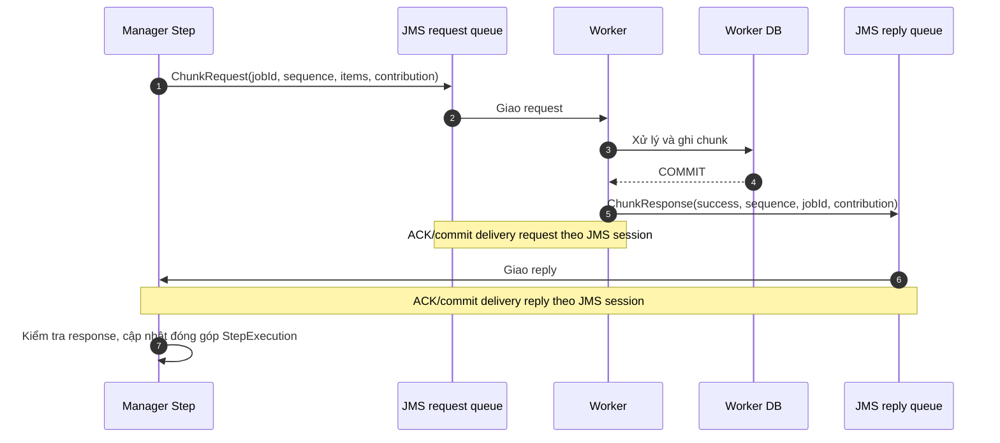

# Chunk response và acknowledgement trong Spring Batch Remote Chunking

## 1. Vì sao phải tách *response* khỏi *acknowledgement*?

Trong **Spring Batch remote chunking**, **manager** đọc và gom item thành chunk rồi gửi `ChunkRequest` cho các **worker** qua middleware. Worker xử lý/ghi chunk và gửi về `ChunkResponse`. Cùng lúc, middleware như JMS hoặc AMQP có cơ chế **acknowledgement (ACK)** riêng để biết một lần giao message đã được consumer tiếp nhận theo quy tắc của broker.

Hai tín hiệu này trả lời **hai câu hỏi khác nhau**:

- **Chunk response:** *Worker thông báo kết quả xử lý chunk nào? Thành công hay lỗi? Đóng góp bao nhiêu vào số liệu step?*
- **Broker ACK:** *Consumer/session đã xác nhận một lần delivery của message với middleware chưa? Message có còn phải redeliver không?*

Đặc biệt, **response thành công không bảo đảm nghiệp vụ chỉ xảy ra một lần trên toàn hệ thống**. Worker có thể đã commit database, sau đó crash trước khi gửi response hoặc ACK request; broker có thể giao lại cùng chunk cho worker khác. Ngược lại, một reply có thể được ACK khỏi broker rồi mất trong bộ đệm RAM của manager trước khi Batch tổng hợp được kết quả.

Bài thuộc chương **Thông điệp phân tán** của module `SPRING_BATCH_SCALING_OPERATIONS`. Mục tiêu của module là mở rộng Spring Batch cho workload dữ liệu lớn thông qua multi-threaded step, parallel steps, partitioning và xử lý phân tán; đo nút thắt, giữ thread safety, retry/restart và lựa chọn kiến trúc theo tài nguyên thực tế. Để scale an toàn, cần hiểu cả phản hồi ở tầng Batch và giao nhận ở tầng messaging.

Sau bài này, bạn có thể:

1. Đọc và kiểm tra các thuộc tính thật của `ChunkResponse` theo API Spring Batch 5.2.
2. Phân biệt `ChunkResponse.isSuccessful()`, `JMS ACK`, `JMSRedelivered` và DB commit.
3. Hiểu cách manager tiếp nhận reply, tổng hợp `StepContribution` và báo lỗi khi response thất bại hoặc sai job.
4. Thiết kế an toàn cho mất reply, redelivery, timeout, idempotency và restart.
5. Xây bộ test mô phỏng crash ở từng ranh giới cùng chỉ số vận hành cần đối soát.

> **Phiên bản:** ví dụ Java dùng **Spring Batch 5.2.x**, Spring Batch Integration, Spring Integration 6.x, Java 17+ và `jakarta.jms`. Với Spring Batch 6.x, tên một số accessor thay đổi (ví dụ `getJobInstanceId()`); không sao chép API 6.x vào bài tập 5.2.

## 2. Sơ đồ ba loại xác nhận



Sơ đồ là **trình tự logic**, không quy định ACK request luôn diễn ra đúng vị trí giữa publish reply và giao reply. Thời điểm ACK phụ thuộc listener container, transaction boundary và việc adapter xử lý exception. Nếu một trong những thao tác trên lỗi, không có mặc định một transaction chung buộc các bên cùng rollback.

| Sự kiện | Ai phát ra? | Tầng bảo đảm | Không chứng minh được điều gì? |
| --- | --- | --- | --- |
| Worker **DB commit** | Database/transaction manager của worker | Những thay đổi thuộc cùng DB transaction đã commit | Broker đã ACK request hoặc manager đã nhận reply |
| `ChunkResponse.isSuccessful() == true` | Giao thức Spring Batch Integration | Worker handler báo xử lý thành công theo logic đã chạy | Exactly-once trên external API/DB hoặc reply chắc chắn tới manager |
| **JMS ACK request** | Session/consumer nhận request | Broker có thể coi delivery request đã được xác nhận | Worker có thể đã gửi/manager đã nhận reply hay chưa |
| **JMS ACK reply** | Session/consumer nhận reply | Broker có thể loại reply khỏi hàng đợi | Manager đã ghi nhận/tổng hợp bền vững response hay chưa |
| `StepExecution=COMPLETED` | Spring Batch manager | Step hoàn tất theo metadata/trạng thái Batch | Không có lần replay hoặc side effect ngoài Batch bị trùng |

Không gọi tất cả các sự kiện này là “ACK chunk”: tên gọi mơ hồ làm người vận hành chọn sai nơi retry và hiểu sai dữ liệu đã được xử lý đến đâu.

## 3. `ChunkResponse` chứa những gì?

Trong Spring Batch **5.2**, lớp `org.springframework.batch.integration.chunk.ChunkResponse` triển khai `Serializable`. Javadoc định nghĩa các constructor tiêu biểu:

```java
public ChunkResponse(
        int sequence,
        Long jobId,
        StepContribution stepContribution);

public ChunkResponse(
        boolean status,
        int sequence,
        Long jobId,
        StepContribution stepContribution);

public ChunkResponse(
        boolean status,
        int sequence,
        Long jobId,
        StepContribution stepContribution,
        String message,
        boolean redelivered);
```

Cùng các accessor:

```java
int getSequence();
Long getJobId();
StepContribution getStepContribution();
boolean isSuccessful();
boolean isRedelivered();
String getMessage();
```

| Thuộc tính | Diễn giải | Điều cần cẩn thận |
| --- | --- | --- |
| `sequence` | Số thứ tự của chunk trong cơ chế request/response | Không duy nhất toàn hệ thống, không phải số lần delivery |
| `jobId` | Trong Spring Batch 5.2 là **JobInstance ID** liên kết với request | Không phải `JobExecution ID` hay `JMSMessageID` |
| `stepContribution` | Phần đóng góp của chunk vào thống kê/trạng thái của step | Không phải biên nhận của DB hay XA transaction |
| `isSuccessful()` | Kết quả thành công/thất bại của chunk handler | Không bảo đảm response đã tới manager hoặc dữ liệu không bị xử lý lại |
| `getMessage()` | Thông điệp/diễn giải lỗi tùy constructor và handler | Có thể `null`; tránh đưa PII/stack trace nhạy cảm vào message |
| `isRedelivered()` | Cờ redelivery ở **response** trong giao thức Batch | Không tự đồng nghĩa với JMS `JMSRedelivered` của **request** |

**Phân biệt phiên bản:** ở Spring Batch 5.2, dùng `getJobId()`; trong các API Spring Batch 6.x mới hơn, accessor được đặt tên `getJobInstanceId()`. Ở cả hai, không tự suy ra đây là ID mỗi lần thực thi job.

### 3.1. Thành công, thất bại và message lỗi

`isSuccessful()` cho biết handler đã báo kết quả thành công hay không; `getMessage()` có thể cung cấp thêm diễn giải lỗi hoặc thông tin vận hành. Khi response thất bại, manager phải xem đó là dấu hiệu xử lý chunk gặp lỗi, không được tính là một ACK nghiệp vụ thành công chỉ vì message đã tới.

Đối với cấu hình mặc định qua Spring Batch Integration, các handler/builder tạo `ChunkResponse` thích hợp. Ứng dụng thông thường **không tự tạo reply thay thế** hoặc tự sửa cờ `successful` trên message sau khi writer đã gặp lỗi.

Nếu một worker bắt exception rồi **giả tạo response thành công**, manager có thể nhận thống kê sai và đánh dấu step hoàn thành dù nghiệp vụ chưa được commit. Nếu chủ ý skip một record lỗi, việc skip phải theo chính sách dữ liệu có giới hạn và được phản ánh đúng trong `StepContribution`.

### 3.2. `StepContribution` được dùng như thế nào?

`StepContribution` chứa những số liệu và thông tin đóng góp từ chunk theo cơ chế Spring Batch, có thể gồm số item ghi/lọc/bỏ qua và các thông tin khác. Worker gửi contribution đã cập nhật về manager; writer phía manager triển khai `StepContributionSource` để công việc tích hợp kết quả trong `StepExecution`.

Chú ý **read count** thường do manager reader quyết định, **write/filter/skip** phụ thuộc xử lý worker và cách đóng góp được tổng hợp. Không cố gắng suy đoán số SQL thực thi chỉ từ một trường count: `UPDATE ... WHERE` có thể ảnh hưởng 0 hàng khi replay nhưng worker vẫn nhận item và thực hiện logic.

### 3.3. Cờ `redelivered` trên response

`ChunkResponse` có constructor:

```java
public ChunkResponse(ChunkResponse input, boolean redelivered);
```

Spring Batch Integration cũng cung cấp `JmsRedeliveredExtractor`; phương thức `extract(ChunkResponse input, @Header("jms_redelivered") boolean redelivered)` có thể tạo một response mới có cờ redelivery lấy từ **header JMS của message đang xét**, khi flow được cấu hình để dùng extractor đó.

Do đó:

- `ChunkResponse.isRedelivered()` là cờ **trong payload response**; ý nghĩa cụ thể phụ thuộc handler/flow đã gắn cờ thế nào.
- `JMSRedelivered` là cờ của **lần JMS delivery** tương ứng, do provider/adapter báo.
- Một **request** bị giao lại không bắt buộc tạo một **response** có `isRedelivered()==true`, trừ khi flow được thiết kế để truyền/tạo tín hiệu như vậy.
- Cờ redelivery không thể chứng minh một DB commit đã hoặc chưa xảy ra.

Với test, kiểm tra cả `jms_redelivered` tại adapter phù hợp và `isRedelivered()` tại manager nếu ứng dụng cần tiêu chí phát hiện reply đã được giao lại.

## 4. Các tầng định danh và correlation

Ví dụ một request và response:

```text
ChunkRequest:
    jobId=501, sequence=12, items=[order-701, order-702]

ChunkResponse:
    jobId=501, sequence=12, successful=true
    stepContribution=...

JMS request envelope:
    JMSMessageID=ID:broker:987
    JMSCorrelationID=<optional routing value>

JMS reply envelope:
    JMSMessageID=ID:broker:1234
    JMSCorrelationID=<optional routing value>
```

`jobId` và `sequence` thuộc giao thức chunk; `JMSMessageID` thuộc transport. `JMSCorrelationID` và Spring Integration header `correlationId` **không tự động là một thứ**. Kết quả trả về có thể không theo thứ tự gửi: một worker chậm xử lý sequence 10 trong khi worker khác trả sequence 11 trước.

Mỗi request/response nên được quan sát bằng một **context đủ phân biệt**: JobInstance ID, JobExecution ID/run ID của ứng dụng, tên step, sequence, worker ID, delivery attempt và logical operation key. Tuy nhiên, không phải tất cả các giá trị này đều là field của `ChunkResponse`: một số phải được bổ sung trong tracing/log/header do ứng dụng quản lý.

### 4.1. Trùng `sequence` giữa các job không phải lỗi

Sequence là số thứ tự chunk, không phải UUID toàn cục. `(jobId=501, sequence=1)` và `(jobId=502, sequence=1)` là những request khác nhau. Khi cùng JobInstance được restart, JobExecution ID thay đổi; các request từ lần chạy trước có thể vẫn còn trong broker. Vì vậy, chỉ kiểm tra `sequence` hoặc chỉ kiểm tra `JMSMessageID` không đủ để bảo vệ nghiệp vụ.

### 4.2. Sai JobInstance ID là lỗi định tuyến nghiêm trọng

Theo API của `ChunkMessageChannelItemWriter.getNextResult()`, manager có thể ném `IllegalStateException` nếu response mang **JobInstance ID khác** với job đang đợi. Đây thường là dấu hiệu nhiều manager chia sẻ reply queue mà không routing/selector đúng, hoặc stale reply từ một job khác đi vào consumer hiện tại.

Không sửa bằng cách “bỏ qua mọi response sai ID” một cách âm thầm: reply có thể đã bị ACK khỏi queue, khiến manager đúng không bao giờ nhận lại. Cần phân tách reply destination theo manager/run hoặc áp dụng routing/selector đã được kiểm chứng.

### 4.3. Header mapper có thể làm mất correlation

Spring Integration dùng các header như `correlationId`, `sequenceNumber`, `sequenceSize` cho việc tổ chức và đối chiếu message. Khi đi qua JMS adapter, header mapper có thể map, lọc hoặc đổi tên user properties; một cấu hình sai có thể khiến reply đến manager nhưng không được tổng hợp đúng.

Hãy kiểm tra message tại **bốn điểm**:

```text
A  Manager outbound channel      → ChunkRequest + required headers
B  Worker inbound channel        → ChunkRequest + required headers
C  Worker outbound reply channel → ChunkResponse + required headers
D  Manager inbound reply channel → ChunkResponse + required headers
```

Từ **Spring Integration 7.0.6+**, việc map inbound user properties thay đổi, nên cần cấu hình allowlist rõ cho các header ứng dụng cần. Với Spring Integration 6.x, dùng mapper/API phù hợp đúng version; không sao chép tùy tiện constructor mới sang 6.x.

## 5. Ba loại acknowledgement trên một đường đi

### 5.1. Request-delivery ACK

Broker giao `ChunkRequest` cho worker. Khi JMS session xác nhận delivery, request thường không còn được broker giao lại theo cơ chế bình thường. Cấu hình listener **transacted** có thể giúp rollback và redelivery nếu handler ném exception đến container.

Tuy nhiên, nếu exception bị một `errorChannel` hoặc handler **nuốt** và flow kết thúc bình thường, container có thể commit JMS delivery dù DB chưa xử lý thành công. Phải kiểm tra cách propagation lỗi trong Spring Integration, không chỉ nhìn thuộc tính `sessionTransacted=true`.

### 5.2. Application-level response

`ChunkResponse` là một message **mới**, đưa kết quả chunk từ worker về manager. Nó có thể báo thành công hoặc thất bại, không đồng nghĩa broker đã hoặc chưa ACK request theo một cách cố định. Một worker có thể:

- **Commit DB rồi trả response thành công** (happy path).
- **Báo response thất bại** nếu handler đóng gói lỗi thành failure reply.
- **Không trả response** nếu lỗi làm flow/consumer dừng hoặc message bị rollback trước bước publish.

Phải phân biệt trường hợp **có failure response** với **không có response**. Failure response là tín hiệu lỗi minh bạch; không response có thể là worker đang chậm, broker/ngắt mạng, lỗi conversion, crash hoặc reply đã mất.

### 5.3. Reply-delivery ACK

Broker giao `ChunkResponse` tới manager qua reply queue. Nếu inbound adapter đã xác nhận JMS reply rồi chỉ đẩy response vào `QueueChannel` RAM, một lần manager crash có thể làm reply biến mất trước khi `ChunkMessageChannelItemWriter` poll được. Việc broker báo “reply consumed” không chứng minh Batch đã áp dụng contribution.

Với workflow đòi hỏi phục hồi chắc chắn, phải thiết kế **durable reply path**, ranh giới ACK thích hợp và reconciliation. Không nên coi việc thêm một JMS queue persistent là đủ nếu chặng cuối là RAM và ACK sớm.

## 6. Ví dụ Java: quan sát `ChunkResponse` trong unit test

Trong ứng dụng thực tế, Spring Batch Integration tạo response thông qua worker handler. Để hiểu rõ API, ta có thể **tự dựng response trong unit test** và kiểm tra nó mà không cần broker.

```java
import org.junit.jupiter.api.Test;
import org.springframework.batch.core.StepContribution;
import org.springframework.batch.core.StepExecution;
import org.springframework.batch.integration.chunk.ChunkResponse;
import org.springframework.batch.integration.chunk.JmsRedeliveredExtractor;
import org.springframework.batch.test.MetaDataInstanceFactory;

import static org.junit.jupiter.api.Assertions.*;

class ChunkResponseContractTest {

    @Test
    void successResponseHasExpectedIdentityAndContribution() {
        StepExecution step = MetaDataInstanceFactory.createStepExecution();
        StepContribution contribution = step.createStepContribution();
        Long jobInstanceId = step.getJobExecution()
                .getJobInstance().getId();

        ChunkResponse response =
                new ChunkResponse(true, 12, jobInstanceId, contribution);

        assertTrue(response.isSuccessful());
        assertEquals(12, response.getSequence());
        assertEquals(jobInstanceId, response.getJobId());
        assertSame(contribution, response.getStepContribution());
        assertFalse(response.isRedelivered());
    }

    @Test
    void failedResponseIsNotACommitAcknowledgement() {
        StepExecution step = MetaDataInstanceFactory.createStepExecution();
        StepContribution contribution = step.createStepContribution();

        ChunkResponse failure = new ChunkResponse(
                false, 12, 501L, contribution, "writer failed");

        assertFalse(failure.isSuccessful());
        assertEquals("writer failed", failure.getMessage());
    }

    @Test
    void redeliveryFlagCanBeAttachedToAReply() {
        StepExecution step = MetaDataInstanceFactory.createStepExecution();
        ChunkResponse original = new ChunkResponse(
                true, 12, 501L, step.createStepContribution());

        ChunkResponse marked =
                new JmsRedeliveredExtractor().extract(original, true);

        assertTrue(marked.isRedelivered());
        assertEquals(original.getSequence(), marked.getSequence());
        assertEquals(original.getJobId(), marked.getJobId());
    }
}
```

Đây là **test contract minh họa**, không phải bài test tích hợp broker. `MetaDataInstanceFactory` thuộc dependency `spring-batch-test`. Cờ `redelivered` ở test thứ ba được đặt **chủ động**; không nên suy ra mọi reply trong ứng dụng thật đều tự động lấy cờ này từ request JMS.

Dependency tham khảo khi chạy test (để Spring Boot BOM quản lý version tương thích):

```groovy
dependencies {
    implementation "org.springframework.boot:spring-boot-starter-batch"
    implementation "org.springframework.batch:spring-batch-integration"
    implementation "org.springframework.integration:spring-integration-jms"
    implementation "org.springframework.boot:spring-boot-starter-artemis"
    testImplementation "org.springframework.batch:spring-batch-test"
    testImplementation "org.springframework.boot:spring-boot-starter-test"
}
```

**Không dùng response giả trong production để che lỗi.** `ChunkResponse(true, ...)` chỉ có ý nghĩa khi handler đã xử lý/ghi xong theo hợp đồng. Test kiểm tra cấu trúc object, còn tính đúng ACK/rollback và side effect phải có integration test với broker/DB.

## 7. Ví dụ manager/worker trả reply qua Spring Integration JMS

Giả sử bảng `orders(id BIGINT PRIMARY KEY, processed BOOLEAN)`. Manager đọc các ID trong một miền đã chốt, gửi từng chunk; worker cập nhật `processed` trong một DB transaction. Hai ứng dụng có cùng JMS broker với **request queue** `batch.chunk.requests` và **reply queue** `batch.chunk.replies`.

### 7.1. Manager Step và kênh nhận response

```java
import javax.sql.DataSource;
import jakarta.jms.ConnectionFactory;

import org.springframework.batch.core.configuration.annotation.StepScope;
import org.springframework.batch.core.step.tasklet.TaskletStep;
import org.springframework.batch.integration.chunk.RemoteChunkingManagerStepBuilderFactory;
import org.springframework.batch.integration.config.annotation.EnableBatchIntegration;
import org.springframework.batch.item.database.JdbcCursorItemReader;
import org.springframework.batch.item.database.builder.JdbcCursorItemReaderBuilder;
import org.springframework.beans.factory.annotation.Qualifier;
import org.springframework.beans.factory.annotation.Value;
import org.springframework.context.annotation.Bean;
import org.springframework.context.annotation.Configuration;
import org.springframework.integration.channel.DirectChannel;
import org.springframework.integration.channel.QueueChannel;
import org.springframework.integration.dsl.IntegrationFlow;
import org.springframework.integration.jms.dsl.Jms;

@Configuration
@EnableBatchIntegration
public class ChunkResponseManagerConfig {

    @Bean
    public DirectChannel requestsToWorkers() {
        return new DirectChannel();
    }

    @Bean
    public QueueChannel repliesFromWorkers() {
        // Demo: PollableChannel chỉ lưu RAM; xem mục 9 để bảo vệ reply.
        return new QueueChannel(256);
    }

    @Bean
    @StepScope
    public JdbcCursorItemReader<Long> orderIdReader(
            DataSource dataSource,
            @Value("#{jobParameters['endExclusive']}") Long endExclusive) {
        return new JdbcCursorItemReaderBuilder<Long>()
                .name("orderIdReader")
                .dataSource(dataSource)
                .sql("SELECT id FROM orders " +
                     "WHERE id >= 1 AND id < ? ORDER BY id")
                .preparedStatementSetter(ps -> ps.setLong(1, endExclusive))
                .rowMapper((rs, rowNum) -> rs.getLong(1))
                .saveState(true)
                .build();
    }

    @Bean
    public TaskletStep managerStep(
            RemoteChunkingManagerStepBuilderFactory factory,
            @Qualifier("orderIdReader") JdbcCursorItemReader<Long> reader,
            @Qualifier("requestsToWorkers") DirectChannel requests,
            @Qualifier("repliesFromWorkers") QueueChannel replies) {
        return factory.<Long, Long>get("managerStep")
                .chunk(100)
                .reader(reader)
                .outputChannel(requests)
                .inputChannel(replies)
                .throttleLimit(8)
                .maxWaitTimeouts(40)
                .build();
    }

    @Bean
    public IntegrationFlow requestsToJms(
            ConnectionFactory cf,
            @Qualifier("requestsToWorkers") DirectChannel requests) {
        return IntegrationFlow.from(requests)
                .handle(Jms.outboundAdapter(cf)
                        .destination("batch.chunk.requests"))
                .get();
    }

    @Bean
    public IntegrationFlow jmsRepliesToManager(
            ConnectionFactory cf,
            @Qualifier("repliesFromWorkers") QueueChannel replies) {
        return IntegrationFlow
                .from(Jms.messageDrivenChannelAdapter(cf)
                        .destination("batch.chunk.replies"))
                .channel(replies)
                .get();
    }
}
```

Ở phía manager:

- `RemoteChunkingManagerStepBuilderFactory` dựng manager step với `ChunkMessageChannelItemWriter`. Writer đặc biệt này gửi request và nhận response; không gắn một `ItemWriter` nghiệp vụ khác ở manager.
- `.inputChannel(replies)` nhận **`PollableChannel`**, giúp manager lấy reply và tổng hợp `StepContribution`. Với `QueueChannel` RAM, **khả năng chịu crash chưa đầy đủ**.
- `.throttleLimit(8)` giới hạn số request đang chờ phản hồi; đây không phải số worker. `.maxWaitTimeouts(40)` là **số lần chờ** trước khi kết luận việc chờ kết quả không đạt, không đơn giản là 40 giây.
- `@StepScope` cấp reader có trạng thái theo execution. Cần chốt tập input/thứ tự đọc để restart không tạo ra một tập item khác.

Đây là **mẫu các bean quan trọng**, chưa phải toàn bộ ứng dụng chạy được: cần `Job`, `JobRepository`, transaction manager, datasource, broker, credentials/queue provisioning và chính sách converter/recovery. `endExclusive` phải là job parameter hợp lệ theo kiểu Spring Batch đang sử dụng.

### 7.2. Worker ghi DB và gửi `ChunkResponse`

```java
import jakarta.jms.ConnectionFactory;
import java.util.List;

import org.springframework.batch.integration.chunk.RemoteChunkingWorkerBuilder;
import org.springframework.batch.item.ItemWriter;
import org.springframework.beans.factory.annotation.Qualifier;
import org.springframework.context.annotation.Bean;
import org.springframework.context.annotation.Configuration;
import org.springframework.integration.channel.DirectChannel;
import org.springframework.integration.config.EnableIntegration;
import org.springframework.integration.dsl.IntegrationFlow;
import org.springframework.integration.jms.dsl.Jms;
import org.springframework.jdbc.core.JdbcTemplate;
import org.springframework.transaction.PlatformTransactionManager;
import org.springframework.transaction.support.TransactionTemplate;

@Configuration
@EnableIntegration
public class ChunkResponseWorkerConfig {

    @Bean
    public DirectChannel incomingChunks() {
        return new DirectChannel();
    }

    @Bean
    public DirectChannel outgoingReplies() {
        return new DirectChannel();
    }

    @Bean
    public IntegrationFlow jmsRequestsToWorker(
            ConnectionFactory cf,
            @Qualifier("incomingChunks") DirectChannel requests) {
        return IntegrationFlow
                .from(Jms.messageDrivenChannelAdapter(cf)
                        .destination("batch.chunk.requests"))
                .channel(requests)
                .get();
    }

    @Bean
    public ItemWriter<Long> markProcessedWriter(
            JdbcTemplate jdbcTemplate,
            PlatformTransactionManager transactionManager) {
        TransactionTemplate tx = new TransactionTemplate(transactionManager);
        return chunk -> tx.executeWithoutResult(status -> {
            List<Object[]> params = chunk.getItems().stream()
                    .map(id -> new Object[]{id})
                    .toList();
            jdbcTemplate.batchUpdate(
                    "UPDATE orders SET processed = TRUE "
                    + "WHERE id = ? AND processed = FALSE", params);
        });
    }

    @Bean
    public IntegrationFlow workerHandler(
            @Qualifier("incomingChunks") DirectChannel requests,
            @Qualifier("outgoingReplies") DirectChannel replies,
            ItemWriter<Long> markProcessedWriter) {
        return new RemoteChunkingWorkerBuilder<Long, Long>()
                .itemWriter(markProcessedWriter)
                .inputChannel(requests)
                .outputChannel(replies)
                .build();
    }

    @Bean
    public IntegrationFlow workerRepliesToJms(
            ConnectionFactory cf,
            @Qualifier("outgoingReplies") DirectChannel replies) {
        return IntegrationFlow.from(replies)
                .handle(Jms.outboundAdapter(cf)
                        .destination("batch.chunk.replies"))
                .get();
    }
}
```

`RemoteChunkingWorkerBuilder` dựng handler và flow sinh `ChunkResponse`, **không phải bean `markProcessedWriter` trực tiếp gửi response**. Việc dùng `TransactionTemplate` bảo vệ các SQL trong cùng DB transaction; nó không làm JMS reply và JMS ACK trở thành một phần của DB transaction.

Với thao tác đặt cờ, `WHERE processed = FALSE` có thể giảm ảnh hưởng của request replay. Nhưng nếu worker ghi tiền, phát email, gọi API hoặc tạo sự kiện thì phải dùng idempotency key/outbox phù hợp. Worker có thể chạy nhiều instance nên processor/writer phải thread-safe; không đặt state chunk vào field mutable của singleton.

### 7.3. ACK/rollback nằm ở listener container, không ở `ChunkResponse`

Ví dụ trên dùng `Jms.messageDrivenChannelAdapter(...)`. Với Spring Integration, khi container được tạo từ adapter theo mặc định, chế độ transacted được khuyến nghị để tránh đánh mất message khi handler lỗi; nếu cung cấp **listener container bên ngoài**, ứng dụng phải tự cấu hình ACK, transaction, concurrency và exception propagation cho container đó.

Trong **Spring Integration JMS message-driven channel adapter**, khi có `errorChannel`, lỗi conversion/handler có thể được chuyển thành `ErrorMessage`; nếu error flow **không ném lại exception**, transaction listener có thể được commit và message bị loại khỏi queue. Vì vậy, log error rồi trả về bình thường **không nhất thiết** là retry; phải thử bằng integration test.

Nếu worker handler tạo một **failure `ChunkResponse`** nhưng JMS request được ACK vì flow kết thúc bình thường, manager nhận lỗi qua reply và có thể fail step; broker **không bắt buộc** redeliver request. Nếu handler ném exception ra listener, flow có thể không phát reply, nhưng broker có thể redeliver request. Cơ chế nào xảy ra phụ thuộc việc lỗi được đóng gói/truyền ở tầng nào.

### 7.4. Không nhầm `Jms.outboundAdapter` với ACK của worker

`Jms.outboundAdapter` **gửi** một message đến broker; nó không phải là thành phần ACK consumer nhận request. Tương tự, việc manager nhận `ChunkResponse` ở kênh Spring Integration khác việc JMS reply delivery đã commit. Mỗi inbound listener có một ranh giới ACK riêng và cần được kiểm chứng.

Với cấu hình production, ngoài request/reply queue phải quản lý:

- **Persistent delivery** và durability của broker, vì queue có tên cố định chưa đảm bảo producer gửi persistent messages.
- **Bounded redelivery** có backoff và DLQ cho request lỗi không thể tự khắc phục.
- **Reply routing** theo đúng manager/run; không để nhiều manager nhận nhầm response qua một queue chung.
- **Header mapping** giữ correlation và sequence cần thiết qua adapter.
- **Message converter** có allowlist/schema/version tương thích, tránh deserialize object không tin cậy.

## 8. Ma trận lỗi: crash xảy ra trước hay sau ACK?

Trong hệ thống phân tán, câu hỏi quan trọng không chỉ là “có lỗi không?” mà là **“lỗi xảy ra sau khi bên nào đã commit?”**. Bảng sau phân tích các kịch bản cần diễn tập trước production.

| Thời điểm gặp lỗi | Trạng thái có thể tồn tại | Hướng xử lý đúng |
| --- | --- | --- |
| Manager đọc chunk, **chưa gửi request thành công** | Broker có thể chưa có request; reader đã tiến trong memory | Xác định ranh giới commit/checkpoint, restart dựa metadata và input ổn định |
| Broker đã lưu request, **worker chưa nhận** | Request chờ consumer | Persistent delivery, backlog/TTL monitoring, worker health |
| Worker nhận request, **chưa commit DB** rồi crash | DB rollback; request có thể được redeliver | JMS listener transaction, retry có giới hạn |
| Worker **đã commit DB**, crash trước request ACK/reply | Broker có thể redeliver request; manager thiếu kết quả | Idempotency và reconciliation; không tái tạo side effect |
| Worker **đã gửi reply** nhưng request ACK lỗi | Reply có thể tồn tại, request vẫn được redeliver | Khóa nghiệp vụ, xử lý reply/request lặp |
| Reply ở broker, **manager chưa nhận** | Reply chờ trong queue hoặc bị TTL/route tác động | Persistent reply, correct consumer routing và monitoring |
| Manager inbound JMS ACK reply, **chưa poll từ QueueChannel RAM** rồi crash | Broker đã xóa reply; manager mất bản copy trong heap | Durable reply channel/ACK boundary/reconciliation |
| Manager nhận reply rồi crash **trước khi lưu tiến độ Batch** | Contribution có thể chưa được checkpoint bền | Restart-aware result tracking, idempotency và đối soát |
| Một manager nhận reply của **JobInstance khác** | Manager sai đã tiêu thụ response | Routing/selector; không tiêu thụ nhầm queue chung |
| Worker chậm hơn deadline và trả reply muộn | Manager có thể đã fail/timeout | Stale reply policy, tra trạng thái DB, không retry mù quáng |

### 8.1. Trường hợp khó: “đã xử lý nhưng chưa được ghi nhận”

```text
T0  Manager gửi request (jobId=501, sequence=12)
T1  Broker giao request cho worker A
T2  Worker A COMMIT 100 bản ghi thành công
T3  A crash, chưa ACK request và chưa publish ChunkResponse
T4  Broker giao lại request cho worker B
T5  B có thể ghi 100 bản ghi lần nữa nếu writer không idempotent
T6  B gửi ChunkResponse(success=true, ...)
T7  Manager tổng hợp contribution
```

Nếu nghiệp vụ là `UPDATE status = 'DONE'`, DB cuối có thể trông đúng dù worker đã thực hiện logic hai lần. Nếu nghiệp vụ là `UPDATE balance = balance + amount`, dữ liệu có thể sai nghiêm trọng. Unique constraint, idempotency key và transaction marker giải quyết **trùng hiệu ứng nghiệp vụ**, chứ không chỉ trùng message ở broker.

### 8.2. Trường hợp khó: “đã có reply nhưng manager vẫn không biết”

```text
T0  Worker commit DB, publish reply vào JMS reply queue
T1  JMS inbound adapter của manager nhận và ACK reply
T2  Adapter đẩy reply vào QueueChannel RAM
T3  Manager JVM crash trước khi writer poll QueueChannel
T4  Broker không còn reply; manager chưa tổng hợp contribution
```

Đây là lý do **JMS queue bền vững không tự bảo đảm reply end-to-end**. Muốn tránh khoảng trống này, cần thiết kế kênh phản hồi bền vững hoặc một cơ chế phục hồi trạng thái dựa trên dữ liệu đã commit. Chỉ tăng `maxWaitTimeouts` không thể khôi phục một message đã bị ACK và mất.

### 8.3. Phản hồi trùng khác với request trùng

Có hai nguy cơ cần xử lý riêng:

- **Request redelivery:** cùng chunk được process/write lại → có thể tạo side effect trùng.
- **Reply redelivery:** cùng kết quả chunk được đưa lại cho manager → nguy cơ áp dụng contribution/statistics nhiều lần nếu pipeline xử lý không có chính sách phát hiện bản sao phù hợp.

`ChunkResponse.isRedelivered()` và `JmsRedeliveredExtractor` là những công cụ để truyền/thấy tín hiệu ở tầng reply. Không được mặc định tất cả adapter đều tự set cờ này, hoặc chỉ nhìn cờ là đã có một giải pháp exactly-once. Cần test với broker cụ thể và đánh giá cách `ChunkMessageChannelItemWriter` của đúng version xử lý response bị lặp.

## 9. Thiết kế idempotency và acknowledgement nhất quán

### 9.1. Dùng khóa logic, không dùng JMS message ID làm nguồn chân lý

Giả sử worker xử lý từng đơn hàng qua một operation “charge”. Ta muốn một đơn hàng không bị trừ tiền hai lần dù request bị gửi lại. Một bảng ledger mẫu:

```sql
CREATE TABLE processed_batch_operation (
    business_batch_key VARCHAR(100) NOT NULL,
    order_id BIGINT NOT NULL,
    operation_type VARCHAR(40) NOT NULL,
    processed_at TIMESTAMP NOT NULL,
    PRIMARY KEY (business_batch_key, order_id, operation_type)
);
```

Mỗi item có `businessBatchKey`/`orderId`/`operationType` bất biến. Trong **cùng DB transaction**, worker:

```text
BEGIN TRANSACTION
    Thử INSERT operation key vào bảng ledger.
    Nếu key đã được commit:
        Không thực hiện side effect thêm lần nữa.
    Nếu key mới:
        Thực hiện thay đổi dữ liệu nghiệp vụ.
        Đánh dấu operation hoàn tất.
COMMIT
Sau đó mới tiếp tục đường reply theo kiến trúc đã chọn.
```

Đây là **pseudo-code**, không phải SQL chạy nguyên xi. Thao tác “insert if absent” phải xử lý race condition qua unique constraint và cú pháp/locking phù hợp DB. Không ghi marker vào một transaction rồi ghi side effect trong transaction khác: việc crash giữa hai thao tác có thể tạo trạng thái giả “đã làm” hoặc nhân đôi nghiệp vụ.

Nếu worker gọi API bên ngoài thay vì chỉ ghi DB, cần **idempotency key tại API downstream**, transactional outbox hoặc quy trình đối soát theo khả năng tích hợp. Một DB transaction cục bộ không tự rollback email, API hoặc broker khác.

### 9.2. Chọn chính sách cho lỗi worker

| Loại lỗi | Xử lý gợi ý | Ảnh hưởng ACK/response |
| --- | --- | --- |
| DB lock timeout tạm thời | Rollback và retry có backoff/giới hạn | Có thể rollback JMS request để redeliver nếu flow/container cấu hình đúng |
| Dữ liệu lỗi cố định | Kiểm tra policy skip/fail; audit và DLQ khi cần | Không retry vô hạn; phản hồi lỗi hoặc message đưa DLQ rõ ràng |
| Writer ném lỗi sau một phần cập nhật | DB rollback toàn bộ chunk nếu cùng transaction | Tránh ACK request như thành công |
| DB commit rồi publish reply lỗi | Tra trạng thái và replay idempotent | ACK/reply vẫn có failure window |
| Reply sai JobInstance | Sửa routing, cách ly message, điều tra stale response | Không âm thầm ACK mất reply của manager khác |
| Header/cấu trúc payload không hợp lệ | Dừng và báo lỗi conversion/contract | Cấu hình rollback/DLQ có giới hạn, không ép thành response thành công |

### 9.3. Ba kiểu “thành công” khác nhau

Khi thiết kế SLA và dashboard, nên định nghĩa rõ:

1. **Transport accepted:** broker xác nhận đã chấp nhận/gửi message theo delivery semantics.
2. **Worker business committed:** dữ liệu nghiệp vụ đã được commit hoặc idempotent operation đã được xác nhận bền vững.
3. **Manager accounted:** manager nhận `ChunkResponse` hợp lệ và tổng hợp vào trạng thái `StepExecution` đã được lưu theo checkpoint.

Một job có thể nằm ở giữa những mốc này trong lúc mạng chập chờn hoặc hệ thống crash. Đừng cộng các con số “received message” rồi gọi chúng là “processed exactly once”. Cần đối soát theo **operation key duy nhất** và trạng thái commit thực.

## 10. Timeout, pending replies và restart

### 10.1. Vì sao manager vẫn đợi khi queue request rỗng?

Theo API Spring Batch 5.2, `ChunkMessageChannelItemWriter` có `waitForResults()` để chờ những chunk response còn trong pipeline. `getNextResult()` nhận reply qua `PollableChannel` và có thể báo `AsynchronousFailureException` nếu nhận một failed `ChunkResponse`; nó cũng có thể báo lỗi nếu response thuộc sai JobInstance.

Khi request queue trên broker rỗng, vẫn có thể tồn tại:

- Request **đã được giao nhưng còn unacknowledged** ở worker.
- Worker **đã commit DB** nhưng chưa publish reply.
- Reply **đang chờ** ở broker hoặc một kênh trung gian.
- Reply **đã vào RAM manager** nhưng chưa được writer poll.
- Reply **bị mất/sai routing** do config correlation hoặc crash.

Vì vậy, để chẩn đoán “job treo cuối step”, phải kiểm tra **pending count, reply queue, unacked deliveries, worker status và DB idempotency audit**, không chỉ request queue depth.

### 10.2. `maxWaitTimeouts` có phải deadline theo giây?

Không. Trong Spring Batch 5.2, `maxWaitTimeouts` là **số lần chờ** ở cuối step khi chưa nhận được kết quả trong khoảng receive timeout của messaging gateway. Tổng thời gian phụ thuộc receive timeout, thời gian xử lý lỗi và lịch giao message. Ví dụ `.maxWaitTimeouts(40)` **không tự động tương đương 40 giây**.

Đặt timeout quá thấp gây fail giả khi worker còn chạy hợp lệ; quá cao khiến lỗi thật phát hiện muộn. Hãy đo p95/p99 thời gian xử lý chunk, backpressure, broker delivery latency rồi cấu hình deadline/chính sách cảnh báo phù hợp. **Timeout không chứng minh worker chưa commit DB.**

### 10.3. Restart cùng `JobInstance`

Khi job fail và restart **cùng `JobInstance`**, manager có thể sử dụng `JobRepository` và `ItemStream` checkpoint của reader để tiếp tục. Nhưng nếu input query phụ thuộc trạng thái do worker thay đổi, ví dụ:

```sql
SELECT id
FROM orders
WHERE processed = FALSE
ORDER BY id;
```

thì sau vài chunk worker đã cập nhật `processed`, tập dữ liệu lần restart sẽ khác. Vị trí checkpoint cũ có thể không còn tương ứng với cùng các item. Để restart có thể giải thích được:

- Dùng **snapshot/manifest** hoặc một miền khóa bất biến và xác định cách xử lý các bản ghi mới.
- Giữ identifying `JobParameters`, thứ tự reader và cùng contract serialization/DTO phù hợp.
- Không đổi tùy tiện chunk size, logic tạo request hoặc schema message khi broker vẫn còn request/reply cũ của lần chạy trước.
- Thiết kế operation key nghiệp vụ ổn định qua retry/restart; không chỉ dựa vào `sequence` hoặc `JMSMessageID`.
- Có chính sách phân loại stale messages, replay/cách ly và reconciliation trước khi dọn queue.

### 10.4. Hạn chế của reply queue dùng chung

Nếu hai manager chạy đồng thời trên **cùng reply queue** mà mỗi bên dùng competing consumer không có routing, một manager có thể lấy reply của job còn lại. Sai `jobId` bị phát hiện không tự gửi message quay về consumer đúng; có thể gây timeout và công việc bị nhận nhầm.

Thiết kế tốt hơn gồm tách reply destination theo manager/job run, dùng JMS message selector theo correlation routing đã thống nhất, hoặc một reply router có kiểm thử concurrency. Với reply queue dùng chung, đặc biệt kiểm thử **stale reply sau restart**, vì manager mới có thể gặp message từ run cũ.

## 11. Quan sát và kiểm thử end-to-end

### 11.1. Bốn điểm trace có giá trị nhất

```text
Manager request outbound:
  jobInstanceId=501, chunkSequence=12, items=100, requestPublishedAt=...

Worker request inbound:
  jobInstanceId=501, chunkSequence=12, worker=worker-A,
  requestDeliveryAttempt=1, requestReceivedAt=...

Worker reply outbound:
  jobInstanceId=501, chunkSequence=12, successful=true,
  workerDBCommitAt=..., replyPublishedAt=...

Manager reply inbound:
  jobInstanceId=501, chunkSequence=12, successful=true,
  isRedelivered=false, replyReceivedAt=...
```

`requestDeliveryAttempt` và các timestamp là **tracing/metadata do ứng dụng hoặc broker bổ sung**, không phải field của `ChunkResponse`. Không tự coi một `sequence` là globally unique, và đừng log toàn bộ item nếu chứa PII hoặc secret.

### 11.2. Test response hợp lệ, failed và out-of-order

Một test tích hợp có broker thực tế/staging có thể dùng 250 item với `chunkSize=100`. Kỳ vọng ba request (100, 100, 50 item). Cho worker của chunk thứ ba xử lý nhanh để reply `sequence=3` đến trước `sequence=2`.

Các điều cần xác minh:

1. Manager nhận đủ ba `ChunkResponse`, đối chiếu đúng JobInstance/chunk; việc reply **khác thứ tự** không tự làm job fail.
2. Tạo một lỗi xử lý ở chunk hai; xác định rõ flow thực tế **trả failure response** hay **rollback JMS request để redeliver**; không suy diễn từ code mẫu.
3. Khi nhận `ChunkResponse.isSuccessful()==false`, manager phát hiện lỗi thay vì đánh dấu mọi chunk thành công.
4. Cho reply mang JobInstance ID sai; manager không được âm thầm gán contribution cho job hiện tại.
5. Theo dõi `StepContribution`/`WRITE_COUNT` và so với **số bản ghi đích** đã commit; một response thành công không đủ chứng minh số bản ghi đích duy nhất.

### 11.3. Test crash trước và sau DB commit

| Ca thử | Tác động mô phỏng | Kỳ vọng |
| --- | --- | --- |
| Worker crash trước commit | Dừng worker khi DB transaction chưa commit | Rollback hoặc không ghi dở; request có thể redeliver |
| Worker crash sau commit trước ACK/reply | Commit xong rồi ngắt tiến trình | Replay không làm side effect lặp; manager cuối cùng nhận kết quả hoặc fail có thể đối soát |
| Worker gửi reply nhưng request ACK lỗi | Ngắt listener/connection ở cửa sổ lỗi | Có thể tồn tại reply và request redelivery; không xử lý nghiệp vụ hai lần |
| Manager crash sau JMS reply ACK, trước poll | Ngắt manager khi reply vào bộ đệm RAM | Chứng minh reply recovery/reconciliation theo thiết kế; demo RAM có thể mất |
| Broker restart khi request/reply còn chờ | Restart broker có persistence | Message phù hợp chính sách được giữ; consumer phục hồi/nhận lại |
| Response sai correlation | Cho hai job dùng chung reply queue trong test | Lỗi được phát hiện; routing mới không làm mất reply |
| Poison message | Payload không deserialize được | Retry có giới hạn, DLQ và cảnh báo; không lặp vô hạn |

Các ca thử crash cần thực hiện trên test/staging với dữ liệu có thể khôi phục, không gây gián đoạn production.

### 11.4. Quan sát từ metadata Spring Batch

Với schema metadata Spring Batch thông dụng:

```sql
SELECT STEP_NAME, STATUS, READ_COUNT, WRITE_COUNT,
       COMMIT_COUNT, ROLLBACK_COUNT
FROM BATCH_STEP_EXECUTION
WHERE JOB_EXECUTION_ID = :jobExecutionId
ORDER BY STEP_NAME;
```

`ChunkMessageChannelItemWriter` còn có API `getStepContributions()` để lấy các contribution đã nhận và drain tập kết quả của nguồn. Các metadata này cần kết hợp với audit worker, broker metrics và số operation đã commit — **không tự thay thế đối soát dữ liệu nghiệp vụ**.

Các chỉ số quan trọng:

| Chỉ số | Giải thích |
| --- | --- |
| Số request đã publish/được giao/đã ACK | Phân biệt tiến trình manager, broker và worker |
| Request unacked, request redelivery, DLQ | Lỗi worker, transaction/ACK hoặc poison payload |
| Reply đã publish/được giao/đã ACK | Chẩn đoán mất reply hoặc routing sai |
| Pending result count / wait timeouts | Manager đang đợi bao nhiêu chunk |
| Số failed `ChunkResponse`, mismatch JobInstance | Lỗi nghiệp vụ hoặc correlation |
| `ChunkResponse.isRedelivered`/JMS redelivered | Tín hiệu trùng giao nhận; cần diễn giải theo flow |
| Worker DB commit và unique operation count | Bằng chứng về nghiệp vụ đã hoàn thành |
| Worker latency p95/p99, queue wait, broker disk | Phân biệt worker chậm với reply path lỗi |

## 12. Các lỗi vận hành thường gặp

| Dấu hiệu | Nguyên nhân khả dĩ | Cách điều tra / khắc phục |
| --- | --- | --- |
| Worker đã ghi xong, manager vẫn đợi | Reply chưa publish, sai reply destination, reply vào RAM rồi mất, header không còn | Trace bốn điểm, kiểm tra broker reply queue, adapter, durability và correlation |
| Manager báo sai JobInstance ID | Reply được route nhầm từ manager/run khác | Tách reply destination hoặc selector/router theo run; đối soát stale replies |
| `Null correlation not allowed` | Spring Integration header mapper/transformer làm mất header | Kiểm tra `correlationId` và sequence headers sau adapter theo version |
| `isSuccessful()==false` nhưng request đã ACK | Failure response được gửi trong một flow hoàn tất bình thường | Xem error-handling policy; manager fail/skip theo nghiệp vụ, không mong broker tự redeliver |
| Một request được nhận lại | Worker rollback/crash trước ACK; broker redelivery | Kiểm tra DB commit, idempotency, attempt count và retry policy |
| Worker commit DB thành công nhưng lại xử lý chunk lần nữa | Crash sau commit trước ACK/reply | Thêm operation key/unique constraint, tránh side effect trùng |
| `isRedelivered()==false` dù đã thấy request replay | Cờ này thuộc response và có thể chưa được gắn từ transport | Đo request delivery attempts riêng; không đồng nhất hai cờ |
| `isRedelivered()==true` nhưng không có duplicate DB | Reply có cờ redelivery, còn writer/DB có thể đã idempotent | Kiểm tra audit theo commit, không mặc định đó là lỗi dữ liệu |
| Request queue rỗng nhưng step chưa hoàn thành | In-flight request hoặc pending replies còn tồn tại | Đo unacked, reply queue và `waitForResults` |
| Nhiều worker nhưng throughput không tăng | Manager reader, serialization, broker, DB hoặc reply path là bottleneck | Đo từng chặng, chunk size, `throttleLimit` và worker capacity |
| Một message lỗi mãi không hết | Poison payload, exception mapping hoặc redelivery không giới hạn | Bounded retry, backoff, DLQ và cảnh báo |
| Metadata `WRITE_COUNT` bất thường | Contribution đến thiếu/trễ/lặp hoặc writer nghiệp vụ có logic khác | Kiểm tra reply correlation, contribution/audit và số bản ghi đích duy nhất |
| Manager restart bị trùng hoặc thiếu item | Query nguồn thay đổi so với checkpoint; message cũ còn trong queue | Chốt snapshot/manifest, đối soát operation ledger, phân loại stale message |

## 13. Checklist trước khi triển khai production

- [ ] Đã phân biệt rõ **`ChunkResponse`**, **ACK của JMS request**, **ACK của JMS reply** và **DB commit** trong sơ đồ vận hành.
- [ ] Worker tạo response theo hợp đồng Spring Batch Integration; không trả thành công giả để che lỗi nghiệp vụ.
- [ ] Với Spring Batch 5.2, phân biệt `getJobId()` là JobInstance ID, không phải `JobExecution ID` hoặc `JMSMessageID`.
- [ ] Response có `sequence`, `StepContribution` và trạng thái xử lý được giữ nguyên qua serialization/deserialization.
- [ ] Manager kiểm tra đúng reply identity; reply queue/routing tránh giao response của job khác.
- [ ] Header `correlationId` và sequence headers cần thiết được map qua hai chiều request/reply.
- [ ] Listener JMS dùng ACK/transaction semantics được kiểm thử; lỗi không bị error flow nuốt rồi ACK ngoài ý muốn.
- [ ] Request và reply đều có persistence/recovery phù hợp; không xem `QueueChannel` RAM là lưu trữ bền.
- [ ] Broker có bounded redelivery, backoff, DLQ, quota, TLS, ACL và cảnh báo.
- [ ] Writer có transaction rõ ràng và idempotency key theo **công việc logic**, không chỉ JMS message ID.
- [ ] Worker xử lý retry/redelivery không nhân đôi side effect; external API có idempotency/outbox nếu cần.
- [ ] Manager reader có checkpoint và nguồn input có snapshot/manifest hoặc quy tắc bất biến khi restart.
- [ ] `throttleLimit`, `maxWaitTimeouts`, chunk size, reply channel capacity và worker concurrency dựa vào số liệu.
- [ ] Đã diễn tập crash **sau DB commit nhưng trước ACK/reply** và crash **sau ACK reply nhưng trước manager poll**.
- [ ] Có log/metrics cho job ID, chunk sequence, delivery attempt, failure response, unacked/pending và business commit.
- [ ] Có phép đối soát dữ liệu đích và kế hoạch phục hồi khi response bị mất hoặc bị nhận nhầm.

## 14. Tổng kết

**`ChunkResponse` không phải một JMS ACK.** Nó là **kết quả xử lý ở tầng Spring Batch**: worker báo trạng thái chunk, nhận dạng request và đóng góp vào `StepExecution`. ACK của broker chỉ xác nhận một **lần delivery** theo quy tắc của middleware. Hai tầng hoạt động cạnh những transaction database độc lập nên có các khoảng trống khi crash hoặc mất mạng.

Muốn remote chunking vừa mở rộng throughput vừa giữ tính đúng, hãy kết hợp **reply correlation, listener ACK đúng, durable reply/recovery, idempotency theo nghiệp vụ, checkpoint input ổn định và kiểm thử failure window**. Chỉ khi hiểu chính xác “ai đã xác nhận điều gì”, đội vận hành mới biết nên retry, redeliver, đợi reply hay đối soát thay vì phát lại công việc một cách mù quáng.

### Tài liệu tham khảo chính thức

- [Spring Batch 5.2 — ChunkResponse API](https://docs.spring.io/spring-batch/docs/5.2.x-SNAPSHOT/api/org/springframework/batch/integration/chunk/ChunkResponse.html) — constructor, `isSuccessful()`, `isRedelivered()`, `getStepContribution()`.
- [Spring Batch 5.2 — ChunkMessageChannelItemWriter API](https://www.springframework.org/spring-batch/docs/5.2.3/api/org/springframework/batch/integration/chunk/ChunkMessageChannelItemWriter.html) — `getNextResult()`, `waitForResults()`, `getStepContributions()` và giới hạn pending.
- [Spring Batch 5.2 — JmsRedeliveredExtractor API](https://www.springframework.org/spring-batch/docs/5.2.3/api/org/springframework/batch/integration/chunk/JmsRedeliveredExtractor.html) — ví dụ gắn cờ redelivery từ JMS header.
- [Spring Batch 5.2 — RemoteChunkingManagerStepBuilder API](https://docs.spring.io/spring-batch/docs/5.2.0/api/org/springframework/batch/integration/chunk/RemoteChunkingManagerStepBuilder.html).
- [Spring Batch Reference — Externalizing Batch Process Execution](https://docs.spring.io/spring-batch/reference/spring-batch-integration/externalizing-execution.html).
- [Spring Integration Reference — JMS Support](https://docs.spring.io/spring-integration/reference/jms.html) — inbound/outbound adapters, listener transaction, error channel và conversion.
