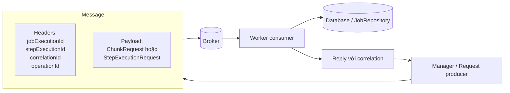
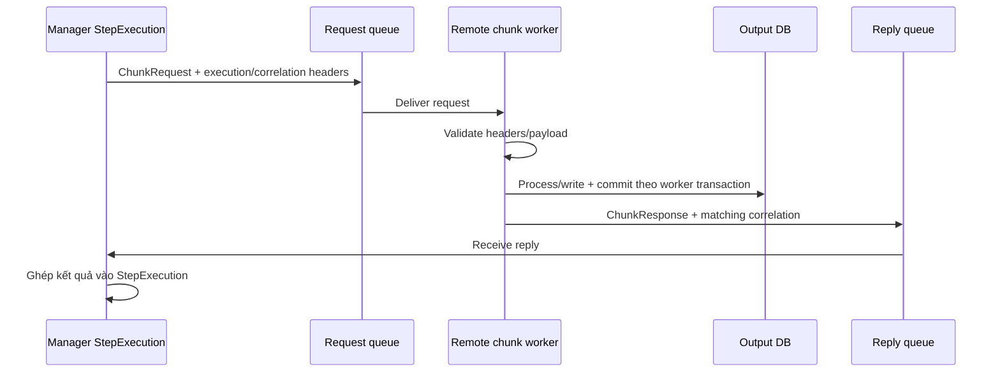
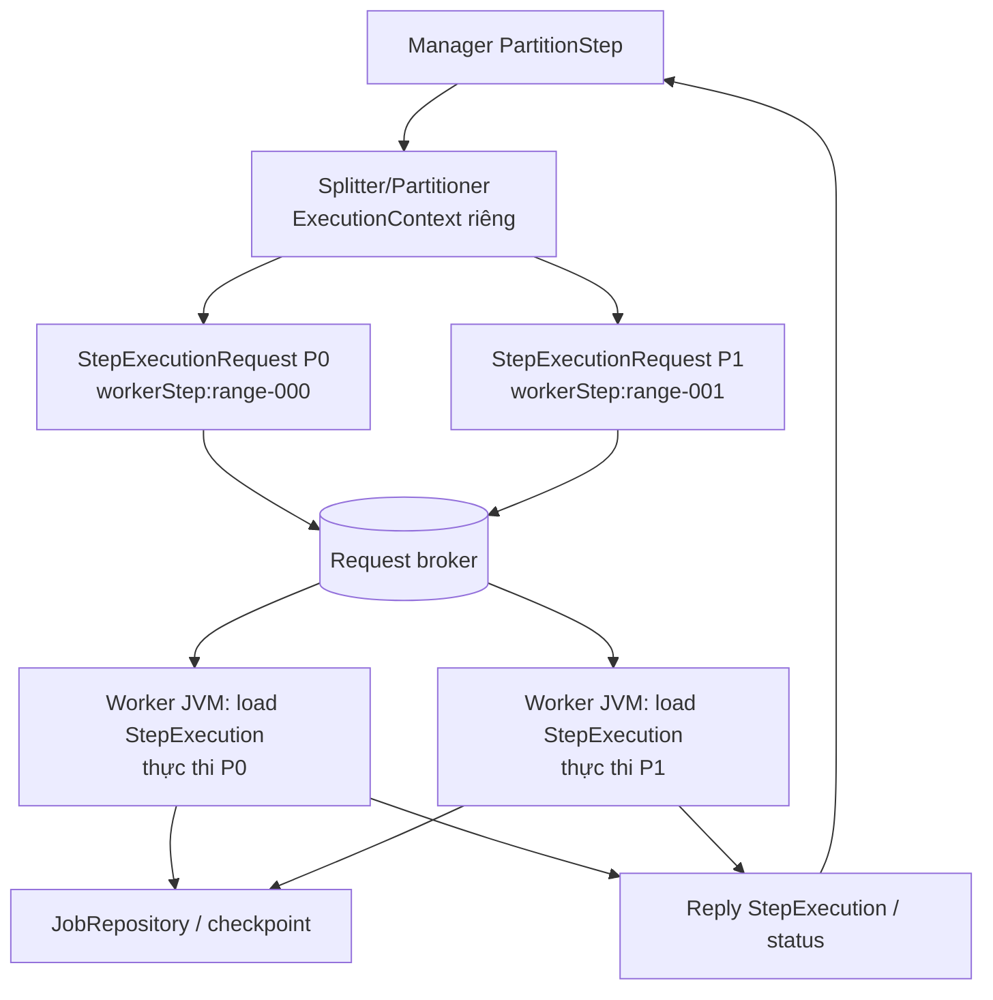
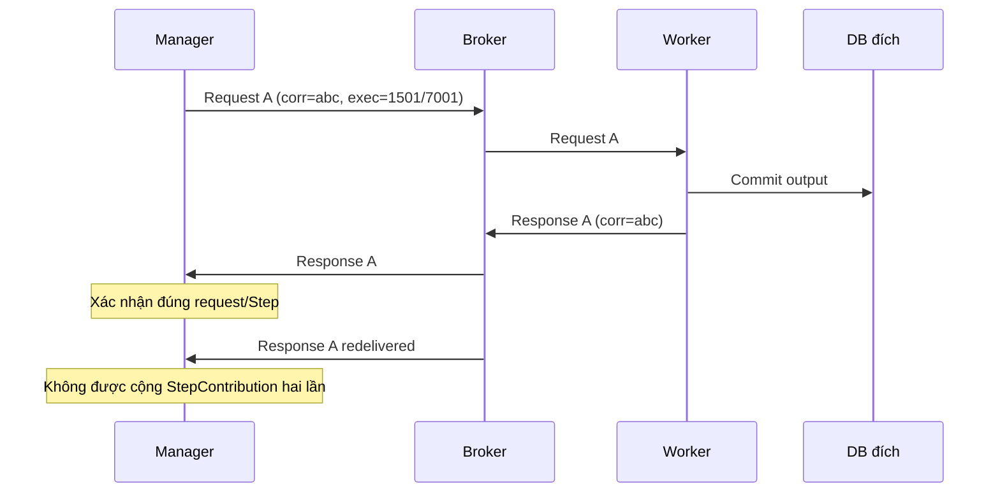
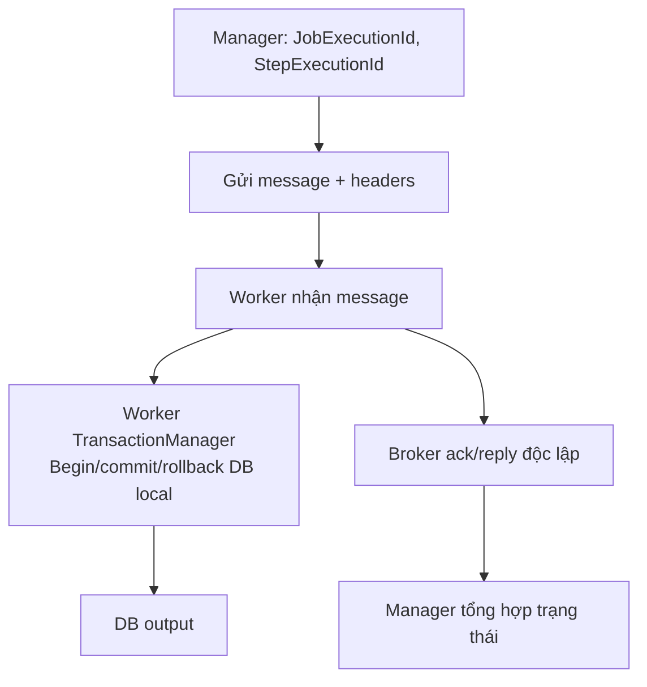

# Header chứa job và step identity trong Spring Batch distributed messaging

Trong hệ thống Spring Batch chạy phân tán, một manager có thể gửi hàng nghìn yêu cầu đến nhiều worker qua Kafka, RabbitMQ hoặc một middleware khác. Khi có lỗi, operator cần biết: **message này thuộc JobInstance nào, lần chạy JobExecution nào, StepExecution nào, partition hay chunk nào, đã được gửi lại bao nhiêu lần và kết quả nào đã commit?**

Những thông tin đó thường được đặt trong **message header**, hoặc một phần nằm trong **payload giao thức** như `ChunkRequest` và `StepExecutionRequest`. Nhưng chỉ gắn một ID bất kỳ lên message là chưa đủ: Spring Batch có nhiều cấp định danh, chúng không có cùng vòng đời. `JobExecutionId` thay đổi khi restart; `StepExecutionId` cũng có thể thay đổi; ngược lại, **khóa công việc nghiệp vụ dùng chống xử lý lặp phải ổn định theo contract**.

Bài thuộc chương **Thông điệp phân tán** trong module **SPRING_BATCH_SCALING_OPERATIONS**, chuyên mở rộng Spring Batch qua multi-threaded step, parallel steps, partitioning và mô hình phân tán, đồng thời bảo đảm thread safety, retry/restart, quan sát bottleneck và vận hành an toàn.

**Sau bài học, bạn có thể:**

- Phân biệt `JobInstance`, `JobExecution`, `StepExecution`, tên Step và partition identity.
- Xác định trường nào là **header ứng dụng**, trường nào thuộc payload/framework, trường nào chỉ là metadata broker.
- Thiết kế hợp đồng header tương thích với remote chunking và remote partitioning.
- Bảo toàn identity qua request/reply, retry, redelivery, consumer threads và restart.
- Tách **execution correlation** khỏi **business idempotency**, không nhân đôi dữ liệu hoặc số đếm.
- Kiểm tra header, bảo mật multi-tenant, observability và đối soát sau sự cố.

## 1. Bốn lớp định danh không được đánh đồng

Spring Batch quản lý các cấp danh tính sau:

| Khái niệm | Đại diện cho | Ổn định khi restart cùng JobInstance? | Dùng làm gì? |
| --- | --- | --- | --- |
| **`JobInstanceId`** | Một JobInstance logic, được xác định bởi job name và các identifying JobParameters theo cơ chế repository | **Có**, khi thực sự restart cùng instance | Nhóm mọi lần chạy của một công việc logic |
| **`JobExecutionId`** | Một lần cố gắng thực thi JobInstance | **Không**: restart tạo JobExecution mới | Truy vết lần chạy, log, JobRepository, điều phối |
| **`StepExecutionId`** | Một lần thực thi Step trong một JobExecution | **Không mặc định**: lần chạy lại thường có StepExecution mới | Theo dõi status, checkpoint, count, exception của Step |
| **`StepName` / partition name** | Tên Step và phần việc logic, ví dụ `workerStep:range-003` | **Phải giữ ổn định** nếu contract restart phụ thuộc mapping | Định tuyến, đối chiếu partition, giám sát |

Ngoài ra còn **`JobParameters`** và `ExecutionContext`:

- `JobParameters` chứa đầu vào của Job, trong đó **identifying parameters** tham gia nhận diện JobInstance. Đừng coi tất cả parameter đều có cùng vai trò nhận diện.
- `ExecutionContext` chứa trạng thái hoặc metadata làm việc được persist ở cấp JobExecution/StepExecution, chẳng hạn khoảng ID, bucket hoặc checkpoint reader.
- Một tên partition `range-003` không tự là một StepExecutionId. Nó là định danh **phần việc logic** được framework gắn vào tên worker StepExecution theo cách tạo partition.
- Một thread name, consumer ID hoặc Kubernetes pod name cũng **không phải** Step identity. Worker có thể thay thread/host khi retry.

### Ví dụ cùng một JobInstance, hai lần chạy

```text
JobName: importOrders
JobParameters (identifying): batchId=B2026-11

JobInstanceId = 41
  JobExecutionId = 1501  (lần đầu; FAILED)
    managerStep, StepExecutionId = 7001
    workerStep:range-000, StepExecutionId = 7002, COMPLETED
    workerStep:range-001, StepExecutionId = 7003, FAILED

  JobExecutionId = 1510  (restart cùng JobInstance)
    managerStep, StepExecutionId = 7050
    workerStep:range-001, StepExecutionId = 7051, COMPLETED
```

Đây là ví dụ minh họa, không phải chuỗi ID framework sẽ cấp thật. Điểm mấu chốt: **`JobInstanceId` không đổi, nhưng `JobExecutionId`/`StepExecutionId` của lần chạy mới thay đổi**. Phần việc `range-001` cần giữ mapping dữ liệu tương ứng, dù execution ID mới.

Vì vậy, không dùng riêng `JobExecutionId` hoặc `StepExecutionId` làm **idempotency key duy nhất** của thao tác nghiệp vụ phải chống trùng xuyên restart. Những ID này vẫn rất hữu ích cho **truy vết và chẩn đoán**.

## 2. Header có chức năng gì trong distributed messaging?

Một message thường có **payload** và **headers**:

- **Payload**: nội dung công việc thực, ví dụ `ChunkRequest` chứa item hoặc `StepExecutionRequest` định danh worker Step.
- **Headers**: metadata phục vụ correlation, routing, schema version, tracing, deadline, security context và xử lý retry.
- **Broker metadata**: offset, delivery tag, partition number, message ID do transport cấp; không nhất thiết bền vững qua mọi kiểu republish.



Sơ đồ thể hiện ý tưởng, không áp đặt mọi thông tin phải xuất hiện **cả trong header và payload**. Nếu payload framework đã chứa một ID, việc sao chép ra header là **thiết kế bổ sung của ứng dụng/transport**, cần tránh mâu thuẫn giữa hai bản.

### Không giả định Spring tự tạo mọi header

Các tên như `x-batch-job-execution-id` hoặc `x-batch-step-execution-id` bên dưới là **đề xuất contract do ứng dụng tự đặt**, **không phải tên header chuẩn bắt buộc của Spring Batch**.

Spring Messaging có các header nền tảng như `id`, `timestamp`; Spring Integration và các broker adapter có thể gắn thêm correlation/reply/transport headers theo loại message. **Tên thực tế và việc header được chuyển qua broker** phụ thuộc message converter/header mapper/adapter. Đừng đọc một header ứng dụng tự đặt rồi kết luận framework luôn cung cấp nó.

## 3. Hợp đồng header đề xuất

Một contract tối thiểu nên đủ để liên kết log và kết quả với Spring Batch metadata, nhưng không khiến message quá lớn hoặc rò rỉ thông tin nhạy cảm.

| Header ứng dụng (ví dụ) | Kiểu wire được chuẩn hóa | Bắt buộc? | Ý nghĩa |
| --- | --- | --- | --- |
| `x-batch-schema-version` | Integer hoặc string phiên bản | Có | Phiên bản schema của envelope/headers |
| `x-batch-job-instance-id` | Long/string số | Khi có metadata manager | Nhóm các lần chạy cùng JobInstance |
| `x-batch-job-execution-id` | Long/string số | Khi có Step/JobExecution | Định danh lần chạy |
| `x-batch-step-execution-id` | Long/string số | Khi có StepExecution tương ứng | Định danh execution của Step, **nguồn gốc phải được ghi rõ** |
| `x-batch-step-name` | String | Khuyến nghị | Tên Step phát request hoặc worker Step theo contract |
| `x-batch-partition-key` | String | Với partitioning | Tên partition logic, ví dụ `range-003` |
| `x-batch-operation-id` | String | Khi cần dedupe | Khóa thao tác **ổn định theo nghiệp vụ** |
| `x-batch-snapshot-id` | String | Nếu input versioned | Snapshot/batch dữ liệu được chốt |
| `x-batch-correlation-id` | String | Với request/reply | Liên kết request và reply |
| `x-batch-attempt` | Integer | Tùy policy | Lần gửi **theo ứng dụng**, không nhất thiết bằng broker redelivery |
| `x-batch-sent-at` | ISO-8601 string | Tùy nhu cầu | Mốc phát message phục vụ latency/TTL |
| `traceparent` | String theo W3C Trace Context | Nếu có tracing | Phân tán trace/span, **khác transaction identity** |

**Nên giữ namespace nhất quán** như `x-batch-*` cho thông tin ứng dụng và công bố rõ cách serialize, giới hạn độ dài, schema version và khả năng thiếu header. Không sử dụng header để chứa token đăng nhập, password, số giấy tờ cá nhân hay payload nghiệp vụ lớn.

### Nguồn gốc của `stepExecutionId` đặc biệt quan trọng

Trong **remote chunking**, manager thường sở hữu `StepExecution` của remote-chunk manager Step; worker xử lý `ChunkRequest` qua handler và không mặc định có worker StepExecution riêng. Do đó, `x-batch-step-execution-id` do manager gửi trong mô hình này thường là **ID của manager StepExecution**, không phải một worker StepExecution giả định.

Trong **remote partitioning**, một `StepExecutionRequest` định danh worker Step cần chạy; ID worker StepExecution là thành phần trọng yếu để worker lấy metadata/checkpoint và thực thi đúng phần việc. Header `x-batch-step-execution-id` nếu dùng có thể phản ánh **worker StepExecution** được giao, nhưng phải xác minh khớp với payload và JobRepository.

Một header tên giống nhau nhưng mang hai ý nghĩa khác nhau giữa hai mô hình là nguồn gốc của nhiều lỗi routing và điều tra. Có thể đặt thêm `x-batch-execution-role=manager|partition-worker` hoặc mô tả chặt trong schema nếu cả hai luồng dùng chung middleware.

## 4. Phân biệt identity, correlation, routing và idempotency

Đừng dùng một chuỗi duy nhất cho tất cả trách nhiệm.

| Nhóm | Ví dụ | Câu hỏi được trả lời | Có nhất thiết ổn định sau restart? |
| --- | --- | --- | --- |
| **Execution identity** | JobExecutionId, StepExecutionId | Lỗi thuộc lần chạy nào? | Không |
| **Logical work identity** | batchId, partition key, snapshot ID | Phần dữ liệu nào phải được xử lý? | **Có**, nếu muốn tái hiện cùng công việc |
| **Message correlation** | correlation ID, request sequence | Reply nào tương ứng với request nào? | Chỉ theo hợp đồng giao thức; có thể thay khi republish |
| **Delivery attempt** | broker redelivered flag, attempt count | Đây có phải lần giao lại? | Không phải business identity |
| **Business idempotency** | batchId + orderId + operation version | Cùng hiệu ứng nghiệp vụ đã commit chưa? | **Phải ổn định** trong các lần retry/restart cần dedupe |
| **Observability trace** | trace ID, span ID | Lệnh này chạy qua những dịch vụ nào? | Theo một trace; không phải dữ liệu checkpoint |

Ví dụ: worker ghi `order-101`, DB commit thành công rồi reply bị mất. Sau restart, manager có thể sinh JobExecutionId và request correlation mới; nếu writer dedupe dựa vào `JobExecutionId`, cùng `order-101` có thể bị ghi lại sai. Ngược lại, khóa `(batchId, orderId, ruleVersion)` vẫn nhận diện cùng hiệu ứng nghiệp vụ.

**Correlation ID không phải là “exactly-once key”.** Nó giúp tìm request/reply cùng nhau; một công việc nghiệp vụ có thể có nhiều request qua các lần thử khác nhau.

## 5. Remote chunking: nhận diện request và manager Step

Remote chunking thường dùng `RemoteChunkingManagerStepBuilder` tại manager và `RemoteChunkingWorkerBuilder` tại worker. Manager đọc item và gửi `ChunkRequest`, worker process/write rồi gửi `ChunkResponse`.



Các API `ChunkRequest` và `ChunkResponse` trong Spring Batch Integration 5.x có thông tin giao thức như `jobId`, `sequence` và `StepContribution`. Cần hiểu đúng:

- `ChunkRequest.getJobId()` là trường giao thức của remote chunking. **Không tự suy rằng nó bằng một header `x-batch-job-instance-id` hoặc `x-batch-job-execution-id` do ứng dụng định nghĩa** nếu chưa xác minh mapping của phiên bản và cách build request.
- `sequence` dùng ghép/truy dõi request/response trong lần điều phối tương ứng, **không tự là khóa nghiệp vụ ổn định** sau restart.
- `ChunkResponse` cần giữ quan hệ tương ứng request mà manager đang đợi; một reply bị trộn Job/Step identity không được cộng nhầm `StepContribution`.
- Broker có thể truyền header `correlationId`, `replyChannel`, `errorChannel` hoặc ID riêng theo adapter. Phải kiểm tra mapping qua từng channel, không nghĩ các header Java object luôn đi nguyên vẹn qua mạng.

### Một điều không được làm

Không thay payload `ChunkRequest` bằng một DTO tùy ý để nhét identity nếu vẫn muốn dùng nguyên `RemoteChunkingWorkerBuilder`/framework handler. Nếu cần thêm header, hãy **enrich message nhưng giữ payload và contract gốc**; nếu thay đổi payload, phải viết converter/adapter rõ ràng và kiểm thử tương thích với builder.

### Ví dụ request identity

```text
payload:
  ChunkRequest: jobId=<theo giao thức>, sequence=42, items=100

application headers:
  x-batch-schema-version: 1
  x-batch-job-instance-id: 41
  x-batch-job-execution-id: 1501
  x-batch-step-execution-id: 7001
  x-batch-step-name: remoteChunkManagerStep
  x-batch-operation-id: B2026-11:orders:101-200:v1
  x-batch-correlation-id: 1501-7001-42
  x-batch-snapshot-id: B2026-11

worker:
  validate -> process/write -> reply with preserved correlation
```

`operationId` ở ví dụ chỉ hợp lệ nếu các item 101–200 thực sự là **tập công việc ổn định** khi retry/restart. Nếu chunk được chia theo thứ tự đọc có thể thay đổi, sử dụng range giả định để dedupe sẽ không an toàn. Khi đó nên ưu tiên idempotency **theo item/business key**.

## 6. Remote partitioning: worker StepExecution identity nằm trong payload

Trong remote partitioning, manager tạo nhiều `StepExecution` cho các partition. Worker nhận yêu cầu chạy Step tương ứng (ví dụ `StepExecutionRequest`), tải/khôi phục metadata và thực thi Step với reader/processor/writer.



`StepExecutionRequest` trong mô hình thông dụng mang thông tin định danh Step, JobExecution và StepExecution để worker tìm đúng metadata. Đối với mỗi message:

- **Payload request** chứa định danh execution mà worker cần xử lý; đây là nguồn sự thật trong giao thức.
- **Header ứng dụng** có thể sao chép các ID để routing/log dễ hơn nhưng phải **khớp payload**.
- **Partition name/ExecutionContext** xác định vùng input logic; cần giữ ổn định giữa các lần restart của cùng JobInstance.
- Worker không được dùng `x-batch-step-execution-id` do bên ngoài đặt để chạy một StepExecution khác với ID đã xác thực trong request.

### Ví dụ hai lần chạy

```text
Lần đầu:
  JobInstanceId=41, JobExecutionId=1501
  workerStep:range-001 -> StepExecutionId=7003 (FAILED)

Restart:
  JobInstanceId=41, JobExecutionId=1510
  workerStep:range-001 -> StepExecutionId=7051 (retry/restart)

Logical work:
  snapshot=B2026-11, partition=range-001
  Giữ mapping input như ban đầu, dù execution IDs khác
```

Do đó, **StepExecutionId là execution identity**, còn `snapshot + partition key` là một phần của **work identity**. Một worker mới ở host khác có thể tiếp tục partition đó; không gắn partition identity với thread hoặc địa chỉ IP của worker cũ.

## 7. Thiết kế model identity và hàm enrich header bằng Java

Ví dụ sau dùng Spring Messaging ở phía producer. Mục tiêu là **giữ payload và các header framework đã có**, sau đó bổ sung nhóm header ứng dụng có schema rõ.

### 7.1. Model bất biến

```java
public record BatchExecutionIdentity(
        long jobInstanceId,
        long jobExecutionId,
        long stepExecutionId,
        String stepName,
        String snapshotId) {

    public BatchExecutionIdentity {
        if (jobInstanceId <= 0 || jobExecutionId <= 0
                || stepExecutionId <= 0) {
            throw new IllegalArgumentException("Execution IDs must be positive");
        }
        if (stepName == null || stepName.isBlank()
                || snapshotId == null || snapshotId.isBlank()) {
            throw new IllegalArgumentException("Missing step/snapshot identity");
        }
    }
}
```

`BatchExecutionIdentity` là DTO nội bộ cho **execution đang chạy**, không phải idempotency key. Nó có thể được tạo khi manager StepExecution đã được persist và ID sẵn có. `snapshotId` là giá trị nghiệp vụ được chốt bởi ứng dụng, không phải field có sẵn của `StepExecution`.

### 7.2. Lấy ID từ StepExecution thực

```java
import org.springframework.batch.core.JobExecution;
import org.springframework.batch.core.JobInstance;
import org.springframework.batch.core.StepExecution;

public final class BatchExecutionIdentityFactory {
    private BatchExecutionIdentityFactory() {}

    public static BatchExecutionIdentity fromStep(
            StepExecution stepExecution,
            String snapshotId) {

        JobExecution jobExecution = stepExecution.getJobExecution();
        JobInstance jobInstance = jobExecution.getJobInstance();

        Long jobId = jobExecution.getId();
        Long stepId = stepExecution.getId();

        if (jobInstance == null || jobId == null || stepId == null) {
            throw new IllegalStateException(
                    "StepExecution/JobExecution has no persisted IDs yet");
        }

        return new BatchExecutionIdentity(
                jobInstance.getInstanceId(),
                jobId,
                stepId,
                stepExecution.getStepName(),
                snapshotId);
    }
}
```

Code này sử dụng **StepExecution đang hoạt động ở đúng phía manager/worker**, không lấy IDs bằng static global hoặc “Job mới nhất” từ repository. Khi chạy remote chunking ở manager, nó phản ánh **manager StepExecution**; khi chạy một worker Step trong remote partitioning, nó phản ánh **worker StepExecution** nếu factory được gọi tại worker.

Chỉ tạo identity khi ID thực sự đã có. Không tạo giả `StepExecutionId` bằng số thread hay một counter ngẫu nhiên rồi dùng để cập nhật JobRepository.

### 7.3. Enrich Spring Message mà không thay payload

```java
import org.springframework.messaging.Message;
import org.springframework.messaging.support.MessageBuilder;

public final class BatchHeaderEnricher {
    private BatchHeaderEnricher() {}

    public static <T> Message<T> enrich(
            Message<T> original,
            BatchExecutionIdentity execution,
            String operationId,
            String correlationId) {

        if (operationId == null || operationId.isBlank()
                || correlationId == null || correlationId.isBlank()) {
            throw new IllegalArgumentException("Missing message identity");
        }

        return MessageBuilder.fromMessage(original)
                .setHeader("x-batch-schema-version", 1)
                .setHeader("x-batch-job-instance-id",
                        execution.jobInstanceId())
                .setHeader("x-batch-job-execution-id",
                        execution.jobExecutionId())
                .setHeader("x-batch-step-execution-id",
                        execution.stepExecutionId())
                .setHeader("x-batch-step-name",
                        execution.stepName())
                .setHeader("x-batch-snapshot-id",
                        execution.snapshotId())
                .setHeader("x-batch-operation-id", operationId)
                .setHeader("x-batch-correlation-id", correlationId)
                .build();
    }
}
```

`MessageBuilder.fromMessage(original)` giữ payload và sao chép các header không bị ghi đè trong builder. Tuy nhiên **việc gửi qua broker có giữ lại toàn bộ các header này hay không** còn phụ thuộc Spring Integration adapter, converter và header mapper. Đây là helper nghiệp vụ, **chưa phải một remote chunking flow hoàn chỉnh**.

**Nơi đặt helper:** ở điểm chuyển tiếp **sau khi framework tạo request message nhưng trước outbound broker adapter**, hoặc trong một adapter có quyền truy cập identity của StepExecution hiện tại. Không thay thế payload `ChunkRequest` bằng envelope tùy ý nếu vẫn dựa vào handler chuẩn.

### 7.4. Không lấy operation ID từ JobExecutionId một cách máy móc

Một operation ID ổn định có thể được cấp bởi bảng công việc:

```text
operationId = "B2026-11:normalize-order:101:rule-v3"
snapshotId  = "B2026-11"
businessKey = ("B2026-11", orderId=101, ruleVersion=3)
```

Khi manager restart với JobExecutionId khác, **operationId của đơn hàng 101 vẫn giữ nguyên**, vì nó định danh cùng hiệu ứng nghiệp vụ. Một `ChunkRequest` có thể chứa nhiều item, nên **idempotency theo item** thường an toàn hơn một ID theo “chunk thứ N” nếu cách đóng chunk có thể thay đổi.

## 8. Validate header trước khi xử lý công việc

Bên worker, header phải được xem là **input từ biên giao tiếp**: có thể thiếu, sai kiểu, quá dài hoặc mâu thuẫn với payload. Không dùng header không được xác thực để tự động nạp bất kỳ StepExecution nào trong repository hoặc truy cập dữ liệu tenant khác.

Một hàm kiểm tra sơ bộ đối với contract tự định nghĩa:

```java
import org.springframework.messaging.Message;
import org.springframework.messaging.MessageHeaders;

public final class BatchHeaderValidator {
    private BatchHeaderValidator() {}

    public static void validate(Message<?> message) {
        MessageHeaders h = message.getHeaders();

        Integer schema = h.get(
                "x-batch-schema-version", Integer.class);
        Long jobId = h.get(
                "x-batch-job-execution-id", Long.class);
        Long stepId = h.get(
                "x-batch-step-execution-id", Long.class);
        String operationId = h.get(
                "x-batch-operation-id", String.class);

        if (!Integer.valueOf(1).equals(schema)
                || jobId == null || jobId <= 0
                || stepId == null || stepId <= 0
                || operationId == null || operationId.isBlank()
                || operationId.length() > 160) {
            throw new IllegalArgumentException(
                    "Invalid batch message headers");
        }
    }
}
```

Đoạn này chỉ hoạt động khi converter **giữ nguyên kiểu** `Integer`/`Long` trong `MessageHeaders`. Nếu broker chuyển toàn bộ thành string hoặc byte array, hãy đặt **bước parse và validate schema** trước khi gọi helper, không ép kiểu tùy tiện. Một số transport không cho phép header object phức tạp, vì vậy dùng primitive/string và contract rõ ràng.

**Validate sâu hơn khi xử lý:**

1. Xác định message đến từ producer/queue/topic được phép.
2. Kiểm tra schema version, bắt buộc/optional headers và giới hạn kích thước.
3. Đối chiếu JobExecutionId/StepExecutionId **với payload và JobRepository nếu kiến trúc yêu cầu và worker có quyền truy cập**.
4. Kiểm tra `snapshotId` và logical work key phù hợp với dữ liệu item/partition.
5. Không cho header `tenantId` đơn độc quyết định quyền truy cập; phải xác thực/ủy quyền tenant tại backend.
6. Giữ log correlation đầy đủ nhưng không log credential hoặc payload nhạy cảm.

Lưu ý: **remote chunking worker có thể không truy cập JobRepository** của manager. Trong trường hợp đó, validate contract và danh tính nguồn gửi, dựa vào business identity ở payload/DB; đừng tạo một dependency repository mới chỉ vì muốn log StepExecutionId.

## 9. Request/reply phải bảo toàn correlation như thế nào?

Một reply cần được gắn đúng request, đặc biệt khi nhiều JobExecution, StepExecution hoặc partition hoạt động đồng thời. Có ba trường hợp nguy hiểm:

- **Reply lạc Job:** response của JobExecution 1501 bị nhầm vào JobExecution 1510.
- **Reply lạc Step:** cùng một manager phục vụ nhiều Step, reply thuộc Step A được cộng vào Step B.
- **Reply trùng:** cùng response được broker giao lại hoặc worker phát lại, khiến contribution bị đếm hai lần.



**Cần hai lớp phòng vệ:**

1. **Response correlation/dedupe** tại manager/integration flow để tránh ghi nhận lặp kết quả của cùng request.
2. **Business idempotency** ở worker/database để tránh lặp hiệu ứng dữ liệu khi request được thực thi lại.

Đừng coi một `correlationId` là bảo đảm exactly-once. Đừng suy ra rằng broker đã gửi reply một lần thì manager sẽ luôn nhận đúng một lần.

### Khi header và payload không khớp

Ví dụ header `x-batch-job-execution-id=1510` nhưng payload `ChunkRequest` tương ứng luồng JobExecution 1501. **Không âm thầm chọn giá trị nào thuận tiện hơn**. Hãy từ chối message hoặc đưa qua error/DLQ theo policy, ghi log có kiểm soát và xác minh tại producer/adapter.

Một nguy cơ khác là worker đã commit DB rồi mới phát hiện header reply thiếu correlation. Khi đó manager timeout, retry có thể làm chạy lại công việc. Do vậy validation header/identity nên diễn ra **trước** phần ghi dữ liệu có side effect.

## 10. Headers và retry/restart: giá trị nào được phép đổi?

| Thuộc tính | Khi broker redeliver **cùng message** | Khi manager republish sau restart | Hướng dẫn |
| --- | --- | --- | --- |
| JobInstanceId | Thường giữ nguyên | Giữ nguyên nếu cùng JobInstance | Dùng nhóm lịch sử |
| JobExecutionId | Nếu cùng payload thường giữ | **Đổi** sang execution mới | Không là dedupe business key |
| StepExecutionId | Nếu cùng payload thường giữ | **Có thể đổi** | Phân biệt nguồn ID là manager hay worker |
| Partition key | Giữ nguyên | **Giữ nguyên mapping** khi restart | Không tái chia dữ liệu tùy tiện |
| Chunk/request sequence | Có thể giữ nếu redelivery nguyên message | **Có thể khác** | Chỉ dùng theo contract correlation |
| Message ID / delivery tag | Có thể đổi theo broker/republish | Thường đổi | Không dùng làm khóa nghiệp vụ |
| Attempt count | Có thể tăng tùy tầng retry | Thường reset/theo policy mới | Metric, không phải identity |
| Trace ID | Có thể giữ hoặc tạo trace mới | Có thể khác | Không là business key |
| **Operation ID/business key** | **Giữ ổn định** | **Giữ ổn định** cho cùng hiệu ứng | Cơ sở idempotency |

Điểm thường bị bỏ sót: **một request cũ có thể được redeliver sau khi manager đã restart**. Header JobExecutionId của request cũ vẫn trỏ về lần chạy cũ. Worker cần chính sách xử lý công việc muộn:

- Có được tiếp tục ghi cùng business output không?
- Có thể tạo duplicate khi request mới cùng business key đang chạy không?
- Reply muộn của JobExecution cũ có được gửi vào luồng manager mới không?
- Worker có cần kiểm tra TTL/lease, batch status hoặc snapshot version không?

Không dùng một điều kiện đơn giản “JobExecutionId cũ nên bỏ qua” nếu request cũ **chưa từng commit** và không có cơ chế chắc chắn để chạy lại. Hãy thiết kế ở cấp logical operation + idempotency + trạng thái nguồn sự thật.

## 11. Dedupe đúng: execution ID không thay thế business key

Giả sử worker ghi bảng `normalized_orders`:

```sql
CREATE TABLE normalized_orders (
    batch_id varchar(80) NOT NULL,
    order_id bigint NOT NULL,
    normalized_amount numeric(18, 2) NOT NULL,
    rule_version integer NOT NULL,
    PRIMARY KEY (batch_id, order_id, rule_version)
);
```

Khóa `(batch_id, order_id, rule_version)` là ví dụ cho **idempotency theo item** nếu nghiệp vụ xác định một output ứng với mỗi bộ này.

```sql
-- Ví dụ PostgreSQL, xử lý lại cùng dữ liệu không tạo duplicate key.
INSERT INTO normalized_orders
    (batch_id, order_id, normalized_amount, rule_version)
VALUES (:batchId, :orderId, :amount, :ruleVersion)
ON CONFLICT (batch_id, order_id, rule_version)
DO UPDATE SET normalized_amount = EXCLUDED.normalized_amount;
```

**Không đồng nhất upsert với đúng nghiệp vụ trong mọi trường hợp:**

- Nếu hai message cùng key nhưng `amount` khác do input đã biến động, last writer wins có thể làm sai trạng thái.
- Nếu nghiệp vụ là append-only ledger hay `balance = balance + delta`, cần operation ID và unique constraint phù hợp, không chỉ upsert một “current value”.
- Nếu worker gọi API thanh toán, unique constraint ở bảng kết quả không tự bảo đảm API chỉ được thực hiện một lần.
- Nếu version xử lý khác nhau, phải kiểm soát thứ tự và cơ chế publish output theo version/snapshot.

### Request-level dedupe khi cần

Một bảng bền vững có thể lưu:

```sql
CREATE TABLE processed_batch_operations (
    operation_id varchar(160) PRIMARY KEY,
    payload_hash varchar(64) NOT NULL,
    committed_at timestamp NOT NULL DEFAULT CURRENT_TIMESTAMP
);
```

Worker chỉ coi operation `DONE` khi marker và business output **đã commit trong cùng transaction**. Khi có hai worker xử lý duplicate đồng thời, phải dựa trên unique constraint/locking/UPSERT có kiểm soát. Kiểu “`SELECT exists` rồi `INSERT`” không có khóa nguyên tử không an toàn.

**Marker dedupe không nhất thiết bằng JobExecutionId hoặc StepExecutionId.** Nó nhận diện **cùng công việc nghiệp vụ**, dù chạy trong execution khác. Nếu cần mã operation từ chunk, phải bảo đảm cùng tập item luôn nhận cùng ID; nếu không, dedupe theo từng item thường đơn giản hơn.

## 12. Header không làm transaction vượt qua broker

Ngay cả khi message có đầy đủ job/step identity, transaction JDBC của manager **không lan sang worker JVM**.



Các identity header chỉ hỗ trợ **routing, correlation, logging và policy**. Worker vẫn phải mở transaction của chính mình nếu muốn ghi dữ liệu nguyên tử. Và DB commit, broker ack, reply cùng JobRepository không tự là một transaction toàn cục.

### Cửa sổ lỗi tiêu biểu

1. Worker nhận request có `JobExecutionId=1501`, `operationId=B2026-11:order-101:v3`.
2. Worker ghi output và commit DB.
3. Worker crash trước khi gửi reply hoặc ack request.
4. Broker redeliver request; manager có thể đã restart sang JobExecutionId 1510.
5. Worker mới nhìn thấy **cùng operationId**, tránh hiệu ứng DB lặp.
6. Manager cần correlate phản hồi vào **đúng execution/request hiện hành**, không nhầm response cũ vào JobExecution 1510.

Nếu một hệ thống quyết định republish cùng công việc dưới execution mới, giao thức cần quy tắc rõ về reply cũ/muộn và cách đánh dấu output đã hoàn thành. Không thể giải bài toán này bằng cách chỉ “sao chép tất cả header từ request sang reply”.

### Ack trước/ sau DB commit

Ack request trước khi DB commit có thể làm mất công việc nếu worker crash. Ack sau commit cho khả năng redelivery và phải chống trùng. Transactional outbox có thể bảo đảm business event được ghi cùng DB, nhưng không tự cung cấp exactly-once delivery. Identity header hỗ trợ tìm đối tượng trong sự cố; **idempotency là cơ chế bảo vệ kết quả**.

## 13. Mapping header khi đi qua Spring Integration và broker

Trong nội bộ JVM, `Message<?>` có `MessageHeaders` chứa các giá trị Java typed. Khi qua Kafka/RabbitMQ hoặc transport khác, adapter có thể:

- Chuyển header `Long` sang byte array/string.
- Chỉ map một tập header theo allowlist.
- Đặt thêm transport-specific ID, offset, routing key, partition hoặc delivery tag.
- Bỏ những header không được hỗ trợ hoặc không serializable.
- Tạo `MessageHeaders.ID`/timestamp mới khi message được xây lại.
- Gắn correlation/reply headers riêng.

**Vì thế phải test đường đi thực tế**, không chỉ assert một `Message` được tạo trong unit test. Một contract có thể quy định toàn bộ identity số được serialize thành **decimal UTF-8 string** trên wire, rồi parse sang `long` ở receiver; hoặc dùng native long header nếu toàn bộ adapter versions hỗ trợ. Điều quan trọng là **thống nhất và kiểm tra kiểu**.

### Các bước test mapping

1. Producer xây request với tất cả required headers và payload đúng giao thức.
2. Gửi qua outbound adapter, broker, inbound adapter mà production sử dụng.
3. Worker log (không log secrets) các key, kiểu và giá trị được parse.
4. Reply đi ngược lại; manager kiểm tra correlation và execution identity.
5. Thử thiếu một header, đổi case, header null, quá dài, giá trị số ngoài range, version không hỗ trợ.
6. Thử broker redelivery và republish: header nào giữ nguyên, header nào bị tạo mới?
7. Thử mixed versions của producer/consumer trong rolling deployment.

Không phụ thuộc vào header `replyChannel` dưới dạng Java object khi gửi qua process khác nếu adapter không biết cách serialize; thường cần reply destination/routing theo transport và một correlation ID ổn định theo giao thức.

## 14. Bảo mật: identity header không phải chứng thực

Một message từ nguồn không đáng tin có thể tự đặt:

```text
x-batch-job-execution-id: 9999
x-batch-step-execution-id: 8888
x-batch-partition-key: tenant-admin
```

Nếu worker tin header này để tải StepExecution hoặc truy cập tenant khác, dữ liệu có thể bị đọc/ghi sai phạm vi.

Các lớp phòng vệ:

- Broker có authentication và authorization cho producer/consumer; queue/topic được phân quyền.
- Worker kiểm tra payload và header khớp, không chấp nhận identity lạc context.
- Nếu worker có quyền truy cập JobRepository, chỉ tải StepExecution hợp lệ cho message đã được xác thực và được phép xử lý.
- Tenant identity phải được xác minh theo chính sách tenant/data ownership; không chỉ dựa vào một header tự khai báo.
- Tránh đưa credentials, access tokens, PII, thông tin tài khoản vào headers/log.
- Nếu cần tính toàn vẹn end-to-end qua thành phần trung gian không đáng tin, dùng cơ chế ký/xác minh message theo threat model chứ không dựa vào correlation ID.
- Header có thể chứa log injection/control chars; validate định dạng, kích thước và log theo structured fields.

**Đừng dùng `JobExecutionId` như bearer token.** Đây là một số định danh nội bộ, không phải bằng chứng người gửi được phép vận hành Job đó.

## 15. Observability: dùng ID để điều tra, không làm metric nổ cardinality

Với hàng nghìn JobExecution và hàng trăm nghìn request, cần phân biệt **log fields** và **metric labels**.

| Trường | Log/tracing chi tiết | Metric dimension? |
| --- | --- | --- |
| `jobExecutionId` | Rất hữu ích để điều tra một lần chạy | Tránh gắn vào mọi timer/counter vì cardinality cao |
| `stepExecutionId` | Hữu ích để truy một worker execution | Thường tránh trong metric liên tục |
| `stepName` | Hữu ích | Có thể dùng nếu tập tên ổn định/được giới hạn |
| `partitionKey` | Hữu ích khi phân tích skew/timeout | Cân nhắc cardinality; dùng report theo batch |
| `correlationId` | Hữu ích để tìm request/reply | Không gắn làm metric label |
| `operationId` | Hữu ích để tra dedupe | Không gắn vào mọi metric |
| `resultClass` | Success/retry/failed/timeout/rejected | Phù hợp label cardinality thấp |
| `workerPool` | Năng lực consumer | Phù hợp nếu số pool hữu hạn |

Một log có thể có dạng:

```text
event=remote_chunk_processed
jobExecutionId=1501 stepExecutionId=7001
stepName=remoteChunkManagerStep
correlationId=1501-7001-42
operationId=B2026-11:order-101:v3
worker=worker-pool-2 status=COMMITTED
items=100 dbCommitMs=180 requestAgeMs=650
```

Khi tracing, có thể dùng W3C `traceparent` để nối span manager → broker → worker, và đặt job/step identity thành attributes. **Trace context không phải transaction context**: nó không chuyển một JDBC transaction từ manager sang worker và không thay `JobRepository`.

### Bộ metric nên đo

- Request gửi/nhận, reply hoàn thành, timeout, duplicate response.
- Broker backlog, in-flight/unacked, redelivery, DLQ.
- Worker active consumers, queue wait, duration process/write, DB commit latency.
- Step `readCount`, `writeCount`, `commitCount`, `rollbackCount`, `skipCount`.
- CPU, memory, GC, DB connection pool, lock wait.
- Business reconciliation: số khóa thiếu/thừa, checksum và giá trị cuối cùng.

**Không đếm số message đã nhận là số item đã commit.** Retry/redelivery có thể làm số lần callback lớn hơn số kết quả hợp lệ.

## 16. Đối chiếu ID với JobRepository

Nếu JobRepository dùng schema quan hệ tiêu chuẩn, có thể truy vấn để kiểm tra execution identity:

```sql
SELECT
    je.JOB_EXECUTION_ID,
    je.JOB_INSTANCE_ID,
    se.STEP_EXECUTION_ID,
    se.STEP_NAME,
    se.STATUS,
    se.EXIT_CODE,
    se.READ_COUNT,
    se.WRITE_COUNT,
    se.ROLLBACK_COUNT
FROM BATCH_JOB_EXECUTION je
JOIN BATCH_STEP_EXECUTION se
  ON se.JOB_EXECUTION_ID = je.JOB_EXECUTION_ID
WHERE je.JOB_EXECUTION_ID = :jobExecutionId
ORDER BY se.STEP_EXECUTION_ID;
```

Đây là truy vấn **đọc** cho schema JDBC JobRepository thường gặp; tên bảng/cột và prefix có thể khác theo cấu hình/version. Với remote chunking, thường nhìn thấy **manager StepExecution** trong repository manager; worker handler không nhất thiết có StepExecution riêng. Với remote partitioning, các worker StepExecution cần được quan sát trong repository theo kiến trúc của hệ thống.

Một trường hợp cần điều tra: header `stepExecutionId=7001` nhưng JobRepository không thấy ID đó thuộc `jobExecutionId=1501`. Có thể là header cũ, converter sai, message bị replay từ execution khác hoặc một producer không đáng tin. **Không tự gán lại ID** để request “chạy tiếp”; xác minh nguồn và trạng thái công việc trước.

### Đối soát business output

```sql
-- Chỉ dùng nếu mỗi input trong snapshot phải tạo đúng một output.
SELECT s.order_id
FROM staging_orders s
LEFT JOIN normalized_orders o
  ON o.batch_id = s.batch_id
 AND o.order_id = s.order_id
WHERE s.batch_id = :batchId
  AND o.order_id IS NULL;

SELECT COUNT(*) AS output_count,
       SUM(normalized_amount) AS output_sum
FROM normalized_orders
WHERE batch_id = :batchId;
```

Nếu pipeline có filter/skip/aggregate thì phải điều chỉnh phép kiểm đúng hợp đồng nghiệp vụ. Một Job `COMPLETED` và header hoàn chỉnh **không chứng minh** output đủ, đúng và không có side effect lặp.

## 17. Fault injection: chứng minh header sống sót và có ý nghĩa

Bộ kiểm thử cần đi từ unit test contract đến integration test với **broker adapter thật** và JobRepository/data output gần production.

| Kịch bản | Tạo lỗi như thế nào | Kỳ vọng |
| --- | --- | --- |
| Header schema thiếu | Xóa `x-batch-schema-version` | Fail validation; không ghi business output |
| Header sai kiểu | Truyền ID như byte array khi validator đòi `Long` | Parse/validate có kiểm soát, không ClassCastException âm thầm |
| Header và payload mâu thuẫn | JobExecutionId khác trong request | Reject/DLQ; không chạy sai Step |
| Reply thiếu correlation | Bỏ header hoặc mapping không giữ | Manager không cộng nhầm StepContribution |
| Reply bị redeliver | Gửi cùng reply hai lần | Không double count ở manager |
| Request bị redeliver | Giao cùng message đến worker khác | Business output idempotent |
| Restart cùng JobInstance | JobExecutionId và StepExecutionId thay đổi | Work key/snapshot/partition mapping vẫn ổn định |
| Request cũ đến sau restart | Delay một request của execution cũ | Không ghi sai dữ liệu hoặc ghép reply cũ vào execution mới |
| Partition name đổi mapping | Thay hàm hash/bucket count khi restart | Phát hiện vi phạm kế hoạch, không âm thầm xử lý |
| Worker mất DB connection sau commit | Ngắt kết nối ở biên commit | Không khẳng định rollback chắc chắn; đối soát DB |
| Broker bỏ custom header | Dùng converter/header mapper thiếu allowlist | Test fail rõ, sửa mapping |
| Producer giả mạo execution ID | Gửi message từ nguồn không được phép | Bị chặn bởi authz/validation |
| Hỗn hợp producer v1/worker v2 | Rolling deployment | Schema version được xử lý hoặc reject rõ |
| Tăng tải gấp đôi | Nhiều request cùng Job/Step | Log correlation không trộn; DB/CPU/pool trong giới hạn |

### Unit test đơn giản cho helper header

```java
import static org.junit.jupiter.api.Assertions.assertEquals;
import static org.junit.jupiter.api.Assertions.assertThrows;

import org.junit.jupiter.api.Test;
import org.springframework.messaging.Message;
import org.springframework.messaging.support.MessageBuilder;

class BatchHeaderEnricherTest {

    @Test
    void enrichesWithoutReplacingPayload() {
        Message<String> original = MessageBuilder
                .withPayload("work")
                .setHeader("existing", "keep-me")
                .build();

        var identity = new BatchExecutionIdentity(
                41L, 1501L, 7001L,
                "remoteChunkManagerStep", "B2026-11");

        Message<String> enriched = BatchHeaderEnricher.enrich(
                original,
                identity,
                "B2026-11:order-101:v3",
                "correlation-42");

        assertEquals("work", enriched.getPayload());
        assertEquals("keep-me",
                enriched.getHeaders().get("existing"));
        assertEquals(1501L,
                enriched.getHeaders().get(
                        "x-batch-job-execution-id"));
        assertEquals("correlation-42",
                enriched.getHeaders().get(
                        "x-batch-correlation-id"));

        BatchHeaderValidator.validate(enriched);
    }

    @Test
    void rejectsMissingBusinessOperationId() {
        Message<String> original =
                MessageBuilder.withPayload("work").build();
        var identity = new BatchExecutionIdentity(
                41L, 1501L, 7001L, "manager", "snapshot-1");

        assertThrows(IllegalArgumentException.class,
                () -> BatchHeaderEnricher.enrich(
                        original, identity, "", "correlation-42"));
    }
}
```

Unit test này xác nhận helper trong bộ nhớ. **Nó không chứng minh** message vẫn giữ các header sau Kafka/RabbitMQ, không chứng minh middleware trả reply đúng hay việc worker xử lý DB atomic. Phải viết integration test theo đúng adapter/version và làm fault injection.

## 18. Runbook khi không tìm được Job/Step của một message

1. **Ghi nhận an toàn thông tin gốc:** broker destination, timestamp, correlation ID, message ID và nhóm `x-batch-*` đã parse (không lộ payload nhạy cảm).
2. **Đọc đúng schema version**, kiểm tra kiểu/format sau header mapper; nếu không tương thích, đưa vào error/DLQ theo policy.
3. **So sánh payload với headers**: request jobId/sequence hoặc StepExecutionRequest IDs; không tự đổi identity để qua validation.
4. **Tra JobRepository** theo JobExecutionId/StepExecutionId, xác định JobInstance, Step name và status thực tế.
5. **Tìm restart chain**: có JobExecution mới của cùng JobInstance không? Có request cũ tới muộn không?
6. **Tra business key/snapshot** trong output DB và marker dedupe; xác định đã commit, chưa commit hoặc chưa chắc chắn.
7. **Kiểm tra broker**: unacked, redelivery, reply queue, DLQ, consumer lag và adapter errors.
8. **Phân loại nguyên nhân**: thiếu header, sai mapping, producer cũ, deployment schema mismatch, request không hợp lệ hay correlation logic lỗi.
9. **Sửa producer/mapper/policy** và replay chỉ khi business idempotency cùng trạng thái dữ liệu đã được xác minh.
10. **Đối soát toàn batch** trước khi cho bước publish downstream tiếp tục.

Không dùng `JobExecutionId` của message cũ để tạo thủ công một `StepExecution` giả hoặc sửa `BATCH_STEP_EXECUTION` bằng SQL nhằm ép status đẹp. Việc can thiệp trực tiếp có thể phá logic restart của Spring Batch.

## 19. Những anti-pattern thường gặp

| Sai lầm | Hậu quả | Cách đúng hơn |
| --- | --- | --- |
| Dùng JobExecutionId làm khóa chống trùng xuyên restart | JobExecutionId đổi, business operation bị chạy lặp | Logical work key/business idempotency |
| Coi StepExecutionId = tên partition | Restart mất mapping hoặc dùng sai worker | Phân biệt execution ID và partition name |
| Coi `ChunkRequest.sequence` là business identity | Republish/chunk boundary đổi khiến dedupe sai | ID nghiệp vụ ổn định |
| Dùng broker message ID để dedupe output | Republish tạo ID mới | Khóa nghiệp vụ/operation ID |
| Giả định header `x-batch-*` là chuẩn của Spring | Worker không thấy header như mong đợi | Công bố contract và cấu hình mapper |
| Thay payload framework bằng custom envelope tùy tiện | Handler không hiểu request | Giữ payload hoặc viết adapter rõ |
| Tin header mà không kiểm tra payload/nguồn | Xử lý sai tenant/StepExecution | Validate/authenticate/authorize |
| Sao chép toàn bộ headers sang reply không chọn lọc | Header stale/không serializable/nhạy cảm | Contract reply và mapper rõ ràng |
| Header thiếu vẫn cho xử lý DB | Commit output không có correlation | Validate trước side effect |
| Dùng StepScope của remote partitioning ở remote chunk handler | Không có Step context hợp lệ | Truyền metadata qua payload/header |
| Dùng trace ID làm transaction identity | Truy vết được nhưng không rollback xuyên JVM | Worker transaction riêng |
| Gắn item/correlation ID vào mọi metric label | Cardinality và chi phí metrics tăng mạnh | Log có cấu trúc, metric label thấp |
| Xem reply đến là DB chắc chắn đúng | Có thể lỗi commit, dedupe hoặc side effect | Kiểm tra commit và reconciliation |
| Chỉ test MessageBuilder trong JVM | Header bị broker adapter đổi/bỏ | Integration test end-to-end |
| Replay request cũ không kiểm tra restart | Trộn kết quả hai JobExecution | Correlation theo execution + idempotency |

## 20. Checklist production: job và step identity trong message header

- [ ] Đã phân biệt JobInstanceId, JobExecutionId, StepExecutionId, StepName và partition key.
- [ ] Contract mô tả **nguồn ID**: manager StepExecution hay remote worker StepExecution.
- [ ] Đã phân biệt remote chunking với remote partitioning về payload và trách nhiệm reader/worker.
- [ ] Custom header names được công bố rõ, không nhầm với header mặc định của Spring Batch.
- [ ] Payload framework như `ChunkRequest`/`StepExecutionRequest` được giữ đúng contract.
- [ ] Có schema version, kiểu dữ liệu wire, allowlist mapper và cách xử lý thiếu header.
- [ ] Request/reply có correlation ID ổn định theo giao thức và không ghép nhầm execution.
- [ ] Không cộng `StepContribution` hai lần khi reply bị giao lại.
- [ ] Logical work key/batch snapshot/partition plan giữ ổn định khi restart.
- [ ] Business idempotency không dựa đơn độc vào JobExecutionId, StepExecutionId, sequence hoặc message ID.
- [ ] Worker validate header, payload và nguồn message trước khi tạo side effect.
- [ ] Broker authentication/authorization không dùng JobExecutionId như secret/token.
- [ ] Tenant/routing information được kiểm tra quyền, không chỉ tin header.
- [ ] Không lưu payload lớn, credential hoặc thông tin nhạy cảm trong headers/log.
- [ ] Tracing ID tách biệt transaction context và idempotency key.
- [ ] Đã kiểm thử header mapper qua broker thực, cả request và reply.
- [ ] Đã thử duplicate, out-of-order, reply muộn sau restart và message từ execution cũ.
- [ ] Có logging structured job/step/correlation và metrics với cardinality kiểm soát.
- [ ] Có truy vấn JobRepository để tra ngược StepExecution và business DB để đối soát.
- [ ] Có runbook cho unknown JobExecutionId, header mismatch, DLQ và replay an toàn.

## 21. Câu hỏi và bài tập thực hành

1. Giải thích sự khác nhau giữa `JobInstanceId` và `JobExecutionId` khi restart cùng một JobInstance.
2. Tại sao `StepExecutionId` có thể đổi khi một partition thất bại được chạy lại, trong khi `partitionKey` phải giữ đúng vùng dữ liệu?
3. Remote chunking worker có mặc định một `StepExecution` riêng để so với `x-batch-step-execution-id` không? Khác remote partitioning ra sao?
4. Khi manager dùng `ChunkRequest.getSequence()` để ghép reply, có nên dùng sequence đó làm business idempotency key xuyên restart không?
5. Nếu header `jobExecutionId` khác identity bên trong payload, worker nên làm gì?
6. Vì sao `MessageHeaders.ID` của Spring không phải khóa nghiệp vụ chống lặp đáng tin qua republish?
7. Một request đã commit ở worker nhưng reply bị mất; sau restart có JobExecutionId mới. Hãy trình bày cách phân biệt reply cũ và cùng operation đã ghi.
8. Khi gửi `Message<ChunkRequest<T>>` qua Kafka, làm sao kiểm chứng `Long`/`Integer` headers được chuyển đúng loại?
9. Nếu `x-batch-tenant-id` do producer cung cấp, điều kiện bảo mật nào phải được kiểm tra trước khi truy cập DB?
10. Vẽ luồng request → worker DB commit → reply → manager và đánh dấu nơi correlation, execution identity, business key có vai trò khác nhau.
11. Khi có 100.000 correlation IDs mỗi phút, vì sao không nên dùng chúng làm label cho một Prometheus timer?
12. Thiết kế một integration test có hai JobExecution của cùng JobInstance, reply muộn từ lần cũ và duplicate delivery để chứng minh không ghi sai dữ liệu hay đếm sai contribution.

## Kết luận

**Header chứa job và step identity giúp định tuyến, truy vết và tương quan thông điệp phân tán, nhưng không thay thế transaction, checkpoint hoặc idempotency.** `JobInstanceId` định danh công việc logic; `JobExecutionId` và `StepExecutionId` định danh một lần thực thi; partition key và business operation ID giúp nhận diện phần việc cần xử lý lại an toàn. Trong remote chunking, StepExecutionId thường thuộc phía manager; trong remote partitioning, worker StepExecution được xác định tường minh. Khi thiết kế header, hãy làm rõ contract, bảo toàn payload framework, validate qua broker, tránh nhầm correlation với dedup và thử redelivery/restart bằng đối soát dữ liệu cuối cùng.
