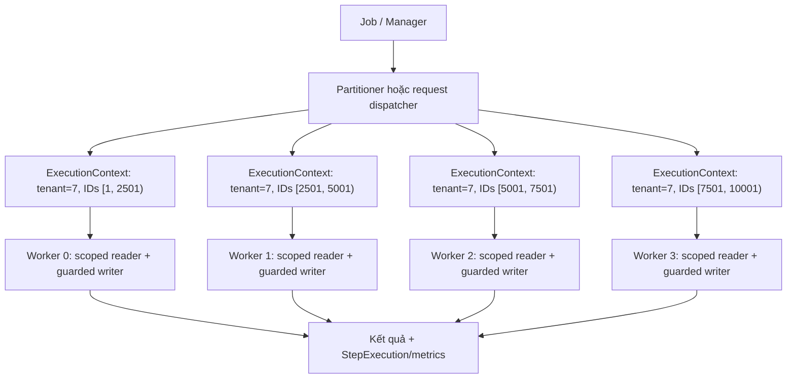

# Worker chỉ xử lý phạm vi được giao trong Spring Batch

## 1. Vì sao ranh giới dữ liệu là một hợp đồng bắt buộc?

Khi triển khai Spring Batch trên nhiều thread, nhiều tiến trình hoặc nhiều máy, **worker không được tự quyết định mở rộng phần dữ liệu mình xử lý**. Manager có thể phân phối công việc theo khoảng ID, tenant, file, time window hoặc chunk message. Mỗi worker cần thực hiện đúng **phạm vi được giao**, ghi nhận kết quả của phạm vi đó và không chủ động lấy thêm dữ liệu bên ngoài hợp đồng.

Ví dụ một job xử lý 10 triệu đơn hàng, chia thành bốn partition theo ID. Worker A được giao `[1, 2_500_001)`. Nếu A dùng câu SQL `WHERE id >= 1` mà quên cận trên, A sẽ đọc cả dữ liệu của B, C và D. Hệ thống vẫn có thể chạy nhanh và mọi `StepExecution` đều `COMPLETED`, nhưng các bản ghi có thể được cập nhật lặp, deadlock, gửi thông báo nhiều lần hoặc làm sai tổng hợp.

Bài học thuộc chương **Thiết kế worker** trong module `SPRING_BATCH_SCALING_OPERATIONS`. Mục tiêu của module là mở rộng Spring Batch cho workload lớn bằng multi-threaded step, parallel steps, partitioning và các mô hình xử lý phân tán; đo bottleneck, đảm bảo thread safety, retry/restart và vận hành theo tài nguyên thực tế. Ở đây, **phạm vi sở hữu dữ liệu** (*data ownership/scope*) là nguyên tắc nền tảng để mọi chiến lược scale vẫn giữ tính đúng.

Sau bài học, bạn sẽ biết:

- Diễn đạt một hợp đồng partition bằng `ExecutionContext` và phân biệt với hợp đồng chunk qua `ChunkRequest`.
- Đảm bảo reader **và** writer thực thi cùng giới hạn tenant/ID/file thay vì chỉ tin ở code manager.
- Kiểm tra không chồng lấn, không bỏ sót và không để worker tự quét toàn bộ nguồn.
- Thiết kế fail-fast, least privilege, idempotency, retry/restart và quan sát cho các worker chạy song song.
- Kiểm thử các tình huống cấu hình sai, worker crash, input thay đổi và side effect trùng.

> **Phiên bản ví dụ:** các đoạn Java dành cho **Spring Batch 5.x** (đặc biệt 5.2.x) và Java 17+. Ở các major version khác, package và API có thể thay đổi. Mã được dùng để minh họa hợp đồng worker và cần ghép với hạ tầng `JobRepository`, transaction manager, database/broker cụ thể của ứng dụng.

## 2. “Phạm vi được giao” có thể mang nhiều hình thức

| Cách scale | Đơn vị giao việc | Thông tin worker cần nhận | Sai lầm thường gặp |
| --- | --- | --- | --- |
| **Local/remote partitioning theo ID** | Khoảng khóa hoặc shard | `tenantId`, `startInclusive`, `endExclusive`, snapshot/run ID | Quên cận trên; tự tính lại `MIN/MAX` |
| **Partitioning theo file** | Một file hoặc nhóm file | URI/manifest ID, version/checksum, logical file ID | Worker tự quét glob và xử lý trùng file |
| **Partitioning theo thời gian** | Time window | `fromInclusive`, `toExclusive`, timezone, watermark | Hai cửa sổ cùng chứa thời điểm ranh giới |
| **Partitioning theo hash** | Bucket của khóa ổn định | `bucketIndex`, `bucketCount`, hash version | Thay số bucket hoặc hàm hash giữa restart |
| **Remote chunking** | `ChunkRequest<T>` chứa item đã được manager đọc | Chunk payload, request identity/correlation | Worker tự đọc thêm item không nằm trong request |
| **Queue nhận việc động** (thiết kế riêng) | Logical task được claim nguyên tử | Task ID, lease/owner, trạng thái claim | Nhiều worker cùng `SELECT status='NEW'` mà không claim |

Không tồn tại một biểu diễn duy nhất cho tất cả kiểu worker. Điều chung là **manager hoặc cơ chế phân phối được ủy quyền quyết định công việc**, còn worker chỉ thực hiện phần đó. Trong remote partitioning, phạm vi thường được truyền qua `StepExecutionContext`. Trong remote chunking, danh sách item đã nằm trong `ChunkRequest`; không nên tự tạo thêm partition theo ID trên worker trừ khi đó là một phần rõ ràng của thiết kế nghiệp vụ.

### Hình dung mối quan hệ manager–worker



Sơ đồ này mô tả **partitioning**. Remote chunking có manager đọc item rồi gửi chunk tới các worker qua middleware, không cần từng worker tự chạy `ItemReader` theo khoảng ID.

## 3. Ba bất biến cần bảo đảm

Gọi `D` là tập dữ liệu phải xử lý cho một job run; `P_i` là tập dữ liệu được giao cho worker/partition `i`.

**Một — Không chồng lấn (disjointness):**

\[
\forall i \neq j:\quad P_i \cap P_j = \varnothing
\]

**Hai — Bao phủ đầy đủ (coverage):**

\[
\bigcup_{i=0}^{n-1} P_i=D
\]

**Ba — Không vượt phạm vi (worker confinement):** gọi `R_i` là tập item mà worker `i` thực sự nhận để xử lý.

\[
R_i \subseteq P_i
\]

Ba bất biến độc lập ở hai tầng:

- **Manager/partitioner:** tạo kế hoạch không chồng lấn và đủ bao phủ.
- **Worker:** thực hiện đúng phạm vi của mình; không gọi query, API hay writer vượt `P_i`.

Ngay cả khi manager chia đúng, worker dùng sai predicate vẫn có thể vi phạm bất biến thứ ba. Ngược lại, tất cả worker đều tuân thủ phạm vi nhưng manager bỏ sót một khoảng thì job vẫn không xử lý đủ `D`.

Đối với **remote chunking**, một logical item có thể được broker giao lại trong một request mới hoặc cùng request sau lỗi. Khi đó, các bất biến mô tả **phân công dự kiến** chứ không chứng minh mỗi item chỉ được thực thi vật lý một lần. Cần thêm idempotency để kiểm soát hiệu ứng nghiệp vụ trong trường hợp redelivery.

### 3.1. Quy tắc khoảng đầu đóng, cuối mở

Với ID số nguyên, dùng nhất quán `[startInclusive, endExclusive)`:

```sql
SELECT id, tenant_id, amount
FROM orders
WHERE tenant_id = :tenantId
  AND id >= :startInclusive
  AND id < :endExclusive
ORDER BY id;
```

Hai khoảng kế tiếp `[1, 2501)` và `[2501, 5001)` **không trùng ID 2501**: khoảng đầu không chứa 2501, khoảng sau có. Ngược lại, dùng hai điều kiện `BETWEEN 1 AND 2500` và `BETWEEN 2500 AND 5000` sẽ đọc trùng ID 2500 vì `BETWEEN` bao gồm cả hai cận.

Ngoài khoảng số, `tenant_id` cũng là một phần của phạm vi. Một worker có quyền đọc tenant 7 không được đọc đơn hàng cùng ID của tenant 8 chỉ vì giá trị `start/end` giống nhau.

### 3.2. Ranh giới đúng phải gắn với tập input ổn định

Một partition có thể giữ nguyên `[1, 2501)` nhưng tập dữ liệu bên trong vẫn thay đổi nếu các bản ghi liên tục được chèn, xóa hoặc cập nhật. Muốn kết quả có thể restart/đối soát, hãy xác định **snapshot, watermark, manifest hoặc batch run ID** phù hợp. Chốt `MIN/MAX` một lần chỉ giúp cố định *cận khóa*, không tự tạo snapshot nhất quán của các dòng trong khoảng.

## 4. Thiết kế hợp đồng `ExecutionContext` tối thiểu

Với partition theo range và tenant, mỗi `StepExecution` worker nhận một tập tham số rõ ràng:

```yaml
partitionName: partition0003
tenantId: 7
startInclusive: 7501
endExclusive: 10001
manifestVersion: v1
```

Đây là **ví dụ diễn giải hợp đồng**, không phải một file Spring Batch tự động đọc. Trên thực tế, `Partitioner` đưa các giá trị vào `ExecutionContext` bằng `putLong`/`putString`; `partitionName` là key của map partition.

| Trường | Bắt buộc hay tùy mục đích? | Quy tắc |
| --- | --- | --- |
| `tenantId` | Bắt buộc khi nguồn đa tenant | Phải được kiểm tra ở mọi truy vấn đọc/ghi |
| `startInclusive` | Bắt buộc cho range | Không được null; có quy ước kiểu số rõ |
| `endExclusive` | Bắt buộc cho range | Phải lớn hơn start; không được tự thay cận nếu reader hết dữ liệu |
| `partitionName` | Cần ổn định khi restart | Tên phải map về cùng phạm vi trong cùng `JobInstance` |
| `manifestVersion`/`snapshotId` | Quan trọng khi input thay đổi | Nhận diện tập dữ liệu đã chốt; worker không tự tính lại |
| `scopeChecksum` hoặc kế hoạch được ký/xác minh | Tùy mức độ nhạy cảm | Phát hiện tham số không khớp với kế hoạch quản lý |

Các giá trị phải **đầy đủ, hợp lệ và có thể kiểm tra** trước khi worker mở tài nguyên. Nếu thiếu `endExclusive`, không dùng mặc định `Long.MAX_VALUE` hoặc chuyển sang `SELECT *` vì như vậy âm thầm mở rộng phạm vi.

### 4.1. Một `Partitioner` tạo phạm vi liên tiếp

Ví dụ lớp `Partitioner` tạo các khoảng ID đầu đóng cuối mở cho một tenant. Miền đầu vào phải được **chốt trước khi tạo phân vùng**:

```java
import java.util.LinkedHashMap;
import java.util.Map;
import org.springframework.batch.core.partition.support.Partitioner;
import org.springframework.batch.item.ExecutionContext;

public final class TenantRangePartitioner implements Partitioner {
    private final long tenantId;
    private final long startInclusive;
    private final long endExclusive;

    public TenantRangePartitioner(long tenantId,
                                  long startInclusive,
                                  long endExclusive) {
        if (tenantId <= 0 || endExclusive <= startInclusive) {
            throw new IllegalArgumentException("Invalid partition domain");
        }
        Math.subtractExact(endExclusive, startInclusive);
        this.tenantId = tenantId;
        this.startInclusive = startInclusive;
        this.endExclusive = endExclusive;
    }

    @Override
    public Map<String, ExecutionContext> partition(int gridSize) {
        if (gridSize <= 0) {
            throw new IllegalArgumentException("gridSize must be positive");
        }

        long total = endExclusive - startInclusive;
        int count = (int) Math.min(total, (long) gridSize);
        long size = total / count;
        long remainder = total % count;
        long cursor = startInclusive;

        Map<String, ExecutionContext> contexts = new LinkedHashMap<>();
        for (int i = 0; i < count; i++) {
            long next = Math.addExact(
                    cursor, size + (i < remainder ? 1 : 0));
            ExecutionContext context = new ExecutionContext();
            context.putLong("tenantId", tenantId);
            context.putLong("startInclusive", cursor);
            context.putLong("endExclusive", next);
            context.putString("manifestVersion", "v1");
            contexts.put(String.format("partition%04d", i), context);
            cursor = next;
        }

        if (cursor != endExclusive) {
            throw new IllegalStateException("Partition coverage mismatch");
        }
        return contexts;
    }
}
```

**Giới hạn ví dụ:** class trên yêu cầu miền **không rỗng** và độ rộng miền biểu diễn được bằng `long`; miền rỗng phải có chính sách riêng ở bước quản lý. `manifestVersion="v1"` chỉ là nhãn minh họa; production phải dùng một ID/version thực sự gắn với tập input đã chốt, không hard-code để tạo cảm giác an toàn.

Thuật toán dùng cùng một biến `cursor` cho cận trên partition trước và cận dưới partition sau, giảm nguy cơ chồng lấn. Nó chia **miền số**, không bảo đảm số bản ghi thực tế bằng nhau vì ID có thể thưa hoặc có mật độ khác nhau.

### 4.2. Đầu vào do manager quyết định, worker không tự tính lại

Một anti-pattern là worker nhận `partitionIndex=3` rồi tự gọi `SELECT MIN(id), MAX(id)` và chia lại theo số worker đang online. Nếu các worker thấy snapshot khác nhau, hoặc `gridSize` thay giữa lần chạy và restart, cùng tên partition có thể gắn tới một vùng dữ liệu khác.

Thay vào đó:

1. Manager tạo kế hoạch từ **một snapshot/manifest ổn định**.
2. `Partitioner` trả về map `partitionName → ExecutionContext` theo quy tắc xác định.
3. Worker lấy đúng tham số từ `StepExecutionContext`; có thể đối chiếu thêm với manifest bền vững.
4. Nếu tham số không nhất quán, worker **fail fast**, không quét nguồn để “tự sửa”.
5. Kế hoạch và ánh xạ tên partition phải được giữ tương thích qua restart cùng `JobInstance`.

## 5. Worker phải áp dụng phạm vi ở cả reader và writer

Chỉ giới hạn `ItemReader` là **chưa đủ**. Processor có thể tạo thêm đối tượng, lỗi mapping có thể làm lệch `tenantId`, hoặc writer có thể dùng một câu SQL cập nhật quá rộng. Phòng vệ nhiều lớp:

1. **Validate input context**: từ chối nếu thiếu tenant hoặc khoảng ID không hợp lệ.
2. **Scoped reader**: câu SQL bao gồm tất cả cột xác định phạm vi (tenant, cận dưới, cận trên, thời điểm/snapshot nếu có).
3. **Item-level guard**: trước side effect, kiểm tra từng item vẫn thuộc phạm vi.
4. **Scoped writer**: WHERE/partition key ở câu cập nhật cũng giữ ranh giới, không chỉ phụ thuộc ItemReader.
5. **Database constraints/permissions**: unique key, row-level security hoặc quyền account phù hợp nếu nghiệp vụ yêu cầu. Kiểm tra trong code không thay thế quyền DB.

### 5.1. Ví dụ worker step theo `StepExecutionContext`

Giả sử schema:

```sql
CREATE TABLE orders (
    tenant_id BIGINT NOT NULL,
    id BIGINT NOT NULL,
    amount DECIMAL(18, 2) NOT NULL,
    processed BOOLEAN NOT NULL DEFAULT FALSE,
    PRIMARY KEY (tenant_id, id)
);
```

Ở đây khóa nghiệp vụ là **`(tenant_id, id)`**, không phải `id` đơn lẻ. Worker được phép cập nhật các row thuộc `AssignedScope(tenantId, start, end)`. Ví dụ Java Spring Batch 5.2:

```java
import java.math.BigDecimal;
import java.util.ArrayList;
import java.util.List;
import javax.sql.DataSource;

import org.springframework.batch.core.Step;
import org.springframework.batch.core.configuration.annotation.StepScope;
import org.springframework.batch.core.repository.JobRepository;
import org.springframework.batch.core.step.builder.StepBuilder;
import org.springframework.batch.item.ItemWriter;
import org.springframework.batch.item.database.JdbcCursorItemReader;
import org.springframework.batch.item.database.builder.JdbcCursorItemReaderBuilder;
import org.springframework.beans.factory.annotation.Qualifier;
import org.springframework.beans.factory.annotation.Value;
import org.springframework.context.annotation.Bean;
import org.springframework.context.annotation.Configuration;
import org.springframework.jdbc.core.JdbcTemplate;
import org.springframework.transaction.PlatformTransactionManager;

record OrderRow(long id, long tenantId, BigDecimal amount) {}

record AssignedScope(long tenantId,
                     long startInclusive,
                     long endExclusive) {
    AssignedScope {
        if (tenantId <= 0 || endExclusive <= startInclusive) {
            throw new IllegalArgumentException("Invalid worker scope");
        }
    }

    boolean contains(OrderRow item) {
        return item.tenantId() == tenantId
                && item.id() >= startInclusive
                && item.id() < endExclusive;
    }
}

@Configuration
public class ScopedWorkerConfig {
    private static AssignedScope requireScope(
            Long tenantId, Long startInclusive, Long endExclusive) {
        if (tenantId == null || startInclusive == null || endExclusive == null) {
            throw new IllegalArgumentException("Missing partition bounds");
        }
        return new AssignedScope(tenantId, startInclusive, endExclusive);
    }

    @Bean
    @StepScope
    public JdbcCursorItemReader<OrderRow> scopedOrderReader(
            DataSource dataSource,
            @Value("#{stepExecutionContext['tenantId']}") Long tenantId,
            @Value("#{stepExecutionContext['startInclusive']}") Long start,
            @Value("#{stepExecutionContext['endExclusive']}") Long end) {

        AssignedScope scope = requireScope(tenantId, start, end);
        return new JdbcCursorItemReaderBuilder<OrderRow>()
                .name("scopedOrderReader")
                .dataSource(dataSource)
                .sql("SELECT id, tenant_id, amount FROM orders "
                    + "WHERE tenant_id = ? AND id >= ? AND id < ? "
                    + "ORDER BY id")
                .preparedStatementSetter(ps -> {
                    ps.setLong(1, scope.tenantId());
                    ps.setLong(2, scope.startInclusive());
                    ps.setLong(3, scope.endExclusive());
                })
                .rowMapper((rs, rowNum) -> new OrderRow(
                        rs.getLong("id"),
                        rs.getLong("tenant_id"),
                        rs.getBigDecimal("amount")))
                .saveState(true)
                .build();
    }

    @Bean
    @StepScope
    public ItemWriter<OrderRow> scopedOrderWriter(
            JdbcTemplate jdbcTemplate,
            @Value("#{stepExecutionContext['tenantId']}") Long tenantId,
            @Value("#{stepExecutionContext['startInclusive']}") Long start,
            @Value("#{stepExecutionContext['endExclusive']}") Long end) {

        AssignedScope scope = requireScope(tenantId, start, end);

        return chunk -> {
            List<Object[]> args = new ArrayList<>();
            for (OrderRow item : chunk.getItems()) {
                if (!scope.contains(item)) {
                    throw new IllegalStateException(
                            "Item outside assigned partition: " + item.id());
                }
                args.add(new Object[] {
                        item.id(), scope.tenantId(),
                        scope.startInclusive(), scope.endExclusive()
                });
            }

            jdbcTemplate.batchUpdate(
                    "UPDATE orders SET processed = TRUE "
                    + "WHERE id = ? AND tenant_id = ? "
                    + "AND id >= ? AND id < ? "
                    + "AND processed = FALSE",
                    args);
        };
    }

    @Bean
    public Step workerStep(
            JobRepository jobRepository,
            PlatformTransactionManager transactionManager,
            @Qualifier("scopedOrderReader")
            JdbcCursorItemReader<OrderRow> reader,
            @Qualifier("scopedOrderWriter") ItemWriter<OrderRow> writer) {

        return new StepBuilder("workerStep", jobRepository)
                .<OrderRow, OrderRow>chunk(100, transactionManager)
                .reader(reader)
                .writer(writer)
                .build();
    }
}
```

**Điểm đáng chú ý ở đoạn mã:**

- `@StepScope` làm reader và writer nhận tham số của **`StepExecution` hiện tại** và tránh chia sẻ trạng thái reader giữa các partition chạy đồng thời. Không đánh dấu chính bean `Step` bằng `@StepScope`; step là cấu hình dùng lại, các thành phần có trạng thái/late binding mới cần scope.
- `requireScope(...)` từ chối thiếu tham số. **Không dùng fallback** sang một tenant mặc định hoặc query toàn bảng khi không tìm thấy context.
- SQL reader lọc theo `tenant_id` và khoảng `id >= start AND id < end`. `ORDER BY id` giúp thứ tự ổn định hơn cho cursor/checkpoint.
- Writer kiểm tra **từng item** và vẫn thêm tenant/range vào `UPDATE`. Nếu processor/mapper vô tình biến một item thành ID khác ngoài phạm vi, writer sẽ ném exception thay vì ghi sang partition của worker khác.
- Writer đặt cờ `processed = TRUE` theo điều kiện `processed = FALSE` để tránh thay đổi trạng thái lần hai khi nhận lại cùng row. Đây là thao tác minh họa idempotent, **không đủ** cho cộng tiền, gọi API hay các side effect không idempotent.
- `StepBuilder` dùng transaction manager của worker; các lệnh ghi trong một chunk được commit/rollback theo cấu hình transaction thực tế.

**Giới hạn và điều kiện:** đoạn mã chỉ mô tả worker step, chưa có manager `PartitionStep` hay transport remote partitioning. Khi worker ở máy khác, nó phải có kết nối phù hợp tới `JobRepository`/hạ tầng metadata và nhận `StepExecution` do manager quản lý theo kiến trúc remote partitioning. Các chi tiết broker, serialization và `StepExecutionRequestHandler` thuộc bước cấu hình điều phối riêng.

### 5.2. Vì sao writer phải giữ lại predicate phạm vi?

Hãy so sánh hai câu lệnh:

```sql
-- SAI: writer vô tình ghi mọi tenant có cùng ID.
UPDATE orders SET processed = TRUE WHERE id = :id;

-- ĐÚNG: giới hạn theo cả khóa tenant và range đã giao.
UPDATE orders SET processed = TRUE
WHERE tenant_id = :tenantId
  AND id = :id
  AND id >= :startInclusive
  AND id < :endExclusive
  AND processed = FALSE;
```

Ở schema có `PRIMARY KEY (tenant_id, id)`, một ID có thể tồn tại ở nhiều tenant. Writer đầu tiên có thể cập nhật dữ liệu tenant khác dù reader đã lọc đúng. Predicate bổ sung ở writer là **phòng vệ bổ sung**, không thay thế khả năng kiểm tra và ràng buộc ở database.

**Không dùng `UPDATE ... WHERE id BETWEEN start AND end` nếu các partition dùng `[start, end)`:** `BETWEEN` bao gồm cả hai đầu và có thể ghi lặp ở cận trên.

### 5.3. Bảo vệ trường hợp processor biến đổi dữ liệu

Trong ví dụ, processor là pass-through. Nếu processor tạo ra đối tượng đầu ra khác, chẳng hạn `OrderCommand(targetOrderId, targetTenantId, amount)`, writer phải kiểm tra **khóa đầu ra** thuộc scope, không chỉ kiểm tra input. Một item đầu vào hợp lệ nhưng kết quả biến đổi nhắm tới tenant khác vẫn là vượt quyền xử lý nếu không có hợp đồng liên tenant rõ ràng.

Một số tác vụ cần tác động tới nhiều bản ghi (ví dụ cập nhật đơn hàng và dòng chi tiết). Hãy định nghĩa rõ **đơn vị ownership**: toàn bộ aggregate thuộc cùng khóa/tenant có thể hợp lệ, nhưng update sang aggregate của partition khác cần cơ chế phối hợp hoặc thiết kế lại phân vùng. Không mở rộng scope ngầm chỉ vì một truy vấn join trả thêm dữ liệu.

## 6. Worker xử lý file: một resource có danh tính rõ ràng

Với file partitioning, “phạm vi được giao” thường là một URI hoặc một tập URI lấy từ **manifest cố định**. Worker không nên nhận một directory glob rồi tự chạy `Files.walk` để tìm *mọi* file mới ở thời điểm khởi động.

Một context điển hình:

```yaml
partitionName: file0007
manifestId: import-2026-11-26-v3
resourceUri: s3://batch-input/orders/part-007.csv
resourceVersion: 3Lg5-example-etag
expectedSha256: e1e6-example-checksum
```

Đây là **manifest minh họa**, các chuỗi version/checksum không phải giá trị tính toán thực. Worker cần:

1. Xác minh `manifestId` tồn tại và partition đó thực sự có `resourceUri` được giao.
2. Kiểm tra URI nằm trong vùng storage được phép; chống path traversal và alias/symlink gây đọc trùng hoặc vượt quyền.
3. Khi hệ thống hỗ trợ, xác minh object version/ETag/checksum, kích thước hoặc record count trước khi đọc; lưu ý ETag không phải luôn là SHA-256 của file.
4. Đọc đúng file/version đã chốt. Không tự thêm file mới xuất hiện trong directory sau khi manager tạo kế hoạch.
5. Ghi output theo **tên partition hoặc logical file ID** để tránh nhiều worker ghi chung một output file không đồng bộ.

Nếu cùng khóa nghiệp vụ xuất hiện ở hai file khác nhau, “mỗi worker chỉ đọc một file” **chưa đảm bảo** không xử lý trùng bản ghi logic. Cần định nghĩa owner theo logical record key, manifest dedup hoặc writer idempotent theo yêu cầu nghiệp vụ.

### 6.1. Cẩn thận khi chia một file lớn theo byte offset

Với CSV/JSONL, không tùy ý cắt file tại byte `500_000_000` rồi đọc một dòng từ đó nếu offset nằm giữa ký tự UTF-8, giữa record hoặc trong một trường CSV nhiều dòng có dấu ngoặc kép. Nếu muốn chia một file lớn thành nhiều đoạn, cần định nghĩa thuật toán **chọn ranh giới record thực** và chứng minh mỗi record thuộc đúng một đoạn.

Worker nhận `startOffset/endOffset` chỉ được giải mã dữ liệu trong phạm vi tương ứng theo thuật toán đã duyệt; không dùng “đọc thêm cho tới EOF” khi thấy cuối phân vùng để tránh vượt scope. Khi cần đọc một lượng byte *lookahead* để xác định ranh giới dòng, phân biệt **đọc kỹ thuật** với **quyền xử lý/commit record** và bảo đảm record chỉ có một owner.

## 7. Worker xử lý theo thời gian và hash

### 7.1. Time window: cùng timezone, cận trên mở

Khi chia dữ liệu theo thời gian, dùng một quy ước `[fromInclusive, toExclusive)`:

```sql
SELECT event_id, event_time
FROM events
WHERE tenant_id = :tenantId
  AND event_time >= :fromInclusive
  AND event_time < :toExclusive
ORDER BY event_time, event_id;
```

Với hai window `[2026-11-26T00:00Z, 2026-11-27T00:00Z)` và `[2026-11-27T00:00Z, 2026-11-28T00:00Z)`, event tại chính xác `2026-11-27T00:00Z` thuộc window thứ hai. Không dùng điều kiện `event_time <= :toInclusive` ở cả hai window.

Chọn **Instant/UTC** hoặc một định nghĩa timezone rõ, tránh logic `23:59:59.999` vì cột DB có thể dùng độ chính xác microsecond hoặc nanosecond. Với nguồn có late-arriving events, quy định watermark và cách chạy backfill, không cho worker tự mở rộng cửa sổ để “bù” dữ liệu tới muộn mà không có kế hoạch.

### 7.2. Hash partition: không tự đổi số bucket

Nếu manager dùng quy tắc `bucket = floorMod(stableHash(key), bucketCount)`, worker phải dùng **cùng version hàm hash** và `bucketCount`:

```java
int ownerBucket(long recordId, int bucketCount) {
    if (bucketCount <= 0) {
        throw new IllegalArgumentException("Invalid bucketCount");
    }
    return Math.floorMod(Long.hashCode(recordId), bucketCount);
}
```

Không để từng worker tự tính `bucketCount` dựa trên số instance đang chạy. Khi scale từ bốn lên sáu instance, thay đổi `bucketCount` sẽ làm nhiều record đổi owner, gây trùng/bỏ sót giữa restart hoặc các worker cũ còn hoạt động. Trong hệ thống cần thay đổi topology, manager phải quản lý **kế hoạch phân công phiên bản hóa** và thời điểm chuyển trạng thái có kiểm soát.

## 8. Với remote chunking, phạm vi là chính `ChunkRequest`

Trong **remote chunking**, manager giữ `ItemReader` và gửi item thực tế trong `ChunkRequest<T>` qua middleware. Worker không có nhiệm vụ quét lại nguồn theo ID range của riêng mình. Hợp đồng đơn giản:

> **Worker chỉ xử lý những item nằm trong `ChunkRequest` đã nhận**, hoặc các dữ liệu phụ trợ được phép tra cứu cho chính các item đó theo quy tắc nghiệp vụ; không tự tìm thêm item để “lấp đầy” chunk hoặc tận dụng CPU rảnh.

Ví dụ worker nhận request chứa `[1001, 1002, 1003]`. Những hành động đúng/sai:

| Worker thực hiện | Có đúng phạm vi không? | Lý do |
| --- | --- | --- |
| Nạp chi tiết cho ID 1001–1003 rồi xử lý | **Có**, nếu quyền truy cập được xác minh | Truy xuất dữ liệu phụ trợ cho item được giao |
| Batch-update ba ID 1001, 1002, 1003 | **Có** | Đúng danh sách item trong request |
| Nếu xử lý xong sớm, chạy `SELECT TOP 100 * WHERE status='NEW'` để lấy thêm việc | **Không** | Tự nhận dữ liệu ngoài request; có thể tranh với manager hoặc worker khác |
| Nhận request lặp do broker redelivery và kiểm tra idempotency trước xử lý | **Có** | Retry cùng công việc logic theo hợp đồng và cơ chế vận chuyển |
| Khi request thiếu item, query từ ID đầu đến ID cuối và xử lý mọi record xen giữa | **Không** | Chunk chỉ chứa những item được manager chọn; khoảng min/max không phải phạm vi được giao |
| Phát email cho mọi khách hàng thuộc tenant chỉ vì một item của tenant đó được giao | **Không**, trừ khi hợp đồng nghiệp vụ định nghĩa rõ | Side effect vượt đơn vị ownership |

### 8.1. Không nhầm `ChunkRequest` với `ExecutionContext`

| Đặc điểm | Worker của remote partitioning | Worker của remote chunking |
| --- | --- | --- |
| Manager truyền | `StepExecution`/`ExecutionContext` mô tả phạm vi | `ChunkRequest<T>` chứa `Chunk<? extends T>` |
| Worker đọc nguồn chính | **Có**, qua reader được scope | Thông thường **không**; manager đã đọc item |
| Cách giới hạn | Predicate reader và writer, file/partition identity | Danh sách item và metadata request, validation/guard ở processor/writer |
| Metadata | Worker `StepExecution` được quản lý qua cơ chế partition/repository | Manager quản lý step; worker trả `ChunkResponse`/contribution |
| Cơ chế retry | Step/chunk restart theo `StepExecution` và transaction | Broker redelivery, handler retry/reply và manager restart |

Trong Spring Batch 5.2, `ChunkRequest` có thông tin `sequence`, `items`, `jobId` (JobInstance ID trong API 5.2) và `StepContribution`. Worker handler nhận đúng request, xử lý chunk và phát `ChunkResponse`. Khi log, phân biệt ID request với `JMSMessageID` của broker; một chunk được phát lại có thể có message ID vận chuyển mới.

### 8.2. Một worker remote chunking có thể nhận chunk không theo thứ tự

Vì nhiều consumer cùng nhận request queue, chunk có thể được xử lý/hoàn thành không đúng thứ tự manager gửi. Worker cần xử lý **độc lập theo nội dung request**; không dựa vào việc sequence 12 phải đến sau sequence 11 tại cùng process. Nếu nghiệp vụ yêu cầu thứ tự tuyệt đối theo một khóa (ví dụ chuỗi giao dịch cùng tài khoản), cần thiết kế **ordering/partition key/serialization** phù hợp, không chỉ tăng worker và tin rằng broker sẽ giữ global order.

### 8.3. Ngăn request giả hoặc quá hạn

Ở môi trường nhiều tenant và worker phân tán:

- Xác minh request đến từ channel/broker được phép, sử dụng TLS và ACL của broker.
- Kiểm tra `jobId`/run context hoặc một allowlist scope khi yêu cầu mức bảo vệ cao hơn. Một field trong payload **không phải chữ ký bảo mật** nếu client không đáng tin có thể tự sửa.
- Giới hạn số item và kích thước message; từ chối payload quá lớn hoặc DTO không deserialize an toàn.
- Kiểm tra dữ liệu mỗi item thuộc tenant/operation scope cho phép trước khi gọi API hoặc writer.
- Phân loại stale request từ job đã kết thúc hoặc bị hủy; không mặc định mọi message cũ còn trong queue đều hợp lệ.

**Bảo mật phạm vi** và **đúng kế hoạch dữ liệu** là hai trách nhiệm khác nhau. TLS/ACL ngăn nguồn không được phép gửi message; nhưng không thay thế kiểm tra ranh giới trong `ExecutionContext` hoặc danh sách item.

## 9. Sai lầm “worker tự tìm thêm việc” và cách thay thế

Một số hệ thống thử “tối ưu” bằng cách để worker, sau khi hoàn tất chunk, tự truy vấn database:

```sql
-- Anti-pattern nếu manager đã chia partition hoặc gửi ChunkRequest.
SELECT id FROM orders
WHERE processed = FALSE
ORDER BY id
LIMIT 100;
```

Hai worker có thể thấy cùng 100 row trước khi bất kỳ worker nào commit. Worker A được giao `[1, 2501)` còn có thể lấy ID trong vùng của worker B. Đây không còn là phân phối công việc theo phạm vi tĩnh và khiến metadata/restart mất ý nghĩa.

Có hai hướng thiết kế khác nhau; cần chọn **một** và xây đủ hợp đồng:

1. **Static partitioning hoặc remote chunking:** worker chỉ nhận `ExecutionContext` hoặc `ChunkRequest`; khi rảnh, nó chờ manager/broker giao việc tiếp. Không tự query nguồn.
2. **Dynamic work stealing/claim queue** (kiến trúc nghiệp vụ riêng): dữ liệu cần có cơ chế **atomic claim**. Worker lấy task qua update có điều kiện/lock trong transaction, nhận lease/owner/expiry rõ ràng, tránh hai consumer cùng claim. Một số database hỗ trợ `SELECT ... FOR UPDATE SKIP LOCKED`, nhưng cú pháp và semantics phụ thuộc DB/isolation level.

Nếu chọn cách thứ hai, phải xác định rõ **ai là owner của task và khi nào lease hết hạn**. Đừng trộn một queue claim tự phát với các partition do Spring Batch manager đã tạo, vì khi đó hai hệ điều phối có thể cùng coi mình là nguồn chân lý.

### 9.1. Không tự nới phạm vi khi thấy khoảng rỗng

Partition `[2501, 5001)` có thể chỉ chứa 20 row vì ID thưa hoặc do filter tenant. Worker nên xử lý 20 row và hoàn tất, **không chuyển sang `[5001, 7501)` để bù đủ 2.500 row**. Việc chia load không đều là vấn đề tuning/partitioner, không phải lý do để một worker bỏ qua ownership contract.

### 9.2. Không dùng hàng chờ nội bộ để lén chia sẻ mutable reader

Một worker step dùng `JdbcCursorItemReader` có cursor/trạng thái. Đưa cùng một reader singleton cho nhiều thread khiến chúng có thể tranh trạng thái cursor và checkpoint. Cách an toàn là dùng `@StepScope` cho reader có state trong partitioning, hoặc thiết kế reader thread-safe rõ ràng và được kiểm thử. `@StepScope` không thay thế việc bảo đảm processor/writer không sử dụng mutable shared state sai cách.

## 10. Retry, restart và idempotency: giữ phạm vi trong mọi lần thử

### 10.1. Replay cùng phạm vi là hợp lệ; mở rộng phạm vi thì không

Worker có thể xử lý lại **cùng phạm vi được giao** khi một chunk bị rollback hoặc broker redeliver request. Điều này không vi phạm việc “chỉ xử lý phạm vi được giao” theo nghĩa *scope*, nhưng có thể gây **trùng hiệu ứng nghiệp vụ**. Cần phân biệt:

- **Scope correctness:** item được đọc/ghi thuộc đúng phần việc đã giao.
- **Execution attempts:** cùng item có thể được *thử* xử lý nhiều lần vì retry.
- **Business exactly-once effect:** thao tác nghiệp vụ được commit đúng một lần (nếu yêu cầu) nhờ idempotency/transaction/reconciliation.

Ví dụ:

```text
workerStep:partition0002 được giao [5001, 7501)
Attempt 1: ghi id=5001..5300 rồi lỗi ở id=5301.
  -> Các chunk đã commit có thể còn ở DB; chunk lỗi rollback.
Attempt 2 (restart): chỉ tiếp tục theo checkpoint/restart policy.
  -> Không được tự đọc id < 5001 hoặc id >= 7501.
  -> Không tạo side effect lặp cho những item đã commit.
```

Chi tiết replay tùy checkpoint của reader, transaction và trạng thái `StepExecution`. **Không suy ra số lần đọc lại = số lần commit**: một chunk rollback có thể được đọc lại nhưng không có DB commit của lần thử trước.

### 10.2. Ranh giới không tự sửa khi restart

Trong Spring Batch partitioning, tên partition và dữ liệu trong `ExecutionContext` phải giữ được **ánh xạ ổn định** trong cùng `JobInstance`. Ví dụ `partition0002` đang đại diện `[5001, 7501)`; đổi `gridSize`/thuật toán chia/miền ID làm nó đại diện `[4001, 6001)` có thể khiến metadata hoàn thành và checkpoint không còn khớp.

Trước restart:

- Dùng cùng identifying `JobParameters` và snapshot/manifest input.
- Kiểm tra `partitionName → assigned scope` vẫn đúng với lúc job bắt đầu.
- Không để worker dựa trên số thread hiện tại để tính lại ranh giới.
- Không dùng glob directory mới sinh file khác để thay thế file của partition đã tồn tại.
- Nếu phải thay đổi partition plan, xem đó là **thay đổi hợp đồng dữ liệu** và cần một kế hoạch migrate/reconciliation hoặc `JobInstance` mới có kiểm soát.

Remote chunking có failure window riêng: worker có thể đã commit DB nhưng crash trước ACK/reply. Broker gửi lại cùng `ChunkRequest` cho worker khác; worker mới vẫn chỉ xử lý item đã giao, song cần **idempotency** để tránh áp dụng side effect lần hai.

### 10.3. Idempotency key ổn định theo công việc logic

Với nghiệp vụ không idempotent như trừ tiền hay phát sự kiện, tránh chỉ dựa vào `StepExecutionId` hoặc `JMSMessageID` để đánh dấu đã xử lý. Những ID đó có thể khác qua retry/restart. Một khóa ví dụ là `(businessBatchId, tenantId, orderId, operationType)`.

```sql
CREATE TABLE processed_operation (
    business_batch_id VARCHAR(100) NOT NULL,
    tenant_id BIGINT NOT NULL,
    order_id BIGINT NOT NULL,
    operation_type VARCHAR(40) NOT NULL,
    PRIMARY KEY (business_batch_id, tenant_id, order_id, operation_type)
);
```

Trong cùng DB transaction với side effect, thử ghi operation key có unique constraint. Nếu key đã tồn tại ở trạng thái đã commit, không thực hiện lại thao tác nghiệp vụ. Với API ngoài DB transaction, dùng idempotency key tại downstream, transactional outbox hoặc một quy trình reconciliation phù hợp.

**Không tự động coi việc writer trả “0 rows updated” là hoàn thành mọi nghĩa vụ nghiệp vụ.** Với cờ `processed=TRUE`, đó có thể là dấu hiệu đã xử lý trước; nhưng nếu câu WHERE sai hoặc row không tồn tại, nó có thể là tín hiệu dữ liệu bị thiếu. Phải định nghĩa chính sách phân biệt các trường hợp này.

### 10.4. Lỗi worker không được được “sửa” bằng cách nhận thêm dữ liệu

Khi worker xử lý phân vùng chậm, mất kết nối DB hoặc gặp một bản ghi lỗi:

- **Lỗi tạm thời:** rollback và retry với giới hạn/backoff theo chính sách của step hoặc broker.
- **Lỗi dữ liệu cố định:** skip có kiểm soát hoặc fail và đưa vào DLQ/quarantine tùy kiến trúc; ghi audit.
- **Phạm vi không hợp lệ:** fail fast, không retry vô hạn và không mở rộng query để tìm dữ liệu “hợp lệ khác”.
- **Request đã commit nhưng reply thất lạc:** reconciliation và idempotent replay; không tự tìm các request khác trong broker.

Worker nên báo trạng thái rõ về manager hoặc qua hệ thống điều phối. Với remote partitioning, StepExecution và JobRepository hỗ trợ theo dõi; với remote chunking, worker trả `ChunkResponse` về manager và cần quản lý ACK/request/reply theo cấu hình messaging.

## 11. Quan sát worker bằng những tín hiệu phù hợp

Không chỉ đo `READ_COUNT` hoặc `WRITE_COUNT`. Để xác minh “worker chỉ xử lý phạm vi được giao”, cần lưu **bằng chứng ownership** mà không lộ dữ liệu nhạy cảm:

```text
jobInstanceId=501
jobExecutionId=902
stepExecutionId=1453
partitionName=partition0002
tenantId=7
startInclusive=5001
endExclusive=7501
manifestVersion=v3
workerInstance=worker-b
readCount=...
writeCount=...
scopeViolationCount=0
duplicateSuppressedCount=...
retryCount=...
```

Với remote chunking, thay `partitionName/start/end` bằng `chunkSequence`, logical request ID và item count, đồng thời lưu delivery attempt/correlation nếu cần. Các trường ở trên là **log cấu trúc gợi ý**, không phải tất cả đều là field mặc định của `StepExecution` hay `ChunkRequest`.

### 11.1. Các nhóm metric quan trọng

| Metric | Để phát hiện điều gì? |
| --- | --- |
| `scopeViolationCount` | Item ra ngoài tenant/range/file/manifest đã giao |
| `duplicateSuppressedCount` | Retry/redelivery đã gặp operation từng được commit |
| `partitionStart/End`, manifest version | Worker có dùng đúng kế hoạch và snapshot không |
| `READ_COUNT`, `WRITE_COUNT` theo `StepExecution` | Tiến độ và sự lệch tải giữa worker |
| `readLatency`, `processLatency`, `writeLatency` | Nút thắt thực tế của worker |
| DB lock wait/deadlock/connection wait | Chồng lấn writer hoặc tăng concurrency vượt DB pool |
| JMS redelivery, DLQ, pending replies | Worker lỗi hoặc request/reply không đến đúng nơi |
| Số source key **duy nhất** và target key **duy nhất** | Phát hiện xử lý trùng/bỏ sót ở mức nghiệp vụ |

Ở remote partitioning, thường có các `StepExecution` worker như `workerStep:partition0002` trong metadata của `JobRepository`. Với remote chunking, manager tổng hợp contribution theo chunk, không nhất thiết có một dòng `StepExecution` riêng cho mỗi worker/message.

### 11.2. Kiểm tra metadata nhưng không chỉ tin metadata

```sql
SELECT STEP_NAME, STATUS, READ_COUNT, WRITE_COUNT,
       COMMIT_COUNT, ROLLBACK_COUNT
FROM BATCH_STEP_EXECUTION
WHERE JOB_EXECUTION_ID = :jobExecutionId
ORDER BY STEP_NAME;
```

Một `StepExecution` ở trạng thái `COMPLETED` nghĩa là step hoàn tất theo logic Spring Batch, **không chứng minh** mọi item nó xử lý đều nằm trong phạm vi chính xác nếu SQL reader/writer sai. Đồng thời `WRITE_COUNT` không thể tự chứng minh không có side effect ngoài database bị lặp sau retry. Cần kết hợp metadata với audit owner, DB constraint và kết quả đối soát.

## 12. Kiểm tra kế hoạch và dữ liệu thực tế

### 12.1. Fail fast nếu hai partition bị chồng lấn

Nếu lưu kế hoạch chạy vào bảng riêng `partition_plan` với các cột `run_id, partition_name, tenant_id, start_id, end_exclusive`, có thể tìm các cặp partition chồng lấn:

```sql
SELECT a.partition_name AS partition_a,
       b.partition_name AS partition_b,
       a.tenant_id,
       a.start_id AS a_start,
       a.end_exclusive AS a_end,
       b.start_id AS b_start,
       b.end_exclusive AS b_end
FROM partition_plan a
JOIN partition_plan b
  ON a.run_id = b.run_id
 AND a.tenant_id = b.tenant_id
 AND a.partition_name < b.partition_name
 AND a.start_id < b.end_exclusive
 AND b.start_id < a.end_exclusive
WHERE a.run_id = :runId;
```

Với các khoảng đầu đóng cuối mở, điều kiện giao nhau là:

\[
A.start < B.end \quad\land\quad B.start < A.end
\]

Kết quả truy vấn **phải rỗng** nếu mỗi khóa tenant/ID chỉ có một partition owner trong cùng một kế hoạch. Cần kiểm tra thêm mọi khoảng đều không rỗng (`start_id < end_exclusive`) và không thiếu vùng:

```sql
SELECT tenant_id,
       partition_name,
       start_id,
       end_exclusive,
       LAG(end_exclusive) OVER (
           PARTITION BY tenant_id
           ORDER BY start_id, end_exclusive
       ) AS previous_end
FROM partition_plan
WHERE run_id = :runId
ORDER BY tenant_id, start_id, end_exclusive;
```

Ở từng tenant, `start_id` của khoảng kế tiếp phải **bằng** `previous_end`. So cả biên đầu/cuối với miền kỳ vọng đã chốt; nếu chỉ kiểm tra các khoảng kề nhau mà không có miền kỳ vọng, vẫn có thể bỏ sót dữ liệu ở đầu/cuối.

Đây là mẫu SQL minh họa; cú pháp `LAG`, kiểu `run_id` và các index phụ thuộc DB. Truy vấn kiểm tra nên chạy **trước khi giao partition cho executor**, không phải sau khi đã có side effect.

### 12.2. Đối soát các item worker thật sự commit

Với audit chứa `run_id, partition_name, tenant_id, source_id` cho những item đã **commit**, tìm các item nằm ngoài phạm vi:

```sql
SELECT a.run_id, a.partition_name, a.tenant_id, a.source_id
FROM processing_audit a
LEFT JOIN partition_plan p
  ON p.run_id = a.run_id
 AND p.partition_name = a.partition_name
 AND p.tenant_id = a.tenant_id
WHERE a.run_id = :runId
  AND (
       p.partition_name IS NULL
       OR a.source_id < p.start_id
       OR a.source_id >= p.end_exclusive
  );
```

Kết quả kỳ vọng là **0 dòng**. Đồng thời có thể phát hiện một bản ghi có nhiều partition owner:

```sql
SELECT tenant_id, source_id,
       COUNT(DISTINCT partition_name) AS owner_count
FROM processing_audit
WHERE run_id = :runId
GROUP BY tenant_id, source_id
HAVING COUNT(DISTINCT partition_name) > 1;
```

Nếu cùng một item được **thử xử lý** nhiều lần nhưng transaction lỗi đã rollback, audit của **attempt** có thể chứa nhiều sự kiện dù không có duplicate commit. Vì vậy, đặt rõ semantics của bảng audit: ghi trong cùng transaction với side effect nếu muốn xác minh commit, hoặc lưu attempt ở bảng/log khác và phân loại kết quả. Không dùng mỗi số lần gọi reader làm bằng chứng dữ liệu bị ghi lặp.

### 12.3. Coverage có đúng trên tập dữ liệu thật?

Với ID thưa, tổng độ dài các khoảng có thể là 10.000 nhưng chỉ có 8.000 row tồn tại. Đừng kiểm tra rằng `SUM(partition_length) == SUM(READ_COUNT)`. Phải đối chiếu:

1. **Tập key nguồn đã chốt** (`D`) của một run/snapshot.
2. **Tập key thuộc các partition** (`P_0 \cup ... \cup P_n`).
3. **Tập key đã commit** ở hệ thống đích, có trừ skip được phép và lỗi được báo đúng.

Phép so theo key duy nhất hoặc hash/checksum có kiểm chứng giúp phát hiện cả **duplicate** lẫn **gap**; riêng việc tổng số bằng nhau có thể bị trường hợp trùng hai row nhưng thiếu hai row khác đánh lừa.

## 13. Bộ kiểm thử worker đúng phạm vi

### 13.1. Unit test cho guard và ranh giới

Kiểm tra một `AssignedScope(tenantId=7, start=2501, end=5001)`:

| Item | Có được xử lý? | Lý do |
| --- | --- | --- |
| `(tenant=7, id=2500)` | **Không** | Nằm dưới cận dưới |
| `(tenant=7, id=2501)` | **Có** | Cận dưới được bao gồm |
| `(tenant=7, id=5000)` | **Có** | ID cuối cùng trước cận trên |
| `(tenant=7, id=5001)` | **Không** | Cận trên bị loại |
| `(tenant=8, id=3000)` | **Không** | Tenant không đúng, dù ID thuộc khoảng |
| `(tenant=7, id=3000)` | **Có** | Đúng tenant và đúng khoảng |

Thêm test lỗi đầu vào: `tenantId=null`, `start=null`, `end=null`, `end <= start` phải bị từ chối. Không có bất kỳ code path nào dùng query không ràng buộc khi thiếu context.

### 13.2. Integration test reader và writer

Chạy với database test có hai tenant dùng trùng ID, mỗi tenant có row ở đầu, giữa và ngoài khoảng. Xác minh:

1. Reader chỉ trả các row đúng `tenant_id` và khoảng ID.
2. Writer chỉ cập nhật row của tenant được giao; không vô tình cập nhật cùng ID của tenant khác.
3. Nếu cố tình đưa một item ngoài scope trực tiếp vào writer, writer ném exception và chunk transaction rollback.
4. Thử reader với các ID nằm đúng cận dưới, ngay trước cận trên; không có off-by-one.
5. Chạy hai worker partition song song và kiểm tra không có row đích được hai partition commit trùng, kể cả khi ID của các tenant trùng nhau.
6. Nếu processor biến đổi khóa đầu ra, kiểm tra guard tại **đầu ra** chứ không chỉ tại input.

Trong Spring Batch 5.x, cần thực thi reader/writer trong `StepExecution` phù hợp để `@StepScope` có context. Với unit test thuần cho guard, có thể kiểm tra `AssignedScope.contains(...)` độc lập mà không cần khởi tạo full Spring Batch.

### 13.3. Test manager tạo partition không chồng lấn

Một bộ test thuật toán `TenantRangePartitioner` nên gồm:

| Miền ID | `gridSize` | Kết quả mong đợi |
| --- | ---: | --- |
| `[1, 10001)` | 4 | Bốn khoảng liên tiếp, không giao, bao phủ 10.000 ID |
| `[1, 11)` | 3 | Ba khoảng có độ dài 4, 3, 3 |
| `[1, 4)` | 8 | Chỉ ba khoảng không rỗng |
| `[-5, 5)` | 4 | Không lỗi qua điểm 0 |
| `[10, 11)` | 1 | Một khoảng |
| `[10, 10)` | 4 | Fail fast hoặc xử lý miền rỗng theo chính sách manager |
| `[1, 100)` | 0 | Từ chối `gridSize` không hợp lệ |

Ngoài số partition, kiểm tra `first.start == domain.start`, `last.end == domain.end`, mọi `start < end` và `previous.end == next.start`. Không suy ra “đủ `gridSize` partition” nghĩa là không overlap.

### 13.4. Failure injection và restart

| Ca thử | Kết quả cần xác minh |
| --- | --- |
| Kill worker giữa chunk trước commit | Phần chưa commit rollback; restart vẫn dùng đúng scope |
| Kill worker sau commit trước ACK/reply | Replay có thể xảy ra nhưng idempotency ngăn side effect trùng |
| Chỉnh `endExclusive` ở một worker thành lớn hơn | Validator/manifest check chặn thay đổi, không viết sang partition khác |
| Thay `gridSize` hoặc thứ tự file rồi restart cùng `JobInstance` | Phát hiện kế hoạch không tương thích, không âm thầm đổi owner |
| Cùng một file được giao qua hai alias URI | Canonical identity/checksum hoặc manifest validation phát hiện trùng |
| Worker không truy cập được DB/object store | Fail minh bạch với retry có giới hạn, không lấy dữ liệu nguồn khác thay thế |
| Hai worker cùng claim một task động | Cơ chế atomic claim/unique ownership bảo vệ; không thực thi hai lần |
| Tenant sai nhưng ID đúng | Không đọc/ghi dữ liệu tenant khác, nêu lỗi scope |
| Worker đọc request remote chunking rồi tự quét nguồn | Test phát hiện query ngoài danh sách item, coi là vi phạm hợp đồng |

Nên thử trên test/staging với dữ liệu có thể khôi phục, kiểm tra **trạng thái dữ liệu cuối cùng**, không chỉ job status và log.

## 14. Ảnh hưởng đến throughput và cách thiết kế worker hiệu quả

Giới hạn worker vào phạm vi không có nghĩa là không thể mở rộng năng lực. Khi các partition đúng và worker độc lập, bạn vẫn có thể tăng pool/thread/worker instance; chỉ là **không được tự mở rộng tập dữ liệu**.

### 14.1. Thêm worker không làm tăng miền dữ liệu

Giả sử `D` có 1 triệu record; manager đã chia thành 20 partition. Tăng số worker từ 4 lên 8 giúp xử lý **tối đa 8 partition đồng thời** (phụ thuộc handler/executor/broker), nhưng không tạo thêm record và không khiến partition nào được quyền đọc sang vùng khác.

Nếu một partition chứa 800.000 record trong khi 19 partition còn lại mỗi partition rất ít, vấn đề là **mất cân bằng kế hoạch phân vùng**. Cách sửa là thiết kế lại phân phối trước job/run, dùng histogram/keyset/range cân bằng hơn hoặc phân nhỏ partition theo hợp đồng. Không khuyến khích worker chậm hoặc worker rảnh tự đọc sang partition khác khi metadata và restart chưa được thiết kế để hỗ trợ work stealing.

### 14.2. Đo đủ ba nhóm

- **Đúng dữ liệu:** không vượt scope, không overlap/gap, audit idempotency, không có tenant leak.
- **Tốc độ:** `READ_COUNT/s`, `WRITE_COUNT/s`, p95 chunk latency, thời gian mỗi partition, CPU và disk/network.
- **Khả năng phục hồi:** retry/rollback, worker timeout, stale request/reply, restart duration và mức ổn định của manifest.

Theo dõi `connection pool`, DB lock wait, transaction duration và downstream rate limit trước khi tăng concurrency. Nếu nguồn DB chỉ chịu được 100 connection mà 50 worker mỗi worker yêu cầu 5 connection, việc tăng worker có thể làm toàn job chậm hoặc lỗi. Cân đối `maxPoolSize`, chunk size và số worker theo benchmark.

### 14.3. Phân vùng quá nhỏ cũng có chi phí

Một triệu partition, mỗi partition chỉ vài row, có thể tạo quá nhiều `StepExecution` metadata, request và transaction overhead. Ngược lại, hai partition rất lớn không khai thác được 32 worker. Chọn mức chia theo **số lượng dữ liệu, độ nặng trung bình của item, khả năng xử lý và chi phí điều phối**, sau đó kiểm tra owner mapping vẫn ổn định qua restart.

## 15. Checklist thiết kế trước production

- [ ] Đơn vị ownership (tenant + key, file, range, time window hoặc ChunkRequest item) đã được định nghĩa bằng hợp đồng rõ ràng.
- [ ] Manager có kế hoạch bao phủ đủ dữ liệu, không chồng lấn và gắn với snapshot/manifest có thể kiểm tra.
- [ ] `Partitioner` đưa scope đầy đủ vào `ExecutionContext`; worker không tự tính lại MIN/MAX hoặc số bucket.
- [ ] Worker fail fast khi thiếu/sai cận, tenant, version hoặc file identity; không có fallback query toàn bảng.
- [ ] `@StepScope` được dùng cho reader/writer có state hoặc cần late binding theo `StepExecution`.
- [ ] Reader, processor **và writer** giữ cùng tenant/partition scope; output key được guard khi processor biến đổi item.
- [ ] Database có unique constraint/quyền truy cập/row-level security phù hợp với mức nhạy cảm dữ liệu.
- [ ] Với file, worker chỉ đọc resource/phiên bản đã được giao, chống alias/symlink và kiểm tra checksum khi cần.
- [ ] Với remote chunking, worker chỉ thực hiện danh sách item trong `ChunkRequest`, không tự quét nguồn lấy thêm.
- [ ] Worker stateless hoặc thread-safe giữa các chunk, không chia sẻ mutable reader/cursor sai cách.
- [ ] Transaction, retry, skip, idempotency và DLQ/ACK được thiết kế riêng theo kiến trúc và side effect thực tế.
- [ ] Tên partition, manifest và input giữ ổn định khi restart cùng `JobInstance`.
- [ ] Có audit `partitionName, tenantId, scope, sourceId` để phát hiện xử lý ngoài vùng và bản ghi có nhiều owner.
- [ ] Đã kiểm thử các ID biên, tenant khác, file trùng, time window, worker crash và restart.
- [ ] Tối ưu worker count/chunk size/gridSize trên số liệu throughput và DB load, **không đánh đổi tính đúng dữ liệu**.

## 16. Kết luận

**Worker chỉ xử lý phạm vi được giao** là hợp đồng nền tảng của Spring Batch khi scale. Với partitioning, manager quyết định `ExecutionContext`, worker dùng scope đó ở **reader và writer**, từ chối tham số bất hợp lệ và không tự tính lại vùng dữ liệu. Với remote chunking, phạm vi là **những item thực tế trong `ChunkRequest`**; worker không tự tìm thêm việc từ nguồn.

Đúng scope và đúng một lần nghiệp vụ là **hai vấn đề khác nhau**. Worker vẫn có thể nhận lại cùng phần việc khi rollback/restart, nên cần idempotency, transaction và đối soát. Khi giữ ổn định scope, chứng minh không overlap/gap và có phép quan sát rõ ràng, việc tăng thread hoặc worker mới tạo ra throughput có ích thay vì tăng tốc xử lý sai dữ liệu.

### Tài liệu tham khảo chính thức

- [Spring Batch Reference — Scaling and Parallel Processing](https://docs.spring.io/spring-batch/reference/scalability.html) — partitioning và remote chunking.
- [Spring Batch Reference — Late Binding of Job and Step Attributes](https://docs.spring.io/spring-batch/reference/step/late-binding.html) — `@StepScope` và `stepExecutionContext`.
- [Spring Batch 5.2 API — Partitioner](https://docs.spring.io/spring-batch/docs/5.2.0/api/org/springframework/batch/core/partition/support/Partitioner.html).
- [Spring Batch 5.2 API — ExecutionContext](https://docs.spring.io/spring-batch/docs/5.2.0/api/org/springframework/batch/item/ExecutionContext.html).
- [Spring Batch Reference — Spring Batch Integration / Externalizing Batch Process Execution](https://docs.spring.io/spring-batch/reference/spring-batch-integration/externalizing-execution.html) — remote chunking và remote partitioning.
- [Spring Batch 5.2 API — ChunkRequest](https://docs.spring.io/spring-batch/docs/5.2.0/api/org/springframework/batch/integration/chunk/ChunkRequest.html).
