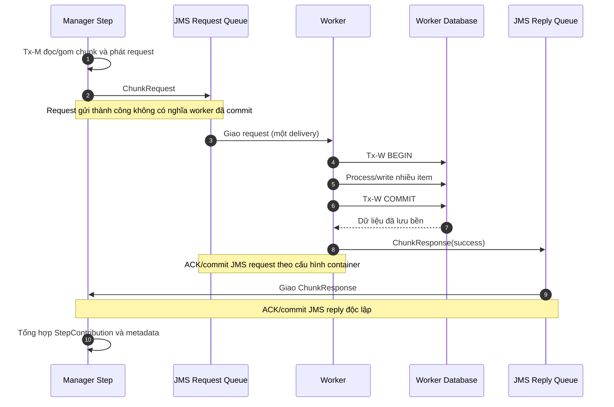
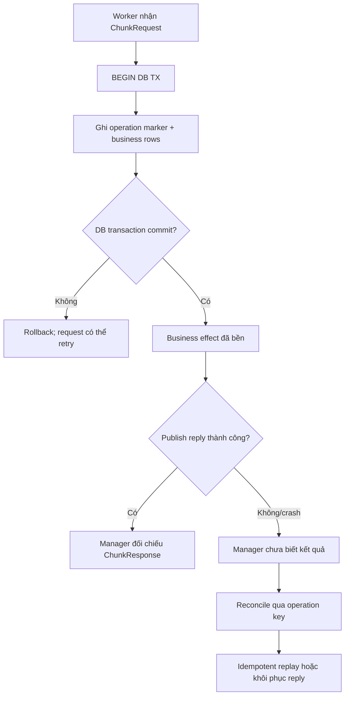

# Worker commit độc lập theo transaction trong Spring Batch

## 1. Bài toán: ai thực sự commit khi xử lý phân tán?

Khi Spring Batch xử lý một `Step` trong cùng một JVM, ta thường thấy một vòng lặp quen thuộc: **đọc một chunk → xử lý → ghi → commit**. Nhưng nếu manager gửi công việc sang worker trên máy khác, không còn một transaction cục bộ duy nhất bao phủ mọi thao tác.

Ví dụ, manager đọc 100 đơn hàng và gửi một `ChunkRequest` lên JMS. Worker A nhận request, tính toán và ghi vào database của worker. Giả sử manager dùng transaction `Tx-M` và worker dùng transaction `Tx-W`:

- `Tx-M` điều khiển công việc tại manager: đọc, trạng thái step, gửi request theo cách hạ tầng messaging được cấu hình.
- `Tx-W` điều khiển các thay đổi dữ liệu mà worker thực hiện trong database của nó.
- ACK của broker và `ChunkResponse` nằm ở các mốc khác, không tự được gộp vào `Tx-M` hay `Tx-W`.

**Worker commit độc lập theo transaction** có nghĩa là worker có ranh giới commit/rollback rõ ràng cho phần việc được giao. Manager không thể chỉ dựa vào rollback transaction của mình để tự động đảo ngược một transaction đã commit ở worker khác. Ngay cả khi hai phía dùng chung một database vật lý, các transaction được mở trong **hai tiến trình/session độc lập** vẫn không mặc nhiên là cùng transaction.

Bài này thuộc chương **Thiết kế worker** của module `SPRING_BATCH_SCALING_OPERATIONS`. Phạm vi module là mở rộng Spring Batch cho workload dữ liệu lớn qua multi-threaded step, parallel steps, partitioning và xử lý phân tán; đo bottleneck, bảo vệ thread safety, retry/restart, vận hành job và chọn kiến trúc theo tài nguyên thực tế. Hiểu ranh giới commit chính xác là điều kiện để mở rộng mà không nhân đôi hoặc làm mất hiệu ứng nghiệp vụ.

### Mục tiêu học tập

Sau bài này, bạn có thể:

1. Phân biệt transaction của **manager step**, **remote chunk worker**, **remote partition worker**, **JMS listener**, và **JobRepository**.
2. Cấu hình một writer worker commit nhiều item theo **một DB transaction** bằng `TransactionTemplate`, không dựa vào transaction ở manager.
3. Dùng unique constraint và operation key để bảo đảm **idempotent business effect** khi request bị giao lại.
4. Phân tích các cửa sổ lỗi trước/sau DB commit, trước/sau ACK và khi reply bị mất.
5. Thiết kế rollback/retry/restart và kiểm thử tính đúng trong môi trường nhiều worker.

> **Phiên bản minh họa:** Spring Batch **5.2.x**, Spring Batch Integration, Spring Integration **6.x**, Spring Framework **6.x**, Java 17+ và `jakarta.jms`. Mã SQL idempotency ở phần thực hành dùng **PostgreSQL**. Spring Batch 6.x có một số builder/API khác; tránh trộn mã của các major version.

## 2. Phân biệt các ranh giới transaction



Sơ đồ là **một luồng logic thành công**, không phải cam kết thứ tự ACK tuyệt đối giữa các adapter. Trên thực tế, JMS session transaction, DB transaction và việc phát reply có thể kết thúc ở những thời điểm khác nhau. Cách listener xử lý exception quyết định request có được broker giao lại hay không.

| Ranh giới | Đơn vị commit/rollback | Ai quản lý? | Giới hạn |
| --- | --- | --- | --- |
| Transaction của manager | Hoạt động cục bộ của manager step | `PlatformTransactionManager` phía manager | Không tự rollback DB mà worker đã commit |
| **Worker DB transaction** | SQL/ghi dữ liệu trong cùng transaction của worker | `DataSourceTransactionManager`, `JdbcTransactionManager` hoặc TX manager tương thích | Không tự commit/rollback JMS delivery hay hệ thống ngoài DB |
| JMS request ACK/session transaction | Delivery request từ broker đến worker | Broker + listener container/session | ACK không chứng minh business effect exactly-once |
| JMS reply ACK/session transaction | Delivery reply từ broker đến manager | Broker + reply listener | ACK không chứng minh manager đã tổng hợp reply bền vững |
| `JobRepository` metadata transaction | `StepExecution`, `ExecutionContext`, checkpoint | Job repository và transaction manager tương ứng | Có thể không atomic với worker DB nếu khác resource |

### 2.1. ACID là cục bộ, không mặc định xuyên JVM

Đối với **một database transaction** đúng cấu hình, toàn bộ SQL tham gia transaction hoặc cùng commit hoặc cùng rollback. Nhưng Spring's `@Transactional` hoặc `TransactionTemplate` với một transaction manager **không mặc định tạo giao dịch phân tán** bao trùm hai database, broker và remote API.

Nếu một worker dùng hai database hoặc vừa ghi DB vừa gửi message, ACID của một `DataSourceTransactionManager` chỉ áp dụng cho nguồn tài nguyên mà nó quản lý. Để có atomic commit nhiều resource có thể cân nhắc JTA/XA khi cả driver/broker hỗ trợ và chấp nhận chi phí vận hành; nhiều hệ thống chọn **at-least-once delivery + idempotency + outbox/inbox + reconciliation**.

### 2.2. “Một chunk = một commit” đúng khi nào?

Trong một **chunk-oriented worker step** (ví dụ remote partitioning), Spring Batch `StepBuilder...chunk(size, transactionManager)` đặt transaction boundary quanh từng chunk do worker step thực thi. Kết quả phụ thuộc reader/writer tham gia transaction như thế nào, skip/retry/rollback rule và checkpoint.

Trong **remote chunking**, `RemoteChunkingWorkerBuilder` của Spring Batch 5.2 tạo `IntegrationFlow` và `ChunkProcessorChunkHandler`, nhưng **không cung cấp phương thức `transactionManager(...)` riêng**. Vì vậy, không thể suy ra một DB transaction bao toàn bộ chunk chỉ bằng việc gọi `.itemWriter(...)`: bạn phải cấu hình rõ ranh giới transaction trong worker (chẳng hạn `TransactionTemplate` trong writer đối với processor thuần túy, hoặc một wrapper/service có transaction bao cả process + write).

Nếu processor đã gọi API/ghi DB **trước khi** writer mở transaction, transaction ở writer **không rollback được** side effect trước đó. Quy tắc thiết kế của ví dụ sắp tới là: **processor thuần túy, mọi SQL thay đổi dữ liệu diễn ra trong writer transaction**.

## 3. Khác biệt giữa remote chunking và remote partitioning

| Đặc điểm | Remote chunking worker | Remote partitioning worker |
| --- | --- | --- |
| Manager giao gì? | `ChunkRequest<T>` chứa item đã đọc | Yêu cầu chạy `StepExecution`/partition với `ExecutionContext` |
| Ai đọc dữ liệu chính? | Manager | Worker step thường tự đọc trong phạm vi được giao |
| Worker chạy gì? | Message handler gọi `ItemProcessor`/`ItemWriter` | Một Spring Batch worker `Step` đầy đủ |
| Ranh giới transaction nghiệp vụ | Phải bảo đảm trong handler/writer hoặc flow | Do transaction manager của worker step/chunk quản lý |
| Metadata ở worker | Thường không cần `JobRepository` riêng cho từng chunk | Có `StepExecution` worker, gắn với JobRepository |
| Retry quan trọng | Broker redelivery, handler error, reply mất | Step/chunk rollback, skip/retry và worker step restart |
| Phạm vi không được vượt | Chỉ item trong request | Chỉ dữ liệu trong `ExecutionContext`/manifest |

Cả hai mô hình đều có **commit độc lập ở phía worker** theo tài nguyên và cấu hình của worker; manager là bên điều phối. Không nên coi trạng thái `COMPLETED` của manager là bằng chứng mọi **external side effect** chỉ xảy ra một lần: hãy đối soát với trạng thái nghiệp vụ thật.

## 4. Bốn bất biến để thiết kế worker transaction

Một worker tin cậy cần thỏa:

**Bất biến A — All-or-nothing trong transaction của worker:** với cùng chunk của ví dụ và cùng DB, hoặc mọi thay đổi hợp lệ commit, hoặc không thay đổi nào của chunk đó commit. Nếu chọn commit từng item thay vì từng chunk, phải mô tả rõ đây là hợp đồng khác và xử lý partial success.

**Bất biến B — Idempotency:** khi nhận lại cùng một logical operation, không áp dụng hiệu ứng nghiệp vụ thêm lần thứ hai. “Chạy logic hai lần” có thể hợp lệ; “trừ tiền hai lần” thường không.

**Bất biến C — Confinement:** worker chỉ xử lý item trong request/partition được giao, không tự truy vấn thêm item ngoài phạm vi khi gặp lỗi hoặc rảnh.

**Bất biến D — Outcome observability:** có cách xác định kết quả cuối cùng từ trạng thái DB/operation ledger, không chỉ dựa vào JMS ACK hay log “processed”.

Các bất biến này khác nhau: transaction bảo vệ **atomicity**, idempotency bảo vệ **repeatability khi replay**, confinement bảo vệ **scope**, còn observability giúp **phục hồi và đối soát**.

### 4.1. Những gì rollback không làm được

Giả sử worker gọi:

```text
1. Ghi hai row trong DB transaction.
2. Gửi email trực tiếp.
3. Ghi row thứ ba.
4. Row thứ ba lỗi -> DB transaction rollback.
```

Hai row DB có thể rollback, nhưng email đã gửi **không được thu hồi**. Tương tự, việc gọi REST API không tham gia DB transaction. Nếu có side effect ngoài DB, hãy dùng **transactional outbox**, API idempotency key hoặc một thiết kế orchestration/reconciliation thay vì kỳ vọng rollback cục bộ khôi phục toàn thế giới.

### 4.2. Nguồn input cần bất biến qua retry/restart

Nếu worker nhận `ChunkRequest` chứa ID, hãy giữ ý nghĩa dữ liệu của cùng ID ổn định hoặc dùng version/snapshot phù hợp. Với partition worker, `ExecutionContext` chứa tenant/range/file version cần được giữ đúng khi restart. Không để worker tự tính lại `MIN/MAX`, nới cận range hoặc đọc thêm file “mới” để bù việc đã rollback.

## 5. Thực hành: một transaction cho toàn bộ chunk ở remote worker

Ví dụ này sử dụng **PostgreSQL**, **Spring Batch 5.2**, **Spring Integration JMS**. Manager gửi một `ChunkRequest<OrderCommand>` gồm nhiều lệnh đã được xác định; worker ghi kết quả chuẩn hóa vào DB.

Yêu cầu:

- Mỗi chunk được worker **commit toàn bộ hoặc rollback toàn bộ** đối với các SQL trong ví dụ.
- Cùng lệnh có thể được nhận lại nhiều lần, nhưng kết quả nghiệp vụ vẫn chỉ áp dụng một lần theo **operation key**.
- Một lệnh của tenant A không được ghi sang tenant B.
- Nếu lệnh thứ 75 trong chunk lỗi, 74 lệnh trước đó cũng không được commit ở attempt ấy.

### 5.1. Tạo schema với unique operation key

```sql
-- PostgreSQL. Các bảng dưới đây nằm trên cùng một DataSource
-- và cùng transaction manager của worker.
CREATE TABLE processed_operation (
    batch_key VARCHAR(100) NOT NULL,
    tenant_id BIGINT NOT NULL,
    order_id BIGINT NOT NULL,
    operation VARCHAR(40) NOT NULL,
    PRIMARY KEY (batch_key, tenant_id, order_id, operation)
);

CREATE TABLE normalized_order (
    tenant_id BIGINT NOT NULL,
    order_id BIGINT NOT NULL,
    normalized_value VARCHAR(200) NOT NULL,
    PRIMARY KEY (tenant_id, order_id)
);
```

**Hai bảng phải dùng chung DB transaction** trong ví dụ này. `processed_operation` là bằng chứng duy nhất cho logical operation `(batch_key, tenant_id, order_id, operation)`; `normalized_order` lưu hiệu ứng của công việc. Nếu một câu lệnh ghi kết quả lỗi, transaction rollback khiến cả marker vừa tạo lẫn dữ liệu kết quả đều rollback.

`batch_key` phải là **khóa nghiệp vụ ổn định** khi retry/restart. Nếu quy tắc của hệ thống yêu cầu “mỗi đơn hàng chỉ được thu phí một lần suốt đời”, một khóa gắn với **lần chạy batch** là chưa đủ: khi chạy batch mới với `batch_key` mới, hệ thống có thể thực hiện lại nghiệp vụ. Khi đó phải dùng operation ID mang ý nghĩa kinh doanh độc lập với job run.

### 5.2. DTO của request

```java
import java.io.Serializable;

public record OrderCommand(
        String batchKey,
        long tenantId,
        long orderId,
        String normalizedValue
) implements Serializable {}
```

Trong ví dụ, manager đọc hoặc tạo `OrderCommand` theo danh sách input đã chốt. Worker không tự quét database để thêm lệnh khi nhận chunk. Payload phải có cùng schema/version ở manager và worker; nếu dùng Java object serialization để thử nghiệm, hãy kiểm soát class allowlist, tránh deserialize dữ liệu không đáng tin cậy. Production có thể dùng codec có version rõ ràng.

### 5.3. Writer transaction độc lập bằng `TransactionTemplate`

```java
import org.springframework.batch.item.ItemWriter;
import org.springframework.context.annotation.Bean;
import org.springframework.context.annotation.Configuration;
import org.springframework.beans.factory.annotation.Qualifier;
import org.springframework.jdbc.core.JdbcTemplate;
import org.springframework.jdbc.datasource.DataSourceTransactionManager;
import org.springframework.transaction.PlatformTransactionManager;
import org.springframework.transaction.support.TransactionTemplate;

import javax.sql.DataSource;

@Configuration
public class WorkerDbConfig {

    @Bean("workerDbTransactionManager")
    public PlatformTransactionManager workerDbTransactionManager(
            DataSource dataSource) {
        return new DataSourceTransactionManager(dataSource);
    }

    @Bean
    public ItemWriter<OrderCommand> transactionalOrderWriter(
            JdbcTemplate jdbc,
            @Qualifier("workerDbTransactionManager")
            PlatformTransactionManager transactionManager) {

        TransactionTemplate tx = new TransactionTemplate(transactionManager);

        return chunk -> tx.executeWithoutResult(status -> {
            for (OrderCommand command : chunk.getItems()) {
                if (command.batchKey() == null
                        || command.batchKey().isBlank()
                        || command.tenantId() <= 0
                        || command.orderId() <= 0
                        || command.normalizedValue() == null
                        || command.normalizedValue().isBlank()) {
                    throw new IllegalArgumentException(
                            "Invalid order command; reject entire chunk");
                }

                // PostgreSQL: việc claim operation phải nằm cùng
                // DB transaction với thay đổi nghiệp vụ.
                int inserted = jdbc.update("""
                        INSERT INTO processed_operation
                            (batch_key, tenant_id, order_id, operation)
                        VALUES (?, ?, ?, 'NORMALIZE')
                        ON CONFLICT
                            (batch_key, tenant_id, order_id, operation)
                        DO NOTHING
                        """,
                        command.batchKey(),
                        command.tenantId(),
                        command.orderId());

                if (inserted == 1) {
                    jdbc.update("""
                            INSERT INTO normalized_order
                                (tenant_id, order_id, normalized_value)
                            VALUES (?, ?, ?)
                            ON CONFLICT (tenant_id, order_id)
                            DO UPDATE SET
                                normalized_value =
                                    EXCLUDED.normalized_value
                            """,
                            command.tenantId(),
                            command.orderId(),
                            command.normalizedValue());
                }
                // inserted == 0 nghĩa là logical operation
                // đã được claim/commit ở transaction khác.
                // Không áp dụng lại hiệu ứng nghiệp vụ.
            }
        });
    }
}
```

**Tính nguyên tử:** `TransactionTemplate` mở/commit DB transaction quanh **toàn bộ vòng lặp**. `JdbcTemplate` phải dùng **cùng `DataSource`** với transaction manager. Nếu row thứ 75 gây `DataAccessException` hoặc validator ném `IllegalArgumentException`, transaction template rollback cả marker và các thay đổi dữ liệu của những item trước đó trong chunk.

**Tính idempotent:** unique constraint bảo vệ các worker cạnh tranh cùng operation key. Nếu request được broker giao lại sau khi worker trước đã commit, câu `INSERT ... ON CONFLICT DO NOTHING` trả 0 cho key đã tồn tại, nên code **không ghi lại** kết quả nghiệp vụ. Không sử dụng một `HashSet` trong RAM để chống duplicate: bộ nhớ biến mất khi worker restart và không phối hợp với các instance khác.

**Giới hạn bảo đảm:** ví dụ chỉ áp dụng cho dữ liệu nằm trong **cùng PostgreSQL transaction**, với processor không phát sinh side effect. Nếu processor gọi API hoặc writer gửi event trực tiếp trước khi commit, các side effect ngoài DB vẫn có nguy cơ lặp/mất. Khi cần gửi event sau commit, dùng **transactional outbox**: ghi event vào bảng outbox trong cùng transaction DB, rồi publish từ dispatcher riêng và để consumer downstream idempotent.

**Không tự báo chính xác số dòng đã ghi từ `ChunkResponse`:** worker có thể nhận 100 item nhưng 20 operation đã được commit từ attempt trước và bị bỏ qua. `StepContribution`/`WRITE_COUNT` do framework/processor ghi nhận không mặc nhiên bằng số row mới được insert trong `normalized_order`. Muốn thống kê “new inserts”, đo thêm một metric/ledger riêng trong phạm vi transaction.

### 5.4. Điều gì xảy ra khi hai worker nhận cùng request?

Giả sử worker A và B cùng lúc thử insert `(batch-01, tenant=7, order=900, NORMALIZE)`:

1. Unique constraint buộc hai giao dịch cạnh tranh trên **cùng một logical operation**.
2. Một transaction có thể insert thành công; transaction kia chờ hoặc gặp conflict tùy lịch giao dịch.
3. Khi transaction thành công đã commit, lần insert còn lại dùng `ON CONFLICT DO NOTHING` và không ghi kết quả lần nữa.
4. Nếu transaction đầu rollback, transaction còn lại có thể tiếp tục claim và ghi kết quả.

Việc “chỉ một worker commit hiệu ứng” đến từ **constraint của database**, không đến từ bảo đảm rằng broker không bao giờ giao lại message.

### 5.5. Giới hạn khi một chunk chứa nhiều operation cùng key

Nếu một chunk lặp hai `OrderCommand` có cùng `(batchKey, tenantId, orderId, NORMALIZE)` nhưng `normalizedValue` khác nhau, vòng lặp chỉ áp dụng bản ghi đầu và bỏ qua bản sau. Điều này không nhất thiết đúng nghiệp vụ! Trước khi đưa hệ thống vào production, phải xác định:

- Duplicate cùng logical operation **là bản sao hợp lệ** và phải có payload giống nhau, hay là dữ liệu lỗi?
- Khi cùng khóa nhưng payload khác, có cần **fail-fast** thay vì coi đã xử lý?
- Tập item có phải được deduplicate/normalize ở manager trước khi gửi chunk hay không?

Với yêu cầu nghiêm ngặt, lưu thêm `payloadHash`/version trong ledger rồi so sánh khi gặp conflict; sự sai khác phải tạo lỗi/audit để con người xử lý, không bị âm thầm bỏ qua.

## 6. Nối transaction writer vào remote chunking worker

Trong Spring Batch 5.2, `RemoteChunkingWorkerBuilder` tạo một `IntegrationFlow` với `ChunkProcessorChunkHandler`. Dưới đây là cấu hình worker kết nối với JMS: mỗi worker instance có cùng **request queue** và có thể được scale độc lập.

```java
import jakarta.jms.ConnectionFactory;
import org.springframework.batch.integration.chunk.RemoteChunkingWorkerBuilder;
import org.springframework.batch.item.ItemWriter;
import org.springframework.beans.factory.annotation.Qualifier;
import org.springframework.context.annotation.Bean;
import org.springframework.context.annotation.Configuration;
import org.springframework.integration.channel.DirectChannel;
import org.springframework.integration.config.EnableIntegration;
import org.springframework.integration.dsl.IntegrationFlow;
import org.springframework.integration.jms.dsl.Jms;

@Configuration
@EnableIntegration
public class TransactionalChunkWorkerConfig {
    private static final String REQUESTS = "batch.orders.requests";
    private static final String REPLIES = "batch.orders.replies";

    @Bean
    public DirectChannel inboundChunks() {
        return new DirectChannel();
    }

    @Bean
    public DirectChannel outboundReplies() {
        return new DirectChannel();
    }

    @Bean
    public IntegrationFlow brokerToWorker(
            ConnectionFactory connectionFactory,
            @Qualifier("inboundChunks") DirectChannel chunks) {
        return IntegrationFlow
                .from(Jms.messageDrivenChannelAdapter(connectionFactory)
                        .destination(REQUESTS))
                .channel(chunks)
                .get();
    }

    @Bean
    public IntegrationFlow processingFlow(
            @Qualifier("inboundChunks") DirectChannel chunks,
            @Qualifier("outboundReplies") DirectChannel replies,
            @Qualifier("transactionalOrderWriter")
            ItemWriter<OrderCommand> writer) {
        return new RemoteChunkingWorkerBuilder<OrderCommand, OrderCommand>()
                .itemWriter(writer)
                .inputChannel(chunks)
                .outputChannel(replies)
                .build();
    }

    @Bean
    public IntegrationFlow workerToBroker(
            ConnectionFactory connectionFactory,
            @Qualifier("outboundReplies") DirectChannel replies) {
        return IntegrationFlow.from(replies)
                .handle(Jms.outboundAdapter(connectionFactory)
                        .destination(REPLIES))
                .get();
    }
}
```

`processingFlow` sử dụng **writer transaction cục bộ** ở mục 5.3. Worker handler gửi `ChunkResponse` dựa trên kết quả xử lý. Phía manager có `ChunkMessageChannelItemWriter` gửi `ChunkRequest<OrderCommand>` qua queue `batch.orders.requests` và nhận reply từ `batch.orders.replies`. Các bên phải thống nhất schema/serialization, destination, message headers và chính sách lỗi.

**Quan trọng:** mã chỉ minh họa đường đi hai chiều, chưa cấu hình hết broker persistence, consumer transaction/ACK, DLQ, durable reply, routing giữa nhiều manager và recovery. Không suy ra `TransactionTemplate` làm JMS ACK/reply thuộc cùng DB transaction.

### 6.1. Mốc thời gian một request thành công

```text
Manager Step:
    tạo ChunkRequest #17 -> publish qua broker

Worker A:
    nhận #17
    -> TransactionTemplate: BEGIN DB
    -> INSERT processed_operation + INSERT/UPDATE normalized_order
    -> COMMIT DB  [mốc nghiệp vụ đã bền]
    -> handler tạo/gửi ChunkResponse #17
    -> JMS request ACK tùy listener transaction/configuration

Manager Step:
    nhận ChunkResponse #17
    -> tổng hợp StepContribution/metadata
```

Đây là timeline khái niệm: **thứ tự publish reply so với ACK request không được mặc định cố định** cho mọi loại adapter/container. Điểm bất biến là DB commit của worker **không thể tự rollback** vì manager hết thời gian chờ hoặc bị lỗi sau đó.

### 6.2. Khi nào cần transaction bao cả processor và writer?

Mẫu writer transaction phù hợp khi:

- Processor chỉ tính toán thuần túy, validate, chuẩn hóa DTO trong RAM.
- Mọi write/side effect liên quan nằm trong writer và cùng DB resource.
- Một lần replay sẽ tạo cùng logical operation ID và cùng kết quả (hoặc mismatch được phát hiện).

Nếu processor **ghi audit, gửi HTTP hoặc cập nhật DB** trước writer, hãy thiết kế một ranh giới bao trùm cả hai hoặc chuyển side effect vào writer/service. Có thể dùng `@Transactional` trên một service **public** được gọi qua Spring proxy từ handler; không trông chờ `@Transactional` trên private method hoặc self-invocation tự kích hoạt proxy. Vẫn phải giải quyết external side effects qua idempotency/outbox vì annotation này chỉ bảo vệ tài nguyên được transaction manager quản lý.

## 7. Với remote partitioning: worker step tự commit chunk

Remote partitioning khác remote chunking ở chỗ manager giao **một partition** (thường có `ExecutionContext` chứa ID range, file hoặc tenant) để worker chạy một `Step`. Worker tự đọc nguồn của phạm vi đó, xử lý/ghi và commit từng chunk.

Trong Spring Batch 5.x, cách gắn transaction manager ở **worker step**:

```java
import org.springframework.batch.core.Step;
import org.springframework.batch.core.repository.JobRepository;
import org.springframework.batch.core.step.builder.StepBuilder;
import org.springframework.batch.item.ItemReader;
import org.springframework.batch.item.ItemWriter;
import org.springframework.beans.factory.annotation.Qualifier;
import org.springframework.context.annotation.Bean;
import org.springframework.transaction.PlatformTransactionManager;

// Trong class @Configuration của ứng dụng worker.
// scopedReader và scopedWriter phải được khai báo riêng,
// lấy tenant/range từ stepExecutionContext bằng @StepScope.
@Bean
public Step partitionWorkerStep(
        JobRepository jobRepository,
        @Qualifier("workerDbTransactionManager")
        PlatformTransactionManager workerDbTx,
        @Qualifier("scopedReader") ItemReader<OrderCommand> scopedReader,
        @Qualifier("scopedWriter") ItemWriter<OrderCommand> scopedWriter) {

    return new StepBuilder("partitionWorkerStep", jobRepository)
            .<OrderCommand, OrderCommand>chunk(100, workerDbTx)
            .reader(scopedReader)
            .writer(scopedWriter)
            .build();
}
```

Ở ví dụ này, `scopedWriter` là writer SQL bình thường dùng `JdbcTemplate` **không tự mở transaction riêng bằng `REQUIRES_NEW`**; transaction do `StepBuilder.chunk(100, workerDbTx)` cung cấp. Reader/writer cần kiểm tra phạm vi đã giao, ví dụ:

```sql
SELECT tenant_id, order_id, normalized_value
FROM pending_orders
WHERE tenant_id = :tenantId
  AND order_id >= :startInclusive
  AND order_id < :endExclusive
ORDER BY order_id;
```

Manager không thể rollback chunk worker đã commit chỉ vì manager process mất mạng. Mỗi worker step có `StepExecution` và metadata của phần việc; kết quả step được quản lý theo cơ chế partitioning. Sự nhất quán giữa **worker business DB** và **JobRepository** phụ thuộc tài nguyên/transaction manager:

- Nếu metadata và business data dùng **cùng transactional resource** và thật sự tham gia một local transaction, một số hoạt động có thể commit cùng nhau.
- Nếu `JobRepository` nằm ở DB khác hoặc dùng transaction manager khác, commit dữ liệu và commit checkpoint/metadata **không tự atomic**; khi crash giữa hai mốc có thể cần replay.
- Trong mọi trường hợp, transaction manager của **manager process** không tự hợp nhất với transaction đang chạy ở worker process.

Không “khắc phục” metadata lệch bằng cách tự đánh dấu partition `COMPLETED` khi chưa kiểm tra side effect. Cần dùng restart contract, idempotency và reconciliation.

### 7.1. Cảnh báo về `REQUIRES_NEW` và transaction lồng nhau

Giả sử một worker step đang xử lý chunk trong transaction `Tx-C`, nhưng writer gọi một service `@Transactional(propagation = REQUIRES_NEW)` để commit từng item:

```text
Tx-C BEGIN
  item 1 -> REQUIRES_NEW commit vào DB
  item 2 -> REQUIRES_NEW commit vào DB
  item 3 -> exception
Tx-C ROLLBACK
```

Transaction con độc lập đã commit có thể **không rollback** khi `Tx-C` rollback. Kết quả là một chunk thất bại nhưng có side effect bền vững của item 1–2. Đó có thể là thiết kế chủ ý trong một hệ thống partial commit, nhưng **không còn là all-or-nothing theo chunk**.

Tương tự, `@Transactional(noRollbackFor = ...)`, swallow exception hoặc lỗi được chuyển thành response thành công có thể làm TX commit dù kết quả nghiệp vụ không hoàn tất. Hãy mô tả và kiểm thử rollback rules; không giả định mọi exception đều rollback trong mọi cấu hình.

### 7.2. Transaction của worker không phải transaction xuyên partition

Nếu worker A xử lý partition `[1, 5001)` và worker B xử lý `[5001, 10001)`, mỗi worker/step có các transaction của mình. Worker B commit thành công **không bị tự động rollback** khi worker A fail. Manager có thể đánh dấu job fail hoặc yêu cầu restart partition lỗi, còn các partition đã hoàn thành thường không cần chạy lại theo metadata.

Vì vậy, dữ liệu và side effect phải chịu được **partial progress giữa các partition**. Nếu nghiệp vụ yêu cầu “toàn job hoặc không gì cả”, batch partitioning với local commit từng chunk **không tự cung cấp atomicity toàn job**. Có thể xử lý qua staging table + validation + atomic publish ở cuối, versioned dataset, hoặc một workflow bù trừ được thiết kế riêng.

## 8. Ma trận lỗi của worker commit độc lập

Đây là phần quan trọng nhất để phân biệt một worker **đã commit**, **đã ACK** và **đã báo manager biết**.

| Thời điểm lỗi | Kết quả DB có thể tồn tại | Broker/manager có thể nhìn thấy | Điều cần làm |
| --- | --- | --- | --- |
| Manager đọc/gom chunk, request chưa được broker lưu | Worker chưa được giao; chưa có DB commit phía worker | Request có thể mất tùy send/commit boundary | Kiểm tra producer persistence, checkpoint/restart reader |
| Broker lưu request, worker chưa nhận | DB chưa xử lý | Queue còn pending | Đảm bảo broker durability, worker health và TTL phù hợp |
| Worker nhận request, chết **trước khi mở DB TX** | Chưa có DB write | Request có thể redeliver | Retry có giới hạn, không sinh operation ID mới |
| Worker ghi 70/100 item, chết **trước DB commit** | Nếu đúng cùng DB TX, cả 70 write rollback | Request có thể redeliver | Kiểm tra transaction thực sự bao trùm writer |
| Worker **đã DB commit**, chết trước JMS ACK/reply | 100 hiệu ứng có thể đã bền | Broker có thể redeliver; manager còn đợi | Idempotency key, reconciliation |
| Worker đã publish reply, nhưng request ACK thất bại | DB có thể đã commit; reply có thể tồn tại | Cùng request có thể đến worker khác | Dedup ở DB; xử lý/đối chiếu reply trùng |
| Manager inbound JMS ACK reply rồi crash trước khi đọc kênh RAM | DB worker đã commit | Reply đã rời broker nhưng chưa được manager tổng hợp | Durable reply path hoặc recovery bằng audit/ledger |
| Manager fail vì timeout trong khi worker vẫn chạy | Worker có thể commit muộn | Step/JobExecution báo lỗi; reply đến muộn | Kiểm tra kết quả trước retry; giải quyết stale replies |
| Worker partition commit DB, metadata chưa được cập nhật bền | Business DB đã có side effect | Repository có thể yêu cầu chạy lại phần việc | Đồng bộ transaction nếu khả thi; idempotency khi restart |

### 8.1. Phản ví dụ cho suy luận “rollback manager thì worker rollback”

```text
T1  Manager mở Tx-M, gửi ChunkRequest #23.
T2  Worker A nhận #23, mở Tx-W.
T3  Worker A xử lý 100 item và COMMIT Tx-W.
T4  Mạng giữa broker và manager bị mất; reply không tới.
T5  Manager phát hiện timeout, rollback/fail bước xử lý hiện tại.
T6  DB worker vẫn chứa kết quả của 100 item.
T7  Nếu manager gửi lại #23, side effect có thể lặp.
```

Không có cách nào để một rollback cục bộ của manager tự đi ngược về thời điểm T3 và đảo ngược transaction worker đã commit. Cần **idempotent retry** hoặc một quy trình bù trừ/đối soát rõ ràng.

### 8.2. Request ACK và reply là hai tín hiệu riêng

Trong remote chunking qua JMS:

- **JMS request ACK/session commit** nói với broker rằng một **delivery** request đã hoàn tất theo semantics của listener; không chứng minh business DB và reply đều thành công.
- **`ChunkResponse`** báo kết quả xử lý ở tầng Spring Batch Integration (thành công/thất bại, sequence, contribution).
- **JMS reply ACK/session commit** nói với broker rằng một **delivery** reply đã được tiêu thụ; không chứng minh manager đã cập nhật `StepExecution` bền vững.

Trong một số flow, handler có thể **đóng gói lỗi thành failure `ChunkResponse`** và message request được ACK vì flow kết thúc bình thường. Trong một số flow khác, exception lan lên JMS listener khiến session rollback và broker redeliver request. Không nên chỉ nhìn một lần thất bại rồi suy ra broker chắc chắn sẽ retry. Cần kiểm tra cách `ChunkProcessorChunkHandler`, error channel và listener container kết hợp trong phiên bản ứng dụng.

### 8.3. Tình huống “worker commit nhưng reply không tới”



Trong nhánh bên phải, **không được trả lời mặc định “phát lại chunk và tính như chưa làm”**. Phải xác định logic nghiệp vụ đã được commit hay chưa; nếu phát lại, writer phải chống side effect lặp. Cùng vấn đề có thể xảy ra khi reply vào `QueueChannel` RAM rồi mất sau ACK.

## 9. Giao dịch nhiều tài nguyên: những lựa chọn thiết kế

| Giải pháp | Cơ chế | Phù hợp khi | Điều cần chấp nhận |
| --- | --- | --- | --- |
| **Một DB TX + idempotent worker** | Commit dữ liệu và operation marker trong cùng DB | Side effect chính nằm trong một DB | Broker có thể redeliver, cần đối soát reply |
| **Transactional outbox** | Ghi dữ liệu + ý định phát event trong một DB TX, dispatcher gửi sau | Cần đồng thời cập nhật DB và phát message | Event có thể được gửi lặp; consumer cần dedup |
| **Transactional inbox/dedup** | Ghi nhận operation/request đã hoàn thành cùng business write | Message at-least-once, nhiều worker | Quản lý khóa, retention và replay policy |
| **XA/JTA** | Coordinator quản lý commit nhiều resource tham gia XA | Có yêu cầu atomicity nhiều resource và hạ tầng hỗ trợ | Độ phức tạp, timeout, recovery, vận hành lớn |
| **Staging + publish** | Worker ghi dữ liệu vào staging/version riêng; job hoàn tất mới công bố | Cần tránh người đọc thấy dữ liệu job dở | Cần bước validation, promote/rollback/version management |
| **Compensating workflow** | Tạo thao tác bù cho side effect đã commit | Không thể có atomic rollback toàn hệ thống | Compensate cũng có thể lỗi, cần audit và idempotency |

### 9.1. Outbox không có nghĩa publish exactly-once

Ví dụ khi worker hoàn thành chunk:

```sql
BEGIN;
INSERT INTO processed_operation (...) VALUES (...);
UPDATE business_table SET ... WHERE ...;
INSERT INTO outbox_event (event_id, payload, status)
VALUES (:eventId, :payload, 'NEW');
COMMIT;
```

Ba ghi chép này thuộc **một DB transaction** nếu cùng connection/resource. Một dispatcher đọc `outbox_event` và gửi event lên broker. Nếu dispatcher publish thành công rồi crash trước khi đánh dấu sent, event có thể được gửi lại. Vì vậy, consumers vẫn cần idempotency theo `eventId`; outbox khắc phục khoảng trống **business DB commit nhưng chưa ghi ý định gửi event**, không phải loại bỏ hoàn toàn duplicate delivery.

### 9.2. Đừng tự mở transaction mới cho từng item nếu yêu cầu commit theo chunk

Một code smell:

```java
for (OrderCommand command : chunk.getItems()) {
    // Nếu mỗi call mở REQUIRES_NEW transaction riêng:
    service.processAndCommit(command);
}
```

Nếu item thứ 80 lỗi, 79 transaction trước đã commit và **không thể rollback cả chunk** bằng transaction bao ngoài. Thao tác này có thể hợp lệ khi business cho phép partial commit, nhưng phải đổi cách ghi nhận status, replay, compensation và metrics. Với đề bài **worker commit độc lập theo transaction của chunk**, dùng một transaction rõ ràng bao toàn bộ các SQL cần atomic, hoặc giải thích chính xác vì sao chọn per-item commit.

## 10. Kiểm thử commit, rollback và duplicate trên PostgreSQL

Đừng chỉ nhìn `ChunkResponse.isSuccessful()` hoặc thông báo log rồi kết luận worker transaction đúng. Cần có **integration test đọc trạng thái DB sau commit/rollback**.

### 10.1. Test dữ liệu trùng không ghi lại business effect

Các đoạn mã sau giả định test đã chạy migration tạo hai bảng ở mục 5, cung cấp đúng bean `transactionalOrderWriter` và `JdbcTemplate`, dọn dữ liệu test trước mỗi trường hợp. Mỗi `batchKey` là duy nhất cho test, tránh phụ thuộc kết quả chạy trước.

```java
import org.junit.jupiter.api.Test;
import org.springframework.batch.item.Chunk;
import org.springframework.batch.item.ItemWriter;
import org.springframework.beans.factory.annotation.Autowired;
import org.springframework.beans.factory.annotation.Qualifier;
import org.springframework.jdbc.core.JdbcTemplate;

import static org.junit.jupiter.api.Assertions.assertEquals;

class WorkerCommitIntegrationTest {
    @Autowired
    @Qualifier("transactionalOrderWriter")
    private ItemWriter<OrderCommand> writer;

    @Autowired
    private JdbcTemplate jdbc;

    @Test
    void replaySameChunkDoesNotCreateAnotherOperation() throws Exception {
        OrderCommand command =
                new OrderCommand("tx-test-repeat", 7L, 9001L, "NORMALIZED");

        writer.write(Chunk.of(command)); // Lần nhận thứ nhất
        writer.write(Chunk.of(command)); // Mô phỏng message redelivery

        Integer operationCount = jdbc.queryForObject(
                "SELECT COUNT(*) FROM processed_operation " +
                "WHERE batch_key = ? AND tenant_id = ? AND order_id = ?",
                Integer.class,
                "tx-test-repeat", 7L, 9001L);

        Integer resultCount = jdbc.queryForObject(
                "SELECT COUNT(*) FROM normalized_order " +
                "WHERE tenant_id = ? AND order_id = ?",
                Integer.class,
                7L, 9001L);

        assertEquals(1, operationCount);
        assertEquals(1, resultCount);
    }
}
```

Test này chỉ chứng minh một **logical operation** không được áp dụng lại trong DB mẫu. Nếu hệ thống phát HTTP/email bên ngoài transaction, test riêng phải kiểm tra số lần side effect ngoài DB — không thể suy ra từ hai câu `COUNT(*)`.

### 10.2. Test lỗi giữa chunk rollback **tất cả** SQL

Vì `normalized_value` là `VARCHAR(200)` ở PostgreSQL, một giá trị 201 ký tự có thể gây lỗi constraint/dữ liệu và làm transaction thất bại. Dùng một `batchKey` khác với test trước:

```java
import org.junit.jupiter.api.Test;
import org.springframework.batch.item.Chunk;
import org.springframework.dao.DataAccessException;

import static org.junit.jupiter.api.Assertions.assertEquals;
import static org.junit.jupiter.api.Assertions.assertThrows;

@Test
void failureInSecondItemRollsBackFirstItemToo() {
    OrderCommand good =
            new OrderCommand("tx-test-rollback", 7L, 9002L, "OK");
    OrderCommand tooLong =
            new OrderCommand("tx-test-rollback", 7L, 9003L, "x".repeat(201));

    assertThrows(DataAccessException.class,
            () -> writer.write(Chunk.of(good, tooLong)));

    Integer committedOperations = jdbc.queryForObject(
            "SELECT COUNT(*) FROM processed_operation " +
            "WHERE batch_key = ?",
            Integer.class,
            "tx-test-rollback");

    Integer committedOutputs = jdbc.queryForObject(
            "SELECT COUNT(*) FROM normalized_order " +
            "WHERE tenant_id = ? AND order_id IN (?, ?)",
            Integer.class,
            7L, 9002L, 9003L);

    assertEquals(0, committedOperations);
    assertEquals(0, committedOutputs);
}
```

Đây là **phần method** để đặt trong class test cùng fixture với mục 10.1; không phải một file Java độc lập. Không gắn transaction rollback tự động của test framework bao quanh bài thử nếu muốn kiểm chứng commit thực của writer bằng connection khác; hãy điều khiển fixture và transaction của test có chủ đích.

### 10.3. Test cạnh tranh của hai worker instance

Chạy hai request giống nhau trên **hai connection/transaction khác nhau** (ví dụ qua hai worker JVM hoặc thread với riêng transaction context) và cho chúng đồng thời claim cùng operation key. Kỳ vọng:

- Chỉ có một row marker committed cho logical operation.
- Chỉ có một hiệu ứng nghiệp vụ có ý nghĩa được ghi.
- Không có deadlock chưa được xử lý hoặc retry vô hạn khi concurrent insert conflict.
- Khi một worker lỗi/rollback trước commit, worker còn lại có thể commit hợp lệ.

**Lưu ý:** chỉ gọi `writer.write(...)` hai lần tuần tự **không chứng minh** độ đúng trong concurrency. Cần một test có cả hai transaction đồng thời để kiểm tra constraint và chính sách timeout.

### 10.4. Test crash đúng thời điểm

| Ca kiểm thử | Mô phỏng | Tiêu chí đạt |
| --- | --- | --- |
| Crash trước worker DB commit | Kill worker khi transaction chưa commit | Không có marker/output từ attempt dở |
| Crash sau DB commit trước reply | Gây lỗi ngay sau writer thành công, trước publish reply | Broker có thể redeliver; DB giữ đúng một logical operation |
| Broker redeliver cùng request | Rollback session hoặc disconnect có kiểm soát | Worker khác nhận nhưng không nhân đôi side effect |
| Reply đã ở broker nhưng manager crash | Dừng manager trước bước nhận/tổng hợp reply | Có thể phục hồi/đối soát; không đánh dấu thành công giả |
| Reply đã ACK vào RAM rồi manager crash | Dừng sau inbound adapter, trước writer poll | Thiết kế production phải khắc phục hoặc có quy trình reconciliation |
| Worker partition DB commit, metadata commit lỗi | Chặn update `JobRepository` sau business write | Restart không nhân đôi logical effect |
| Hai request cùng operation với payload khác | Phát message khác `normalizedValue` nhưng cùng operation key | Phát hiện mismatch/audit, không âm thầm nhận là đúng |
| Một item lỗi ở giữa 100 item | Ném DB exception tại item thứ 75 | Toàn bộ DB TX rollback, không có partial commit ngoài ý muốn |

Chỉ tiến hành failure injection trong test/staging có dữ liệu và broker tách biệt, không kill production worker để “thử” nếu chưa có kế hoạch sự cố.

## 11. Chẩn đoán từ metadata, broker và DB

### 11.1. Ba tầng chỉ số phải khớp theo *ý nghĩa*, không nhất thiết cùng số lượng

| Tầng | Ví dụ metric | Cách hiểu |
| --- | --- | --- |
| **Transport** | request delivered, acknowledged, redelivered, DLQ | Số lần vận chuyển/ACK; không đồng nghĩa unique business operations |
| **Worker DB** | transaction commits, rollbacks, unique operation keys | Bằng chứng về thay đổi đã lưu bền |
| **Batch manager** | `READ_COUNT`, `WRITE_COUNT`, `COMMIT_COUNT`, `StepExecution.STATUS` | Kết quả quản lý job/step từ framework |

Ví dụ có 100 logical operations, một worker commit cả chunk nhưng reply mất; broker gửi lại request và worker thứ hai nhận 100 item. Có thể thấy:

```text
Logical operations       : 100
Broker deliveries        : 2 (cùng ChunkRequest, hai attempts)
Items delivered to worker: 200 (100 x 2)
New DB operation markers : 100
Duplicate operations     : 100 (bị writer thứ hai bỏ qua)
```

Các số trên là ví dụ minh họa; chúng khác nhau nhưng không mâu thuẫn. Mục tiêu là **100 business operations duy nhất** được commit, không phải bắt buộc `deliveries=1`.

### 11.2. SQL kiểm tra marker trùng và dữ liệu mồ côi

Unique constraint ở `processed_operation` ngăn **hai row marker trùng cùng key**, nhưng cần audit các row mồ côi do bug cũ, write ngoài transaction hoặc hệ thống khác:

```sql
-- Kết quả đã ghi nhưng không có marker tương ứng
-- (ví dụ kiểm tra một batch cụ thể).
SELECT r.tenant_id, r.order_id
FROM normalized_order r
LEFT JOIN processed_operation p
  ON p.tenant_id = r.tenant_id
 AND p.order_id = r.order_id
 AND p.operation = 'NORMALIZE'
 AND p.batch_key = :batchKey
WHERE p.order_id IS NULL;
```

**Cẩn thận khi diễn giải:** `normalized_order` có thể được tạo bởi **batch khác** với `batchKey` đang truy vấn. Trong trường hợp đó, kết quả không nhất thiết là lỗi; muốn đối soát chính xác, bảng đích cần lưu owner batch/operation ID hoặc bảng audit có liên hệ đủ mạnh. Không dùng SQL trên để tự động xóa row nếu chưa xác định quy tắc ownership.

Để xem số logical operations đã commit:

```sql
SELECT batch_key,
       COUNT(*) AS committed_logical_operations
FROM processed_operation
WHERE batch_key = :batchKey
GROUP BY batch_key;
```

### 11.3. Metadata Spring Batch

```sql
SELECT STEP_NAME, STATUS, READ_COUNT, WRITE_COUNT,
       COMMIT_COUNT, ROLLBACK_COUNT
FROM BATCH_STEP_EXECUTION
WHERE JOB_EXECUTION_ID = :jobExecutionId
ORDER BY STEP_NAME;
```

Với **remote partitioning**, worker step có `StepExecution` và checkpoint riêng. Với **remote chunking**, manager tổng hợp đóng góp từ `ChunkResponse` và thường không có một `StepExecution` worker mới cho mỗi request. Không dùng một bảng này làm bằng chứng đầy đủ về business DB transactions khi metadata và business database được commit qua những ranh giới độc lập.

### 11.4. Logging/tracing tối thiểu

```text
jobInstanceId=501
jobExecutionId=902
chunkSequence=17
workerInstance=worker-b
logicalBatchKey=batch-2026-11-26
requestAttempt=2
dbTransactionOutcome=COMMITTED
newLogicalOperations=0
duplicatesSuppressed=100
replyPublished=true
elapsedMs=...
```

Các trường ở trên là **đề xuất log nghiệp vụ**, không phải tất cả đều là trường mặc định của Spring Batch. Không ghi nguyên payload, token, mật khẩu hoặc thông tin cá nhân. Timestamp trong worker và manager có thể lệch do clock skew; dùng trace ID và đo latency tại mỗi chặng thay vì chỉ trừ timestamp của hai máy chưa đồng bộ.

## 12. Hiệu năng: transaction độc lập ảnh hưởng throughput thế nào?

Đặt:

- `C`: số item trong một chunk;
- `T_w(C)`: thời gian worker xử lý/commit chunk (giây);
- `N`: số worker thực sự bận;
- `R_m`: tốc độ manager tạo item (item/giây);
- `R_b`: năng lực broker/network sau serialization (item/giây);
- `R_d`: năng lực DB/downstream (item/giây).

Giới hạn lý thuyết đơn giản:

\[
R_{\mathrm{job}} \lesssim
\min\left(R_m,\ \frac{N\times C}{T_w(C)},\ R_b,\ R_d\right)
\]

Nếu có tám worker, mỗi worker hoàn thành hai chunk/giây và mỗi chunk có 100 item, năng lực worker khoảng **1.600 item/giây**. Nhưng nếu DB chỉ ghi được 900 item/giây, tăng số worker tiếp sẽ không giúp vượt giới hạn DB; thời gian chờ connection hoặc lock thậm chí có thể tăng.

### 12.1. Transaction quá dài

Nếu chunk có 10.000 item, worker có thể giữ lock lâu, tạo redo/WAL lớn và tăng rủi ro timeout/deadlock. Khi item thứ 9.999 lỗi, phải rollback cả chunk — tốn nhiều thời gian phục hồi hơn chunk nhỏ.

### 12.2. Transaction quá ngắn

Nếu chunk chỉ có một item, chi phí begin/commit, round-trip network và message broker có thể chiếm phần lớn tổng thời gian. Tăng chunk size vừa đủ có thể cải thiện throughput, nhưng cần đo kích thước serialized message và latency p95/p99 chứ không chỉ số item.

### 12.3. Tăng worker làm tăng concurrency ở DB

Ví dụ 20 worker, mỗi worker có 10 concurrent consumers, trong khi DB connection pool tối đa 50 connection, không thể mặc định 200 giao dịch đồng thời đều tiến triển. Hãy đo **DB connection wait, lock wait, deadlock, commit latency và broker queue backlog**; chọn worker concurrency và pool size dựa trên tài nguyên thật, không phải số core CPU đơn lẻ.

### 12.4. Rủi ro khi dùng isolation level quá thấp hoặc quá cao

`READ_COMMITTED` cùng unique constraint thường đủ làm nền cho idempotent insert theo key ở ví dụ PostgreSQL. Nhưng nghiệp vụ phức tạp phụ thuộc **nhiều row và điều kiện tổng hợp** có thể cần khóa/optimistic version/`SERIALIZABLE` hoặc thay đổi mô hình dữ liệu. `SERIALIZABLE` có thể tạo lỗi serialization và cần retry **toàn transaction** đúng cách; nó cũng không loại bỏ việc message redelivery hay side effect ngoài DB.

Thiết kế isolation phải đi kèm invariant nghiệp vụ cụ thể, không chọn “mức cao nhất” theo cảm tính rồi kỳ vọng broker và manager đều được đồng bộ.

## 13. Các anti-pattern thường gặp

### 13.1. “Manager rollback thì tất cả worker rollback”

**Sai:** worker nằm ở tiến trình khác đã commit một local DB transaction. Không có transaction coordinator xuyên resource/JVM thì rollback ở manager không hủy được commit đó. Thiết kế đúng phải chấp nhận partial progress, có idempotent replay và reconciliation.

### 13.2. “Thêm `@Transactional` ở mọi method là đủ”

**Sai:** annotation chịu ảnh hưởng Spring AOP proxy/self-invocation, transaction manager nào được chọn, propagation, exception rollback rule và resource tham gia. Nếu writer được gọi từ handler nhưng transaction annotation nằm ở một private method hoặc self-invocation, transaction có thể không được áp dụng như mong đợi.

Giải pháp là xác định rõ **một transaction owner** cho business DB của worker, sử dụng một service có proxy hợp lệ hoặc `TransactionTemplate`; kiểm thử bằng cách cố ý ném lỗi ở item cuối chunk rồi kiểm tra DB.

### 13.3. “Broker ACK là bằng chứng dữ liệu đã commit”

**Sai:** ACK chỉ nói về delivery. Một handler có thể ACK sau khi lỗi bị bắt/nuốt, hoặc DB đã commit nhưng broker chưa nhận ACK. Theo dõi **DB operation ledger** và phản hồi nghiệp vụ ngoài ACK.

### 13.4. “Worker gửi success response là đã xử lý exactly once”

**Sai:** `ChunkResponse` báo kết quả mà handler biết; response có thể mất sau khi worker commit, hoặc request có thể được phát lại trước khi ACK. Success response không thay thế idempotency, unique constraint và kiểm thử failover.

### 13.5. “Ghi marker xong rồi thực hiện business write ở transaction khác”

**Sai:**

```text
Tx 1: INSERT processed_operation -> COMMIT
Tx 2: UPDATE business_table      -> crash trước COMMIT
```

Khi request được redeliver, marker đã tồn tại nên worker có thể **bỏ qua một business operation chưa từng hoàn thành**. Marker và hiệu ứng nghiệp vụ phải commit cùng nhau nếu dùng dedup kiểu này. Nếu chúng nằm ở hai hệ thống khác nhau, cần workflow nhất quán riêng.

### 13.6. “Một global in-memory Set đủ chống duplicate”

**Sai:** một process crash sẽ mất Set; nhiều worker instance không chia sẻ state an toàn. Unique constraint/ledger bền vững trong DB là lớp bảo vệ tốt hơn cho side effect cùng resource.

### 13.7. “Đổi operation key mỗi lần nhận request”

**Sai:** một request được retry hoặc broker redeliver sẽ nhận key mới, vô hiệu hóa cơ chế dedup. Khóa phải gắn với **công việc logic** và được giữ ổn định qua retry/restart theo yêu cầu nghiệp vụ.

### 13.8. “Bắt mọi exception và gửi response thành công để job tiếp tục”

**Sai:** làm mất tín hiệu lỗi và có thể commit JMS request dù DB rollback. Phân loại lỗi tạm thời/cố định; phát failure response hoặc throw exception theo chính sách của worker/broker và đảm bảo manager nhận biết. Nếu chọn skip, phải có skip policy/audit được định nghĩa rõ.

### 13.9. “Cứ rollback chunk của worker thì toàn job atomic”

**Sai:** các chunk/partition khác có thể đã commit thành công. Một job thất bại **không đồng nghĩa hệ thống đích chưa thay đổi**. Cần staging/versioned publish nếu người dùng cuối chỉ được thấy tập kết quả hoàn chỉnh.

### 13.10. “Tăng worker để sửa mọi lỗi throughput”

**Sai:** DB có thể đã là nút thắt. Thêm worker làm tăng contention, deadlocks và timeouts, khiến tỷ lệ retry cao hơn. Đo DB commit latency, `connection wait`, broker backlog và throughput trước khi scale.

## 14. Checklist worker commit độc lập trước production

- [ ] Đã xác định **transaction owner** cho DB worker và tài nguyên được transaction manager quản lý.
- [ ] Với remote chunking, worker không chỉ dựa vào builder để giả định DB transaction; đã cấu hình rõ writer/service transaction.
- [ ] Với remote partitioning, `StepBuilder.chunk(size, transactionManager)` của worker step dùng đúng transaction manager và reader/writer đúng scope.
- [ ] Processor không có side effect ngoài TX một cách vô ý; API/event ngoài DB có idempotency/outbox nếu cần.
- [ ] Một chunk cần all-or-nothing đã được kiểm tra bằng lỗi ở item cuối, xác minh rollback toàn bộ DB writes.
- [ ] Operation key là **khóa nghiệp vụ ổn định**, duy nhất và không đổi khi broker redeliver hoặc job restart.
- [ ] Marker dedup và business write được commit trong **cùng DB transaction**; có unique constraint thật.
- [ ] Đã kiểm thử hai worker cạnh tranh cùng operation key bằng hai transaction/connection độc lập.
- [ ] Không có `REQUIRES_NEW` ngoài ý muốn trong đường ghi khi cần atomicity theo chunk.
- [ ] Input/partition scope được chốt ổn định; worker không tự nhận dữ liệu ngoài `ChunkRequest`/`ExecutionContext`.
- [ ] Broker có persistent delivery phù hợp, bounded redelivery/backoff, DLQ, quota và monitoring.
- [ ] Listener ACK/rollback và error-channel propagation được kiểm tra với broker thực tế.
- [ ] Reply destination/correlation phù hợp khi có nhiều manager; có durable reply/reconciliation khi manager crash.
- [ ] Manager timeout không được coi là chứng cứ worker chưa commit; mọi replay đều được bảo vệ.
- [ ] JobRepository và business DB có chính sách nhất quán riêng nếu dùng transaction managers khác nhau.
- [ ] Đã thử crash trước/sau worker DB commit, trước/sau JMS ACK, reply lost và restart cùng JobInstance.
- [ ] Đã đo `chunkSize`, worker count, DB pool, lock wait và p95 transaction time theo tải thực.
- [ ] Có audit theo logical operation, trace request/delivery attempt, worker DB commit và kết quả manager.
- [ ] Có quy trình reconcile bản ghi đã commit, các request đang unacked và reply cũ trước khi replay/cleanup.

## 15. Kết luận

**Worker commit độc lập theo transaction** không chỉ là một chi tiết cấu hình JDBC. Nó là nguyên tắc kiến trúc: **mỗi worker tự chịu trách nhiệm về ranh giới commit của dữ liệu mình xử lý**, trong khi manager chịu trách nhiệm điều phối và tổng hợp kết quả. Một transaction của manager không tự mở rộng qua JVM, broker và database của worker.

Trong **remote chunking**, ứng dụng worker phải bảo đảm transaction cho process/write phù hợp; `RemoteChunkingWorkerBuilder` của Spring Batch 5.2 chỉ cấu hình integration handler/flow. Trong **remote partitioning**, worker step quản lý transaction theo chunk qua `PlatformTransactionManager` của chính nó. Cả hai đều phải chấp nhận việc worker đã commit nhưng manager chưa biết, hoặc worker phải replay vì broker chưa nhận ACK.

Để có hệ thống mở rộng được mà vẫn đúng dữ liệu, hãy kết hợp **transaction cục bộ rõ ràng, idempotency theo công việc logic, ranh giới scope, durable messaging, reply recovery và đối soát**. Sau đó mới tăng số worker, chunk size hoặc consumer concurrency theo bottleneck thực tế.

### Tài liệu tham khảo

- [Spring Batch 5.2 — Scaling and Parallel Processing / Remote Chunking](https://docs.spring.io/spring-batch/reference/5.2/scalability.html).
- [Spring Batch 5.2 API — RemoteChunkingWorkerBuilder](https://www.springframework.org/spring-batch/docs/5.2.3/api/org/springframework/batch/integration/chunk/RemoteChunkingWorkerBuilder.html) — worker integration flow, processor/writer.
- [Spring Batch 5.2 API — ChunkProcessorChunkHandler](https://www.springframework.org/spring-batch/docs/5.2.3/api/org/springframework/batch/integration/chunk/ChunkProcessorChunkHandler.html) — handler và cách phản hồi/rollback.
- [Spring Batch Reference — Spring Batch Integration: Externalizing Batch Execution](https://docs.spring.io/spring-batch/reference/5.2/spring-batch-integration/externalizing-execution.html).
- [Spring Batch Reference — Configuring a Chunk-Oriented Step](https://docs.spring.io/spring-batch/reference/step/chunk-oriented-processing/configuring.html) — transaction manager, commit interval và JobRepository.
- [Spring Framework Reference — Programmatic Transaction Management](https://docs.spring.io/spring-framework/reference/data-access/transaction/programmatic.html) — `TransactionTemplate` và transaction callback.
- [Spring Integration Reference — JMS Support](https://docs.spring.io/spring-integration/reference/jms.html) — listener container, ACK/error handling và adapters.
- [PostgreSQL Reference — INSERT / ON CONFLICT](https://www.postgresql.org/docs/current/sql-insert.html) — unique-conflict handling cho operation ledger.
