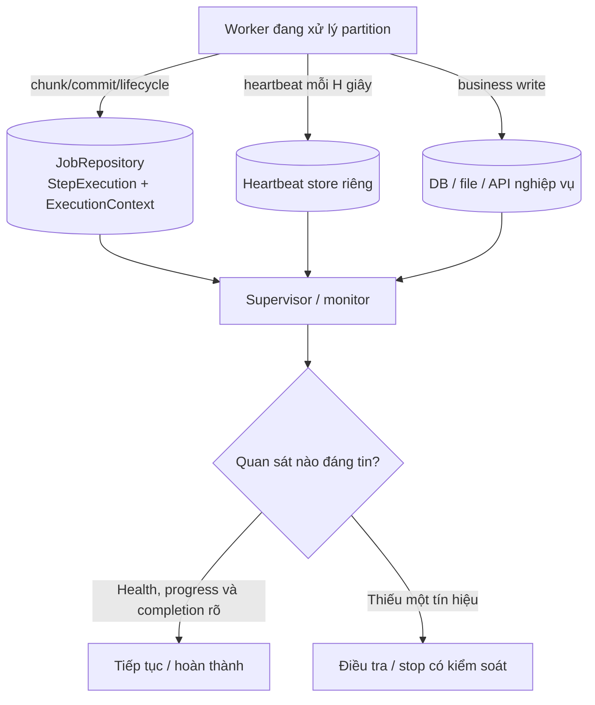
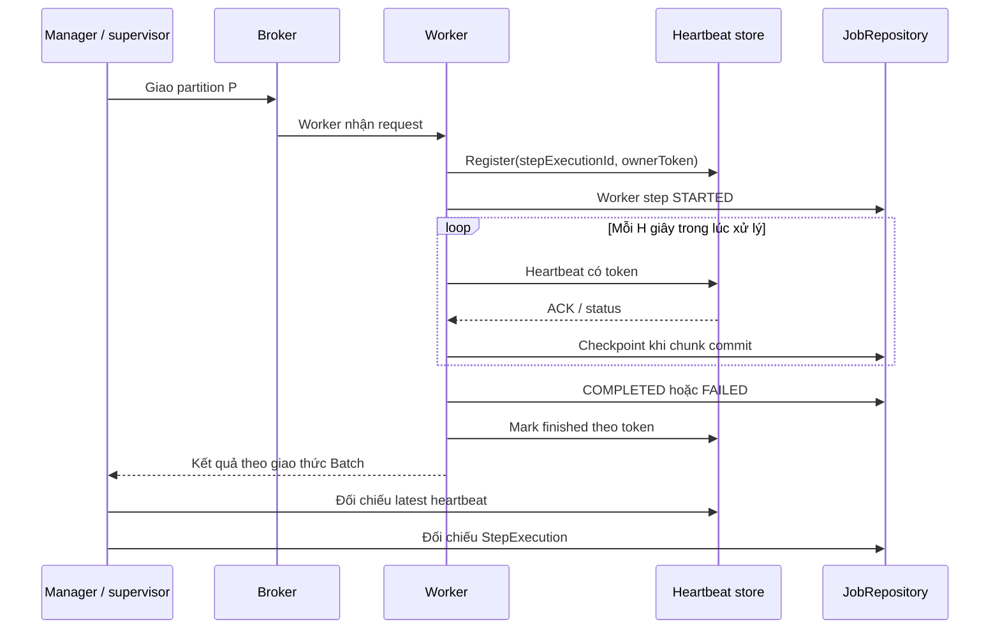
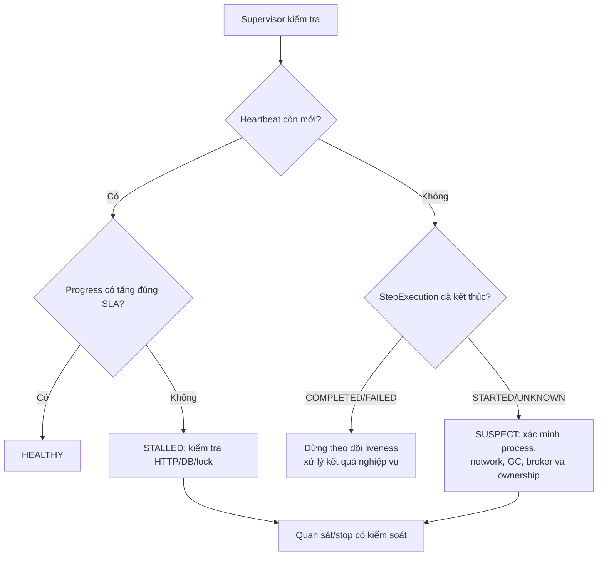
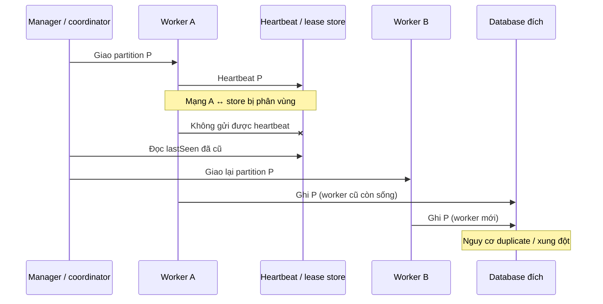

# Worker timeout và heartbeat

## 1. Bối cảnh: worker còn sống nhưng công việc có thể đã ngừng tiến triển

Trong chương **Thiết kế worker** của module **SPRING_BATCH_SCALING_OPERATIONS**, chúng ta xây dựng worker có khả năng xử lý workload dữ liệu lớn qua partitioning, remote chunking và những mô hình phân tán phù hợp. Khi manager giao việc cho nhiều worker, một câu hỏi vận hành rất quan trọng xuất hiện: **khi nào có thể kết luận worker đã chết, kẹt hoặc không còn quyền xử lý phần việc?**

Hãy hình dung job xử lý 16 partition. Mười lăm partition đã hoàn thành, nhưng worker xử lý partition cuối không gửi kết quả trong mười phút. Có ít nhất bốn khả năng:

1. Worker đã chết do JVM crash hoặc container bị dừng.
2. Worker vẫn sống nhưng đang đợi HTTP/JDBC quá lâu, hoặc mắc deadlock.
3. Worker đã commit dữ liệu và kết thúc step, nhưng phản hồi về manager bị mất.
4. Worker chưa thực sự bắt đầu vì request đang nằm trong broker queue hoặc task đang chờ executor.

Nếu chỉ dựa vào một bộ đếm thời gian để tự đánh dấu `FAILED` rồi gửi lại việc, hệ thống có thể **cho hai worker cùng ghi một partition**, tạo duplicate hoặc phá checkpoint. Bởi vậy thiết kế worker cần phân biệt **timeout**, **heartbeat**, **tiến độ nghiệp vụ** và **trạng thái `StepExecution`**.

Mục tiêu của bài:

- Phân biệt heartbeat về **liveness**, dấu hiệu **progress**, completion và ownership/lease.
- Thiết kế các lớp timeout cho I/O, transaction, xử lý step, request/reply và giám sát SLA.
- Hiểu vì sao `JobRepository.LAST_UPDATED` không phải heartbeat đáng tin cậy cho mọi worker.
- Bố trí heartbeat store/channel riêng, giữ metadata Spring Batch khỏi concurrent update tùy tiện.
- Thiết kế điều kiện phát lại an toàn, tránh *zombie worker* và các vấn đề *split brain*.
- Triển khai ví dụ Spring Batch 5.x bằng `StepExecutionListener` và scheduler cho heartbeat.
- So sánh local partitioning, remote partitioning, remote chunking và remote step.
- Đo bottleneck, kiểm thử mất kết nối, crash, replay và restart trong môi trường nhiều worker.

> **Nguyên tắc quan trọng:** **Heartbeat chỉ là tín hiệu quan sát được, không phải bằng chứng tuyệt đối worker còn quyền ghi hoặc đã hoàn tất.** Không nhận được heartbeat có thể do lỗi mạng hay GC pause; nhận được heartbeat vẫn không chứng minh worker đang tạo tiến độ hoặc dữ liệu đã commit.

## 2. Bốn khái niệm cần tách riêng

| Khái niệm | Câu hỏi trả lời | Dữ liệu quan sát điển hình | Không thể suy ra |
| --- | --- | --- | --- |
| **Liveness / heartbeat** | Tiến trình hoặc worker có gửi tín hiệu gần đây không? | `lastSeenAt`, `workerId`, timestamp nhận ping | Job đang xử lý có tiến độ |
| **Progress** | Công việc có đang tiến tới hoàn tất không? | `readCount`, `writeCount`, `commitCount`, số business key đã xử lý | Worker có thể hoàn tất mọi side effect |
| **Completion** | `StepExecution` đã đạt trạng thái cuối chưa? | `BatchStatus`, `ExitStatus`, `END_TIME` | Dữ liệu đích không thiếu/trùng |
| **Ownership / lease** | Worker nào **được phép** thực thi phần việc lúc này? | `ownerId`, lease expiry, generation/fencing token | Việc giữ lease tự ngăn được writer không kiểm tra token |

Ví dụ một worker vẫn gửi ping mỗi 5 giây nhưng đang đợi một API HTTP suốt 10 phút. Nó **có liveness**, nhưng **không có progress**. Ngược lại, worker đã ghi xong và process chết trước khi gửi reply: liveness mất, còn **completion và dữ liệu đã commit có thể đã tồn tại**.

### 2.1. Bảng trạng thái quan sát

| Heartbeat | Progress | Step metadata | Diễn giải sơ bộ | Hành động ban đầu |
| --- | --- | --- | --- | --- |
| Mới | Tăng đều | `STARTED` | Có vẻ khỏe | Theo dõi bình thường |
| Mới | Đứng yên lâu | `STARTED` | Có thể kẹt I/O, lock hoặc chunk rất lớn | Kiểm tra latency, thread dump, DB locks |
| Cũ | Tăng gần đây | `STARTED` | Heartbeat pipeline có thể lỗi hoặc trễ | Đối chiếu worker/monitor, không replay ngay |
| Cũ | Đứng yên | `STARTED` | Nghi crash hoặc mất liên lạc | Kiểm tra process, broker, repository và lease |
| Cũ | Không còn tăng | `COMPLETED` | Worker đã hoàn tất; không cần ping tiếp | Kiểm tra output/reply, không phát lại mù |
| Mới | Đứng yên | `FAILED` | Monitor và Batch state đang lệch hoặc worker còn process khác | Kiểm tra attempt/owner token và nguồn thời gian |
| Không có heartbeat | Không có progress | Chưa có `StepExecution` chạy | Request có thể vẫn đang xếp hàng | Kiểm tra queue, worker availability và dispatch |

**Đây là bảng chẩn đoán, không phải bảng quyết định tự động restart.** Tình trạng cuối cùng phải dựa trên nhiều nguồn và chính sách đồng thời của hệ thống.

## 3. Heartbeat không được đồng nhất với LAST_UPDATED của JobRepository

Spring Batch lưu metadata tại `JobRepository`. Một `StepExecution` có `START_TIME`, `END_TIME`, `LAST_UPDATED`, `STATUS` và các bộ đếm. Những trường này giúp quan sát tiến độ, nhưng **`LAST_UPDATED` không phải heartbeat có chu kỳ cố định**.

Trong chunk-oriented step, trạng thái được cập nhật ở các điểm mà framework quản lý, thường liên quan tới checkpoint/commit và vòng đời step. Nếu một chunk gọi API trong 90 giây, việc metadata không đổi trong 90 giây **không tự có nghĩa JVM đã chết**. Khi worker block trước khi kết thúc chunk, repository thậm chí có thể vẫn báo `STARTED`.

Các nguy cơ nếu tự biến metadata thành heartbeat:

- Một thread nền tự gọi `JobRepository.update(stepExecution)` trong khi chunk thread cũng cập nhật **cùng `StepExecution`** có thể gây tranh chấp `VERSION` hoặc trạng thái không nhất quán.
- Cập nhật `ExecutionContext` liên tục để ghi timestamp làm tăng tải DB metadata và phức tạp hóa checkpoint.
- Nếu heartbeat dùng cùng transaction với một chunk đang xử lý lâu, cập nhật có thể bị trì hoãn hoặc rollback.
- Nếu quản trị sửa `BATCH_STEP_EXECUTION.STATUS` bằng SQL theo timeout trong khi worker còn sống, worker có thể tiếp tục ghi dữ liệu và cập nhật repository sau đó.

**Khuyến nghị:** Dùng `JobRepository` làm nguồn sự thật cho **lifecycle và checkpoint Batch**, còn heartbeat liveness định kỳ nên đặt ở **kênh hoặc bảng riêng** khi hệ thống thực sự cần. Dữ liệu heartbeat chỉ phục vụ giám sát/lease, không thay thế `StepExecution`.



## 4. Các loại timeout phải được xác định rõ

Một chữ “timeout” có thể mang nhiều ý nghĩa rất khác nhau:

| Timeout | Áp dụng cho | Khi hết hạn | Có ngắt worker ngay không? |
| --- | --- | --- | --- |
| Connect timeout | Thiết lập kết nối HTTP/TCP | Client có thể báo lỗi kết nối | Không |
| Read/response timeout | Một thao tác chờ dữ liệu | Client có thể ném lỗi I/O | Không bảo đảm kết thúc cả step |
| Connection pool acquisition timeout | Lấy connection từ JDBC/HTTP pool | Báo hết thời gian chờ pool | Không |
| Query/statement timeout | Một truy vấn JDBC | Driver/database có thể hủy câu SQL | Phụ thuộc driver và DB |
| Transaction timeout | Giao dịch chunk | Manager/resource có thể đánh dấu rollback | Không tự hủy mọi HTTP side effect |
| Heartbeat freshness timeout | Khoảng thời gian không thấy ping | Supervisor đánh dấu **suspect** | **Không** |
| Lease expiration | Quyền sở hữu phần việc | Chủ sở hữu cũ bị coi là hết hạn theo giao thức lease | **Không thể giết worker cũ** |
| Request/reply timeout | Đợi kết quả messaging | Caller/manager hết thời gian chờ | **Không** |
| Worker SLA deadline | Tổng thời gian xử lý một partition | Cảnh báo/đề nghị dừng/escalate | **Không mặc định** |
| Executor shutdown timeout | Chờ các task khi JVM shutdown | Quá thời gian chờ khi tắt ứng dụng | Không phải per-partition timeout |

Trong `TaskExecutorPartitionHandler` chạy local, không có một deadline universal mà chỉ cần `gridSize(8)` sẽ tự dừng worker sau tám giây. `setAwaitTerminationSeconds` của `ThreadPoolTaskExecutor` liên quan **shutdown**, không phải một giới hạn thời gian thực thi cho từng partition.

Trong remote partitioning hoặc remote chunking, timeout ở phía manager/broker cũng **không chứng minh worker từ xa đã dừng**. Manager phải đối chiếu trạng thái thực thi và tác dụng phụ ở đích.

### 4.1. Một tình huống minh họa

Job có chunk size 100; mỗi item gọi HTTP, read timeout 4 giây. Nếu toàn bộ 100 item đều chờ gần 4 giây, **một chunk có thể kéo dài rất lâu**; chưa tính retry, database commit và queue. Vì thế không thể suy từ “HTTP timeout 4 giây” ra “partition chắc chắn hoàn tất trong 4 giây”.

Nếu một partition có 50.000 item, worker SLA cần dựa trên lượng dữ liệu, tốc độ nền, P95/P99 latency, chi phí retry và nhu cầu nghiệp vụ. Không thiết kế một ngưỡng timeout cố định cho mọi partition mà không xét kích thước và độ lệch tải.

## 5. Kiến trúc heartbeat đề xuất

Một thiết kế đơn giản nhưng có thể vận hành gồm:

1. **Heartbeat sender** chạy trong worker JVM, độc lập với thao tác read/process/write khi phù hợp.
2. **Heartbeat transport/store** có timeout hữu hạn và ghi nhận thời gian **tại nơi nhận**, ví dụ một bảng riêng hoặc hệ thống telemetry.
3. **Supervisor** kiểm tra freshness, tiến độ, trạng thái `StepExecution` và metrics của broker/worker.
4. **Điều phối quyền sở hữu** nếu cần tự động chuyển partition sang worker khác: phải có lease/claim và giải pháp ngăn worker cũ ghi, không chỉ heartbeat.
5. **JobRepository** vẫn quản lý trạng thái Batch/checkpoint theo API framework.



Sơ đồ nói về **trách nhiệm logic**. Thứ tự chính xác giữa đăng ký heartbeat và `StepExecution.STARTED` phụ thuộc listener, broker và handler của ứng dụng. Trong cấu hình production, các thao tác phải được đặt trong giao thức ownership rõ ràng nếu có thể xảy ra request trùng.

### 5.1. Thông tin nên có trong heartbeat

| Trường | Ý nghĩa | Cách sử dụng |
| --- | --- | --- |
| `jobExecutionId` | Phân biệt lần thực thi job | Join với metadata Batch |
| `stepExecutionId` | Phân biệt lần thực thi step/partition | Khóa theo execution cụ thể |
| `partitionKey` | Phạm vi dữ liệu logic | Đối chiếu khi restart |
| `workerId` | Tiến trình/container thực thi | Theo dõi node và lỗi cục bộ |
| `attemptToken` | Nhận diện một lần ownership/attempt | Tránh message cũ ghi đè tình trạng mới |
| `receivedAt` | Thời điểm heartbeat store nhận | Đo độ mới, giảm vấn đề lệch đồng hồ |
| `state` | `RUNNING` / `FINISHED` / `SUSPECT`... của monitor | Không thay thế `BatchStatus` |
| `lastProgress` (tùy chọn) | Commit count, item count hoặc business key | Phát hiện worker sống nhưng không tiến triển |

Không nhất thiết phát full `ExecutionContext` trên mỗi heartbeat: có thể chứa dữ liệu nhạy cảm, lớn, khó serialize và làm tăng tải mạng/DB. **Không đưa credential, access token hoặc PII** vào heartbeat/log.

### 5.2. Chọn chu kỳ và timeout

Gọi:

- `H` = khoảng cách mục tiêu giữa các heartbeat, ví dụ 5 giây.
- `D` = khoảng giám sát coi heartbeat đã quá cũ, ví dụ 30 giây.
- `L_p` = độ trễ P99 của đường heartbeat (gửi, queue, store).
- `G` = khoảng dung sai cho GC pause, scheduling và mạng.

Một quy tắc thiết kế là chọn `D` đủ lớn để chứa nhiều lần heartbeat và điều kiện gián đoạn ngắn, thay vì `D = H`. Ví dụ `H=5s` và `D=30s` là **giá trị khởi đầu để benchmark**, không phải chuẩn bắt buộc. Nếu hệ thống thường có GC pause 40 giây, cấu hình này sẽ tạo false positives.

\[
\text{suspect nếu } t_{\text{now,store}}-t_{\text{lastSeen,store}} > D
\]

Hai timestamp nên được tính theo cùng đồng hồ nhận (ví dụ DB `CURRENT_TIMESTAMP`) hoặc cùng hệ thống giám sát; không trừ timestamp do hai máy có lệch đồng hồ không kiểm soát. Với duration đo trong một process, đồng hồ monotonic có thể phù hợp hơn wall-clock.

**Suspect là cảnh báo, không phải lệnh replay.** Quyết định chuyển quyền sở hữu cần một quy trình riêng và phải xét đến worker chưa thật sự dừng.

## 6. Ví dụ bảng heartbeat riêng, tránh cập nhật StepExecution từ thread nền

Một thiết kế PostgreSQL minh họa:

```sql
CREATE TABLE batch_worker_heartbeat (
    step_execution_id BIGINT PRIMARY KEY,
    job_execution_id  BIGINT NOT NULL,
    partition_key     VARCHAR(128) NOT NULL,
    worker_id         VARCHAR(128) NOT NULL,
    attempt_token     VARCHAR(64) NOT NULL,
    state             VARCHAR(24) NOT NULL,
    received_at       TIMESTAMPTZ NOT NULL DEFAULT CURRENT_TIMESTAMP
);

CREATE INDEX idx_worker_heartbeat_received
    ON batch_worker_heartbeat(state, received_at);
```

Đây là **bảng ứng dụng đề xuất**, không phải bảng schema chuẩn của Spring Batch. Không sửa bảng `BATCH_STEP_EXECUTION` để thêm heartbeat tùy tiện.

### 6.1. Đăng ký ownership cho một StepExecution

```sql
INSERT INTO batch_worker_heartbeat (
    step_execution_id,
    job_execution_id,
    partition_key,
    worker_id,
    attempt_token,
    state,
    received_at
)
VALUES (
    :stepId, :jobId, :partitionKey, :workerId,
    :attemptToken, 'RUNNING', CURRENT_TIMESTAMP
)
ON CONFLICT (step_execution_id) DO NOTHING;
```

Ứng dụng **phải kiểm tra số hàng được insert**. Nếu bằng 0, đã có record cho `stepExecutionId` đó: không tự nhận quyền rồi chạy tiếp. Cần một giao thức reclaim/khôi phục rõ ràng, nhất là khi message bị redelivery.

### 6.2. Gia hạn heartbeat có kiểm tra owner

```sql
UPDATE batch_worker_heartbeat
SET received_at = CURRENT_TIMESTAMP
WHERE step_execution_id = :stepId
  AND attempt_token = :attemptToken
  AND worker_id = :workerId
  AND state = 'RUNNING';
```

Nếu kết quả update là 0, caller không còn khớp owner/state hoặc record không tồn tại. **Không bỏ qua im lặng**: worker cần quan sát và chuyển sang xử lý mất quyền hợp tác theo thiết kế, tránh tiếp tục ghi sau khi quyền bị thu hồi.

### 6.3. Đánh dấu xong và quan sát worker nghi ngờ

```sql
UPDATE batch_worker_heartbeat
SET state = 'FINISHED',
    received_at = CURRENT_TIMESTAMP
WHERE step_execution_id = :stepId
  AND attempt_token = :attemptToken
  AND state = 'RUNNING';
```

```sql
-- PostgreSQL: chỉ dùng để quan sát/cảnh báo.
SELECT
    step_execution_id, job_execution_id, partition_key,
    worker_id, state, received_at
FROM batch_worker_heartbeat
WHERE state = 'RUNNING'
  AND received_at < CURRENT_TIMESTAMP - INTERVAL '30 seconds';
```

Câu truy vấn trả những worker **không có heartbeat mới**, không chứng minh chúng đã chết. Hãy tiếp tục đối chiếu `JobRepository`, process status, broker delivery và DB nghiệp vụ.

### 6.4. Bảng heartbeat không tự tạo distributed lock an toàn

`attemptToken` ngẫu nhiên giúp phân biệt owner và chặn một số stale heartbeat. Tuy nhiên, một worker cũ có thể **vẫn tiếp tục ghi DB nghiệp vụ** sau khi bị thay owner, dù record heartbeat của nó không còn cập nhật được.

Để có **fencing** thực sự khi tự động chuyển phần việc:

1. Coordinator cấp một **generation/fencing token tăng đơn điệu** cho mỗi lần ownership.
2. Worker mới được chấp nhận khi đã giành quyền theo giao thức atomic.
3. Mọi đường ghi có thể gây xung đột tới tài nguyên quan trọng phải **kiểm tra generation mới nhất** hoặc có cơ chế chặn owner cũ tương đương.
4. Writer cũ mang generation nhỏ hơn phải bị từ chối ở **đích ghi**, kể cả nếu thread chưa ngừng.
5. Khi không thể fencing mọi side effect bên ngoài, không được tự tin rằng failover tự động là an toàn: cần idempotency/compensation và quy trình vận hành.

**UUID token không phải fencing generation tăng đơn điệu.** Đoạn SQL trong mục này giúp giám sát liveness và phân biệt owner của một step execution; nó chưa tự hoàn chỉnh giao thức lease/fencing production.

## 7. Spring Batch 5.x: phát heartbeat bằng StepExecutionListener

Một cách ghép heartbeat vào worker chunk step là dùng `StepExecutionListener` để bắt đầu và kết thúc một scheduled task. `ThreadPoolTaskScheduler` làm scheduler **dùng chung**, thay vì tạo một thread mới cho từng partition. Phần gửi ping dùng một interface riêng để dễ kiểm thử và chọn transport.

### 7.1. Hợp đồng gửi heartbeat

```java
public interface WorkerHeartbeatSink {
    // Claim/register phải từ chối khi stepExecutionId
    // đã có owner khác, không "ghi đè" mặc định.
    void register(long jobExecutionId, long stepExecutionId,
                  String workerId, String attemptToken);

    // Touch heartbeat với owner token.
    // Có thể throw khi mất kết nối hoặc không còn quyền sở hữu.
    void heartbeat(long stepExecutionId, String workerId,
                   String attemptToken);

    void finished(long stepExecutionId, String workerId,
                  String attemptToken);
}
```

Trong thực tế, implement `WorkerHeartbeatSink` bằng một service riêng, transaction ngắn và độc lập với transaction nghiệp vụ. `register/heartbeat/finished` có thể dùng SQL tương tự mục 6, kiểm tra **rows affected**. Nếu dùng `@Transactional(REQUIRES_NEW)`, gọi qua Spring proxy/service riêng để propagation thực sự có hiệu lực.

### 7.2. Scheduler chung và listener có trạng thái theo StepExecution

```java
import java.time.Duration;
import java.util.Map;
import java.util.UUID;
import java.util.concurrent.ConcurrentHashMap;
import java.util.concurrent.ScheduledFuture;

import org.springframework.batch.core.ExitStatus;
import org.springframework.batch.core.StepExecution;
import org.springframework.batch.core.StepExecutionListener;
import org.springframework.context.annotation.Bean;
import org.springframework.scheduling.concurrent.ThreadPoolTaskScheduler;

@Bean
ThreadPoolTaskScheduler workerHeartbeatScheduler() {
    ThreadPoolTaskScheduler scheduler = new ThreadPoolTaskScheduler();
    scheduler.setPoolSize(2);
    scheduler.setThreadNamePrefix("batch-heartbeat-");
    scheduler.setRemoveOnCancelPolicy(true);
    scheduler.initialize();
    return scheduler;
}

@Bean
StepExecutionListener workerHeartbeatListener(
        ThreadPoolTaskScheduler scheduler,
        WorkerHeartbeatSink sink) {

    // Bean listener có thể được dùng bởi nhiều worker StepExecution.
    Map<Long, ScheduledFuture<?>> scheduled =
        new ConcurrentHashMap<>();
    Map<Long, String> ownerTokens = new ConcurrentHashMap<>();
    String workerId = UUID.randomUUID().toString(); // một JVM instance

    return new StepExecutionListener() {
        @Override
        public void beforeStep(StepExecution stepExecution) {
            long jobId = stepExecution.getJobExecution().getId();
            long stepId = stepExecution.getId();
            String token = UUID.randomUUID().toString();

            // Đây là liveness registration, cần thực thi atomic trong sink.
            sink.register(jobId, stepId, workerId, token);
            ownerTokens.put(stepId, token);

            ScheduledFuture<?> task = scheduler.scheduleAtFixedRate(
                () -> {
                    try {
                        sink.heartbeat(stepId, workerId, token);
                    } catch (RuntimeException ex) {
                        // Production: ghi log/metric, phân loại transient
                        // vs mất ownership; không sửa StepExecution
                        // trực tiếp từ scheduler thread.
                    }
                },
                Duration.ofSeconds(5)
            );
            scheduled.put(stepId, task);
        }

        @Override
        public ExitStatus afterStep(StepExecution stepExecution) {
            long stepId = stepExecution.getId();
            ScheduledFuture<?> task = scheduled.remove(stepId);
            if (task != null) {
                task.cancel(false);
            }
            String token = ownerTokens.remove(stepId);
            if (token != null) {
                sink.finished(stepId, workerId, token);
            }
            return null; // không thay ExitStatus của worker step
        }
    };
}
```

### 7.3. Gắn listener vào worker step

```java
@Bean
Step invoiceWorker(
        JobRepository jobRepository,
        PlatformTransactionManager transactionManager,
        ItemReader<Invoice> reader,
        ItemProcessor<Invoice, ProcessedInvoice> processor,
        ItemWriter<ProcessedInvoice> writer,
        StepExecutionListener workerHeartbeatListener) {

    return new StepBuilder("invoiceWorker", jobRepository)
        .<Invoice, ProcessedInvoice>chunk(100, transactionManager)
        .reader(reader)
        .processor(processor)
        .writer(writer)
        .listener(workerHeartbeatListener)
        .build();
}
```

Các kiểu `Invoice`, `ProcessedInvoice` và bean reader/processor/writer là **kiểu nghiệp vụ minh họa**; dự án phải định nghĩa và cấu hình riêng. Với partitioning, mỗi `StepExecution` của worker chạy listener; map concurrent giữ các task riêng theo `stepExecutionId`.

### 7.4. Giới hạn quan trọng của ví dụ

Mã này **minh họa liveness monitoring**, chưa phải giải pháp automatic failover hoàn chỉnh:

- Nếu JVM bị kill bằng `SIGKILL`, `afterStep()` không chạy. Supervisor phải phát hiện heartbeat quá cũ; không dựa vào `FINISHED` là trạng thái bắt buộc được gửi.
- Nếu scheduler thread kẹt hoặc heartbeat store mất kết nối, heartbeat bị trễ dù worker vẫn xử lý.
- Nếu gửi heartbeat thất bại vì **ownership đã mất**, việc chỉ ghi log **không đủ an toàn**. Production phải có cơ chế báo mất lease cho worker và dừng ghi tại ranh giới có thể kiểm soát; nếu cần, đích ghi phải thực thi fencing.
- `task.cancel(false)` ngừng lịch lặp trong tương lai theo khả năng scheduler; nó không hủy một heartbeat đang chạy hoặc transaction nghiệp vụ.
- Một listener được dùng chung cho nhiều worker cần state thread-safe như map ở ví dụ. Không để các partition ghi vào một biến instance `currentStepExecution` singleton.
- Việc đăng ký heartbeat và lên lịch cần xử lý thất bại trung gian: nếu `scheduleAtFixedRate` lỗi sau `register`, phải cleanup/reconcile record đã đăng ký và làm worker thất bại có kiểm soát.
- Phương thức `sink.finished` có thể lỗi do DB/network; nên thiết kế exception policy và cleanup rõ ràng để không che mất `ExitStatus` nghiệp vụ.

Khi cần bảo đảm chống xử lý trùng, nên bổ sung guard tại **trước chunk** hoặc **trước external write** để kiểm tra trạng thái ownership, cộng với fencing ở đích. Chỉ có listener heartbeat chạy nền **không** tạo hàng rào bảo mật dữ liệu.

## 8. Heartbeat và progress: phải kết hợp để phát hiện worker bị treo

Một worker chạy chunk-oriented step có thể tiếp tục ping trong khi `ItemProcessor` bị kẹt HTTP. Nếu monitor chỉ xem `receivedAt`, job có thể treo rất lâu mà không cảnh báo.

Thiết kế hai lớp kiểm tra:

1. **Liveness deadline:** đã lâu không thấy heartbeat của đúng `workerId`/`attemptToken`.
2. **Progress deadline:** đã lâu không có chunk commit, không tăng business count hoặc không có trạng thái tiến triển hợp lệ so với SLA của partition.



### 8.1. Nguồn đo progress

- `BATCH_STEP_EXECUTION.READ_COUNT`, `WRITE_COUNT`, `COMMIT_COUNT` và `LAST_UPDATED`.
- Ứng dụng có thể xuất thêm metric ở `ChunkListener`/`StepExecutionListener`.
- Số business key đã ghi bền vững vào bảng đích, watermark hoặc checkpoint được kiểm chứng.
- Thời lượng từng chunk, thời gian chờ HTTP, connection pool pending, DB lock wait.

**Progress count không phải heartbeat.** Một chunk xử lý hợp lệ có thể dài 1–2 phút; `COMMIT_COUNT` chưa tăng cho tới ranh giới commit. Ngược lại, `READ_COUNT` tăng không đồng nghĩa writer đã commit đủ dữ liệu.

### 8.2. Phân biệt worker kẹt và partition đang queue

Trong local partitioning, `gridSize=16` nhưng pool chỉ có bốn thread, 12 partition có thể chờ executor. Trong remote partitioning, request có thể còn ở broker. Không nên đặt liveness timeout cho một partition **chưa có worker claim/start**.

Gợi ý trạng thái monitor:

```text
CREATED / QUEUED
    -> DISPATCHED
    -> CLAIMED (bắt đầu theo dõi heartbeat)
    -> RUNNING
    -> COMPLETED / FAILED / STOPPED
    hoặc SUSPECT -> INVESTIGATING
```

Đây là **state machine giám sát do ứng dụng định nghĩa**, không phải danh sách `BatchStatus` chuẩn của Spring Batch. Cần lưu rõ thời gian dispatch, claim/start và lần nhận heartbeat cuối để không nhầm queue delay với worker timeout.

## 9. Khi heartbeat mất: không replay ngay, phải giải quyết zombie worker

Một *zombie worker* là worker **vẫn đang hoạt động hoặc có thể tiếp tục ghi** sau khi manager/coordinator cho rằng nó đã mất quyền xử lý.

### 9.1. Kịch bản split brain



Chỉ kiểm tra `lastSeen` và gửi lại request có thể dẫn tới hai writer cùng thao tác trên phần dữ liệu. Điều này vẫn có thể xảy ra khi cả hai JVM còn CPU và DB kết nối tốt, nhưng một đường network đến heartbeat store có vấn đề.

### 9.2. Thiết kế ownership an toàn hơn

Một hướng thiết kế:

1. Worker nhận request kèm `partitionKey`, `jobExecutionId`, `stepExecutionId`.
2. Worker giành **claim/lease atomic** qua coordinator/store đáng tin cậy; claim có owner và generation.
3. Worker định kỳ renew lease và kiểm tra kết quả renew.
4. Khi lease mất, worker **không tiếp tục side effect mới**. Nếu đã ở giữa một I/O blocking, vẫn phải xét thực tế nó có thể hoàn thành muộn.
5. Coordinator chỉ giao việc cho owner mới theo protocol, nâng fencing generation.
6. Tài nguyên đích hoặc lớp ghi kiểm tra generation để từ chối owner cũ; hoặc có cơ chế bảo vệ tương đương.
7. Kết quả cũ đến muộn phải được kiểm tra attempt/owner trước khi công bố completion.

**Nếu không thể áp đặt fencing vào hệ thống ngoài**, cần dùng idempotency key, unique business constraint, outbox, reconciliation hoặc quy trình chuyển quyền thủ công sau khi đã xác nhận owner cũ dừng. Không quảng cáo khả năng “automatic failover exactly once” chỉ vì có heartbeat.

### 9.3. Không tự ghi FAILED vào JobRepository

`JobRepository` có thể vẫn báo `STARTED` vì worker kẹt hoặc đã chết trước khi cập nhật. Không tùy ý:

```sql
-- PHẢN VÍ DỤ: KHÔNG LÀM NHƯ VẬY khi worker có thể còn chạy.
UPDATE BATCH_STEP_EXECUTION
SET STATUS = 'FAILED'
WHERE STEP_EXECUTION_ID = :stepId;
```

Sửa metadata trực tiếp có thể làm mất nhất quán `VERSION`, checkpoint và vòng đời framework. Hãy dùng API/quy trình recovery được hỗ trợ, xác minh worker cũ và trạng thái dữ liệu nghiệp vụ trước khi restart.

## 10. JobOperator.stop() là yêu cầu, không phải lệnh giết thread

Khi cần dừng job:

```java
import org.springframework.batch.core.launch.JobOperator;

// jobExecutionId là ID của JobExecution đang thực thi.
// Đây là một stop request, chưa phải ACK worker đã dừng.
jobOperator.stop(jobExecutionId);
```

`JobOperator.stop(...)` yêu cầu dừng theo cơ chế Spring Batch. Worker thường có cơ hội nhận stop tại những ranh giới phù hợp; một HTTP/JDBC call blocking có thể chưa kết thúc ngay. `Thread.interrupt()` và `Future.cancel(true)` cũng chỉ mang tính hợp tác: driver/client không nhất thiết hủy được thao tác đang chạy.

Sau stop request, phải:

- Theo dõi status thật của `JobExecution` và từng worker `StepExecution`.
- Kiểm tra thread/process/container còn hoạt động không.
- Đối chiếu transaction và business keys đã commit ở đích.
- Xác minh không còn worker cũ đang ghi xung đột trước khi chuyển ownership.
- Bảo đảm khả năng resume/checkpoint và chính sách xử lý request trùng.

Nếu chỉ cần alert khi quá SLA, **không nhất thiết phải tự động stop hoặc replay**. Việc tự động hóa quyết định xử lý lỗi cần dựa trên bảo đảm kỹ thuật đã được thử nghiệm thực tế.

## 11. Heartbeat trong các mô hình mở rộng Spring Batch

| Mô hình | Đơn vị thực thi | Nơi quan sát heartbeat có ích | Lưu ý về timeout |
| --- | --- | --- | --- |
| Local partitioning (`TaskExecutorPartitionHandler`) | Worker `StepExecution` trong cùng JVM | Có thể dùng thread/executor metrics, heartbeat theo partition khi cần | JVM chung; worker block I/O không nhất thiết bị dừng bằng interrupt |
| Remote partitioning | Worker `StepExecution` ở nhiều JVM | Heartbeat theo worker/step attempt, kết hợp broker và repository | Reply mất/worker crash/lease hết hạn không đồng nghĩa transaction đã rollback |
| Remote chunking | Manager đọc và gửi **ChunkRequest**; worker tiêu thụ chunk | Heartbeat worker consumer/JVM, thêm request progress/outstanding chunk | Không có `StepExecution` riêng cho mỗi chunk mặc định; cần correlation và idempotency |
| Remote step (Spring Batch 6.x) | Một whole-step execution được ủy quyền cho worker | Heartbeat step attempt tại worker và repository shared | Một remote step không tự chia thành N partition; monitor step không phải message per chunk |
| Multi-threaded chunk step | Nhiều chunk thread của cùng `StepExecution` | Thread/queue metrics, progress theo step | `@StepScope` không tạo heartbeat target riêng cho từng chunk thread |

### 11.1. Local partitioning: tận dụng những tín hiệu sẵn có

Với worker trong cùng JVM, việc đầu tiên là quan sát `ThreadPoolTaskExecutor`: active threads, queue, thread dump và thời gian `StepExecution`. Heartbeat chuyên dụng có ích cho SLA theo partition, nhưng **không thay thế timeout của JDBC/HTTP** và không giúp giết một thread đang giữ lock.

Nếu chỉ có bốn worker và muốn giảm overhead, có thể không cần ghi một heartbeat row mỗi 5 giây cho từng partition. Tùy mức độ rủi ro, metric ở JVM và JobRepository đã đủ cho giám sát thủ công.

### 11.2. Remote partitioning: heartbeat theo execution/attempt

Worker nhận request mang định danh execution/partition, thực thi step, cập nhật repository và trả kết quả theo `PartitionHandler`. Một queue ACK **không chứng minh** worker đã hoàn tất step.

Heartbeat nên gắn `stepExecutionId` cùng `attemptToken` để phân biệt tín hiệu muộn của owner cũ. Manager cần kiểm tra `StepExecution`, độ trễ reply, broker redelivery và trạng thái đích trước khi replay.

### 11.3. Remote chunking: không tạo StepExecution cho từng chunk

Manager giữ reader và dùng message writer gửi các `ChunkRequest`. Nhiều worker có thể cùng xử lý chunk của cùng manager step. Heartbeat worker consumer cho biết node có khả năng nhận message; **không cho biết riêng chunk 42 đã commit hay chưa**.

Cần theo dõi:

- Số chunk đã gửi, đang outstanding và đã nhận `ChunkResponse`.
- Correlation ID/chunk ID, response trễ hoặc trùng.
- Broker redelivery, DLQ, queue age.
- Worker liveness và worker handler duration.
- Idempotency business writer khi chunk đã ghi thành công nhưng reply bị mất.

### 11.4. RemoteStep và tính tương thích phiên bản

`RemoteStep` là API được giới thiệu từ **Spring Batch 6.0** để ủy quyền toàn bộ step execution; nó không có trong các phiên bản 5.x. Nếu ứng dụng dùng Spring Batch 5.2, nên phân biệt **remote partitioning/remote chunking** với class `RemoteStep` 6.x. Heartbeat có thể được thêm theo kiến trúc worker chung nhưng phải kiểm tra API cụ thể của phiên bản.

## 12. Timeout ở tầng I/O vẫn phải có dù đã bật heartbeat

Một worker có thể ping đều đặn nhưng đang mắc một HTTP request không có timeout. Chỉ giám sát heartbeat sẽ bỏ sót tình huống này.

### 12.1. Cấu hình HTTP timeout trong Spring Framework 6.1+

```java
import org.springframework.context.annotation.Bean;
import org.springframework.http.client.SimpleClientHttpRequestFactory;
import org.springframework.web.client.RestClient;

@Bean
RestClient riskClient() {
    SimpleClientHttpRequestFactory requestFactory =
        new SimpleClientHttpRequestFactory();
    requestFactory.setConnectTimeout(2_000); // 2 giây
    requestFactory.setReadTimeout(5_000);    // 5 giây

    return RestClient.builder()
        .baseUrl("https://risk.example.internal")
        .requestFactory(requestFactory)
        .build();
}
```

Endpoint trên chỉ là minh họa. Trong hệ thống thật còn cần authentication, connection pool, quota/rate limit, tracing và timeout tổng cho request nếu client hỗ trợ. Read timeout không nhất thiết tương đương deadline cho **toàn bộ chuỗi retry hoặc chunk**.

### 12.2. JDBC và transaction

Với database, cần phân biệt:

- **Pool acquisition timeout:** chờ connection.
- **Connect/socket timeout:** lỗi network/driver.
- **Statement/query timeout:** thời gian một SQL chạy.
- **Lock timeout:** chờ khóa row/table.
- **Transaction timeout:** ngân sách thời gian của transaction.

Một worker bị DB lock trong khi vẫn gửi heartbeat không phải worker khỏe về mặt progress. Đo connection pending, lock wait, transaction duration, statement timeout và số rollback trước khi tăng concurrency.

### 12.3. Retry có giới hạn

Ví dụ ở chunk step Spring Batch 5.x:

```java
new StepBuilder("scoreWorker", jobRepository)
    .<Invoice, ScoredInvoice>chunk(100, transactionManager)
    .reader(reader)
    .processor(processor)
    .writer(writer)
    .faultTolerant()
    .retry(org.springframework.web.client.ResourceAccessException.class)
    .retryLimit(3)
    .build();
```

Đây là snippet cấu hình, chưa có các bean reader/processor/writer. Không retry mọi exception vô hạn; cần phân loại lỗi tạm thời với validation, authorization và các side effect đã xảy ra. Nếu mỗi lần retry tạo thêm một HTTP `POST` không idempotent, heartbeat hoàn toàn không giải quyết được lỗi ghi lặp đó.

## 13. JobRepository, heartbeat store và database đích có ranh giới transaction riêng

Giả sử worker:

1. Ghi dữ liệu đích.
2. Commit transaction.
3. Gửi heartbeat.
4. Trả reply cho manager.

Nếu worker chết sau bước 2 nhưng trước bước 3, **dữ liệu đã tồn tại nhưng monitor không nhận ping cuối**. Nếu coordinator lập tức giao việc lại, dữ liệu có thể bị ghi lần nữa.

Ngược lại, heartbeat có thể thành công ngay trước khi writer lỗi. Monitor nhìn thấy ping mới nhưng step thực tế `FAILED`.

**Không xây một phép so sánh đơn giản “heartbeat mới hơn commit timestamp thì thành công”.** Giữa JobRepository, heartbeat store, broker và business database thường không có một transaction ACID chung.

| Tình huống | Metadata | Heartbeat | Business data | Hệ quả |
| --- | --- | --- | --- | --- |
| Worker đang xử lý chunk | `STARTED`, checkpoint chưa cập nhật | Mới | Có thể chưa commit chunk | Bình thường |
| Worker kẹt HTTP | `STARTED`, không tăng commit | Vẫn mới nếu scheduler hoạt động | Không có tiến độ | Alert progress stalled |
| Worker chết ngay sau commit | Có thể đã cập nhật checkpoint hoặc chưa, tùy transaction | Trở nên cũ | Dữ liệu có thể đã commit | Cần đối soát trước replay |
| Network đến heartbeat store hỏng | Worker có thể vẫn cập nhật JobRepository | Cũ | Worker vẫn ghi | Không tự kết luận worker chết |
| Worker bị mất lease nhưng còn chạy | Có thể vẫn `STARTED` | Stale/rejected | Có thể tiếp tục ghi nếu không fencing | Nguy cơ zombie writer |
| Job đã `COMPLETED` | Đã có kết quả cuối | Ngừng ping | Cần kiểm tra nghiệp vụ | Không phải liveness failure |

### 13.1. Checkpoint đúng nhưng side effect ngoài transaction có thể trùng

`ItemStream.update(ExecutionContext)` và `JobRepository` lưu tiến độ của reader/writer. Việc cập nhật metadata thường gắn với commit chunk theo cấu hình transaction phù hợp. Tuy nhiên HTTP POST, message publish hay file write không nhất thiết tham gia transaction JDBC. Một retry/restart có thể gọi lại tác vụ bên ngoài.

Giải pháp:

- Dùng unique business key hoặc idempotency key ổn định.
- Thiết kế transactional outbox khi phát sự kiện từ DB.
- Giữ partition key/boundary ổn định cho cùng `JobInstance`.
- Đối chiếu business key/source watermark sau restart.
- Không dùng heartbeat như checkpoint thay thế `ItemStream`.

## 14. Truy vấn và dashboard để chẩn đoán

### 14.1. Quan sát StepExecution

```sql
SELECT
    STEP_EXECUTION_ID,
    JOB_EXECUTION_ID,
    STEP_NAME,
    STATUS,
    EXIT_CODE,
    READ_COUNT,
    WRITE_COUNT,
    COMMIT_COUNT,
    ROLLBACK_COUNT,
    START_TIME,
    END_TIME,
    LAST_UPDATED
FROM BATCH_STEP_EXECUTION
WHERE JOB_EXECUTION_ID = ?
ORDER BY START_TIME, STEP_EXECUTION_ID;
```

Trong partitioning, mỗi worker thường có tên dạng `invoiceWorker:partition0`. Manager có `StepExecution` riêng và có thể đã tổng hợp counters từ worker. **Không cộng manager count với mọi worker count** để suy tổng business item duy nhất.

### 14.2. Kết hợp metadata và heartbeat

Với PostgreSQL, một truy vấn vận hành minh họa:

```sql
SELECT
    se.STEP_EXECUTION_ID,
    se.STEP_NAME,
    se.STATUS AS batch_status,
    se.READ_COUNT,
    se.WRITE_COUNT,
    se.COMMIT_COUNT,
    hb.worker_id,
    hb.state AS heartbeat_state,
    hb.received_at,
    CURRENT_TIMESTAMP - hb.received_at AS heartbeat_age
FROM BATCH_STEP_EXECUTION se
LEFT JOIN batch_worker_heartbeat hb
    ON hb.step_execution_id = se.STEP_EXECUTION_ID
WHERE se.JOB_EXECUTION_ID = ?
ORDER BY se.STEP_EXECUTION_ID;
```

Truy vấn này phục vụ quan sát; không dựa vào một lần đọc ở `READ COMMITTED` để đưa ra quyết định failover có tính cạnh tranh. Nếu nhiều coordinator có quyền giao lại việc, cần cơ chế claim/fencing atomic.

### 14.3. Những metric cần theo dõi

| Nhóm | Metric | Mục đích |
| --- | --- | --- |
| Heartbeat | Age p50/p95/p99, missed beats, sink errors | Phát hiện gián đoạn monitor/network |
| Worker health | CPU, heap, GC pause, thread count, container restarts | Tách JVM lỗi khỏi request chậm |
| Step progress | Commit/read/write count, chunk duration, step age | Phát hiện stalled step |
| Broker | Request backlog, oldest message age, DLQ, redelivery | Phân biệt queued với worker dead |
| DB pool | Active/pending connections, timeout | Worker có kẹt đợi connection không |
| Database | Lock wait, slow queries, transaction commit time | Nút thắt xử lý thực tế |
| Ownership | Failed renew, duplicate claim, old-token write rejects | Phát hiện split brain/fencing |
| Data integrity | Missing/duplicate business keys, checksum | Kiểm chứng retry/restart |

Khi heartbeat store là một điểm chung, nó cũng có thể trở thành bottleneck. Ví dụ 10.000 worker gửi ping mỗi 5 giây tạo mức trung bình **2.000 heartbeat/s**, chưa kể retry. Cần thiết kế batch/partition-level monitoring hợp lý, giới hạn telemetry và năng lực DB/store phù hợp.

## 15. Chọn heartbeat interval theo quy mô thực tế

Giả sử có `N` worker active, mỗi worker gửi heartbeat mỗi `H` giây. Số lần ghi trung bình cần phục vụ xấp xỉ:

\[
R_{\text{heartbeat}} \approx \frac{N}{H}.
\]

Đối với 1.200 worker với `H=10s`, hệ thống heartbeat phải xử lý khoảng **120 lần ghi mỗi giây** (chưa tính burst, retry, cleanup). Nếu mọi worker đồng loạt ping ở đúng mốc giây, store có thể chịu **burst** lớn hơn nhiều so với trung bình. Một mức jitter nhỏ trong thời điểm gửi có thể giúp phân tán tải, miễn không làm sai deadline phát hiện.

| Số worker | Chu kỳ heartbeat | Tải trung bình minh họa | Thỏa hiệp |
| ---: | ---: | ---: | --- |
| 50 | 5 giây | 10 ping/s | Phát hiện nhanh, ít tải |
| 500 | 5 giây | 100 ping/s | Cần theo dõi sink latency |
| 2.000 | 10 giây | 200 ping/s | Ít ghi hơn nhưng detection chậm |
| 10.000 | 5 giây | 2.000 ping/s | Cần thiết kế monitor/store ở quy mô lớn |

Đây là phép ước lượng đơn giản, không tính retries, batch write, replication hay những worker chưa claim. Chọn chu kỳ theo yêu cầu phát hiện lỗi và chi phí hạ tầng, không theo một hằng số “chuẩn” cho mọi hệ thống.

### 15.1. SLA cho partition dài/ngắn khác nhau

Một partition có 10.000 item có thể hợp lệ khi chạy lâu hơn partition 100 item. Thay vì chỉ đặt `maxStepDuration=60s`, cân nhắc:

- `maxQueueAge` tính từ thời điểm dispatch tới claim.
- `maxNoProgressDuration` từ lần commit/progress cuối (có dung sai cho chunk dài).
- `maxTotalDuration` theo lượng dữ liệu và loại workload.
- `heartbeatStaleAfter` tính theo hạ tầng liveness riêng.
- `maxReplyWait` nếu giao thức dùng request/reply.

Các deadline trên có **chức năng khác nhau**. Nếu cùng báo “worker timeout” mà không lưu nguyên nhân, đội vận hành rất khó quyết định nên tăng consumer, sửa HTTP client hay kiểm tra database.

## 16. Runbook khi một worker bị nghi timeout

1. **Xác định đơn vị công việc:** `JobInstance`, `JobExecutionId`, `StepExecutionId`, tên partition, attempt/owner token và node thực thi.
2. **Phân biệt queued hay started:** xem dispatch/claim timestamp, executor queue hoặc broker queue.
3. **Đối chiếu liveness:** heartbeat age, lỗi sink, network, JVM/container health và GC pause.
4. **Đối chiếu progress:** `READ_COUNT`/`WRITE_COUNT`/`COMMIT_COUNT`, chunk duration, HTTP/JDBC metrics và business output.
5. **Xác định transaction hiện tại:** worker đang đọc, xử lý, ghi, commit hay bị deadlock? Dùng thread dump, DB lock wait, trace và log thích hợp.
6. **Giảm nguy cơ trùng:** không gửi lại ngay cùng partition chỉ vì stale heartbeat; kiểm tra request in-flight và owner cũ.
7. **Dừng có kiểm soát nếu cần:** dùng cơ chế stop được hỗ trợ, theo dõi cho tới khi step/process thực sự dừng; nhớ rằng interrupt không bảo đảm chấm dứt blocking I/O.
8. **Quyết định chuyển ownership:** chỉ sau khi có giao thức claim/lease/fencing hoặc quy trình xác minh old worker đã không còn gây side effect.
9. **Khôi phục theo Spring Batch:** dùng metadata/checkpoint và identifying job parameters ổn định; không tự sửa `VERSION`/`STATUS`.
10. **Đối soát dữ liệu:** bảo đảm không thiếu/trùng business key và chỉ publish sau khi mọi partition hợp lệ.
11. **Phân tích hậu sự cố:** điều chỉnh timeout I/O, pool, retries, heartbeat deadline, queue age và cảnh báo dựa trên quan sát thật.

Một runbook tốt phải ghi rõ ai có quyền stop/restart, điều kiện nào cho phép auto-retry, điều kiện nào phải dừng để điều tra và cách xác định *exactly-once business effect* theo dữ liệu nghiệp vụ.

## 17. Lỗi thiết kế thường gặp

| Ngộ nhận | Rủi ro | Cách đúng |
| --- | --- | --- |
| “`LAST_UPDATED` là heartbeat 5 giây/lần của Spring Batch.” | Kết luận worker chết khi chunk còn đang xử lý | Dùng heartbeat riêng nếu cần liveness định kỳ |
| “Nhận heartbeat nghĩa là dữ liệu đang tiến triển.” | Worker bị kẹt HTTP vẫn ping | Kết hợp progress/commit metrics |
| “Không có ping 30 giây thì worker đã chết.” | False positive do GC/network/store chậm | Đánh dấu suspect và xác minh |
| “Timeout của manager sẽ hủy worker remote.” | Worker có thể vẫn ghi DB | Stop/cooperative cancellation và fencing |
| “UUID owner token đủ chặn zombie writer.” | Writer cũ không bị chặn ở đích | Generation/fencing kiểm tra tại resource |
| “Tự cập nhật `StepExecution` mỗi 5 giây là đơn giản nhất.” | Tranh chấp `VERSION` với chunk thread, hỏng checkpoint | Heartbeat store riêng |
| “`@StepScope` tạo writer riêng cho mỗi thread.” | Nhiều chunk thread cùng `StepExecution` vẫn chia sẻ bean | Thiết kế thread-safe/partitioning |
| “Có `JobRepository` thì không cần idempotency.” | Side effect ngoài transaction có thể lặp | Unique key, outbox, reconciliation |
| “ACK broker nghĩa là worker đã commit.” | ACK theo transport khác commit nghiệp vụ | Dựa vào `StepExecution`/reply và dữ liệu thật |
| “Chỉ cần tăng worker để tránh timeout.” | DB/API có thể bão hòa hơn | Đo bottleneck, giới hạn concurrency |
| “`afterStep()` luôn chạy kể cả kill -9.” | Không có cleanup khi process chết bất thường | Lease expiry và supervisor |
| “Heartbeat store không bao giờ lỗi.” | Monitor có thể gây false alarm hoặc mất tín hiệu | Theo dõi monitor health, fail-safe policy |
| “Worker đã `COMPLETED` mà không ping là lỗi.” | Worker hoàn tất thì ngừng heartbeat | Đọc Batch status cùng lifecycle |

## 18. Bài thực hành: phát hiện worker sống nhưng không tiến triển

**Bài toán:** Job xử lý 1,6 triệu giao dịch với tám partition remote. Bốn worker chạy ở hai JVM, đọc database và gọi HTTP API. Broker có thể redeliver request; một số API call thỉnh thoảng mất 90 giây. Hệ thống yêu cầu cảnh báo khi worker chết, nhận biết stuck progress, restart không ghi trùng và không giao đồng thời cùng partition.

Thực hiện:

1. **Phân rã dữ liệu:** thiết kế `Partitioner` tạo tám vùng ID không chồng lấn, đặt tên ổn định và giữ identifying job parameters nhất quán khi restart.
2. **Tách health:** tạo bảng `batch_worker_heartbeat` như mục 6, không chỉnh sửa bảng `BATCH_STEP_EXECUTION`.
3. **Gắn listener:** dùng `StepExecutionListener` + `ThreadPoolTaskScheduler`. Đặt chu kỳ heartbeat 5 giây, cảnh báo nghi stale sau 30 giây; thay đổi theo latency thực tế.
4. **Quan sát progress:** ghi metric commit count và chunk duration cho từng partition. Phân biệt worker ping đều nhưng chưa commit với worker mất cả ping lẫn tiến độ.
5. **Giả lập HTTP chậm:** cho một item gọi API mất 90 giây. Kiểm tra monitor **không kết luận chết** chỉ vì `LAST_UPDATED` chưa đổi.
6. **Giả lập lỗi heartbeat store:** chặn kết nối worker đến bảng heartbeat trong 40 giây nhưng giữ đường JDBC nghiệp vụ. Quan sát false positives và cách ứng dụng phân biệt store outage với worker crash.
7. **Giả lập process crash:** kill riêng JVM worker sau khi một chunk đã commit. Kiểm tra `afterStep()` không phải cơ chế cleanup đáng tin duy nhất; supervisor thấy stale ping và đối chiếu metadata.
8. **Thử redelivery:** cố ý gửi lại cùng `StepExecutionRequest` vào worker khác. Thiết kế claim atomic để không cho cả hai owner nhận cùng attempt; kiểm tra yêu cầu fencing khi owner cũ còn sống.
9. **Thử mất reply:** để worker commit xong nhưng response không tới manager. Đối chiếu `JobRepository` và business keys trước khi quyết định replay.
10. **Restart:** chỉ khi old worker đã dừng hoặc bị fencing, restart cùng `JobInstance`; các partition thành công được xử lý đúng theo chính sách restart và không tạo duplicate.
11. **Tối ưu:** thử các mức worker concurrency 2, 4, 8; đo throughput, HTTP P99, DB pool pending, queue age, missed heartbeat và lỗi ghi trùng.
12. **Viết runbook:** phân biệt `QUEUED`, `HEALTHY`, `STALLED`, `SUSPECT`, `COMPLETED` và hành động an toàn của từng trạng thái.

### Câu hỏi tự kiểm tra

1. Heartbeat, progress và `BatchStatus` khác nhau như thế nào?
2. Vì sao `BATCH_STEP_EXECUTION.LAST_UPDATED` không phải heartbeat theo chu kỳ cố định?
3. Tại sao một `StepExecutionListener` được dùng chung giữa nhiều partition phải quản lý state an toàn luồng?
4. Nếu worker gửi ping đều nhưng không commit chunk suốt mười phút, cần kiểm tra gì?
5. Khi heartbeat stale, vì sao không thể kết luận worker đã chết và giao ngay partition cho worker khác?
6. `attemptToken` ngẫu nhiên khác fencing generation tăng đơn điệu ở điểm nào?
7. Vì sao một background thread không nên tự cập nhật cùng `StepExecution` với chunk thread?
8. Trong remote chunking, một heartbeat của consumer có chứng minh `ChunkRequest #42` đã được commit không?
9. Nếu heartbeat store và DB nghiệp vụ dùng transaction độc lập, rủi ro nào tồn tại sau crash?
10. Khi nào có thể dùng `JobOperator.stop`, và vì sao phải đợi xác nhận worker thực sự kết thúc?
11. Tại sao ngưỡng heartbeat cần xét P99 network/GC delay và không nên bằng đúng chu kỳ gửi?
12. Những phép thử nào cần có trước khi bật automatic failover trong production?

## 19. Tài liệu chính thức để đối chiếu

- [Spring Batch Reference — Scaling and Parallel Processing / Partitioning](https://docs.spring.io/spring-batch/reference/5.2/scalability.html).
- [Spring Batch Reference — JobRepository](https://docs.spring.io/spring-batch/reference/5.2/job/configuring-repository.html).
- [Spring Batch Reference — Batch Meta-Data Schema](https://docs.spring.io/spring-batch/reference/5.2/schema-appendix.html).
- [Spring Batch Reference — ItemStream](https://docs.spring.io/spring-batch/reference/5.2/readers-and-writers/item-stream.html).
- [Spring Batch Reference — Externalizing Batch Process Execution](https://docs.spring.io/spring-batch/reference/5.2/spring-batch-integration/externalizing-execution.html).
- [Spring Framework Reference — Task Execution and Scheduling](https://docs.spring.io/spring-framework/reference/integration/scheduling.html).
- [Spring Integration Reference — Messaging Endpoints](https://docs.spring.io/spring-integration/reference/endpoint.html).

**Ghi nhớ:** Worker timeout và heartbeat là bài toán **quan sát, điều phối và an toàn dữ liệu**, không chỉ là đếm giây. Heartbeat giúp phát hiện dấu hiệu mất liveness, progress cho biết công việc có tiến triển, còn `JobRepository` quản lý lifecycle/checkpoint của Spring Batch. Không có heartbeat không đồng nghĩa worker đã dừng; có heartbeat không đồng nghĩa dữ liệu đã commit. Khi mở rộng từ local sang remote workers, hãy kết hợp I/O timeout, lease/fencing hoặc quy trình dừng xác minh, retry/restart có checkpoint và idempotency để tránh *zombie worker* cùng xử lý một partition.
