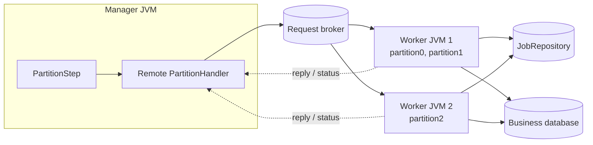
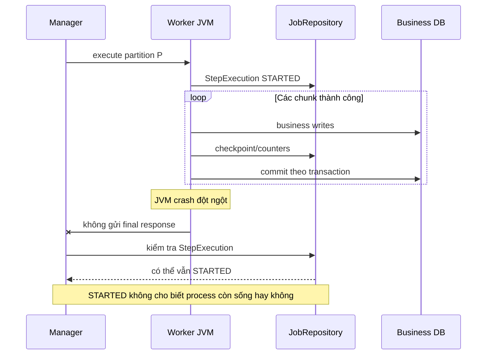
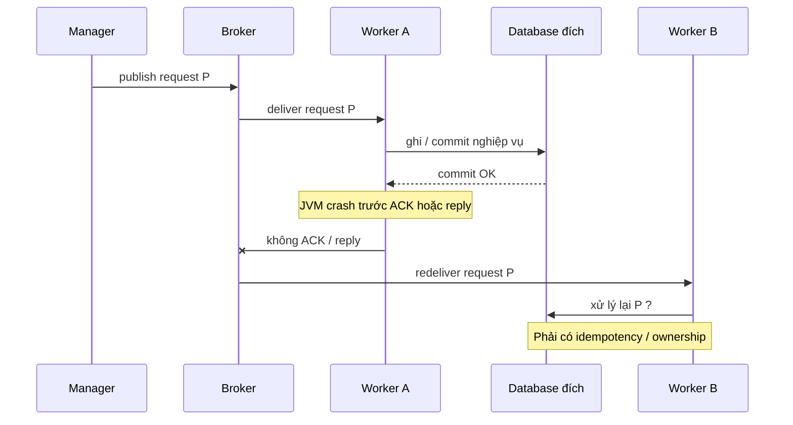
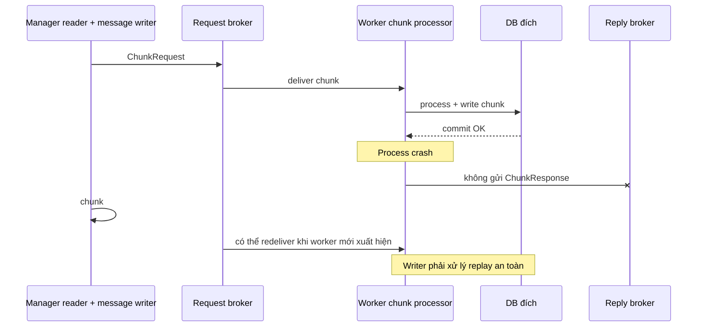

# Worker restart sau process crash

## 1. Bối cảnh: tiến trình có thể biến mất ngay giữa một chunk

Trong chương **Thiết kế worker** thuộc module **SPRING_BATCH_SCALING_OPERATIONS**, việc mở rộng dữ liệu lớn bằng multi-threaded step, parallel steps, partitioning hoặc worker phân tán chỉ có giá trị khi hệ thống **khôi phục được sau sự cố**. Một lỗi đặc biệt khó xử lý là *process crash*: JVM bị kill, container bị thay thế, host mất điện, tiến trình gặp lỗi nghiêm trọng hoặc hệ điều hành kết thúc ứng dụng **mà không cho Spring Batch hoàn tất vòng đời bình thường**.

Hãy xét job đối soát 8 triệu giao dịch, chia thành tám partition. Worker nhận partition số 3, đọc 200.000 bản ghi, ghi được nhiều chunk rồi JVM đột ngột mất. Manager còn sống và có thể vẫn đợi phản hồi, còn `JobRepository` có thể vẫn lưu worker `StepExecution` ở trạng thái `STARTED`. Sau khi worker được khởi động lại, câu hỏi không chỉ là “chạy lại bằng lệnh nào?” mà còn là:

- Worker cũ đã thực sự ngừng ghi dữ liệu hay có thể chỉ **mất kết nối với manager**?
- Chunk nào đã commit? Checkpoint nào đã bền vững?
- Broker có thể gửi lại request cũ không?
- `JobExecution` hiện tại có đang chờ, đã thất bại hay bị kẹt ở `STARTED`?
- Một lần restart có tạo **`JobInstance` mới** ngoài ý muốn không?
- Nếu dữ liệu đã được ghi nhưng ACK/reply thất lạc, writer có thể xử lý trùng an toàn không?

**Mục tiêu học tập:**

1. Phân loại sự cố *process crash*, timeout, mất reply và lỗi nghiệp vụ thông thường.
2. Hiểu vai trò của `JobInstance`, `JobExecution`, `StepExecution` và `ExecutionContext` khi restart.
3. Phân tích các cửa sổ lỗi trước/sau commit của chunk và trước/sau ACK message.
4. Xây dựng worker có checkpoint ổn định, writer idempotent và khả năng khởi động lại cùng công việc.
5. Biết cách phát hiện `STARTED` còn sót sau crash mà không tự ý chỉnh metadata sai cách.
6. Thiết kế runbook khôi phục cho local partitioning, remote partitioning và remote chunking.
7. Kiểm thử crash có chủ đích và đối chiếu **business key thực tế**, không chỉ kiểm tra status.

> **Thông điệp chính:** Spring Batch hỗ trợ **restart theo metadata/checkpoint**, nhưng **restartability không đồng nghĩa exactly-once business effect**. Sau process crash, hãy xác định đúng nguồn sự thật, xác minh worker cũ, checkpoint và dữ liệu đã commit trước khi phát lại bất kỳ phần việc nào.

## 2. Phân biệt process crash với những loại lỗi dễ nhầm

| Tình huống | JVM/worker còn chạy? | Framework có thể gọi cleanup/listener? | Rủi ro khi phục hồi |
| --- | --- | --- | --- |
| Exception trong `ItemProcessor` | Thường còn | Thông thường có đường rollback, listener và cập nhật `FAILED` | Retry/skip sai chính sách |
| Query/HTTP timeout | Có thể còn, tùy client | Có thể có nếu lời gọi kết thúc và ném lỗi | Side effect đã xảy ra nhưng caller không biết |
| Manager hết thời gian chờ reply | Worker **có thể vẫn chạy** | Worker có thể tiếp tục lifecycle bình thường | Giao lại việc khi owner cũ còn hoạt động |
| Broker mất kết nối | Worker có thể còn hoặc đã chết | Không suy ra được chỉ từ broker | Redelivery/duplicate request |
| JVM worker bị `SIGKILL` hoặc crash | Tiến trình đó đã chết | **Không bảo đảm** `afterStep`, `close`, shutdown hook được gọi | Metadata treo, checkpoint cuối/commit không rõ |
| JVM manager bị crash, worker remote còn sống | Worker có thể tiếp tục | Manager không hoàn tất lifecycle | Restart manager trong khi worker cũ chưa xong |
| Container bị thay thế trong lúc chạy | Instance cũ có thể đã ngừng; cần xác minh | Không thể dựa vào graceful shutdown | Message/reply đến muộn, ownership đổi |

**Một timeout không phải bằng chứng process crash.** Heartbeat ngừng 30 giây có thể do GC pause, network partition hoặc heartbeat store lỗi. Nếu supervisor chỉ dựa vào heartbeat để khởi chạy worker mới, hệ thống có thể có *zombie worker*: worker cũ vẫn còn làm việc dù coordinator đã cấp phần việc cho người khác.

## 3. Ranh giới tiến trình trong các mô hình Spring Batch

### 3.1. Local partitioning: một JVM chứa manager và worker threads

`TaskExecutorPartitionHandler` giao các partition cho `TaskExecutor` trong cùng process. Nếu **JVM crash**, manager và tất cả worker thread trong JVM đó cùng biến mất. Nếu chỉ một task ném exception bình thường, JVM và các task khác có thể vẫn chạy.

```text
JVM A:
  Job / PartitionStep manager
    +-- worker:partition0 (thread-1)
    +-- worker:partition1 (thread-2)
    +-- worker:partition2 (thread-3)
    +-- worker:partition3 (thread-4)

JVM A crash
  => toàn bộ thread trong process đó dừng
  => JobRepository có thể còn StepExecution STARTED
```

Restart đòi hỏi **ứng dụng/process được khởi chạy lại**, sau đó phục hồi job qua metadata. `TaskExecutor` không tự “sống lại” sau khi process chết.

### 3.2. Remote partitioning: manager và worker ở các JVM khác nhau

Trong remote partitioning, manager tạo `StepExecution` cho từng partition, gửi `StepExecutionRequest` qua middleware và worker tải execution/context từ `JobRepository` dùng chung (hoặc truy cập metadata theo kiến trúc tích hợp được hỗ trợ).



Khi **worker JVM 2 crash**, manager và worker JVM 1 có thể vẫn chạy. Khi **manager crash**, worker JVM 1/2 có thể vẫn hoàn thành công việc và cập nhật repository. Đây là điểm khiến việc tự động phát lại request trở nên nhạy cảm: **sự cố ở một tiến trình không đồng nghĩa mọi tiến trình khác đã dừng**.

### 3.3. Remote chunking: worker nhận chunk, không sở hữu StepExecution riêng cho từng chunk

Remote chunking giữ `ItemReader` ở manager. Manager gom chunk, `ChunkMessageChannelItemWriter` gửi `ChunkRequest`; worker xử lý/ghi và phát `ChunkResponse`. **Mỗi chunk không mặc định được tạo một `StepExecution` độc lập** như remote partitioning.

Khi một worker chunking crash:

- Manager có thể đã gửi chunk nhưng chưa nhận response.
- Broker có thể redeliver chunk, tùy acknowledgment/transaction.
- Chunk có thể đã ghi thành công trước lúc worker chết.
- Recovery cần **correlation theo request/chunk** và **idempotency ở writer**.
- Checkpoint nguồn đọc tại manager phải phối hợp với việc đã nhận đủ kết quả chunk.

**Không áp dụng nguyên xi cơ chế restart partition theo `StepExecution` cho từng `ChunkRequest`.** Hai mô hình có đơn vị giao việc và state khác nhau.

## 4. Metadata làm nền tảng cho restart

### 4.1. Bốn khái niệm cần nhận diện

| Thành phần | Mục đích | Vai trò trong recovery |
| --- | --- | --- |
| `JobInstance` | Một công việc logic theo tên job + **identifying JobParameters** | Giữ danh tính công việc khi restart |
| `JobExecution` | Một lần chạy/restart cụ thể của JobInstance | Theo dõi trạng thái và lịch sử các lần thử |
| `StepExecution` | Một lần thực thi step/worker partition | Status, counters, lỗi và checkpoint của step |
| `ExecutionContext` | Trạng thái bền vững theo job/step execution | Reader position, ranh giới partition, dữ liệu khôi phục |

Các bảng metadata JDBC thông dụng:

```text
BATCH_JOB_INSTANCE
BATCH_JOB_EXECUTION
BATCH_JOB_EXECUTION_PARAMS
BATCH_JOB_EXECUTION_CONTEXT
BATCH_STEP_EXECUTION
BATCH_STEP_EXECUTION_CONTEXT
```

Trong partitioning, các worker partition thường có tên như `invoiceWorker:partition0`, `invoiceWorker:partition1`. Khi job restart, những `StepExecution` mới có thể có ID mới, còn **tên partition và ranh giới nghiệp vụ cần ổn định**. Không coi `STEP_EXECUTION_ID` là định danh vĩnh viễn của partition trên mọi lần chạy.

### 4.2. Vì sao sau crash có thể còn STARTED?

Khi worker được khởi chạy, `JobRepository` ghi status/lifecycle. Nếu tiến trình chết **trước khi framework cập nhật trạng thái cuối**, repository có thể tiếp tục thấy `STARTED` (hoặc trạng thái chưa kết thúc khác).



`JobRepository` là nguồn sự thật cho **trạng thái đã được persistence**, không phải tiến trình giám sát hệ điều hành. Nếu process chết giữa transaction, database thường rollback giao dịch chưa commit khi connection bị đóng, nhưng **thời điểm và kết quả phải xác nhận từ DB/driver**; với side effect ngoài transaction thì quy tắc rollback đó không áp dụng.

### 4.3. Không tự đổi JobParameters để ép job chạy lại

Nếu lần đầu chạy:

```text
jobName      = invoiceRiskJob
businessDate = 2026-11-26   (identifying)
snapshotId   = snapshot-v17 (identifying)
```

thì restart đúng công việc phải giữ **identifying parameters** tương ứng. Tự thêm một `run.id` ngẫu nhiên hoặc thời gian hiện tại như identifying parameter có thể tạo **JobInstance mới**, làm toàn bộ input được xử lý lại mà metadata cũ không còn gắn với lần chạy mới.

**Quy tắc:** Nếu nghiệp vụ yêu cầu tiếp tục một `JobInstance` lỗi, phải dùng cơ chế restart của Spring Batch và đúng identifying parameters. Chỉ dùng job instance mới khi nghiệp vụ thực sự cần một lần chạy mới, có chính sách chống trùng/đối soát phù hợp.

## 5. Checkpoint và commit: những cửa sổ lỗi sau process crash

Trong chunk-oriented step, `ItemStream` giúp lưu tiến độ:

```java
public interface ItemStream {
    void open(ExecutionContext executionContext);
    void update(ExecutionContext executionContext);
    void close();
}
```

- `open` khôi phục reader/writer state khi bắt đầu hoặc restart.
- `update` đưa checkpoint vào `ExecutionContext` trước commit theo vòng đời chunk.
- Framework cùng `JobRepository` lưu metadata/checkpoint theo transaction được cấu hình.
- `close` giải phóng resource khi kết thúc bình thường; **không được coi là chắc chắn chạy sau `SIGKILL`**.

### 5.1. Một chu kỳ chunk thông thường


Sơ đồ rút gọn vòng đời để giải thích ý nghĩa checkpoint. Thực tế còn có listener, EOF, skip, retry, rollback và những callback khác. **`ItemStream.update` xảy ra trước commit**, không chứng minh riêng lẻ rằng chunk đã bền vững.

### 5.2. Ma trận crash quanh commit

Giả sử chunk size 100, hai chunk đầu đã commit và chunk thứ ba đang xử lý:

| Thời điểm crash | Dữ liệu chunk thứ ba | Checkpoint sau crash | Nguy cơ khi restart |
| --- | --- | --- | --- |
| Trước `ItemWriter.write` | Chưa có ghi của chunk | Mốc sau chunk 2 | Thực hiện lại chunk 3 |
| Trong `write`, transaction chưa commit | JDBC writes trong transaction thường rollback | Mốc sau chunk 2 **nếu metadata cùng transaction** | Đọc lại item chunk 3 |
| Sau `ItemStream.update` nhưng trước commit | State in-memory đã cập nhật, transaction chưa commit | Checkpoint mới chưa bền vững nếu transaction rollback | Khôi phục từ mốc đã commit |
| Ngay sau commit của cả dữ liệu và metadata | Ghi chunk 3 bền vững | Checkpoint tương ứng đã bền vững | Thường tiếp tục sau chunk 3 |
| Dữ liệu nghiệp vụ commit nhưng metadata ở transaction khác chưa lưu | Dữ liệu chunk 3 có thể đã tồn tại | Có thể vẫn ở mốc chunk 2 | **Replay có thể gây duplicate** |
| HTTP POST đã được hệ thống ngoài xử lý, chunk JDBC rollback | Side effect POST vẫn có thể tồn tại | Mốc checkpoint cũ | POST có thể bị gọi lại |
| Commit đang diễn ra đúng lúc crash | Kết quả có thể cần xác minh thực tế | Không suy luận được chỉ từ log caller | Cần reconciliation trước khi replay |

**Điểm kỹ thuật quan trọng:** Nếu `JobRepository` và dữ liệu nghiệp vụ dùng **cùng database transaction phù hợp**, checkpoint và JDBC write có thể cùng commit/rollback. Nếu dùng hai datasource/transaction manager độc lập, hoặc có API/file/message bên ngoài, không có atomicity toàn hệ thống mặc định.

### 5.3. Checkpoint phải đại diện nguồn dữ liệu ổn định

`JdbcCursorItemReader` hoặc reader lưu offset theo vị trí cần:

- Query có `ORDER BY` xác định.
- Tập dữ liệu đầu vào ổn định hoặc snapshot/watermark đáng tin.
- Tên reader và phạm vi partition không thay đổi tùy tiện khi restart.
- Một `ExecutionContext` riêng cho mỗi worker `StepExecution` trong partitioning.

**Chỉ có `saveState(true)` không đủ** nếu dữ liệu nguồn thay đổi thứ tự, có row bị chèn/xóa trước vị trí checkpoint hoặc nếu writer có tác dụng phụ ngoài transaction.

## 6. Request được gửi lại không nhất thiết là công việc chưa từng chạy

Remote partitioning thường vận chuyển một `StepExecutionRequest`; remote chunking vận chuyển một `ChunkRequest`. Khi worker crash, broker có thể redeliver message tùy cấu hình ACK/transaction.



Nếu bản ghi đã được ghi nhưng reply thất lạc, manager **không có bằng chứng hoàn tất chỉ qua channel reply**. Việc broker phát lại message có thể là hành vi đúng của transport theo at-least-once delivery, nhưng **writer nghiệp vụ phải chịu được request lặp**.

### 6.1. Ba mức chống trùng cần phân biệt

| Mức | Ví dụ | Bảo vệ được gì? | Giới hạn |
| --- | --- | --- | --- |
| **Transport/message dedup** | Lưu request ID/chunk ID đã tiêu thụ | Một số bản tin phát lại | Không đủ nếu side effect commit nhưng dedup record chưa commit |
| **Ownership/lease/fencing** | Một owner hợp lệ cho partition và generation | Tránh hai worker cùng xử lý một miền dữ liệu | Chỉ hiệu quả với tài nguyên đích thực thi fencing/guard |
| **Business idempotency** | `UNIQUE(order_id)` + upsert đúng nghĩa | Ghi lặp không nhân đôi tác dụng nghiệp vụ | Cần xét update thay đổi, hệ thống ngoài transaction |

Tốt nhất thiết kế theo nhiều lớp. `JobRepository` không tự thay thế unique key, outbox, idempotency token hay cơ chế fencing ở hệ thống đích.

### 6.2. Định danh đúng đơn vị công việc

- **Partition key**: `invoiceWorker:partition3`, miền ID/ngày/tenant đã chốt trong một `JobInstance`.
- **JobExecutionId**: ID lần thực thi job hiện tại; có thể đổi khi restart.
- **StepExecutionId**: ID của một lần thực thi worker step; có thể đổi theo lần thử.
- **Transport message ID**: Có thể đổi khi publish lại; không nên dùng làm khóa business duy nhất.
- **Business idempotency key**: Khóa ổn định theo nghiệp vụ, ví dụ `order_id` + loại tác vụ.
- **Attempt/generation**: Phân biệt owner mới và owner cũ khi chuyển quyền xử lý.

Không nhầm **cùng partition logic** với **cùng StepExecutionId** xuyên mọi lần restart.

## 7. Phát hiện worker crash: heartbeat, progress và JobRepository

Khi một worker không phản hồi, có ba trục quan sát:

| Tín hiệu | Nguồn | Trả lời |
| --- | --- | --- |
| **Liveness** | Process/container status, heartbeat riêng | Worker/process còn gửi tín hiệu không? |
| **Progress** | `READ_COUNT`, `WRITE_COUNT`, `COMMIT_COUNT`, business metrics | Công việc có tiến triển không? |
| **Completion** | `BatchStatus`, `ExitStatus`, `END_TIME` | Framework đã ghi kết quả cuối chưa? |

`BATCH_STEP_EXECUTION.LAST_UPDATED` **không phải heartbeat đều đặn**. Một chunk dài có thể chưa đến ranh giới commit nên metadata chưa đổi dù worker còn làm việc.

Ví dụ ma trận quan sát:

| Heartbeat | Progress | `StepExecution` | Cách hiểu ban đầu |
| --- | --- | --- | --- |
| Mới | Tăng | `STARTED` | Đang tiến triển |
| Mới | Không tăng lâu | `STARTED` | Worker sống nhưng có thể block I/O |
| Cũ | Không tăng | `STARTED` | Nghi crash hoặc network partition; cần xác minh |
| Cũ | Không tăng | `COMPLETED` | Worker có thể đã xong, không cần gửi ping |
| Cũ | Không tăng | `FAILED` | Lỗi đã ghi nhận; xem điều kiện restart |
| Chưa có heartbeat | Không có | Execution tạo nhưng chưa chạy | Request có thể vẫn queue/chưa claim |

**Không restart vì chỉ một dòng “heartbeat stale”.** Một manager mất kết nối với heartbeat store có thể coi nhầm nhiều worker còn sống là đã chết. Nếu tự động chuyển quyền, phải bảo đảm owner cũ thực sự bị ngăn side effect.

### 7.1. Khi cần quyền sở hữu partition

Với hệ có khả năng failover tự động, nên có:

1. Claim một partition theo **JobInstance + partition key** có kiểm soát cạnh tranh.
2. Gắn owner và **generation/fencing token** tăng khi chuyển quyền.
3. Renew lease có kiểm tra owner.
4. Từ chối ghi từ owner có generation cũ tại nơi ghi dữ liệu quan trọng.
5. Chỉ coi owner mới là hợp lệ sau khi đã qua giao thức claim; kết quả cũ đến muộn không được ghi đè status mới.

**UUID attempt token không tự là fencing token.** Một UUID giúp nhận diện lượt thực thi nhưng không cung cấp thứ tự mới/cũ. Cơ chế fencing cần có generation đơn điệu hoặc bảo đảm tương đương được hệ thống đích kiểm tra.

## 8. Quy trình restart an toàn: đừng bỏ qua trạng thái STARTED bị kẹt

### 8.1. Vì sao không thể chỉ gọi restart ngay?

`JobOperator.restart(jobExecutionId)` hỗ trợ khởi chạy lại một `JobExecution` khi điều kiện restart được đáp ứng. Nếu repository vẫn coi execution là **đang chạy**, một restart bình thường có thể bị từ chối. Sau process crash, trạng thái `STARTED` trong metadata không tự biến thành `FAILED` chỉ vì process của hệ điều hành đã chết.

Vì vậy, bước recovery đôi khi cần **reconcile metadata của execution bị bỏ dở** theo quy trình quản trị, sau khi chắc chắn tiến trình cũ không thể tiếp tục ghi. Không được sửa SQL trực tiếp để “làm sạch” status hoặc ép `VERSION` khớp. Nếu trạng thái đã được Spring Batch cập nhật thành `FAILED`/`STOPPED` hợp lệ, có thể đi theo đường restart thông thường.

### 8.2. Runbook từ phát hiện đến restart

**Giai đoạn 1 — Xác định sự cố**

1. Xác định `jobName`, `JobInstanceId`, `JobExecutionId`, `StepExecutionId` và partition key.
2. Kiểm tra process/container thật: đã bị kết thúc hay chỉ mất mạng tới manager?
3. Kiểm tra broker queue/request/reply, trạng thái worker khác, heartbeat/progress và metadata.
4. Xác định hệ thống nguồn/đích, transaction manager, mức độ bền vững của checkpoint.

**Giai đoạn 2 — Cô lập tác nhân cũ**

5. Ngăn việc phát lại cùng partition trong khi trạng thái cũ chưa rõ.
6. Xác minh owner cũ đã dừng **hoặc** đã bị fencing nên không còn quyền side effect.
7. Kiểm tra các transaction còn mở/rollback, lock database và tác dụng phụ bên ngoài.

**Giai đoạn 3 — Đối soát và phục hồi metadata**

8. Đối chiếu checkpoint `ExecutionContext` và business keys đã commit.
9. Nếu `JobExecution` vẫn `STARTED` sau crash, thực hiện quy trình recovery/điều chỉnh trạng thái **bằng cơ chế quản trị dựa trên API Spring Batch phù hợp phiên bản**, dưới điều kiện an toàn và quyền truy cập kiểm soát. Không dùng một câu `UPDATE BATCH_*` mù.
10. Kiểm tra lại các partition đã `COMPLETED` và các partition còn cần xử lý, không đổi ranh giới/định danh khi restart.

**Giai đoạn 4 — Restart và xác minh**

11. Restart **cùng `JobInstance`** khi execution ở trạng thái cho phép.
12. Theo dõi worker mới, lỗi optimistic locking, retry/redelivery và queue backlog.
13. Đối soát số business keys, checksum/số tiền và side effect; chỉ publish khi job thật sự hoàn tất.
14. Ghi lại root cause, điều chỉnh timeout, broker ACK, DB pool hoặc heartbeat/fencing nếu cần.

> **Lưu ý thực hành:** Quy trình xử lý metadata `STARTED` bị bỏ dở phụ thuộc phiên bản, cơ chế repository, quyền quản trị và trạng thái job. Đừng coi `JobOperator.stop()` là cách chắc chắn chuyển một job có JVM đã chết sang `STOPPED`: stop là **yêu cầu hợp tác**, không phải công cụ khôi phục metadata của process không còn tồn tại.

### 8.3. Các thao tác có thể tự động hóa, và những việc không nên làm

| Việc | Có thể tự động? | Điều kiện |
| --- | --- | --- |
| Phát hiện process/container exit | Có | Có nguồn quan sát đáng tin |
| Cảnh báo heartbeat quá cũ | Có | Chỉ đánh dấu *suspect*, có dung sai network/GC |
| Thu metrics, thread dump, query status | Có | Phân quyền và bảo vệ dữ liệu nhạy cảm |
| Ngăn request mới cho partition nghi ngờ | Có | Coordinator/queue hỗ trợ |
| Chuyển owner sang worker mới | Có điều kiện | Atomic claim + fencing/side-effect guard |
| Đổi `STARTED` thành `FAILED` bằng SQL khi chưa rõ worker cũ | **Không** | Có thể phá metadata và chạy trùng |
| Tạo JobInstance mới bằng tham số ngẫu nhiên | **Không để restart** | Đó là lần chạy logic khác |
| Phát lại HTTP POST không idempotent | **Không an toàn** | Cần idempotency key hoặc quy trình bù |

## 9. Ví dụ Spring Batch 5.x: worker partition có checkpoint

Ví dụ local partitioning dưới đây minh họa **cách thiết kế worker có thể restart**. Nó chia hóa đơn ID từ 1 đến 800.000 thành tám dải ổn định; mỗi worker đọc dải ID riêng, xử lý dữ liệu và ghi vào PostgreSQL bằng upsert. Với worker từ xa, ý tưởng phân vùng/checkpoint vẫn áp dụng, nhưng cần thay handler local bằng cấu hình remote partitioning cùng `JobRepository` và transport phù hợp.

**Giả định chạy mẫu:**

- Java 17+, Spring Batch 5.x, PostgreSQL.
- `invoice_source(id, amount)` có ID duy nhất và dữ liệu nguồn đã đóng băng cho kỳ chạy.
- `invoice_result(invoice_id, normalized_amount)` có `PRIMARY KEY(invoice_id)`.
- `JobRepository`, `PlatformTransactionManager`, `DataSource` được cấu hình thích hợp.
- Mỗi partition có reader instance riêng nhờ `@StepScope`; không bật thêm multi-threaded chunks bên trong worker.

### 9.1. Tạo các vùng dữ liệu cố định

```java
import java.util.LinkedHashMap;
import java.util.Map;
import org.springframework.batch.core.partition.support.Partitioner;
import org.springframework.batch.item.ExecutionContext;
import org.springframework.context.annotation.Bean;

@Bean
Partitioner invoicePartitioner() {
    return gridSize -> {
        if (gridSize <= 0) {
            throw new IllegalArgumentException("gridSize must be positive");
        }
        long minId = 1L;
        long maxId = 800_000L;
        long total = maxId - minId + 1;
        int partitions = (int) Math.min(total, (long) gridSize);
        long base = total / partitions;
        long remainder = total % partitions;
        long from = minId;

        Map<String, ExecutionContext> contexts = new LinkedHashMap<>();
        for (int index = 0; index < partitions; index++) {
            long size = base + (index < remainder ? 1L : 0L);
            long to = from + size - 1;

            ExecutionContext context = new ExecutionContext();
            context.putLong("fromId", from);
            context.putLong("toId", to);
            contexts.put("partition" + index, context);
            from = to + 1;
        }
        return contexts;
    };
}
```

Với `gridSize=8`, map có tám partition, mỗi partition 100.000 ID. **`gridSize` là gợi ý cho `Partitioner.partition(gridSize)`**, không phải cam kết framework luôn tạo từng ấy worker. Ví dụ này tự chọn tôn trọng gợi ý.

Tên `partition0` ... `partition7` và ranh giới ID phải giữ nguyên cho cùng `JobInstance` khi cần restart. Nếu `gridSize` bị đổi từ 8 thành 16 ngay sau crash, tên partition cũ có thể trỏ vào phạm vi mới, khiến checkpoint cũ sai. Hãy coi partition plan là **một phần hợp đồng khôi phục**.

### 9.2. Reader step-scoped với checkpoint

```java
import java.math.BigDecimal;
import javax.sql.DataSource;
import org.springframework.batch.core.configuration.annotation.StepScope;
import org.springframework.batch.item.database.JdbcCursorItemReader;
import org.springframework.batch.item.database.builder.JdbcCursorItemReaderBuilder;
import org.springframework.beans.factory.annotation.Value;
import org.springframework.context.annotation.Bean;

record Invoice(long id, BigDecimal amount) {}
record NormalizedInvoice(long id, BigDecimal amount) {}

@Bean
@StepScope
JdbcCursorItemReader<Invoice> invoiceReader(
        DataSource dataSource,
        @Value("#{stepExecutionContext['fromId']}") Long fromId,
        @Value("#{stepExecutionContext['toId']}") Long toId) {

    return new JdbcCursorItemReaderBuilder<Invoice>()
        .name("invoicePartitionReader")
        .dataSource(dataSource)
        .sql("""
            SELECT id, amount
            FROM invoice_source
            WHERE id BETWEEN ? AND ?
            ORDER BY id
            """)
        .preparedStatementSetter(ps -> {
            ps.setLong(1, fromId);
            ps.setLong(2, toId);
        })
        .rowMapper((rs, rowNum) ->
            new Invoice(rs.getLong("id"), rs.getBigDecimal("amount")))
        .saveState(true)
        .build();
}
```

Giải thích:

- `@StepScope` tạo reader target theo `StepExecution`, nên mỗi partition có cursor và context độc lập.
- `fromId/toId` lấy từ context do partitioner tạo.
- `ORDER BY id` tạo thứ tự đọc ổn định **nếu tập nguồn không biến động**.
- `name("invoicePartitionReader")` giúp reader quản lý namespace trạng thái trong `ExecutionContext`.
- `saveState(true)` bật checkpoint do reader hỗ trợ, **không** tạo exactly-once business effect một cách tự động.

Nếu nguồn dữ liệu thay đổi khi restart, checkpoint theo vị trí có thể gây thiếu/trùng. Với hệ thống tài chính cần snapshot, watermark và/hoặc danh sách ID bất biến cho kỳ xử lý.

### 9.3. Writer idempotent theo business key

```java
import org.springframework.batch.item.ItemProcessor;
import org.springframework.batch.item.database.JdbcBatchItemWriter;
import org.springframework.batch.item.database.builder.JdbcBatchItemWriterBuilder;
import org.springframework.context.annotation.Bean;
import org.springframework.jdbc.core.namedparam.MapSqlParameterSource;

@Bean
ItemProcessor<Invoice, NormalizedInvoice> normalizeInvoice() {
    return invoice -> new NormalizedInvoice(
        invoice.id(),
        invoice.amount().setScale(
            2, java.math.RoundingMode.HALF_UP));
}

@Bean
JdbcBatchItemWriter<NormalizedInvoice> invoiceResultWriter(
        DataSource dataSource) {
    return new JdbcBatchItemWriterBuilder<NormalizedInvoice>()
        .dataSource(dataSource)
        .sql("""
            INSERT INTO invoice_result (invoice_id, normalized_amount)
            VALUES (:id, :amount)
            ON CONFLICT (invoice_id)
            DO UPDATE SET normalized_amount = EXCLUDED.normalized_amount
            """)
        .itemSqlParameterSourceProvider(item ->
            new MapSqlParameterSource()
                .addValue("id", item.id())
                .addValue("amount", item.amount()))
        .build();
}
```

Đây là cú pháp **PostgreSQL UPSERT** cho phép ghi lặp cùng `invoice_id` mà không tạo bản ghi thứ hai. Nó chỉ thật sự **idempotent về nghiệp vụ** nếu dữ liệu nguồn và phép chuẩn hóa ổn định: nếu hai worker ghi cùng khóa với giá trị khác nhau, “last writer wins” vẫn có thể sai.

Với thanh toán hoặc tác vụ phát sự kiện, không được thay thế thiết kế idempotency bằng câu UPSERT chung chung. Có thể cần ràng buộc `businessDate`/`version`, deduplication, outbox hoặc compare-and-set.

### 9.4. Worker step, manager và job

```java
import org.springframework.batch.core.Job;
import org.springframework.batch.core.Step;
import org.springframework.batch.core.job.builder.JobBuilder;
import org.springframework.batch.core.repository.JobRepository;
import org.springframework.batch.core.step.builder.StepBuilder;
import org.springframework.batch.core.partition.support.Partitioner;
import org.springframework.batch.item.ItemProcessor;
import org.springframework.batch.item.database.JdbcBatchItemWriter;
import org.springframework.batch.item.database.JdbcCursorItemReader;
import org.springframework.beans.factory.annotation.Qualifier;
import org.springframework.context.annotation.Bean;
import org.springframework.core.task.TaskExecutor;
import org.springframework.scheduling.concurrent.ThreadPoolTaskExecutor;
import org.springframework.transaction.PlatformTransactionManager;

@Bean
Step invoiceWorker(
        JobRepository jobRepository,
        PlatformTransactionManager transactionManager,
        JdbcCursorItemReader<Invoice> invoiceReader,
        ItemProcessor<Invoice, NormalizedInvoice> normalizeInvoice,
        JdbcBatchItemWriter<NormalizedInvoice> invoiceResultWriter) {

    return new StepBuilder("invoiceWorker", jobRepository)
        .<Invoice, NormalizedInvoice>chunk(100, transactionManager)
        .reader(invoiceReader)
        .processor(normalizeInvoice)
        .writer(invoiceResultWriter)
        .build();
}

@Bean
TaskExecutor partitionExecutor() {
    ThreadPoolTaskExecutor executor = new ThreadPoolTaskExecutor();
    executor.setCorePoolSize(4);
    executor.setMaxPoolSize(4);
    executor.setQueueCapacity(8);
    executor.setThreadNamePrefix("invoice-worker-");
    executor.initialize();
    return executor;
}

@Bean
Step invoiceManager(
        JobRepository jobRepository,
        @Qualifier("invoiceWorker") Step worker,
        Partitioner invoicePartitioner,
        @Qualifier("partitionExecutor") TaskExecutor executor) {

    return new StepBuilder("invoiceManager", jobRepository)
        .partitioner("invoiceWorker", invoicePartitioner)
        .step(worker)
        .gridSize(8)
        .taskExecutor(executor)
        .build();
}

@Bean
Job invoiceJob(JobRepository jobRepository,
               @Qualifier("invoiceManager") Step manager) {
    return new JobBuilder("invoiceJob", jobRepository)
        .start(manager)
        .build();
}
```

Đoạn mã là các **bean cấu hình lõi**: đặt chung trong `@Configuration` phù hợp, import DTO và cung cấp datasource/schema/job launcher khi chạy thực tế.

Tám partition được tạo nhưng executor có **bốn thread**. Khi process manager local crash, cả bốn thread đang làm việc cũng chết; application mới cần khôi phục job qua repository. Trong remote partitioning, handler và worker deployment khác, nhưng `StepExecution` và `ExecutionContext` riêng theo partition vẫn là nền tảng.

### 9.5. Điểm cần nhớ khi chạy phân tán

Code trên minh họa **local partitioning**, không phải một remote worker hoàn chỉnh. Để đổi sang remote partitioning cần:

- Manager dùng remote `PartitionHandler`/builder đúng phiên bản.
- Worker triển khai bean `Step` có đúng tên mà manager dispatch.
- Messaging adapter vận chuyển `StepExecutionRequest`/kết quả.
- Metadata repository được quản lý nhất quán giữa các node.
- Timeout, broker ACK/retry/DLQ, correlation, serialization và security.
- Guard chống hai worker cùng xử lý partition khi request bị phát lại.

Không chỉ thay `TaskExecutor` bằng một queue rồi cho rằng chương trình đã có restart phân tán an toàn.

## 10. Thực hiện restart qua JobOperator

Sau khi execution được xác định **đã kết thúc ở trạng thái cho phép restart**, có thể dùng `JobOperator`:

```java
import org.springframework.batch.core.launch.JobOperator;

// Lấy ID từ JobExplorer / JobRepository theo runbook.
// Chỉ restart khi trạng thái và ownership đã được xác minh.
long previousJobExecutionId = 1234L;
long newJobExecutionId = jobOperator.restart(previousJobExecutionId);
```

Giá trị ID ở trên chỉ minh họa. Spring Batch dùng repository để xác định `JobInstance` và history; nó không tự dựa vào một request bất kỳ để khôi phục đúng partition. Việc restart có thể bị từ chối nếu execution còn chạy, instance đã hoàn tất, job không restartable hoặc metadata không nhất quán.

### 10.1. Những điều không nên làm

```sql
-- PHẢN VÍ DỤ: Không sửa thẳng trạng thái/version để "mở khóa" restart.
UPDATE BATCH_JOB_EXECUTION
SET STATUS = 'FAILED'
WHERE JOB_EXECUTION_ID = :id;

UPDATE BATCH_STEP_EXECUTION
SET STATUS = 'FAILED'
WHERE JOB_EXECUTION_ID = :id;
```

Các câu SQL trên **chỉ để minh họa thao tác nguy hiểm, không được chạy**. Việc sửa trực tiếp có thể bỏ qua `VERSION`/optimistic locking, làm sai checkpoint hoặc tạo điều kiện cho hai tác nhân cùng thực thi.

Nếu operator thực sự cần phục hồi metadata của một execution còn `STARTED` sau process crash, hãy áp dụng quy trình quản trị đã được thiết kế và kiểm thử trên đúng phiên bản: xác minh không còn worker sống, bảo vệ dữ liệu, dùng những API repository/hành vi recovery phù hợp và audit mọi thay đổi. **Không giả định Spring Batch có một lệnh tự động “sửa toàn bộ mọi trạng thái treo” an toàn trong mọi kiến trúc.**

### 10.2. Restart khác startNextInstance

| Thao tác | Mục tiêu | Rủi ro khi dùng sai |
| --- | --- | --- |
| `JobOperator.restart(executionId)` | Tiếp tục **JobInstance** trước đó nếu hợp lệ | Có thể bị từ chối khi status chưa kết thúc |
| `JobLauncher.run(job, sameIdentifyingParams)` | Theo điều kiện repository, có thể thử restart cùng instance | Phải giữ đúng identifying params; xử lý duplicate launch |
| `JobOperator.startNextInstance(jobName)` | Tạo **JobInstance kế tiếp** theo incrementer | Không phải phục hồi checkpoint của instance lỗi |
| Thêm `run.id` ngẫu nhiên | Tạo danh tính job mới khi là identifying param | Có thể xử lý lại toàn bộ kỳ dữ liệu |

Hãy lưu rõ trong runbook rằng **phục hồi crash** và **tạo một lần chạy kỳ mới** là hai nghiệp vụ khác nhau.

## 11. Trường hợp remote partitioning: quản lý worker restart và reply muộn

### 11.1. Khi worker crash nhưng manager vẫn chạy

Ví dụ remote partitioning có các bước:

1. Manager đã tạo worker `StepExecution` và publish `StepExecutionRequest`.
2. Worker nhận, bắt đầu chạy step, commit một số chunk.
3. Worker process crash; request chưa ACK hoặc reply không đến.
4. Manager có thể đợi handler, timeout, lấy status từ repository hoặc chuyển sang đường lỗi — tùy implementation và cấu hình.
5. Worker instance mới được deploy; broker có thể redeliver request.
6. Cần xác minh owner cũ thực sự ngừng, trạng thái execution và chính sách khởi chạy trước khi worker mới thực thi.

**Không giả định remote partitioning luôn tự restart một partition lỗi sau broker redelivery.** Cơ chế handler, transport, metadata và restart strategy quyết định điều xảy ra khi message được giao lại. Một số trạng thái cần can thiệp quản trị hoặc chạy lại toàn JobExecution.

### 11.2. Khi manager crash nhưng remote worker tiếp tục

Kịch bản này khó hơn:

```text
T0: Manager dispatch 8 partition
T1: Worker A và B đang xử lý; worker C đã COMPLETED
T2: Manager process crash
T3: Worker A và B có thể vẫn commit, cập nhật repository
T4: Manager được restart
T5: Nếu dispatch lại mù => nguy cơ 2 worker cho cùng partition
```

Trước khi manager mới giao lại việc, cần xác định **các worker từ attempt cũ còn chạy không**, kết quả đã ghi repository, queue response đang tồn và quy tắc fencing/idempotency. **Restart manager không đồng nghĩa tất cả remote worker trước đó đã chết.**

### 11.3. Không coi kết quả reply là nguồn sự thật duy nhất

Reply của remote worker có thể đến trễ, thất lạc hoặc bị gửi trùng. `JobRepository` cho biết metadata execution, nhưng metadata cũng có thể đang dang dở. Đối chiếu:

- `JobExecutionId`, `StepExecutionId` và partition name trong request/reply.
- `BatchStatus`, `ExitStatus`, `ExecutionContext` và `LAST_UPDATED` trong repository.
- Broker delivery/redelivery/DLQ và queue age.
- Dữ liệu nghiệp vụ đã commit.
- Process/container thật và ownership/fencing state.

Manager chỉ nên kết luận hoàn tất theo hợp đồng handler/aggregator và các kiểm tra nghiệp vụ cần thiết.

## 12. Trường hợp remote chunking: worker crash sau khi ghi nhưng trước reply

Remote chunking khác partitioning ở chỗ manager đọc item và gửi **chunk payload**:



Để phục hồi:

1. Chọn một **chunk/request correlation ID** có ý nghĩa theo protocol, không dựa đơn thuần vào message delivery ID.
2. Bảo toàn header correlation/sequence qua adapter/broker và rolling deployment.
3. Bảo vệ business writer bằng idempotency key hoặc transaction/deduplication hợp lệ.
4. Đặt timeout/retry/DLQ phù hợp, tránh poison chunk làm pipeline đợi mãi.
5. Theo dõi số chunk outstanding và phản hồi cuối cùng, không đồng nhất với số `StepExecution` của remote partitioning.
6. Kiểm thử crash ở cả hai thời điểm: **trước business commit** và **sau business commit trước reply**.

**Không tự di chuyển reader checkpoint của manager lên phía worker** để “sửa” một reply bị mất. Phải hiểu cách builder/manager writer tổng hợp kết quả và lưu trạng thái trong phiên bản Spring Batch Integration đang dùng.

## 13. Heartbeat và crash recovery: sử dụng mà không phá metadata

Một hệ thống có thể gửi heartbeat định kỳ để phát hiện worker bị mất. Tuy nhiên:

- `LAST_UPDATED` trong `BATCH_STEP_EXECUTION` là **metadata update time**, không phải heartbeat luôn chạy mỗi vài giây.
- Không nên tạo một thread heartbeat tự gọi `JobRepository.update(stepExecution)` đồng thời với chunk thread đang cập nhật **cùng `StepExecution`**: có nguy cơ stale version/optimistic lock conflict.
- Heartbeat nên dùng kênh/bảng riêng khi cần theo dõi liveness định kỳ.
- Heartbeat mới không chứng minh worker tạo progress; cần theo dõi `COMMIT_COUNT`/business counters.
- Heartbeat cũ không chứng minh worker đã chết; có thể do network/GC/heartbeat store lỗi.

### 13.1. Watchdog không được tự đánh FAILED theo timestamp

```text
IF now - lastHeartbeat > 30s:
    mark SUSPECT
    inspect process / metadata / broker / transactions
    do NOT immediately relaunch same partition
```

Khi đủ điều kiện recovery, supervisor phải đi qua protocol ownership và trạng thái Batch. Nếu yêu cầu tự động failover mạnh, cần thiết kế **fencing hoặc cơ chế ngăn writer cũ ghi**; chỉ nhận biết stale heartbeat là chưa đủ.

### 13.2. Phân biệt timeout I/O với process crash

| Cấu hình | Giải quyết gì? | Không giải quyết gì? |
| --- | --- | --- |
| HTTP connect/read timeout | Giới hạn thời gian chờ thao tác I/O cụ thể | Worker JVM bị kill |
| JDBC query/lock timeout | Giảm thời gian block ở database | Mất reply sau commit |
| `chunkSize` và retry limit | Giới hạn phạm vi chunk, số lần thử | Exactly-once side effect |
| Heartbeat freshness deadline | Phát hiện mất tín hiệu liveness | Chứng minh process chết |
| Broker ACK/redelivery | Điều khiển transport delivery | Idempotency nghiệp vụ |
| `JobOperator.stop` | Yêu cầu job dừng hợp tác | Giết ngay một JVM/thread không đáp ứng |
| Process supervisor/Kubernetes | Khởi động lại JVM/container | Tự khôi phục đúng JobInstance/partition |

**Restart process** (dịch vụ được deploy lại) và **restart Batch job** (tạo JobExecution kế tiếp của cùng JobInstance) là **hai việc độc lập**. Một orchestrator chỉ làm cho pod `Running` trở lại không bảo đảm job đã được restart đúng checkpoint.

## 14. Quan sát trạng thái sau crash qua JobRepository

### 14.1. Truy vấn trạng thái của một JobExecution

```sql
SELECT
    STEP_EXECUTION_ID,
    JOB_EXECUTION_ID,
    STEP_NAME,
    STATUS,
    EXIT_CODE,
    READ_COUNT,
    WRITE_COUNT,
    COMMIT_COUNT,
    ROLLBACK_COUNT,
    START_TIME,
    END_TIME,
    LAST_UPDATED
FROM BATCH_STEP_EXECUTION
WHERE JOB_EXECUTION_ID = ?
ORDER BY STEP_EXECUTION_ID;
```

Với partitioning, manager step và worker steps cùng xuất hiện; worker thường có tên như `invoiceWorker:partition0`. Không cộng `READ_COUNT` của manager đã tổng hợp với tổng read count của worker vì có thể **đếm trùng**.

### 14.2. Quan sát qua nhiều lần chạy của cùng JobInstance

```sql
SELECT
    je.JOB_EXECUTION_ID,
    je.STATUS AS job_status,
    se.STEP_EXECUTION_ID,
    se.STEP_NAME,
    se.STATUS AS step_status,
    se.READ_COUNT,
    se.WRITE_COUNT,
    se.COMMIT_COUNT,
    se.START_TIME,
    se.END_TIME
FROM BATCH_JOB_EXECUTION je
JOIN BATCH_STEP_EXECUTION se
    ON se.JOB_EXECUTION_ID = je.JOB_EXECUTION_ID
WHERE je.JOB_INSTANCE_ID = ?
ORDER BY je.JOB_EXECUTION_ID, se.STEP_EXECUTION_ID;
```

Không cộng mọi `WRITE_COUNT` lịch sử để suy số business record duy nhất: một partition có thể đã ghi một phần, rollback, retry hoặc chạy lại sau lỗi.

### 14.3. Xem checkpoint context khi điều tra

```sql
SELECT
    se.STEP_EXECUTION_ID,
    se.STEP_NAME,
    se.STATUS,
    sec.SHORT_CONTEXT,
    sec.SERIALIZED_CONTEXT
FROM BATCH_STEP_EXECUTION se
JOIN BATCH_STEP_EXECUTION_CONTEXT sec
  ON sec.STEP_EXECUTION_ID = se.STEP_EXECUTION_ID
WHERE se.JOB_EXECUTION_ID = ?
ORDER BY se.STEP_EXECUTION_ID;
```

Context được serializer của phiên bản repository quản lý. Không mặc định nó là JSON dễ sửa, và **không chỉnh checkpoint bằng SQL thủ công**. Khi cần truy xuất có cấu trúc, ưu tiên API `JobExplorer`/`JobRepository` tương ứng.

### 14.4. Những metric phải đối chiếu ngoài repository

| Nguồn | Metric | Giúp trả lời |
| --- | --- | --- |
| JVM/container | Restarts, exit code, OOMKilled, process start time | Process thực sự crash hay chỉ network lag? |
| JobRepository | Status, read/write/commit/rollback count, context | Chunk/step đã được ghi nhận tới đâu? |
| Broker | Queue age, unacked, redelivery, DLQ, reply backlog | Request/reply có bị mất/đưa lại? |
| Database nguồn | Snapshot/watermark, số business key | Input còn ổn định không? |
| Database đích | Unique key count, checksum, commit/lock metrics | Đã có dữ liệu gì, có trùng/thiếu không? |
| Heartbeat/lease | Owner, generation, lastSeen | Worker cũ còn có thể giữ quyền không? |
| Tracing/log | Request ID, partition key, JobExecutionId | Liên kết các sự kiện trước/sau crash |

Nếu metrics cho thấy process crash ngay khi JVM thiếu bộ nhớ, cần điều tra **heap, chunk size, payload size, GC và concurrent workers**, không chỉ tăng retry.

## 15. Những yếu tố khiến recovery thất bại dù code có saveState(true)

| Ngộ nhận | Sự thật cần nhớ | Khắc phục |
| --- | --- | --- |
| “Process lên lại là job tự tiếp tục.” | JVM và Batch execution có lifecycle khác nhau | Tích hợp orchestrator với repository/restart |
| “`STARTED` nghĩa là worker vẫn sống.” | Có thể là metadata còn sót sau crash | Xác minh process và giao dịch |
| “Heartbeat stale nghĩa là có thể gửi lại việc.” | Worker cũ có thể vẫn ghi | Ownership/fencing/đối soát |
| “Mất reply nghĩa là worker chưa commit.” | Commit có thể xảy ra trước reply | Idempotency và kiểm tra DB đích |
| “`saveState(true)` bảo đảm đúng-một-lần.” | Checkpoint không bao phủ side effect ngoài transaction | Unique key/outbox/reconciliation |
| “Đổi `gridSize` khi restart không ảnh hưởng.” | Mapping tên partition/ID có thể thay đổi | Giữ partition plan ổn định |
| “Thêm `run.id` sẽ khôi phục job.” | Có thể tạo JobInstance mới | Restart cùng JobInstance |
| “Có thể dùng SQL sửa `STATUS`.” | Phá optimistic locking/lifecycle | Recovery API/quy trình được kiểm thử |
| “Exception handler chạy sau `SIGKILL`.” | Process không còn cơ hội gọi `afterStep` | Dựa vào persistent metadata và external supervisor |
| “Broker at-least-once đồng nghĩa DB exactly-once.” | Message delivery và business effect khác nhau | Idempotent writer/dedup |
| “Manager crash thì remote worker cũng dừng.” | Worker JVM có thể vẫn chạy | Kiểm tra remote ownership trước restart |
| “Mọi partition phải chạy lại sau crash.” | Partition đã `COMPLETED` thường được bỏ qua khi restart | Tin vào metadata đúng, kiểm tra context |
| “Tăng worker giải quyết mọi crash.” | Có thể tăng contention/OOM/API rate limit | Đo giới hạn tài nguyên |

## 16. Thiết kế fault-injection test trước khi production

Khả năng restart **phải được kiểm chứng**, không nên chỉ suy từ API. Một bộ test điển hình:

| Thí nghiệm | Thời điểm gây crash | Kết quả cần xác minh |
| --- | --- | --- |
| A | Trước worker bắt đầu step | Request còn có thể được giao/recover đúng |
| B | Giữa `read/process` trước writer | Không thiếu dữ liệu; checkpoint trở về mốc hợp lệ |
| C | Trong `ItemWriter.write` trước commit | JDBC transaction rollback; replay an toàn |
| D | Trong hoặc ngay sát commit | Không kết luận mù; đối chiếu transaction và checkpoint |
| E | Sau commit trước ACK/reply | Redelivery không gây business duplicate |
| F | Worker crash nhưng manager còn sống | Manager/handler không đợi vô hạn không kiểm soát; có runbook |
| G | Manager crash trong khi worker remote còn sống | Không giao trùng partition cho owner mới |
| H | Broker mất kết nối/duplicate message | Correlation/dedup xử lý đúng |
| I | Heartbeat mất nhưng process vẫn ghi | Không tạo zombie writer |
| J | Job đã có `COMPLETED` partitions và một `FAILED` | Restart giữ nguyên phần hoàn tất theo policy |
| K | Dữ liệu nguồn bị thay đổi giữa restart | Hệ thống phát hiện hoặc chốt snapshot |
| L | Process lặp crash do OOM hoặc poison item | Có retry budget, alert và cơ chế dừng điều tra |

### 16.1. Tiêu chí thành công không chỉ là COMPLETED

Một test recovery nên kiểm tra:

- **Job/step status:** `COMPLETED` cuối cùng hoặc lỗi được báo rõ.
- **Coverage:** toàn bộ business keys thuộc kỳ đầu vào phải được xử lý theo policy.
- **No duplicate effect:** không có ghi trùng ngoài ý muốn, không gọi API side effect hai lần trái hợp đồng.
- **Partition identity:** không có hai worker cùng active owner cho một partition nếu mô hình cấm.
- **Checkpoint:** reader/writer resume đúng từ trạng thái đã commit.
- **Observation:** metric/log/reply đủ để giải thích nguyên nhân và thời điểm crash.
- **Bounded recovery:** không retry/loop vô hạn; có cơ chế escalation.

`JobRepository` có thể tổng hợp count ở manager từ worker: khi đối soát, không cộng manager count với tất cả worker hoặc cộng mọi attempt lịch sử để suy ra số business key duy nhất.

## 17. Bài thực hành: phục hồi một worker sau crash

**Bối cảnh:** Một job nhập 2,4 triệu hóa đơn trên ba JVM worker bằng remote partitioning. Manager chia 12 partition; mỗi worker chạy chunk size 200, ghi PostgreSQL và gọi API tra cứu rủi ro (GET). Broker có thể giao lại request khi worker không ACK. Hệ thống phải chạy lại sau crash mà không ghi trùng business key.

Thực hiện:

1. Tạo partitioner chia dữ liệu thành 12 dải ID không chồng lấn; lưu tên partition và `fromId/toId` ổn định cho cùng `JobInstance`.
2. Worker có `@StepScope` reader, `ItemStream` checkpoint và writer `UPSERT` hoặc idempotency theo business key. Giải thích vì sao GET tra cứu khác với POST có side effect.
3. Cấu hình broker request/reply, worker concurrency, consumer ACK/redelivery/DLQ và log `JobExecutionId`, `StepExecutionId`, partition key.
4. Chạy job tới khi một số partition đã commit nhiều chunk. Kill một **worker JVM riêng** giữa chunk; không tắt manager.
5. Quan sát `BATCH_STEP_EXECUTION`, heartbeat, broker unacked và dữ liệu đích. Phân loại partition `STARTED` còn sót so với `FAILED` đã được ghi nhận.
6. Khởi động lại worker process nhưng **không tự thay JobParameters**. Kiểm tra liệu broker/redelivery/handler đưa request trở lại hay cần recovery job theo đúng cấu hình.
7. Gây crash sau DB commit nhưng trước reply. Xác minh replay không tạo thêm business key trùng hoặc thay đổi sai kết quả.
8. Gây crash **manager** trong khi worker khác còn đang chạy. Mô tả cách xác minh owner cũ trước khi restart manager và phát lại việc.
9. Giữ snapshot nguồn không đổi, hoàn thành recovery rồi chạy truy vấn đối soát business keys và tổng số tiền.
10. Thay đổi dữ liệu nguồn giữa hai lần thử để chứng minh vì sao checkpoint theo vị trí không còn đủ nếu thiếu snapshot/watermark.
11. Tăng concurrency từ 3 lên 12 rồi đo DB pool pending, transaction latency, OOM/GC, time-to-recovery và lỗi duplicate.
12. Viết runbook vận hành có bước xác minh tiến trình cũ, metadata recovery, restart và quyết định escalation.

### Câu hỏi tự kiểm tra

1. Process restart và `JobOperator.restart` khác nhau như thế nào?
2. Vì sao JVM chết có thể để lại `StepExecution.STARTED` trong repository?
3. Trong remote partitioning, vì sao manager crash không nhất thiết làm remote workers chết?
4. Tại sao `ItemStream.update` trước commit vẫn giúp phục hồi checkpoint?
5. Nếu business DB commit nhưng repository không lưu checkpoint vì transaction khác nhau, điều gì xảy ra?
6. Khi worker đã ghi DB nhưng broker redeliver request, cơ chế nào ngăn tác dụng phụ trùng lặp?
7. Vì sao heartbeat stale chưa đủ để giao lại partition cho worker khác?
8. `JobInstance`, `JobExecution` và `StepExecution` có vai trò khác nhau như thế nào khi restart?
9. Tại sao không nên sửa `VERSION`/`STATUS` bằng SQL để “dọn” job bị kẹt?
10. Tại sao một `ChunkRequest` remote chunking không tương đương một worker `StepExecution`?
11. Nếu datasource nguồn thay đổi trong lúc job lỗi, làm thế nào giữ checkpoint đáng tin?
12. Những metric nào giúp xác định worker crash do OOM, DB lock hay network?

## 18. Tài liệu chính thức để đối chiếu

- [Spring Batch 5.2 — Job Restart](https://docs.spring.io/spring-batch/reference/5.2/job/configuring.html).
- [Spring Batch 5.2 — Configuring a Step / Restart](https://docs.spring.io/spring-batch/reference/5.2/step/chunk-oriented-processing/restart.html).
- [Spring Batch 5.2 — ItemStream](https://docs.spring.io/spring-batch/reference/5.2/readers-and-writers/item-stream.html).
- [Spring Batch 5.2 — JobRepository](https://docs.spring.io/spring-batch/reference/5.2/job/configuring-repository.html).
- [Spring Batch 5.2 — Batch Meta-Data Schema](https://docs.spring.io/spring-batch/reference/5.2/schema-appendix.html).
- [Spring Batch 5.2 — Scaling and Parallel Processing](https://docs.spring.io/spring-batch/reference/5.2/scalability.html).
- [Spring Batch 5.2 — Externalizing Batch Process Execution](https://docs.spring.io/spring-batch/reference/5.2/spring-batch-integration/externalizing-execution.html).
- [Spring Batch — JobOperator API](https://docs.spring.io/spring-batch/docs/5.2.0/api/org/springframework/batch/core/launch/JobOperator.html).

**Ghi nhớ:** Worker restart sau process crash là sự phối hợp giữa **process supervisor**, **JobRepository**, **transaction/checkpoint**, **messaging ACK/reply** và **idempotency/ownership**. Worker JVM chết không có nghĩa manager đã ghi `FAILED`, và manager mất kết nối không có nghĩa worker đã dừng. Hãy giữ nguyên danh tính `JobInstance`/partition, xác minh commit và checkpoint, phục hồi metadata bằng quy trình an toàn, rồi restart cùng công việc và đối soát dữ liệu thực tế trước khi công bố thành công.
