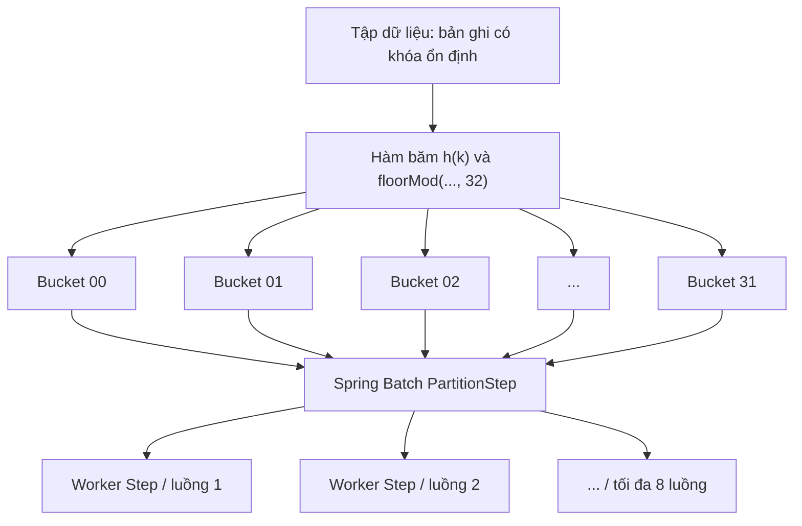
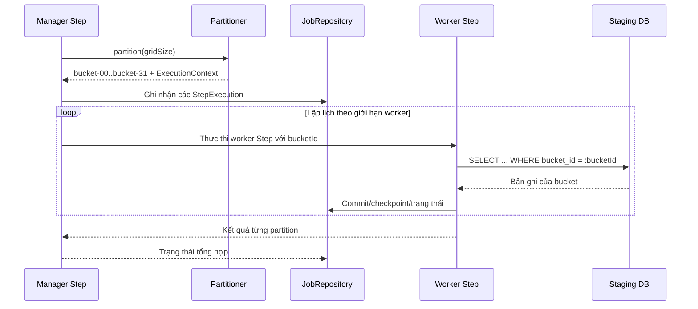

# Chia theo hash bucket trong Spring Batch

Khi một Spring Batch job phải xử lý hàng triệu đến hàng trăm triệu bản ghi, một Step tuần tự có thể không đáp ứng thời gian hoàn thành yêu cầu. Nếu dữ liệu gồm các bản ghi độc lập, ta có thể chia đầu vào thành nhiều phần để chạy song song. **Hash bucket** là cách chia dựa trên khóa ổn định của từng bản ghi: cùng một khóa luôn được đưa vào cùng một bucket trong suốt một lần chạy.

Bài học thuộc chương **Chia dữ liệu** của module **SPRING_BATCH_SCALING_OPERATIONS**. Mục tiêu là biết thiết kế bucket, triển khai local partitioning trong Spring Batch, kiểm tra độ lệch tải, giới hạn tài nguyên và giữ đúng dữ liệu khi retry hoặc restart. Các khái niệm này cũng là nền tảng để chuyển sang remote partitioning khi một JVM không đủ tài nguyên.

## 1. Hash bucket là gì?

Giả sử có tập bản ghi đầu vào \(D\), mỗi bản ghi có khóa \(k\). Với **B** bucket, quy tắc phân chia là:

\[
\operatorname{bucket}(k)=\operatorname{floorMod}(h(k), B),\qquad B>0
\]

Trong đó:

- **\(k\)**: khóa ổn định và xác định của bản ghi, ví dụ `order_id`, `transaction_id` hoặc một khóa nghiệp vụ đã chuẩn hóa.
- **\(h(k)\)**: hàm băm xác định (deterministic), được định nghĩa rõ thuật toán và cách mã hóa/chuẩn hóa khóa.
- **\(B\)**: số bucket logic của workload.
- **`floorMod`**: phép lấy dư không âm, cho kết quả trong khoảng từ `0` đến `B - 1` ngay cả khi giá trị băm là số âm.

Hai bản ghi có cùng khóa và cùng quy tắc băm sẽ luôn thuộc cùng bucket. Mỗi bản ghi thuộc **đúng một** bucket; nhiều khóa khác nhau có thể rơi vào cùng bucket. Việc va chạm bucket là bình thường: mục tiêu là chia tải, không phải tạo định danh duy nhất.

Ví dụ với 32 bucket, hệ thống có các nhóm `bucket-00` đến `bucket-31`. Mỗi worker xử lý dữ liệu thỏa điều kiện `bucket_id = i`. Nếu chỉ có 8 luồng xử lý, 32 bucket vẫn có thể được thực thi theo nhiều đợt: số bucket logic và số luồng đang chạy là hai tham số khác nhau.



**Phân biệt thuật ngữ:** Hash bucket ở đây là **phân hoạch logic tập dữ liệu để xử lý**. Nó không tự tạo partition vật lý trong database và không có nghĩa là Spring Batch tự băm từng item khi đọc. Ta phải cung cấp cách xác định bucket cho dữ liệu và điều kiện đọc tương ứng.

## 2. Khi nào nên dùng chia theo hash bucket?

Hash bucket phù hợp khi:

1. Khối lượng bản ghi lớn và nhiều bản ghi có thể xử lý độc lập.
2. Có khóa đủ ổn định để tính lại cùng bucket khi job thất bại rồi restart.
3. Có cách **đọc riêng dữ liệu của một bucket** mà không phải lặp lại toàn bộ quá trình đọc dữ liệu B lần.
4. Hệ nguồn và đích có đủ tài nguyên cho nhiều reader/writer chạy đồng thời.
5. Không có yêu cầu thứ tự toàn cục giữa các bucket hoặc có thể thiết kế thứ tự theo khóa phù hợp.

Ví dụ thực tế: job tính dữ liệu báo cáo từ bảng đơn hàng trong một đợt `batch_id` cố định. Mỗi `order_id` thuộc một bucket và các đơn hàng có thể xử lý độc lập. Các partition có thể đọc, biến đổi, ghi kết quả theo bucket.

**Không nên áp dụng trực tiếp** nếu nghiệp vụ đòi hỏi tất cả giao dịch của cùng tài khoản phải xử lý tuần tự nhưng lại băm theo từng giao dịch. Khi đó cùng tài khoản có thể rải trên nhiều bucket, làm hỏng giả định về thứ tự hoặc số dư. Có thể chọn `account_id` làm khóa bucket, nhưng một tài khoản quá lớn lại có nguy cơ tạo bucket nóng; cần cân nhắc đặc tính nghiệp vụ và tính đúng đắn trước.

| Cách chia | Điểm mạnh | Điểm cần quan sát |
| --- | --- | --- |
| **Hash bucket** | Không cần dữ liệu phân bố đều theo giá trị khóa; dễ xác định bucket từ key; tiện triển khai lại | Phụ thuộc chất lượng hash, key nóng, truy vấn theo hash, tính ổn định khi restart |
| **Range partition** | Phù hợp khóa có thứ tự, thuận lợi cho index/range scan, dễ truy vết | Range có thể không cân bằng, dữ liệu dồn về giá trị cuối |
| **Danh sách phân vùng nghiệp vụ** | Kiểm soát dễ theo tenant, khu vực, nguồn dữ liệu | Tenant/khu vực có thể lệch tải; số nhóm và tải thay đổi |
| **Một Step tuần tự** | Đơn giản, ít chia sẻ tài nguyên và trạng thái | Bị giới hạn bởi một luồng xử lý hoặc một reader/writer |

## 3. Chọn khóa, hàm băm và số bucket

### 3.1. Khóa phải ổn định

Một khóa bucket tốt có đặc điểm **không đổi trong suốt workload**, có thể tái tạo sau restart, và có đủ sự đa dạng để phân bố tải.

- Phù hợp: ID bất biến của đơn hàng, giao dịch, bản ghi staging; khóa tổ hợp được chuẩn hóa nhất quán.
- Cần thận trọng: status, thời gian cập nhật, trường có thể bị sửa giữa các lần đọc.
- Không phù hợp: số thứ tự dòng sau một phép sort không ổn định, offset trang thay đổi khi dữ liệu chèn/xóa, mã phát sinh lại ở mỗi lần chạy.

Nếu `customer_id` có hàng triệu dòng nhưng một số khách hàng chiếm phần lớn dữ liệu, chia theo `customer_id` có thể gặp **skew** dù hash tốt. Hàm băm phân bố các *khóa*, không tự bảo đảm mỗi bucket có cùng số *bản ghi* hoặc cùng thời gian xử lý.

Khóa `null` phải có quy tắc xử lý tường minh: từ chối dữ liệu thiếu khóa, bổ sung khóa có nghĩa nghiệp vụ, hoặc đặt vào một nhóm riêng đã thiết kế trước. Không nên để cách xử lý `null` phụ thuộc ngầm vào thư viện.

### 3.2. Hàm băm phải xác định và có phiên bản

Ví dụ Java sử dụng SHA-256 cho kết quả băm tái tạo được từ một `String` UTF-8. Chỉ lấy 32 bit đầu làm giá trị băm để minh họa công thức chia bucket:

```java
import java.nio.ByteBuffer;
import java.nio.charset.StandardCharsets;
import java.security.MessageDigest;
import java.security.NoSuchAlgorithmException;

public final class HashBuckets {
    private HashBuckets() {}

    public static int bucketFor(String stableKey, int bucketCount)
            throws NoSuchAlgorithmException {
        if (stableKey == null || stableKey.isBlank()) {
            throw new IllegalArgumentException("Missing stable key");
        }
        if (bucketCount <= 0) {
            throw new IllegalArgumentException("bucketCount must be > 0");
        }

        byte[] hash = MessageDigest.getInstance("SHA-256")
                .digest(stableKey.getBytes(StandardCharsets.UTF_8));
        int firstWord = ByteBuffer.wrap(hash).getInt(); // signed 32-bit
        return Math.floorMod(firstWord, bucketCount);
    }
}
```

Với cùng `stableKey`, cùng quy tắc chuẩn hóa, cùng thuật toán và cùng `bucketCount`, hàm trả về cùng bucket. SHA-256 ở đây được chọn vì tính xác định và dễ mô tả; **không bắt buộc** dùng hash mật mã để phân chia dữ liệu. Ở workload cần thông lượng rất cao, có thể dùng hash nhanh hơn nhưng phải cố định thuật toán, seed, cách xử lý kiểu dữ liệu và kiểm tra độ phân bố.

Cần tránh những lỗi thường gặp:

- Dùng `Object.hashCode()` trên đối tượng tự tạo mà không định nghĩa giá trị theo khóa: mặc định có thể gắn với danh tính object, không ổn định qua lần chạy.
- Tính bucket trong Java bằng một thuật toán, nhưng lọc ở SQL bằng hàm `HASH()` khác: **hai hàm không có nghĩa là tương đương**.
- Dùng `hash % B` với hash âm rồi giả định bucket luôn không âm.
- Ghép khóa tổ hợp mơ hồ như `"12" + "34"` và `"1" + "234"` (cùng chuỗi `"1234"`); cần tiền tố độ dài, định dạng có cấu trúc hoặc quy tắc thoát ký tự.
- Thay đổi quy tắc viết hoa, khoảng trắng, Unicode normalization, charset hoặc phiên bản hash mà không gắn với phiên bản dữ liệu.

### 3.3. Số bucket logic khác số worker

Giả sử hệ thống có 8 thread chạy song song. Có thể chọn 32 bucket (4 lần số thread) để mỗi bucket là một đơn vị công việc có thể lập lịch và retry độc lập. Đây là **điểm xuất phát để benchmark**, không phải quy tắc bắt buộc.

| Quy mô | Lợi ích | Chi phí |
| --- | --- | --- |
| Ít bucket, ví dụ 4 bucket / 8 thread | Ít metadata, ít bước khởi tạo | Chỉ tối đa 4 partition có việc; bucket lớn làm một worker kéo dài thời gian |
| Vừa phải, ví dụ 32 bucket / 8 thread | Linh hoạt phân phối nhiều phần công việc, giảm ảnh hưởng của bucket chậm | Tăng số `StepExecution`, reader, checkpoint và câu lệnh truy vấn |
| Rất nhiều bucket, ví dụ 10.000 / 8 thread | Phần việc rất nhỏ, linh hoạt ở một số workload | Metadata của JobRepository, query setup và transaction overhead có thể áp đảo lợi ích |

Thông lượng thực tế phụ thuộc CPU, I/O, connection pool và hệ đích. Tăng bucket không làm database nhanh hơn; tăng thread khi database đã bão hòa còn có thể làm chậm job do cạnh tranh lock và connection.

## 4. Cách lưu và truy vấn dữ liệu theo bucket

Có hai cách phổ biến.

**Cách A — tính và lưu `bucket_id` khi nạp dữ liệu vào staging.** Ví dụ trong một bảng staging có `batch_id`, `id`, `payload` và `bucket_id`. Quy tắc hash chạy đúng một lần khi nhập hoặc được tính theo quy ước chung. Mỗi partition chỉ query bucket của mình:

```sql
-- Ví dụ trên PostgreSQL.
CREATE INDEX idx_orders_batch_bucket_id
    ON staging_orders (batch_id, bucket_id, id);

SELECT id, payload
FROM staging_orders
WHERE batch_id = :batchId
  AND bucket_id = :bucketId
ORDER BY id;
```

Khi dữ liệu đầu vào đủ lớn, index `(batch_id, bucket_id, id)` thường giúp chọn đúng vùng dữ liệu và trả về theo khóa ổn định. Mọi bucket phải dựa vào **cùng một snapshot/đợt dữ liệu**. Thao tác đặt `bucket_id` nên nằm trong cùng quy trình nhập dữ liệu có thể kiểm soát và ghi nhận phiên bản hash + `bucketCount`.

**Cách B — tính bucket ngay trong điều kiện truy vấn.** Ví dụ điều kiện dạng `WHERE floor_mod(stable_hash(id), :bucketCount) = :bucketId`. Cần kiểm tra cụ thể database hỗ trợ các hàm này thế nào, có expression index/generated column hay không và `EXPLAIN` cho thấy truy vấn có tận dụng index không. Nếu mỗi partition quét toàn bộ bảng để lọc, 32 bucket có thể gây **32 lần quét bảng**, khiến partitioning chậm hơn một Step tuần tự.

Ví dụ tại phần còn lại dùng **Cách A** vì câu SQL rõ ràng, có thể đo và kiểm soát điều kiện đọc.

## 5. Triển khai local partitioning trong Spring Batch

Trong Spring Batch, **manager Step** dùng `Partitioner` tạo các `ExecutionContext`; mỗi context chứa thông tin để một **worker Step** xử lý bucket riêng. Worker Step có thể được chạy đồng thời trên nhiều thread trong cùng JVM bằng `TaskExecutor`.



### 5.1. Tạo các partition với tên ổn định

`Partitioner` sau tạo chính xác 32 bucket. Tham số `gridSize` là gợi ý Spring Batch truyền cho `partition(...)`; trong ví dụ, số bucket được cố định tường minh và **không lấy từ số thread**:

```java
import org.springframework.batch.core.partition.support.Partitioner;
import org.springframework.batch.item.ExecutionContext;

import java.util.LinkedHashMap;
import java.util.Map;

public final class FixedHashPartitioner implements Partitioner {
    private final int bucketCount;

    public FixedHashPartitioner(int bucketCount) {
        if (bucketCount <= 0) {
            throw new IllegalArgumentException("bucketCount must be > 0");
        }
        this.bucketCount = bucketCount;
    }

    @Override
    public Map<String, ExecutionContext> partition(int gridSize) {
        Map<String, ExecutionContext> partitions = new LinkedHashMap<>();
        for (int i = 0; i < bucketCount; i++) {
            ExecutionContext context = new ExecutionContext();
            context.putInt("bucketId", i);
            context.putInt("bucketCount", bucketCount);
            partitions.put(String.format("bucket-%04d", i), context);
        }
        return partitions;
    }
}
```

Đặt tên partition ổn định (`bucket-0000`, `bucket-0001`, ...) giúp JobRepository liên kết trạng thái với một partition khi restart. Trong hệ thống thật, `bucketCount`, phiên bản hash và ID của snapshot/dataset nên được lưu cùng cấu hình **bất biến cho job instance**. Nếu thay 32 bucket thành 64 giữa hai lần chạy tiếp của cùng job, nhiều bản ghi sẽ đổi partition và checkpoint cũ không còn diễn giải chính xác.

### 5.2. Worker reader đọc bucket từ StepExecutionContext

Ví dụ Spring Batch 5+ sử dụng `JdbcCursorItemReaderBuilder`, `@StepScope` và dữ liệu staging đã có `bucket_id`. `@StepScope` giúp mỗi partition có reader riêng, nhận `bucketId` tại thời điểm Step thực thi:

```java
import javax.sql.DataSource;
import org.springframework.batch.core.configuration.annotation.StepScope;
import org.springframework.batch.item.database.JdbcCursorItemReader;
import org.springframework.batch.item.database.builder.JdbcCursorItemReaderBuilder;
import org.springframework.beans.factory.annotation.Value;
import org.springframework.context.annotation.Bean;

public record OrderRow(long id, String payload) {}

@Bean
@StepScope
public JdbcCursorItemReader<OrderRow> bucketReader(
        DataSource dataSource,
        @Value("#{jobParameters['batchId']}") String batchId,
        @Value("#{stepExecutionContext['bucketId']}") Integer bucketId) {

    return new JdbcCursorItemReaderBuilder<OrderRow>()
            .name("bucketReader")
            .dataSource(dataSource)
            .sql("""
                 SELECT id, payload
                 FROM staging_orders
                 WHERE batch_id = ? AND bucket_id = ?
                 ORDER BY id
                 """)
            .preparedStatementSetter(ps -> {
                ps.setString(1, batchId);
                ps.setInt(2, bucketId);
            })
            .rowMapper((rs, rowNum) ->
                new OrderRow(rs.getLong("id"), rs.getString("payload")))
            .saveState(true)
            .build();
}
```

Đoạn trên minh họa **phần định tuyến dữ liệu**; `OrderRow` được khai báo ở cấp file/class phù hợp khi đưa vào dự án thực tế. `batchId` là JobParameter xác định một đợt dữ liệu đã được cố định. Khóa `id` trong `ORDER BY` phải **duy nhất và ổn định trong bucket** để khôi phục thứ tự đọc. `saveState(true)` cho phép reader duy trì trạng thái, nhưng **không thay thế** yêu cầu giữ nguyên dữ liệu/tập kết quả đọc khi restart. Việc thay đổi dữ liệu nguồn giữa các chunk hoặc giữa các lần chạy lại có thể làm checkpoint theo vị trí không còn tương ứng bản ghi ban đầu.

### 5.3. Kết nối worker Step và manager Step

Ví dụ cấu hình Step theo API Spring Batch 5+, giả sử đã có bean `ItemWriter<OrderRow>` xử lý ghi kết quả một cách idempotent:

```java
import org.springframework.batch.core.Step;
import org.springframework.batch.core.partition.support.Partitioner;
import org.springframework.batch.core.repository.JobRepository;
import org.springframework.batch.core.step.builder.StepBuilder;
import org.springframework.batch.item.ItemWriter;
import org.springframework.batch.item.database.JdbcCursorItemReader;
import org.springframework.context.annotation.Bean;
import org.springframework.core.task.TaskExecutor;
import org.springframework.scheduling.concurrent.ThreadPoolTaskExecutor;
import org.springframework.transaction.PlatformTransactionManager;

@Bean
public Partitioner orderPartitioner() {
    return new FixedHashPartitioner(32);
}

@Bean
public TaskExecutor partitionExecutor() {
    ThreadPoolTaskExecutor executor = new ThreadPoolTaskExecutor();
    executor.setCorePoolSize(8);
    executor.setMaxPoolSize(8);
    executor.setQueueCapacity(32);
    executor.setThreadNamePrefix("bucket-");
    executor.initialize();
    return executor;
}

@Bean
public Step bucketWorker(
        JobRepository jobRepository,
        PlatformTransactionManager transactionManager,
        JdbcCursorItemReader<OrderRow> bucketReader,
        ItemWriter<OrderRow> writer) {

    return new StepBuilder("bucketWorker", jobRepository)
            .<OrderRow, OrderRow>chunk(500, transactionManager)
            .reader(bucketReader)
            .writer(writer)
            .build();
}

@Bean
public Step bucketManager(
        JobRepository jobRepository,
        Step bucketWorker,
        Partitioner orderPartitioner,
        TaskExecutor partitionExecutor) {

    return new StepBuilder("bucketManager", jobRepository)
            .partitioner("bucketWorker", orderPartitioner)
            .step(bucketWorker)
            .gridSize(8)
            .taskExecutor(partitionExecutor)
            .build();
}
```

Ở đây **32** là số đơn vị dữ liệu do `FixedHashPartitioner` trả về; **8** là số thread thực thi tối đa từ executor (trong phạm vi không có tác nhân giới hạn khác). `gridSize(8)` là gợi ý lập kế hoạch cho partitioner/handler trong cấu hình này; vì partitioner cố định 32 bucket, không dùng `gridSize` làm số lượng bucket. Cấu hình bean `Job` để chạy manager Step và cấu hình writer cụ thể sẽ tùy ứng dụng.

**Thread safety:** `JdbcCursorItemReader` không nên được chia sẻ giữa các partition; `@StepScope` giúp khởi tạo reader theo từng StepExecution. Writer/processor phải độc lập trạng thái, thread-safe hoặc được scope đúng. Không đặt bộ đếm hay `Connection` dùng chung trong singleton writer nếu nó không có cơ chế đồng bộ đúng.

**Tài nguyên:** Có 8 worker không có nghĩa chỉ dùng 8 kết nối: JobRepository, datasource khác, writer, transaction manager và các tác vụ phụ cũng có thể chiếm connection. Kiểm tra kích thước pool, giới hạn truy vấn của DB và số luồng tổng của ứng dụng trước khi tăng concurrency.

## 6. Bảo đảm mỗi item được xử lý đúng một lần về mặt dữ liệu

Nếu `bucket(k)` là hàm tất định, ta có hai thuộc tính phân hoạch logic:

**Đầy đủ:** Mọi bản ghi hợp lệ thuộc workload đều rơi vào một bucket trong dải `[0, B-1]`.

**Không chồng lấn:** Với hai bucket khác nhau `i != j`, một bản ghi đầu vào duy nhất không đồng thời thỏa `bucket_id = i` và `bucket_id = j`.

Tuy nhiên, **phân hoạch không chồng lấn không đồng nghĩa callback hay thao tác ghi chỉ thực hiện đúng một lần**. Spring Batch có thể retry chunk, rollback transaction hoặc chạy lại partition sau lỗi. Đặc biệt với gửi message, gọi HTTP hoặc ghi ra hệ thống không tham gia cùng transaction, side effect có thể xảy ra trước khi checkpoint được commit.

Một số cơ chế bảo vệ:

1. **Đầu vào bất biến:** dùng bảng staging đã hoàn tất ingest, `batch_id` cố định, hoặc snapshot/watermark được kiểm soát. Không tự thêm bản ghi giữa lúc job đang đọc nếu điều đó khiến phạm vi xử lý thay đổi.
2. **Khóa ghi idempotent:** dùng ràng buộc duy nhất của `(batch_id, order_id)` và logic upsert phù hợp; xác định chính xác ý nghĩa khi bản ghi đã tồn tại.
3. **Giữ nguyên ánh xạ bucket:** cố định thuật toán, phiên bản hash, số bucket và các quy tắc chuẩn hóa cho toàn bộ job instance, kể cả restart.
4. **Checkpoint theo partition:** mỗi `StepExecution` lưu trạng thái reader riêng qua `ExecutionContext`, không chia sẻ cursor hay vị trí đọc giữa các partition.
5. **Kiểm tra lỗi thực tế:** chủ động lỗi giữa chừng, rollback, khởi động lại; đối chiếu số khóa đầu ra và dữ liệu nghiệp vụ, thay vì chỉ nhìn `BatchStatus.COMPLETED`.

Nếu triển khai remote partitioning, manager phát mô tả bucket cho worker từ xa, nhưng các quy tắc về tính xác định, idempotency và checkpoint vẫn giữ nguyên; cần bổ sung cơ chế truyền thông, heartbeat/timeout và quan sát worker.

## 7. Nhận diện lệch tải (data skew) và nút thắt

Hash tốt chỉ giúp phân tán **giá trị khóa**. Workload vẫn có thể lệch nặng vì một bucket nhiều bản ghi hơn, record trong đó khó xử lý hơn, hoặc nhiều item chờ cùng API/lock.

Trước khi chạy, dùng truy vấn để xem phân bố số item:

```sql
SELECT bucket_id, COUNT(*) AS item_count
FROM staging_orders
WHERE batch_id = :batchId
GROUP BY bucket_id
ORDER BY bucket_id;
```

So sánh **tổng số bucket dự kiến** với bucket thực sự có dữ liệu, và đo thời gian của từng partition:

| Chỉ số | Ý nghĩa |
| --- | --- |
| `max(bucket_count) / avg(bucket_count)` | Mức lệch số lượng item; giá trị gần 1 thường tốt hơn |
| p50 / p95 / max thời gian một partition | Phát hiện partition chậm, job bị kéo dài bởi phần việc cuối |
| Throughput và callback timer read/process/write theo partition | Xác định tải nặng do dữ liệu, thuật toán hay I/O |
| CPU / GC / disk / DB wait / connection wait | Kiểm tra tài nguyên giới hạn hiệu năng |
| Số retry, rollback, lỗi theo partition | Phát hiện một bucket có dữ liệu xấu hoặc thao tác dễ lỗi |
| Tổng wall-clock và item/s của job | Đánh giá lợi ích thực, không cộng thời gian các partition rồi xem là wall-clock |

Ví dụ minh họa: 12 triệu bản ghi với 32 bucket và 8 worker. Nếu phân bố tương đối đều, trung bình có khoảng **375.000 bản ghi/bucket**. Nhưng nếu một bucket chứa **2 triệu bản ghi** do phân bố khóa không đều, nó có thể tiếp tục chạy rất lâu sau khi các worker khác hoàn tất. Khi đó tăng số worker không giải quyết phần việc lớn nhất; cần xem lại khóa, chia nhỏ bucket theo quy tắc ổn định hoặc thay đổi cách phân phối công việc phù hợp nghiệp vụ.

**Đo và điều chỉnh có kiểm soát:**

- Chạy baseline một worker; ghi throughput, thời gian đọc/xử lý/ghi, số commit, CPU và DB wait.
- Thử 2, 4, 8 worker trên **cùng snapshot dữ liệu** và cùng số bucket; so speedup thực tế.
- Nếu writer/database đã bão hòa tại 4 worker, không kỳ vọng 8 worker cho thời gian giảm một nửa.
- Nếu bucket skew cao, kiểm tra phân bố khóa và độ nặng mỗi item. Có thể thử nhiều bucket logic hơn cho **job instance mới**, nhưng không đổi quy tắc chia của job đang restart.
- Đảm bảo JobRepository và hệ dữ liệu chịu được số `StepExecution`, transaction và connection đồng thời.

## 8. Các lỗi thiết kế thường gặp

| Lỗi | Hậu quả | Cách xử lý |
| --- | --- | --- |
| `WHERE MOD(hash(key), B)=i` không có index hỗ trợ | Mỗi partition quét bảng lớn | Lưu `bucket_id` và index phù hợp hoặc kiểm tra expression index |
| Thay `B` khi restart | Cùng item đổi partition; checkpoint không tương ứng | Lưu cấu hình chia bất biến theo job instance |
| Băm theo khóa không ổn định | Item di chuyển giữa các bucket sau cập nhật | Chọn ID bất biến, snapshot đầu vào |
| Băm theo `tenant_id` có vài tenant rất lớn | Hot bucket, worker kết thúc lệch nhau | Kiểm tra tải theo key; chỉ đổi khóa nếu nghiệp vụ cho phép |
| Dùng chung singleton `JdbcCursorItemReader` | Tranh chấp cursor, trạng thái và checkpoint | Tạo reader theo `@StepScope`, từng StepExecution |
| Writer ghi ra API không có idempotency | Ghi trùng sau retry/restart | Thiết kế idempotency key và reconcile kết quả |
| 64 worker nhưng pool DB chỉ có 16 connection | Phần lớn worker chờ, timeout, DB bị áp lực | Điều chỉnh concurrency theo capacity đo được |
| Ghi `StepExecutionId`/bucket ID duy nhất thành tag metric | Cardinality metric tăng mạnh | Dùng metric tổng hợp ổn định; ID chi tiết ở log/trace |
| Bỏ qua partition rỗng trong tính hoàn thành | Số partition thực khác với kỳ vọng, thiếu bằng chứng dữ liệu đầy đủ | Kiểm tra số bucket sinh ra, coverage và số lượng item theo bucket |

## 9. Checklist benchmark và đối soát

Đối với một job thực tế, lập biên bản trước/sau khi bật partitioning:

```text
Workload:
  batchId; totalInput; inputSnapshot; stableKey
  hashAlgorithmVersion; keyNormalization; bucketCount
Execution:
  workerConcurrency; chunkSize; DB pool size; retries
  wallTime; readCount; writeCount; filterCount
  commitCount; rollbackCount; skipCount
Per bucket:
  bucketId; plannedItems; processedItems; writtenItems
  duration; readLatency; processLatency; writeLatency
  failureCount; restartResult
Integrity:
  distinctInputKeys; distinctOutputKeys; duplicateOutputKeys
  missingKeys; unexpectedKeys; checksum/controlTotals
Resource:
  CPU; GC; DB CPU/lock time; connection wait; storage I/O
```

Điều kiện tối thiểu để chấp nhận một cấu hình mới:

- Tổng item đầu vào khớp tập dữ liệu được chốt; không có item nằm ngoài hoặc bị bỏ sót do bucket.
- Đầu ra thỏa ràng buộc nghiệp vụ; khóa trùng, thiếu và thừa đã được đối soát.
- Hiệu năng cải thiện theo **wall-clock** và không đẩy tài nguyên nguồn/đích vượt giới hạn.
- Có thể restart một partition lỗi với đúng hash/bucket configuration và thu được dữ liệu hợp lệ.
- Có khả năng tìm nhanh bucket lỗi từ log, `StepExecution` và dashboard.

## 10. Bài tập áp dụng

**Bài tập 1 — Thiết kế phân hoạch.** Một bảng có 8 triệu giao dịch, mỗi giao dịch mang `transaction_id` và `account_id`. Yêu cầu xử lý độc lập từng giao dịch, nhưng kết quả tổng hợp theo tài khoản chỉ được ghi sau khi mọi giao dịch tương ứng đã hoàn thành. Hãy chọn khóa bucket cho pha xử lý giao dịch, rồi thiết kế bước tổng hợp để không đọc dữ liệu chưa hoàn tất.

**Bài tập 2 — Kiểm tra skew.** Với 16 bucket, một bucket mất 30 phút, 15 bucket còn lại đều hoàn thành dưới 4 phút. Hãy xác định những số liệu cần lấy để phân biệt: quá nhiều item, item đặc biệt nặng, DB lock hoặc retry lặp.

**Bài tập 3 — Restart.** Job với 32 bucket hoàn thành 29 bucket và lỗi 3 bucket. Một thay đổi code mới đề xuất 64 bucket. Giải thích vì sao không nên dùng thay đổi đó để restart cùng job instance, và cách tạo một lần xử lý mới có kiểm soát nếu thực sự muốn đổi bucketCount.

**Bài tập 4 — Thiết kế truy vấn.** So sánh `SELECT ... WHERE hash(id) % 32 = :bucket` với `WHERE batch_id = :batchId AND bucket_id = :bucket`. Dùng `EXPLAIN`, số rows scanned và tốc độ thực tế để đưa ra lựa chọn.

## Kết luận

Chia theo hash bucket là cách **gán bản ghi vào các phần việc xác định** dựa trên khóa và hàm băm ổn định. Trong Spring Batch, manager Step tạo `ExecutionContext` cho từng bucket, còn worker Step đọc và xử lý dữ liệu của bucket tương ứng. Chất lượng giải pháp nằm ở **tính ổn định khi restart, độ cân bằng công việc, khả năng đọc hiệu quả bằng index, tính đúng đắn khi retry và năng lực hệ nguồn/đích**. Chọn số bucket và worker dựa trên benchmark thực tế trước khi mở rộng từ local partitioning sang mô hình phân tán.
