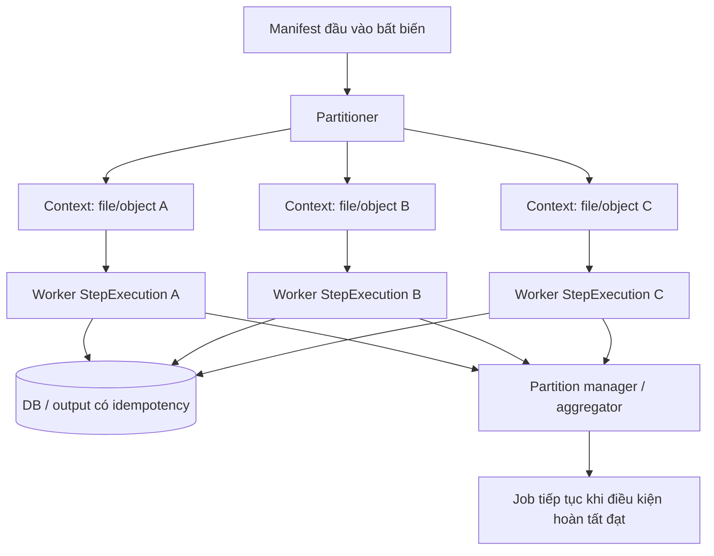

# Chia theo file hoặc object

## 1. Bài toán: mỗi file hoặc object là một đơn vị công việc

Một pipeline Spring Batch phải nhập 3.000 file CSV từ hệ thống kế toán mỗi đêm. Nếu dùng một reader đọc lần lượt toàn bộ file, job có thể mất nhiều giờ dù máy còn CPU và database chưa bão hòa. Một hướng mở rộng tự nhiên là **chia dữ liệu theo file**: gán một hoặc nhiều file cho một partition và cho các worker xử lý những partition khác nhau.

Với object storage như Amazon S3, Azure Blob Storage hoặc Google Cloud Storage, đơn vị có thể là **object** được nhận diện bởi bucket/container, key và phiên bản hoặc một định danh nội dung bất biến. Mô hình tương tự file, nhưng phát sinh thêm yêu cầu về quyền truy cập, network, thay đổi object và quản lý snapshot đầu vào.

Trong module **SPRING_BATCH_SCALING_OPERATIONS**, lựa chọn này phục vụ mục tiêu mở rộng Spring Batch cho workload dữ liệu lớn qua multi-threaded step, parallel steps, partitioning và xử lý phân tán. Hiệu quả cần được đánh giá bằng throughput, nút thắt tài nguyên, tính an toàn đa luồng, retry/restart và **độ chính xác của dữ liệu**, không chỉ số worker.

**Ý tưởng cốt lõi:** một `Partitioner` tạo các `ExecutionContext` khác nhau, mỗi context chỉ tới một file/object hoặc một nhóm file/object **không chồng lấn**. Mỗi worker `StepExecution` đọc đúng tập dữ liệu được giao, còn manager tổng hợp kết quả.

### Kết quả cần đạt

Sau bài này, bạn có thể:

1. Chọn khi nào partition theo file/object tốt hơn một reader tuần tự hay multi-threaded step.
2. Mô tả contract đầu vào: manifest, object key/version, checksum, kích thước và ownership.
3. Dùng `MultiResourcePartitioner` hoặc `Partitioner` tùy biến cùng `@StepScope`/`ExecutionContext`.
4. Phân biệt **số partition** với **số partition thực thi đồng thời**.
5. Cân bằng file nhỏ/file lớn, tránh xử lý trùng, thực hiện restart an toàn.
6. Chuyển từ local partitioning sang remote partitioning mà không nhầm local path với một URI truy cập được từ mọi worker.

## 2. File, object và partition khác nhau thế nào?

| Khái niệm | Ví dụ | Điều cần phân biệt |
| --- | --- | --- |
| File trong filesystem | `/data/invoices/2026-11-26/part-001.csv` | Có thể chỉ truy cập được tại một host hoặc một shared mount |
| Object storage object | `s3://finance-import/2026-11-26/part-001.csv` | Bucket + key chỉ vị trí logic; có thể bị overwrite nếu không khóa phiên bản |
| Object version / immutable identifier | S3 `versionId` hoặc immutable object key | Cần pin nội dung cụ thể cho restart |
| Partition | `file-001` kèm `ExecutionContext` chỉ tới input | Là đơn vị Spring Batch quản lý, không đồng nghĩa luôn đúng một file |
| Worker `StepExecution` | `fileWorkerStep:file-001` | Trạng thái, counts và checkpoint riêng cho partition |
| `gridSize` | `gridSize(4)` | Hint phân chia công việc; **không mặc nhiên bằng số file hoặc số worker** |

Một partition có thể chứa **một file**, **một object**, **nhiều file nhỏ**, hoặc một **vùng byte/record** của file lớn nếu định dạng hỗ trợ tách an toàn. Chọn đơn vị partition dựa trên tính độc lập, chi phí xử lý và khả năng restart.

### Tại sao không nhất thiết dùng parallel steps?

Các file đều cần thực hiện cùng pipeline `read → process → write`, chỉ khác dữ liệu nguồn. Nếu tạo thủ công một flow và một step cho từng file, cấu hình job sẽ phình to và khó tự động điều chỉnh khi số file thay đổi. **Partitioning** cho phép tái sử dụng cùng một worker step, tạo nhiều `StepExecution` với input context khác nhau.



Sơ đồ không hàm ý ba worker chạy đồng thời trong mọi cấu hình; executor, `PartitionHandler`, số partition và quota hạ tầng quyết định concurrency thực tế.

## 3. Khi nào chọn chiến lược chia theo file/object?

| Workload | Chiến lược nên cân nhắc | Lý do |
| --- | --- | --- |
| 500 file có kích thước gần tương đương, xử lý độc lập | Một file → một partition | Dễ lập danh sách, theo dõi và restart |
| 100.000 file vài KB | Gộp nhiều file thành một partition | Giảm số `StepExecution`/task và chi phí mở file |
| 3 file, mỗi file hàng trăm GB | Chia theo range/row group nếu định dạng cho phép | Một file/partition tạo quá ít concurrency |
| File CSV có field chứa newline được quote | Tránh cắt byte tùy ý | Dễ rơi giữa một record và làm hỏng parser |
| File `.gz` thông thường | Một file/partition hoặc đổi sang dạng splittable | Stream gzip phổ biến không thể nhảy byte tùy ý để giải nén độc lập |
| Parquet/ORC có row groups hoặc dữ liệu phân vùng sẵn | Cân nhắc chia theo đơn vị block/row group hợp lệ | Tránh scan cả object nếu thư viện hỗ trợ đọc theo vùng |
| Dữ liệu chỉ gồm những bảng DB lớn, không có file độc lập | Chia theo ID/range/key | File/object partitioning không phải cách phân chia tự nhiên |
| Hai bộ dữ liệu có logic nghiệp vụ khác nhau | Parallel steps/flows | Chạy hai pipeline khác trách nhiệm, không phải các partition của cùng worker step |

**Điều kiện quan trọng:** partition phải **không bỏ sót và không chồng lấn**. Với mỗi input logical record cần xác định nó thuộc partition nào, và writer phải xử lý được tình huống replay sau khi worker/manager gặp lỗi.

## 4. Khóa đầu vào: đừng chỉ liệt kê folder rồi chạy

### 4.1. Dùng một manifest bất biến

Liệt kê `*.csv` ngay tại thời điểm worker chạy có thể khiến hai worker nhìn thấy tập file khác nhau nếu nhà cung cấp tiếp tục upload/đổi tên. Tốt hơn là tạo một **manifest của đợt chạy** trước khi bắt đầu partitioning.

Ví dụ manifest minh họa:

```json
{
  "batchId": "invoice-2026-11-26",
  "manifestVersion": 1,
  "inputs": [
    {
      "partitionId": "file-00001",
      "uri": "file:/data/invoices/2026-11-26/a.csv",
      "sizeBytes": 3120045,
      "sha256": "example-sha256-of-a"
    },
    {
      "partitionId": "file-00002",
      "uri": "file:/data/invoices/2026-11-26/b.csv",
      "sizeBytes": 4120091,
      "sha256": "example-sha256-of-b"
    }
  ]
}
```

Các checksum `example-*` chỉ là placeholder minh họa, **không phải digest hợp lệ**. Manifest thật cần chứa checksum được tạo và kiểm chứng đúng thuật toán, hoặc version bất biến phù hợp.

Quy trình nên có:

1. Nguồn ghi file/object vào vùng tạm, chỉ công bố khi upload hoàn tất.
2. Bước chuẩn bị liệt kê input, kiểm tra schema/size/duplicate keys, chọn quy tắc sắp xếp.
3. Ghi manifest bất biến, đặt ID/version riêng và persist ở nơi bền vững, có phân quyền.
4. Truyền **manifest ID/URI** làm identifying `JobParameter` thích hợp; không đưa hàng nghìn file vào JobParameters.
5. `Partitioner` đọc **cùng một manifest** khi job chạy và restart; không tự scan lại folder đang thay đổi.
6. Mỗi `ExecutionContext` chỉ giữ thông tin nhỏ: file path/object key/version, partition ID, checkpoint tương ứng.

**Không đổi thứ tự manifest khi restart.** Với partition name đánh số `file-00001`, nếu đầu vào thứ nhất thay từ file A sang file B, Spring Batch có thể gắn checkpoint của A vào B vì tên partition không đổi. Tên partition phải ổn định gắn với cùng đơn vị công việc suốt vòng đời JobInstance.

### 4.2. Object key và object version

Một object ở `s3://bucket/key` không nhất thiết có nội dung bất biến. Khi source overwrite cùng key, worker restart có thể đọc dữ liệu khác. Vì vậy:

- Khi storage hỗ trợ, **pin version ID** hoặc immutable object generation.
- Nếu không có versioning, dùng quy ước **immutable key** và ngăn overwrite trong chính sách upload.
- Ghi nhận size, checksum tin cậy hoặc metadata verification để phát hiện đầu vào đã thay.
- Không dùng **ETag như SHA-256 hay MD5 toàn bộ object** một cách mặc định. Ví dụ S3 ETag của multipart upload hoặc một số chế độ mã hóa **không phải MD5 toàn object**.
- Nếu input thay đổi sau khi một partition đã commit, **không restart âm thầm** như thể dữ liệu vẫn giống cũ; cần báo lỗi và quyết định một JobInstance mới/correction workflow.

Với S3, kết quả đọc phiên bản cụ thể còn phụ thuộc permission `GetObjectVersion` nếu sử dụng version ID. Với GCS/Azure, dùng cơ chế generation/version tương ứng của nhà cung cấp; không giả định tất cả dịch vụ dùng chung tên field.

## 5. Tạo partition theo file với MultiResourcePartitioner

Spring Batch cung cấp `MultiResourcePartitioner`, nhận một mảng `Resource[]` rồi tạo **một partition cho mỗi resource**. Mỗi partition có `ExecutionContext` chứa tên/vị trí file theo một key (mặc định `fileName`); định danh partition có dạng `partition0`, `partition1`, ...

**Chi tiết dễ nhầm:** phương thức `MultiResourcePartitioner.partition(int gridSize)` **bỏ qua `gridSize`**. Nếu truyền 250 resource, nó có thể tạo 250 partition dù `gridSize(4)`; việc **chạy đồng thời** vẫn phụ thuộc `PartitionHandler` và executor. Muốn gộp 250 file thành bốn nhóm, phải có `Partitioner` tùy biến.

### 5.1. Cấu hình resource partitioner

Ví dụ cho file đã được chuẩn bị trên filesystem và có thể truy cập từ worker **cùng JVM/host**:

```java
@Bean("invoiceFilePartitioner")
Partitioner invoiceFilePartitioner(
        @Value("file:/data/invoices/ready/*.csv") Resource[] resources) {

    MultiResourcePartitioner partitioner = new MultiResourcePartitioner();
    partitioner.setResources(resources);
    partitioner.setKeyName("fileName");
    return partitioner;
}
```

Ví dụ này giúp hiểu API; **không nên dựa vào wildcard scan động để restart production**. Trong hệ thống thật, nguồn `Resource[]` nên được dựng từ manifest đã chốt và được kiểm tra trùng lặp, có quy tắc sắp xếp ổn định và xác minh file không đổi.

### 5.2. StepScope đọc file thuộc partition

`ExecutionContext` của từng worker partition được bind khi worker bắt đầu bằng SpEL. Với reader dành cho CSV, khai báo `@StepScope` để mỗi `StepExecution` có reader instance riêng:

```java
@Bean("invoiceFileReader")
@StepScope
FlatFileItemReader<Invoice> invoiceFileReader(
        @Value("#{stepExecutionContext['fileName']}") Resource resource) {

    return new FlatFileItemReaderBuilder<Invoice>()
            .name("invoiceFileReader")
            .resource(resource)
            .linesToSkip(1)
            .delimited()
            .names("invoiceId", "amount")
            .fieldSetMapper(fs -> new Invoice(
                    fs.readString("invoiceId"),
                    fs.readBigDecimal("amount")))
            .build();
}
```

Đoạn code dành cho **Spring Batch 5.x và cú pháp builder tương ứng**; import, `Invoice` record và dependency được lược bỏ. `@StepScope` yêu cầu step scope được đăng ký (Spring Batch/Spring Boot configuration thông thường hỗ trợ). StepScope là **theo StepExecution**, không phải tạo bean riêng cho mỗi `Thread` của multi-threaded step.

**Cần xác minh kiểu giá trị thực:** `MultiResourcePartitioner` ghi thông tin filename dưới dạng chuỗi, và Spring có thể chuyển chuỗi resource location thành `Resource` thông qua property conversion. Tùy đường dẫn và cách tạo `Resource[]`, sử dụng `String fileName` rồi chuyển sang `FileSystemResource`/`UrlResource` rõ ràng có thể dễ kiểm soát hơn. Hãy kiểm thử với đúng các URI của môi trường, đặc biệt Windows/Linux và filesystem mount.

Một reader có state được checkpoint cần hỗ trợ `ItemStream` đúng; `FlatFileItemReader` hỗ trợ trạng thái dòng khi được cấu hình phù hợp. Không tắt `saveState` tùy ý nếu yêu cầu restart tại vị trí đã commit.

## 6. Partitioner tùy biến từ manifest để giữ identity ổn định

`MultiResourcePartitioner` thuận tiện nhưng khi có object storage, manifest gộp nhóm, ID nghiệp vụ hoặc cần kiểm tra version, hãy tự triển khai `Partitioner`.

**Mẫu thiết kế:** mỗi entry trong manifest có ID duy nhất và bất biến; `Partitioner` chỉ chuyển entry thành `ExecutionContext`, không đọc toàn bộ nội dung file.

```java
record ManifestFile(String partitionId, String absolutePath) {}

final class FrozenManifestPartitioner implements Partitioner {

    private final List<ManifestFile> files;

    FrozenManifestPartitioner(List<ManifestFile> files) {
        this.files = List.copyOf(files);
    }

    @Override
    public Map<String, ExecutionContext> partition(int gridSize) {
        Map<String, ExecutionContext> result = new LinkedHashMap<>();

        for (ManifestFile input : files) {
            ExecutionContext context = new ExecutionContext();
            context.putString("inputFile", input.absolutePath());

            if (result.putIfAbsent(input.partitionId(), context) != null) {
                throw new IllegalArgumentException(
                        "Duplicate partition ID: " + input.partitionId());
            }
        }
        return result;
    }
}
```

Ở đây `gridSize` là hint của framework nhưng **partitioner tự quyết định số partition**. Nếu manifest có 12 file, phương thức tạo 12 context, không chia được nội dung của một file thành bốn chỉ vì `gridSize=4`.

Trong production, danh sách `ManifestFile` phải được đọc từ **manifest bất biến đã xác minh** (manifest ID là JobParameter), không hard-code trong mã. Các ID ví dụ `file-00001` phải được giữ ổn định; có thể dùng ID được gán khi tạo manifest hoặc giá trị được tạo deterministically từ identity object. Nếu ID dựa trên hash key, phải tránh collision và ký tự gây vấn đề trong tên step.

### 6.1. Dùng path từ context với reader riêng

```java
@Bean
@StepScope
FlatFileItemReader<Invoice> invoiceReaderFromManifest(
        @Value("#{stepExecutionContext['inputFile']}") String inputFile) {

    return new FlatFileItemReaderBuilder<Invoice>()
            .name("invoiceReaderFromManifest")
            .resource(new FileSystemResource(inputFile))
            .linesToSkip(1)
            .delimited()
            .names("invoiceId", "amount")
            .fieldSetMapper(fs -> new Invoice(
                    fs.readString("invoiceId"),
                    fs.readBigDecimal("amount")))
            .build();
}
```

**Phạm vi đường dẫn:** `FileSystemResource` phù hợp với file local/shared mount; nó **không tự mở URI S3/Azure/GCS**. Với object storage, cần một resource/reader adapter được hỗ trợ hoặc SDK client, và reader phải thực hiện đúng checkpoint/close/seek hoặc reopen trên phiên bản object đã khóa.

### 6.2. Ưu tiên context nhỏ

Không đưa toàn bộ manifest, list hàng trăm nghìn file, raw credential hoặc payload dữ liệu vào mỗi `ExecutionContext`. Context được persist trong `JobRepository` và cần có serializer/giới hạn kích thước tương ứng. Nên lưu `manifestId`, `partitionId`, `objectKey`, `versionId`, `size`, `offset` hoặc reference nhỏ gọn. Secret được cấp qua identity/secret provider ở runtime, không persist.

## 7. Ghép partitioner vào một step chạy cục bộ

Ví dụ sau dùng **Spring Batch 5.x** với `StepBuilder`, `ThreadPoolTaskExecutor` và cùng một worker step. Reader `@StepScope` đọc file từ context; writer nghiệp vụ phải được khai báo riêng và xử lý idempotent.

### 7.1. Worker step

```java
@Bean("invoiceFileWorkerStep")
Step invoiceFileWorkerStep(
        JobRepository jobRepository,
        PlatformTransactionManager transactionManager,
        @Qualifier("invoiceReaderFromManifest")
            ItemReader<Invoice> reader,
        ItemWriter<Invoice> writer) {

    return new StepBuilder("invoiceFileWorkerStep", jobRepository)
            .<Invoice, Invoice>chunk(100, transactionManager)
            .reader(reader)
            .writer(writer)
            .build();
}
```

Ở đây, `chunk(100)` là tối đa 100 item/chunk, **không** phải 100 partition hoặc 100 thread. Writer phải dùng `invoiceId`/`sourceVersion` hoặc khóa nghiệp vụ phù hợp để tránh ghi trùng khi một partition retry/restart. Reader step-scoped tách vị trí đọc của mỗi `StepExecution`.

### 7.2. Partition manager step

```java
@Bean("filePartitionExecutor")
ThreadPoolTaskExecutor filePartitionExecutor() {
    ThreadPoolTaskExecutor executor = new ThreadPoolTaskExecutor();
    executor.setThreadNamePrefix("file-partition-");
    executor.setCorePoolSize(4);
    executor.setMaxPoolSize(4);
    executor.setQueueCapacity(20);
    return executor;
}

@Bean("invoiceFileManagerStep")
Step invoiceFileManagerStep(
        JobRepository jobRepository,
        @Qualifier("invoiceFileWorkerStep") Step workerStep,
        @Qualifier("invoiceFilePartitioner") Partitioner partitioner,
        @Qualifier("filePartitionExecutor") TaskExecutor executor) {

    return new StepBuilder("invoiceFileManagerStep", jobRepository)
            .partitioner(workerStep.getName(), partitioner)
            .step(workerStep)
            .gridSize(4)
            .taskExecutor(executor)
            .build();
}
```

Ví dụ này dùng `MultiResourcePartitioner` ở mục 5 nếu inject `invoiceFilePartitioner`, và có thể đổi sang `FrozenManifestPartitioner` nếu thay bean tương ứng. Với `MultiResourcePartitioner`, `gridSize=4` **không giới hạn số file/partition được sinh**. `ThreadPoolTaskExecutor` có tối đa bốn worker xử lý các partition **cục bộ** trong một JVM; 20 task chờ không phải 20 partition đang chạy.

**Lưu ý API theo phiên bản:** Mẫu `chunk(100, transactionManager)` áp dụng Spring Batch 5.x. Ở Spring Batch 6.x, chunk builder và package của một số hạ tầng đã thay đổi (ví dụ có dạng `chunk(100).transactionManager(transactionManager)`); hãy đối chiếu dependency và documentation trước khi copy code. Bản chất `Partitioner → ExecutionContext → worker StepExecution` vẫn giữ nguyên.

### 7.3. Một file lớn khác gì nhiều file nhỏ?

`MultiResourcePartitioner` tạo một partition mỗi resource, nên một file 40 GB cùng 99 file 10 MB có thể khiến **một worker trở thành critical path**. Thêm worker pool lớn không giúp file 40 GB hoàn thành nhanh nếu nó vẫn là một partition đơn lẻ. Cần xem mục 9 về balancing và khả năng tách an toàn file lớn.

## 8. Local partitioning so với remote partitioning

| Tiêu chí | Local partitioning | Remote partitioning |
| --- | --- | --- |
| Worker chạy ở đâu? | Các thread trong một JVM/ứng dụng | Các tiến trình hoặc node khác |
| Cách phân công | `TaskExecutorPartitionHandler` | Middleware/adapter và `PartitionHandler` remote |
| Truy cập file local | Có thể dùng path chung trong cùng host | Không bảo đảm worker khác host nhìn thấy path đó |
| Input object storage | Mỗi worker dùng storage client phù hợp | Mỗi worker cần endpoint, IAM/credential và network |
| Metadata | `JobRepository` theo mô hình Spring Batch | Cần thiết kế quyền và truy cập repository theo kiến trúc remote |
| Recovery | `StepExecution`/checkpoint trên cùng hạ tầng | Thêm lỗi broker, worker timeout và correlation |
| Giới hạn scaling | CPU/RAM/IOPS của một JVM/host | Nhiều node, nhưng phụ thuộc broker, DB và object storage |

Ví dụ **không nên làm**: manager trên host A đưa `/tmp/orders-001.csv` vào context, worker trên host B nhận partition rồi cố mở cùng đường dẫn. `/tmp` của hai máy không phải cùng file. Các phương án hợp lệ:

- Đặt file ở **shared filesystem** có mount path nhất quán và quyền truy cập đúng.
- Tải file về worker theo **object key + version ID** trước khi xử lý, ghi local staging riêng và xóa khi hoàn tất.
- Dùng reader streaming qua SDK/object protocol, hỗ trợ retry/seek/checkpoint theo contract.

Khi chuyển sang remote partitioning, không tự gửi Java `Resource` hoặc stream đang mở qua message. Gửi **định danh nhỏ, có thể serialize** và cho worker tự mở đúng đối tượng theo storage contract. Không đặt credential trong `ExecutionContext` hay message.

## 9. Cân bằng tải: số file không bằng lượng công việc

Giả sử 100 file có kích thước khác nhau:

| Nhóm | Số file | Kích thước mỗi file | Tổng dung lượng |
| --- | ---: | ---: | ---: |
| Nhỏ | 80 | 5 MB | 400 MB |
| Trung bình | 18 | 200 MB | 3.600 MB |
| Lớn | 2 | 10 GB | 20 GB |
| **Tổng** | **100** | — | **~24 GB** |

Nếu mỗi file là một partition, đa số partition nhỏ hoàn tất sớm nhưng hai file 10 GB chiếm worker lâu. `gridSize(16)` không tự chia hai file 10 GB thành 16 phần.

### 9.1. Gộp nhiều file nhỏ vào một partition

Với 50.000 file vài KB, mỗi file/partition có thể tạo quá nhiều `StepExecution`, transaction metadata và open/close file overhead. Giải pháp:

1. Sắp xếp manifest theo ID bất biến.
2. Gom các file thành nhóm có tổng bytes hoặc số record ước lượng tương đương.
3. Mỗi partition giữ **groupId** và manifest URI, thay vì cả nghìn đường dẫn trong `ExecutionContext`.
4. Worker xử lý nhóm theo thứ tự **deterministic** để checkpoint/restart rõ ràng.
5. Đặt số group nhiều hơn số worker một chút để có cơ hội cân bằng nhưng không quá nhiều tới mức metadata trở thành bottleneck.

Ví dụ 50.000 file nhỏ chia thành 200 groups, executor 8 worker; **200 partitions** là số đơn vị có checkpoint, còn tối đa **8 worker** hoạt động cùng lúc tại pool này.

### 9.2. Chia một file/object lớn

Chỉ nên chia một file thành nhiều partition khi parser và format hỗ trợ. Ví dụ:

- **Parquet/ORC:** row groups/stripes là đơn vị chia có ngữ nghĩa rõ nếu thư viện đọc hỗ trợ.
- **CSV line-based đơn giản:** phải xác định ranh giới record, xử lý header, encoding, newline và các field quoted có newline. **Không** cắt byte bất kỳ rồi gọi `readLine` mà chưa chứng minh ranh giới record hợp lệ.
- **JSON lines:** có thể chia theo record boundary nếu từng dòng độc lập; cần kiểm tra encoding và định dạng thực.
- **Gzip stream truyền thống:** không giả định có thể seek tới byte offset bất kỳ để giải nén; có thể chia từ trước khi nén hoặc dùng định dạng hỗ trợ block.
- **Large object storage:** HTTP range GET chỉ cung cấp byte range; **không tự biến** range thành đơn vị record hợp lệ.

Nếu phải hỗ trợ ranges, context nên chứa `startOffset`, `endOffsetExclusive` cùng version và checksum; reader phải có logic skip/align, không bỏ sót hay lặp record ở biên. Test với Unicode nhiều byte, quoted fields, line endings, object multipart và record cuối file.

### 9.3. Ước lượng theo thời gian thay vì bytes

Hai file 100 MB chưa chắc tốn thời gian bằng nhau: file A parse CSV đơn giản, file B phải gọi API cho từng dòng. Nếu có thống kê lịch sử, cân bằng theo `estimatedProcessingSeconds` hoặc số record và mức xử lý nghiệp vụ. Chú ý skew theo tenant/customer/địa bàn, tránh tập trung partition nặng lên một worker.

## 10. Checkpoint, retry và restart theo partition

### 10.1. Một partition có trạng thái riêng

Khi `Partitioner` trả về các entry như `file-00001`, `file-00002`, Spring Batch tạo các `StepExecution` tương ứng với metadata và `ExecutionContext` riêng. Khi worker xử lý chunk có checkpoint, trạng thái reader được cập nhật theo commit/stream semantics của step.

Ví dụ:

```text
JobInstance: nightlyInvoiceImport(manifestId=M-2026-11-26)

fileWorkerStep:file-00001 -> COMPLETED (a.csv)
fileWorkerStep:file-00002 -> FAILED    (b.csv, đã commit một phần)
fileWorkerStep:file-00003 -> COMPLETED (c.csv)

Restart cùng JobInstance:
- Partition completed thường không cần chạy lại theo cơ chế mặc định.
- Partition failed được thực hiện lại từ checkpoint hợp lệ.
- Manifest file/order/version phải vẫn như lần chạy đầu.
```

Không suy ra “không cần xử lý lại” chỉ từ cờ `COMPLETED` nếu nghiệp vụ yêu cầu rebuild toàn bộ snapshot. Với `allowStartIfComplete`, custom restart policy hoặc một JobInstance khác, hành vi có thể khác.

### 10.2. Reader có state không đồng nghĩa exactly-once

Giả sử worker đã commit 1.000 invoices, sau đó crash trước khi cập nhật hoặc xác nhận trạng thái của thao tác ngoài DB. Sau restart, một số item có thể được xử lý lại. `JobRepository` cung cấp cơ sở checkpoint, nhưng **không cam kết exactly-once end-to-end** với file, API hoặc hệ thống đích không tham gia cùng transaction.

Nên:

- Sử dụng unique key/upsert ở sink, ví dụ `invoiceId + sourceVersion`.
- Đặt transaction boundary rõ ở writer; tránh side effect không idempotent trong processor.
- Dùng idempotency key cho HTTP API hoặc outbox khi cần phát sự kiện.
- Đối soát tổng số record theo manifest và business keys, không chỉ `readCount`/`writeCount`.
- Test crash trước/sau commit, thiếu nguồn, file thay đổi, lỗi parse và worker bị kill giữa file.

### 10.3. Rủi ro đổi nội dung và thứ tự manifest

| Thay đổi giữa hai lần chạy | Hệ quả có thể xảy ra | Chính sách |
| --- | --- | --- |
| Object key bị overwrite | Đọc dữ liệu mới bằng checkpoint cũ | Pin version hoặc fail khi fingerprint không khớp |
| Có file mới trong folder | Partition set không còn giống lần đầu | Giữ manifest bất biến; file mới thuộc batch khác |
| Manifest sắp xếp lại | Partition `file-00001` trỏ file khác | Cố định ID mapping, không đổi thứ tự |
| File bị xóa | Partition failed không thể restart | Phục hồi đúng phiên bản hoặc báo thất bại |
| Worker restart với schema mới | Parse sai hoặc số dòng checkpoint không khớp | Version hóa schema/reader; test migration |
| Two partitions cùng ghi một invoiceId | Ghi đè/trùng | Dedup theo khóa nghiệp vụ hoặc thiết kế ownership rõ |
| Reader `saveState(false)` | Mất checkpoint chi tiết của reader | Chỉ dùng khi có chiến lược reprocess idempotent khác |

### 10.4. PartitionNameProvider khi số lượng lớn

Spring Batch có `PartitionNameProvider` để cung cấp tên partition khi restart mà không cần tính lại toàn bộ context đắt đỏ. Nếu custom Partitioner triển khai giao diện này, tên trả về **phải khớp chính xác** với tên do `partition(...)` tạo ra. Nó giúp giảm chi phí tạo lại partition ở một số kịch bản, **không cho phép đổi mapping sang file khác**.

Dù sử dụng provider, hệ thống vẫn cần bảo đảm **manifest bất biến**, không để dữ liệu mới chen vào một đợt chạy cũ.

## 11. An toàn đa luồng và isolation giữa worker

Local partitioning tạo nhiều `StepExecution`, không phải chỉ chia một reader singleton rồi cho các thread gọi `read()` lẫn nhau.

| Thành phần | Cách thiết kế |
| --- | --- |
| `ItemReader` | `@StepScope`; mỗi StepExecution có instance/state/offset riêng |
| `ItemProcessor` | Ưu tiên stateless; nếu shared bean, phải thread-safe |
| `ItemWriter` | Không dùng chung mutable file handle/transaction state; idempotent theo khóa |
| `ExecutionContext` | Thông tin input/checkpoint theo partition; không dùng như concurrent global map |
| `DataSource` / clients | Dùng pool và client thread-safe; không chia một `Connection`/`EntityManager` giữa worker |
| File output | Mỗi partition ghi file tạm riêng; bước merge xuất bản sau khi tất cả thành công |
| Object storage client | Mỗi worker truy cập đúng object/version; token cấp qua identity/secret provider |
| JobRepository | Metadata cập nhật đồng thời; dimension pool/DB capacity theo số partition chạy |

**`@StepScope` không phải per-thread scope chung.** Nó tạo bean theo `StepExecution`; nhờ mỗi partition có StepExecution riêng, reader có thể giữ state độc lập. Nếu một partition lại bật multi-threaded step bên trong, reader step-scoped **vẫn có thể bị nhiều thread của cùng partition truy cập**, tùy phiên bản Spring Batch. Không kết luận thread safety chỉ từ annotation.

## 12. Bảo mật và quyền truy cập object storage

Khi worker mở một URI object, không gửi access key/secret qua `ExecutionContext`, `JobParameters` hay message. Dùng identity runtime, IAM/workload identity hoặc secret manager phù hợp, với quyền tối thiểu.

| Thành phần | Quyền tối thiểu nên xét |
| --- | --- |
| Manager manifest discovery | Được list/đọc vùng manifest và metadata input theo policy |
| Worker | Chỉ được đọc object/prefix/version được phân công, quyền decrypt nếu KMS yêu cầu |
| Writer | Quyền ghi đúng bucket/container/table output, không quyền xóa mọi object |
| Operator | Đọc logs/metrics và manifest đã hạn chế dữ liệu nhạy cảm |
| Cleanup service | Quyền xóa staging theo retention, không dùng credential của mọi worker |

Cũng cần:

- TLS endpoint và hostname verification.
- Giới hạn network egress, thời gian chờ SDK, retries có backoff, connection pools.
- Không log full object payload hoặc signed URL chứa token.
- Kiểm tra object path traversal khi chuyển key/filename từ manifest sang local path.
- Xác minh checksum/version trước khi xử lý; không tin file chỉ vì tên giống.
- Theo dõi cloud request cost, throttling và quota khi tăng worker.

**Object URI không phải chứng từ quyền sở hữu:** user hoặc bên cấp file có thể đặt key chứa tên đặc biệt, ký tự Unicode hoặc tên trùng. Phải validate manifest và chuẩn hóa cách ánh xạ key thành partition ID, log path và local staging path.

## 13. Benchmark: tìm trần throughput và mức chia hợp lý

Một job xử lý **600 GB** input từ object storage trong 2 giờ. Khi chia theo file, performance không chỉ phụ thuộc vào số file mà còn băng thông object storage, CPU parse, DB writer, chi phí mở kết nối, kích thước partition và độ lệch thời gian giữa partition.

**Số liệu sau hoàn toàn giả định** để minh họa cách chọn cấu hình:

| Executor workers | Số partition | Tổng thời gian | Throughput trung bình | Nhận xét |
| ---: | ---: | ---: | ---: | --- |
| 1 | 120 | 240 phút | 2,5 GB/phút | Baseline |
| 4 | 120 | 78 phút | ~7,7 GB/phút | Tăng tốc rõ |
| 8 | 120 | 49 phút | ~12,2 GB/phút | Tối ưu tiếp |
| 16 | 120 | 47 phút | ~12,8 GB/phút | Gần chạm trần DB/network |
| 32 | 120 | 57 phút | ~10,5 GB/phút | Contention/retry/GC tăng |

Dù kết quả minh họa cho thấy tám worker hợp lý, **không thể áp số này cho mọi hạ tầng**. Nếu còn một file 200 GB chưa chia được, nó có thể giữ một worker rất lâu và làm giảm lợi ích tổng.

### 13.1. Bộ metric cần thu thập

- Tổng `JobExecution` duration, thời gian manager step và worker partition step.
- Thời gian **mỗi partition**, bytes/s, records/s, số input IDs duy nhất.
- `readCount`, `writeCount`, `filterCount`, `skipCount`, `commitCount` theo StepExecution.
- Pool active threads, queue depth, rejection, CPU, heap/GC.
- DB connection active/pending, write latency, locks/deadlocks.
- Object GET/HEAD/List latency, request count, error/throttling, network bytes.
- Số partition thất bại, restart count, checkpoint lag, dữ liệu output trùng.
- **Straggler ratio:** partition chậm nhất / median partition duration.

### 13.2. Quy trình đánh giá

1. Chạy baseline một worker với **manifest cố định** và dữ liệu đại diện.
2. Đo thời gian từng file và xây histogram sizes/durations, xác định file cực lớn.
3. Dùng fixed executor 2 → 4 → 8; giữ nguyên input/chunk size và benchmark lặp nhiều lượt.
4. Thử grouping các file nhỏ, hoặc tách file lớn khi có format support; phân biệt thay đổi partition strategy với thay đổi concurrency.
5. Đo timeout, API/storage throttling, DB locks, retries; nếu đã bão hòa, không tăng worker tiếp.
6. Thử worker crash giữa file và restart cùng manifest; đối soát checksum và output.
7. Chọn cấu hình đạt deadline với **headroom** và khả năng phục hồi, thay vì chọn số thread tối đa.

## 14. Case study: 30.000 object mỗi đêm

Một nhà bán lẻ có 30.000 object JSON Lines, dung lượng mỗi object từ 50 KB tới 10 GB. Dữ liệu ở object storage, worker Spring Batch chạy trên nhiều pod. Nếu mỗi object tạo một partition, metadata rất nhiều và phần lớn partition hoàn tất cực nhanh; một số object lớn chiếm worker quá lâu.

**Thiết kế đề xuất:**

1. Có một bước chuẩn bị tạo manifest bất biến cho một `businessBatchId`, lưu bucket/key/version/size/checksum.
2. Gom khoảng 29.900 object nhỏ thành các nhóm theo tổng bytes hoặc thời gian ước lượng, ví dụ 300 nhóm; không nhất thiết một object = một partition.
3. Với object lớn, chỉ tách range nếu có chỉ mục record hoặc parser chứng minh được ranh giới JSONL hợp lệ; nếu không, để nguyên một object/partition và đánh giá lại định dạng input.
4. Mỗi partition context chứa `manifestId`, `groupId` hoặc `objectKey` và `versionId`; worker tự mở object qua SDK với identity đã cấp.
5. Dùng remote partitioning nếu cần xử lý trên nhiều pod, giới hạn số worker đồng thời theo CPU/DB/network quota.
6. Writer upsert theo khóa nghiệp vụ, output staging theo business batch ID; publish chỉ sau khi các partition hoàn tất và đối soát.
7. Khi worker chết giữa object, restart cùng manifest/version và checkpoint đã commit; nếu input thay đổi thì fail thay vì im lặng đọc phiên bản mới.
8. Giám sát duration per partition, stragglers, disk/network, retries và unique records.

**Kết quả mong đợi:** hệ thống tận dụng đồng thời nhiều worker mà không tạo một Job/Step riêng cho mỗi object, không lưu secret trong metadata và vẫn có khả năng điều tra partition nào lỗi.

## 15. Những lỗi thiết kế thường gặp

| Nhầm lẫn | Điều đúng cần ghi nhớ |
| --- | --- |
| “`gridSize(4)` nghĩa luôn chỉ có bốn file/partition.” | `MultiResourcePartitioner` bỏ qua `gridSize`; nó tạo một partition cho mỗi resource. |
| “Một file = một worker thread.” | Số partition và concurrency khác nhau; executor/handler quyết định số worker. |
| “Tất cả worker remote đọc được `/tmp/a.csv` của manager.” | Local path không tự chia sẻ giữa host/pod. |
| “Restart chỉ cần list folder lại.” | Danh sách có thể đổi; cần manifest và partition identity bất biến. |
| “Key `s3://bucket/a.csv` luôn chứa cùng dữ liệu.” | Key có thể bị overwrite; pin version hoặc immutable key. |
| “S3 ETag luôn là MD5 toàn object.” | Multipart upload/mã hóa có thể làm ETag không phải MD5 toàn object. |
| “Tăng gridSize sẽ tự chia file 10 GB.” | Muốn chia record/range phải có `Partitioner` và reader hỗ trợ biên dữ liệu. |
| “CSV cứ cắt byte theo kích thước đều được.” | Quoted newline, encoding và record boundary có thể khiến mất/trùng dữ liệu. |
| “`@StepScope` làm mọi bean thread-safe.” | Chỉ tạo scope theo StepExecution; shared component vẫn phải an toàn. |
| “Reader hỗ trợ checkpoint nên writer chắc chắn exactly-once.” | Side effect, rollback và replay vẫn cần idempotency/transaction. |
| “Đưa toàn bộ manifest vào ExecutionContext là tiện.” | Có thể làm metadata phình to, khó serialize và tăng rủi ro dữ liệu nhạy cảm. |
| “30.000 file nhỏ thì nên tạo 30.000 thread.” | Cần group file nhỏ và bounded concurrency. |
| “Partition đã COMPLETED luôn cần chạy lại khi restart.” | Theo mặc định completed partitions thường được nhận diện và không chạy lại. |

## 16. Câu hỏi tự kiểm tra

**Câu 1.** Có 500 file trong `Resource[]`, dùng `MultiResourcePartitioner` và `gridSize(8)`. Có bao nhiêu partition được tạo?

*Gợi ý:* Theo API của `MultiResourcePartitioner`, một partition cho mỗi resource: khoảng 500 partition; `gridSize` bị bỏ qua bởi implementation này. Executor có thể chỉ chạy tám worker đồng thời nếu được giới hạn tám.

**Câu 2.** Vì sao sau restart không nên scan lại folder để tạo partition từ các file mới nhất?

*Gợi ý:* Tập file/thứ tự và nội dung có thể đã đổi, gây mapping checkpoint sai hoặc xử lý trùng/bỏ sót. Dùng manifest bất biến và identity ổn định.

**Câu 3.** Worker local đọc `FileSystemResource("/tmp/data.csv")` bình thường. Khi chuyển remote worker sang pod khác, điều gì có thể xảy ra?

*Gợi ý:* Pod khác không có file đó. Phải có shared mount, object storage hoặc cơ chế truyền/download file, với version và quyền đúng.

**Câu 4.** Một object gzip lớn 50 GB có thể chia thành 50 byte ranges và giải nén độc lập không?

*Gợi ý:* Không mặc định. Gzip stream thông thường không hỗ trợ tùy ý bắt đầu ở byte giữa stream; cần định dạng splittable, indexed chunks hoặc chia trước khi nén.

**Câu 5.** Nếu worker đã commit 1.000 bản ghi rồi crash trước khi metadata được xác nhận, tại sao reprocess có thể gây ghi trùng?

*Gợi ý:* Database side effect và checkpoint/ack có thể không nằm trong một transaction. Writer phải idempotent và có unique key.

**Câu 6.** Một file 40 GB chạy lâu trong khi 100 file 10 MB đã xong. Tăng executor từ 8 lên 32 có chắc giúp không?

*Gợi ý:* Không. File lớn vẫn là một partition/critical path; cần chia an toàn file đó hoặc tối ưu logic/định dạng, thay vì chỉ tăng thread.

## 17. Checklist trước khi production

- [ ] Chọn đơn vị partition theo file, object, group hay record range có cơ sở đo lường.
- [ ] Có manifest bất biến, định danh partition ổn định, object version/checksum hoặc immutable key.
- [ ] Không có file/object chồng lấn giữa partition; tổng dữ liệu được bao phủ đầy đủ.
- [ ] `ExecutionContext` nhỏ, serializable, không chứa secret, signed URL dài hạn hay payload.
- [ ] Reader `@StepScope` nhận đúng input; writer có transaction/idempotency.
- [ ] Cấu hình `PartitionHandler`/executor bounded, hiểu rõ `gridSize` và số partition sinh ra.
- [ ] Local/remote workers thực sự đọc được URI/input tương ứng, không phụ thuộc path local của manager.
- [ ] Object storage IAM, TLS, checksum/ETag/version và retries được kiểm soát.
- [ ] File lớn và file nhỏ có chính sách balancing; không cắt byte khi chưa hiểu record boundary.
- [ ] Đã đo per-partition duration, throughput, CPU/DB/network/GC, storage throttling.
- [ ] Đã test fail/restart cùng manifest và phát hiện input bị thay đổi.
- [ ] Có đối soát dữ liệu đầu vào–đầu ra theo business key và chính sách skip/filter.
- [ ] Có runbook xử lý straggler, file missing, schema mismatch, checksum sai và dead-letter nếu remote transport yêu cầu.
- [ ] Chỉ chuyển sang nhiều node khi local scaling đã bộc lộ giới hạn thực và hạ tầng đủ observability.

## Tài liệu tham khảo

- [Spring Batch Reference — Scaling and Parallel Processing](https://docs.spring.io/spring-batch/reference/scalability.html): partitioning SPI, `Partitioner`, `TaskExecutorPartitionHandler` và context binding.
- [Spring Batch 5.2 — Scaling and Parallel Processing](https://docs.spring.io/spring-batch/reference/5.2/scalability.html): cấu hình Java partitioned step và xử lý cục bộ.
- [Spring Batch — MultiResourcePartitioner API](https://docs.spring.io/spring-batch/reference/api/org/springframework/batch/core/partition/support/MultiResourcePartitioner.html): mỗi resource tạo một partition, `gridSize` bị bỏ qua.
- [Spring Batch — Late Binding of Job and Step Attributes](https://docs.spring.io/spring-batch/reference/step/late-binding.html): `@StepScope` và `stepExecutionContext`.
- [Spring Batch — Restarting a Step](https://docs.spring.io/spring-batch/reference/step/chunk-oriented-processing/restart.html): checkpoint/`ItemStream` và restart.
- [Amazon S3 — Checking Object Integrity](https://docs.aws.amazon.com/AmazonS3/latest/userguide/checking-object-integrity-upload.html): checksum và trường hợp ETag không phải MD5 toàn object.
- [Amazon S3 — Object Versions](https://docs.aws.amazon.com/AmazonS3/latest/userguide/Versioning.html): khóa nội dung object theo version.

**Điểm cần nhớ:** chia theo file/object đạt hiệu quả khi mỗi partition được xác định rõ, bất biến trong suốt JobInstance và có cách xử lý/khôi phục độc lập. Số file, `gridSize` và số worker là ba đại lượng khác nhau. Hãy chọn đơn vị partition theo workload và record boundary, dùng manifest + version để restart đúng, đặt giới hạn concurrency theo CPU/DB/storage, và luôn đối soát dữ liệu sau lỗi.
