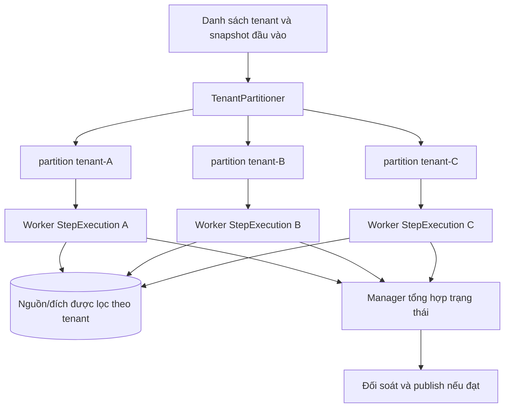

# Chia theo tenant

## 1. Bài toán: mỗi tenant là một miền dữ liệu độc lập

Trong ứng dụng **multi-tenant**, nhiều khách hàng hoặc tổ chức (tenant) dùng chung một nền tảng, nhưng dữ liệu và quyền truy cập của mỗi tenant phải được tách biệt. Ví dụ hệ thống SaaS cần tính hóa đơn cuối tháng cho 2.000 tenant: 1.900 tenant có vài nghìn hóa đơn, 99 tenant có hàng trăm nghìn hóa đơn, riêng một tenant lớn có hàng chục triệu hóa đơn. Nếu mọi dữ liệu đi qua **một step tuần tự**, job có thể vượt cửa sổ xử lý dù CPU và database vẫn còn năng lực.

**Chia theo tenant (tenant-based partitioning)** biến tenant, hoặc một phần dữ liệu của tenant, thành **đơn vị phân công và khôi phục**. Manager tạo các partition, mỗi worker step chỉ đọc/xử lý/ghi tập dữ liệu thuộc partition của mình. Các partition độc lập có thể thực thi song song bằng `TaskExecutorPartitionHandler` trong một JVM hoặc phân tán qua remote partitioning.

Bài này thuộc chương **Chia dữ liệu** của module `SPRING_BATCH_SCALING_OPERATIONS`, nơi mục tiêu là mở rộng Spring Batch cho dữ liệu lớn với đa luồng, parallel steps, partitioning, retry/restart và kiểm soát tài nguyên. Một giải pháp đúng phải thỏa mãn đồng thời:

1. **Isolation:** không đọc nhầm, ghi chéo hay lộ dữ liệu giữa tenant.
2. **Completeness:** không bỏ sót hoặc xử lý trùng bản ghi theo khóa nghiệp vụ.
3. **Restartability:** partition giữ nguyên danh tính và cùng tập dữ liệu qua những lần restart của một `JobInstance`.
4. **Bounded concurrency:** số worker phù hợp CPU, DB connections, I/O và quota theo tenant.
5. **Operability:** đo được tenant nào chậm/lỗi, không để một tenant lớn giữ toàn bộ job.

### Học xong, bạn có thể

- Phân biệt partition theo tenant với multi-threaded step, parallel steps và chia theo ID/time range.
- Tạo manifest tenant bất biến và `Partitioner` sinh `ExecutionContext` có tenant ID/range rõ ràng.
- Dùng `@StepScope` để bind tenant cho JDBC reader và processor.
- Thiết kế writer idempotent theo **khóa kép tenant + entity**, tránh cross-tenant writes.
- Cân bằng tenant lớn/nhỏ, sizing `gridSize`, thread pool, retry/restart và quan sát ở quy mô nhiều tenant.

## 2. Partition theo tenant vận hành thế nào?



Một `Partitioner` trả về `Map<String, ExecutionContext>`. Mỗi key là **partition name** ổn định; context mang thông số đọc dữ liệu, ví dụ `tenantId` và `highWatermarkId`. Spring Batch dùng các context này để tạo những worker `StepExecution` như `tenantWorkerStep:tenant-0001` và ghi trạng thái riêng cho từng partition trong `JobRepository`.

| Thành phần | Trách nhiệm | Điều không nên nhầm |
| --- | --- | --- |
| `Partitioner` | Chia input và tạo context cho từng partition | Không thực thi SQL xử lý toàn bộ dữ liệu |
| `ExecutionContext` | Cung cấp tham số tenant/range và checkpoint | Không phải nơi lưu token, password, danh sách hàng triệu record |
| Worker `Step` | Chạy read → process → write cho một partition | Có thể được thực thi nhiều lần qua retry/restart |
| `PartitionHandler` | Phân phối các StepExecution tới worker | Không bảo đảm đúng một thread trên mỗi tenant |
| `gridSize` | Hint về độ phân chia cho `Partitioner`/handler | Không bắt buộc bằng số tenant, số partition hoặc thread |
| `TaskExecutor` | Giới hạn số worker local chạy đồng thời | Không đặt trần toàn cluster hoặc request API nếu worker mở thêm luồng |
| `JobRepository` | Theo dõi JobExecution, StepExecution, checkpoint | Không tự thực thi chính sách bảo mật tenant hay exactly-once ngoài transaction |

**Một tenant không nhất thiết chỉ có một partition.** Tenant lớn có thể được chia thành nhiều `tenant + range`, trong khi nhiều tenant rất nhỏ có thể được gom thành một partition có manifest nhóm. Nhưng quy tắc ownership phải rõ ràng, không thể tùy ý chia để tăng số thread nếu làm mất ranh giới transaction hoặc phân tách dữ liệu.

## 3. Chọn đúng mô hình chia dữ liệu

| Kiểu workload | Lựa chọn | Vì sao |
| --- | --- | --- |
| Nhiều tenant, mỗi tenant có tập hóa đơn độc lập | Một tenant → một partition | Dễ audit/isolation và restart theo tenant |
| Một tenant chiếm 80% tổng dữ liệu | Tenant + ID/time ranges | Tránh worker đơn lẻ trở thành critical path |
| Hàng chục nghìn tenant rất nhỏ | Gom nhóm tenant nhỏ theo manifest | Giảm overhead JobRepository/khởi tạo step, vẫn kiểm tra ranh giới tenant |
| Công việc phải xử lý **tuần tự trong từng tenant** | Partition theo tenant, từng worker xử lý theo thứ tự | Có thể song song giữa các tenant mà giữ thứ tự nội bộ |
| Các pipeline khác nhau: tính phí và gửi báo cáo | Parallel steps | Đây là các bước nghiệp vụ khác nhau, không chỉ chia cùng một pipeline |
| Một reader và processor stateless trên cùng tập dữ liệu nhỏ | Multi-threaded step có kiểm soát | Ít cấu hình hơn nhưng checkpoint và isolation phải được đánh giá theo phiên bản |
| Mỗi tenant có schema/database riêng | Tenant partition với routing datasource/connection an toàn | Phải giải quyết transaction, identity và connection lifecycle |
| Dữ liệu trải trên nhiều node, local CPU/RAM đã hết | Remote partitioning | Mỗi worker phải có quyền nguồn/đích và phối hợp JobRepository |

**Khác biệt cốt lõi với multi-threaded step:** partitioning tạo **nhiều StepExecution** độc lập, nên việc tìm tenant thất bại và restart theo partition thuận tiện hơn so với một step cùng chia sẻ reader/ExecutionContext. Một multi-threaded step không tự tạo checkpoint cho từng tenant.

## 4. Ba kiểu lưu trữ multi-tenant và tác động tới partition

### 4.1. Shared database, shared schema

Ví dụ bảng `invoice` chứa cột `tenant_id`. Đây là cách dễ lấy ví dụ, nhưng cũng dễ rò dữ liệu nếu bất kỳ query nào thiếu predicate tenant:

```sql
-- Đọc an toàn theo tenant và mốc dữ liệu của batch.
SELECT invoice_id, tenant_id, amount
FROM invoice
WHERE tenant_id = :tenantId
  AND invoice_id <= :highWatermarkId
ORDER BY invoice_id;
```

**Không** dùng `SELECT * FROM invoice` trong worker và chỉ lọc tenant sau khi reader đã trả item: dữ liệu của tenant khác có thể đã đi qua bộ nhớ, log và processor. Điều kiện tenant phải được thực thi ở **nguồn truy cập dữ liệu**, và writer phải tiếp tục bảo đảm tenant identity.

Đề xuất chỉ mục tùy DB/workload:

```sql
CREATE INDEX idx_invoice_tenant_id
    ON invoice (tenant_id, invoice_id);
```

Chỉ mục giúp tìm phần dữ liệu của tenant theo ID trong trường hợp phù hợp; cần đo execution plan, thống kê, selectivity và chi phí index thực tế. Không mặc định chỉ mục này tối ưu cho mọi trạng thái lọc/ngày.

### 4.2. Shared database, schema per tenant

Mỗi tenant có schema như `tenant_abc.invoice`. Worker cần chọn schema hoặc connection context đúng **trước khi lấy connection/khởi tạo transaction**. Không ghép schema lấy từ input tự do vào SQL (`"SELECT ... FROM " + tenantId + ".invoice"`); định danh schema không phải tham số bind `?` và có nguy cơ SQL injection.

Cần một mapping **tenant ID đã được xác thực → schema được cấp phép** ở phía server, cùng connection/session lifecycle được quản lý. Nếu dùng `SET search_path` hoặc thay default schema trên pooled connection, phải đặt và **reset** đúng cho mọi transaction/worker; tránh “rò tenant” khi connection được tái sử dụng.

### 4.3. Database per tenant

Mỗi tenant có datasource/credential hoặc database riêng. Partition context chỉ giữ **mã tenant**; worker xác định datasource qua registry an toàn, không nhận JDBC URL/password từ `JobParameters` hoặc `ExecutionContext` do người gọi tự nhập.

Có thể dùng `AbstractRoutingDataSource` khi routing key được đặt **trước thời điểm transaction/connection được lấy**. Routing qua `ThreadLocal` nếu có phải được thiết lập/giải phóng chính xác tại boundary của worker, không giả định context của manager thread tự truyền sang thread executor. Khi transaction đã lấy connection, đổi `ThreadLocal` sau đó **không làm connection đang dùng chuyển database**.

| Kiểu lưu trữ | Ưu điểm | Rủi ro khi chạy song song |
| --- | --- | --- |
| Shared schema | Hạ tầng đơn giản, một pool | Bỏ predicate `tenant_id` có thể gây lộ dữ liệu |
| Schema per tenant | Phân tách cấu trúc và namespace | Schema routing/connection reuse/DDL khác phiên bản |
| Database per tenant | Cô lập mạnh về dữ liệu và quota riêng | Nhiều pools, network/credential rotation và DB capacity |

**Thiết kế bảo mật không được phụ thuộc duy nhất vào partitioner.** Một context chỉ tenant A không ngăn bug writer tạo bản ghi tenant B. Áp dụng kiểm tra tenant từ nguồn tới sink và cơ chế cô lập phía database phù hợp.

## 5. Chốt tập tenant bằng manifest bất biến

Giả sử manager scan danh sách tenant “đang active” tại mỗi lần chạy. Nếu một tenant bị vô hiệu hóa hoặc thêm mới trước khi restart, `Partitioner` có thể tạo danh sách khác, khiến metadata của partition cũ không còn khớp.

Hãy tạo **frozen tenant manifest** ngay trước JobExecution đầu tiên, xác định scope của một đợt batch. Manifest ví dụ:

```json
{
  "businessBatchId": "billing-2026-11",
  "manifestVersion": 1,
  "partitions": [
    {
      "partitionName": "tenant-0001",
      "tenantId": "t-a91",
      "highWatermarkId": 1500900
    },
    {
      "partitionName": "tenant-0002",
      "tenantId": "t-b24",
      "highWatermarkId": 1600120
    }
  ]
}
```

Các ID và số liệu chỉ để minh họa. Trong thực tế manifest do hệ thống có quyền lập, có chữ ký/checksum hoặc cơ chế bảo đảm tính toàn vẹn nếu cần, và được lưu bền vững để restart. `businessBatchId` là định danh **đợt dữ liệu nghiệp vụ**; `JobExecutionId` là lần chạy kỹ thuật, thay đổi khi restart.

### Manifest phải bảo đảm

1. **Identity ổn định:** `partitionName` luôn gắn với cùng `tenantId` và phạm vi dữ liệu khi restart cùng JobInstance.
2. **Danh sách chính xác:** tenant nào được phép tham gia, phạm vi kỳ/ngày, tình trạng dữ liệu có hợp lệ không.
3. **Snapshot dữ liệu:** `highWatermarkId` hoặc snapshot/cutoff phù hợp, nếu nguồn liên tục thay đổi.
4. **Không trùng ownership:** không có hai partition cùng xử lý một invoice nếu không có quy tắc dedup rõ ràng.
5. **Quyền truy cập:** tenant nằm trong registry tin cậy; không nhận ID tùy ý chưa được kiểm tra từ phía client.
6. **Audit:** biết ai chốt manifest, phiên bản nào được dùng và số record kỳ vọng.
7. **Data minimization:** không chứa secret, token, tên cá nhân hay raw payload; chỉ các tham chiếu cần thiết.

**Watermark ID không phải snapshot đầy đủ.** Điều kiện `invoice_id <= highWatermarkId` chỉ loại các ID mới hơn mốc, **không** ngăn bản ghi có ID cũ bị update/delete giữa các lần chạy. Nếu nghiệp vụ cần ảnh chụp nhất quán, hãy dùng nguồn bất biến, CDC snapshot/version, cột phiên bản/cutoff được kiểm soát hoặc staging snapshot riêng. Tính đúng của restart phụ thuộc vào sự ổn định của tập dữ liệu thực tế, không chỉ một số nguyên.

### Vì sao không lấy tenant ID động làm tên step?

Giữ **tên step logic** cố định, ví dụ `tenantWorkerStep`. `Partitioner` tạo tên partition như `tenant-0001` và Spring Batch có thể tạo worker StepExecution dạng `tenantWorkerStep:tenant-0001`. Tên partition phải bất biến và an toàn để ghi trong metadata.

Tránh dùng email, tên công ty thật, token hoặc một URI nhạy cảm làm tên partition. `tenantId` hoặc `tenantAlias` cũng có thể là dữ liệu nhạy cảm; dùng alias nội bộ ổn định nếu cần và kiểm soát quyền đọc `JobRepository`/dashboard.

## 6. Tạo Partitioner theo tenant

Đối với manifest đã được khóa, có thể tạo mỗi tenant một `ExecutionContext`. Code sau dùng API `Partitioner` của Spring Batch; nhận dữ liệu **đã được xác minh** từ manifest chứ không scan tenant ngay trong mỗi lần restart.

```java
record TenantSlice(
        String partitionName,
        String tenantId,
        long highWatermarkId
) {}

final class TenantPartitioner implements Partitioner {

    private final List<TenantSlice> frozenManifest;

    TenantPartitioner(List<TenantSlice> frozenManifest) {
        this.frozenManifest = List.copyOf(frozenManifest);
    }

    @Override
    public Map<String, ExecutionContext> partition(int gridSize) {
        Map<String, ExecutionContext> result = new LinkedHashMap<>();

        for (TenantSlice slice : frozenManifest) {
            ExecutionContext context = new ExecutionContext();
            context.putString("tenantId", slice.tenantId());
            context.putLong("highWatermarkId", slice.highWatermarkId());

            if (result.putIfAbsent(slice.partitionName(), context) != null) {
                throw new IllegalArgumentException(
                        "Duplicate partition name: " + slice.partitionName());
            }
        }
        return result;
    }
}
```

**Đặc điểm:**

- `partitionName` là key trong kết quả của `partition(...)`, phải duy nhất và ổn định. Nên kiểm tra cả trường hợp hai partitionName khác nhau cùng trỏ đến một phạm vi tenant/range.
- `tenantId` và `highWatermarkId` được serial hóa vào partition `ExecutionContext`, vì vậy không nhét secret hoặc một object không serializable tùy ý.
- `gridSize` là **hint**, không phải lệnh Spring Batch ép chia đúng N partition. Partitioner trên **cố ý tạo số partition bằng số entry trong manifest**.
- Trong production, `TenantPartitioner` được tạo từ manifest được tải theo `manifestId` trong identifying `JobParameters` hoặc registry đã chốt; tránh hard-code `TenantSlice`.
- Nếu có nhiều partition cho một tenant, mở rộng record thành `tenantId + startIdExclusive + endIdInclusive` hoặc range thời gian, đồng thời xác minh phạm vi không chồng lấn.

**Cảnh báo khi nhiều tenant:** với 50.000 tenant, 50.000 partition có thể khiến `JobRepository` và cơ chế dispatch bị quá tải. `gridSize(8)` không tự giảm thành tám partition nếu implementation này bỏ qua hint. Cần grouping hoặc `PartitionHandler` có admission control; không đặt queue vô hạn chỉ để giấu chi phí.

## 7. Worker đọc dữ liệu theo tenant và @StepScope

Ở Spring Batch, `@StepScope` cho phép inject giá trị của **partition StepExecutionContext** khi worker step bắt đầu. Với `JdbcCursorItemReader`, cần đảm bảo SQL bind tenant ở phía database, dùng thứ tự ổn định và checkpoint phù hợp.

### 7.1. Mô hình dữ liệu

```java
record Invoice(long id, String tenantId, BigDecimal amount) {}

record NormalizedInvoice(
        long id,
        String tenantId,
        BigDecimal normalizedAmount
) {}
```

### 7.2. Reader theo tenant (Spring Batch 5.x)

```java
@Bean("tenantInvoiceReader")
@StepScope
JdbcCursorItemReader<Invoice> tenantInvoiceReader(
        DataSource dataSource,
        @Value("#{stepExecutionContext['tenantId']}") String tenantId,
        @Value("#{stepExecutionContext['highWatermarkId']}") Long highWatermarkId) {

    return new JdbcCursorItemReaderBuilder<Invoice>()
            .name("tenantInvoiceReader")
            .dataSource(dataSource)
            .sql("""
                SELECT invoice_id, tenant_id, amount
                FROM invoice
                WHERE tenant_id = ?
                  AND invoice_id <= ?
                ORDER BY invoice_id
                """)
            .preparedStatementSetter(ps -> {
                ps.setString(1, tenantId);
                ps.setLong(2, highWatermarkId);
            })
            .rowMapper((rs, rowNum) -> new Invoice(
                    rs.getLong("invoice_id"),
                    rs.getString("tenant_id"),
                    rs.getBigDecimal("amount")))
            .build();
}
```

Ví dụ sử dụng **Java 17+ text blocks** và cú pháp Spring Batch 5.x. Cần khai báo import/dependencies thực tế, index phù hợp và cấu hình JDBC transaction/driver tương thích.

Lưu ý quan trọng:

- `WHERE tenant_id = ?` dùng **bind parameter**, không nối chuỗi từ input.
- `ORDER BY invoice_id` cần khóa sắp xếp duy nhất trong phạm vi tenant. Nếu ID trùng trong một tenant, dùng thêm key tiebreaker.
- `@StepScope` tạo instance reader cho **mỗi StepExecution**, tránh chia sẻ một cursor giữa các partition. Nó không tự giải quyết concurrency nếu bật multi-threaded chunk *bên trong cùng worker step*.
- `JdbcCursorItemReader` sử dụng cursor/connection theo lifecycle; nhiều partition cùng lúc sẽ chiếm thêm tài nguyên DB. Đo số connections/cursors đang mở trước khi tăng worker.
- Checkpoint theo vị trí đọc chỉ an toàn khi source/ordering không đổi theo contract. `highWatermarkId` một mình không bảo đảm điều đó nếu record cũ được sửa/xóa.
- `saveState` mặc định cần được kiểm thử với restart; không tắt tùy tiện khi muốn tiếp tục từ điểm đã commit.

### 7.3. Processor không được đổi tenant

Bản ghi do worker đọc đã mang `tenantId`. Một processor cần đảm bảo không biến nó thành tenant khác, đồng thời tránh mutable state dùng chung.

```java
@Bean("tenantInvoiceProcessor")
@StepScope
ItemProcessor<Invoice, NormalizedInvoice> tenantInvoiceProcessor(
        @Value("#{stepExecutionContext['tenantId']}") String expectedTenantId) {

    return invoice -> {
        if (!expectedTenantId.equals(invoice.tenantId())) {
            throw new IllegalStateException(
                    "Tenant boundary violation in batch input");
        }

        BigDecimal normalized = invoice.amount()
                .setScale(2, RoundingMode.HALF_UP);

        return new NormalizedInvoice(
                invoice.id(), expectedTenantId, normalized);
    };
}
```

Không log toàn bộ invoice hay tenant PII trong exception. Thực tế `tenantId` là dữ liệu không nên tin chỉ vì nằm trong context; worker phải nhận nó từ manifest đã xác minh và được phép truy cập theo principal/identity.

## 8. Writer idempotent: tenant + entity là khóa nghiệp vụ

Một lỗi phổ biến là writer chỉ dựa vào `invoice_id`, trong khi nhiều tenant có invoice số 1001. Nếu khóa đích là `invoice_id` đơn lẻ, write/update có thể ảnh hưởng dữ liệu tenant khác.

Với PostgreSQL, có thể thiết kế:

```sql
CREATE TABLE normalized_invoice (
    tenant_id TEXT NOT NULL,
    invoice_id BIGINT NOT NULL,
    normalized_amount NUMERIC(18, 2) NOT NULL,
    PRIMARY KEY (tenant_id, invoice_id)
);
```

Ví dụ writer dùng `JdbcBatchItemWriter` và UPSERT (PostgreSQL-specific):

```java
@Bean("tenantInvoiceWriter")
JdbcBatchItemWriter<NormalizedInvoice> tenantInvoiceWriter(
        DataSource dataSource) {

    return new JdbcBatchItemWriterBuilder<NormalizedInvoice>()
            .dataSource(dataSource)
            .sql("""
                INSERT INTO normalized_invoice
                    (tenant_id, invoice_id, normalized_amount)
                VALUES (?, ?, ?)
                ON CONFLICT (tenant_id, invoice_id)
                DO UPDATE SET
                    normalized_amount = EXCLUDED.normalized_amount
                """)
            .itemPreparedStatementSetter((item, ps) -> {
                ps.setString(1, item.tenantId());
                ps.setLong(2, item.id());
                ps.setBigDecimal(3, item.normalizedAmount());
            })
            .build();
}
```

**Vì sao kết hợp hai thành phần này?**

- `PRIMARY KEY (tenant_id, invoice_id)` ngăn một tenant ghi đè cùng ID của tenant khác thông qua khóa trùng.
- `ON CONFLICT` giúp cùng invoice được replay thì kết quả ổn định **nếu phép biến đổi thuần/idempotent và nguồn bất biến**.
- Writer không dùng `tenantId` do client tự nộp một cách không kiểm tra: processor/step đã xác minh partition boundary, và có thể dùng chính sách RLS/điều kiện ghi bổ sung phía database.
- UPSERT không thay thế business versioning. Nếu invoice được chỉnh sửa giữa hai lần chạy, replay có thể ghi dữ liệu cũ hoặc mới; cần `sourceVersion`, conditional update hoặc snapshot policy.
- Writer idempotent ở một bảng **không** bảo đảm một email/API thanh toán bên ngoài cũng idempotent. Side effect ngoài DB cần idempotency key/outbox và quy trình đối soát.

### 8.1. Tránh update/delete thiếu tenant predicate

Nếu nghiệp vụ dùng câu lệnh cập nhật, câu lệnh:

```sql
UPDATE normalized_invoice
SET normalized_amount = :amount
WHERE invoice_id = :invoiceId;
```

**Không an toàn trong shared schema** khi invoice ID chỉ duy nhất trong tenant. Cần:

```sql
UPDATE normalized_invoice
SET normalized_amount = :amount
WHERE tenant_id = :tenantId
  AND invoice_id = :invoiceId;
```

Tương tự với `DELETE`, `MERGE`, truy vấn thống kê và ghi staging. Điều kiện tenant không nên chỉ xuất hiện ở reader rồi biến mất khỏi pipeline.

## 9. Ghép local partitioning với StepBuilder

Đoạn mã sau minh họa **Spring Batch 5.x**, dùng worker step độc lập theo partition, pool cục bộ và manager step. Reader/processor/writer đã khai báo ở mục trước.

### 9.1. Worker step

```java
@Bean("tenantWorkerStep")
Step tenantWorkerStep(
        JobRepository repository,
        PlatformTransactionManager transactionManager,
        @Qualifier("tenantInvoiceReader") ItemStreamReader<Invoice> reader,
        @Qualifier("tenantInvoiceProcessor")
            ItemProcessor<Invoice, NormalizedInvoice> processor,
        @Qualifier("tenantInvoiceWriter") ItemWriter<NormalizedInvoice> writer) {

    return new StepBuilder("tenantWorkerStep", repository)
            .<Invoice, NormalizedInvoice>chunk(200, transactionManager)
            .reader(reader)
            .processor(processor)
            .writer(writer)
            .build();
}
```

`chunk(200)` là tối đa 200 invoice/chunk, **không phải 200 tenant hoặc 200 worker**. `StepExecutionContext` sẽ chứa tenant ID/high watermark riêng cho mỗi partition. Các resource như JDBC cursor đóng theo lifecycle của reader khi worker step kết thúc.

### 9.2. Executor giới hạn tài nguyên

```java
@Bean("tenantPartitionExecutor")
ThreadPoolTaskExecutor tenantPartitionExecutor() {
    ThreadPoolTaskExecutor executor = new ThreadPoolTaskExecutor();
    executor.setThreadNamePrefix("tenant-partition-");
    executor.setCorePoolSize(4);
    executor.setMaxPoolSize(4);
    executor.setQueueCapacity(16);
    return executor;
}
```

Đây là pool **4 worker tối đa**, với 16 task chờ. Nó **không bảo đảm** hệ thống nhận vô hạn số partition: nếu manager cố submit hàng trăm task gần như tức thời, queue/pool có thể đầy và xảy ra `TaskRejectedException`. Dùng manifest 8–12 partition để thử mẫu; ở production hàng nghìn tenant, hãy thiết kế **grouping hoặc partition handler có bounded dispatch** theo API/version đang dùng, không chỉ tăng queue khổng lồ.

### 9.3. Manager step

```java
@Bean("tenantManagerStep")
Step tenantManagerStep(
        JobRepository repository,
        @Qualifier("tenantWorkerStep") Step worker,
        @Qualifier("tenantPartitioner") Partitioner partitioner,
        @Qualifier("tenantPartitionExecutor") TaskExecutor executor) {

    return new StepBuilder("tenantManagerStep", repository)
            .partitioner(worker.getName(), partitioner)
            .step(worker)
            .gridSize(4)
            .taskExecutor(executor)
            .build();
}
```

`gridSize(4)` là hint truyền tới partitioner; `TenantPartitioner` ở mục 6 không sử dụng hint mà tạo partition theo manifest. Nếu có 12 entry, sẽ có 12 partition, nhưng executor cố định 4 worker chỉ thực thi tối đa bốn task của **pool này** tại cùng thời điểm.

**Lưu ý theo phiên bản:** các ví dụ `chunk(200, transactionManager)` thuộc Spring Batch 5.x. Spring Batch 6.x có thay đổi API builder và mô hình multi-threaded step; cần đối chiếu phiên bản phụ thuộc khi áp dụng. Cơ chế partition `Partitioner → StepExecutionContext → worker step` vẫn là khái niệm cốt lõi.

## 10. Tenant lớn, tenant nhỏ và bài toán skew

### 10.1. Một tenant có thể quyết định toàn bộ thời gian job

Giả sử 100 tenant, tổng 20 triệu hóa đơn:

| Nhóm tenant | Số tenant | Số hóa đơn/tenant (giả định) | Tổng |
| --- | ---: | ---: | ---: |
| Nhỏ | 90 | 10.000 | 900.000 |
| Trung bình | 9 | 900.000 | 8.100.000 |
| Rất lớn | 1 | 11.000.000 | 11.000.000 |
| **Tổng** | **100** | — | **20.000.000** |

Nếu mỗi tenant là một partition, 99 partition khác có thể xong rất sớm, nhưng partition lớn nhất vẫn cần đọc/xử lý **11 triệu invoice**. Tăng thread pool từ 8 lên 32 không tự giúp partition lớn đó hoàn tất nhanh hơn.

### 10.2. Chia tenant lớn thành nhiều range độc lập

Ví dụ tenant `t-big` được chia theo ID đã chốt:

```text
partitionName = "tenant-big-range-0001"
tenantId      = "t-big"
startId       = 0          (exclusive)
endId         = 500000     (inclusive)

partitionName = "tenant-big-range-0002"
tenantId      = "t-big"
startId       = 500000     (exclusive)
endId         = 1000000    (inclusive)
```

Worker dùng:

```sql
SELECT invoice_id, tenant_id, amount
FROM invoice
WHERE tenant_id = :tenantId
  AND invoice_id > :startId
  AND invoice_id <= :endId
ORDER BY invoice_id;
```

Tính đúng phụ thuộc các vùng **không chồng lấn, không có lỗ** trong miền record cần xử lý, và đầu vào giữ nguyên theo snapshot. Không lấy `MAX(invoice_id)` mới mỗi khi restart rồi sinh range khác nếu có thể làm tên partition cũ trỏ vùng mới.

Nếu nghiệp vụ yêu cầu xử lý giao dịch **đúng thứ tự trong từng tenant** (ví dụ cập nhật số dư theo chuỗi), không được chia một tenant thành nhiều range chạy song song tùy ý. Có thể chỉ song song **giữa các tenant**, hoặc phân vùng theo khóa con (tài khoản/đơn hàng) khi có ràng buộc thứ tự riêng và có bằng chứng tính độc lập.

### 10.3. Gom nhóm tenant nhỏ

Với 50.000 tenant rất nhỏ, mỗi tenant một `StepExecution` có thể đắt hơn thao tác nghiệp vụ. Có thể tạo một partition cho **một nhóm tenant** và worker xử lý từng tenant theo một thứ tự xác định từ manifest.

Nhưng phải cẩn thận:

- Khi chuyển giữa hai tenant, **không tái sử dụng tenant-specific transaction/session/reader state** không được reset.
- Không cho một SQL query xử lý toàn group mà quên predicate tenant hoặc kiểm tra quyền.
- Dùng checkpoint riêng theo thành viên nhóm hoặc một cursor group có khả năng restart được định nghĩa rõ; `saveState(false)` không phải giải pháp tự động.
- Không gom tenant có yêu cầu isolation, residency hoặc SLA khác nhau vào cùng một process/credential nếu trái chính sách.
- Giữ group-to-tenant mapping bất biến khi restart.

### 10.4. Fairness và quota

Partitioning theo tenant có thể gây tình trạng tenant lớn chiếm worker/DB pool, làm tenant nhỏ chậm. Cần đo:

- **Per-tenant duration**, input size, throughput, timeout và retry.
- Số partition tenant lớn cùng chạy; limit để một tenant không chiếm mọi worker.
- Quota DB/API **cấp tenant** và tổng quota toàn ứng dụng.
- Khả năng ưu tiên/điều phối tenant nhỏ, nhưng vẫn giữ tính đúng của deadline nghiệp vụ.

Nếu cần concurrency limit **toàn tenant** trên nhiều pod, pool local `maxPoolSize` không đủ; dùng coordinator/quota dùng chung hoặc chiến lược phân phối có bảo đảm.

## 11. Thread safety và tenant context trong worker

Đối với partitioning, mỗi partition có `StepExecution` riêng, nhưng các bean dùng chung vẫn có thể chạy ở nhiều worker threads.

| Thành phần | Thiết kế an toàn |
| --- | --- |
| `@StepScope` reader | Một instance theo StepExecution, giữ tenant/range/checkpoint độc lập |
| Processor | Stateless hoặc có state riêng; xác minh tenant input |
| Writer | Đảm bảo tenant + entity key; không chia sẻ `Connection` hoặc `EntityManager` mutable |
| `ExecutionContext` | Dữ liệu riêng partition; không dùng làm global mutable map |
| `DataSource` | Pool thread-safe, tenant routing trước khi lấy connection, reset sau transaction |
| `TaskExecutor` | Bounded threads/queue, giám sát saturation; không coi pool size là quota toàn hệ thống |
| JobRepository | Trạng thái worker StepExecution và checkpoint, bảo vệ quyền truy cập metadata |

### 11.1. ThreadLocal: rủi ro lộ tenant khi thread được tái sử dụng

Nếu ứng dụng dùng `TenantContextHolder` trên `ThreadLocal`:

```java
TenantContextHolder.setTenant(tenantId);
try {
    // Thực hiện công việc khi tenant context đã thiết lập.
    // Tránh lấy connection/EntityManager trước khi set context.
    doTenantWork();
} finally {
    TenantContextHolder.clear();
}
```

Đây là **mẫu nguyên tắc**, không phải đoạn mã đủ để tích hợp trực tiếp với chunk transaction. Nếu đặt tenant context bên trong processor **sau khi transaction/connection đã được mở**, routing có thể chọn sai tenant. Không giả định Spring `@StepScope` tự truyền ThreadLocal qua executor. Với worker step, cần một integration point thiết lập context **trước lần lấy connection đầu tiên**, bảo đảm `finally` cleanup ở cả exception/stop/retry; kiểm thử với thread pool reuse.

### 11.2. Tăng lớp bảo vệ bằng Row-Level Security

Với PostgreSQL shared schema, **Row-Level Security (RLS)** có thể là lớp phòng vệ bổ sung. Ví dụ ý tưởng (chỉ sử dụng khi DBA đã thiết kế chính sách, quyền và transaction context đúng):

```sql
ALTER TABLE invoice ENABLE ROW LEVEL SECURITY;

CREATE POLICY invoice_tenant_policy
ON invoice
USING (
    tenant_id = current_setting('app.tenant_id', true)
)
WITH CHECK (
    tenant_id = current_setting('app.tenant_id', true)
);
```

**Cảnh báo triển khai:**

- Giá trị `app.tenant_id` phải được thiết lập **trên chính DB connection thực hiện query** trước khi truy cập và được reset/transaction-scoped. Không chỉ set một biến Java rồi coi database đã áp policy.
- `SET LOCAL`/`set_config(..., true)` gắn với transaction thích hợp; reader dùng connection riêng có thể không có setting này nếu không cấu hình đúng. Test riêng cả reader cursor, writer, listener và các JDBC calls khác.
- Table owner và role có quyền `BYPASSRLS` có thể bypass policy trong những điều kiện nhất định. Dùng least-privilege DB roles, `FORCE ROW LEVEL SECURITY` khi cần và review với DBA.
- Cần RLS hoặc kiểm soát quyền **cho cả bảng output**, không chỉ bảng nguồn.
- Schema/database per tenant có chính sách cách ly khác; không sao chép RLS shared-schema cho mọi kiểu lưu trữ.

RLS là phòng vệ chiều sâu, **không thay** kiểm tra partition ownership, authorization và xử lý dữ liệu xuyên tenant ở code.

## 12. Retry, restart và dữ liệu thay đổi

### 12.1. Restart theo partition

Giả sử manager tạo ba partition cố định:

```text
JobInstance: monthlyInvoiceJob(manifestId=manifest-2026-11)

tenantWorkerStep:tenant-0001 -> COMPLETED
tenantWorkerStep:tenant-0002 -> FAILED
tenantWorkerStep:tenant-0003 -> COMPLETED

Restart cùng JobInstance:
- tenant-0001 và tenant-0003 thường không chạy lại theo mặc định.
- tenant-0002 chạy lại theo checkpoint/step policy.
- Các partition vẫn phải trỏ đúng tenant/range ban đầu.
```

Spring Batch quản lý `JobExecution`/`StepExecution` trong `JobRepository`, nhưng **không bảo đảm exactly-once** cho mọi hệ thống ngoài transaction. Nếu writer gọi API tính phí hoặc publish message trước khi metadata cập nhật, replay có thể lặp side effect.

### 12.2. Checklist tại điểm crash

| Điểm xảy ra lỗi | Trạng thái có thể có | Cách xử lý |
| --- | --- | --- |
| Trước khi mở reader | Không có item được xử lý | Retry/restart theo trạng thái step |
| Sau khi đọc nhưng trước commit | Dữ liệu chunk có thể rollback | Reader checkpoint và transaction phải nhất quán |
| Sau khi DB commit nhưng trước khi xác nhận ngoài hệ thống | Sink đã có output, metadata/reply chưa rõ | Idempotent writer và đối soát, không suy ra “chưa ghi” |
| Sau khi gọi API ngoài transaction | API có thể đã thành công dù job fail | Idempotency key/business reconciliation |
| Trong lúc đổi schema/tenant context | Connection có thể giữ context cũ | Fail an toàn, reset và kiểm tra tenant boundary trước retry |
| Tenant source bị sửa/xóa giữa restart | Checkpoint có thể trỏ tập dữ liệu khác | Phát hiện thay đổi, không restart mù |

### 12.3. Tránh “một tenant FAILED làm hỏng tất cả”

Một tenant thất bại không tự rollback kết quả của các tenant khác. Manager aggregate kết quả partition để quyết định bước tiếp; nếu nghiệp vụ yêu cầu toàn batch đầy đủ, **publish chỉ khi mọi partition đã hoàn thành và đã đối soát**.

Có thể tách output staging theo `businessBatchId + tenantId`; bước publish đánh dấu một phiên bản dữ liệu đã hoàn chỉnh sau khi tất cả tenant thành công. Không dùng `JobExecutionId` riêng của từng lần restart làm khóa dữ liệu mà không có chủ đích, vì cùng business batch có thể trải qua nhiều JobExecution.

Nếu nghiệp vụ cho phép partial success, phải có hợp đồng rõ tenant nào thành công, tenant nào failed, snapshot nào được công bố và điều kiện retry, thay vì âm thầm coi toàn bộ Job `COMPLETED`.

## 13. Benchmark và chọn số worker

Ví dụ một job tổng **20 triệu invoice** trên 100 tenant. Chạy baseline single-threaded tốn **240 phút**. Bảng giả định minh họa:

| Số worker local | Tổng thời gian | Throughput xấp xỉ | Nhận xét |
| ---: | ---: | ---: | --- |
| 1 | 240 phút | ~1.389 invoice/s | Baseline |
| 2 | 145 phút | ~2.299 invoice/s | Giảm thời gian rõ |
| 4 | 92 phút | ~3.623 invoice/s | DB còn headroom |
| 8 | 78 phút | ~4.274 invoice/s | Tenant lớn bắt đầu thành critical path |
| 16 | 85 phút | ~3.922 invoice/s | Lock/GC/DB contention tăng |

**Số liệu chỉ để học cách đọc benchmark**, không phải kết quả đo từ Spring Batch. Với một tenant rất lớn, tốc độ không tăng tuyến tính dù còn worker rảnh.

### Quy trình benchmark

1. Chốt **manifest và dữ liệu đại diện**, ghi baseline thời gian từng tenant và số bản ghi duy nhất.
2. Phân nhóm tenant theo size/duration, phát hiện heavy hitters và các tenant có SLA riêng.
3. Thử pool `2 → 4 → 8` với cùng chunk size, query, transaction và DB pool; đổi từng tham số một.
4. Đo throughput, `StepExecution` duration, read/write/skip/retry counts, CPU/GC, DB lock wait, connection pending, API latency.
5. Chạy cùng tải của scheduler hoặc tenant API traffic để phát hiện cạnh tranh.
6. Thử tenant lớn bị fail và restart, một tenant nhỏ bị lỗi dữ liệu và một worker bị kill sau commit.
7. Kiểm tra số invoice **duy nhất theo từng tenant**, không chỉ tổng toàn job.
8. Chọn mức đạt deadline có headroom, rồi quyết định có cần chia tenant lớn thành nhiều range hoặc chuyển remote partitioning không.

### Số liệu quan sát nên có

| Metric | Ý nghĩa |
| --- | --- |
| `tenant_partition_duration_seconds` | Phát hiện tenant/range quá chậm |
| `tenant_partition_records_total` | Theo dõi số record của partition, đối soát |
| `tenant_partition_retry_total` | Kiểm soát lỗi có lặp theo tenant |
| `partition_executor_active_threads` | Xác minh concurrency local |
| `partition_executor_queue_depth` | Phát hiện backlog hoặc bão hòa |
| `batch_step_commit/rollback/skip` | Phân tích fault tolerance |
| `db_connections_pending` | Biết DB pool có cạn không |
| `tenant_isolation_violation_total` | Phát hiện cross-tenant hoặc manifest mismatch |

Các tên metric **chỉ là gợi ý**. Không đưa ID của hàng chục nghìn tenant làm label Prometheus dài hạn nếu điều đó gây nổ cardinality hoặc lộ dữ liệu; dùng nhóm/khoảng giá trị ở metrics, giữ tenant/partition ID cụ thể trong log có phân quyền.

## 14. Local và remote partitioning theo tenant

| Tiêu chí | Local partitioning | Remote partitioning |
| --- | --- | --- |
| Phạm vi worker | Cùng JVM, nhiều thread | Nhiều process/pod/node |
| Chia dữ liệu | `Partitioner` tạo tenant/range contexts | Cùng nguyên tắc nhưng context được phân phối qua middleware |
| Truy cập tenant | Datasource/SQL local | Worker cần quyền network/DB/secret phù hợp |
| Giới hạn concurrency | Local executor/pool và DB | Worker replicas, broker, quota theo tenant/cụm |
| Recovery | StepExecution/checkpoint | Thêm lỗi broker, reply/timeout và worker crash |
| Bảo mật | Thread isolation và DB authorization | Thêm service identity, broker ACL, TLS, tenant routing |
| Quan sát | Logs/metrics một ứng dụng | Correlation job/partition/worker qua nhiều node |

**Remote không tự bảo đảm isolation.** Một worker ở pod B vẫn phải kiểm tra tenant ID, mở đúng datasource, có quyền tối thiểu và ghi theo khóa tenant. Tránh gửi mật khẩu DB hoặc token qua partition context/message; worker dùng workload identity/secret manager.

Nếu tenant lớn nằm ở một DB chậm, thêm pod có thể chỉ làm kết nối DB nghẽn hơn. Trước khi remote scale, xác định bottleneck CPU, I/O, network và database, rồi tính chi phí vận hành broker/JobRepository/retry.

## 15. Tình huống thực tế: xuất hóa đơn theo 600 tenant

Một nền tảng quản trị doanh nghiệp cần tổng hợp hóa đơn tháng cho **600 tenant trong 60 phút**. Baseline tuần tự mất 165 phút. Có 10 tenant đặc biệt lớn và 590 tenant nhỏ hoặc trung bình.

### Thiết kế đề xuất

1. Ở đầu kỳ, tạo manifest có **businessBatchId**, danh sách 600 tenant được phép xử lý và snapshot dữ liệu. Pin source cutoff/version khi có thể.
2. Đặt partition một tenant cho nhóm trung bình, gộp tenant cực nhỏ vào nhóm nếu JobRepository overhead đáng kể. Với 10 tenant lớn, thử chia theo các vùng invoice ID nhưng chỉ khi nghiệp vụ độc lập.
3. Tạo `tenantWorkerStep` với reader `@StepScope`; SQL bắt buộc `tenant_id = ?` và range đã giao.
4. Processor kiểm tra tenant invariant, writer upsert với `PRIMARY KEY(tenant_id, invoice_id)`.
5. Dùng executor 4 worker ở bản thử đầu, queue/dispatch bounded, quan sát số connection và DB lock. Không giả định `gridSize(4)` sẽ tạo đúng bốn partition.
6. Khi một tenant lỗi, lưu nguyên trạng thái những tenant đã hoàn thành. Sửa nguyên nhân, restart **cùng JobInstance** và đối soát partition lỗi.
7. Chỉ publish snapshot của tháng khi dữ liệu 600 tenant hoàn tất hoặc có chính sách partial success được duyệt.
8. Kiểm tra cross-tenant leakage trong test: cố tình truyền `tenantId` không được phép, đổi tenant context khi tái sử dụng thread, và input có invoice ID giống nhau giữa hai tenant.

**Điểm tối ưu cần tìm:** có thể pool 8 worker giảm từ 70 xuống 58 phút nhưng làm DB pending connections tăng mạnh. Nếu SLA là 60 phút, phải đánh giá cả độ biến động và headroom; lựa chọn không chỉ là “58 nhanh hơn 70” mà là mức ổn định ở peak load có thể tái lập.

## 16. Những sai lầm thường gặp

| Nhầm lẫn | Điều đúng |
| --- | --- |
| “`gridSize(8)` nghĩa manager chỉ tạo tám tenant partition.” | Partitioner quyết định; gridSize là hint, không phải quota cứng. |
| “`@StepScope` tự xác thực tenant.” | Nó bind context theo StepExecution, không có chức năng authorization. |
| “Reader lọc tenant rồi writer không cần tenant predicate/key.” | Sai; sink và mọi cập nhật/xóa cũng phải bảo đảm tenant boundary. |
| “`invoice_id` luôn unique trên toàn SaaS.” | Có thể chỉ unique trong tenant; dùng khóa kép phù hợp. |
| “Một tenant một partition luôn tối ưu.” | Tenant lớn gây skew; tenant nhỏ tạo metadata overhead. |
| “Chia tenant lớn thành bốn range luôn an toàn.” | Không nếu có phụ thuộc thứ tự hoặc phạm vi range không ổn định. |
| “Đổi tên partition giữa restart không ảnh hưởng gì.” | Có thể làm Spring Batch gắn checkpoint sai hoặc coi đó là partition mới. |
| “Watermark ID bảo đảm snapshot bất biến.” | Không nếu bản ghi cũ bị update/delete. |
| “ThreadLocal tenant context tự lan sang executor worker.” | Không tự động; phải thiết lập đúng boundary và cleanup. |
| “Đặt `maxPoolSize=8` là giới hạn cho mọi tenant API trên nhiều pod.” | Chỉ giới hạn worker của pool đó, không bao trùm toàn cụm. |
| “DB transaction rollback sẽ thu hồi HTTP payment call.” | Không; side effect ngoài transaction cần idempotency/compensation. |
| “JobRepository bảo đảm exactly-once theo tenant.” | Không bảo đảm end-to-end; cần writer idempotent và đối soát. |
| “Cứ dùng tenant ID làm metric label.” | Nhiều tenant gây high cardinality và nguy cơ lộ dữ liệu. |

## 17. Câu hỏi tự kiểm tra

**Câu 1.** Có 1.000 tenant, `TenantPartitioner` ở mục 6 trả một entry/tenant, nhưng `gridSize(4)`. Có bao nhiêu partition?

*Gợi ý:* Khoảng 1.000 partition; `gridSize` không ép giảm số entry. Executor 4 worker chỉ thực thi tối đa bốn task local tại một thời điểm nếu không có cơ chế khác.

**Câu 2.** Một tenant lớn chiếm 70% dữ liệu. Tăng worker từ 8 lên 32 có chắc giảm runtime không?

*Gợi ý:* Không; tenant đó vẫn là một partition và critical path. Cần xét chia theo range độc lập hoặc tối ưu pipeline của tenant đó.

**Câu 3.** Query reader đã có `WHERE tenant_id = ?`. Một câu lệnh UPDATE chỉ có `WHERE invoice_id = ?` có an toàn không?

*Gợi ý:* Không nếu invoice ID có thể trùng giữa các tenant. Cần `tenant_id` trong điều kiện và cơ chế DB isolation bổ sung.

**Câu 4.** Một partition restart đọc lại invoice có ID nhỏ hơn high watermark nhưng amount đã được sửa. Vì sao có thể sai?

*Gợi ý:* High watermark không khóa các giá trị cũ; cần snapshot bất biến/version hoặc chiến lược thay đổi dữ liệu có kiểm soát.

**Câu 5.** Vì sao `TenantContextHolder.setTenant(...)` đặt trong processor có thể quá muộn với routing datasource?

*Gợi ý:* Transaction/DB connection có thể đã được lấy trước processor; context phải sẵn sàng trước lần chọn datasource/connection, sau đó cleanup đúng.

**Câu 6.** Tenant A và B đều có `invoice_id=1001`. Dùng `PRIMARY KEY(invoice_id)` ở bảng output có đúng không?

*Gợi ý:* Không nếu cùng DB shared schema; cần khóa gồm tenant và invoice ID hoặc định danh globally unique được chứng minh.

## 18. Checklist production

- [ ] Mỗi tenant/range có ownership rõ và phạm vi dữ liệu không chồng lấn.
- [ ] Manifest bất biến, partitionName ổn định, identifying JobParameters giữ nguyên khi restart.
- [ ] Có snapshot/version/cutoff phù hợp với khả năng update/delete của nguồn.
- [ ] Tenant ID lấy từ registry/manifest có phân quyền, không nhận giá trị client tự do.
- [ ] Reader lọc tenant ở database; processor xác minh boundary; writer dùng khóa/predicate tenant.
- [ ] Không có secret/PII trong `ExecutionContext`, tên partition, log hoặc metrics.
- [ ] `@StepScope` tạo reader riêng cho mỗi StepExecution; không giả định shared beans thread-safe.
- [ ] Tenant routing được thiết lập trước DB connection và reset đúng sau xử lý, kể cả lỗi.
- [ ] Có RLS/quyền DB phù hợp nếu dùng shared schema và cần defense-in-depth.
- [ ] Tenant lớn có chiến lược tránh skew; tenant rất nhỏ có grouping khi phù hợp.
- [ ] Executor/dispatch bounded; tính tổng concurrency qua nhiều job/pod và các pool khác.
- [ ] Reader checkpoint, writer idempotent, API/outbox và retry/restart được kiểm thử.
- [ ] Benchmark per-tenant duration, CPU/DB/API, lock waits và số record duy nhất.
- [ ] Có test input/SQL cố tình vi phạm tenant isolation và kiểm thử thread reuse.
- [ ] Publish chỉ khi mọi partition đạt điều kiện nghiệp vụ; có runbook cho partial success.

## Tài liệu tham khảo

- [Spring Batch — Scaling and Parallel Processing](https://docs.spring.io/spring-batch/reference/scalability.html): `Partitioner`, `PartitionHandler`, `StepExecution` và mở rộng worker.
- [Spring Batch 5.2 — Scaling and Parallel Processing](https://docs.spring.io/spring-batch/reference/5.2/scalability.html): cấu hình local partitioning bằng Java.
- [Spring Batch — Late Binding of Job and Step Attributes](https://docs.spring.io/spring-batch/reference/step/late-binding.html): `@StepScope` và lấy `stepExecutionContext`.
- [Spring Batch — Database ItemReaders and ItemWriters](https://docs.spring.io/spring-batch/reference/readers-and-writers/database.html): JDBC cursor/paging reader và writer.
- [Spring Batch — Configuring a Step for Restart](https://docs.spring.io/spring-batch/reference/step/chunk-oriented-processing/restart.html): `ExecutionContext`, checkpoint và restart.
- [Spring Framework API — AbstractRoutingDataSource](https://docs.spring.io/spring-framework/docs/current/javadoc-api/org/springframework/jdbc/datasource/lookup/AbstractRoutingDataSource.html): routing datasource dựa trên lookup key.
- [PostgreSQL — Row Security Policies](https://www.postgresql.org/docs/current/ddl-rowsecurity.html): RLS, `USING`/`WITH CHECK` và quyền bypass.
- [PostgreSQL — INSERT and ON CONFLICT](https://www.postgresql.org/docs/current/sql-insert.html): UPSERT với khóa nghiệp vụ đúng.

**Ghi nhớ:** chia dữ liệu theo tenant mang lại concurrency và checkpoint theo miền dữ liệu, nhưng đồng thời đặt ra nghĩa vụ **cô lập tenant xuyên suốt reader → processor → writer → DB**. Partition identity phải bền vững; tenant lớn cần tránh skew, tenant nhỏ cần tránh metadata overhead; retry/restart phải đi cùng snapshot và idempotency. Chỉ tăng worker khi đã đo được bottleneck và bảo đảm không thể xử lý chéo tenant.
