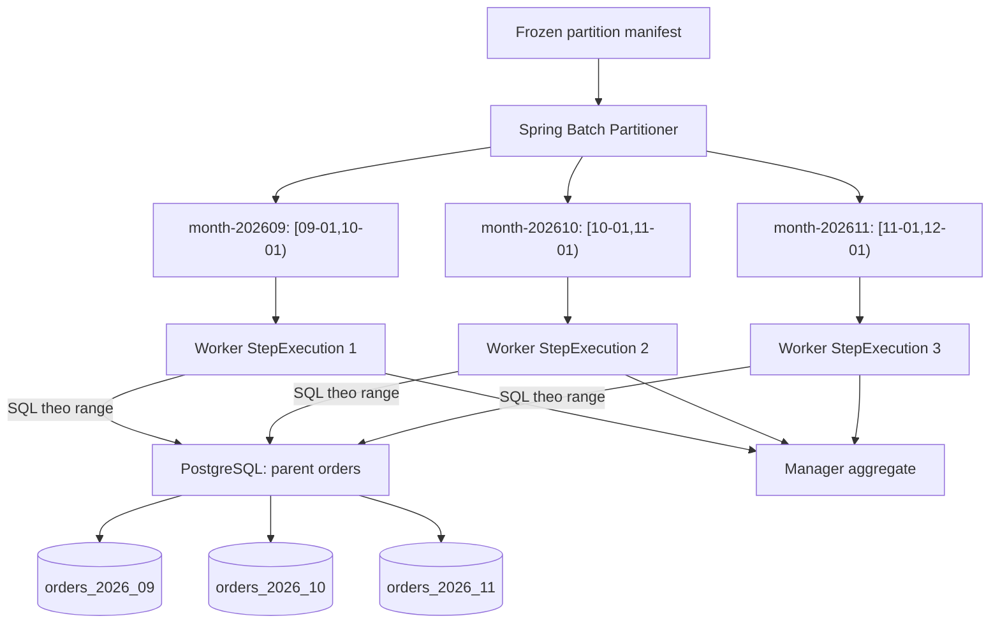

# Chia theo partition vật lý

## 1. Partition vật lý là gì và tại sao tận dụng nó?

Một hệ thống dữ liệu có thể đã phân bố dữ liệu thành nhiều **partition vật lý** ở tầng lưu trữ: các partition của bảng PostgreSQL theo tháng, các shard database trên nhiều máy, hoặc những thư mục/dataset phân vùng trong data lake. Khi xây dựng job Spring Batch, ta có thể tận dụng ranh giới có sẵn này để phân phối công việc thay vì quét toàn bộ nguồn bằng một reader tuần tự.

Ví dụ bảng `orders` có 24 partition theo `order_date`. Job cần đối soát dữ liệu của 12 tháng. Mỗi tháng có thể trở thành một đơn vị phân công cho worker, song **không có nghĩa 12 bảng vật lý tự tạo ra 12 Spring Batch StepExecution**. Ứng dụng vẫn phải thiết kế `Partitioner`, mapping input, `PartitionHandler`, worker step và chính sách restart.

Trong module **SPRING_BATCH_SCALING_OPERATIONS**, nội dung này thuộc chương **Chia dữ liệu**, phục vụ mục tiêu mở rộng Spring Batch cho workload dữ liệu lớn bằng multi-threaded step, parallel steps, partitioning và mô hình phân tán. Thiết kế cần cân bằng throughput, tài nguyên CPU/I/O/DB, thread safety, retry/restart và tính đúng dữ liệu.

> **Nguyên tắc trung tâm:** partition vật lý mô tả **dữ liệu được lưu ở đâu hoặc được cắt theo quy tắc nào**; partition của Spring Batch mô tả **đơn vị công việc và checkpoint**. Hai hệ thống có thể được ánh xạ 1:1, 1:n hoặc n:1, nhưng không nên đánh đồng.

### Mục tiêu học tập

Sau bài này, bạn có thể:

1. Phân biệt physical storage partition, logical work partition và worker `StepExecution`.
2. Tận dụng PostgreSQL range/list/hash partition và nhận biết **partition pruning**.
3. Tạo manifest bất biến, ánh xạ partition vật lý sang `ExecutionContext` và `@StepScope` reader.
4. Viết ví dụ local partitioned step có bounded `TaskExecutor`, không tự chạm trực tiếp tên bảng từ dữ liệu không tin cậy.
5. Xử lý lệch kích thước partition, bão hòa I/O, maintenance DDL và thay đổi dữ liệu khi restart.
6. Chuyển sang remote partitioning/shards khi đã xác định đúng bottleneck.

## 2. Phân biệt ba tầng partition

| Tầng | Ví dụ | Ai tạo/quản lý? | Điều được bảo đảm |
| --- | --- | --- | --- |
| **Physical database partition** | `public.orders_2026_10` chứa đơn tháng 10 | Database/DBA, schema và partition key | Cơ sở dữ liệu quản lý vị trí dữ liệu và định tuyến/pruning theo quy tắc |
| **Logical partition của Spring Batch** | `month-202610` với `startDate`/`endDateExclusive` | `Partitioner` | Một tập tham số đầu vào cho công việc |
| **Worker StepExecution** | `ordersWorkerStep:month-202610` | Spring Batch/`JobRepository` | Trạng thái, counters và `ExecutionContext` phục vụ retry/restart |

Ví dụ mapping:



Ở đây mỗi worker **truy vấn parent table `orders` với predicate trên partition key**, để PostgreSQL tự chọn partition vật lý thích hợp. Không bắt buộc nối chuỗi SQL `FROM orders_2026_10` cho từng worker.

### 2.1. Số partition không bằng số thread

Giả sử database có 120 partition tháng và manifest chọn 12 tháng:

- Database có **120 physical partitions**.
- `Partitioner` được viết để trả về **12 logical partitions**.
- Local executor có `core=max=4` nên tối đa **4 worker tasks** do pool đó quản lý chạy đồng thời.
- Nếu một worker có processor mở thêm executor hoặc gọi API không đồng bộ, số request/transaction nghiệp vụ có thể lớn hơn bốn.

`gridSize(4)` là **gợi ý** cho partitioner/handler, không phải mệnh lệnh “tạo đúng bốn partition”. Nếu `Partitioner` bỏ qua `gridSize` và trả 12 entries, framework vẫn có thể tạo 12 worker StepExecutions.

### 2.2. Physical layout không tự tạo parallelism

Một bảng partitioned có thể được quét bằng **một** SQL statement và vẫn chạy trong một Spring Batch step tuần tự. Ngược lại, một bảng không partitioned cũng có thể được Spring Batch chia theo các ID ranges. Physical partition chỉ trở thành lợi thế khi giúp **data locality, query pruning, quản lý dữ liệu** hoặc chia việc phù hợp với tài nguyên.

## 3. Các dạng partition vật lý phổ biến

### 3.1. Range partitioning

Phân theo khoảng giá trị: ngày, timestamp, thứ tự ID hoặc kỳ nghiệp vụ.

| Physical partition | Range ví dụ |
| --- | --- |
| `orders_2026_09` | `2026-09-01 ≤ order_date < 2026-10-01` |
| `orders_2026_10` | `2026-10-01 ≤ order_date < 2026-11-01` |
| `orders_2026_11` | `2026-11-01 ≤ order_date < 2026-12-01` |

Đây là mô hình tự nhiên cho batch theo tháng vì có **ranh giới xác định** và thường dễ viết predicate để database prune partition.

### 3.2. List partitioning

Phân theo tập giá trị, ví dụ khu vực `north`, `central`, `south`. Mỗi physical partition chứa một hoặc nhiều giá trị. Nếu số tenant/khu vực quá nhiều, tạo một table partition cho từng tenant có thể gây planning overhead và metadata tăng cao.

Với list partition, manifest có thể dùng **tập region codes tin cậy** thay vì range ngày. Worker phải filter đúng partition key và bảo đảm không có hai logical partitions chồng lên cùng giá trị.

### 3.3. Hash partitioning

Database phân hàng theo hash của một partition key vào một số partition được cấu hình. Hash partition có thể giúp phân phối dữ liệu tương đối đồng đều, nhưng đừng giả định quy tắc vật lý tương ứng với `id % N`.

**Đặc biệt với PostgreSQL:** hash partitioning dùng quy tắc hash nội bộ, nên biểu thức ứng dụng `order_id % 8 = k` **không phải** cách xác định chắc chắn hàng nào nằm trong physical hash partition `remainder=k`. Nếu cần ánh xạ chính xác, sử dụng catalog/bounds của hệ quản trị và truy vấn được thiết kế cho loại partition đó, hoặc phân chia lại theo logical ID ranges độc lập.

### 3.4. Physical shards và data lake partitions

Cũng có thể dùng “partition vật lý” để chỉ:

- Một shard database nằm trên endpoint/cluster riêng.
- Một nhóm file theo layout `s3://bucket/orders/year=2026/month=11/...`.
- Một Parquet dataset có row groups được hỗ trợ đọc theo block.

Các loại này **không có cùng API với declarative table partition của PostgreSQL**. Worker cần biết endpoint, quyền, reader và đặc tính checkpoint tương ứng. Phần code chính dưới đây minh họa **PostgreSQL range partition**; mục 11 mở rộng sang shard và object storage.

## 4. Ví dụ schema PostgreSQL đã partition vật lý

Giả sử nền tảng lưu hóa đơn/đơn hàng theo ngày và cần đồng bộ từng tháng.

```sql
CREATE TABLE orders (
    order_date DATE NOT NULL,
    order_id BIGINT NOT NULL,
    customer_id BIGINT NOT NULL,
    amount NUMERIC(18, 2) NOT NULL,
    PRIMARY KEY (order_date, order_id)
) PARTITION BY RANGE (order_date);

CREATE TABLE orders_2026_09 PARTITION OF orders
    FOR VALUES FROM ('2026-09-01') TO ('2026-10-01');

CREATE TABLE orders_2026_10 PARTITION OF orders
    FOR VALUES FROM ('2026-10-01') TO ('2026-11-01');

CREATE TABLE orders_2026_11 PARTITION OF orders
    FOR VALUES FROM ('2026-11-01') TO ('2026-12-01');
```

**Vì sao khóa chính gồm `order_date`?** PostgreSQL yêu cầu `UNIQUE`/`PRIMARY KEY` trên một parent partitioned table có các cột partition key, với một số hạn chế về biểu thức. Chỉ dùng `PRIMARY KEY (order_id)` trong ví dụ partition by `order_date` có thể không được chấp nhận ở parent. Nếu nghiệp vụ đòi unique `order_id` toàn cục không phụ thuộc ngày, cần giải pháp riêng và kiểm chứng bằng schema thực, không giả định unique constraint trên từng child đã bảo vệ toàn bộ parent.

### 4.1. Truy vấn nên đi qua parent table với partition predicate

```sql
SELECT order_date, order_id, amount
FROM orders
WHERE order_date >= DATE '2026-10-01'
  AND order_date < DATE '2026-11-01'
ORDER BY order_date, order_id;
```

Khi optimizer chứng minh được các partition khác không chứa hàng phù hợp, nó có thể áp dụng **partition pruning**. Truy vấn từ parent giữ cấu trúc SQL ổn định, quyền truy cập đơn giản hơn và tránh việc ứng dụng phải ghép tên child table.

**Không bảo đảm pruning chỉ vì query có `WHERE`:** hiệu quả tùy partition key, dạng predicate, kiểu dữ liệu, tham số prepared statement, version DB và query plan. Cần quan sát thực tế.

### 4.2. Chứng minh pruning bằng EXPLAIN

```sql
EXPLAIN (ANALYZE, BUFFERS)
SELECT order_date, order_id, amount
FROM orders
WHERE order_date >= DATE '2026-10-01'
  AND order_date < DATE '2026-11-01'
ORDER BY order_date, order_id;
```

- Kiểm tra những child partitions thực sự được scan, `Append`/`Partition Pruning` và buffer I/O.
- PostgreSQL có thể prune tại **planning** và/hoặc **execution** với tham số phù hợp. Một generic plan có thể khác custom plan; hãy thử bằng JDBC/prepared statement thực tế.
- `EXPLAIN ANALYZE` **thực thi truy vấn**, có thể nặng: chạy trên staging hoặc trong khung kiểm tra đã quản lý tải. Khi chỉ muốn xem plan sơ bộ có thể dùng `EXPLAIN`.
- Nếu predicate biến đổi **cột** partition key qua hàm/cast tùy tiện, optimizer có thể khó prune. Ưu tiên bound trực tiếp `order_date >= ? AND order_date < ?` cùng kiểu dữ liệu.

### 4.3. Kiểm kê physical partitions từ catalog

Đây là SQL khám phá partition tree của PostgreSQL (đặc thù PostgreSQL):

```sql
SELECT
    t.relid::regclass::text AS relation_name,
    t.parentrelid::regclass::text AS parent_name,
    t.isleaf,
    pg_get_expr(c.relpartbound, c.oid) AS partition_bound
FROM pg_partition_tree('public.orders'::regclass) AS t
JOIN pg_class AS c ON c.oid = t.relid
ORDER BY t.level, relation_name;
```

Kết quả có thể hiển thị `public.orders_2026_10` với bound tương ứng. **Không dùng output là chuỗi `partition_bound` rồi parse bằng regex như một hợp đồng lâu dài**: catalog/format hiển thị không phải manifest nghiệp vụ. Tốt hơn:

1. Hệ thống quản trị lưu một **partition registry** đã xác minh: key, thời gian bắt đầu/kết thúc, child relation và trạng thái.
2. Job chuẩn bị đối chiếu registry với catalog hiện tại để phát hiện partition thiếu, detach hoặc overlap.
3. Chốt manifest cho đợt batch.
4. Worker nhận **range đã kiểm tra**, không nhận SQL fragment hoặc tùy ý tên bảng.

Nếu có `DEFAULT` partition, phải đưa nó vào chính sách phân loại; không im lặng bỏ những hàng không thuộc range dự kiến.

## 5. Chốt một manifest bất biến trước khi dispatch

Partition vật lý có thể thay đổi vì DBA tạo partition tháng mới, detach partition cũ hoặc chuyển data sang archive. Trong lúc Spring Batch chạy/restart, việc scan lại danh sách mới nhất có thể làm **partition name → dữ liệu** khác lần đầu.

Manifest minh họa:

```json
{
  "businessBatchId": "orders-import-2026-q4",
  "manifestVersion": 1,
  "sourceSnapshotId": "orders-snapshot-v17",
  "partitions": [
    {
      "partitionName": "month-202610",
      "physicalRelation": "public.orders_2026_10",
      "startInclusive": "2026-10-01",
      "endExclusive": "2026-11-01",
      "estimatedRows": 2500000
    },
    {
      "partitionName": "month-202611",
      "physicalRelation": "public.orders_2026_11",
      "startInclusive": "2026-11-01",
      "endExclusive": "2026-12-01",
      "estimatedRows": 4100000
    }
  ]
}
```

**`sourceSnapshotId` là ví dụ định danh ảnh chụp logic**, không phải API PostgreSQL mặc định tự tạo ra snapshot tồn tại mãi. Nếu ứng dụng muốn cùng dữ liệu qua nhiều giờ và nhiều lần restart, cần một snapshot/staging **bền vững** hoặc chính sách bất biến khác. Một MVCC snapshot giao dịch thông thường chỉ sống trong phạm vi transaction và **không được mặc định tái sử dụng qua JobExecution mới**.

### 5.1. Điều kiện để manifest an toàn

1. `partitionName` **duy nhất, ngắn và ổn định** trong cùng JobInstance.
2. Mỗi name ánh xạ tới **chính xác cùng range và nguồn dữ liệu** khi restart.
3. Ranges là nửa mở `[startInclusive, endExclusive)` để hai partition liền kề không trùng ngày biên.
4. Đã xác minh ranh giới **không chồng lấn**; nếu nghiệp vụ yêu cầu liên tục thì kiểm tra cả **không có lỗ**.
5. Có chính sách cho `DEFAULT`/NULL/out-of-range records, không tự bỏ qua.
6. Có cơ chế phát hiện thay đổi schema, child relation, snapshot hoặc input records.
7. Manifest được lưu bền vững theo `manifestId` và tham chiếu bởi identifying `JobParameters`.
8. Không chứa credential, query SQL tự do, PII hoặc raw payload.
9. Các vùng dữ liệu được chốt có lịch bảo lưu để ngăn DDL retention xóa trong khi còn JobInstance có thể restart.
10. Có cách đối soát số bản ghi kỳ vọng và số kết quả duy nhất.

**Khác biệt quan trọng:** đóng băng danh sách physical partitions **không tự đóng băng dữ liệu bên trong chúng**. Nếu người dùng cập nhật/xóa đơn hàng ngày cũ, reader khi restart có thể thấy giá trị khác dù range và table name không đổi.

### 5.2. Watermark, CDC và snapshot

Các phương án giữ đầu vào nhất quán:

| Nguồn | Cách giữ phạm vi | Hạn chế phải giải quyết |
| --- | --- | --- |
| Append-only theo `order_date` | Chốt mốc ngày/ID cùng policy không sửa hàng cũ | Late-arriving data và sửa dữ liệu cũ có thể phá giả định |
| Bảng được cập nhật liên tục | Materialize snapshot sang staging/immutable table | Chi phí lưu trữ, snapshot creation và cleanup |
| CDC/event log | Chốt sequence/offset, xử lý event có version | Ordering, dedup và replay |
| Object storage | Pin object generation/version hoặc immutable key | Version retention, quyền đọc đúng phiên bản |
| MVCC transaction | Snapshot tại thời điểm một transaction | Không mặc định bền qua job restart hoặc chia sẻ xuyên transaction/worker |

Nếu chỉ cần “xử lý các đơn hiện có từ 01/10 đến trước 01/11”, việc ràng buộc theo ngày có thể đủ cho **phạm vi** nhưng không đủ cho **nội dung**. Hãy viết rõ hợp đồng đầu vào trước khi bật parallelism.

## 6. Partitioner chuyển physical ranges thành ExecutionContext

Trong Spring Batch, `Partitioner` trả `Map<String, ExecutionContext>`. Mỗi key là tên partition logic; context cung cấp tham số đã được xác nhận. Dùng `LinkedHashMap` giúp giữ thứ tự manifest để dễ vận hành, nhưng **không bảo đảm thứ tự worker thực thi hoặc hoàn thành**.

Ví dụ Java theo Spring Batch 5.x cho phần partition SPI; code nhận manifest đã xác minh từ một bước/registry riêng:

```java
record PhysicalSlice(
        String partitionName,
        LocalDate startInclusive,
        LocalDate endExclusive) {}

final class FrozenPhysicalPartitioner implements Partitioner {

    private final List<PhysicalSlice> slices;

    FrozenPhysicalPartitioner(List<PhysicalSlice> frozenSlices) {
        this.slices = List.copyOf(frozenSlices);
    }

    @Override
    public Map<String, ExecutionContext> partition(int gridSize) {
        Map<String, ExecutionContext> contexts = new LinkedHashMap<>();

        for (PhysicalSlice slice : slices) {
            if (!slice.startInclusive().isBefore(slice.endExclusive())) {
                throw new IllegalArgumentException(
                        "Invalid physical range: " + slice.partitionName());
            }

            ExecutionContext context = new ExecutionContext();
            context.putString("startDate", slice.startInclusive().toString());
            context.putString("endDate", slice.endExclusive().toString());

            if (contexts.putIfAbsent(slice.partitionName(), context) != null) {
                throw new IllegalArgumentException(
                        "Duplicate partition name: " + slice.partitionName());
            }
        }

        return contexts;
    }
}
```

Ví dụ này kiểm tra **range hợp lệ và tên trùng**, nhưng giả định trước đó manifest đã được đối chiếu để phát hiện **overlap/gap và mapping tới physical partitions**. Production không nên coi đây là trình kiểm định manifest đầy đủ.

**Điều cần hiểu:**

- Nếu `slices` có 12 entries, implementation này tạo 12 partitions dù `gridSize=4`.
- `ExecutionContext` chứa string dates, đủ nhỏ và có thể serialize qua `JobRepository`. Không cần đưa object JDBC Connection hoặc `DataSource` vào context.
- Nếu physical partition được detach/thay đổi, không thay range âm thầm rồi dùng lại partitionName.
- Khi restart, Spring Batch dùng metadata của partition `StepExecution` để quyết định phần cần chạy lại; `PartitionNameProvider` có thể hữu ích khi việc liệt kê partition tốn kém, nhưng tên phải khớp chính xác với partitioner.

### 6.1. Kiểm tra giao nhau trước khi tạo JobExecution

Một nguyên tắc có thể áp dụng cho các `PhysicalSlice` đã sắp xếp theo ngày:

```text
previous.endExclusive <= current.startInclusive  -> không overlap
previous.endExclusive =  current.startInclusive  -> liền mạch
previous.endExclusive <  current.startInclusive  -> có gap
previous.endExclusive >  current.startInclusive  -> overlap (sai)
```

Gap không phải lúc nào cũng sai: job có thể cố ý chỉ nhập các tháng 10 và 12. Nhưng nếu contract yêu cầu bao phủ toàn quý, khoảng trống của tháng 11 là lỗi preflight. Cần lưu lý do bỏ qua hoặc fail trước khi xử lý dữ liệu, không đợi đến lúc số record đầu ra thiếu mới phát hiện.

## 7. Reader dùng @StepScope và partition pruning

### 7.1. Dữ liệu đơn hàng

```java
record OrderRow(LocalDate orderDate, long orderId, BigDecimal amount) {}
```

### 7.2. JdbcCursorItemReader theo range

```java
@Bean("physicalOrdersReader")
@StepScope
JdbcCursorItemReader<OrderRow> physicalOrdersReader(
        DataSource dataSource,
        @Value("#{stepExecutionContext['startDate']}") String startDate,
        @Value("#{stepExecutionContext['endDate']}") String endDate) {

    LocalDate from = LocalDate.parse(startDate);
    LocalDate to = LocalDate.parse(endDate);

    return new JdbcCursorItemReaderBuilder<OrderRow>()
            .name("physicalOrdersReader")
            .dataSource(dataSource)
            .sql("""
                 SELECT order_date, order_id, amount
                 FROM orders
                 WHERE order_date >= ?
                   AND order_date < ?
                 ORDER BY order_date, order_id
                 """)
            .preparedStatementSetter(ps -> {
                ps.setDate(1, java.sql.Date.valueOf(from));
                ps.setDate(2, java.sql.Date.valueOf(to));
            })
            .rowMapper((rs, rowNumber) -> new OrderRow(
                    rs.getDate("order_date").toLocalDate(),
                    rs.getLong("order_id"),
                    rs.getBigDecimal("amount")))
            .build();
}
```

**Giải thích:**

1. `@StepScope` tạo reader theo **StepExecution**, nên mỗi partition có bound và checkpoint riêng.
2. SQL đọc **parent table `orders`** với `order_date >= ? AND order_date < ?`; PostgreSQL có thể áp dụng partition pruning theo plan thực tế.
3. `ORDER BY order_date, order_id` dùng khóa định thứ tự có tính duy nhất trong ví dụ schema này. Với nguồn khác, phải chọn **unique deterministic order** để cursor/paging và restart không đổi thứ tự ngẫu nhiên.
4. Bound lấy từ manifest, không phải user request tự do và không ghép tên table.
5. JDBC driver, fetch size/cursor behavior, transaction isolation và trạng thái reader phải được benchmark; tên `JdbcCursorItemReader` không tự bảo đảm đọc streaming ít RAM trên mọi cấu hình driver.
6. Nếu dữ liệu nguồn thay đổi sau checkpoint, thứ tự row có thể đổi ngay cả khi parent table vẫn giữ nguyên; cần snapshot hoặc xử lý reprocess có idempotency.

### 7.3. Nếu cần truy cập trực tiếp child table?

Về kỹ thuật có thể query child `orders_2026_10`, nhưng **tên identifier không thể thay thế an toàn bằng JDBC bind parameter `?`**:

```sql
-- Không hợp lệ nếu muốn bind tên table như một giá trị.
SELECT order_id FROM ? WHERE order_date >= ?;
```

**Không nối thẳng chuỗi `physicalRelation` từ manifest do client cung cấp vào SQL**. Nếu thực sự phải query child trực tiếp (ví dụ một loại shard/legacy schema không hỗ trợ parent), cần:

- Lấy tên relation từ **server-side trusted registry**, đối chiếu catalog và allowlist.
- Validate schema/relation, quote identifier bằng cơ chế chính xác của driver/framework.
- Kiểm soát privileges theo service account, ngăn truy cập bảng ngoài phạm vi.
- Giữ mapping relation/partition ổn định qua restart.
- Kiểm thử với schema đổi tên, detach hoặc database migration.

**Ưu tiên truy vấn parent với partition key predicate** khi mô hình DB hỗ trợ, vì giảm rủi ro SQL injection và coupling ứng dụng với layout vật lý.

## 8. Worker Step và manager Step cho local partitioning

Ví dụ dưới đây minh họa **Spring Batch 5.x** vì `chunk(size, transactionManager)` có cú pháp tường minh. Với Spring Batch 6.x, một số builder API đã thay đổi; khi triển khai phải đối chiếu dependency, ví dụ cú pháp `chunk(size).transactionManager(transactionManager)` ở step chunk. Phương pháp `Partitioner → ExecutionContext → worker StepExecution` vẫn là nền tảng chung.

### 8.1. Writer phải idempotent

Giả sử sink là bảng kết quả `order_summary` với khóa doanh nghiệp phù hợp:

```sql
CREATE TABLE order_summary (
    order_date DATE NOT NULL,
    order_id BIGINT NOT NULL,
    normalized_amount NUMERIC(18, 2) NOT NULL,
    PRIMARY KEY (order_date, order_id)
);
```

Ví dụ `JdbcBatchItemWriter` theo PostgreSQL:

```java
@Bean("orderSummaryWriter")
JdbcBatchItemWriter<OrderRow> orderSummaryWriter(DataSource dataSource) {
    return new JdbcBatchItemWriterBuilder<OrderRow>()
            .dataSource(dataSource)
            .sql("""
                 INSERT INTO order_summary
                     (order_date, order_id, normalized_amount)
                 VALUES (?, ?, ?)
                 ON CONFLICT (order_date, order_id)
                 DO UPDATE SET
                     normalized_amount = EXCLUDED.normalized_amount
                 """)
            .itemPreparedStatementSetter((order, ps) -> {
                ps.setDate(1, java.sql.Date.valueOf(order.orderDate()));
                ps.setLong(2, order.orderId());
                ps.setBigDecimal(3, order.amount());
            })
            .build();
}
```

UPSERT giảm rủi ro duplicate **khi cùng bản ghi được xử lý lại**, nhưng chỉ an toàn về kết quả nếu phép biến đổi ổn định và source version được kiểm soát. Ghi sự kiện ngoài DB hay gọi API cần idempotency key/outbox riêng.

### 8.2. Worker Step

```java
@Bean("physicalOrdersWorkerStep")
Step physicalOrdersWorkerStep(
        JobRepository repository,
        PlatformTransactionManager transactionManager,
        @Qualifier("physicalOrdersReader") ItemStreamReader<OrderRow> reader,
        @Qualifier("orderSummaryWriter") ItemWriter<OrderRow> writer) {

    return new StepBuilder("physicalOrdersWorkerStep", repository)
            .<OrderRow, OrderRow>chunk(250, transactionManager)
            .reader(reader)
            .writer(writer)
            .build();
}
```

`chunk(250)` là số item tối đa mỗi chunk, **không phải số partition hay số thread**. `ItemStreamReader` giữ checkpoint theo StepExecution tương ứng. Một partition chạy lại có thể đọc lại một phần dữ liệu; writer nên có unique constraint và nghiệp vụ đối soát.

### 8.3. Pool worker có giới hạn

```java
@Bean("physicalPartitionExecutor")
ThreadPoolTaskExecutor physicalPartitionExecutor() {
    ThreadPoolTaskExecutor executor = new ThreadPoolTaskExecutor();
    executor.setThreadNamePrefix("physical-partition-");
    executor.setCorePoolSize(4);
    executor.setMaxPoolSize(4);
    executor.setQueueCapacity(16);
    return executor;
}
```

Bốn worker là giới hạn của **pool này**. Query tới cùng PostgreSQL instance vẫn cạnh tranh CPU, buffer cache, disk IOPS và DB connections. Tăng từ bốn lên 32 thread không tạo ra 32 đĩa khác nhau.

### 8.4. Partition manager Step

```java
@Bean("physicalOrdersManagerStep")
Step physicalOrdersManagerStep(
        JobRepository repository,
        @Qualifier("physicalOrdersWorkerStep") Step worker,
        @Qualifier("physicalOrdersPartitioner") Partitioner partitioner,
        @Qualifier("physicalPartitionExecutor") TaskExecutor executor) {

    return new StepBuilder("physicalOrdersManagerStep", repository)
            .partitioner(worker.getName(), partitioner)
            .step(worker)
            .gridSize(4)
            .taskExecutor(executor)
            .build();
}
```

Bean `physicalOrdersPartitioner` trong ví dụ đại diện cho `FrozenPhysicalPartitioner` đã được tạo từ manifest bất biến. Cấu hình `.gridSize(4)` không ép implementation đó sinh đúng bốn partitions; nó trả về số entries trong manifest.

**Lưu ý khi manifest lớn:** nếu Partitioner tạo hàng nghìn partitions nhưng executor có 4 threads và queue 16, handler có thể submit nhiều task rồi gặp `TaskRejectedException` tùy implementation và thời điểm submit. Không cho rằng `gridSize` hoặc `queueCapacity` tự áp **admission control** cho mọi số lượng partition. Khi số partition rất lớn, cần thiết kế grouping hoặc `PartitionHandler`/dispatch có giới hạn và kiểm thử trên phiên bản Spring Batch thực tế.

## 9. Physical partition pruning và giới hạn của nó

Partition pruning chỉ giải quyết một phần bài toán I/O: giảm các physical partitions không liên quan được scan. Nó **không giảm chi phí của các hàng phù hợp nằm trong partition lớn**, cũng không tự loại contention ở writer.

### 9.1. Những predicate nên và không nên ưu tiên

| Predicate | Mức phù hợp | Giải thích |
| --- | --- | --- |
| `order_date >= ? AND order_date < ?` | Tốt cho range partition by `order_date` | Ranh giới nửa mở trực tiếp, dễ cho optimizer chứng minh |
| `order_date = ?` | Phù hợp khi lọc một ngày | Có thể chỉ chạm partition chứa ngày đó |
| `EXTRACT(MONTH FROM order_date) = 10` | Không nên giả định prune tốt | Có phép biến đổi trên partition key, thiếu năm và không mô tả bound |
| `date_trunc('month', order_date) = ?` | Cần đo; có thể cản trở pruning | Predicate không trực tiếp giống partition constraint |
| `order_id BETWEEN ? AND ?` | Không đủ để prune theo `order_date` | Order ID không phải partition key trong ví dụ |
| Query child table có tên literal | Đọc đúng child nếu allowlist đúng | Coupling với layout, quyền truy cập và khó migration |

Có những điều kiện phức tạp optimizer vẫn xử lý được theo version/plan, nên bảng trên là **hướng dẫn thiết kế**, không phải cam kết tuyệt đối. Xác minh bằng `EXPLAIN`, `EXPLAIN ANALYZE` và metrics read I/O của database.

### 9.2. Đừng nhầm partition pruning và indexing

- **Partition pruning** loại physical partitions không thể chứa hàng phù hợp.
- **Index** giúp truy cập một tập hàng **trong partition** hoặc trong quan hệ phù hợp.
- **Parallel query** là cơ chế PostgreSQL tự dùng nhiều worker trong một SQL statement, **khác** Spring Batch partitioning.
- **Spring Batch partitioning** tạo nhiều worker StepExecutions, mỗi worker có query và transaction riêng.

Có thể dùng tất cả các cơ chế này cùng lúc, nhưng cũng có thể dẫn đến **oversubscription**: 8 Spring Batch workers, mỗi query dùng DB parallel workers, cộng với các job khác khiến DB cạn CPU/memory. Cần đo tổng resources, không đánh giá riêng executor pool.

### 9.3. Số physical partitions quá nhiều cũng có giá

PostgreSQL partitioning không có nghĩa càng chia nhỏ càng nhanh. Hàng nghìn partitions có thể tăng chi phí query planning, quản lý index, catalog và metadata trong backend processes; đặc biệt nếu query không prune hiệu quả.

Nếu mỗi partition chỉ có vài trăm hàng và có hàng chục nghìn child tables, trước khi thêm nhiều Spring Batch workers nên xem lại **physical partition design** cùng DBA. Không đổi schema production chỉ vì một benchmark batch đơn lẻ: chi phí OLTP, retention, maintenance và migration cũng quan trọng.

## 10. Cân bằng tải khi các physical partitions không đồng đều

Giả sử một bảng có 12 partition tháng:

| Loại tháng | Số partition | Quy mô mỗi partition | Tác động |
| --- | ---: | ---: | --- |
| Tháng bình thường | 10 | 8 triệu orders | Xử lý tương đối đều |
| Tháng khuyến mãi | 1 | 90 triệu orders | Một worker chạy rất lâu |
| Tháng dữ liệu ít | 1 | 100 nghìn orders | Hoàn tất nhanh, overhead tương đối lớn |

Nếu **mỗi physical partition → một worker partition**, tháng khuyến mãi trở thành **straggler/critical path**. Khi 11 worker khác xong, thêm worker pool cũng không làm partition 90 triệu orders tự tách ra.

### 10.1. Một physical partition chia thành nhiều logical ranges

Giải pháp là phân công theo **physical month + logical order ID range**, ví dụ:

```text
month-202611-range-00:
    order_date in [2026-11-01, 2026-12-01)
    order_id   in [0, 10000000)

month-202611-range-01:
    order_date in [2026-11-01, 2026-12-01)
    order_id   in [10000000, 20000000)
```

Mỗi query cần **cả hai predicate**:

```sql
SELECT order_date, order_id, amount
FROM orders
WHERE order_date >= :startDate
  AND order_date < :endDate
  AND order_id >= :startId
  AND order_id < :endId
ORDER BY order_date, order_id;
```

Điều kiện tháng giúp partition pruning, điều kiện ID phân chia xử lý **trong cùng physical partition**. Ranges phải không chồng lấn, bao phủ đủ dữ liệu cần xử lý và cố định trên manifest. Không được chia `order_id` theo range tùy tiện nếu dữ liệu không dùng được ID đó hoặc nguồn thay đổi giữa các lần chạy.

Với PostgreSQL, hai worker cùng đọc physical partition vẫn có thể cạnh tranh chung disk/cache; lợi ích không đồng nghĩa nhân đôi IOPS. Khi range scan không có index phù hợp, mỗi worker có thể quét một phần lớn physical partition và làm tổng I/O tăng.

### 10.2. Gộp nhiều physical partitions nhỏ

Nếu dữ liệu 10 năm có nhiều tháng gần như trống, tạo `StepExecution` cho từng tháng có thể đắt hơn đọc dữ liệu. Có thể gom một **nhóm tháng** vào một logical partition với manifest danh sách ranges đã chốt; worker xử lý lần lượt và checkpoint rõ.

Cần chú ý:

- Một query với khoảng rộng có thể chạm nhiều physical partitions; vẫn phải đo pruning.
- Nếu một logical partition chứa nhiều tháng, phải thiết kế checkpoint theo tháng/record đủ để restart.
- Đổi nhóm tháng khi restart mà vẫn dùng tên partition cũ có thể làm checkpoint không tương thích.
- Không gom những partitions có yêu cầu retention, quyền truy cập hay isolation trái nhau.

### 10.3. Chọn granularity theo thời gian xử lý thực

`estimatedRows` chỉ là tín hiệu sơ bộ. Một partition có 10 triệu hàng dễ xử lý hơn partition 1 triệu hàng nếu mỗi hàng của nhóm sau phải gọi API bên ngoài hoặc thực hiện tính toán nặng. Nên cân bằng theo **estimated seconds**, p95 duration, bytes read, DB latency, index selectivity và dữ liệu lịch sử.

## 11. Chia theo shard vật lý, tablespace và data lake

### 11.1. Physical partition trong cùng database không đồng nghĩa nhiều máy

Declarative partitioned tables của PostgreSQL thường vẫn dùng cùng PostgreSQL instance/cluster. Chúng có thể nằm ở các tablespace khác nhau hoặc có physical layout khác, nhưng **không tự tạo ra nhiều DB servers**. Để mở rộng CPU/I/O theo nhiều node, cần xem mô hình sharding/distributed database và routing tương ứng.

| Mô hình | Nơi lưu vật lý | Đơn vị Spring Batch phù hợp | Rủi ro |
| --- | --- | --- | --- |
| PostgreSQL monthly partitions | Một DB cluster, nhiều child tables | Range tháng, có pruning | DB pool/IOPS chung, DDL maintenance |
| PostgreSQL partitions trên tablespace khác | Có thể phân bố ở disk khác tùy hạ tầng | Range/child theo manifest | Không đảm bảo I/O độc lập nếu storage phía dưới vẫn chung |
| Database sharding | Shard A/B/C ở endpoint khác | `shardId + range` | Credential/routing, cross-shard consistency |
| Hive/S3 partitioned dataset | Directory/prefix `date=...` | Manifest file groups/prefix | Listing thay đổi, version/URI, network |
| Parquet row groups | Các row groups bên trong file | File/row-group identifier | Reader phải hỗ trợ range và row-group semantics |

### 11.2. Với database shards

Worker `ExecutionContext` có thể chứa `shardId` và range, nhưng **không chứa JDBC password hoặc URL tùy ý từ người gọi**. Tại worker, một registry tin cậy ánh xạ shard ID sang datasource có quản lý quyền; thiết lập routing trước khi transaction lấy connection. Nếu dùng `ThreadLocal` shard context, phải dọn trong `finally` và không giả định nó truyền tự động qua executor.

Ví dụ context khái niệm:

```json
{
  "partitionName": "shard-03-range-002",
  "shardId": "shard-03",
  "fromIdInclusive": 5000000,
  "toIdExclusive": 6000000
}
```

Những worker ở shard khác nhau có thể thật sự dùng resource độc lập hơn so với các child tables cùng DB, nhưng transaction đa shard, retry và tính nhất quán snapshot phức tạp hơn. Cần idempotent sink và business reconciliation.

### 11.3. Với physical partitions trong object storage

Một layout `s3://lake/orders/year=2026/month=11/` có thể dùng tên partition logic theo tháng. Nhưng prefix/object listing không phải snapshot tự động:

- Chốt manifest object keys, generations/version IDs, size/checksum trước khi dispatch.
- Remote workers phải có IAM và network truy cập đúng URI; local path trên manager không tự tồn tại ở worker.
- Reader cần biết file format (CSV, Parquet, ORC) và ranh giới record; không chia byte range tùy ý.
- Nếu key có thể overwrite, phải pin version hoặc dùng immutable naming.
- Không đưa access key, signed URL hoặc dữ liệu nhạy cảm vào `ExecutionContext`/metadata.

Đây là **định hướng kiến trúc**, không phải mã Spring Batch cho S3. Một `JdbcCursorItemReader` của ví dụ PostgreSQL không thể dùng trực tiếp để đọc URI object storage.

## 12. DDL maintenance: partition có thể biến mất giữa lúc job chạy

Lợi ích của physical partitioning là quản lý retention nhanh, ví dụ detach/drop partition tháng cũ. Nhưng đó cũng là rủi ro lớn cho Spring Batch job đang chạy hoặc có thể restart.

### 12.1. Những thao tác có thể ảnh hưởng

| Thao tác | Rủi ro cho batch | Cách giảm thiểu |
| --- | --- | --- |
| `CREATE TABLE ... PARTITION OF` | Thêm vùng dữ liệu sau khi manifest chốt | Quy định nguồn mới thuộc đợt chạy kế tiếp |
| `ATTACH PARTITION` | Đổi topology, kiểm tra constraint và locks | Lập lịch, đối chiếu manifest/catalog |
| `DETACH PARTITION` | Parent query không còn thấy dữ liệu cũ | Cấm detach trong retention window của job có thể restart |
| `DROP TABLE child` | Mất đầu vào, restart không thể đọc | Retention gate theo JobInstance và archive |
| `UPDATE` partition key | Hàng có thể di chuyển partition hoặc đổi phạm vi | Nguồn snapshot/immutability, data correction policy |
| `REINDEX`/maintenance | Tăng I/O, lock/wait, thay query latency | Cân lịch DBA với batch và đo lock |
| Dữ liệu rơi vào DEFAULT partition | Bỏ sót nếu manifest chỉ liệt kê tháng | Quarantine và kiểm kê default partition |

Trong PostgreSQL, một số dạng detach/attach hỗ trợ concurrency-friendly locking hơn các thao tác khác, nhưng chi tiết phụ thuộc phiên bản và điều kiện. **Không** kết luận một lệnh DDL là “không lock” chỉ vì có chữ `CONCURRENTLY`.

### 12.2. Contract giữa DBA và batch scheduler

Khuyến nghị định nghĩa một **maintenance protocol**:

1. Batch chuẩn bị manifest và ghi `businessBatchId` cùng các physical relations cần đọc.
2. Hệ thống retention đánh dấu những relation đó đang được giữ đến khi job hoàn thành hoặc hết hạn restart được phê duyệt.
3. DBA chỉ detach/drop sau khi không còn job active/failed có nhu cầu đọc partition cũ; có phương án archive/restore nếu buộc phải xóa.
4. Nếu schema/version của một child thay đổi, preflight phải fail với thông tin rõ, không tự chuyển sang child mới.
5. Sau publish, phát tín hiệu/metadata cho phép giải phóng retention, với kiểm soát thay đổi.

### 12.3. Default partition và late-arriving records

Nếu một đơn hàng có `order_date` ngoài các range đang có, PostgreSQL có thể đưa nó vào default partition nếu được cấu hình. Nếu job chỉ đọc các partition tháng, dòng trong default có thể **không được xử lý**.

Cần xác định rõ:

- Default partition có được phép tồn tại không?
- Nếu có, nó được kiểm kê thành **partition/quarantine riêng** hay coi là lỗi input?
- Có quy trình move record vào physical partition đúng khi DBA thêm range không?
- Late-arriving orders có thuộc batch cũ hay batch mới, theo business cutoff nào?

Không tự ý đưa dữ liệu vào một physical partition bằng thao tác bypass constraint hoặc update thủ công. Cần giữ invariant DB partition key và chính sách batch thống nhất.

## 13. Transaction, checkpoint và restart

### 13.1. Mỗi partition có StepExecution và context riêng

Ví dụ manifest ba tháng:

```text
JobInstance: ordersImport(manifestId=orders-q4-v1)

physicalOrdersWorkerStep:month-202610    COMPLETED
physicalOrdersWorkerStep:month-202611    FAILED
physicalOrdersWorkerStep:month-202612    COMPLETED

Restart cùng JobInstance:
- month-202610 và month-202612 thường được bỏ qua theo default.
- month-202611 xử lý lại từ checkpoint/logic recovery hợp lệ.
- Tên partition và SQL range không được đổi giữa hai JobExecution.
```

Cơ chế Spring Batch có thể tái sử dụng thông tin partition đã lưu để xác định phần cần restart. Đừng sinh partition names từ **thứ tự liệt kê catalog hiện tại** nếu catalog có thể thêm/bớt physical partitions: `partition0` hôm qua không được trỏ tháng khác hôm nay.

### 13.2. Nguồn thay đổi có thể phá checkpoint

`JdbcCursorItemReader` thường lưu vị trí đọc (row count) vào `ExecutionContext` khi checkpoint. Nếu trước restart một hàng cũ bị xóa hoặc INSERT bổ sung vào đầu thứ tự `ORDER BY`, một index vị trí có thể trỏ sang hàng khác. Do vậy, **ổn định ranh giới partition chưa đủ**: cần snapshot bất biến hoặc chiến lược kiểm chứng/reprocess theo business key.

Ví dụ nguy hiểm:

```text
Lần 1: partition tháng 11 đọc và commit 10.000 rows.
Giữa các lần: 100 rows có order_date cũ được chèn vào giữa thứ tự.
Lần 2: reader nhảy tới "row thứ 10.001" theo tập đã đổi.

=> Có thể đọc lại/đi qua item khác kỳ vọng.
```

Đừng hứa exactly-once chỉ vì `JobRepository` có checkpoint. Đối với nguồn mutable, cân nhắc snapshot table, keyset-based checkpoint được thiết kế riêng với watermark đã chốt hoặc chạy lại toàn range bằng writer idempotent. Mỗi lựa chọn có tradeoff và cần kiểm thử.

### 13.3. Writer và side effect

- Với sink DB, unique key/upsert theo `order_date + order_id` giúp giảm ghi trùng trong ví dụ.
- Với external API, dùng idempotency key hoặc outbox; rollback DB không tự hoàn tác HTTP đã gửi.
- Nếu partition X đã commit và partition Y fail, transaction của X **không tự rollback**.
- Nếu output cần nhất quán toàn bộ quý, ghi vào staging theo **businessBatchId** và chỉ publish khi manager đã đối soát mọi partition thành công.
- Không dùng riêng `JobExecutionId` làm định danh staging bất biến khi muốn cùng snapshot tồn tại qua restart (restart tạo JobExecution mới).

### 13.4. Lỗi quá tải không phải lỗi dữ liệu

`TaskRejectedException` khi submit partition, `CannotGetJdbcConnectionException` khi DB pool cạn, lock timeout hoặc disk saturation có thể xảy ra trước khi xử lý item. Chính sách `skip(...)` cho item không tự khắc phục được lỗi ở executor/DB. Xác định tầng lỗi, giảm tải hoặc phục hồi hạ tầng trước khi restart. Không retry vô hạn và gây bão connection.

## 14. Thread safety và resource budgeting

Chia theo physical partitions thường tạo nhiều worker cùng đọc một database. **Cùng một parent table có nhiều child partitions không có nghĩa đọc song song hoàn toàn độc lập về phần cứng**.

| Resource | Rủi ro khi tăng worker | Biện pháp |
| --- | --- | --- |
| JDBC pool | Cạn connections; reader giữ cursor | Đặt pool bounded, đo active/pending, giữ headroom cho JobRepository |
| PostgreSQL CPU | Parallel query cộng với nhiều worker vượt quota | Đo CPU/DB active sessions và query plans |
| Disk/cache | Nhiều scans cạnh tranh IOPS/cache | Giảm concurrency, index/range hợp lý |
| Lock/DDL | Retention/migration tranh lock với batch | Maintenance window và manifest retention |
| JVM heap | Queue lớn, kết quả buffer, GC | Bounded queue/fetch size, stream đúng |
| Network/API | Nhiều worker gọi cùng endpoint | Rate limiter, retry bounded, quota toàn cluster |
| ExecutionContext | Quá nhiều entries/large payload | Context nhỏ, grouping và manifest ID |
| Writer | Cùng output key/range bị chồng lấn | Unique key, ownership validator và idempotency |

### 14.1. Không chia sẻ stateful reader

`@StepScope` cung cấp instance reader theo **StepExecution** cho các partition. Tuy nhiên:

- Một bean `ItemProcessor` singleton giữ field mutable vẫn có thể bị nhiều worker đồng thời truy cập.
- `@StepScope` không có nghĩa mỗi **thread** luôn có bean riêng nếu bên trong worker step lại có multi-threaded chunk.
- Không chia sẻ một `Connection`, `ResultSet`, `EntityManager` hoặc mutable cursor giữa worker threads.
- `ExecutionContext` của partition không nên được dùng như global concurrent map.

### 14.2. Tổng concurrency có thể cao hơn pool của manager

Bốn partition workers có thể mỗi worker lại chạy asynchronous processor với 8 threads; khi ấy số tác vụ nghiệp vụ có thể vượt xa bốn. Nhiều JobExecution hoặc nhiều pod cũng nhân tổng tải. Vì thế đo **tổng active JDBC connections và request concurrency ở downstream**, không chỉ `TaskExecutor.getActiveCount()` tại một bean.

Với remote partitioning, mỗi worker pod còn có pool/kết nối riêng; số partition thực thi đồng thời phụ thuộc cơ chế phân phối và worker replicas, không chỉ `gridSize`.

## 15. Benchmark và chọn số logical partitions

Một bảng PostgreSQL có 24 physical partitions, tổng dữ liệu 240 triệu orders. Giả sử job xử lý 12 tháng lịch sử trên một database. Bảng sau **hoàn toàn minh họa**, không phải benchmark chính thức:

| Local worker threads | Logical partitions | Runtime | Throughput xấp xỉ | Nhận xét |
| ---: | ---: | ---: | ---: | --- |
| 1 | 12 | 240 phút | 16,7k orders/s | Baseline |
| 2 | 12 | 138 phút | 29,0k orders/s | Tăng tốc |
| 4 | 12 | 82 phút | 48,8k orders/s | Hiệu quả rõ |
| 8 | 12 | 67 phút | 59,7k orders/s | Bắt đầu tiệm cận DB limit |
| 16 | 12 | 73 phút | 54,8k orders/s | Lock/IOPS/GC tăng |

Ví dụ throughput giả định số hàng cần xử lý là **240 triệu**, không phải 12 tháng bất kỳ luôn chứa đúng số đó. Nếu mục tiêu là hoàn tất dưới 90 phút, bốn worker đã đáp ứng ở môi trường giả định; tám worker chỉ đáng chọn khi có lợi ích deadline/headroom và không làm quá tải DB.

### 15.1. Bộ metric nên thu

- Tổng `JobExecution` duration, manager step duration, từng worker `StepExecution` duration.
- `readCount`, `writeCount`, `filterCount`, `skipCount`, `commitCount`, retry/rollback counts.
- Throughput record/s, bytes read/s, row counts/s theo từng physical month.
- Per-partition latency, **max/median partition time** để phát hiện straggler.
- PostgreSQL `EXPLAIN (ANALYZE, BUFFERS)`, query duration, buffer hits/reads, active sessions.
- JDBC connection pool active/pending, thread pool active/queue/rejection.
- Lock waits, table/DDL maintenance events, disk IOPS, network throughput, CPU/GC.
- Số record đích **duy nhất** theo `order_date + order_id` và tổng đối soát nghiệp vụ.

### 15.2. Quy trình thử tải

1. Chốt manifest với đủ physical ranges và dataset đại diện.
2. Chạy một worker để lấy baseline, đảm bảo output đúng.
3. Dùng `EXPLAIN` xác nhận partition pruning và tìm scan/index bottleneck.
4. Thử 2 → 4 → 8 worker, **giữ chunk size, input và SQL ổn định**.
5. Nếu một month là straggler, thử **nhiều logical ranges** bên trong month đó; đây là biến chiến lược khác với tăng thread pool.
6. Thử cùng tải của ứng dụng OLTP/JobRepository và các job khác.
7. Inject lỗi sau commit, lỗi thiếu physical partition, database failover, detach/DDL race trong môi trường test.
8. Kiểm thử restart cùng JobInstance và đối soát chính xác dữ liệu, không chỉ thời gian chạy.

## 16. Tình huống thực tế: đối soát ba năm giao dịch

Một tổ chức xử lý 36 tháng giao dịch tài chính. PostgreSQL lưu mỗi tháng vào một physical partition. Mỗi đêm, job cần đối soát 12 tháng gần nhất; một tháng cuối năm chiếm gần 40% dữ liệu.

**Thiết kế:**

1. Scheduler tạo `businessBatchId` cho đợt đối soát và chọn tập tháng cố định.
2. Preflight đọc partition registry/cataloɡ (nếu cần) để xác nhận 12 physical child tồn tại, bounds không chồng lấn và không có dữ liệu lạc vào default partition.
3. Ghi manifest bất biến chứa `month-YYYYMM`, start/end exclusive và source snapshot reference. Cần giữ physical relations/đầu vào cho tới khi job không còn nhu cầu restart.
4. `FrozenPhysicalPartitioner` sinh logical partitions theo manifest; month lớn được chia tiếp theo ID ranges nếu đảm bảo độc lập.
5. Worker `@StepScope` dùng SQL trên parent `orders` với date bounds và optional ID range, để DB pruning những partitions khác.
6. Dùng fixed pool 4 worker và bounded dispatch; đo DB connections, query plans và I/O. Không mặc định 12 physical partitions nghĩa có 12 ổ đĩa/DB nodes độc lập.
7. Writer ghi staging theo `businessBatchId` bằng business unique key và không phát báo cáo cho đến khi mọi partition hoàn thành, đối soát tổng amount và row count hợp lệ.
8. Nếu partition tháng 11 fail, giữ các partition completed; sửa nguyên nhân, restart **cùng JobInstance** với manifest/ranges đã chốt.
9. Sau publish mới cho phép chính sách retention tháo physical partition cũ. Không xóa partition đang cần cho retry.
10. Báo cáo gồm per-partition runtime, skew và khác biệt kết quả trước/sau restart.

**Kết luận vận hành:** một physical partition là ranh giới thuận tiện để phân công dữ liệu, nhưng vẫn phải phân tích query plan, tính bất biến nguồn, tài nguyên chung và chi phí restart. Nếu nhóm dữ liệu đã chia theo shard phân tán thật, remote partitioning có thể phù hợp hơn local executor.

## 17. Những nhầm lẫn thường gặp

| Nhận định | Điều đúng |
| --- | --- |
| “Database có 12 physical partitions thì Spring Batch tự tạo 12 workers.” | Sai; cần `Partitioner` và `PartitionHandler`/executor. |
| “`gridSize(4)` luôn sinh đúng bốn logical partitions.” | Sai; đó là hint và implementation có thể trả số khác. |
| “Physical partition và Spring Batch partition là một.” | Sai; tầng lưu trữ khác tầng quản lý công việc/checkpoint. |
| “Nhiều child tables nghĩa dùng nhiều DB servers.” | Sai; PostgreSQL partitions thường cùng DB cluster. |
| “Query qua parent luôn quét mọi child nên bắt buộc gọi child trực tiếp.” | Sai; database hỗ trợ partition pruning khi predicate phù hợp. |
| “Bất kỳ `WHERE` nào cũng prune đúng.” | Sai; cần predicate tương thích partition key và kiểm tra plan. |
| “Hash partition `remainder=2` đồng nghĩa `id % 8 = 2`.” | Không mặc định; quy tắc hash của DB có thể khác phép modulo trực tiếp. |
| “Đưa table name vào dấu `?` JDBC là đủ chống SQL injection.” | Sai; bind parameter dành cho giá trị, không dành cho SQL identifier. |
| “Manifest liệt kê tháng cố định nghĩa dữ liệu tháng không đổi.” | Sai nếu source vẫn INSERT/UPDATE/DELETE hàng cũ. |
| “Restart có thể sinh tên partition bằng thứ tự catalog mới nhất.” | Sai; có thể làm checkpoint cũ trỏ dữ liệu mới. |
| “Physical partition lớn sẽ tự chia khi tăng thread pool.” | Sai; phải chủ động tách logical subranges phù hợp. |
| “Xóa child tháng cũ không ảnh hưởng batch đã FAILED.” | Sai nếu restart còn cần dữ liệu đó. |
| “JdbcCursorItemReader luôn streaming và restart đúng trên nguồn mutable.” | Không; phụ thuộc driver/transaction/checkpoint và nguồn ổn định. |
| “Writer có unique key nên mọi side effect exactly-once.” | Không; API, broker, file và snapshot consistency vẫn cần riêng. |
| “Tăng worker luôn tăng throughput.” | Có thể giảm do DB connection, lock, IOPS, query parallelism và GC. |

## 18. Tự kiểm tra

**Câu 1.** Bảng có 24 physical monthly partitions, nhưng manifest chọn ba tháng và `FrozenPhysicalPartitioner` trả ba entries. `gridSize(8)` khiến Spring Batch tạo tám StepExecutions không?

*Gợi ý:* Không. Partitioner theo manifest tạo ba logical partitions; `gridSize` chỉ là hint trong mô hình này.

**Câu 2.** Vì sao nên đọc parent `orders` với `order_date >= ? AND order_date < ?` thay vì ghép chuỗi tên child table?

*Gợi ý:* SQL được bind giá trị an toàn, database có thể prune partition, ứng dụng ít phụ thuộc tên physical relation và hạn chế SQL injection.

**Câu 3.** Một tháng có 90 triệu records, 11 tháng còn lại mỗi tháng dưới 5 triệu. Tăng worker từ 8 lên 32 có chắc giúp không?

*Gợi ý:* Không. Tháng lớn vẫn là một logical partition/critical path; cần cân nhắc subranges ID an toàn hoặc tối ưu SQL/IOPS.

**Câu 4.** Sau JobExecution #1 fail, DBA detach physical partition tháng 10. Có thể restart từ checkpoint cũ mà không thay đổi gì không?

*Gợi ý:* Không bảo đảm. Query parent có thể không còn thấy dữ liệu, nên cần phục hồi đúng physical layout/source snapshot trước khi restart hoặc có workflow xử lý khác.

**Câu 5.** Vì sao chốt `startDate/endDate` chưa đủ để bảo đảm reader restart đúng?

*Gợi ý:* Dữ liệu trong range có thể được INSERT/UPDATE/DELETE, thay thứ tự/các row. Cần snapshot bất biến hoặc chiến lược checkpoint/reprocess với idempotency.

**Câu 6.** Physical HASH partition `remainder=3` có luôn chứa các hàng có `id % modulus = 3` không?

*Gợi ý:* Không mặc định; database dùng hàm hash/partition routing riêng. Cần dựa vào semantics/cataloɡ chuẩn thay vì modulo thủ công.

## 19. Checklist trước production

- [ ] Đã phân biệt physical partition/storage shard với logical Spring Batch partition.
- [ ] Có inventory physical partitions, partition key, bounds và default/quarantine policy.
- [ ] Truy vấn parent với predicate tương thích; `EXPLAIN` chứng minh pruning thực tế.
- [ ] Manifest bất biến, partition names/ranges không đổi khi restart.
- [ ] Nguồn có snapshot/immutability/version phù hợp; range đơn thuần không thay thế snapshot.
- [ ] Ranges không overlap; nếu cần bao phủ liên tục đã kiểm tra gap.
- [ ] `ExecutionContext` nhỏ, không chứa credential, SQL fragment hoặc payload nhạy cảm.
- [ ] `@StepScope` reader tách state; cursor/paging/transaction driver được kiểm thử.
- [ ] Không dựng SQL identifier từ untrusted data; tên child trực tiếp phải qua allowlist nếu thực sự cần.
- [ ] Worker writer idempotent; unique business key và đối soát kết quả sau crash.
- [ ] Pool/dispatch bounded; tổng DB connections, CPU/IOPS và query parallelism còn headroom.
- [ ] Có xử lý skew: logical ranges bên trong physical partition lớn hoặc gộp partitions nhỏ.
- [ ] Retention/DDL không detach/drop partition còn cần cho retry/restart.
- [ ] Có test thiếu partition, DB schema drift, default partition và late-arriving records.
- [ ] Đã benchmark nhiều mức concurrency trên dữ liệu đại diện và môi trường tải thực.
- [ ] Publish kết quả chỉ khi tất cả partitions hoàn tất và business reconciliation đạt.
- [ ] Remote workers có routing/identity/quyền nguồn đúng, không giả định local path luôn dùng được.

## Tài liệu tham khảo

- [Spring Batch Reference — Scaling and Parallel Processing](https://docs.spring.io/spring-batch/reference/scalability.html): `Partitioner`, `PartitionHandler`, `gridSize` và worker `StepExecution`.
- [Spring Batch 5.2 — Scaling and Parallel Processing](https://docs.spring.io/spring-batch/reference/5.2/scalability.html): Java local partitioning và `TaskExecutorPartitionHandler`.
- [Spring Batch API — Partitioner](https://docs.spring.io/spring-batch/reference/api/org/springframework/batch/core/partition/Partitioner.html): contract `partition(int gridSize)`.
- [Spring Batch — Late Binding of Job and Step Attributes](https://docs.spring.io/spring-batch/reference/step/late-binding.html): `@StepScope` và `stepExecutionContext`.
- [Spring Batch — Configuring a Step for Restart](https://docs.spring.io/spring-batch/reference/step/chunk-oriented-processing/restart.html): checkpoint và restart.
- [PostgreSQL — Table Partitioning](https://www.postgresql.org/docs/current/ddl-partitioning.html): range/list/hash partition, pruning, maintenance và các hạn chế khóa.
- [PostgreSQL — Query Planning](https://www.postgresql.org/docs/current/runtime-config-query.html): `enable_partition_pruning` và tùy chọn planner.
- [PostgreSQL — EXPLAIN](https://www.postgresql.org/docs/current/sql-explain.html): kiểm tra plan, `ANALYZE` và `BUFFERS`.
- [PostgreSQL — pg_partition_tree](https://www.postgresql.org/docs/current/functions-admin.html): kiểm kê hierarchy partition theo catalog.

**Điểm cần nhớ:** chia theo partition vật lý chỉ thật sự hữu ích khi Spring Batch **ánh xạ đúng ranh giới dữ liệu đã tồn tại** sang các logical partitions có identity bền vững, để database prune/cấp dữ liệu hiệu quả và worker restart không nhầm tập nguồn. Số physical partitions, `gridSize` và số worker là các đại lượng khác nhau. Hãy chốt manifest, kiểm chứng SQL plan, bảo vệ retention/snapshot và đo bottleneck DB trước khi mở rộng concurrency.
