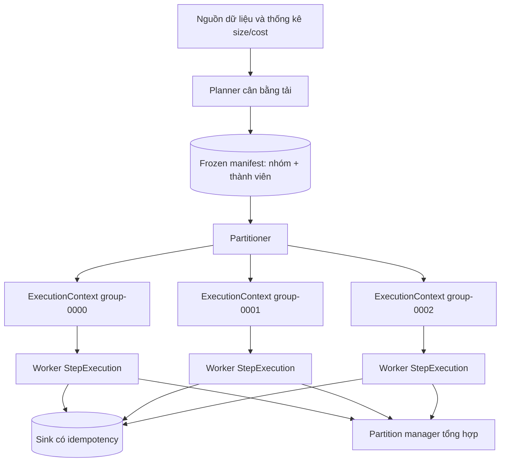
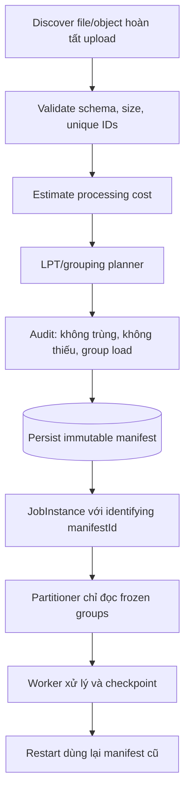

# Chia đều theo kích thước dữ liệu

## 1. Vì sao chia đều theo kích thước lại quan trọng?

Một job Spring Batch cần đọc 1.000 file để nhập dữ liệu vào warehouse. Nếu mỗi file là một partition, các file 1 MB có thể hoàn tất trong vài giây, nhưng một file 100 GB giữ một worker hàng giờ. Khi các worker khác đã rảnh, **job vẫn phải chờ partition chậm nhất**. Tăng số thread từ 8 lên 32 không tự làm file 100 GB được chia thành 32 công việc.

**Chia đều theo kích thước dữ liệu** (*size-balanced data partitioning*) là cách xây dựng các **partition logic có lượng việc ước lượng gần nhau**, thay vì chỉ chia theo số lượng file, số tenant, số khoảng ID hoặc số partition vật lý bằng nhau.

Trong module **SPRING_BATCH_SCALING_OPERATIONS**, chiến lược này giúp mở rộng workload dữ liệu lớn bằng partitioning, đồng thời giữ được thread safety, retry/restart và khả năng vận hành. Trọng tâm là **cân bằng công việc thực**, không đơn thuần làm mọi nhóm có cùng số byte.

> **Một partition có kích thước bằng nhau chưa chắc chạy nhanh như nhau.** Chi phí xử lý còn phụ thuộc số bản ghi, định dạng, nén, SQL, API, dữ liệu lệch và băng thông từng nguồn.

### Mục tiêu học tập

Sau bài này, bạn có thể:

1. Phân biệt kích thước dữ liệu, số record, **chi phí ước lượng** và thời gian hoàn thành thực.
2. Chọn cách phân nhóm file nhỏ, tách file lớn hoặc chia range ID mà không làm mất/trùng dữ liệu.
3. Áp dụng thuật toán **Largest Processing Time first (LPT)** cho nhiều file độc lập.
4. Viết `Partitioner` dựa trên **manifest đã đóng băng**, kết hợp `ExecutionContext` và `@StepScope`.
5. Tách rõ **số partition được tạo** khỏi **mức concurrency của `PartitionHandler`**.
6. Đo skew, straggler, bottleneck và đánh giá retry/restart trước khi đưa vào production.

## 2. Ba đại lượng khác nhau: dữ liệu, công việc và concurrency

| Đại lượng | Ví dụ | Ý nghĩa |
| --- | --- | --- |
| **Data size** | 300 GB, 40.000.000 records | Khối lượng dữ liệu nguồn cần xử lý |
| **Work partition** | `group-0003` gồm 12 file | Một đơn vị quản lý, trạng thái và restart của Spring Batch |
| **Concurrency** | Pool 4 worker | Số partition tasks thực sự có thể chạy đồng thời tại executor |

Ví dụ: 400 file được gom thành **20 nhóm**; manager tạo 20 `StepExecution`, còn `ThreadPoolTaskExecutor` với `core=max=4` chỉ có **tối đa 4 worker threads** cho các task của pool này. Con số 20 không phải 20 thread, và `gridSize(4)` không bắt buộc một `Partitioner` tùy biến phải tạo đúng bốn nhóm.

Trong mô hình Spring Batch partitioning:



**Hai thời điểm cần tách biệt:**

- **Lập kế hoạch:** đo kích thước/chi phí, tính grouping, ghi manifest **một lần** và xác minh tính đầy đủ.
- **Thực thi/restart:** `Partitioner` tải **chính manifest đó** rồi cấp context cho worker; không tự cân bằng lại bằng danh sách dữ liệu mới mỗi lần khởi động.

Đây là ranh giới giúp việc tối ưu performance không phá khả năng restart.

## 3. “Đều” nên dựa trên chỉ số nào?

Đừng bắt đầu bằng việc chia `totalBytes / N` mà chưa đo phần xử lý tốn thời gian nhất.

| Tiêu chí | Khi nào phù hợp | Hạn chế |
| --- | --- | --- |
| **Byte size** | Copy file, đọc object, parsing có chi phí gần tuyến tính theo byte | Compression và số record làm lệch chi phí |
| **Record count** | Processor làm thao tác gần như cố định cho mỗi item | Độ dài record/chi phí API có thể thay đổi |
| **ID/time range** | Dữ liệu database có chỉ mục, phân bố tương đối đều | Khoảng ID bằng nhau không có nghĩa số row bằng nhau |
| **Estimated processing time** | Có số liệu quá khứ về bytes/s, rows/s, API latency | Dự báo có sai số; phải hiệu chỉnh sau mỗi batch |
| **Độ nóng của key/tenant** | Có nhóm dữ liệu đặc biệt nặng | Cần giữ ordering và isolation, khó gộp tùy ý |
| **Số file/object** | Các file nhỏ gần bằng nhau | Một file lớn phá cân bằng toàn bộ |

Một mô hình ước lượng tham khảo:

```text
estimatedSeconds =
    fixedOpenCostSeconds
  + uncompressedBytes / measuredParseBytesPerSecond
  + estimatedRecords * measuredProcessingSecondsPerRecord
  + estimatedExternalCalls * expectedCallSeconds
```

Mô hình này chỉ là **xấp xỉ để xếp hạng công việc**, không phải công thức Spring Batch hay dự báo chính xác. Nếu processor gọi API theo batch, chi phí không tuyến tính theo số record; nếu HTTP latency biến động theo thời gian, dùng P95, dữ liệu lịch sử và headroom khi lập kế hoạch.

### 3.1. Dữ liệu nén làm méo chỉ số size

Hai file cùng 1 GB có thể hoàn toàn khác nhau:

- File CSV không nén: 1 GB đọc từ disk và parse trực tiếp.
- File GZIP 1 GB: sau giải nén có thể thành 8 GB; thời gian CPU parse và số record lớn hơn.
- File Parquet 1 GB: column pruning và predicate pushdown có thể chỉ đọc một phần cột/row group.

Nếu có metadata `uncompressedBytes` và `recordCount`, thường nên đưa chúng vào estimation. **Không suy ra kích thước sau giải nén từ compressed file size bằng một hằng số chung cho mọi nguồn.**

### 3.2. Mục tiêu cân bằng là thời điểm hoàn tất

Với N worker độc lập và mỗi task có thời gian dự kiến `t_i`, mốc thấp nhất về lý thuyết (bỏ qua overhead và contention) là:

```text
lowerBound >= max(
    tổng estimatedSeconds của tất cả task / N,
    estimatedSeconds của task lớn nhất không thể chia nhỏ
)
```

Không thuật toán grouping nào có thể làm một task **không chia được** có thời gian 40 phút hoàn thành trong 10 phút chỉ bằng cách đặt thêm worker chờ.

## 4. Ví dụ: cân bằng 12 file vào bốn nhóm

Giả sử 12 file độc lập có kích thước (GB):

```text
19, 18, 17, 16, 12, 11, 10, 9, 8, 7, 6, 5
Tổng = 138 GB; bốn worker => trung bình lý tưởng 34,5 GB/worker.
```

Một cách lập nhóm **Largest Processing Time first (LPT)**:

1. Sắp file theo kích thước ước lượng **giảm dần**.
2. Khởi tạo bốn nhóm rỗng.
3. Với từng file, gán vào nhóm đang có **tổng size nhỏ nhất**.
4. Khi hòa, chọn group ID nhỏ hơn để kết quả **deterministic**.
5. Ghi kết quả vào manifest, giữ nguyên cho mọi lần restart.

| Group | Các file (GB) | Tổng |
| --- | --- | ---: |
| `group-0000` | 19 + 9 + 8 | 36 GB |
| `group-0001` | 18 + 10 + 7 | 35 GB |
| `group-0002` | 17 + 11 + 6 | 34 GB |
| `group-0003` | 16 + 12 + 5 | 33 GB |
| **Tổng** | **12 file, không trùng** | **138 GB** |

Nhóm nặng nhất 36 GB, nhóm nhẹ nhất 33 GB. Nếu thời gian xử lý gần tỷ lệ số byte và các worker có năng lực như nhau, mức lệch này thường dễ chấp nhận hơn cách chia ngẫu nhiên.

**LPT là heuristic, không bảo đảm tối ưu tuyệt đối.** Nó giúp cân bằng tương đối nhanh cho nhiều item có kích thước đã biết. Nên so sánh với cách đơn giản nhất trên dữ liệu thực, đặc biệt khi nhiều task có I/O bottleneck chung.

### 4.1. Trường hợp một file quá lớn

Với bốn worker và các file:

```text
40, 22, 16, 12, 8, 6, 4, 2, 1, 1 (GB)
Tổng 112 GB, trung bình 28 GB/worker.
```

**Không nhóm nào có thể nhẹ hơn 40 GB** nếu file 40 GB phải nằm trọn trong một partition. Do đó lower bound là 40 GB, không phải 28 GB. Muốn giảm critical path phải:

- Tách file 40 GB theo **ranh giới record hợp lệ**, nếu format cho phép.
- Tối ưu parser, giảm overhead và I/O của chính file lớn.
- Chuyển định dạng để có row groups/block/splittable shards ngay ở nguồn.
- Hoặc chấp nhận đây là straggler và chọn SLA tương ứng.

Không nên tự chia `byteOffset` của CSV có quoted newlines hay GZIP stream tùy ý: dễ mất/trùng dòng, lỗi encoding và checkpoint không khôi phục đúng.

## 5. Chuẩn bị manifest bất biến trước khi partition

Một `Partitioner` được phép nhận `gridSize` và trả một `Map<String, ExecutionContext>`. Nhưng **lập lại thuật toán cân bằng khi restart** có thể biến `group-0002` từ tập file A/B/C thành tập D/E/F vì kích thước, số file hoặc thứ tự scan thay đổi.

### 5.1. Manifest mẫu

```json
{
  "businessBatchId": "ingest-2026-11-26",
  "manifestId": "size-balanced-v1",
  "algorithmVersion": "LPT-1",
  "groups": [
    {
      "groupId": "group-0000",
      "estimatedBytes": 38654705664,
      "inputs": [
        {"sourceId": "source-a", "path": "/data/ready/a.csv", "sizeBytes": 20401094656},
        {"sourceId": "source-b", "path": "/data/ready/b.csv", "sizeBytes": 18253611008}
      ]
    },
    {
      "groupId": "group-0001",
      "estimatedBytes": 30064771072,
      "inputs": [
        {"sourceId": "source-c", "path": "/data/ready/c.csv", "sizeBytes": 30064771072}
      ]
    }
  ]
}
```

Số liệu trong JSON **chỉ minh họa cấu trúc**, không phải đầu ra của bảng 12 file ở mục trước. Để tránh metadata không nhất quán, công cụ tạo manifest thật phải kiểm tra `estimatedBytes` có bằng tổng size của các entry hay không và có đúng size/version thực tế.

Một manifest production nên lưu tối thiểu:

- `manifestId`, `businessBatchId`, **algorithmVersion** và phiên bản input snapshot.
- `groupId`, danh sách `sourceId`, input URI/định danh bất biến, thứ tự đọc đã xác định.
- Size, checksum đáng tin cậy hoặc object version/generation; optional record count, estimated cost.
- Quy tắc **không trùng/không sót**: một input xuất hiện đúng một lần trong các group của batch.
- Phiên bản parser/schema và chính sách lỗi đối với file thiếu hoặc bị đổi.
- Địa điểm lưu an toàn, phân quyền và retention đủ cho tất cả JobInstance còn có thể restart.

**Đừng lưu toàn bộ manifest vào `ExecutionContext` của từng partition.** Nó được persist trong `JobRepository`, có thể phình to và gây khó khăn cho serialization. Context chỉ cần `manifestId` và `groupId`, cùng một vài số liệu nhỏ.

### 5.2. Khi nào chốt manifest?

Một chu trình thích hợp:



**Nếu input tiếp tục thay đổi:** file mới phải thuộc manifest/batch mới, hoặc cần một cơ chế version/snapshot chính thức. Đừng scan thư mục lần nữa để “bổ sung file còn thiếu” trong khi restart cùng JobInstance; điều đó làm ý nghĩa checkpoint thay đổi.

### 5.3. Nguồn object storage

Một object `s3://bucket/key` có thể bị overwrite. Nếu source thay đổi giữa hai lần restart, checkpoint theo dòng hoặc byte sẽ trỏ tới dữ liệu khác. Pin object version ID (nếu hỗ trợ) hoặc dùng immutable key; xác minh checksum/size trước khi đọc. Với S3, ETag **không luôn là MD5 toàn object** (ví dụ multipart upload), nên không coi nó là checksum toàn vẹn mà chưa xét cách upload và server-side encryption.

Đối với remote workers, đường dẫn local của manager như `C:\\data\\file.csv` **không tự tồn tại ở worker pod khác**. Cần shared filesystem hoặc object-store reader có quyền truy cập và version phù hợp.

## 6. Java: thuật toán LPT có tính xác định

Đoạn mã sau chỉ làm **planning**. Nó chưa tạo `StepExecution` và phải được chạy **trước khi chốt manifest**. Đầu vào là các file độc lập, mỗi file có ID ổn định, đường dẫn đã được allowlist và số byte đã xác minh. Mỗi nhóm được trả về theo thứ tự deterministic.

```java
record InputFile(String sourceId, String path, long sizeBytes) {}

record FileGroup(
        String groupId,
        List<InputFile> files,
        long estimatedBytes) {}

final class SizeBalancedPlanner {

    static List<FileGroup> plan(List<InputFile> input, int requestedGroups) {
        if (requestedGroups <= 0) {
            throw new IllegalArgumentException("requestedGroups must be > 0");
        }
        if (input.isEmpty()) {
            return List.of();
        }

        Set<String> seen = new HashSet<>();
        for (InputFile file : input) {
            if (file.sourceId() == null || file.sourceId().isBlank()
                    || file.path() == null || file.path().isBlank()
                    || file.sizeBytes() < 0
                    || !seen.add(file.sourceId())) {
                throw new IllegalArgumentException("Invalid or duplicate input");
            }
        }

        List<InputFile> ordered = new ArrayList<>(input);
        ordered.sort(
            Comparator.comparingLong(InputFile::sizeBytes).reversed()
                      .thenComparing(InputFile::sourceId));

        int groupCount = Math.min(requestedGroups, ordered.size());
        List<List<InputFile>> bins = new ArrayList<>();
        long[] loads = new long[groupCount];

        for (int i = 0; i < groupCount; i++) {
            bins.add(new ArrayList<>());
        }

        for (InputFile file : ordered) {
            int target = 0;
            for (int i = 1; i < groupCount; i++) {
                if (loads[i] < loads[target]) {
                    target = i;
                }
            }
            bins.get(target).add(file);
            loads[target] = Math.addExact(loads[target], file.sizeBytes());
        }

        List<FileGroup> result = new ArrayList<>();
        for (int i = 0; i < groupCount; i++) {
            result.add(new FileGroup(
                String.format(Locale.ROOT, "group-%04d", i),
                List.copyOf(bins.get(i)),
                loads[i]));
        }
        return List.copyOf(result);
    }
}
```

**Điểm mạnh của ví dụ:**

- File được xếp theo size giảm dần; cùng size được sắp theo `sourceId` để không phụ thuộc thứ tự liệt kê filesystem.
- Khi hai group có tổng size bằng nhau, vòng lặp chọn group index nhỏ hơn; lập kế hoạch lặp với cùng dữ liệu/version cho kết quả giống nhau.
- `Math.addExact` phát hiện overflow `long` thay vì âm thầm tạo số byte âm.
- Mỗi input chỉ gán vào đúng một bin; ID trùng bị từ chối.

**Những giới hạn phải nhớ:**

1. Code **không** tự lưu manifest, không đọc file, không xác thực path quyền truy cập và không bảo đảm input không bị thay đổi sau planning.
2. Group size được tính theo `sizeBytes`, chưa xét số record/CPU/API. Có thể thay weight bằng **estimatedMillis** được tính trước, nhưng phải version hóa thuật toán và các thống kê.
3. Không được chạy `plan(...)` lại với số `requestedGroups` khác trong **cùng JobInstance đã có checkpoint**.
4. Với số lượng cực lớn, sắp xếp tốn `O(F log F)` cho F file; đây là chi phí lập kế hoạch, không nên nằm trong hot path của từng worker.
5. Không dùng `sourceId` chứa dữ liệu nhạy cảm hoặc path từ client chưa xác thực làm log/partition name.

### 6.1. Kiểm tra kết quả trước khi lưu manifest

Sau planning, xác minh:

```text
1. Tổng số source IDs trong groups = tổng source IDs của input.
2. Mỗi source ID xuất hiện đúng một lần.
3. Tổng estimatedBytes(groups) = tổng sizeBytes(input).
4. Group IDs là duy nhất và không rỗng.
5. Group nào cũng có ít nhất một input (trừ trường hợp input ban đầu rỗng).
6. Không có input trỏ tới object version/path ngoài tập đã duyệt.
```

Nếu có file không đọc được hoặc size không còn khớp, **fail preflight trước khi Job bắt đầu**; đừng tiếp tục với manifest “xấp xỉ đủ tốt” cho dữ liệu nghiệp vụ bắt buộc đầy đủ.

## 7. Tạo Partitioner từ các nhóm đã chốt

Đừng để `Partitioner.partition(gridSize)` vừa scan nguồn, vừa tính lại LPT và thay đổi grouping khi job restart. Một cách tách trách nhiệm:

- **Planner:** tính LPT, lưu manifest bất biến.
- **Partitioner:** đọc các **FileGroup đã chốt** và tạo `ExecutionContext` nhỏ.
- **Worker:** lấy `manifestId + groupId` để mở đúng tài nguyên theo snapshot.

```java
final class FrozenFileGroupPartitioner implements Partitioner {

    private final String manifestId;
    private final List<FileGroup> frozenGroups;

    FrozenFileGroupPartitioner(
            String manifestId,
            List<FileGroup> frozenGroups) {
        this.manifestId = manifestId;
        this.frozenGroups = List.copyOf(frozenGroups);
    }

    @Override
    public Map<String, ExecutionContext> partition(int gridSize) {
        Map<String, ExecutionContext> contexts = new LinkedHashMap<>();

        for (FileGroup group : frozenGroups) {
            ExecutionContext context = new ExecutionContext();
            context.putString("manifestId", manifestId);
            context.putString("groupId", group.groupId());
            context.putLong("estimatedBytes", group.estimatedBytes());

            if (contexts.putIfAbsent(group.groupId(), context) != null) {
                throw new IllegalStateException(
                    "Duplicate group ID: " + group.groupId());
            }
        }
        return contexts;
    }
}
```

Nếu manifest có 20 groups, implementation này tạo **20 partition contexts**, dù `gridSize=4`. `gridSize` là tham số gợi ý của SPI và chỉ có tác dụng thực tế khi implementation sử dụng nó; không phải một bộ giới hạn tài nguyên cứng.

**Không coi `estimatedBytes` là khóa định danh:** kích thước có thể đổi khi nguồn mutable. `manifestId` và `groupId` xác định **chính xác cùng tập input**. Khi restart, các worker `StepExecution` đã hoàn tất thường không chạy lại, còn partition `FAILED` xử lý theo checkpoint; đổi thành viên group trong lúc đó có thể gây mất/trùng dữ liệu.

### 7.1. PartitionNameProvider: tối ưu trong một số trường hợp

Spring Batch hỗ trợ `PartitionNameProvider` để có thể chỉ lấy tên partition trên restart, tránh việc tạo lại context quá đắt. Nếu muốn triển khai, tên trả về **phải khớp chính xác** với các key của `partition(...)`. Nó không cho phép lập lại grouping mới rồi tái sử dụng tên cũ.

### 7.2. Giới hạn số partition rất lớn

Với 100.000 file, planner có thể gộp chúng thành 64 hoặc 256 groups thay vì 100.000 `StepExecution` riêng lẻ. Cân bằng giữa:

- **Group quá lớn:** một lỗi gần cuối nhóm khiến việc khôi phục kéo dài, khó tách straggler.
- **Group quá nhỏ:** chi phí metadata, mở reader, transaction và dispatch tăng.
- **Quá nhiều group so với pool:** queue có thể quá tải nếu handler submit dồn dập; chọn `PartitionHandler`/admission strategy có giới hạn.

Không mặc định tăng `queueCapacity` lên 100.000 là giải pháp. Queue lưu task, không tạo năng lực xử lý tương ứng.

## 8. @StepScope: worker đọc đúng nhóm dữ liệu

Một `ExecutionContext` có `manifestId` và `groupId` phải được giải ra danh sách file đúng khi worker bắt đầu. Ví dụ dưới đây chỉ áp dụng cho **filesystem local/shared mount**; với S3/Azure/GCS cần resource/reader adapter thực sự hỗ trợ loại URI đó.

### 8.1. Giao diện truy xuất manifest

Đây là contract ứng dụng **cần tự hiện thực** (database/object store có phân quyền), không phải interface có sẵn trong Spring Batch:

```java
interface FrozenManifestStore {
    // Trả các file đúng group thuộc manifest immutable đã xác minh.
    // Danh sách phải có thứ tự ổn định qua các lần restart.
    List<InputFile> filesFor(String manifestId, String groupId);
}

record InvoiceRow(String invoiceId, BigDecimal amount) {}
```

### 8.2. MultiResourceItemReader theo group

```java
@Bean("balancedGroupReader")
@StepScope
MultiResourceItemReader<InvoiceRow> balancedGroupReader(
        FrozenManifestStore store,
        @Value("#{stepExecutionContext['manifestId']}") String manifestId,
        @Value("#{stepExecutionContext['groupId']}") String groupId) {

    List<InputFile> entries = store.filesFor(manifestId, groupId);
    if (entries.isEmpty()) {
        throw new IllegalStateException("Empty frozen file group");
    }

    Resource[] resources = entries.stream()
            .map(file -> new FileSystemResource(file.path()))
            .toArray(Resource[]::new);

    FlatFileItemReader<InvoiceRow> delegate =
            new FlatFileItemReaderBuilder<InvoiceRow>()
                    .name("invoiceCsvDelegate")
                    .linesToSkip(1)
                    .delimited()
                    .names("invoiceId", "amount")
                    .fieldSetMapper(fs -> new InvoiceRow(
                            fs.readString("invoiceId"),
                            fs.readBigDecimal("amount")))
                    .build();

    MultiResourceItemReader<InvoiceRow> reader =
            new MultiResourceItemReader<>();
    reader.setName("balancedGroupReader");
    reader.setResources(resources);
    reader.setDelegate(delegate);
    reader.setComparator(Comparator.comparing(Resource::getDescription));
    reader.setSaveState(true);
    return reader;
}
```

Đây là ví dụ Java với các API phổ biến của Spring Batch 5.x; các import và bean infrastructure được lược bỏ. `FileSystemResource` dùng cho file local/shared mount, **không** tự mở cloud object URI. Với object storage, cần SDK/Resource chuyên dụng và cơ chế checkpoint phù hợp.

**Điểm cần kiểm chứng trong test tích hợp:**

1. `store.filesFor(...)` đọc manifest bất biến, trả đúng group, không nhận path từ yêu cầu không tin cậy.
2. Toàn bộ file còn tồn tại và **checksum/version/size phù hợp**; nếu không, báo lỗi thay vì đọc sai.
3. `MultiResourceItemReader` cần thứ tự resource ổn định khi lưu và khôi phục checkpoint; comparator của ví dụ dựa trên description của Resource, phải có **thứ tự toàn phần ổn định**. Nếu hai Resource có description giống nhau, tạo một khóa duy nhất từ manifest và sắp xếp xác định.
4. Reader lưu state với `setSaveState(true)`; với dữ liệu đã thay đổi, state không còn đủ để restart đúng.
5. `@StepScope` tạo bean **theo StepExecution**, nhờ vậy các partition không chia sẻ cùng reader/cursor. Một processor/writer singleton vẫn phải được kiểm tra thread safety nếu chạy ở nhiều partition.
6. Nếu mỗi file đều có header, `linesToSkip(1)` cần được xác nhận hoạt động đúng theo logic delegate khi reader chuyển resource; test nhiều file, file trống và file thiếu header.

### 8.3. Đừng gộp file theo cách mất thông tin nguồn

Trong một group có nhiều file, khi cùng một `invoiceId` xuất hiện ở hai nguồn có thể là lỗi trùng, record hợp lệ hoặc phiên bản mới. Cần quy định business key rõ ràng.

Nếu writer idempotent theo `invoiceId`, phải đảm bảo ID thực sự unique ở phạm vi đó. Nếu không, dùng khóa ghép như `sourceSystem + sourceRecordId + sourceVersion` hoặc áp chính sách dedup đã thống nhất. Không giả định file nào xử lý trước luôn đúng nếu thứ tự load được thiết kế cho hiệu năng.

## 9. Ghép thành local partitioned Step

Một ví dụ local partitioning Spring Batch **5.x** gồm worker step, executor có giới hạn và manager step. Các bean `FrozenManifestStore`, `Partitioner` và `ItemWriter` phải do ứng dụng cung cấp.

### 9.1. Worker step

```java
@Bean("balancedFileWorkerStep")
Step balancedFileWorkerStep(
        JobRepository jobRepository,
        PlatformTransactionManager transactionManager,
        @Qualifier("balancedGroupReader")
            ItemStreamReader<InvoiceRow> reader,
        ItemWriter<InvoiceRow> writer) {

    return new StepBuilder("balancedFileWorkerStep", jobRepository)
            .<InvoiceRow, InvoiceRow>chunk(100, transactionManager)
            .reader(reader)
            .writer(writer)
            .build();
}
```

`chunk(100)` là kích thước chunk, không phải số partition hay số thread. Writer nên dùng transaction, unique constraint/UPSERT và idempotency theo nghiệp vụ; `JobRepository` quản lý checkpoint nhưng **không bảo đảm exactly-once cho mọi external API/file side effect**.

### 9.2. Executor có giới hạn

```java
@Bean("sizeBalancedExecutor")
ThreadPoolTaskExecutor sizeBalancedExecutor() {
    ThreadPoolTaskExecutor executor = new ThreadPoolTaskExecutor();
    executor.setThreadNamePrefix("size-balanced-");
    executor.setCorePoolSize(4);
    executor.setMaxPoolSize(4);
    executor.setQueueCapacity(16);
    return executor;
}
```

Nếu planner tạo 20 groups và executor có bốn worker, có thể có tối đa **bốn worker tasks chạy đồng thời trong pool này** và 16 task chờ. Trong thực tế submission, timing và partition handler quyết định việc queue có đầy/reject hay không.

Đừng bật `CallerRunsPolicy` nếu yêu cầu nghiêm ngặt trần bốn **flow/partition tasks nghiệp vụ**: khi pool đầy, thread submit có thể tự chạy task ngoài worker pool, khiến tổng concurrency thực tế vượt giả định.

### 9.3. Manager step

```java
@Bean("balancedFileManagerStep")
Step balancedFileManagerStep(
        JobRepository repository,
        @Qualifier("balancedFileWorkerStep") Step worker,
        @Qualifier("sizeBalancedPartitioner") Partitioner partitioner,
        @Qualifier("sizeBalancedExecutor") TaskExecutor executor) {

    return new StepBuilder("balancedFileManagerStep", repository)
            .partitioner(worker.getName(), partitioner)
            .step(worker)
            .gridSize(4)
            .taskExecutor(executor)
            .build();
}
```

Ví dụ này áp dụng cú pháp Spring Batch 5.x `chunk(size, transactionManager)`. Ở Spring Batch 6.x, API chunk builder có thay đổi như `chunk(size).transactionManager(transactionManager)`; hãy kiểm tra dependency trước khi sao chép code. Khái niệm partition manager/worker, `ExecutionContext` và late binding giữ nguyên.

**Lưu ý quan trọng:** `.gridSize(4)` không tự cắt 20 frozen groups thành bốn partition vì `FrozenFileGroupPartitioner` cố tình bỏ qua tham số. Muốn giảm số group phải **lập kế hoạch mới cho một business batch mới** hoặc dùng manifest đã chốt khác trước khi job bắt đầu; không thay mapping trong lúc restart.

### 9.4. Nếu partition quá nhiều

Một handler/executor có thể submit nhiều `StepExecution` gần cùng lúc. Với queue nhỏ, `TaskRejectedException` có thể xảy ra trước khi toàn bộ partitions được xử lý. Vì vậy cần:

- Chọn số group có cân nhắc tới **dispatch capacity**.
- Kiểm tra semantics thực tế của `PartitionHandler` và `gridSize` trong phiên bản đang dùng.
- Dùng grouping, bounded dispatch hoặc custom handler được kiểm thử nếu số partition rất lớn.
- Không âm thầm discard task hay tạo queue vô hạn để “làm cho job hết lỗi”.

## 10. Cân bằng file nhỏ, file lớn và định dạng đặc biệt

### 10.1. Rất nhiều file nhỏ

50.000 file 20 KB có tổng chỉ khoảng 1 GB, nhưng nếu mỗi file một partition thì metadata và open/close I/O có thể chiếm phần lớn runtime.

**Giải pháp:** gom các file nhỏ thành groups theo **cả tổng size và chi phí mở file**. Một heuristic đơn giản:

```text
weight(file) =
    estimatedReadSeconds
  + estimatedParseSeconds
  + fixedFileOpenSeconds
```

LPT theo trọng số này thường hiệu quả hơn cân bằng bytes thuần nếu `fileOpenSeconds` đáng kể. Khi nhóm có nhiều file nhỏ, reader phải lưu trạng thái **file hiện tại + vị trí trong file**, không chỉ tổng số item trong toàn group mà chưa bảo đảm thứ tự.

### 10.2. Một file cực lớn

Tách theo bytes có thể hợp lý cho **định dạng có biên block/record được xác định**:

| Định dạng | Khả năng chia nhỏ | Điều phải kiểm tra |
| --- | --- | --- |
| Plain text một record/dòng, không quoted newline | Có thể chia theo line offset nếu có index và xử lý biên đúng | UTF-8 nhiều byte, CRLF, dòng đầu/cuối |
| CSV có multiline quoted fields | Không cắt byte tùy ý | Phải tìm ranh giới **record CSV**, không chỉ `newline` |
| JSON Lines | Có thể tách theo newline khi mỗi dòng là một JSON độc lập | Encoding và record boundary |
| GZIP thường | Không seek tùy ý rồi giải nén từ giữa stream | Cần block/index/splittable compression hoặc chia trước khi nén |
| Parquet/ORC | Có row groups/stripes nếu reader hỗ trợ | Predicate pushdown, column/row-group semantics |
| Database table | Có thể chia theo ID/time/keyset | Range không chồng lấn, snapshot, index và row density |

Nếu buộc phải tách một object thành nhiều ranges, context nên lưu `objectVersion`, `startOffsetInclusive`, `endOffsetExclusive` hoặc record group identifiers. Reader phải xử lý biên chính xác và checkpoint trong từng range. **HTTP Range GET chỉ trả byte range, không xác nhận byte đó là đầu record.**

### 10.3. Dữ liệu có phụ thuộc thứ tự

Một pipeline tính số dư theo từng tài khoản không thể đưa giao dịch của cùng tài khoản vào các groups tùy ý chỉ để đều số bytes. Nếu item sau phụ thuộc item trước, cần chia theo **khóa đảm bảo tính độc lập** (ví dụ account), và giữ thứ tự trong từng khóa. Cân bằng bytes là **mục tiêu phụ sau correctness**, không được làm thay đổi kết quả nghiệp vụ.

## 11. Retry/restart khi group có nhiều nguồn

### 11.1. Partition identity phải ổn định

Ví dụ lần chạy đầu:

```text
JobInstance: invoiceImport(manifestId=size-balanced-v1)

balancedFileWorkerStep:group-0000  COMPLETED
balancedFileWorkerStep:group-0001  FAILED
balancedFileWorkerStep:group-0002  COMPLETED
balancedFileWorkerStep:group-0003  COMPLETED
```

Khi restart cùng `JobInstance`, Spring Batch thường **không chạy lại** các partition đã `COMPLETED` theo mặc định, còn partition lỗi được thực thi lại theo checkpoint/logic recovery. Nếu lần restart `group-0001` bỗng chứa tập file khác trước vì planner chạy lại, checkpoint có thể áp lên **sai file**, gây đọc trùng/bỏ sót.

**Không làm:** `new SizeBalancedPlanner(...).plan(listDirectoryNow(), gridSize)` trực tiếp mỗi lần `partition(...)` được gọi cho một JobInstance đã có lịch sử.

**Nên làm:** `manifestStore.load(manifestId)` trả chính xác các nhóm đã đóng băng, kiểm tra checksum/version trước khi mở từng resource.

### 11.2. Transaction không bao trùm toàn group

Với chunk-oriented worker:

- Chunk trước có thể đã commit.
- Chunk sau có thể fail giữa file thứ ba.
- Người vận hành restart group, không có rollback tự động toàn bộ những file đã commit trước đó.
- Nếu writer gọi API ngoài DB, side effect có thể xảy ra dù metadata checkpoint chưa được cập nhật.

Vì vậy cần:

1. **ItemStream checkpoint** phù hợp với reader nhiều file/record.
2. **Business key/idempotency** cho writer; unique constraint hoặc UPSERT đúng phạm vi.
3. **Frozen source:** cùng file bytes/order/schema khi restart.
4. **Retry có giới hạn** và phân loại transient/permanent; đừng retry vô hạn file hỏng.
5. **Đối soát:** tập source IDs, số record theo file, số output unique và tổng nghiệp vụ.

### 11.3. Nhóm lớn giảm metadata nhưng tăng phạm vi phải khôi phục

Nếu một group có 100 file và reader checkpoint tốt, một lỗi có thể tiếp tục ở file/dòng đang xử lý. Tuy nhiên **đừng giả định** mọi reader/transformer và external side effect đều cung cấp checkpoint an toàn. Khi không có checkpoint chi tiết, replay group lớn sẽ tốn thời gian và tăng nguy cơ duplicate.

Vì thế “chia đều bytes” không đủ để quyết định granularity: cần xét **thời gian phục hồi tối đa** khi một group fail, không chỉ runtime bình thường.

## 12. Thread safety, backpressure và giới hạn tài nguyên

Một partitioned step cục bộ có thể mở nhiều reader/writer ở các worker khác nhau. Dù các nhóm cân bằng, nguồn/đích vẫn chia sẻ CPU, disk và connections.

| Resource | Dấu hiệu bão hòa | Cách ứng phó |
| --- | --- | --- |
| CPU | Core gần 100%, GC tăng | Tối ưu parse/processor, giảm số worker hoặc tăng CPU thực |
| Disk/object storage | Throughput không tăng, 429/503, IOPS chạm trần | Giảm concurrency, giới hạn request, cache/format hợp lý |
| DB | Pending connections, lock waits, deadlocks | Giảm workers, tối ưu SQL, batch write, tăng capacity hợp lý |
| Heap | Queue/backlog lớn, allocation rate cao | Bounded queue, streaming, giới hạn items buffer |
| Network | Băng thông đạt trần, timeout tăng | Phân bổ bandwidth, giảm tải, điều tiết retry |
| `JobRepository` | Metadata/StepExecution quá nhiều | Gộp file nhỏ, giảm số partition hoặc tối ưu repository |
| API downstream | 429/rate-limit, p95 tăng | Per-API quota/semaphore/rate limiter, backoff |

**`@StepScope` không biến mọi bean dùng chung thành thread-safe.** Reader stateful theo partition là tốt; processor singleton có mutable state hoặc writer chia sẻ `Connection` vẫn có thể race. `Transaction` gắn với thread, và các side effect qua HTTP không tự rollback theo DB.

### 12.1. Nhiều pod hoặc executor con

Pool `max=4` chỉ giới hạn bốn worker threads **của một pool instance**. Với 5 pod độc lập có cùng pool, tổng khả năng chạy có thể lên tới 20 worker tasks. Nếu mỗi worker mở thêm executor, số HTTP calls/JDBC connections có thể lớn hơn nữa. Đặt quota ở resource dùng chung nếu cần giới hạn toàn cụm.

### 12.2. Kích thước group không thay cho backpressure

Một nhóm 30 GB và một nhóm 31 GB vẫn có thể khiến API bị quá tải nếu cả hai worker gọi API không hạn chế. Balancing giải quyết **phân phối công việc**, còn backpressure giải quyết **năng lực tiếp nhận và tiêu thụ**. Hệ thống production cần cả hai.

## 13. Đo độ lệch và tìm điểm cân bằng

### 13.1. Các metric quan trọng

- `estimated_bytes_per_group` và `actual_bytes_per_group`.
- `estimated_seconds_per_group` và `actual_seconds_per_group`.
- `partition_duration_seconds`, `readCount`, `writeCount`, `skipCount`, `commitCount`.
- `worker_active_count`, queue depth, rejection, idle time.
- `source_read_bytes_per_second`, DB write latency, API p95/p99.
- Number of files/group, resource open overhead và GC/heap.
- Thời gian **straggler**: partition cuối cùng hoàn thành sau khi nhiều worker đã rảnh.
- Độ đúng: số input IDs duy nhất đã xử lý, output unique keys, sum/checksum nghiệp vụ.

Các tên metric chỉ là **đề xuất**, không phải Spring Batch/Micrometer xuất sẵn các tên đó.

### 13.2. Hai cách đo skew

```text
Size skew ratio =
    max(estimatedBytesPerGroup) / mean(estimatedBytesPerGroup)

Runtime skew ratio =
    max(actualDurationPerGroup) / median(actualDurationPerGroup)
```

Với cùng một batch, chỉ số càng gần 1 có thể biểu thị các nhóm cân bằng hơn, nhưng **không có một ngưỡng phổ quát**. Nếu median bằng 0 hoặc có group rỗng, chỉ số phải được định nghĩa lại để tránh chia cho 0. Nếu job có nhiều ngắn, một group dài, cần kết hợp quan sát critical path và worker idle time.

**Đừng tối ưu quá mức size skew** nếu runtime skew đã thấp và database/I/O mới là nút thắt. Khi mọi worker cùng chạm trần DB, cân bằng file đẹp hơn chưa chắc giúp job nhanh hơn.

### 13.3. Benchmark minh họa

Giả sử job phải nhập **240 GB** dữ liệu, cùng source snapshot và infrastructure. Các số dưới đây **chỉ là ví dụ giả định**:

| Chiến lược | Worker | Group count | Runtime | Throughput |
| --- | ---: | ---: | ---: | ---: |
| Một reader tuần tự | 1 | 1 | 240 phút | 1,00 GB/phút |
| Một file/partition, lệch size | 4 | 120 | 112 phút | 2,14 GB/phút |
| LPT theo bytes | 4 | 16 | 78 phút | 3,08 GB/phút |
| LPT theo estimated time | 4 | 16 | 71 phút | 3,38 GB/phút |
| LPT theo estimated time | 8 | 24 | 52 phút | 4,62 GB/phút |
| LPT theo estimated time | 16 | 48 | 55 phút | 4,36 GB/phút |

Bảng không chứng minh thuật toán nào luôn thắng: thay cả thuật toán và số group là **hai biến khác nhau**. Trong benchmark thực, đo từng biến riêng, lặp lại nhiều lượt và giữ môi trường tương đương. Có thể 16 worker chậm hơn 8 vì DB/disk/API contention.

### 13.4. Quy trình đo có thể lặp lại

1. Chốt input manifest, kiểm tra size/record count và business totals.
2. Chạy baseline, đo thời gian theo từng file hoặc một mẫu đại diện.
3. Dùng cùng số worker để so sánh **theo số file**, **theo bytes**, **theo estimated processing time**.
4. Giữ group count giống nhau giữa hai thuật toán khi muốn so sánh thuật toán.
5. Thử 2–4–8 workers với thuật toán cố định để tìm giới hạn resource.
6. Xem scatter plot `estimatedSize → actualDuration`; nếu tương quan thấp, thay mô hình cost.
7. Thử lỗi giữa group, worker crash, file hỏng, missing object, restart và side effect duplicate.
8. Chọn mức đạt SLA có headroom và RTO hợp lý, không chỉ thời gian tốt nhất một lượt.

## 14. Local vs remote partitioning khi dữ liệu lớn

| Tiêu chí | Local partitioning | Remote partitioning |
| --- | --- | --- |
| Chạy worker | Trong một JVM bằng `TaskExecutorPartitionHandler` | Nhiều process/node qua transport/integration |
| Chia nhóm | Từ frozen manifest | Cũng phải dùng frozen manifest |
| Truy cập file local | Có thể chung mount | Không bảo đảm path manager tồn tại ở worker |
| Cấp tài nguyên | CPU/RAM/DB của máy chủ | Thêm pods/nodes, network, broker và quota |
| Restart | `StepExecution`/checkpoint per group | Thêm lỗi giao nhận, worker timeout và correlation |
| Bảo mật | Filesystem ACL, JDBC least privilege | Identity cho từng worker, TLS, broker ACL, object permissions |
| Chi phí | Ít thành phần vận hành | Có overhead transport/coordination |

**Không dùng remote partitioning chỉ vì “dữ liệu lớn”.** Nếu bottleneck là một DB đang chạm IOPS/lock, thêm worker node có thể làm nguồn chậm hơn. Nếu local CPU/RAM đã hết nhưng nguồn hỗ trợ concurrent reads và sink đủ headroom, remote partitioning có thể đem lại lợi ích.

Một remote worker không được nhận credential, token hoặc signed URL có hạn ngắn qua `ExecutionContext` rồi lưu vào `JobRepository`. Nên nhận `manifestId/groupId`, tự tra thông tin và identity theo cơ chế bảo mật của hạ tầng.

## 15. Case study: nhập 80.000 object dữ liệu

Một đội dữ liệu nhập **80.000 object** mỗi đêm từ object storage. Phần lớn object nhỏ dưới 1 MB, một số vài GB; tổng dữ liệu khoảng 1,5 TB. Bản đầu mỗi object một StepExecution, pool tám worker:

- Metadata tạo nhiều entries, mở/đóng object liên tục.
- Một số object lớn chạy rất lâu trong khi phần lớn worker đã rảnh.
- Khi operator restart, listing mới có thêm object, tên partition đánh số cũ có thể gắn file khác.
- DB writer thỉnh thoảng timeout khiến retry tăng.

**Thiết kế cải thiện:**

1. Ở preflight, chỉ đưa object đã upload hoàn tất vào danh sách; gắn version/generation/checksum.
2. Thu thập `sizeBytes`, ước lượng uncompressed bytes, record count và historical processing time.
3. Tạo manifest bất biến với `businessBatchId` và khoảng **64 groups** làm cấu hình thử nghiệm, không coi 64 là con số tối ưu cố định.
4. Dùng LPT theo estimated processing time, nhưng giới hạn cả file count/group để tránh một group chứa quá nhiều open/close operations.
5. Object cực lớn được tách theo row groups/record boundaries nếu reader hỗ trợ; không cắt byte tùy ý.
6. `FrozenFileGroupPartitioner` chỉ lấy `manifestId/groupId`; mỗi worker xử lý danh sách cố định theo thứ tự đã chốt.
7. Giới hạn pool và tổng concurrent object requests; theo dõi storage throttling, DB connections và CPU.
8. Writer dùng business key/unique constraint để xử lý replay sau crash; output staging theo batch ID và publish sau đối soát.
9. Tập trung đo runtime skew và 5–10 groups chạy lâu nhất; điều chỉnh cost model cho batch **tiếp theo**, không tái chia các group của batch đang restart.
10. Benchmark 8/12/16 workers trên tập dữ liệu giống nhau rồi chọn mức đạt SLA và headroom.

Nếu một object không còn đúng version khi worker restart, job phải fail an toàn và báo nguồn bị thay đổi; **không âm thầm lấy bản mới** để hoàn tất partition cũ.

## 16. Những sai lầm phổ biến

| Nhận định | Điều đúng cần nhớ |
| --- | --- |
| “Mỗi partition có bằng nhau số file thì tải sẽ đều.” | Một file 100 GB khác một file 1 MB. |
| “Bằng số byte thì bằng thời gian.” | Record count, compression, API/CPU và I/O có thể khác. |
| “LPT bảo đảm giải tối ưu mọi trường hợp.” | LPT là heuristic; cần benchmark và đo kết quả thực. |
| “Tăng thread sẽ chia file lớn thành phần nhỏ.” | Không; file lớn cần tách ở record/block boundary hợp lệ. |
| “`gridSize(4)` bắt buộc `Partitioner` sinh bốn groups.” | Không; custom partitioner có thể trả số groups khác. |
| “Đọc lại list file mới nhất khi restart cho chính xác hơn.” | Có thể đổi mapping partition và làm checkpoint sai. |
| “Group ID giữ nguyên nhưng thành viên group đổi vẫn ổn.” | Không; StepExecution cũ không còn cùng đơn vị công việc. |
| “Object key và ETag luôn định danh immutable bytes.” | Key có thể overwrite; ETag không luôn là checksum toàn object. |
| “`@StepScope` làm mọi bean thread-safe.” | Scope theo StepExecution; các singleton dùng chung vẫn cần an toàn. |
| “Queue dài sẽ tăng số worker chạy.” | Queue chỉ giữ task đang chờ, không tăng concurrency. |
| “Writer UPSERT là exactly-once end-to-end.” | API, broker và file side effects vẫn cần idempotency/reconciliation. |
| “Chỉ cần runtime trung bình mỗi group.” | Phải xem straggler và thời điểm partition cuối hoàn thành. |
| “Remote partitioning luôn nhanh hơn.” | Bottleneck dùng chung và transport overhead có thể làm chậm hơn. |
| “Cân bằng lại nhóm trong lần restart là tối ưu.” | Đổi grouping có thể làm mất liên kết checkpoint và lặp/mất dữ liệu. |

## 17. Câu hỏi tự kiểm tra

**Câu 1.** Có 12 file trong ví dụ mục 4 và bốn workers. Vì sao LPT đặt file 19 GB vào nhóm đầu tiên, rồi ưu tiên nhóm nhẹ nhất?

*Gợi ý:* File lớn khó ghép về sau; gán từng file vào group có tổng size thấp nhất giúp giảm lệch tải theo heuristic.

**Câu 2.** Có một file 40 GB và toàn bộ dữ liệu 112 GB, bốn workers. Mốc thấp nhất về size-load của nhóm nặng nhất là bao nhiêu khi không được tách file?

*Gợi ý:* Ít nhất 40 GB vì file đó không chia được, dù trung bình toàn bộ là 28 GB.

**Câu 3.** Vì sao một source object mới xuất hiện trước restart không được tự thêm vào manifest của cùng JobInstance?

*Gợi ý:* Nó thay tập dữ liệu và có thể thay mapping/checkpoint; object mới cần batch mới hoặc chiến lược bổ sung dữ liệu được thiết kế có chủ đích.

**Câu 4.** Một nhóm gồm 20 file nhỏ, một nhóm chứa một file gzip 20 GB. Hai nhóm cùng 20 GB nén có phải công việc tương đương?

*Gợi ý:* Không; gzip có thể giải nén ra nhiều dữ liệu, số records/CPU/I/O khác nhau. Cần estimated cost theo workload.

**Câu 5.** Khi `MultiResourceItemReader` restart, yếu tố nào quan trọng ngoài số dòng đã đọc?

*Gợi ý:* Danh sách resource cố định, thứ tự ổn định, nội dung/version của từng file không đổi, trạng thái delegate và transaction/idempotency.

**Câu 6.** Vì sao không nên tăng `queueCapacity` rất lớn nếu 100.000 partitions bị reject?

*Gợi ý:* Queue chỉ hoãn task và làm tăng bộ nhớ/latency; cần điều chỉnh số nhóm, dispatch bounded và downstream capacity.

## 18. Checklist đưa vào production

- [ ] Định nghĩa rõ “kích thước” cần cân bằng: bytes, uncompressed bytes, records hay estimated duration.
- [ ] Đã đo mối liên hệ size/cost với actual runtime trên dữ liệu đại diện.
- [ ] Sử dụng chiến lược grouping deterministic, kiểm tra trùng/thiếu source IDs.
- [ ] Manifest cố định có source identity, object version/checksum, algorithm version và group membership.
- [ ] Không chạy lại thuật toán rebalancing cho JobInstance đã có StepExecution.
- [ ] `ExecutionContext` chỉ giữ manifest/group references nhỏ và an toàn.
- [ ] Worker `@StepScope` có reader/checkpoint riêng; thứ tự file ổn định qua restart.
- [ ] Có giải pháp chia file lớn **chỉ khi** record/row-group boundary hợp lệ.
- [ ] Có chính sách gộp file nhỏ, giới hạn số group và chi phí JobRepository.
- [ ] Worker writer idempotent; external side effects có khóa hoặc quy trình đối soát.
- [ ] `TaskExecutor`/dispatch bounded; có metric queue, rejection, active workers và DB/API quota.
- [ ] Không coi `gridSize` là trần số partition cứng khi partitioner tùy biến.
- [ ] Đã thử mất input, sửa source sau planning, crash sau commit và restart cùng manifest.
- [ ] Có đo runtime skew, straggler duration, worker idle và SLA tổng.
- [ ] Đã benchmark nhiều workload/worker counts và cân nhắc bottleneck hạ tầng.
- [ ] Remote worker có quyền đúng với source/object, không phụ thuộc local path của manager.
- [ ] Publish chỉ sau khi mọi partition cần thiết hoàn tất và dữ liệu được đối soát.

## Tài liệu tham khảo

- [Spring Batch Reference — Scaling and Parallel Processing](https://docs.spring.io/spring-batch/reference/scalability.html): `Partitioner`, `PartitionHandler`, `gridSize` và worker `StepExecution`.
- [Spring Batch 5.2 — Scaling and Parallel Processing](https://docs.spring.io/spring-batch/reference/5.2/scalability.html): Java local partitioning, `TaskExecutorPartitionHandler` và restart.
- [Spring Batch API — PartitionStepBuilder](https://docs.spring.io/spring-batch/docs/current/api/org/springframework/batch/core/step/builder/PartitionStepBuilder.html): `gridSize` là hint cho splitter.
- [Spring Batch API — MultiResourcePartitioner](https://docs.spring.io/spring-batch/reference/api/org/springframework/batch/core/partition/support/MultiResourcePartitioner.html): một resource/partition, bỏ qua `gridSize`; khác với grouping tùy biến.
- [Spring Batch — Late Binding of Job and Step Attributes](https://docs.spring.io/spring-batch/reference/step/late-binding.html): `@StepScope` và `stepExecutionContext`.
- [Spring Batch — Flat File ItemReaders and Writers](https://docs.spring.io/spring-batch/reference/readers-and-writers/flat-files/file-item-reader.html): `FlatFileItemReader` và xử lý file.
- [Spring Batch API — MultiResourceItemReader](https://docs.spring.io/spring-batch/reference/api/org/springframework/batch/item/file/MultiResourceItemReader.html): đọc nhiều resources và trạng thái restart.
- [Spring Batch — Configuring a Step for Restart](https://docs.spring.io/spring-batch/reference/step/chunk-oriented-processing/restart.html): checkpoint, `ItemStream` và restart.
- [Amazon S3 — Checking Object Integrity](https://docs.aws.amazon.com/AmazonS3/latest/userguide/checking-object-integrity-upload.html): checksum và ETag không luôn là MD5 toàn object.

**Ghi nhớ:** chia đều theo kích thước là **bài toán lập kế hoạch công việc**, không phải chỉ tăng `gridSize` hoặc thread pool. Hãy dùng thống kê phù hợp để cân bằng, chia/gộp đúng ranh giới dữ liệu, giữ **manifest và partition identity bất biến qua restart**, rồi đo **runtime skew và bottleneck thật**. Mục tiêu là job hoàn thành đúng hạn, chính xác và có thể khôi phục, không chỉ có các cột dung lượng nhìn bằng nhau.
