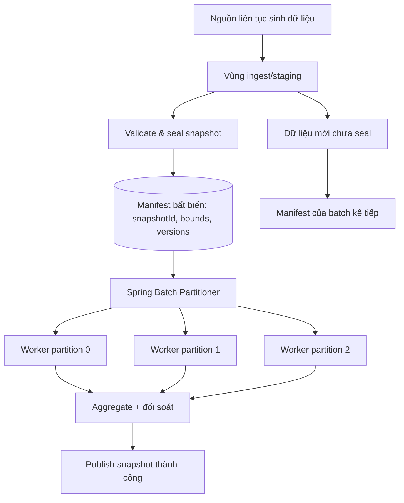
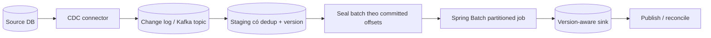
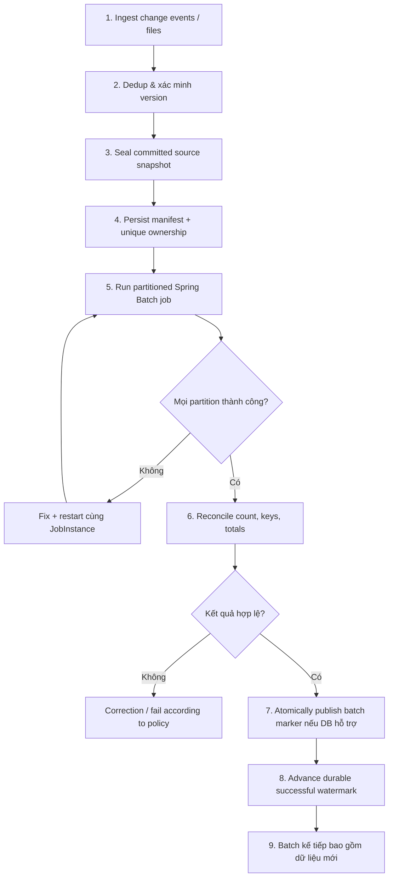

# Xử lý dữ liệu mới phát sinh

## 1. Bài toán: dữ liệu không đứng yên khi job đang chạy

Giả sử một job Spring Batch chạy từ **01:00 đến 02:30** để nhập 20 triệu giao dịch. Trong lúc đó, hệ thống đặt hàng vẫn tiếp tục tạo đơn mới, gửi lại sự kiện cũ, sửa giao dịch hoặc hủy đơn. Nếu job chia dữ liệu thành nhiều partition và **mỗi worker nhìn thấy một tập dữ liệu khác nhau theo thời điểm đọc**, hệ thống có thể:

- **Bỏ sót:** một giao dịch được thêm vào sau khi partition tương ứng đã đọc qua vị trí của nó.
- **Xử lý trùng:** bản ghi mới làm thay đổi thứ tự đọc hoặc một partition bị tính lại sau restart.
- **Đọc thiếu nhất quán:** partition A thấy dữ liệu trước update, partition B thấy dữ liệu sau update.
- **Sai checkpoint:** worker lưu “đã đọc đến dòng thứ N”, nhưng dataset đã chèn/xóa dòng trước N.
- **Ghi đè bản cập nhật mới:** retry/replay của dữ liệu cũ đến sink sau bản cập nhật mới.
- **Kéo dài vô hạn:** liên tục mở rộng `MAX(id)` hoặc danh sách file trong một batch không có điểm kết thúc rõ ràng.

Trong chương **Chia dữ liệu** của module **SPRING_BATCH_SCALING_OPERATIONS**, xử lý dữ liệu mới phát sinh không chỉ là tăng `gridSize` hay số worker. Đây là bài toán kết hợp **ranh giới snapshot, partition ownership, watermark, đồng bộ transaction, idempotency và retry/restart** để mở rộng workload lớn một cách đúng đắn.

**Nguyên tắc chính:** với một `JobInstance` có thể restart, hãy cố định **tập dữ liệu logic được phép xử lý**. Dữ liệu mới sau điểm chốt nên thuộc một đợt chạy kế tiếp, trừ khi kiến trúc đã được thiết kế rõ để xử lý các thay đổi theo CDC/event log.

### Kết quả cần đạt

Sau bài học, bạn có thể:

1. Phân biệt **bản ghi đến mới**, **bản ghi đến muộn**, **update/delete** và **replay**.
2. Chọn giữa **snapshot/manifest bất biến**, **cửa sổ + watermark + overlap**, và **CDC với offset/LSN**.
3. Hiểu vì sao `MAX(id)`, `created_at` hoặc `updated_at` không tự bảo đảm dữ liệu nhất quán.
4. Tạo `Partitioner` theo các range cố định và reader `@StepScope` sử dụng đúng snapshot.
5. Thiết kế writer idempotent, kiểm soát thứ tự phiên bản và khôi phục partition bị lỗi.
6. Đánh giá freshness, completeness, throughput, API/DB capacity và rủi ro vận hành.

## 2. “Dữ liệu mới” có ít nhất bốn ý nghĩa

| Loại thay đổi | Ví dụ | Rủi ro chính |
| --- | --- | --- |
| **New arrival** | Đơn hàng mới được insert sau lúc batch bắt đầu | Vào giữa phạm vi đang đọc hoặc bị bỏ qua khỏi batch |
| **Late arrival** | Sự kiện có `event_time=00:50` nhưng hệ thống chỉ nhận lúc `01:20` | Cửa sổ theo event time đã đóng có thể bỏ sót |
| **Update/delete** | Đơn đã đọc bị sửa giá hoặc hủy trước khi các partition khác hoàn tất | Snapshot không nhất quán, stale write/tombstone |
| **Replay/duplicate delivery** | Broker giao lại event do consumer mất ack | Ghi trùng hoặc lặp side effect |

Cần phân biệt **ba thời điểm**:

- **Event time:** khi nghiệp vụ thực sự xảy ra, ví dụ khách đặt hàng lúc 00:50.
- **Ingestion/arrival time:** khi hệ thống batch hoặc nguồn dữ liệu nhận được bản ghi.
- **Processing time:** khi worker Spring Batch bắt đầu hoặc hoàn tất xử lý.

```text
00:50       Khách hàng tạo đơn: event_time = 00:50
01:00       Batch chốt cửa sổ event_time < 01:00
01:20       Sự kiện đó mới được đưa vào database/broker
01:30       Một worker bắt đầu đọc partition cũ

=> Đây là late arrival: event_time trước cutoff nhưng arrival sau cutoff.
```

Nếu chỉ truy vấn `WHERE event_time < '01:00'` ở mỗi worker vào thời điểm khác nhau, **partition có thể chứa thêm hàng sau khi batch đã bắt đầu**. Ranh giới thời gian nghiệp vụ **không đồng nghĩa một snapshot dữ liệu bất biến**.

## 3. Tập dữ liệu đóng và tập dữ liệu mở

Hai kiểu xử lý có contract rất khác nhau:

| Đặc tính | Bounded batch / snapshot đóng | Continuous/incremental stream |
| --- | --- | --- |
| Tập input | Được chốt trước khi dispatch | Liên tục phát sinh |
| Điểm kết thúc | Có thể xác định | Có thể chạy vô hạn |
| Partition identity | Cố định với một `JobInstance` | Thường gắn với shard/offset và checkpoint liên tục |
| Dữ liệu đến sau cutoff | Chuyển sang đợt sau | Được tiêu thụ theo log/offset mới |
| Restart | Dùng lại manifest, bounds và checkpoint | Dùng offset/sequence được commit đúng |
| Công cụ phù hợp | Spring Batch partitioned step | CDC consumer/stream processor, hoặc Batch chạy các micro-batch định kỳ |

**Spring Batch phù hợp với bounded workloads**, kể cả chạy định kỳ mỗi phút hay mỗi giờ. Một lịch micro-batch liên tục là **nhiều JobInstance có phạm vi rõ**, không phải một job tự mở rộng mãi danh sách partition của lần chạy đầu.

### 3.1. Ba chiến lược chọn nhanh

| Chiến lược | Dùng khi | Điều cần bảo đảm |
| --- | --- | --- |
| **Frozen manifest/snapshot** | Import file/object, bảng staging, dữ liệu có thể materialize | Danh sách và nội dung input không đổi cho tới khi job hết nhu cầu restart |
| **Watermark + overlap + dedup** | Incremental poll dữ liệu gần append-only, yêu cầu eventual completeness | Có giới hạn lateness đáng tin và khóa idempotent |
| **CDC/change log** | Phải bắt mọi insert/update/delete, nguồn thay đổi liên tục | Offset/LSN, thứ tự theo key, xử lý lại và sink version-aware |

Trong nhiều hệ thống, cách thực tế là **CDC/stream ingest trước**, sau đó tạo **staging snapshot đóng** để Spring Batch xử lý nặng bằng partitioning. Hai phần bổ sung cho nhau, không phải luôn thay thế nhau.

## 4. Vì sao không nên liên tục mở rộng range theo MAX(id)?

Giả sử manager chia:

```text
partition-0: id 1      .. 250000
partition-1: id 250001 .. 500000
partition-2: id 500001 .. 750000
partition-3: id 750001 .. 1000000
```

Nếu sau đó có các ID 1.000.001–1.100.000, **đừng sửa partition-3** để kéo `toId=1.100.000` rồi dùng lại tên partition cũ. Điều đó biến `partition-3` thành một đơn vị công việc khác với metadata/checkpoint mà Spring Batch đã lưu.

Cách an toàn hơn:

1. `JobInstance A` chốt input/bounds tới một snapshot hoặc mốc đủ tin cậy.
2. Các worker của A chỉ xử lý phần đã chốt, không mở rộng giữa chừng.
3. Dữ liệu mới được ingest vào vùng pending/next batch.
4. `JobInstance B` chốt đợt tiếp theo, bao gồm các thay đổi chưa được đưa vào A.
5. Nếu A thất bại, restart **A với cùng manifest**, không dùng dữ liệu/sơ đồ của B để thay nội dung partition cũ.

### 4.1. Một bẫy sâu: sequence ID không bảo đảm thứ tự commit

Ở một database có sequence:

```text
Transaction T1: cấp id=100, nhưng chưa COMMIT.
Transaction T2: cấp id=101, COMMIT thành công.
Manager: SELECT MAX(id) => 101; chốt highWatermark=101.
Worker: đọc các row đã COMMIT, thấy 101 nhưng chưa thấy 100.
T1: COMMIT id=100 sau khi worker đã quét qua vùng này.
```

Nếu batch lần tiếp theo chỉ đọc `id > 101`, bản ghi `id=100` **bị bỏ sót vĩnh viễn**. PostgreSQL sequences và nhiều hệ quản trị khác **không bảo đảm thứ tự cấp ID chính là thứ tự commit**.

Vì vậy, `MAX(id)` chỉ là một **ranh giới giá trị**, không mặc nhiên là **commit-consistent high watermark**. Muốn có biên hoàn chỉnh, cần một trong những hợp đồng như:

- Nguồn append-only **đã được đóng/seal** và không còn transaction chưa commit trong phạm vi.
- Bảng staging được copy/materialize dưới quy trình capture nhất quán, sau đó đánh dấu `READY`.
- CDC theo commit log (LSN/offset) với snapshot và streaming handoff chính xác.
- Protocol ingestion cấp **commit-visible sequence** đáng tin hoặc chỉ đánh dấu bản ghi đã được publish sau commit.
- Overlap/lookback + dedup nếu nghiệp vụ cho phép eventual consistency và có bound cho late commits.

**Không dùng `created_at <= cutoff` như bằng chứng tuyệt đối đã thấy mọi commit:** một transaction có thể gán timestamp trước cutoff nhưng commit sau khi batch đọc xong.

## 5. Chiến lược A: đóng băng một snapshot/manifest

Đây là chiến lược dễ suy luận nhất cho partitioning vì các worker và những lần restart đều cùng đọc **một tập nguồn**.

### 5.1. Chu trình xử lý



Đối với file/object:

1. Chỉ liệt kê các object **đã upload hoàn tất**; không dựa vào tên file đang được viết.
2. Chốt key + version/generation/checksum và kích thước, không chỉ một URL có thể overwrite.
3. Lưu manifest bất biến trước khi tạo `JobInstance`, tham chiếu bằng `manifestId`.
4. Các partition trỏ vào những entry bất biến và xử lý đúng một lần về mặt *logic*; implementation vẫn phải chịu được retry vật lý.
5. Object mới xuất hiện sau seal thuộc manifest khác, **không xen vào group cũ**.

Đối với database:

1. Tạo một **staging dataset** được nhận diện bằng `snapshotId` hoặc `businessBatchId`.
2. Ghi/copy dữ liệu nhất quán theo hợp đồng ingestion. Tách vùng đang ingest khỏi vùng `READY`.
3. Chỉ sau khi nội dung staging hoàn tất và bất biến mới cho manager phân vùng.
4. Worker đọc `WHERE snapshot_id = :snapshotId` cùng range/key riêng.
5. Giữ snapshot đủ lâu để job thất bại có thể restart và đối soát.

### 5.2. Manifest mẫu

```json
{
  "businessBatchId": "orders-2026-11-26-0100",
  "snapshotId": "snapshot-20261126-0100-v1",
  "schemaVersion": 3,
  "partitions": [
    {
      "partitionName": "range-0000",
      "startIdExclusive": 0,
      "endIdInclusive": 250000,
      "estimatedRows": 250000
    },
    {
      "partitionName": "range-0001",
      "startIdExclusive": 250000,
      "endIdInclusive": 500000,
      "estimatedRows": 250000
    }
  ]
}
```

Các số liệu chỉ **minh họa cấu trúc**, không phải ví dụ bao phủ toàn bộ một dataset 20 triệu bản ghi. Trong production, manifest phải bảo đảm mọi record trong snapshot thuộc **đúng một partition** hoặc có quy tắc dedup rõ ràng.

### 5.3. “Manifest cố định” chưa đủ nếu source mutable

Chỉ giữ `startId/endId` mà không giữ trạng thái row bên trong range **không làm nguồn bất biến**. Nếu record có ID 50.000 bị UPDATE hoặc DELETE sau thời điểm lập manifest, worker có thể nhìn thấy giá trị khác khi đọc hoặc restart.

Muốn snapshot nhất quán qua **nhiều transaction và nhiều lần JobExecution**, cần materialized snapshot/immutable store hoặc protocol phiên bản dữ liệu có thể đọc lại. Một MVCC snapshot của transaction PostgreSQL thường chỉ có hiệu lực trong vòng đời transaction; **không mặc nhiên kéo dài qua nhiều giờ, nhiều worker và nhiều lần restart**.

## 6. Chiến lược B: cửa sổ thời gian, watermark và dữ liệu đến muộn

Một số hệ thống không thể materialize toàn bộ snapshot. Khi nguồn cung cấp **timestamp/offset đủ tin cậy**, có thể đọc incrementally theo các cửa sổ thời gian đã chốt.

Ví dụ xử lý mỗi 15 phút:

```text
Window A: [00:00, 00:15)
Window B: [00:15, 00:30)
Window C: [00:30, 00:45)
...
```

Dùng nửa mở `[fromInclusive, toExclusive)` để các record nằm đúng biên chỉ thuộc một cửa sổ.

### 6.1. Event-time watermark khác ingestion-time watermark

Giả sử có event:

| Event | Event time | Arrived at | Thuộc cửa sổ nghiệp vụ |
| --- | --- | --- | --- |
| A | 00:10 | 00:10 | [00:00, 00:15) |
| B | 00:12 | 00:23 | [00:00, 00:15), **đến muộn** |
| C | 00:17 | 00:18 | [00:15, 00:30) |
| D | 00:14 | 01:50 | [00:00, 00:15), **rất muộn** |

Nếu window A chạy lúc 00:16, B và D chưa xuất hiện. Để đạt eventual completeness có thể:

- **Delay window close:** chờ thêm một khoảng dự kiến cho late arrivals.
- **Overlap/lookback:** batch tiếp theo đọc lại một đoạn quá khứ rồi sink dedup.
- **Correction lane:** event quá muộn đi vào một job điều chỉnh/đối soát riêng.
- **CDC/event log:** không mất event vì dựa trên commit/append offsets, sau đó quyết định xử lý event-time theo nghiệp vụ.

**Watermark theo event time** biểu thị mức tiến độ/sự hoàn thiện được **giả định hoặc bảo đảm bởi nguồn**; nó không tự xuất hiện chỉ vì có đồng hồ hệ thống. Nếu độ trễ đến **không có giới hạn**, một lookback 15 phút **không thể bảo đảm** bắt được mọi event đến muộn.

### 6.2. Ví dụ SQL cho overlap

```sql
-- Đọc lại 30 phút phía trước mốc đã xử lý.
SELECT event_id, source_version, event_time, amount
FROM incoming_event
WHERE event_time >= :lastBusinessWindowEnd - INTERVAL '30 minutes'
  AND event_time < :newBusinessWindowEnd
ORDER BY event_time, event_id;
```

Ví dụ sử dụng cú pháp PostgreSQL. Đây là **cơ chế đọc có overlap**, không bảo đảm exactly-once: các event thuộc vùng đọc lại chắc chắn có thể xuất hiện nhiều lần. Sink phải có business key và idempotency/version policy.

Nếu sự kiện có thể đến chậm vài ngày, phải chọn lookback phù hợp với số liệu lateness hoặc dùng correction workflow. Không âm thầm báo “đã xử lý đủ” khi contract nguồn không bảo đảm giới hạn lateness.

### 6.3. Không lấy thời điểm job hoàn tất làm watermark mới một cách tùy tiện

Ví dụ job bắt đầu lúc 01:00, kết thúc 01:45. Nếu khi kết thúc cập nhật `lastProcessedTime=01:45` mặc dù truy vấn chỉ chốt dữ liệu trước 01:00, các bản ghi đến trong 45 phút đó có thể bị bỏ qua ở job sau.

**Quy tắc:** cursor/watermark thành công phải phản ánh **phạm vi nguồn thực sự đã xử lý và commit**, không phải `LocalDateTime.now()` tại lúc job kết thúc.

## 7. Chiến lược C: CDC và log offset

Với bảng được update/delete liên tục, CDC có thể đáng tin hơn polling `updated_at` để bắt mọi thay đổi.

### 7.1. Ngữ nghĩa của CDC

CDC đọc một chuỗi thay đổi đã commit, chẳng hạn thông qua WAL/LSN hoặc transaction log, rồi ghi vào một log/topic có offset. Có thể tách thành:

- **Capture:** nhận insert/update/delete, thứ tự và transaction metadata.
- **Stage:** ghi change events vào một vùng ingest có khóa/version và commit status.
- **Seal:** chốt một tập offsets/sequence hoặc snapshot-consistent boundary.
- **Partitioned batch:** Spring Batch xử lý những events đã chốt theo key/range.
- **Ack/checkpoint:** chỉ ghi nhận tiến độ sau khi dữ liệu đích đã được commit đủ theo protocol.



**Một offset không thay thế transaction của sink.** Nếu ghi sink thành công nhưng crash trước khi commit offset, event có thể được đọc lại. Vì thế worker/sink vẫn phải idempotent. Nếu CDC source và batch sink nằm ở những hệ thống khác nhau, **không mặc định có distributed exactly-once transaction**.

### 7.2. Insert/update/delete cần hợp đồng rõ

| Change event | Cách xử lý ví dụ | Nguy cơ |
| --- | --- | --- |
| INSERT | UPSERT bản ghi mới | Replay gây duplicate nếu khóa sai |
| UPDATE | Ghi bản mới với `sourceVersion` cao hơn | Replay cũ có thể ghi đè mới nếu không kiểm soát thứ tự |
| DELETE | Tombstone hoặc đánh dấu deleted | Nếu bỏ qua delete, sink chứa dữ liệu không còn tồn tại |
| Schema change | Dùng schema registry/versioned mapper | Worker đời cũ deserialize sai |
| Snapshot → streaming handoff | Handoff bằng log position nhất quán | Mất hoặc nhân đôi changes giữa hai chế độ |

Ở pipeline có nhiều partition/worker, **thứ tự hoàn tất giữa các partition không được bảo đảm**. Nếu hai phiên bản cùng một entity bị gửi tới hai workers độc lập, version 5 có thể ghi sau version 6. Để tránh sai, partition theo **business key** hoặc dùng sink **conditional update theo version**.

### 7.3. SQL chống ghi đè phiên bản mới

Ví dụ PostgreSQL:

```sql
CREATE TABLE order_projection (
    source_system TEXT NOT NULL,
    order_id TEXT NOT NULL,
    source_version BIGINT NOT NULL,
    amount NUMERIC(18, 2),
    deleted BOOLEAN NOT NULL DEFAULT FALSE,
    PRIMARY KEY (source_system, order_id)
);

INSERT INTO order_projection (
    source_system, order_id, source_version, amount, deleted
)
VALUES (
    :sourceSystem, :orderId, :sourceVersion, :amount, :deleted
)
ON CONFLICT (source_system, order_id)
DO UPDATE SET
    source_version = EXCLUDED.source_version,
    amount = EXCLUDED.amount,
    deleted = EXCLUDED.deleted
WHERE order_projection.source_version < EXCLUDED.source_version;
```

Câu lệnh chỉ nhận một version mới hơn; replay cùng version hoặc version cũ không ghi đè. **Điều kiện quan trọng:** `source_version` phải có thứ tự đơn điệu **trong phạm vi mỗi entity** và thực sự biểu diễn thứ tự nghiệp vụ. Không dùng một timestamp có thể trùng hoặc lùi làm version mà không giải quyết tie-breaking/clock skew.

Nếu delete là tombstone, lưu version của delete để một INSERT cũ không làm sống lại row. Khi có yêu cầu GDPR/retention, dùng cơ chế purge/retention thích hợp; tombstone nghiệp vụ không đồng nghĩa xóa vĩnh viễn.

## 8. Phân vùng một snapshot đóng: thiết kế Java

Ví dụ tiếp theo minh họa **Spring Batch 5.x** với dữ liệu đã được **seal và immutable** trong bảng `staged_event`. Chỉ khi ingestion pipeline xác nhận snapshot sẵn sàng, manager mới chạy partitioned job.

Đây là ví dụ mô hình, **không phải một ứng dụng Spring Boot đầy đủ**: bỏ qua import, cấu hình DataSource, Job, triển khai `SealedManifestRepository` và các lớp kiểm soát dữ liệu. Phần minh họa chỉ bao gồm ranh giới partition, reader và writer.

### 8.1. Bảng staging có snapshot ID

```sql
CREATE TABLE staged_event (
    snapshot_id TEXT NOT NULL,
    ingest_id BIGINT NOT NULL,
    event_id TEXT NOT NULL,
    source_version BIGINT NOT NULL,
    amount NUMERIC(18, 2) NOT NULL,
    PRIMARY KEY (snapshot_id, ingest_id),
    UNIQUE (snapshot_id, event_id, source_version)
);
```

**Contract của ví dụ:** một `snapshot_id` chỉ được đánh dấu `READY` khi mọi row đã nhập và commit, rồi **không được INSERT/UPDATE/DELETE** trong suốt retention của job. Primary key `(snapshot_id, ingest_id)` đã tự tạo index duy nhất trong PostgreSQL, nên không cần tạo lại cùng index. Không có constraint SQL ở trên tự động bảo vệ invariant “READY thì bất biến”; phải thực hiện bằng quyền truy cập, bảng trạng thái/trigger hoặc quy trình seal ở tầng ingest.

`ingest_id` chỉ là khóa sắp xếp **bên trong snapshot đã chốt**. Không dùng nó để suy ra thứ tự commit của các transaction chưa seal.

### 8.2. Manifest định nghĩa các range không chồng lấn

```json
{
  "manifestId": "snap-20261126-a",
  "snapshotId": "snap-20261126-a",
  "partitions": [
    {"name": "range-0000", "lowExclusive": 0, "highInclusive": 100000},
    {"name": "range-0001", "lowExclusive": 100000, "highInclusive": 200000},
    {"name": "range-0002", "lowExclusive": 200000, "highInclusive": 300000}
  ]
}
```

Các phạm vi minh họa phải được kiểm tra trên snapshot thực tế; ID không nhất thiết liên tục nhưng phải bảo đảm không có row nằm ngoài các range đã chốt (trừ khi được xử lý theo một chính sách loại trừ tường minh).

### 8.3. Partitioner từ manifest bất biến

```java
record SealedSlice(
        String name,
        long lowExclusive,
        long highInclusive) {}

record SealedManifest(
        String snapshotId,
        List<SealedSlice> slices) {}

interface SealedManifestRepository {
    // Chỉ trả manifest READY đã chốt, không tự dựng lại range lúc restart.
    SealedManifest loadReady(String manifestId);
}

final class SealedRangePartitioner implements Partitioner {

    private final SealedManifest manifest;

    SealedRangePartitioner(SealedManifest manifest) {
        this.manifest = manifest;
    }

    @Override
    public Map<String, ExecutionContext> partition(int gridSize) {
        Map<String, ExecutionContext> result = new LinkedHashMap<>();

        for (SealedSlice slice : manifest.slices()) {
            if (slice.lowExclusive() >= slice.highInclusive()) {
                throw new IllegalArgumentException("Invalid range");
            }

            ExecutionContext context = new ExecutionContext();
            context.putString("snapshotId", manifest.snapshotId());
            context.putLong("lowExclusive", slice.lowExclusive());
            context.putLong("highInclusive", slice.highInclusive());

            if (result.putIfAbsent(slice.name(), context) != null) {
                throw new IllegalArgumentException(
                    "Duplicate partition name: " + slice.name());
            }
        }
        return result;
    }
}
```

**Bắt buộc kiểm tra thêm ngoài code:** các ranges không overlap, không có gaps ngoài phạm vi được cho phép, mọi row thuộc đúng một range và `snapshotId` đúng với manifest. Kiểm tra các bất biến này khi tạo/seal manifest trước khi worker chạy.

### 8.4. Bind manifest theo JobParameters đúng lúc

```java
@Bean("sealedRangePartitioner")
@StepScope
Partitioner sealedRangePartitioner(
        SealedManifestRepository repository,
        @Value("#{jobParameters['manifestId']}") String manifestId) {

    return new SealedRangePartitioner(
            repository.loadReady(manifestId));
}
```

`@StepScope` cho phép tham số `manifestId` được bind ở thời điểm manager step thực thi thay vì khởi tạo bean sớm khi application startup. `manifestId` nên là **identifying JobParameter** (hoặc được ánh xạ bền vững tới JobInstance) để restart vẫn tải cùng snapshot.

`gridSize` là **hint**. Nếu manifest có 12 slices và partitioner trên không sử dụng tham số, nó tạo 12 partitions dù manager `.gridSize(4)`. Không tính lại ranges dựa trên giá trị `gridSize` mới khi restart.

### 8.5. Reader @StepScope chỉ đọc snapshot và range

```java
record StagedEvent(
        long ingestId,
        String eventId,
        long sourceVersion,
        BigDecimal amount) {}

@Bean("sealedEventReader")
@StepScope
JdbcPagingItemReader<StagedEvent> sealedEventReader(
        DataSource dataSource,
        @Value("#{stepExecutionContext['snapshotId']}")
            String snapshotId,
        @Value("#{stepExecutionContext['lowExclusive']}")
            Long lowExclusive,
        @Value("#{stepExecutionContext['highInclusive']}")
            Long highInclusive) {

    return new JdbcPagingItemReaderBuilder<StagedEvent>()
            .name("sealedEventReader")
            .dataSource(dataSource)
            .selectClause(
                "SELECT ingest_id, event_id, source_version, amount")
            .fromClause("FROM staged_event")
            .whereClause(
                "WHERE snapshot_id = :snapshotId " +
                "AND ingest_id > :lowExclusive " +
                "AND ingest_id <= :highInclusive")
            .parameterValues(Map.of(
                "snapshotId", snapshotId,
                "lowExclusive", lowExclusive,
                "highInclusive", highInclusive))
            .sortKeys(Map.of("ingest_id", Order.ASCENDING))
            .rowMapper((rs, rowNum) -> new StagedEvent(
                rs.getLong("ingest_id"),
                rs.getString("event_id"),
                rs.getLong("source_version"),
                rs.getBigDecimal("amount")))
            .pageSize(200)
            .saveState(true)
            .build();
}
```

Đây là mẫu `JdbcPagingItemReaderBuilder` API thông dụng của Spring Batch 5.x. Sự tương thích cụ thể về SQL provider/driver và builder phải được kiểm chứng ở version dự án. Những lưu ý quan trọng:

- `snapshot_id = :snapshotId` và range đã chốt **không phụ thuộc các row mới của snapshot khác**.
- `sortKeys("ingest_id")` cần **unique trong tập truy vấn**; trong ví dụ đã có `PRIMARY KEY(snapshot_id, ingest_id)` nên khi cố định một snapshot, thứ tự là duy nhất.
- Với `JdbcPagingItemReader`, tài liệu chính thức yêu cầu sort key unique cho restart an toàn. Nhưng **sort key unique vẫn không sửa được input mutable**: cần snapshot bất biến.
- `@StepScope` tạo reader theo `StepExecution` của partition, không phải tự làm mọi singleton processor/writer thread-safe.
- `pageSize(200)` là kích thước trang đọc; `chunk(200)` ở worker là kích thước transaction chunk. Hai giá trị có thể được benchmark, không mặc định phải bằng nhau ở mọi workload.

### 8.6. Writer idempotent và worker step

Với output giữ phiên bản mới nhất của mỗi event, có thể dùng `JdbcBatchItemWriter` theo PostgreSQL. Đối với bài này, dùng một writer đã được kiểm thử để thực hiện logic tương đương câu lệnh `ON CONFLICT ... WHERE source_version < EXCLUDED.source_version` ở mục 7.3.

```java
@Bean("sealedWorkerStep")
Step sealedWorkerStep(
        JobRepository repository,
        PlatformTransactionManager transactionManager,
        @Qualifier("sealedEventReader")
            ItemStreamReader<StagedEvent> reader,
        @Qualifier("versionAwareWriter")
            ItemWriter<StagedEvent> writer) {

    return new StepBuilder("sealedWorkerStep", repository)
            .<StagedEvent, StagedEvent>chunk(200, transactionManager)
            .reader(reader)
            .writer(writer)
            .build();
}
```

Bean `versionAwareWriter` là **dependency do ứng dụng triển khai**, không phải bean mặc định của framework. Nếu sử dụng writer với SQL conditional update, một số item replay có thể không thay đổi row do version không mới; cần xác định ý nghĩa `writeCount`/`assertUpdates` cho trường hợp này. Đừng coi “0 hàng cập nhật” luôn là lỗi: có thể đó là replay đúng.

## 9. Manager Step, bounded executor và phạm vi đồng thời

```java
@Bean("sealedPartitionExecutor")
ThreadPoolTaskExecutor sealedPartitionExecutor() {
    ThreadPoolTaskExecutor executor = new ThreadPoolTaskExecutor();
    executor.setThreadNamePrefix("sealed-partition-");
    executor.setCorePoolSize(4);
    executor.setMaxPoolSize(4);
    executor.setQueueCapacity(16);
    return executor;
}

@Bean("sealedManagerStep")
Step sealedManagerStep(
        JobRepository repository,
        @Qualifier("sealedWorkerStep") Step worker,
        @Qualifier("sealedRangePartitioner") Partitioner partitioner,
        @Qualifier("sealedPartitionExecutor") TaskExecutor executor) {

    return new StepBuilder("sealedManagerStep", repository)
            .partitioner(worker.getName(), partitioner)
            .step(worker)
            .gridSize(4)
            .taskExecutor(executor)
            .build();
}
```

Với bốn worker của **một pool instance**, tối đa bốn tasks của pool đó được thực thi đồng thời. Nếu manifest sinh 12 partitions, các partitions dư có thể chờ trong queue; nếu queue đầy, executor có thể reject. Không tự động hiểu `gridSize(4)` nghĩa framework chỉ sinh bốn partitions.

**Cần kiểm tra Spring Batch version:** `chunk(200, transactionManager)` minh họa Spring Batch 5.x. Trong Spring Batch 6.x, cú pháp chunk builder có thay đổi (ví dụ `chunk(200).transactionManager(transactionManager)`); package của một số API cũng đổi. Giữ nguyên kiến trúc `Partitioner → ExecutionContext → StepExecution`, nhưng đối chiếu reference theo dependency cụ thể trước khi triển khai.

### 9.1. Khi nào cần remote partitioning?

Nếu dataset đã seal lớn, local CPU/RAM hết nhưng database/sink còn headroom, có thể dùng remote partitioning. Khi đó:

- Gửi `manifestId`, `snapshotId`, `range` và định danh partition **có thể serialize**.
- Các remote workers phải truy cập được cùng snapshot, không dựa trên file `/tmp` ở manager.
- Không gửi credential hoặc raw payload/SQL tùy ý vào `ExecutionContext`.
- JobRepository, message correlation, retry/worker crash cần được kiểm thử.
- **Dữ liệu mới phát sinh vẫn thuộc snapshot/đợt tiếp theo**, không vì mở rộng nhiều node mà được chen vào JobInstance hiện tại.

Nếu bottleneck là DB đang chạm connection/IOPS, thêm node có thể chỉ làm tình hình tệ hơn. Đây là lý do phải đo nút thắt trước khi chuyển kiến trúc.

## 10. Cơ chế restart: giữ đúng snapshot, không “bù dữ liệu mới” khi lỗi

Ví dụ:

```text
JobInstance A: manifestId=snap-20261126-a

sealedWorkerStep:range-0000   COMPLETED
sealedWorkerStep:range-0001   FAILED
sealedWorkerStep:range-0002   COMPLETED

Trong khi A chạy: xuất hiện snapshot B có các sự kiện mới.

Restart A:
- Dùng lại đúng snap-20261126-a và các ranges cũ.
- Các partition COMPLETED thường không chạy lại.
- range-0001 tiếp tục/replay theo checkpoint phù hợp.
- Không đưa event của snapshot B vào range-0001.

JobInstance B:
- Xử lý snapshot B với manifest và partition identity riêng.
```

Một `JobInstance` được nhận diện bằng **job name + identifying JobParameters**. Restart thường tạo **JobExecution mới** cho **cùng JobInstance**, nên không sử dụng riêng `JobExecutionId` làm khóa snapshot nghiệp vụ nếu muốn dữ liệu được dùng xuyên nhiều lần restart.

### 10.1. Bảng lỗi và phục hồi

| Tình huống | Rủi ro | Cách xử lý |
| --- | --- | --- |
| Worker fail trước commit chunk | Dữ liệu chunk chưa ghi, reader có thể đọc lại | Transaction/checkpoint đúng, bounded retry |
| Writer commit DB nhưng fail trước ghi nhận bước tiếp theo | Replay item đã ghi | Unique key/version-aware UPSERT |
| Dữ liệu mới insert vào nguồn mutable giữa lúc paging | Row order thay đổi, miss/duplicate | Frozen snapshot hoặc CDC/offset |
| Restart với `manifestId` khác | Tạo JobInstance/tập công việc khác | Giữ identifying parameters của đợt cũ |
| `Partitioner` đổi mapping `range-0001` | Checkpoint gắn sai dataset | Manifest và partition names bất biến |
| File/object bị overwrite | Đọc input khác bản đầu | Pin version/checksum; fail nếu không khớp |
| CDC consumer mất ack sau sink commit | Event đọc lại | Idempotency theo event/version |
| Backfill record rất cũ | Window cũ đã đóng | Correction lane hoặc replay có kiểm soát |
| DELETE ở source | Sink giữ row lẽ ra phải xóa | Tombstone/CDC/delete reconciliation |
| Job đã `COMPLETED` | Không restart cùng JobInstance để thêm event mới | JobInstance mới cho dữ liệu mới |

### 10.2. `ExecutionContext` lưu checkpoint, không phải “sự thật cuối cùng”

Spring Batch persist `ExecutionContext` của step/partition và reader lưu trạng thái theo lifecycle/commit. Điều này cho phép restart nhiều workload, nhưng không tạo transaction phân tán bao trùm toàn source, DB sink, broker, HTTP và metadata.

**Sự thật nghiệp vụ cuối cùng** cần kiểm chứng tại sink hoặc ledger bằng business IDs, version và số lượng/tổng giá trị tương ứng. Một bước báo `COMPLETED` không đồng nghĩa mọi consumer bên ngoài đã xử lý event bất đồng bộ.

## 11. Late arrival, update và delete sau khi snapshot đã publish

Một chiến lược snapshot có thể hoàn thành đúng và vẫn nhận dữ liệu sửa muộn. Đây không nhất thiết là lỗi của batch; đó là **hợp đồng freshness và correction** phải được thiết kế riêng.

### 11.1. Các lựa chọn xử lý

| Loại thay đổi sau publish | Cách xử lý thường dùng |
| --- | --- |
| Insert mới với event time hiện tại | Đưa vào batch/micro-batch kế tiếp |
| Insert đến muộn nằm trong kỳ đã khóa | Correction batch cho kỳ đó, hoặc overlap khi lateness trong giới hạn |
| Update row cũ | CDC event có sourceVersion hoặc rebuild projection theo partition bị ảnh hưởng |
| Delete row cũ | Tombstone/soft delete/sink reconciliation |
| File/object bổ sung cho kỳ cũ | Backfill manifest mới, không sửa manifest của JobInstance completed |
| Sửa schema input | Versioned parser/migration và kiểm thử backward compatibility |

### 11.2. Backfill không đồng nghĩa restart

**Restart** nghĩa hoàn tất một **JobInstance chưa thành công** theo cùng phạm vi đã chốt.

**Backfill/correction** nghĩa xử lý **một phạm vi nghiệp vụ mới hoặc đã điều chỉnh** sau khi phát hiện dữ liệu thiếu/sai. Nó thường cần **JobInstance mới** với identifying parameters riêng, cùng chính sách dedup/version và đối soát.

Không xóa lịch sử `BATCH_*` hoặc sửa tay `StepExecution` để buộc job đã completed “đọc thêm ít dữ liệu” mà không có quyết định nghiệp vụ rõ ràng.

### 11.3. Watermark xử lý đến muộn phải có nguồn gốc rõ

Một watermark có thể là:

- Mốc commit offset/sequence đã được pipeline ingestion xác nhận.
- Event-time watermark do upstream cam kết với lateness limit.
- Cutoff của staging snapshot đã seal.
- Mốc nghiệp vụ như kỳ chốt hóa đơn, nhưng **không đồng nghĩa commit order**.

Cần lưu cả **watermark type** và **source identity/version** trong metadata nghiệp vụ. Không dùng một cột `lastProcessedTimestamp` duy nhất để thay thế mọi ngữ nghĩa.

## 12. Race condition giữa ingestion, planning và publish

Một số race thường bị bỏ qua:

### Race A — Liệt kê input quá sớm

Manager liệt kê `*.csv` lúc 01:00 trong khi hệ thống đang upload file cuối. Manifest chứa file chưa hoàn tất, worker đọc thiếu.

**Khắc phục:** upload vào vùng tạm; chỉ công bố object khi hoàn tất, xác minh size/checksum và trạng thái `READY` trước khi seal manifest.

### Race B — Đọc theo thời gian tạo, commit đến sau

Một transaction bắt đầu trước cutoff, ghi `created_at=00:59` nhưng commit lúc 01:05. Batch lúc 01:00 không thấy row, batch sau chỉ đọc `created_at >= 01:00`.

**Khắc phục:** không suy ra commit-consistent boundary từ `created_at`; dùng snapshot/CDC hoặc overlap có giới hạn + reconciliation.

### Race C — Hai JobExecution cùng nhận một phạm vi

Scheduler khởi chạy hai job với `manifestId` khác nhau nhưng cả hai manifest cùng chứa event nguồn chưa được đánh dấu ownership rõ.

**Khắc phục:** registry duy nhất cho batch ownership, unique business key và policy concurrency. `JobRepository` kiểm soát identity của **một JobInstance**, không tự ngăn mọi overlap giữa **hai JobInstances khác nhau**.

### Race D — Update mới xong sau replay cũ

Partition P2 ghi `sourceVersion=8`, rồi P1 được retry và ghi `sourceVersion=7`.

**Khắc phục:** conditional write theo version và/hoặc cùng một business key luôn được route tới một partition giữ thứ tự.

### Race E — Publish trước khi mọi partition hợp lệ

Một partition lỗi, các partition khác đã ghi staging, bước publish vẫn lấy những dữ liệu mới nhất từ DB.

**Khắc phục:** staging theo `businessBatchId`, join/aggregate trạng thái đúng, business reconciliation, publish một version marker chỉ sau khi tất cả điều kiện đạt. Không rollback giả định toàn bộ những partition đã commit.

## 13. Thiết kế một chu trình incremental batch hoàn chỉnh

Có thể triển khai các giai đoạn:



Thứ tự này là **mẫu kiến trúc**, không phải các bước do Spring Batch tự thực thi. Đặc biệt, “publish marker” và “advance watermark” có thể không nguyên tử nếu nằm ở hai hệ thống. Phải thiết kế recovery sao cho crash giữa hai hành động không làm mất data; có thể dùng transaction chung trong một DB, outbox hoặc idempotent publish/retry có đối soát.

### 13.1. Không advance cursor trước khi sink commit

Nếu hệ thống ghi `lastProcessedOffset=10000` rồi crash trước khi ghi sink cho offsets 9901–10000, lần sau bắt đầu >10000 có thể làm mất 100 events. Ngược lại, nếu sink commit trước offset, replay có thể xuất hiện; **idempotent sink** giúp trường hợp replay an toàn hơn.

Trong mô hình at-least-once, thường chấp nhận việc xử lý lại có kiểm soát thay vì đánh dấu tiến độ quá sớm làm mất dữ liệu.

### 13.2. Quản lý trạng thái liên tục

Có thể dùng một registry nghiệp vụ tách biệt `BATCH_*`:

| Trường | Ý nghĩa |
| --- | --- |
| `business_batch_id` | Đợt dữ liệu nghiệp vụ |
| `manifest_id` | Danh sách partition bất biến |
| `source_snapshot_id` hoặc `offset_range` | Phạm vi nguồn đã đóng |
| `status` | `PREPARING/READY/PROCESSING/VERIFIED/PUBLISHED` tùy thiết kế |
| `input_count` / `input_checksum` | Đối soát đầu vào |
| `output_count` / `output_checksum` | Đối soát đầu ra |
| `published_version` | Snapshot được consumer dùng |
| `retention_until` | Giữ dữ liệu cho restart/điều tra |

Không đưa secret, raw payload nhạy cảm hoặc hàng triệu IDs vào `ExecutionContext` của Spring Batch; tham chiếu tới manifest/registry bằng ID nhỏ gọn.

## 14. Sizing, backpressure và hiệu năng

Việc có thêm dữ liệu liên tục không có nghĩa phải tăng số worker liên tục. Nếu nguồn phát sinh 20.000 event/s nhưng pipeline chỉ xử lý 10.000 event/s, backlog sẽ tăng dù các partition trong từng batch đã chia đều.

### 14.1. Các chỉ số cần đo

| Metric | Mục tiêu chẩn đoán |
| --- | --- |
| **Ingestion rate** (events/s) | Nguồn tạo mới nhanh đến mức nào |
| **Processed rate** (events/s) | Sink xử lý và commit thành công bao nhiêu |
| **Backlog size / oldest age** | Có theo kịp nguồn và SLA freshness không |
| **Watermark lag** | Độ trễ giữa mốc đầu vào được bảo đảm và mốc đã publish |
| **Late arrival rate** | Độ trễ đến muộn thực tế để chọn overlap/correction |
| **Per-partition duration** | Phát hiện straggler và skew |
| **Duplicate/replay rate** | Đánh giá độ bền giao thức, writer idempotency |
| **Update/delete correction lag** | Projection có theo kịp thay đổi nghiệp vụ không |
| **Executor active/queue/rejections** | Pool có bị bão hòa hoặc task bị từ chối |
| **DB locks/connections/IOPS** | Hạn chế ở source/sink có nằm ngoài JVM không |
| **Reconciliation mismatch** | Bằng chứng tính đúng dữ liệu, không chỉ tốc độ |

**Ví dụ tính đơn giản:** nguồn tạo 15.000 events/s, pipeline chỉ commit được 12.000 events/s. Backlog tăng **3.000 events/s**, tức khoảng **10,8 triệu events/giờ** nếu hai tốc độ duy trì. Cần tăng năng lực xử lý, giảm lượng công việc hợp lệ, hoặc thay SLA/kiến trúc; điều chỉnh `gridSize` đơn thuần không khắc phục giới hạn DB đã bão hòa.

### 14.2. Kích thước cửa sổ và số partition

- **Cửa sổ quá nhỏ:** nhiều JobInstance, overhead scheduler/metadata, transaction setup.
- **Cửa sổ quá lớn:** độ trễ freshness và thời gian khôi phục dài, backlog tăng.
- **Partition quá ít:** một worker thành critical path, CPU rảnh.
- **Partition quá nhiều:** `JobRepository`, queue, dispatch và connection churn tăng.
- **Overlapping windows quá dài:** dữ liệu đọc lặp nhiều, tốn sink writes và dedup.
- **Overlapping windows quá ngắn:** bỏ sót late arrivals ngoài ngưỡng.

Benchmark với nguồn đại diện và lỗi thực tế: processor CPU, HTTP timeout, DB lock, broker redelivery, snapshot creation time, source growth. Theo dõi **end-to-end freshness** chứ không chỉ runtime của một partitioned step.

### 14.3. Trần concurrency là tổng thể

`core=max=4` ở local `ThreadPoolTaskExecutor` chỉ giới hạn worker của **pool đó**. Với ba JobExecution hoặc nhiều pod, tổng truy cập DB/API có thể vượt mức này. Nếu một worker mở executor con, nó còn tạo nhiều request. Hãy đặt admission control, source/sink quota hoặc semaphore/rate limiter chung khi cần.

## 15. Kiểm thử correctness trong điều kiện dữ liệu thay đổi

Một load test chỉ có dữ liệu tĩnh không đủ cho chủ đề này. Cần cố ý tạo race quanh thời điểm cutoff và commit.

| Test | Cách inject | Kết quả cần chứng minh |
| --- | --- | --- |
| New insert sau seal | Thêm record vào vùng ingest/next snapshot | Không chen vào batch đã seal; có ở đợt sau |
| Transaction commit đến muộn | T1 giữ transaction, T2 commit ID lớn hơn | Không mất row ID thấp hơn chỉ vì chốt `MAX(id)` |
| Event time cũ đến muộn | Event thuộc kỳ cũ, arrival sau cutoff | Overlap/correction theo contract, không bỏ sót |
| Update sau snapshot | Sửa giá trong nguồn live | Snapshot worker không thay đổi đầu vào đã chốt |
| Delete sau snapshot | Xóa bản ghi nguồn | CDC tombstone/correction về sink đúng |
| Worker chết sau commit | Kill một worker ở ranh giới chunk | Restart không tạo duplicate business IDs |
| Partition restart với manifest mới | Cố đổi `range-0001` mapping | Bị chặn hoặc phát hiện, không silently tiếp tục |
| Hai jobs overlap | Cùng source record thuộc hai manifest | Unique ownership/dedup/version policy hoạt động |
| Job failed rồi có nhiều event mới | Restart với cùng manifest | Không thu nhận event ngoài snapshot cũ |
| Source version cũ tới sau bản mới | Giao replay đảo thứ tự | Version-aware writer không ghi đè bản mới |
| Thiếu quyền đọc snapshot cũ | Retention hoặc ACL đổi | Fail rõ và phục hồi đúng version, không đọc thay nguồn |
| DB bị bão hòa | Tăng partitions/worker và writer load | Backpressure/timeout có giới hạn, không retry storm |

### 15.1. Các assertion quan trọng

- Mỗi `source_event_id + source_version` hợp lệ được nhận diện đúng, không bỏ sót sau các đợt cần thiết.
- Mỗi entity ở sink phản ánh **version nghiệp vụ đúng**, kể cả khi retry đến sai thứ tự.
- Tổng tiền/tổng số lượng theo business batch ID khớp đầu vào đã seal (có giải thích skip/filter hợp lệ).
- `StepExecution` completed/failed có tên partition gắn đúng manifest/range cũ.
- Mọi event đến muộn vượt lookback có **correction route hoặc một lỗi/alert rõ ràng**, không mất âm thầm.
- Publish chỉ xảy ra khi đủ điều kiện thành công và reconciliation.
- Runtime/lag có headroom ở peak workload, không chỉ happy path.

## 16. Tình huống thực tế: đồng bộ giao dịch 24/7

Một nền tảng thanh toán tiếp nhận **30 triệu giao dịch/ngày**. Job tổng hợp mỗi 30 phút để cập nhật dashboard. Nguồn vẫn ghi liên tục; một số giao dịch đến chậm 10–90 phút do gateway offline, và có những bản ghi bị điều chỉnh sau khi đối soát.

**Thiết kế ban đầu không an toàn:**

1. Scheduler gọi `SELECT MAX(id)`, chia các ranges.
2. Trong lúc worker đọc, transaction cũ commit ID thấp hơn cutoff.
3. Lần sau chỉ đọc `id > previousMaxId`.
4. Các commit muộn bị bỏ sót; dashboard có tổng tiền sai nhưng job vẫn `COMPLETED`.

**Thiết kế cải thiện:**

1. Dùng ingestion event log/CDC với định danh nguồn và version, bắt mọi commit/update/delete.
2. Ghi vào staging; chỉ chốt `snapshotId` khi tập thay đổi trong committed offset window đã materialize đủ.
3. Tạo manifest immutable cho 30 phút processing window; chia theo source shard hoặc ID ranges **trên snapshot**, không trên live table đang thay đổi.
4. `Partitioner` cung cấp context `snapshotId/start/end`; worker `@StepScope` đọc snapshot, writer conditional upsert theo version.
5. Mỗi job đối soát số event đã chốt và projection; chỉ khi hợp lệ mới publish dashboard version mới.
6. Event đến muộn được đưa vào snapshot kế tiếp và có correction đối với kỳ event-time cũ. Những giao dịch đã finalized theo chính sách tài chính cần luồng điều chỉnh/đối soát riêng.
7. Nếu một partition fail, restart cùng manifest; không bỏ metadata và không kéo thêm event mới vào partition đó.
8. Giám sát `watermark lag`, tuổi backlog, source commit offset, per-partition runtime, duplicate/replay rate và số sai lệch tổng tiền.

**Vì sao vẫn cần Spring Batch?** CDC đảm bảo nguồn thay đổi được capture theo protocol; Spring Batch đảm nhiệm xử lý nặng có giới hạn, checkpoint partition, retry/restart và đối soát/publish theo từng micro-batch. Kiến trúc kết hợp phù hợp hơn việc buộc một `JobInstance` duy nhất theo đuổi một nguồn không có điểm kết thúc.

## 17. Những sai lầm thường gặp

| Nhận định | Điều đúng |
| --- | --- |
| “`MAX(id)` chốt dữ liệu đã commit đầy đủ.” | Sequence allocation và commit có thể khác thứ tự; cần contract riêng. |
| “`created_at <= cutoff` là snapshot.” | Bản ghi có timestamp cũ có thể commit muộn hoặc bị sửa/xóa. |
| “Dữ liệu mới phát sinh cứ thêm vào partition chưa chạy.” | Làm đổi identity/input và có thể phá checkpoint/restart. |
| “Một JobExecution mới tức là JobInstance mới.” | Restart tạo JobExecution mới cho cùng JobInstance khi identifying parameters không đổi. |
| “Cửa sổ theo event time sẽ tự bắt late arrivals.” | Event time cũ có thể đến sau khi cửa sổ đã đóng. |
| “Lookback 15 phút bắt mọi dữ liệu đến muộn.” | Chỉ nếu có giới hạn lateness tương ứng và correction cho ngoại lệ. |
| “Dùng `lastProcessedTime=now()` khi job kết thúc là đủ.” | Có thể bỏ qua dữ liệu sinh trong lúc job đang chạy. |
| “`JdbcPagingItemReader` có sort key unique nghĩa không bao giờ miss.” | Unique sort key giúp restart, nhưng input mutable vẫn có race. |
| “Snapshot trong một transaction luôn restart được sau nhiều giờ.” | MVCC snapshot không mặc nhiên tồn tại qua transaction/JobExecution. |
| “CDC giúp exactly-once end-to-end.” | Offset replay và sink commit vẫn cần idempotency/transaction protocol. |
| “Update và delete có thể xử lý như insert mới.” | Cần version ordering, tombstone và projection policy. |
| “Writer UPSERT luôn bảo vệ khỏi replay cũ.” | UPSERT không điều kiện có thể ghi đè version mới bằng version cũ. |
| “Tăng worker giảm watermark lag trong mọi trường hợp.” | DB/API/IOPS có thể đã bão hòa hoặc backlog tăng nhanh hơn capacity. |
| “Job đã COMPLETED thì restart để thêm bản ghi mới.” | Thêm dữ liệu mới nên có JobInstance mới hoặc correction workflow riêng. |
| “Partition metadata bảo đảm mọi external side effect exactly-once.” | Không; cần business idempotency và reconciliation. |

## 18. Câu hỏi tự kiểm tra

**Câu 1.** T1 cấp ID 100 nhưng commit sau T2 có ID 101. Manager chốt `MAX(id)=101` và batch tiếp theo chỉ đọc `id>101`. Điều gì xảy ra?

*Gợi ý:* ID 100 có thể bị bỏ sót nếu batch đầu đã đi qua vùng đó khi T1 chưa commit. Dùng sealed snapshot, CDC commit offsets hoặc protocol phát hiện late commits.

**Câu 2.** Một sự kiện có event time 00:10 nhưng arrival time 00:23. Window [00:00,00:15) chạy lúc 00:16. Đây là lỗi gì?

*Gợi ý:* Late arrival. Nếu cần đầy đủ, có thể trì hoãn đóng window, overlap+dedup hoặc correction lane.

**Câu 3.** Có được thay `highInclusive` của partition `range-0001` từ 200.000 lên 250.000 khi restart cùng JobInstance không?

*Gợi ý:* Không nên. Partition identity và input phải ổn định để checkpoint gắn đúng đơn vị công việc. Event mới thuộc batch/manifest mới.

**Câu 4.** Vì sao `ORDER BY ingest_id` cần unique key và snapshot bất biến?

*Gợi ý:* Reader paging cần unique deterministic order để restart; dù sort key unique, input thay đổi vẫn có thể làm sai tập dữ liệu cần đọc.

**Câu 5.** Event version 8 được xử lý trước version 7 do hai workers song song. Làm thế nào sink không bị downgrade?

*Gợi ý:* Partition theo entity key và/hoặc conditional update `WHERE current.source_version < incoming.source_version`.

**Câu 6.** Job bắt đầu lúc 01:00 và hoàn tất lúc 01:45 nhưng chỉ xử lý dữ liệu đã seal đến 01:00. Được phép cập nhật watermark thành 01:45 không?

*Gợi ý:* Không nếu 01:00–01:45 chưa được xử lý và commit. Watermark thành công phải phản ánh phạm vi nguồn thực sự đã hoàn tất.

## 19. Checklist triển khai production

- [ ] Định nghĩa rõ new arrival, late arrival, update/delete và duplicate/replay.
- [ ] Có contract về event time, ingestion time, commit offset và dữ liệu đến muộn.
- [ ] Chọn rõ frozen snapshot, watermark+overlap, CDC hoặc kiến trúc kết hợp.
- [ ] Không dùng `MAX(id)`/`created_at` như bằng chứng commit order nếu chưa có bảo đảm.
- [ ] Manifest/partition names/bounds ổn định qua mọi restart cùng JobInstance.
- [ ] Source snapshot hoặc object version vẫn truy cập được trong retention/restart window.
- [ ] `ExecutionContext` nhỏ, chứa snapshot/manifest/range và checkpoint; không chứa secret.
- [ ] Reader `@StepScope` với sort key unique, xác minh không đọc ngoài snapshot đã seal.
- [ ] Các ranges không overlap, không có gaps ngoài contract; dữ liệu mới thuộc batch tiếp theo.
- [ ] Writer idempotent theo business key và kiểm soát sourceVersion/ordering.
- [ ] Update/delete/tombstone được xử lý hoặc có correction policy rõ ràng.
- [ ] Watermark chỉ advance sau khi sink/publish thành công theo protocol có thể recovery.
- [ ] Có giải pháp ngăn hai JobInstances khác nhau âm thầm xử lý cùng nguồn trái chính sách.
- [ ] Chunk retry/restart, worker crash, DB failover và broker redelivery đã được kiểm thử.
- [ ] Có cơ chế backpressure khi nguồn mới phát sinh nhanh hơn tốc độ xử lý.
- [ ] Có giám sát watermark lag, late arrivals, backlog age, partition skew và reconciliation.
- [ ] Publish dữ liệu chỉ sau khi các partition cần thiết thành công và kiểm tra nghiệp vụ đạt.
- [ ] Có runbook cho snapshot thiếu, late records quá hạn, schema drift và data corrections.

## Tài liệu tham khảo

- [Spring Batch Reference — Scaling and Parallel Processing](https://docs.spring.io/spring-batch/reference/scalability.html): `Partitioner`, `ExecutionContext`, `StepExecution` và khả năng partitioned restart.
- [Spring Batch 5.2 — Scaling and Parallel Processing](https://docs.spring.io/spring-batch/reference/5.2/scalability.html): partitioning SPI và cách bind runtime context.
- [Spring Batch — Late Binding of Job and Step Attributes](https://docs.spring.io/spring-batch/reference/step/late-binding.html): `@StepScope`, JobParameters và StepExecutionContext.
- [Spring Batch — Configuring a Step for Restart](https://docs.spring.io/spring-batch/reference/step/chunk-oriented-processing/restart.html): checkpoint/ItemStream và giới hạn restart.
- [Spring Batch — Database ItemReaders and ItemWriters](https://docs.spring.io/spring-batch/reference/readers-and-writers/database.html): paging reader, sort key unique và JDBC.
- [Spring Batch API — JdbcPagingItemReader](https://docs.spring.io/spring-batch/docs/5.2.6/api/org/springframework/batch/item/database/JdbcPagingItemReader.html): restart theo last sort key, yêu cầu unique sort key.
- [PostgreSQL — MVCC Introduction](https://www.postgresql.org/docs/current/mvcc-intro.html): snapshot và trạng thái dữ liệu trong transaction.
- [PostgreSQL — Sequence Manipulation Functions](https://www.postgresql.org/docs/current/functions-sequence.html): sequence và những giới hạn về transaction/giá trị.
- [PostgreSQL — Logical Decoding Concepts](https://www.postgresql.org/docs/current/logicaldecoding-concepts.html): WAL, thứ tự commit và nguồn CDC.
- [PostgreSQL — INSERT and ON CONFLICT](https://www.postgresql.org/docs/current/sql-insert.html): conditional upsert theo version.

**Ghi nhớ:** xử lý dữ liệu mới phát sinh là bài toán **định nghĩa tập đầu vào và tính nhất quán theo thời gian**. Partitioning chỉ an toàn khi một JobInstance biết chính xác snapshot nào mình xử lý và có checkpoint ổn định. Đối với dữ liệu liên tục thay đổi, hãy dùng watermark có hợp đồng rõ hoặc CDC, kết hợp idempotency/version-aware writes, correction cho dữ liệu đến muộn và giám sát backlog để vừa mở rộng throughput vừa không bỏ sót hoặc ghi trùng.
