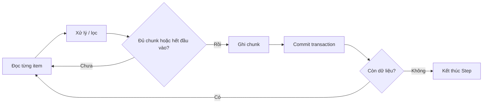

# Đo thời gian đọc, xử lý, ghi trong Spring Batch

Trong một Spring Batch job xử lý hàng triệu bản ghi, câu hỏi “job chạy chậm ở đâu?” cần được trả lời bằng số đo trước khi tăng số thread, chia partition hoặc triển khai worker từ xa. Bài này hướng dẫn đo thời gian **đọc (read)**, **xử lý (process)** và **ghi (write)** ở mức Step, kết hợp số liệu về transaction, tài nguyên và lỗi để tìm đúng nút thắt.

**Kết quả cần đạt:** thiết lập được phép đo có thể lặp lại; hiểu ý nghĩa và giới hạn của các chỉ số; biết khi nào nên tối ưu I/O, thuật toán, chunk size, connection pool hay sử dụng multi-threaded step, parallel steps, partitioning và xử lý phân tán.

## 1. Hiểu đúng vòng đời của một chunk

Với một *chunk-oriented step*, Spring Batch thường thực hiện chu trình sau:

1. Gọi `ItemReader.read()` để lấy từng item; giá trị `null` báo hết dữ liệu.
2. Gọi `ItemProcessor.process(item)` (nếu cấu hình). Kết quả `null` nghĩa là item được **lọc**, không phải lỗi.
3. Gom các item đầu ra; gọi `ItemWriter.write(Chunk<? extends T>)` để ghi một chunk.
4. Hoàn thành transaction của chunk; khi đã commit, tiếp tục chunk tiếp theo.

`read()` và `process()` thường được gọi nhiều lần trong một chunk, còn `write()` nhận cả tập item. Vì vậy **thời gian mỗi lần ghi** không thể so trực tiếp với **thời gian mỗi lần đọc** nếu chưa chuẩn hóa theo số item. Quá trình retry, skip và rollback có thể khiến cùng một item được xử lý nhiều lần; thời gian đo được phản ánh **công việc đã thực thi**, bao gồm cả lần thử thất bại.



Một phép đo chỉ bao quanh `write()` **chưa chắc bao gồm commit**. Với JDBC batch, thời gian có thể nằm trong lời gọi `write`; với JPA hay cơ chế ghi trì hoãn, phần flush/commit có thể diễn ra sau đó. Do đó cần thêm thời gian chunk/transaction và theo dõi chính database.

## 2. Những số liệu cần thu thập

| Nhóm | Chỉ số | Cách diễn giải và lưu ý |
| --- | --- | --- |
| Toàn Step | `step_wall_time` = thời điểm kết thúc − bắt đầu | Thời gian thực người vận hành phải chờ; dùng để đánh giá kết quả cuối cùng. |
| Đọc | Tổng thời gian và số lần gọi `read()`, trung bình, p95/p99 | Có thể bao gồm chờ DB, mạng, file, cache và cả lần trả `null`. |
| Xử lý | Tổng thời gian và số lần gọi `process()`, trung bình, p95/p99 | Tìm CPU-bound, API bên ngoài hay thao tác đồng bộ tốn thời gian. |
| Ghi | Tổng thời gian và số lần gọi `write(chunk)`, trung bình, p95/p99 | Đo **theo chunk**; cần kèm kích thước chunk và số item ghi. |
| Chunk/transaction | Thời gian chunk, commit, rollback, số commit/rollback | Xác định overhead transaction, lock wait, flush, retry. |
| Tiến độ | `readCount`, `filterCount`, `writeCount`, số item skip theo pha | So sánh đầu vào, dữ liệu lọc và đầu ra; các count không thay thế bộ đếm số lần callback thực chạy. |
| Hạ tầng | CPU, heap/GC, disk I/O, DB latency, DB pool, connection wait, thread pool | Phân biệt nghẽn tài nguyên với nghẽn logic xử lý. |

Đối với mỗi pha, ghi **count, total time, average, p95/p99 và lỗi** nếu cần điều tra độ trễ. Đối với Step, luôn ghi **wall-clock time**, tổng item đọc/ghi thành công và throughput:

- **Tốc độ đọc thực tế:** `readCount / step_wall_seconds` (item/s).
- **Tốc độ tạo đầu ra:** `writeCount / step_wall_seconds` (item/s).
- **Thời gian gọi ghi bình quân/chunk:** `total_write_callback_time / write_invocations`.
- **Chi phí ghi tham khảo/item:** `total_write_callback_time / số_item_đã_đưa_cho_writer`; chỉ số này phải được phân tích cùng lỗi, retry và kích thước chunk.

Lưu ý: `readCount`/`writeCount` là chỉ số tiến độ do Spring Batch quản lý; với retry hoặc rollback, chúng không nhất thiết bằng số **lần gọi** `read()`/`write()` được bộ đo thời gian ghi nhận. Không lấy `writeCount` làm mẫu số của tổng thời gian *mọi lần thử ghi* mà không giải thích sai lệch.

### Tại sao tổng thời gian các pha có thể lớn hơn thời gian Step?

Ở chế độ tuần tự lý tưởng, có thể xấp xỉ:

```text
T_step ≈ T_read + T_process + T_write + T_transaction + T_framework/other
```

Khi nhiều thread hoặc partition hoạt động đồng thời, các timer cộng **thời gian của từng callback trên mọi thread**. Chẳng hạn 4 thread cùng xử lý trong 10 giây có thể ghi tổng `process_time` xấp xỉ 40 giây, dù wall-clock chỉ 10 giây. Khi đó không được diễn giải tổng timer như “phần trăm thời gian Step” hay cộng các p95 lại để ra p95 Step. Hãy đặt kết quả theo ba góc nhìn: **wall time**, **thời gian dịch vụ cộng dồn** và **mức sử dụng tài nguyên**.

## 3. Đo ba pha bằng Micrometer

Spring Batch có tích hợp observability/Micrometer trong các phiên bản hiện đại; tên meter và mức chi tiết có thể khác nhau theo phiên bản, cấu hình và exporter. Trước hết kiểm tra meter thực sự xuất hiện trong ứng dụng. Khi cần cùng một quy ước cho từng callback, có thể bọc reader, processor, writer bằng một timer tùy chỉnh.

Ví dụ Java dưới đây dùng `MeterRegistry` và `Timer`. Reader/writer được khai báo dạng `ItemStreamReader`/`ItemStreamWriter` để **chuyển tiếp `open/update/close`**, vốn rất quan trọng với reader có trạng thái và khả năng restart.

```java
import io.micrometer.core.instrument.Timer;
import org.springframework.batch.item.Chunk;
import org.springframework.batch.item.ExecutionContext;
import org.springframework.batch.item.ItemProcessor;
import org.springframework.batch.item.ItemStreamReader;
import org.springframework.batch.item.ItemStreamWriter;

import java.util.concurrent.TimeUnit;

public final class PhaseTimers {
    private PhaseTimers() {}

    public static <T> ItemStreamReader<T> reader(
            ItemStreamReader<T> delegate, Timer timer) {
        return new ItemStreamReader<>() {
            @Override
            public T read() throws Exception {
                long start = System.nanoTime();
                try {
                    return delegate.read();
                } finally {
                    timer.record(
                        System.nanoTime() - start, TimeUnit.NANOSECONDS);
                }
            }

            @Override
            public void open(ExecutionContext context) {
                delegate.open(context);
            }

            @Override
            public void update(ExecutionContext context) {
                delegate.update(context);
            }

            @Override
            public void close() {
                delegate.close();
            }
        };
    }

    public static <I, O> ItemProcessor<I, O> processor(
            ItemProcessor<I, O> delegate, Timer timer) {
        return item -> {
            long start = System.nanoTime();
            try {
                return delegate.process(item);
            } finally {
                timer.record(
                    System.nanoTime() - start, TimeUnit.NANOSECONDS);
            }
        };
    }

    public static <T> ItemStreamWriter<T> writer(
            ItemStreamWriter<T> delegate, Timer timer) {
        return new ItemStreamWriter<>() {
            @Override
            public void write(Chunk<? extends T> items) throws Exception {
                long start = System.nanoTime();
                try {
                    delegate.write(items);
                } finally {
                    timer.record(
                        System.nanoTime() - start, TimeUnit.NANOSECONDS);
                }
            }

            @Override
            public void open(ExecutionContext context) {
                delegate.open(context);
            }

            @Override
            public void update(ExecutionContext context) {
                delegate.update(context);
            }

            @Override
            public void close() {
                delegate.close();
            }
        };
    }
}
```

Khi lắp các component này vào `StepBuilder`, dùng một meter cố định cho mỗi pha:

```java
var timedReader = PhaseTimers.reader(
    rawReader,
    registry.timer("batch.phase.duration",
        "step", "loadOrders", "phase", "read"));

var timedProcessor = PhaseTimers.processor(
    rawProcessor,
    registry.timer("batch.phase.duration",
        "step", "loadOrders", "phase", "process"));

var timedWriter = PhaseTimers.writer(
    rawWriter,
    registry.timer("batch.phase.duration",
        "step", "loadOrders", "phase", "write"));

// Đưa timedReader, timedProcessor, timedWriter vào StepBuilder.
// rawReader/rawWriter là các delegate ItemStream có sẵn.
```

**Ý nghĩa của mẫu đo:**

- Timer của `read` ghi một mẫu mỗi lần gọi, kể cả EOF và lần gọi ném exception.
- Timer của `process` ghi một mẫu mỗi item đưa vào processor, kể cả item bị lọc hay lần gọi thất bại.
- Timer của `write` ghi một mẫu **cho cả chunk**, kể cả lần ghi thất bại. Muốn biết chi phí/item phải đo thêm kích thước chunk, số lần thử ghi hoặc số item được gửi tới writer.
- Khối `finally` đo cả callback thành công lẫn thất bại. Cần đếm exception/skip/retry riêng để giải thích các đột biến latency.
- Timer dùng `System.nanoTime()` để đo thời lượng; không dùng `currentTimeMillis()` để tính độ trễ callback.

Ví dụ ưu tiên sự rõ ràng. Nếu delegate có các giao diện bổ sung như `StepExecutionListener` hay lifecycle callback được đăng ký ngầm, hãy **đăng ký listener đó tường minh** khi bọc component. Nếu reader/writer không triển khai `ItemStream`, dùng wrapper theo giao diện `ItemReader`/`ItemWriter` phù hợp. Nếu muốn biết thời gian đọc dữ liệu thực từ database, bổ sung metric tại JDBC driver, connection pool hoặc nguồn dữ liệu: đo `read()` không đảm bảo mỗi lời gọi tương ứng một truy vấn SQL.

**Giữ tag có cardinality thấp:** `step`, `phase`, `job_type` hoặc mã loại nguồn dữ liệu ổn định. Tránh gắn `jobExecutionId`, `userId`, đường dẫn file duy nhất hoặc từng mã partition làm tag cho mọi meter; có thể lưu những định danh đó trong log/tracing có kiểm soát.

## 4. Liên kết timer với số liệu của StepExecution

Timer giải thích **chi phí thực thi**, còn `StepExecution` giải thích **tiến độ và kết quả**. Tại điểm kết thúc Step (ví dụ trong `StepExecutionListener.afterStep`), ghi ít nhất:

```text
step, executionId, status, startTime, endTime
readCount, writeCount, filterCount
readSkipCount, processSkipCount, writeSkipCount
commitCount, rollbackCount
```

Sau đó ghép với tổng/percentile của các meter theo `step` và với metric hệ thống trong cùng thời gian chạy. Để so sánh giữa các lần chạy, lưu thêm khối lượng đầu vào, chunk size, cấu hình concurrency, connection pool và phiên bản code. Đừng suy ra “writer chạy 100.000 lần” từ `writeCount = 100.000`: đó là số item, trong khi writer có thể chỉ được gọi khoảng 100 lần nếu chunk size bằng 1.000.

Khi một Step được restart, phải phân biệt **lần chạy Step hiện tại** với **toàn bộ logical job**. Dữ liệu đã commit ở các lần chạy trước, retry của lần chạy này và thời gian chờ giữa các lần restart là các đại lượng khác nhau. Trong vận hành, nên theo dõi cả throughput của từng attempt và thời gian hoàn tất toàn bộ workload.

## 5. Thiết kế phép đo để có thể so sánh

Một phép benchmark có ích cần giữ ổn định dữ liệu và môi trường, sau đó **đổi từng biến tại một thời điểm**.

1. **Định nghĩa mục tiêu:** chẳng hạn 2 triệu dòng, hoàn thành dưới 15 phút, lỗi ghi được retry an toàn, không tạo trùng dữ liệu khi restart.
2. **Chốt workload:** số hàng, phân bố kích thước record, tỉ lệ filter, complexity của processor, trạng thái index và khối lượng DB sẵn có. Dùng dữ liệu đủ lớn để đại diện cho thực tế.
3. **Chạy baseline:** khởi đầu một Step tuần tự với chunk size cụ thể; ghi throughput, wall-clock, timer ba pha, số commit/rollback, CPU, GC, network/disk, DB và pool.
4. **Lặp phép đo:** có lần warm-up và nhiều lần chạy đại diện; phân biệt cache nóng/lạnh, trạng thái connection pool và sự khác biệt giữa lần đầu và các lần sau. Đặc biệt chú ý p95/p99 khi dịch vụ bên ngoài có độ trễ biến động.
5. **Chẩn đoán và đổi một biến:** thử chunk size, SQL/DB batching, thuật toán xử lý hoặc concurrency; chạy lại trên workload tương đương rồi so cả tốc độ lẫn lỗi và tài nguyên.
6. **Kiểm tra điều kiện vận hành:** cố tình thử một lần lỗi giữa chừng, retry/restart và rollback; xác minh dữ liệu cuối cùng đúng, không mất/trùng bản ghi, metric không bị hiểu sai do retry.

Một lần chạy nhanh nhưng có ít bản ghi hơn, database rỗng hơn hoặc thiếu xác thực dữ liệu **không phải** bằng chứng cải thiện throughput.

## 6. Đọc kết quả để xác định nút thắt

| Dấu hiệu | Nguyên nhân nên kiểm tra trước | Thí nghiệm phù hợp |
| --- | --- | --- |
| `read` tốn nhiều thời gian, CPU nhàn | Query chậm, fetch size, N+1 query, network latency, đọc file trên storage chậm | EXPLAIN/query plan, index, fetch size, throughput của nguồn, connection wait |
| `process` cao, CPU bão hòa | Thuật toán đắt, parse/transform nhiều, GC; hoặc processor gọi API đồng bộ | CPU profile, allocation/GC, đo latency API, thử tối ưu thuật toán trước khi tăng thread |
| `write` cao, DB CPU/I/O/lock bão hòa | Insert/update từng dòng, thiếu batch JDBC, tranh chấp index/lock, transaction lớn | JDBC batching, kiểm tra lock/transaction log, chỉnh chunk size, bulk load khi phù hợp |
| `write` cao nhưng DB nhàn; pool chờ lâu | Connection pool nhỏ hoặc thread giữ connection quá lâu | Đo pool active/pending, thời gian chờ connection, so kích thước pool với concurrency |
| Tổng ba pha nhỏ nhưng Step vẫn lâu | Commit/rollback, GC, checkpoint, framework overhead, chờ thread, khởi tạo hoặc tài nguyên ngoài callback | Đo chunk/transaction, thread dump, GC, tracing, thời gian mở/đóng stream |
| Tăng thread không tăng throughput; p99 xấu hơn | Saturation, lock contention, connection pool, áp lực GC, nguồn/đích đã hết công suất | Vẽ đường throughput theo concurrency, quan sát DB và queue/pool; giảm hoặc giới hạn concurrency |

Một nút thắt phải được xác nhận bằng **ít nhất hai loại dấu hiệu**: độ trễ ở pha liên quan và bằng chứng tài nguyên/tầng phụ trợ. Ví dụ timer ghi cao chưa đủ kết luận “CPU xử lý chậm” nếu phần lớn thời gian trong processor là chờ HTTP.

### Ví dụ phân tích

Giả sử Step nhập **120.000** đơn hàng, chạy tuần tự, không retry/skip/filter, số liệu đo được:

| Thành phần | Thời gian |
| --- | ---: |
| Đọc tất cả item | 45 giây |
| Xử lý tất cả item | 30 giây |
| Ghi tất cả chunk | 180 giây |
| Commit và overhead ngoài callback | 25 giây |
| **Tổng wall-clock** | **280 giây** |

Throughput thực tế ≈ **429 item/s**. Pha ghi chiếm **180/280 ≈ 64,3%** thời gian ở ví dụ *tuần tự*, nên ưu tiên xem JDBC batching, lock wait, index, kích thước chunk và tải database. Tăng thread ngay có thể khiến tranh chấp ghi trầm trọng hơn.

Trong một phép tính minh họa, nếu cải tiến ghi làm pha đó giảm từ 180 xuống 90 giây và các thành phần khác thực sự không đổi, Step còn khoảng **190 giây**, đạt **632 item/s**, tức nhanh hơn khoảng **1,47 lần**. Đây là **ước lượng**, không phải dự báo bảo đảm: sau khi tối ưu ghi, nút thắt có thể chuyển sang đọc hoặc xử lý. Phải benchmark lại.

## 7. Từ số đo đến chiến lược mở rộng

Mục tiêu của module *Spring Batch Scaling Operations* là mở rộng workload dữ liệu lớn bằng chiến lược phù hợp với nút thắt, đồng thời duy trì thread safety, retry/restart và khả năng vận hành. Đo ba pha cung cấp cơ sở để ra quyết định:

| Chiến lược | Khi nào đáng thử | Điều phải xác minh |
| --- | --- | --- |
| **Tối ưu Step tuần tự** | SQL, batching, chunk size hoặc thuật toán đang là nguyên nhân chính | Throughput, commit cost, dùng RAM, thời gian lock, restart |
| **Multi-threaded step** | Có công việc độc lập và CPU/I/O có dư năng lực; dữ liệu có thể đọc/ghi an toàn từ nhiều thread | Reader/writer có thread-safe hay không; state/checkpoint; thứ tự xử lý; pool và DB có chịu tải tăng |
| **Parallel steps** | Có nhiều luồng công việc độc lập, ít phụ thuộc dữ liệu | Tương tranh tài nguyên dùng chung, điều kiện kết thúc và kết quả khi Step khác thất bại |
| **Partitioning (cục bộ hoặc từ xa)** | Có thể chia tập dữ liệu thành partition không chồng lấn, cân bằng tải | Phạm vi dữ liệu mỗi partition, restart từng partition, skew, số worker, idempotency |
| **Remote chunking / mô hình phân tán** | Khả năng xử lý/ghi cần mở rộng sang node khác, chi phí truyền message chấp nhận được | Broker, delivery semantics, duplicate messages, cơ chế retry, correlation và khả năng quan sát từng node |

**Chỉ tăng concurrency sau khi biết nguồn và đích còn sức chứa.** Ví dụ Step xử lý CPU-bound có thể được lợi từ nhiều core, nhưng workload write-bound bị giới hạn bởi database sẽ không tăng tuyến tính dù tăng lên 16 thread.

Khi parallel hoặc partitioning, báo cáo đồng thời throughput tổng, p95 của từng pha, độ lệch thời gian giữa các partition, pool wait và mức bão hòa tài nguyên. Một partition xử lý 80% dữ liệu có thể quyết định thời gian hoàn thành dù các partition khác rảnh.

Trong multi-threaded step, một số reader có trạng thái không an toàn khi gọi song song. Bọc `read()` bằng synchronized adapter có thể bảo vệ truy cập nhưng biến thao tác đọc thành điểm tuần tự, đồng thời cần đánh giá nghiêm túc restartability. Partitioning với vùng dữ liệu không chồng lấn thường dễ giải thích hơn về trạng thái đọc và phục hồi, nếu dữ liệu cho phép.

## 8. Xem xét retry, restart và dữ liệu đúng

Tối ưu hiệu năng phải đi cùng tính đúng đắn:

- **Retry:** một item/chunk có thể đi qua callback nhiều lần; timer đo mọi lần thử, còn count của Step thể hiện tiến độ theo cơ chế Spring Batch. Ghi thêm số retry, exception theo loại và thời gian backoff để phân biệt xử lý chậm với lỗi lặp.
- **Rollback:** việc writer trả về không đồng nghĩa transaction đã commit. Theo dõi `rollbackCount`, commit latency và số dữ liệu thực được lưu ở hệ đích.
- **Restart:** reader có checkpoint cần lưu đúng `ExecutionContext`; không làm mất luồng `open/update/close` khi thêm decorator. Đối với đa luồng, kiểm tra lại giả định checkpoint và thứ tự item.
- **Idempotency:** khi retry, remote chunking hoặc worker thất bại, thiết kế ghi theo khóa nghiệp vụ, upsert hoặc cơ chế chống trùng phù hợp. Không giả định exactly-once chỉ vì Step báo COMPLETED.
- **Timeout và backpressure:** giới hạn số kết nối DB, yêu cầu API đồng thời và số chunk đang chờ; tăng tốc reader vô hạn có thể đẩy áp lực sang writer.

Khi so sánh hai cấu hình, chỉ công nhận cải thiện nếu số bản ghi đầu ra, tổng kiểm tra nghiệp vụ, tình trạng lỗi và khả năng restart vẫn đạt yêu cầu.

## 9. Mẫu báo cáo benchmark

Mỗi lần đo nên có một bản ghi kết quả dùng cùng đơn vị và quy ước:

```text
job=importOrders; step=loadOrders
data_size=2_000_000; filtered=0
chunk_size=500; concurrency=4; partitions=1
step_wall_seconds=...
read_count=...; write_count=...; filter_count=...
commit_count=...; rollback_count=...
read_calls=...; process_calls=...; write_calls=...
read_total_seconds=...; read_p95_ms=...
process_total_seconds=...; process_p95_ms=...
write_total_seconds=...; write_p95_ms_per_chunk=...
throughput_output_items_per_second=...
cpu_utilization=...; gc_pause=...
db_pool_active=...; db_pool_pending=...
db_wait_or_lock_latency=...
failure_and_restart_result=...
```

Cần ghi rõ **tổng callback time là thời gian cộng dồn**, p95 write đo **mỗi chunk**, và throughput lấy theo **wall-clock**. Đính kèm số liệu exporter, log/trace và dashboard cùng khoảng thời gian để người khác có thể đối chiếu.

## 10. Câu hỏi tự kiểm tra

1. Vì sao `write()` thường ít lần gọi hơn `read()`, dù hai pha xử lý cùng một khối lượng item?
2. Một Step 8 thread có tổng `process_time` là 800 giây nhưng hoàn thành sau 150 giây. Điều này có tự mâu thuẫn không?
3. Pha `write` chậm: làm thế nào phân biệt query/lock chậm với việc chờ connection pool?
4. Trong một job có rollback và retry, vì sao `writeCount` và số lần gọi writer không nhất thiết trùng nhau?
5. Khi nào nên chọn tối ưu JDBC batching trước partitioning? Khi nào partitioning giúp đảm bảo state/restart rõ ràng hơn multi-threaded step?
6. Một cấu hình nhanh hơn 30% nhưng ghi trùng khi restart có được xem là thành công không? Vì sao?

**Ghi nhớ:** quyết định mở rộng dựa trên **wall-clock throughput + thời gian các pha + dấu hiệu tài nguyên + tính đúng đắn khi lỗi**. Đo trước, xác định nút thắt, đổi một biến, rồi đo lại với cùng workload.
