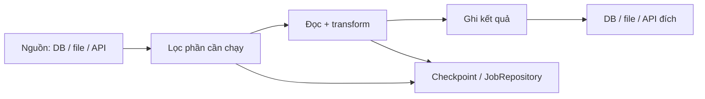

# Đo kích thước dữ liệu và tốc độ tăng để thiết kế Spring Batch có khả năng mở rộng

Một batch job xử lý ổn định hôm nay chưa chắc đáp ứng được thời gian hoàn thành sau vài tháng nếu dữ liệu tăng nhanh, kích thước mỗi bản ghi thay đổi hoặc số lượng hệ thống cùng ghi/đọc tăng lên. Vì vậy, trước khi chọn **multi-threaded step, parallel steps, partitioning hay remote processing**, cần xác định dữ liệu **lớn đến đâu, tăng nhanh thế nào và phần nào thực sự phải xử lý trong mỗi lần chạy**.

Trong chương **Phân tích nhu cầu** của module **SPRING_BATCH_SCALING_OPERATIONS**, bài học này trình bày cách đo dung lượng, số bản ghi, tốc độ phát sinh, khối lượng I/O, khả năng xử lý và xu hướng tăng trưởng; từ đó chuyển số liệu thành yêu cầu công suất, kiến trúc và kế hoạch vận hành Spring Batch. Trọng tâm là dùng phép đo đáng tin cậy để tìm nút thắt và dự trù tài nguyên, đồng thời tính đến thread safety, retry/restart và cửa sổ chạy job.

## 1. Cần đo điều gì, để trả lời câu hỏi nào?

Không nên dùng duy nhất câu nói “bảng có 200 triệu dòng” làm căn cứ thiết kế. Cùng số dòng đó, một job cập nhật 50.000 bản ghi mới mỗi ngày khác xa job quét lại toàn bộ 200 triệu dòng mỗi đêm.

| Nhóm đo lường | Câu hỏi cần trả lời | Đơn vị gợi ý |
| --- | --- | --- |
| Khối lượng hiện tại | Nguồn có bao nhiêu bản ghi và dữ liệu đang chiếm bao nhiêu dung lượng? | rows, GB/TB |
| Kích thước mỗi bản ghi | Một dòng trung bình/P95 chiếm bao nhiêu byte? Có trường JSON/BLOB lớn? | B/row, KiB/row |
| Tốc độ phát sinh | Mỗi giờ/ngày có bao nhiêu bản ghi mới, thay đổi, xóa? | rows/hour, GB/day |
| Khối lượng phải xử lý | Job chạy full load, incremental, CDC, backfill hay reprocess? | rows/run, GB/run |
| Thời gian và mức đỉnh | Dữ liệu tập trung vào giờ nào; job phải hoàn tất trước khi nào? | rows/min, phút/run |
| Đọc/ghi thực tế | Job phải đọc bao nhiêu byte, ghi bao nhiêu byte, gọi bao nhiêu API? | MB/s, writes/s, calls/s |
| Dung lượng phụ trợ | Index, WAL/redo log, staging, temp, metadata, bản sao lưu chiếm bao nhiêu? | GB/TB |
| Tăng trưởng và lưu giữ | Sản lượng tăng tuyến tính hay theo mùa? Giữ dữ liệu bao lâu? | %/tháng, ngày retention |
| Độ lệch phân bố | Có tenant, ngày, khóa hay partition nào chiếm phần lớn dữ liệu? | P50/P95/max rows/partition |

**Ba khái niệm cần tách riêng:**

1. **Dataset size**: toàn bộ dữ liệu đang lưu (ví dụ bảng giao dịch có 120 triệu dòng).
2. **Workload size**: phần dữ liệu job phải tác động trong một lần chạy (ví dụ 2,4 triệu dòng phát sinh trong ngày).
3. **Processing capacity**: tốc độ hệ thống thực tế xử lý workload đó (ví dụ 3.200 dòng/giây sau khi tính đọc, xử lý và commit).

Quy mô dữ liệu quyết định dung lượng lưu trữ và khả năng truy vấn; workload và công suất quyết định job có kịp **batch window/SLA** hay không.

## 2. Phân biệt kích thước logic, kích thước vật lý và lượng dữ liệu di chuyển

### 2.1. Kích thước logic

Một ước lượng ban đầu:

\[
S_{\text{logic}} \approx N \times \overline{s}
\]

Trong đó:

- `N`: số bản ghi thuộc phạm vi đo.
- `\overline{s}`: số byte dữ liệu logic trung bình mỗi bản ghi.
- `S_{\text{logic}}`: tổng kích thước payload ở mức dữ liệu, **chưa** bao gồm index, overhead lưu trữ, WAL hay replication.

Ví dụ có **120.000.000 dòng**, payload trung bình **900 B/dòng** thì:

\[
S_{\text{logic}} = 120.000.000 \times 900
= 108.000.000.000\text{ B} \approx 108\text{ GB}
\]

Ở đây **GB dùng hệ thập phân** (1 GB = 10⁹ byte); nếu báo cáo theo GiB (1 GiB = 2³⁰ byte) thì 108 GB xấp xỉ 100,6 GiB. Luôn ghi rõ đơn vị khi đối chiếu số liệu database và cloud storage.

Giá trị trung bình chỉ là một phần của bức tranh. Trường `description` hoặc `metadata` có kích thước biến thiên mạnh có thể làm cho các partition có số dòng bằng nhau nhưng lượng I/O khác nhau. Nên đo thêm P50, P95, P99 hoặc phân nhóm loại bản ghi khi có thể.

### 2.2. Kích thước vật lý

Dung lượng trên DB/disk thường khác kích thước logic vì:

- Header dòng, page alignment, MVCC/versioning, nén và encoding.
- Index, partition index, TOAST/LOB, materialized view.
- Dead tuples/bloat, vacuum/compaction và chiến lược lưu trữ.
- WAL/redo log, replication, backup, snapshot, data retention.
- Tệp tạm cho sort/join/hash; staging bảng trung gian và dữ liệu lỗi.

Không nên lấy `N × avgRowBytes` rồi tuyên bố đó là dung lượng đĩa cần cấp. Hãy đo riêng dữ liệu bảng, index, phần phụ trợ và mức tăng do batch write. Nên lưu đồng thời:

| Chỉ số | Ý nghĩa |
| --- | --- |
| `logical_payload_bytes` | Ước lượng kích thước dữ liệu nghiệp vụ. |
| `table_bytes` | Dung lượng vật lý bảng/heap theo hệ quản trị CSDL. |
| `index_bytes` | Dung lượng index phục vụ truy cập và ghi. |
| `total_relation_bytes` | Dung lượng vật lý do DB báo cáo cho bảng và thành phần phụ thuộc. |
| `database_storage_used_bytes` | Mức chiếm dụng trong volume/cluster. |
| `temporary_peak_bytes` | Mức tăng đỉnh khi backfill, sort, staging hoặc restart. |

### 2.3. Khối lượng dữ liệu di chuyển và nhân hệ số I/O

Một job không chỉ “đọc một lần, ghi một lần”. Nó có thể đọc dữ liệu nguồn, join/lookup qua DB khác, ghi kết quả, tạo index, ghi transaction log, đồng bộ replica và retry. Cần đo hoặc ước lượng:

\[
B_{\text{read/run}} \approx N_{\text{read}} \times s_{\text{read}}
\qquad
B_{\text{write/run}} \approx N_{\text{write}} \times s_{\text{write}}
\]

Sau đó kiểm tra **I/O amplification** (I/O thực tế chia cho payload logic) bằng monitoring DB/storage, vì giá trị này không cố định. Ví dụ một job đọc 40 GB payload nhưng tốn 160 GB đọc từ đĩa do access path và truy vấn kém hiệu quả sẽ không được cải thiện chỉ bằng tăng số worker.

## 3. Lập inventory nguồn, đích và phạm vi job

Trước khi đo, mô tả từng dòng dữ liệu đi qua hệ thống:



Với mỗi nguồn, ghi lại những thuộc tính có thể làm thay đổi lượng việc:

| Trường inventory | Ví dụ cần xác nhận |
| --- | --- |
| Tên tập dữ liệu và owner | `orders` do nhóm giao dịch quản lý |
| Định danh/scope | Một tenant, nhiều tenant, một khu vực, toàn hệ thống |
| Event time và ingestion time | Thời điểm phát sinh nghiệp vụ khác thời điểm được nạp vào DB |
| Điều kiện chọn dữ liệu | `created_at`, `updated_at`, trạng thái `PENDING`, CDC offset |
| Loại biến động | Insert, update, delete, correction/backfill |
| Retention và archive | Giữ 90 ngày online, còn lịch sử ở object storage |
| Phân bố và khóa partition | Theo ID, ngày, tenant, hash; độ lệch giữa các nhóm |
| Tính hợp lệ khi chạy lại | Có thể upsert/idempotent không, dữ liệu đến muộn thế nào? |

Đặc biệt cần phân biệt **số bản ghi thay đổi** với **số bản ghi mới**. Một bảng có 2 triệu insert và 8 triệu update/ngày có thể tạo ra workload CDC lớn hơn nhiều so với cách ước lượng chỉ từ số hàng tăng. Nếu dữ liệu có backfill/correction, đo cả sản lượng xử lý lại ngoài lịch thông thường.

## 4. Đo kích thước hiện tại từ cơ sở dữ liệu

Các câu SQL sau minh họa **PostgreSQL** với bảng `analytics.orders`. Hệ quản trị khác có công cụ thống kê, catalog và cú pháp riêng. Các phép đếm toàn bảng trên bảng lớn có thể rất tốn kém: đo vào thời gian phù hợp, cân nhắc metadata ước lượng và dùng số liệu vận hành sẵn có.

### 4.1. Dùng catalog để ước lượng nhanh

```sql
SELECT
    c.reltuples::bigint AS estimated_rows,
    pg_relation_size(c.oid) AS table_bytes,
    pg_indexes_size(c.oid) AS index_bytes,
    pg_total_relation_size(c.oid) AS total_relation_bytes
FROM pg_class AS c
WHERE c.oid = 'analytics.orders'::regclass;
```

- `reltuples` là **ước lượng** có thể cũ nếu thống kê chưa được cập nhật; không dùng như một số đếm chính xác hay cơ sở đối soát giao dịch.
- `pg_relation_size` là kích thước phần lưu trữ của relation chính; `pg_total_relation_size` bao gồm index và các thành phần phụ thuộc. Đối với bảng partitioned, cần tổng hợp đúng từng partition vật lý, không mặc định số của parent phản ánh toàn bộ dữ liệu.
- Chụp cùng loại metric vào những thời điểm cố định hằng ngày để lập chuỗi thời gian. Lưu cả thời điểm đo và DB/schema/table để tránh so sai hai scope.

Khi thật sự cần số lượng chính xác tại một snapshot và đã đánh giá tải:

```sql
SELECT COUNT(*) AS exact_rows
FROM analytics.orders;
```

Trên bảng rất lớn, `COUNT(*)` thường phải quét nhiều dữ liệu; không chạy liên tục để làm dashboard real-time. Tận dụng summary table, counter do ingest pipeline duy trì hoặc số liệu batch đã xác nhận nếu phù hợp với bài toán.

### 4.2. Lấy mẫu để hiểu kích thước dòng

```sql
SELECT
    COUNT(*) AS sampled_rows,
    AVG(pg_column_size(o)) AS avg_row_bytes,
    MAX(pg_column_size(o)) AS max_row_bytes
FROM analytics.orders AS o TABLESAMPLE SYSTEM (1);
```

Đây là **mẫu khoảng 1% page**, không bảo đảm đúng 1% hàng và có thể thiên lệch nếu dữ liệu được ghi theo ngày/tenant. `pg_column_size` cho biết kích thước biểu diễn giá trị theo PostgreSQL, không tương đương byte mạng truyền hay chi phí I/O vật lý. Với trường biến thiên mạnh, lấy mẫu phân tầng theo loại bản ghi, tenant và thời gian; kiểm tra phần payload lớn nằm ngoài hàng nếu dùng LOB/TOAST.

Có thể lưu các thông số từ lần đo vào bảng thống kê nhỏ để theo dõi dài hạn, thay vì lặp lại sampling đắt tiền trong mỗi batch run.

### 4.3. Đo theo ngày và theo tập cần xử lý

```sql
SELECT
    DATE(created_at AT TIME ZONE 'UTC') AS ingest_day_utc,
    COUNT(*) AS inserted_rows
FROM analytics.orders
WHERE created_at >= TIMESTAMPTZ '2026-11-01 00:00:00+00'
  AND created_at <  TIMESTAMPTZ '2026-11-08 00:00:00+00'
GROUP BY 1
ORDER BY 1;
```

Câu truy vấn dùng ranh giới **[bắt đầu, kết thúc)** để không đếm trùng khi ghép các ngày liên tiếp. Trong hệ thống thực, cần xác minh `created_at` có thật sự phản ánh **ingestion time** hay chỉ là event time của nghiệp vụ. Một sự kiện được tạo hôm thứ Hai nhưng đến hệ thống vào thứ Tư không nên bị vô tình bỏ sót khi batch chỉ quét dữ liệu “được tạo hôm qua”.

Với luồng cập nhật, cần riêng metric `inserted_rows`, `updated_rows`, `deleted_rows` (ví dụ theo CDC log hoặc audit table). Một truy vấn dựa trên `updated_at` có thể tính *số dòng đã thay đổi trong khoảng* nhưng không phân biệt số lần cập nhật cùng một dòng; đo số **change events** cần nguồn theo dõi sự kiện.

Đối với bảng lớn, chỉ truy vấn trên khoảng thời gian được đánh index/partition phù hợp; dùng aggregate theo giờ/ngày đã duy trì từ trước nếu yêu cầu đọc dữ liệu kéo dài.

## 5. Đo workload tại chính Spring Batch

Số liệu database cho biết quy mô nguồn; metadata của Spring Batch cho biết **job đã thực sự xử lý bao nhiêu**. `JobRepository` lưu `JobExecution` và `StepExecution` cùng các counter như:

| Counter | Cách hiểu khi đo workload |
| --- | --- |
| `readCount` | Số item reader trả về để xử lý; không nhất thiết bằng số dòng DB đã quét. |
| `writeCount` | Số item được ghi thành công theo cơ chế batch step; không đồng nghĩa số byte đích hoặc số lần gọi API. |
| `filterCount` | Item bị processor lọc bằng cách trả `null`. |
| `readSkipCount`, `processSkipCount`, `writeSkipCount` | Các item bị skip tại từng pha theo cấu hình fault tolerance. |
| `commitCount`, `rollbackCount` | Mức giao dịch/rollback, hữu ích khi dự tính overhead ghi. |
| Trạng thái và thời điểm chạy | Job kết thúc `COMPLETED`, `FAILED`, `STOPPED`; duration theo step và job. |

Không lấy `writeCount` làm mẫu số cho throughput đọc nếu processor lọc nhiều item. Khi một job xử lý 10 triệu item nhưng chỉ ghi 2 triệu, tốc độ đọc và tốc độ ghi là **hai chỉ số khác nhau**.

Mẫu code dưới đây (phong cách API Spring Batch 5.x) minh họa ghi log kết quả của step. Nó dùng đồng hồ trong JVM tại thời điểm callback để ước lượng thời gian; muốn metric lịch sử chuẩn nên tính từ timestamp đã lưu ở JobRepository hoặc hệ monitoring nhất quán.

```java
import java.time.Duration;
import java.time.LocalDateTime;
import org.slf4j.Logger;
import org.slf4j.LoggerFactory;
import org.springframework.batch.core.ExitStatus;
import org.springframework.batch.core.StepExecution;
import org.springframework.batch.core.StepExecutionListener;
import org.springframework.stereotype.Component;

@Component
public class BatchVolumeListener implements StepExecutionListener {
    private static final Logger log =
        LoggerFactory.getLogger(BatchVolumeListener.class);

    @Override
    public ExitStatus afterStep(StepExecution step) {
        LocalDateTime start = step.getStartTime();
        long elapsedMs = start == null
            ? 0L
            : Math.max(0L, Duration.between(start, LocalDateTime.now()).toMillis());

        double readPerSecond = elapsedMs > 0
            ? step.getReadCount() * 1_000.0 / elapsedMs
            : 0.0;

        log.info(
            "jobExecutionId={} stepExecutionId={} stepName={} status={} "
                + "read={} written={} filtered={} skipped={} commits={} "
                + "rollbacks={} elapsedMs={} readPerSecond={}",
            step.getJobExecutionId(),
            step.getId(),
            step.getStepName(),
            step.getStatus(),
            step.getReadCount(),
            step.getWriteCount(),
            step.getFilterCount(),
            step.getSkipCount(),
            step.getCommitCount(),
            step.getRollbackCount(),
            elapsedMs,
            readPerSecond);
        return null; // Giữ nguyên ExitStatus của step.
    }
}
```

Đăng ký listener vào step cần đo. Trong remote partitioning, nên ghi metric **tại worker step theo từng partition** và tổng hợp theo manager/job; nếu chỉ nhìn duration của manager, có thể không biết partition nào nghẽn. Đối với nhiều job/partition, dùng Micrometer/Spring Batch monitoring để theo dõi phân bố latency, throughput và lỗi, và giữ ID có cardinality lớn trong log/tracing thay vì tag lên mọi chuỗi metric.

**Lưu ý:** Counter thuộc một `StepExecution` được xác nhận sau quá trình commit và ghi metadata. Một lần retry, rollback hoặc job restart có thể làm số lượng *đã thử xử lý* khác số lượng *thực sự được ghi mới*. Chỉ đo tăng trưởng dữ liệu đích bằng số bản ghi tồn tại/thay đổi trên đích tại snapshot phù hợp, không cộng ngây thơ mọi `writeCount` của các lần chạy.

## 6. Đo tốc độ tăng dữ liệu theo thời gian

Đo dữ liệu ở nhiều thời điểm cho phép tách **tăng trưởng ròng** và **lưu lượng biến động**.

### 6.1. Tăng trưởng tuyệt đối, tương đối và theo đơn vị thời gian

Với tổng dung lượng hoặc tổng số dòng tại hai mốc:

\[
\Delta S = S_{t_2} - S_{t_1},\qquad
g_{\text{period}} = \frac{S_{t_2}-S_{t_1}}{S_{t_1}}\times100\%
\]

Khi đo liên tiếp `d` ngày:

\[
G_{\text{day}} = \frac{S_{t_2}-S_{t_1}}{d}
\]

Ví dụ dữ liệu logic tăng từ 108 GB lên 151,2 GB sau 20 ngày thì:

- Tăng ròng: `43,2 GB`.
- Bình quân: `2,16 GB/ngày`.
- Tăng so với snapshot đầu: `40% trong 20 ngày`.

Các con số không nói được toàn bộ lượng dữ liệu **đã đi qua** hệ thống nếu có xóa/retention. Ví dụ ngày đó thêm 10 GB, xóa 8 GB thì dung lượng ròng chỉ tăng 2 GB nhưng batch ingest vẫn phải xử lý 10 GB đầu vào, và DB vẫn có chi phí xóa/compaction.

### 6.2. Những kiểu tăng trưởng cần phân biệt

| Mô hình | Đặc điểm | Hệ quả triển khai |
| --- | --- | --- |
| Tuyến tính | Thêm gần như một lượng cố định mỗi ngày. | Dễ lập kế hoạch dung lượng và batch window. |
| Theo tỷ lệ / lãi kép | Sản lượng tăng `g%` mỗi chu kỳ. | Một phép ngoại suy tuyến tính dài hạn có thể thiếu công suất. |
| Theo mùa/đợt | Cuối tháng, lễ, kỳ quyết toán có đỉnh lớn. | Cần tính nhu cầu theo peak, không chỉ giá trị trung bình. |
| Theo sự kiện | Onboard tenant, import lịch sử, chiến dịch mới. | Cần kịch bản backfill và năng lực tăng tạm thời. |
| Có retention | Bản ghi cũ bị xóa/đưa sang lưu trữ lạnh. | Dung lượng sống có thể ổn định nhưng lượng ghi vẫn tăng. |
| Tăng kích thước bản ghi | JSON mới, thêm trường, file đính kèm. | Byte/day tăng dù rows/day không đổi. |

Nếu sản lượng tăng `r` mỗi tháng, mô hình minh họa:

\[
V_m = V_0(1+r)^m
\]

Trong đó `V_m` là **sản lượng phát sinh trong tháng m**, không tự động là tổng dữ liệu lưu trữ. Tổng dung lượng còn phụ thuộc xóa, retention, nén, cập nhật và việc phân vùng dữ liệu.

### 6.3. Thu thập chuỗi thời gian có chất lượng

Để so sánh được, mỗi snapshot nên lưu:

```json
{
  "capturedAt": "2026-11-26T00:00:00Z",
  "source": "analytics.orders",
  "scope": "all-active-tenants",
  "rowCount": 120000000,
  "rowCountType": "estimate",
  "logicalAvgRowBytes": 900,
  "physicalTableBytes": null,
  "physicalIndexBytes": null,
  "insertedRows24h": 2400000,
  "updatedRows24h": 800000,
  "deletedRows24h": 100000,
  "eventTimeZone": "UTC"
}
```

Giá trị `null` thể hiện metric chưa đo, không được âm thầm coi bằng 0. Ghi nguồn đo và trạng thái ước lượng/chính xác. Dùng lịch chụp nhất quán theo timezone và thời gian batch. Một vài ngày mẫu không đủ để suy ra tốc độ tăng dài hạn; cần ít nhất bao phủ chu kỳ tuần và kỳ kinh doanh có đỉnh.

## 7. Chuyển tốc độ tăng thành khối lượng công việc mỗi lần chạy

Tần suất job không đồng nhất với tốc độ phát sinh. Khi dữ liệu đến liên tục, một job chạy mỗi 15 phút, hằng giờ hoặc hằng đêm sẽ gom các lượng dữ liệu khác nhau:

\[
N_{\text{run}} \approx
\lambda_{\text{avg}}\times\Delta t + N_{\text{late}} + N_{\text{reprocess}}
\]

Trong đó `\lambda_{\text{avg}}` là tốc độ bản ghi **cần xử lý** theo đơn vị thời gian, `\Delta t` là khoảng giữa các lần chạy, còn `N_{\text{late}}` và `N_{\text{reprocess}}` là lượng bổ sung do dữ liệu đến trễ và xử lý lại. Khi cần đúng hạn, dùng **giá trị peak/P95** thay cho chỉ dùng trung bình.

Ví dụ có 2,4 triệu bản ghi mới/ngày:

| Lịch chạy | Số dòng trung bình/lần | Điều cần đánh giá |
| --- | ---: | --- |
| 1 lần/ngày | 2.400.000 | Có đủ batch window ban đêm không? |
| 1 lần/giờ | 100.000 | Peak vào giờ cao điểm có gấp nhiều lần trung bình? |
| 15 phút/lần | 25.000 | Startup, transaction và metadata overhead có đáng kể? |

Nếu job đọc cả bảng mỗi ngày, `N_run` là **toàn bộ số dòng hiện có**, không phải 2,4 triệu dòng mới. Khi dữ liệu tăng, thời gian full scan sẽ tăng theo số dòng (và cả chi phí DB), ngay cả lúc lưu lượng insert ổn định.

**Đặc biệt với incremental load:** watermark phải dựa trên thuộc tính có nghĩa rõ ràng (ingestion timestamp, CDC offset, sequence ID...) và được cập nhật **sau khi ghi dữ liệu thành công**. Dùng khoảng [from, to) hoặc checkpoint tương đương, xử lý dữ liệu đến muộn và bảo đảm writer idempotent để retry/restart không gây nhân đôi kết quả.

## 8. Dự báo dung lượng cho 30, 90 và 365 ngày

Giả sử snapshot ban đầu cho thấy:

- Tổng số dòng: **120 triệu**.
- Payload logic trung bình: **900 B/dòng**.
- Số insert trung bình mỗi ngày: **2,4 triệu**, giả định ổn định.
- Chưa áp dụng retention, xóa hoặc thay đổi kích thước dòng.

Vậy:

\[
N_d = 120.000.000 + 2.400.000d
\]
\[
S_d \approx N_d\times900\text{ B}
\]

| Mốc | Tổng dòng dự kiến | Payload logic dự kiến |
| --- | ---: | ---: |
| Ngày 0 | 120 triệu | 108 GB |
| Sau 30 ngày | 192 triệu | 172,8 GB |
| Sau 90 ngày | 336 triệu | 302,4 GB |
| Sau 365 ngày | 996 triệu | 896,4 GB |

Đây là **mô hình baseline**, không phải dự báo chính xác tuyệt đối. Hãy làm thêm ít nhất ba kịch bản:

1. **Cơ sở:** lượng insert và kích thước dòng ổn định như quan sát.
2. **Tăng nhanh:** ingest tăng theo tháng, hoặc kích thước trung bình tăng sau khi thêm trường.
3. **Đỉnh/backfill:** số dòng hoặc dung lượng tăng đột biến do import dữ liệu lịch sử.

Nếu chính sách chỉ giữ 180 ngày dữ liệu online, cần tính lượng xóa/archival theo ngày và thời gian áp dụng chính sách. Khi hệ thống đạt trạng thái ổn định và ingest không đổi, dữ liệu online từ riêng luồng insert sẽ có khoảng `2,4 triệu × 180 = 432 triệu` dòng, tương đương `388,8 GB` payload logic, **nếu mọi dòng đều sống đúng 180 ngày**. Đây không phải con số đúng ngay sau ngày 180 nếu dataset ban đầu có phân bố tuổi khác giả định.

Dung lượng cần cấp cho hệ thống phải được tính riêng theo physical storage, index, WAL, staging, backup, replica, peak/temp và khoảng trống vận hành. Không áp một hệ số cố định cho mọi DB hay mọi kiểu dữ liệu.

## 9. Biến dữ liệu thành yêu cầu throughput và số worker

### 9.1. Throughput cần đạt để không vượt SLA

Giả sử incremental batch phải xử lý 2,4 triệu item trong **20 phút**:

\[
T_{\text{minimum}} =
\frac{2.400.000}{20\times60}
=2.000\ \text{item/s}
\]

Nếu muốn giữ **25% headroom về công suất** (tức chỉ sử dụng tối đa 75% công suất quan sát được ở tình huống tương đương):

\[
T_{\text{capacity target}} =
\frac{2.000}{0,75}
\approx 2.667\ \text{item/s}
\]

Đây là mục tiêu công suất đo ở mức **end-to-end**, bao gồm đọc, xử lý, ghi, commit và overhead. Không lấy tốc độ reader thuần hoặc throughput tối đa ở vài giây đầu làm capacity của cả job.

Nếu cùng pipeline còn phải xử lý bù 600.000 item đến muộn, workload thực tế thành 3 triệu item và công suất cần được tính lại. Đặc biệt, tổng thời gian job còn có bước mở kết nối, chuẩn bị partition, tổng hợp kết quả, cleanup và khả năng overlap với job khác.

### 9.2. Ước lượng số worker rồi kiểm chứng bằng load test

Giả sử một worker đo được **650 item/s** với dữ liệu đại diện. Tại cấu hình nhiều worker, hiệu suất trung bình của từng worker chỉ còn **70%** do cạnh tranh tài nguyên. Ước lượng:

\[
P_{\text{needed}} =
\left\lceil\frac{2.667}{650\times0,70}\right\rceil
=6\ \text{worker}
\]

Con số 6 chỉ là điểm bắt đầu để **thử tải**, không phải bảo đảm hiệu năng. Tốc độ có thể không tăng tuyến tính khi nhiều worker cùng:

- Đọc cùng bảng/index, tạo thêm IOPS và DB connections.
- Ghi vào cùng bảng/khóa, tranh chấp lock hoặc tăng WAL.
- Gọi cùng API có rate limit.
- Chia quá nhiều partition nhỏ, tăng overhead điều phối.
- Dùng reader/writer không thread-safe hoặc cấu hình connection pool không đủ.

**So sánh:** Nếu thay incremental bằng full scan 120 triệu dòng, để hoàn tất trong 4 giờ cần ít nhất:

\[
\frac{120.000.000}{4\times3.600}
\approx8.333\ \text{item/s}
\]

Đó là yêu cầu lớn hơn nhiều so với incremental 2.000 item/s. Trước khi nhân thêm worker, cần cân nhắc **giảm lượng việc** bằng CDC/incremental read, index đúng cách, partition pruning hoặc xử lý theo vùng dữ liệu.

### 9.3. Thí nghiệm theo số mức song song

Giữ workload, dữ liệu và cấu hình đích tương đương rồi thử 1, 2, 4, 8 worker hoặc concurrency level phù hợp. Với mỗi điểm đo:

| Workers | Throughput end-to-end | Duration | DB CPU/IO | P95 latency/lock | Nhận định |
| ---: | ---: | ---: | --- | --- | --- |
| 1 | Đo thực tế | Đo thực tế | Đo thực tế | Đo thực tế | Baseline |
| 2 | Đo thực tế | Đo thực tế | Đo thực tế | Đo thực tế | So với 1 |
| 4 | Đo thực tế | Đo thực tế | Đo thực tế | Đo thực tế | Kiểm tra hiệu suất tăng thêm |
| 8 | Đo thực tế | Đo thực tế | Đo thực tế | Đo thực tế | Tìm điểm bão hòa |

Đừng điền các con số giả định vào bảng như thể đó là kết quả benchmark. Khi throughput đứng yên nhưng DB CPU hoặc lock tăng, bạn đã gặp nút thắt ngoài khả năng xử lý của worker. Cần tối ưu truy cập dữ liệu, transaction, partition layout hoặc giới hạn tải lên đích.

## 10. Phân tích phân bố để chọn partitioning hiệu quả

Partitioning chỉ hiệu quả khi các vùng dữ liệu tương đối độc lập và có thể chạy đồng thời. Hai partition có số dòng bằng nhau chưa chắc có cùng thời gian: một vùng chứa nhiều record lớn, nhiều API lookup hoặc dữ liệu lỗi.

Ví dụ cần đo:

- `count(*)` và byte ước lượng theo ngày, tenant, trạng thái, khoảng khóa.
- P50/P95/max thời gian thực thi partition từ `StepExecution`.
- Số skip, retry, rollback, commit theo partition.
- Độ chênh giữa partition nhanh nhất và chậm nhất.

Với `gridSize=8`, nếu bảy partition mất 1 phút nhưng partition cuối mất 12 phút, thời gian manager step vẫn bị kéo dài bởi partition cuối. Nguyên nhân thường là **data skew**, khác biệt query plan, tài nguyên đích hoặc partition phạm vi quá rộng.

Chọn khóa partition phải tính tới:

1. **Phân tách công việc:** Một item chỉ thuộc đúng một partition trong cùng lần chạy, trừ khi nghiệp vụ chấp nhận lặp có idempotency.
2. **Truy vấn có thể tối ưu:** Ưu tiên điều kiện cho phép index seek/range scan hoặc pruning; tránh tạo nhiều worker cùng full-table scan.
3. **Cân bằng tải:** Dựa vào histogram/số dòng/byte thực tế; tránh chia ID thành các khoảng bằng nhau nếu ID phân bố thưa hoặc có nhiều tenant “nặng”.
4. **Ổn định khi restart:** Phạm vi và checkpoint được lưu trong `ExecutionContext`; không tự thay quy tắc chia dữ liệu giữa chừng khiến một số bản ghi bị bỏ sót hoặc lặp.
5. **Giới hạn tài nguyên:** Đếm tổng số kết nối đến nguồn/đích, thread, heap, request/s tới API và lượng trạng thái lưu trong JobRepository.

Remote partitioning hữu ích khi cần phân phối partition qua nhiều tiến trình/máy, nhưng cũng cần đo broker backlog, thời gian dispatch/reply và chi phí metadata. Nếu bottleneck chính nằm ở storage hoặc DB nguồn, tăng số worker từ xa có thể làm tình hình tệ hơn.

## 11. Tính cả thất bại, retry, restart và dữ liệu đến muộn

**Tốc độ dữ liệu tăng** và **khối lượng xử lý thực tế** có thể lệch xa nhau khi batch thường xuyên thất bại. Một kế hoạch công suất chỉ dựa vào lần chạy thành công rất dễ thiếu năng lực xử lý bù.

Hãy đo thêm:

| Metric vận hành | Tác động tới kích thước workload |
| --- | --- |
| Số item retry và tỷ lệ retry | Làm tăng lượt đọc/ghi/API dù số item duy nhất không đổi. |
| Thời gian job bị dừng | Dữ liệu tồn đọng tích lũy cần xử lý bù. |
| Backlog lúc khôi phục | Có thể lớn gấp nhiều lần workload một chu kỳ. |
| Dữ liệu đến muộn | Phải có cửa sổ truy vấn bổ sung hoặc CDC offset đáng tin cậy. |
| Số item reprocess/backfill | Tăng tải ngoài tăng trưởng ingest thông thường. |
| Thời gian checkpoint/commit | Có thể tăng khi chunk quá lớn hoặc JobRepository quá tải. |

Ví dụ: ingest 2,4 triệu item/ngày, job dừng **3 ngày** và không có xử lý song song bù. Backlog sẽ xấp xỉ **7,2 triệu item**, chưa kể item phát sinh trong thời gian khôi phục và dữ liệu phát lại. Nếu một batch window chỉ cho phép 2,4 triệu item, cần lịch recovery riêng hoặc thêm công suất/độ dài cửa sổ.

Khi thiết kế restart, không suy diễn “còn 7,2 triệu item chưa xong” chỉ từ `readCount` của job lỗi: các chunk đã commit có thể hoàn tất, một số chunk rollback, và hệ thống ngoài có thể nhận side effect trước lúc crash. Phải đối chiếu checkpoint, trạng thái `StepExecution` và idempotency ở writer để xác định phạm vi thực sự cần xử lý lại.

## 12. Chọn chiến lược mở rộng từ phép đo

| Dấu hiệu từ số liệu | Hướng điều tra/giải pháp ưu tiên | Khi nào cân nhắc mở rộng |
| --- | --- | --- |
| Mỗi đêm quét cả bảng, trong khi dữ liệu mới rất ít | Incremental load, watermark, CDC, index/partition pruning. | Chỉ sau khi giảm phần dữ liệu không cần xử lý. |
| Processor nặng CPU, DB và đích còn dư tài nguyên | Đo CPU, memory, GC; cân nhắc multi-threaded step nếu component an toàn. | Khi scale trong một JVM còn lợi và quản lý thread safety tốt. |
| Có nhiều bước độc lập, chạy tuần tự làm tăng duration | Xem phụ thuộc dữ liệu; parallel steps. | Khi bước chạy song song không cạnh tranh tài nguyên quá mạnh. |
| Một tập dữ liệu lớn có thể chia thành vùng độc lập | Local partitioning, kiểm tra data skew và checkpoint. | Khi từng vùng có thể chạy/restart độc lập. |
| Cần nhiều máy, một JVM hết tài nguyên, dữ liệu có thể chia | Remote partitioning. | Khi broker, JobRepository và DB/đích chịu được đồng thời. |
| Manager đọc/transform rồi gửi nhiều item đã có sẵn đến worker | Đánh giá remote chunking và chi phí truyền message. | Khi chia xử lý/ghi theo chunk có lợi hơn gửi cả partition. |
| DB/đích đã bão hòa, thêm worker không tăng throughput | Tối ưu SQL/index/IO, transaction, connection pool, giảm contention. | Scale worker chỉ sau khi giải quyết rào cản này. |

Không có ngưỡng số dòng tuyệt đối như “trên 10 triệu thì phải partition”. Quyết định cần dựa vào **workload/run, kích thước mỗi item, throughput đo được, batch window, phân bố dữ liệu, độ an toàn khi restart và giới hạn tài nguyên**.

## 13. Mẫu báo cáo đánh giá trước khi thiết kế

Một báo cáo gọn cho stakeholder và nhóm vận hành có thể dùng cấu trúc:

```yaml
dataset: analytics.orders
measurement_window: "2026-10-27..2026-11-25"
timezone: UTC
baseline:
  total_rows: 120000000
  row_count_method: "estimate"
  mean_payload_bytes: 900
  logical_payload_gb: 108
growth:
  average_inserted_rows_per_day: 2400000
  average_logical_gb_per_day: 2.16
  peak_rows_per_hour: null  # Chưa đo
  updated_rows_per_day: null
job:
  mode: incremental
  interval: daily
  expected_rows_per_run: 2400000
  batch_window_minutes: 20
capacity:
  minimum_rows_per_second: 2000
  target_with_25pct_headroom_rows_per_second: 2667
risks:
  - "Phải đo peak ingest và dữ liệu đến muộn"
  - "Chưa đánh giá throughput khi nhiều worker cùng ghi"
  - "Chưa đo WAL, index và peak temporary storage"
```

Đây là **dữ liệu ví dụ** phục vụ minh họa, không phải kết quả đo một hệ thống thực. Báo cáo chính thức cần nêu phương pháp, phạm vi, thời điểm, cỡ mẫu, sai số, mức tin cậy và người chịu trách nhiệm xác nhận dữ liệu.

## 14. Bài thực hành: kiểm tra kế hoạch mở rộng bằng số liệu

Một hệ thống nhận bình quân 1,2 triệu đơn hàng/ngày, P95 ngày cao điểm là 3 triệu đơn hàng. Mỗi bản ghi đầu vào khoảng 1.000 byte. Job chạy một lần/ngày, yêu cầu hoàn tất trong 15 phút. Khi chạy thử với dữ liệu đại diện, pipeline thực tế xử lý được 1.500 item/giây.

**Câu hỏi:**

1. Khối lượng payload logic đầu vào trung bình/ngày và ở ngày P95 là bao nhiêu?
2. Throughput tối thiểu để hoàn tất đúng 15 phút tại ngày P95 là bao nhiêu?
3. Vì sao không thể kết luận chắc chắn rằng chạy hai worker sẽ đáp ứng SLA?
4. Cần đo những yếu tố nào trước khi chọn partition theo `order_id`?

**Gợi ý giải:**

- Ngày bình thường: `1,2 triệu × 1.000 B = 1,2 GB` payload logic.
- Ngày P95: `3 triệu × 1.000 B = 3 GB` payload logic.
- Cần `3.000.000 / (15 × 60) ≈ 3.334 item/s`, **chưa có headroom**.
- Hai worker chỉ đạt tối đa `2 × 1.500 = 3.000 item/s` nếu scale tuyến tính lý tưởng, nên đã thấp hơn mức cần thiết; DB contention còn có thể làm hiệu năng giảm tiếp.
- Phải xác định phân bố ID/tenant/ngày, index truy vấn, độ nặng của từng loại bản ghi, giới hạn DB/đích, transaction, khả năng chia phạm vi độc lập và cách restart partition.

Nếu đo thêm được mức dữ liệu đến muộn hoặc khả năng backlog sau outage, hãy tính lại workload và số worker ở kịch bản xấu. Mục tiêu là lập một **capacity plan có thể kiểm chứng bằng benchmark**, không chỉ dựa vào khối lượng dữ liệu trung bình.

## 15. Những sai lầm phổ biến

- **Đếm số dòng thay cho đo workload:** không phân biệt full scan và incremental.
- **Nhân số dòng với kích thước trung bình rồi coi là disk usage:** bỏ qua index, bloat, WAL, backup và replication.
- **Dựa vào một snapshot:** không thấy xu hướng tăng trưởng, peak theo ngày/giờ và thay đổi kích thước item.
- **Dùng thống kê ước lượng như số chính xác:** dẫn tới kết luận sai khi đối soát hoặc sizing tinh.
- **Chỉ đo `writeCount`:** bỏ qua item filtered, skipped, rollback, API call và dữ liệu đọc để lookup.
- **Dùng tốc độ một worker để nhân tuyến tính:** quên giới hạn database, network, broker, pool và lock.
- **Không tính restart/backlog:** công suất đủ cho ngày thường nhưng không thể xử lý bù sau sự cố.
- **Chia partition theo khoảng ID đều nhau mà không đo data skew:** tạo các worker rảnh chờ một partition rất chậm.
- **Bỏ qua data retention:** dự báo dung lượng online bị thổi phồng hoặc đánh giá thấp tác động của xóa dữ liệu.
- **Không ghi thời điểm/scope/đơn vị đo:** các nhóm báo cáo GB, GiB, payload và disk size bằng các con số không thể so sánh.

## 16. Tài liệu tham khảo và hướng tìm hiểu tiếp

- [Spring Batch Reference – Scaling and Parallel Processing](https://docs.spring.io/spring-batch/reference/scalability.html): lựa chọn multi-threaded step, parallel steps, local/remote partitioning và remote chunking.
- [Spring Batch Reference – Monitoring and Metrics](https://docs.spring.io/spring-batch/reference/monitoring-and-metrics.html): hướng đo thời gian chạy, kết quả job và step.
- [Spring Batch Reference – JobRepository](https://docs.spring.io/spring-batch/reference/job/configuring-repository.html): metadata chạy job, step và cơ chế lưu trạng thái phục vụ restart.
- [PostgreSQL Documentation – Database Object Size Functions](https://www.postgresql.org/docs/current/functions-admin.html): các hàm `pg_relation_size`, `pg_indexes_size`, `pg_total_relation_size`.
- [PostgreSQL Documentation – Planner Statistics](https://www.postgresql.org/docs/current/planner-stats.html): cách hiểu ước lượng thống kê và hạn chế của chúng.

> **Điểm cần nhớ:** Đo kích thước dữ liệu phải đi cùng đo **tốc độ tăng**, **phần dữ liệu phải xử lý trong mỗi lần chạy** và **throughput thực tế từ đầu vào đến đầu ra**. Chỉ khi có đủ bốn nhóm số liệu này mới có cơ sở chọn chiến lược mở rộng Spring Batch, ước lượng tài nguyên, đặt headroom và thiết kế retry/restart đáng tin cậy.
