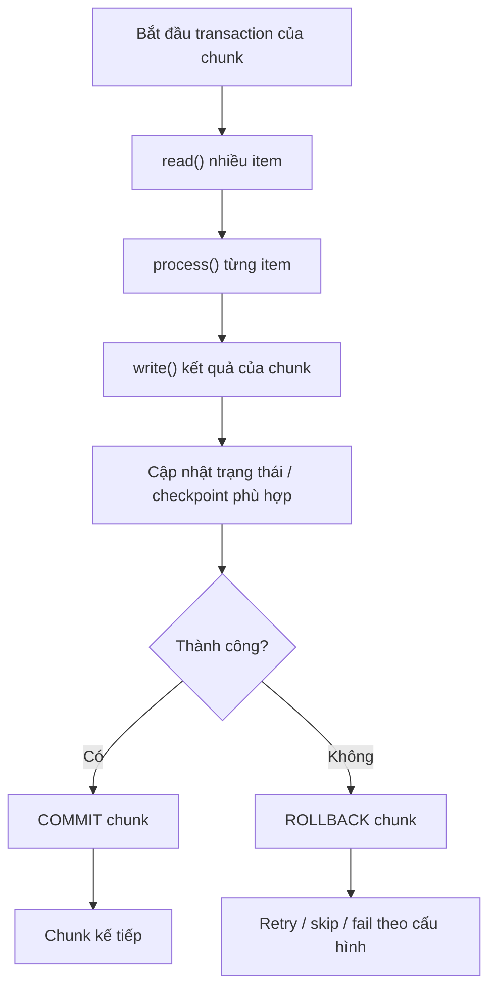
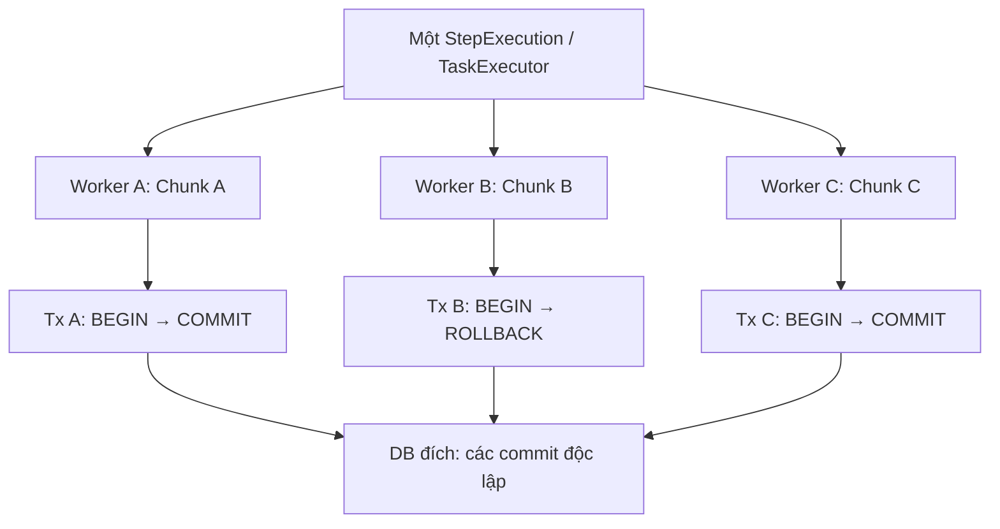

# Transaction của chunk local trong Spring Batch

## 1. Mục tiêu và bối cảnh

Trong module **SPRING_BATCH_SCALING_OPERATIONS**, chúng ta mở rộng Spring Batch cho dữ liệu lớn bằng multi-threaded step, parallel steps, partitioning và các mô hình phân tán. Tuy nhiên, tăng concurrency trước khi hiểu transaction rất dễ dẫn tới tình trạng **job báo lỗi nhưng một phần dữ liệu đã được ghi**, **retry tạo tác dụng phụ trùng lặp**, hoặc **restart bỏ sót bản ghi**.

Bài này thuộc chương **Transaction boundary** và tập trung vào **transaction của chunk local**: một chunk xử lý trong cùng ứng dụng/JVM, được Spring Batch điều phối bằng transaction manager đã gắn với step. Từ đó ta phân tích điều gì thay đổi khi nhiều chunk đồng thời chạy cục bộ và khi chuyển sang các kiến trúc mở rộng khác.

Sau khi học, bạn có thể:

- Xác định thời điểm bắt đầu, commit và rollback transaction của một chunk; phân biệt transaction của chunk với phạm vi toàn step/job.
- Giải thích khác biệt giữa **ranh giới transaction trong Spring Batch** và **khả năng rollback thực tế của nguồn/đích**.
- Dự đoán trạng thái dữ liệu sau lỗi, retry, skip và restart, kể cả khi các chunk hoàn thành khác thứ tự.
- Cấu hình chunk transaction bằng Spring Batch 5.x, biết tác động của isolation, timeout và propagation.
- Đo contention, deadlock, thời gian commit và chọn chunk size/concurrency theo tài nguyên thực tế.

> **Phạm vi:** “Local” ở đây nghĩa là các tác vụ chunk chạy trong một JVM. Nó **không mặc nhiên có nghĩa** tất cả hệ thống tham gia đều nằm trong một transaction ACID. Một local step vẫn có thể gọi API, đọc file, ghi message hoặc truy cập nhiều cơ sở dữ liệu.

## 2. Transaction boundary nằm ở đâu?

### 2.1. Khối công việc của một chunk

Với một chunk-oriented step có commit interval là 100, luồng ý niệm thường như sau:

1. Step mở transaction thông qua `PlatformTransactionManager` được cấu hình.
2. `ItemReader` lấy các item của chunk; `ItemProcessor` xử lý hoặc lọc từng item.
3. `ItemWriter` ghi tập kết quả của chunk.
4. Các thành phần `ItemStream` thích hợp cập nhật trạng thái checkpoint, và Spring Batch cập nhật metadata liên quan tới chunk.
5. Nếu toàn bộ phần việc bắt buộc trong transaction thành công, Spring Batch commit; nếu lỗi yêu cầu rollback, transaction rollback và xử lý tiếp theo tùy chính sách lỗi.



Đây là **mô hình logic** của chunk thành công. Khi bật fault tolerance, Spring Batch có thể chạy lại các thao tác, phân tách xử lý lỗi và kiểm soát rollback theo cấu hình. Việc gọi `read()` bên trong transaction cũng **không** bảo đảm thao tác đọc có thể được hoàn tác đối với mọi loại reader.

### 2.2. Transaction của chunk khác transaction của job

Giả sử một step xử lý 1.000 item và cấu hình `chunk(100, transactionManager)`, không có item bị lọc hoặc skip:

| Đơn vị | Phạm vi | Có transaction riêng? |
| --- | --- | --- |
| Job | Điều phối các step từ đầu đến cuối | Không có một transaction DB chung mặc định bao trùm toàn job |
| Step | Chạy một tập chunk và lưu tiến độ | Không có một transaction chung mặc định bao trùm mọi chunk |
| Chunk 1 | Item 1–100 | Có: transaction T1 |
| Chunk 2 | Item 101–200 | Có: transaction T2 |
| … | … | … |
| Chunk 10 | Item 901–1.000 | Có: transaction T10 |

Nếu T1–T4 đã commit và T5 rollback khiến step thất bại, kết quả của T1–T4 **không tự động bị hoàn tác**. Đó là hành vi thiết kế bình thường của batch processing. Khi restart, hệ thống phải tiếp tục một cách đúng đắn dựa trên dữ liệu đã commit và trạng thái lưu được.

Một transaction có thể chứa nhiều câu SQL và tác động tới nhiều bảng **trong cùng tài nguyên transaction**. Tuy vậy, không nên suy ra rằng “mọi lệnh gọi trong read/process/write đều thuộc một transaction ACID duy nhất” nếu chúng dùng những tài nguyên độc lập.

### 2.3. Vì sao commit theo chunk?

Đặt commit interval quá nhỏ thường làm tăng số lần commit và overhead; đặt quá lớn có thể kéo dài thời gian giữ lock, tăng lượng dữ liệu rollback và áp lực bộ nhớ.

Ví dụ 1 triệu item:

| Chunk size | Số chunk xấp xỉ | Đánh đổi chính |
| ---: | ---: | --- |
| 20 | 50.000 | Transaction ngắn nhưng chi phí commit/metadata có thể cao |
| 200 | 5.000 | Cân bằng tùy workload |
| 2.000 | 500 | Ít commit hơn nhưng transaction dài và rollback đắt hơn |

Các con số giả định không có lọc, skip hoặc thay đổi kích thước chunk. **Không có chunk size tối ưu cố định**: phải đo bằng dữ liệu, DB, query và mức song song thực tế.

## 3. Điều gì thật sự được commit/rollback?

Câu hỏi quan trọng nhất không phải “writer có chạy trong chunk không?”, mà là **“tài nguyên writer sử dụng có tham gia transaction do step mở không?”**

### 3.1. Cùng một relational database và transaction manager

Với một JDBC writer sử dụng cùng `DataSource`/transaction manager phù hợp với step, các lệnh ghi SQL trong transaction có thể được commit hoặc rollback cùng nhau.

Ví dụ chunk cập nhật 100 bản ghi vào một database:

- 99 câu cập nhật thành công; câu thứ 100 lỗi, lỗi không bị skip hoặc retry thành công.
- Khi transaction rollback, 99 câu cập nhật trước đó cũng bị rollback **nếu thực sự cùng tham gia transaction**.
- Những chunk đã commit trước đó vẫn tồn tại trong DB.

Đây là trường hợp phù hợp để tận dụng tính atomic của transaction DB. Nếu reader cũng đọc từ DB đó, việc đọc lại dữ liệu và quản lý cursor/checkpoint vẫn cần xét riêng.

### 3.2. Nhiều DB hoặc transaction manager không đồng nhất

Một chunk dùng `DataSourceTransactionManager` cho DB A nhưng processor hoặc writer lại dùng connection DB B không được enlist vào transaction A. Khi T1 rollback, thao tác đã commit riêng ở DB B **không nhất thiết rollback**.

Tương tự, `@Transactional(propagation = REQUIRES_NEW)` ở một service con có thể mở transaction độc lập, commit trước outer chunk transaction. Nếu chunk rollback sau đó, transaction con đã commit vẫn còn. `REQUIRES_NEW` không phải cách làm “an toàn hơn” cho mọi writer; nó thay đổi ranh giới commit.

Transaction phân tán (ví dụ XA/JTA) có thể điều phối nhiều tài nguyên tương thích nhưng tăng đáng kể độ phức tạp, yêu cầu hạ tầng và khả năng vận hành. Trong nhiều pipeline, thiết kế idempotent và transactional outbox đơn giản hơn là cố buộc mọi hệ thống vào một transaction phân tán.

### 3.3. File, API, message và side effect ngoài transaction DB

| Hoạt động | Khi DB transaction rollback | Thiết kế cần bổ sung |
| --- | --- | --- |
| `JdbcBatchItemWriter` dùng cùng DB transaction | Các thay đổi SQL thuộc transaction có thể rollback | Đảm bảo dùng cùng nguồn kết nối và manager phù hợp |
| Ghi file trực tiếp | Bytes đã ghi không tự động biến mất | Ghi file tạm, kiểm tra và công bố sau khi hoàn tất; cơ chế dọn dẹp |
| Gọi HTTP API | Yêu cầu thành công không bị đảo ngược vì DB rollback | Idempotency key, retry có kiểm soát, đối soát |
| Gửi email/SMS | Có thể đã gửi ra ngoài | Hàng đợi/outbox, khóa chống gửi trùng |
| Publish message độc lập | Message có thể đã được gửi dù DB rollback | Outbox, transaction của broker nếu thích hợp, xử lý trùng ở consumer |
| Cập nhật cache ngoài DB | Cache có thể phản ánh dữ liệu chưa commit | Cập nhật sau commit hoặc invalidation có kiểm soát |

**Ví dụ:** Processor gọi API thu phí, sau đó writer ghi báo cáo vào DB. API đã trừ tiền nhưng writer lỗi và transaction DB rollback. Restart chunk có thể gọi API lần nữa. Vấn đề không thể được giải quyết chỉ bằng cách tăng retry; cần khóa idempotency theo nghiệp vụ, tách side effect và cơ chế đối soát.

## 4. Ví dụ cấu hình một chunk local trong Spring Batch 5.x

Đoạn code sau minh họa cách xác lập ranh giới transaction. Các interface `Order`, `OrderRow` và các bean reader/processor/writer là thành phần nghiệp vụ cần được triển khai riêng. Cấu hình giả định writer dùng tài nguyên transaction phù hợp với `orderTransactionManager`.

```java
@Configuration
public class OrderBatchStepConfig {

    @Bean
    public Step importOrdersStep(
            JobRepository jobRepository,
            @Qualifier("orderTransactionManager")
            PlatformTransactionManager orderTransactionManager,
            ItemReader<Order> orderReader,
            ItemProcessor<Order, OrderRow> orderProcessor,
            ItemWriter<OrderRow> orderWriter) {

        return new StepBuilder("importOrdersStep", jobRepository)
                .<Order, OrderRow>chunk(200, orderTransactionManager)
                .reader(orderReader)
                .processor(orderProcessor)
                .writer(orderWriter)
                .build();
    }
}
```

Trong Spring Batch 5.x, lệnh `chunk(200, orderTransactionManager)` xác định transaction manager dùng cho chunk. Ví dụ này **chưa** bật nhiều luồng; mặc định chunk-oriented step chạy tuần tự theo các chunk.

Nếu cần quản lý thời gian giao dịch, có thể gắn `TransactionAttribute` phù hợp:

```java
DefaultTransactionAttribute txAttribute = new DefaultTransactionAttribute();
txAttribute.setPropagationBehavior(TransactionDefinition.PROPAGATION_REQUIRED);
txAttribute.setIsolationLevel(TransactionDefinition.ISOLATION_DEFAULT);
txAttribute.setTimeout(120); // giây; giá trị minh họa

Step step = new StepBuilder("importOrdersStep", jobRepository)
        .<Order, OrderRow>chunk(200, orderTransactionManager)
        .reader(orderReader)
        .processor(orderProcessor)
        .writer(orderWriter)
        .transactionAttribute(txAttribute)
        .build();
```

**Cần hiểu các tham số:**

- `PROPAGATION_REQUIRED`: tham gia transaction hiện có hoặc mở mới nếu chưa có. Khi gọi service có annotation `@Transactional`, propagation của service có thể làm thay đổi phạm vi transaction; cần xem toàn bộ call chain.
- `ISOLATION_DEFAULT`: sử dụng mức isolation mặc định của DB. Mức phù hợp phụ thuộc tính nhất quán yêu cầu, đọc dữ liệu đồng thời và hiện tượng lock/deadlock.
- `timeout = 120`: giới hạn thời gian transaction nếu transaction manager/tài nguyên hỗ trợ. Không đồng nghĩa mọi truy vấn SQL hay mọi lời gọi HTTP sẽ tự dừng chính xác sau 120 giây; cần cấu hình timeout ở các client liên quan.
- `chunk(200, …)`: đặt số item đọc cho mỗi chunk theo chính sách chunk processing, **không** phải số transaction đồng thời.

Không nên bọc toàn bộ `JobLauncher.run(...)` trong một transaction ứng dụng kéo dài để “đảm bảo atomic toàn job”. Cách này có thể giữ lock lâu, phá vỡ ý nghĩa commit theo chunk và gây khó khăn cho restart.

## 5. Rollback, retry, skip và restart hoạt động ra sao?

### 5.1. Không cấu hình fault tolerance

Giả sử chunk 1 ghi thành công 200 item, chunk 2 xử lý thêm 200 item nhưng writer gặp lỗi:

```text
Chunk 1: BEGIN -> read/process/write(200) -> COMMIT
Chunk 2: BEGIN -> read/process/write(200) -> ERROR -> ROLLBACK
Step: FAILED (nếu lỗi không được xử lý tiếp)
```

Sau khi step FAILED, 200 item chunk 1 vẫn có thể ở database đích. Còn item trong chunk 2 có thể được xử lý lại khi restart, tùy cơ chế reader và checkpoint. Tính “chính xác một lần” của từng side effect **không tự phát sinh** từ chunk transaction.

### 5.2. Retry là thử lại thao tác; rollback là hoàn tác tài nguyên

Spring Batch hỗ trợ fault-tolerant chunk step. Ví dụ chỉ retry loại lỗi truy cập dữ liệu tạm thời:

```java
return new StepBuilder("importOrdersStep", jobRepository)
        .<Order, OrderRow>chunk(200, orderTransactionManager)
        .reader(orderReader)
        .processor(orderProcessor)
        .writer(orderWriter)
        .faultTolerant()
        .retry(TransientDataAccessException.class)
        .retryLimit(3)
        .build();
```

`TransientDataAccessException` là một họ exception của Spring DataAccess. Việc chọn loại exception retry phải phù hợp với driver và nguyên nhân thực tế. Giới hạn retry tránh lặp vô hạn khi DB ngừng hoạt động hoặc dữ liệu luôn vi phạm ràng buộc.

Trong các nhánh xử lý lỗi, Spring Batch có thể rollback và thử lại item/chunk theo các quy tắc của fault-tolerant step. Vì vậy, processor và writer cần chịu được việc **cùng logic có thể được gọi nhiều lần**. Retry không hứa sẽ không có side effect trùng khi có hệ thống bên ngoài transaction.

### 5.3. Skip không phải bỏ qua rollback

Nếu nghiệp vụ cho phép bỏ bản ghi không hợp lệ, có thể sử dụng skip policy với exception phù hợp. Tuy nhiên, khi writer gặp lỗi, framework có thể cần rollback và xử lý lại để cô lập item lỗi; việc skip không đồng nghĩa phần còn lại của chunk đầu tiên luôn được commit nguyên trạng.

Đối với dữ liệu tài chính hoặc nghiệp vụ đòi hỏi toàn vẹn, cần quyết định rõ **lỗi nào được skip** và cách lưu lại input lỗi để kiểm toán. Không nên skip mọi `Exception` chỉ để job hiện trạng thái `COMPLETED`.

### 5.4. Restart cần cả checkpoint và idempotency

Spring Batch lưu thông tin `JobExecution`, `StepExecution` và `ExecutionContext` qua `JobRepository`. Với reader triển khai `ItemStream`, trạng thái đọc có thể được lưu tại checkpoint phù hợp, giúp tiếp tục sau lỗi.

Nhưng có hai điều cần tách bạch:

1. **Checkpoint đúng:** trạng thái đã lưu phản ánh nguồn dữ liệu và những gì thực sự được commit. Reader dùng cursor, trang dữ liệu hoặc biến mutable phải đáp ứng contract restart.
2. **Ghi lặp an toàn:** nếu một item được thực hiện lại, unique key, UPSERT có kiểm soát hoặc idempotency key phải ngăn kết quả nghiệp vụ bị nhân đôi.

Nếu repository metadata và dữ liệu nghiệp vụ ở **hai hệ thống transaction độc lập**, đừng mặc nhiên giả định cập nhật checkpoint và commit nghiệp vụ là atomic tuyệt đối. Cần thử nghiệm kịch bản crash ở sát thời điểm commit, đặc biệt với nguồn/đích có side effect bên ngoài.

## 6. Transaction boundary khi chạy nhiều chunk đồng thời

### 6.1. Multi-threaded step trong cùng JVM

Khi thêm `TaskExecutor`, một step có thể xử lý nhiều chunk trên nhiều worker thread. **Mỗi chunk vẫn có transaction riêng**, không có một transaction chung của tất cả worker.



Ví dụ thực tế:

| Thời điểm | Worker A | Worker B | Worker C |
| --- | --- | --- | --- |
| t1 | T_A bắt đầu | T_B bắt đầu | T_C bắt đầu |
| t2 | Ghi, chưa commit | Bị deadlock | Ghi xong, commit |
| t3 | Commit | Rollback, retry hoặc fail | Đã hoàn tất |

Không thể dựa vào thứ tự “chunk A trước B trước C” để suy ra thứ tự commit. Nếu B thất bại, A và C đã commit thường **vẫn giữ nguyên kết quả**.

Cần phân biệt **song song ở cấp chunk** với **an toàn luồng**:

- `TaskExecutor` không khiến `ItemReader`, `ItemProcessor`, `ItemWriter` hoặc `ItemStream` tự trở thành thread-safe.
- Một reader dùng chung có cursor/counter mutable có thể đọc thiếu hoặc trùng dù writer rollback đúng.
- `@StepScope` không đảm bảo mỗi worker thread có một instance reader độc lập; scope được quản lý theo step context.
- Concurrency làm tăng số transaction đang mở, connection DB sử dụng và khả năng deadlock/lock contention.

Nếu cần transaction và checkpoint độc lập cho từng dải ID/file, local partitioning thường có ranh giới state dễ kiểm soát hơn so với multi-threaded step chia sẻ reader.

### 6.2. Parallel steps và partitioning

**Parallel steps:** Hai step độc lập chạy song song; mỗi step quản lý các chunk/transaction của mình. Thành công của step A không bị tự động rollback chỉ vì step B thất bại. Nếu chúng cập nhật chung bảng, phải cân nhắc khóa, race condition và thứ tự ghi.

**Local partitioning:** Manager step chia dữ liệu thành các partition. Mỗi partition có `StepExecution` và thường có `ExecutionContext` riêng; các worker step chạy chunk theo transaction của mình. Điều này tạo ranh giới dữ liệu rõ hơn khi partition theo dải ID, thời gian hoặc file, nhưng commit của các partition vẫn độc lập, không có transaction chung bao trùm toàn job.

**Remote partitioning/remote chunking:** Khi có worker nằm ở process khác, transaction của worker thường chỉ bao trùm tài nguyên tại worker đó. Việc chuyển thông điệp qua middleware không tự biến transaction DB của manager và worker thành một transaction phân tán. Cần thiết kế delivery semantics, idempotency, retry, acknowledgements và recovery ở cấp hệ thống.

## 7. Nút thắt, contention và isolation

Tăng số worker hoặc chunk size có thể tăng throughput cho workload I/O-bound, nhưng cũng có thể làm transaction dài và xung đột nhiều hơn.

| Vấn đề | Dấu hiệu | Cách xử lý |
| --- | --- | --- |
| Transaction giữ lock quá lâu | Lock wait tăng, throughput giảm | Giảm chunk size, tối ưu SQL/index, hạn chế thao tác chậm trong transaction |
| Deadlock giữa các worker | Exception deadlock, rollback/retry tăng | Ghi bảng/row theo thứ tự nhất quán, tách dải khóa, giảm concurrency |
| Connection pool cạn | Chờ lấy connection, timeout | Xem số worker đồng thời, pool size, các query và job khác cùng dùng DB |
| Isolation quá mạnh | Block đọc/ghi, contention cao | Đánh giá yêu cầu consistency, thử mức isolation thích hợp và kiểm thử anomaly |
| Isolation quá yếu | Non-repeatable read/phantom tùy DB | Ổn định tập input, dùng điều kiện truy vấn và khóa nghiệp vụ phù hợp |
| API chậm ngay trong transaction | Transaction mở lâu dù DB ít công việc | Tách lời gọi ngoài transaction hoặc thiết kế outbox, timeout cho client |
| Ghi cùng business key | Unique violation, overwrite lẫn nhau | Chia partition theo key, unique constraint và chính sách upsert xác định |

### Isolation và tập input ổn định

Mức isolation của DB quyết định những thay đổi đồng thời có thể được nhìn thấy như thế nào; tên mức isolation giống nhau không có nghĩa mọi DB triển khai giống hệt.

Ví dụ step đọc bảng `orders` theo trang rồi cập nhật trạng thái các row. Nếu truy vấn trang dùng offset và đồng thời lọc ra các row “đã xử lý”, tập kết quả có thể dịch chuyển, dẫn đến đọc thiếu. Đây là lỗi **thiết kế truy vấn và nguồn dữ liệu**, không giải quyết chỉ bằng transaction manager.

Một số cách giảm rủi ro là dùng snapshot/input cố định cho lần chạy, sort key ổn định, phân vùng theo ID hoặc dùng keyset pagination. Phải kiểm tra với đặc tính reader và DB cụ thể.

### Chọn timeout theo mục tiêu vận hành

Transaction timeout nên đủ để một chunk hoàn thành trong điều kiện bình thường nhưng có giới hạn khi mắc kẹt. Cần đo p95/p99 latency của chunk, quan sát transaction lâu bất thường và định nghĩa cảnh báo. Timeout quá thấp làm tăng rollback/retry; timeout quá cao khiến lock bị giữ lâu lúc gặp sự cố.

## 8. Tình huống nghiệp vụ: tính tổng doanh thu theo ngày

**Yêu cầu:** Có 3 triệu dòng giao dịch nguồn; batch tạo `daily_revenue` theo khóa `(business_date, merchant_id)`. Có thể scale tới 4 worker. Khi job bị ngắt, hệ thống phải restart và kết quả cuối phải khớp với tập nguồn.

### Thiết kế chưa an toàn

- Reader lấy từng trang của tập đang bị sửa trong lúc job chạy, không có thứ tự ổn định.
- Processor gọi API bên ngoài để cập nhật điểm thưởng và không truyền idempotency key.
- Writer insert vào bảng báo cáo nhưng không có unique constraint.
- Chạy 4 worker; nếu một chunk rollback sau khi API đã phản hồi thành công, restart có thể gọi API lần nữa.

Trong tình huống này, transaction DB của chunk có thể vẫn hoạt động hoàn hảo, nhưng kết quả toàn hệ thống **không nhất quán**.

### Thiết kế có thể kiểm chứng

1. Chốt phạm vi input cho `business_date`, đảm bảo cách phân trang hoặc phân vùng không bỏ sót khi bảng nguồn thay đổi.
2. Dùng khóa nghiệp vụ duy nhất cho báo cáo, viết lại cùng input không sinh thêm record trái mong đợi. Nếu tính tổng theo nhóm, tránh thực hiện `current_total = current_total + amount` lặp lại mà không có cơ chế chống trùng.
3. Để công việc có thể commit cùng DB trong transaction chunk khi thích hợp. Nếu cần gọi API hoặc gửi sự kiện, ghi một **outbox record** cùng transaction DB rồi cho tiến trình khác gửi theo chính sách idempotent.
4. Chạy baseline 1 worker; kiểm tra logic đúng và restart sau khi tiêm lỗi. Sau đó thử 2 và 4 worker khi reader/writer đã được đánh giá thread-safe hoặc mỗi partition có state độc lập.
5. Đối soát tập khóa, tổng tiền, số lần gọi API/message, tỷ lệ rollback, thời gian transaction, deadlock và thời gian job.

**Kịch bản tiêm lỗi:** Cho worker B gặp DB timeout trước commit; A và C đã commit. Restart cùng `JobInstance` hợp lệ, kiểm tra mọi key nghiệp vụ và số tổng ở `daily_revenue`. Kết quả đúng phải **không thiếu, không trùng, không cộng dồn hai lần**, bất kể thứ tự chunk đã commit.

## 9. Chọn mô hình giao dịch theo kiến trúc

| Tình huống | Ranh giới phù hợp | Lưu ý |
| --- | --- | --- |
| JDBC đọc/ghi một DB, item độc lập | Transaction DB theo chunk | Tận dụng commit/rollback của cùng tài nguyên; vẫn kiểm tra checkpoint |
| Cùng DB, throughput tăng bằng nhiều thread | Transaction riêng cho từng chunk song song | Reader/writer thread-safe, giới hạn connection, tránh deadlock |
| Mỗi nhóm ID/file có thể xử lý riêng | Transaction theo chunk của từng partition | `StepExecution` và trạng thái riêng giúp kiểm soát restart |
| Nhiều nhánh nghiệp vụ độc lập | Parallel steps, transaction chunk theo từng step | Không có rollback nguyên job |
| DB + gọi HTTP/event | DB chunk transaction + outbox/idempotency | API/event không tự rollback cùng DB |
| Nhiều DB cần atomicity chặt | Cân nhắc JTA/XA **chỉ nếu thực sự cần và được hỗ trợ** | Chi phí vận hành và recovery cao |
| Worker phân tán qua nhiều máy | Transaction cục bộ của worker + delivery/retry/idempotency | Không mặc nhiên có distributed ACID |

Không nên chọn kiến trúc chỉ dựa trên sơ đồ luồng xử lý. Hãy bắt đầu từ yêu cầu: **cái gì phải commit cùng nhau, cái gì có thể chạy lại, và bao nhiêu dữ liệu đã commit được chấp nhận khi job fail?** Những câu trả lời này quyết định ranh giới transaction thích hợp.

## 10. Checklist kiểm thử và quan sát vận hành

Trước khi tăng concurrency hoặc thay đổi commit interval, chuẩn bị các bằng chứng sau:

| Nhóm kiểm tra | Tiêu chí có thể xác minh |
| --- | --- |
| Commit/rollback | Một lỗi SQL cuối chunk có rollback các câu SQL cùng transaction không? |
| Retry | Lỗi tạm thời có được retry đúng giới hạn? Processor/writer có chịu được gọi lặp? |
| Restart | Sau crash sát thời điểm commit, chạy lại có tạo thiếu/trùng hoặc side effect lặp không? |
| Checkpoint | `ExecutionContext` và trạng thái reader có phản ánh dữ liệu đã commit? |
| Thread safety | Với nhiều worker, thứ tự đọc/ghi và state chia sẻ có gây race condition không? |
| Pool và lock | Active connections, connection wait, lock wait, deadlocks ở mức nào? |
| Hiệu năng | Throughput, thời gian chunk p95/p99, commit/rollback count thay đổi ra sao? |
| Tính đúng nghiệp vụ | Count, checksum hoặc tập business key có khớp dữ liệu kỳ vọng? |
| Khả năng vận hành | Có log theo job/step/chunk, cảnh báo lỗi, ngưỡng retry và hướng dẫn recovery? |

**Thí nghiệm nhỏ:** Dùng 10.000 item và chunk size 100 trên một DB thử nghiệm. Cho writer cố tình ném exception ở chunk thứ năm sau khi thực hiện một số lệnh SQL nhưng trước commit. Xác minh chỉ dữ liệu của bốn chunk đã commit xuất hiện tại DB. Sau đó thử retry/restart với writer idempotent và đo chênh lệch khi tăng worker từ 1 lên 4. Khi bật concurrency, không nên giả định “chunk thứ năm” theo ID là transaction thất bại thứ năm vì thứ tự hoàn tất có thể khác nhau.

Khi phân tích số liệu, `commitCount`/`rollbackCount` trong `StepExecution` là chỉ báo tiến độ và lỗi giao dịch, **không thay thế** việc đối soát kết quả thực tế tại DB hoặc hệ thống đích.

## 11. Những hiểu lầm thường gặp

**“Một job chạy xong hoặc thất bại như một transaction duy nhất.”** Sai trong chunk-oriented processing thông thường. Các chunk đã commit có thể giữ lại dữ liệu dù chunk sau làm step fail.

**“Processor nằm trong chunk nên mọi thao tác của nó đều rollback.”** Không đúng với API, file, email hay service tự mở transaction độc lập.

**“Retry sẽ khắc phục dữ liệu bị lặp.”** Retry giúp vượt lỗi tạm thời; nếu thao tác không idempotent, retry có thể tạo bản ghi hoặc side effect trùng.

**“Step chạy bốn thread thì có một transaction xử lý bốn chunk.”** Mỗi chunk được thực thi theo ranh giới transaction của chính nó. Những chunk khác có thể commit trong khi một chunk rollback.

**“Chunk size càng lớn càng nhanh.”** Không chắc. Thời gian giữ lock, contention, memory và chi phí rollback có thể khiến throughput tệ hơn.

**“Thêm partitioning sẽ bảo đảm atomicity toàn job.”** Partitioning tách workload và trạng thái; commit của mỗi chunk ở mỗi partition vẫn độc lập.

## 12. Tự kiểm tra kiến thức

1. Một step có 12 chunk; 7 chunk đã commit và chunk thứ 8 lỗi khiến step FAILED. Có tự động rollback bảy chunk đầu không? Vì sao?
2. Tại sao gọi REST API trong processor có thể gây giao dịch nghiệp vụ bị thực hiện hai lần dù DB writer dùng cùng transaction manager với step?
3. Khi chạy multi-threaded step, điều gì bảo đảm các chunk đã commit trước vẫn không bị ảnh hưởng bởi rollback của chunk khác? Những rủi ro nào vẫn còn?
4. Nếu đang đọc dữ liệu bằng truy vấn phân trang trên bảng được cập nhật đồng thời, chỉ tăng isolation level có luôn tránh được bỏ sót hay không?
5. Một hệ thống cần ghi DB và phát sự kiện cho consumer. Bạn sẽ đặt ranh giới chunk transaction ở đâu và xử lý delivery/retry như thế nào?

**Gợi ý cho câu 2:** API thường nằm ngoài transaction DB của chunk. Nếu API thành công nhưng writer DB rollback, thử lại chunk có thể phát sinh một lệnh API thứ hai. Nên thiết kế idempotency hoặc transactional outbox theo yêu cầu nghiệp vụ.

## 13. Tóm tắt cần nhớ

- **Chunk transaction** là đơn vị commit/rollback của chunk-oriented step; một job và một step thông thường chứa nhiều transaction độc lập.
- Transaction manager chỉ điều phối những tài nguyên thực sự tham gia transaction đó. Đừng đồng nhất “code chạy trong chunk” với “mọi side effect đều rollback”.
- Retry, skip và restart đòi hỏi reader/checkpoint đúng và writer/idempotency an toàn, đặc biệt khi có API, file hoặc nhiều DB.
- Khi scale bằng multi-threaded step, parallel steps hay partitioning, ranh giới transaction không tự hợp nhất; số transaction đồng thời và nguy cơ contention tăng.
- Hãy đo thời gian transaction, lock, connection, rollback, throughput **cùng với độ đúng của dữ liệu** trước khi thay đổi chunk size hoặc số worker.
