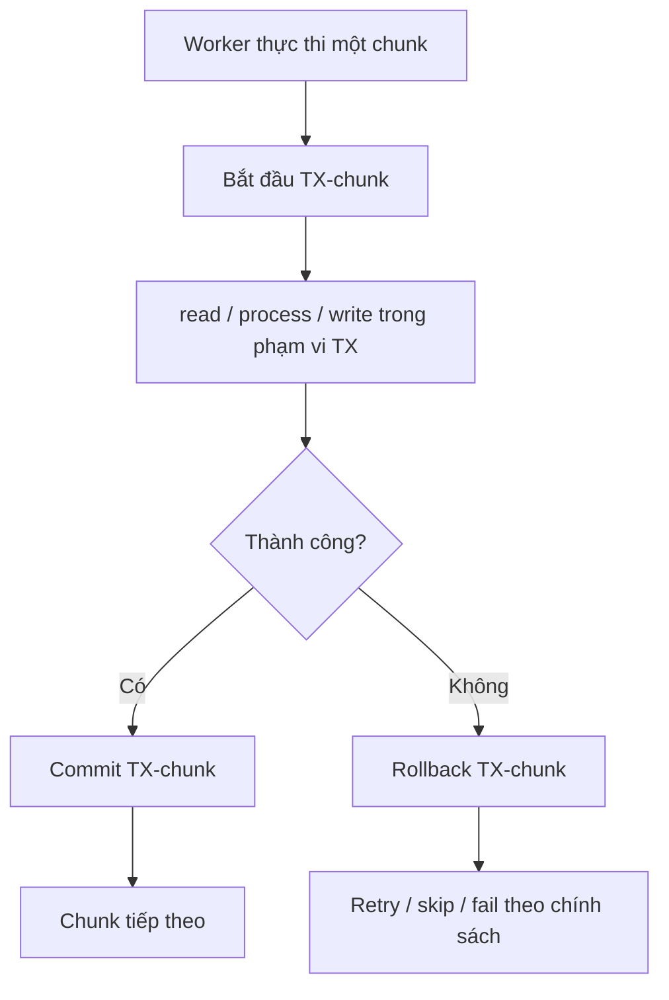
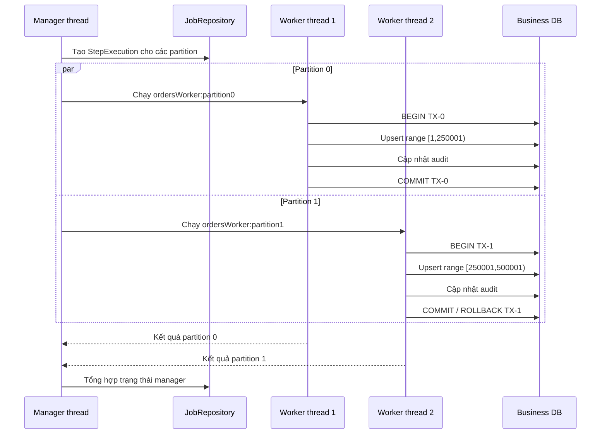

# Transaction trong worker thread của Spring Batch

## Mục tiêu học tập

Sau bài này, bạn có thể:

- Xác định transaction được mở, commit và rollback ở **thread nào** trong một job Spring Batch chạy song song.
- Phân biệt transaction của **chunk**, transaction của **worker step** và transaction của phương thức `@Transactional` được gọi từ thread khác.
- Hiểu sự khác biệt về vị trí xử lý giữa **Spring Batch 5.2** và **Spring Batch 6.1**, đặc biệt với multi-threaded step.
- Cấu hình local partitioning có transaction độc lập cho từng worker; tránh kỳ vọng transaction tự động lan qua `TaskExecutor` hoặc `@Async`.
- Thiết kế retry/restart, idempotency, connection pool và phép đo để mở rộng batch mà vẫn giữ đúng ranh giới dữ liệu.

## 1. Nguyên lý: transaction gắn với thread đang thực thi

Với transaction kiểu imperative của Spring Framework, `PlatformTransactionManager` quản lý ngữ cảnh transaction và tài nguyên liên quan (chẳng hạn JDBC connection) trong **thread hiện tại**, thường qua `TransactionSynchronizationManager`. Khi luồng A mở transaction rồi giao việc cho luồng B bằng `TaskExecutor`, `CompletableFuture` hoặc `@Async`, transaction của A **không tự động trở thành transaction của B**.

```text
Thread A (điều phối)                 Thread B (worker)
--------------------                ---------------------
start transaction TX-A              [không nhận TX-A]
  submit(work) ------------------->  thực hiện work
  ...                                 nếu cần: mở TX-B
commit / rollback TX-A                commit / rollback TX-B
```

TX-A và TX-B có vòng đời riêng. `@Transactional(propagation = REQUIRED)` được gọi **qua Spring proxy** trong worker sẽ tham gia transaction **đã hoạt động trên chính worker thread** hoặc mở transaction mới trên thread đó. Nó không thể “tìm” transaction đang hoạt động trên thread điều phối. Với `MANDATORY`, lời gọi sẽ lỗi nếu worker chưa có transaction.

Khái niệm này phải được đặt trong đúng kiến trúc Spring Batch: framework có thể tự mở transaction **ở worker** nếu worker thực thi cả chunk/step; ngược lại, nếu framework chỉ chuyển một phần việc sang worker, phần việc đó không nhất thiết được bao trong transaction chunk. Do đó, chỉ nhìn thấy `.taskExecutor(...)` là chưa đủ để kết luận `ItemProcessor` hoặc `ItemWriter` đang chạy trong transaction nào.

### Chunk transaction bao phủ việc gì?

Một chunk-oriented step xử lý tối đa một số item theo `chunkSize`, sau đó commit. Trong luồng xử lý chunk đồng bộ thông thường, các thao tác read/process/write có thể diễn ra trong cùng transaction chunk do `PlatformTransactionManager` của step quản lý (phụ thuộc reader, writer và nguồn dữ liệu có thực sự tham gia transaction hay không).



Transaction của DB **không thể rollback** một HTTP request đã thành công, thông báo gửi ra broker ngoài transaction hoặc thay đổi của hệ thống không cùng tham gia transaction. Những side effect ấy cần chiến lược idempotency/outbox hoặc điều phối nhất quán riêng.

## 2. Chú ý phiên bản: “worker thread” không luôn làm cùng một việc

Khác biệt này đặc biệt quan trọng khi học mở rộng Spring Batch hoặc nâng phiên bản:

| Kiến trúc | Vị trí công việc | Ranh giới transaction cần hiểu |
| --- | --- | --- |
| **Spring Batch 5.2 – multi-threaded step** với `.taskExecutor(...)` | Các chunk được thực thi trên nhiều worker thread: đọc, xử lý, ghi chunk | Framework mở transaction **cho từng chunk tại worker thực thi chunk**. Reader/writer dùng chung giữa chunk song song phải được kiểm tra thread safety. |
| **Spring Batch 6.1 – multi-threaded step** với `.taskExecutor(...)` | `ItemReader`/`ItemWriter` chạy tuần tự trên thread điều khiển step; `ItemProcessor` chạy song song trên worker thread | Worker processor **không tự tham gia transaction chunk** ở thread điều khiển. Nếu processor cần DB transaction, phải tự mở transaction trên worker. |
| **Local partitioning** | Mỗi partition có `StepExecution`/worker step riêng; worker có thể chạy trên các thread khác nhau | Mỗi worker step quản lý transaction các chunk/tasklet của **chính nó**; không có một transaction bao trùm tất cả partition. |
| **Parallel steps** | Các step/flow chạy đồng thời | Mỗi step có transaction tương ứng với cấu hình step; không có một transaction tự lan giữa các flow. |
| **Remote partitioning / remote chunking** | Công việc chuyển sang process/JVM khác | Không thể truyền JDBC transaction qua message. Worker phải tự quản lý commit/rollback và xử lý gửi lại thông điệp. |

**Phạm vi của ví dụ cấu hình bên dưới:** API `StepBuilder(..., jobRepository)` và `chunk(size, transactionManager)` được trình bày theo Spring Batch **5.2.x**. Ở Spring Batch **6.1**, API và cơ chế multi-threaded step có thay đổi; cần đọc tài liệu đúng phiên bản trước khi áp dụng ví dụ multi-threaded step. Nguyên tắc transaction gắn với thread vẫn giữ nguyên.

### Minh họa: multi-threaded step trên Spring Batch 5.2

Đoạn dưới là cấu hình chính, giả sử `reader`, `processor`, `writer` đã được khai báo thành các bean phù hợp và được kiểm tra an toàn khi truy cập đồng thời:

```java
@Bean
Step concurrentStep(JobRepository repository,
                    PlatformTransactionManager transactionManager,
                    ItemReader<OrderRow> reader,
                    ItemProcessor<OrderRow, OrderRow> processor,
                    ItemWriter<OrderRow> writer,
                    @Qualifier("chunkExecutor") TaskExecutor executor) {
    return new StepBuilder("concurrentStep", repository)
            .<OrderRow, OrderRow>chunk(100, transactionManager)
            .reader(reader)
            .processor(processor)
            .writer(writer)
            .taskExecutor(executor)
            .build();
}
```

Trong Spring Batch 5.2, khi chunk thứ nhất chạy ở `chunk-worker-1` và chunk thứ hai ở `chunk-worker-2`, mỗi chunk có transaction riêng trên thread của nó. Không suy ra rằng hai chunk chia sẻ cùng transaction chỉ vì chúng thuộc một `StepExecution`. Reader dùng chung giữa các thread cần được đánh giá đặc biệt: nhiều reader giữ cursor/offset mutable và không an toàn cho multi-threaded step.

Trong Spring Batch 6.1, **không dùng mô tả trên để suy luận vị trí transaction**: framework đưa processor sang worker, còn read/write nằm ở thread thực thi step. Nếu processor được gọi với `@Transactional(REQUIRED)` qua Spring proxy, phương thức đó có thể mở transaction riêng tại worker; commit của nó không bị hoàn tác tự động khi chunk transaction phía điều khiển rollback. Khi cần xử lý cả chunk song song, hãy cân nhắc cơ chế **local chunking** của 6.x hoặc partitioning và chủ động xác định transaction ở delegate worker.

## 3. Ví dụ rõ transaction boundary: local partitioning

Ta có bảng `source_order(id, payload)` và `target_order(id, payload)` trên PostgreSQL. Dữ liệu nguồn có ID từ `1` đến `1_000_000`. Bốn worker nhận bốn khoảng **không chồng lấn** `[fromId, toId)`. Mỗi worker chạy một tasklet và một transaction độc lập; manager chỉ chia việc và tổng hợp kết quả.

Ví dụ dùng tasklet để dễ quan sát transaction: **mỗi partition được xử lý trong một transaction**. Với partition rất lớn, phải chuyển sang worker step kiểu **chunk-oriented** để giảm thời gian giữ transaction/lock và có checkpoint theo chunk.

```sql
CREATE TABLE source_order (
    id BIGINT PRIMARY KEY,
    payload TEXT NOT NULL
);

CREATE TABLE target_order (
    id BIGINT PRIMARY KEY,
    payload TEXT NOT NULL
);

CREATE TABLE order_range_audit (
    partition_name VARCHAR(100) PRIMARY KEY,
    source_rows BIGINT NOT NULL
);
```

### Cấu hình manager và worker

```java
import java.util.LinkedHashMap;
import java.util.Map;

import org.springframework.batch.core.Job;
import org.springframework.batch.core.Step;
import org.springframework.batch.core.job.builder.JobBuilder;
import org.springframework.batch.core.partition.support.Partitioner;
import org.springframework.batch.core.repository.JobRepository;
import org.springframework.batch.core.step.builder.StepBuilder;
import org.springframework.batch.core.step.tasklet.Tasklet;
import org.springframework.batch.item.ExecutionContext;
import org.springframework.batch.repeat.RepeatStatus;
import org.springframework.beans.factory.annotation.Qualifier;
import org.springframework.context.annotation.Bean;
import org.springframework.context.annotation.Configuration;
import org.springframework.core.task.TaskExecutor;
import org.springframework.jdbc.core.JdbcTemplate;
import org.springframework.scheduling.concurrent.ThreadPoolTaskExecutor;
import org.springframework.transaction.PlatformTransactionManager;
import org.springframework.transaction.support.TransactionSynchronizationManager;

@Configuration
class OrderPartitionTransactionConfig {

    @Bean
    Job ordersJob(JobRepository repository,
                  @Qualifier("ordersManagerStep") Step manager) {
        return new JobBuilder("ordersJob", repository)
                .start(manager)
                .build();
    }

    @Bean
    Step ordersManagerStep(JobRepository repository,
                           @Qualifier("ordersWorkerStep") Step worker,
                           @Qualifier("ordersPartitioner") Partitioner partitioner,
                           @Qualifier("partitionExecutor") TaskExecutor executor) {
        return new StepBuilder("ordersManager", repository)
                .partitioner("ordersWorker", partitioner)
                .step(worker)
                .gridSize(4)
                .taskExecutor(executor)
                .build();
    }

    @Bean
    Step ordersWorkerStep(JobRepository repository,
                          PlatformTransactionManager transactionManager,
                          JdbcTemplate jdbc) {
        Tasklet tasklet = (contribution, chunkContext) -> {
            var stepExecution = contribution.getStepExecution();
            ExecutionContext context = stepExecution.getExecutionContext();
            long fromId = context.getLong("fromId");
            long toId = context.getLong("toId");

            boolean active =
                    TransactionSynchronizationManager.isActualTransactionActive();
            System.out.printf("step=%s thread=%s txActive=%s range=[%d,%d)%n",
                    stepExecution.getStepName(),
                    Thread.currentThread().getName(), active, fromId, toId);

            if (!active) {
                throw new IllegalStateException("Expected worker transaction");
            }

            // Hai câu lệnh JDBC dùng cùng DataSource/transaction manager.
            // Lỗi ở câu lệnh thứ hai sẽ rollback cả việc ghi target_order.
            jdbc.update("""
                    INSERT INTO target_order(id, payload)
                    SELECT id, payload FROM source_order
                    WHERE id >= ? AND id < ?
                    ON CONFLICT (id) DO UPDATE
                    SET payload = EXCLUDED.payload
                    """, fromId, toId);

            Long sourceRows = jdbc.queryForObject(
                    "SELECT COUNT(*) FROM source_order WHERE id >= ? AND id < ?",
                    Long.class, fromId, toId);

            jdbc.update("""
                    INSERT INTO order_range_audit(partition_name, source_rows)
                    VALUES (?, ?)
                    ON CONFLICT (partition_name) DO UPDATE
                    SET source_rows = EXCLUDED.source_rows
                    """, stepExecution.getStepName(), sourceRows);

            return RepeatStatus.FINISHED;
        };

        return new StepBuilder("ordersWorker", repository)
                .tasklet(tasklet, transactionManager)
                .build();
    }

    @Bean
    Partitioner ordersPartitioner() {
        return gridSize -> {
            // Cố định khoảng dữ liệu cho ví dụ; giữ ổn định khi restart.
            long firstId = 1L;
            long endExclusive = 1_000_001L;
            int count = Math.max(1, gridSize);
            long total = endExclusive - firstId;
            long base = total / count;
            long remainder = total % count;
            long start = firstId;

            Map<String, ExecutionContext> partitions = new LinkedHashMap<>();
            for (int i = 0; i < count; i++) {
                long size = base + (i < remainder ? 1 : 0);
                if (size == 0) break;

                ExecutionContext context = new ExecutionContext();
                context.putLong("fromId", start);
                context.putLong("toId", start + size);
                partitions.put("partition" + i, context);
                start += size;
            }
            return partitions;
        };
    }

    @Bean
    TaskExecutor partitionExecutor() {
        ThreadPoolTaskExecutor executor = new ThreadPoolTaskExecutor();
        executor.setCorePoolSize(4);
        executor.setMaxPoolSize(4);
        executor.setQueueCapacity(8);
        executor.setThreadNamePrefix("partition-worker-");
        executor.initialize();
        return executor;
    }
}
```

**Điều kiện cần để ví dụ có ý nghĩa:** `JdbcTemplate` dùng `DataSource` được quản lý bởi `PlatformTransactionManager` truyền vào worker step. Nếu writer thao tác trên một DB/connection khác không tham gia transaction, rollback của worker không thể bảo đảm hoàn tác các thao tác đó. SQL `ON CONFLICT` là cú pháp PostgreSQL; cần điều chỉnh theo cơ sở dữ liệu thực tế.

### Diễn biến transaction



Sơ đồ mô tả ranh giới **logic** của transaction nghiệp vụ; các thao tác cập nhật metadata JobRepository có transaction riêng theo cấu hình repository/transaction manager. Không được mặc định hai nguồn dữ liệu hay hai transaction manager cùng tham gia một transaction phân tán.

Trong ví dụ, nếu transaction của `partition1` rollback, transaction của `partition0` đã commit **không bị rollback theo**. Manager có thể kết thúc `FAILED` dù một số partition đã ghi dữ liệu. Khi restart, framework sử dụng trạng thái partition và cấu hình restart để tiếp tục; vì vậy reader/writer phải an toàn khi chạy lại.

## 4. Chunk transaction trong một partition

Đối với workload lớn, worker thường là chunk-oriented step. Mỗi partition sở hữu `StepExecution` riêng, còn mỗi chunk là một đơn vị commit/rollback trong worker đó. Cấu hình dưới đây **thay thế tasklet worker** của ví dụ bằng reader/processor/writer đã được định nghĩa riêng:

```java
@Bean
Step chunkWorker(JobRepository repository,
                 PlatformTransactionManager transactionManager,
                 ItemReader<OrderRow> partitionReader,
                 ItemProcessor<OrderRow, OrderRow> processor,
                 ItemWriter<OrderRow> writer) {
    return new StepBuilder("ordersWorker", repository)
            .<OrderRow, OrderRow>chunk(200, transactionManager)
            .reader(partitionReader)
            .processor(processor)
            .writer(writer)
            .build();
}
```

`partitionReader` nên là bean `@StepScope` nhận `fromId`/`toId` qua `stepExecutionContext`; reader có trạng thái và checkpoint phải được quản lý theo từng `StepExecution`. **Mỗi worker chỉ có một luồng chunk tại một thời điểm** trong cấu hình này; concurrency đến từ nhiều partition. Đừng tự thêm executor bên trong worker step khi chưa kiểm chứng thread safety của reader, writer, checkpoint và transaction.

Một partition xử lý 20.000 bản ghi với `chunk(200)` sẽ có khoảng 100 lần commit thay vì một transaction dài. Nếu chunk thứ 38 lỗi, các chunk đã commit trước đó không được tự động hoàn tác; cơ chế retry/restart sẽ dựa trên trạng thái chunk đã lưu và khả năng lặp lại an toàn của thao tác ghi.

### Tại sao `@StepScope` chưa giải quyết transaction?

`@StepScope` làm cho bean có vòng đời theo `StepExecution`, ví dụ tạo một reader riêng cho mỗi partition. Nó **không truyền transaction** từ một thread sang thread khác. Một worker partition có thể sở hữu đúng reader riêng mà vẫn gọi `CompletableFuture.runAsync(...)` bên trong processor: công việc được gửi vào thread mới không tham gia transaction chunk của thread gọi.

## 5. `@Transactional` trong worker: `REQUIRED`, `REQUIRES_NEW` và `MANDATORY`

| Cấu hình | Khi gọi qua proxy trên worker thread | Rủi ro cần cân nhắc |
| --- | --- | --- |
| `REQUIRED` (mặc định) | Tham gia transaction đang hoạt động **ở chính worker**, hoặc mở mới nếu chưa có | Trong Spring Batch 6.1, processor worker có thể mở transaction riêng ngoài chunk TX |
| `MANDATORY` | Chỉ hoạt động khi worker đang có transaction | Hữu ích để phát hiện gọi ngoài TX; trong processor worker 6.1 có thể báo lỗi |
| `REQUIRES_NEW` | Tạm ngưng transaction hiện tại trên cùng thread (nếu có), mở transaction vật lý riêng | Có thể commit dù chunk ngoài rollback; tăng nhu cầu connection, gây cạn pool |
| `NESTED` | Dùng savepoint của transaction hiện tại nếu transaction manager hỗ trợ | Không tạo một transaction chung giữa các thread; hỗ trợ tùy JDBC/transaction manager |

Một phương thức `@Transactional` chỉ được chặn bởi Spring transaction interceptor khi lời gọi đi qua proxy thích hợp. Gọi `this.save(...)` tới phương thức được annotate trong cùng bean có thể **bỏ qua proxy**. Tương tự, đặt `@Transactional` lên một lambda `Runnable` rồi tự gọi lambda không tạo transaction. Với luồng worker tự xây dựng, dùng một service bean được inject hoặc `TransactionTemplate` thường rõ ràng hơn.

### Sai lầm phổ biến: tạo thread con trong chunk transaction

```java
@Transactional
public void processOne(OrderRow order) {
    orderRepository.save(order);

    // Việc ghi audit chạy ở thread khác, không tham gia transaction ở đây.
    executor.execute(() -> auditRepository.save(new AuditRow(order.id())));
}
```

Nếu `orderRepository.save` rollback ở thread gọi, audit trên thread khác có thể đã commit độc lập (tùy cách repository mở transaction). Nếu audit lỗi, lỗi async cũng không mặc nhiên được chuyển thành rollback của transaction gốc. Không dùng cách này để yêu cầu tính nguyên tử giữa ghi order và ghi audit.

Nếu hai thao tác bắt buộc cùng commit/rollback và cùng dùng một cơ sở dữ liệu, hãy thực hiện **đồng bộ trên cùng transaction/thread**:

```java
@Transactional
public void processOne(OrderRow order) {
    orderRepository.save(order);
    auditRepository.save(new AuditRow(order.id()));
}
```

Nếu phải gọi hệ thống ngoài sau khi commit, xem xét transactional outbox với cơ chế publish và deduplicate riêng. Đơn thuần dùng callback sau commit không giải quyết triệt để trường hợp process chết ngay sau DB commit nhưng trước lúc gửi thông điệp.

### Mở transaction có chủ đích bằng `TransactionTemplate`

Trong một worker thread do ứng dụng quản lý, không có transaction tự động, có thể chủ động dùng `TransactionTemplate`:

```java
TransactionTemplate txTemplate = new TransactionTemplate(transactionManager);

executor.execute(() -> {
    txTemplate.executeWithoutResult(status -> {
        jdbc.update("UPDATE work_item SET processed = true WHERE id = ?", id);
    });
});
```

`TransactionTemplate` quản lý transaction trong **thread đang chạy callback**. Ví dụ này không thể thay thế transaction chunk của Spring Batch và không tự cập nhật checkpoint/retry; nếu tự dispatch async, ứng dụng phải chờ/kết hợp kết quả, xử lý lỗi và restart có kiểm soát. Không nên “sao chép” `TransactionSynchronizationManager` hay JDBC connection từ thread cha sang thread con để cố nối hai transaction.

## 6. Retry, rollback, restart và dữ liệu đã commit

Giả sử có ba partition A, B, C, mỗi partition chạy ba chunk:

| Thời điểm | Partition A | Partition B | Partition C |
| --- | --- | --- | --- |
| Lần 1 | Commit A1, A2, A3 | Commit B1, B2; B3 rollback | Commit C1, C2, C3 |
| Job kết thúc | Hoàn thành | Thất bại | Hoàn thành |
| Restart cùng JobInstance | Thường bỏ qua nếu đã hoàn thành | Tiếp tục/lặp lại theo checkpoint và cấu hình | Thường bỏ qua nếu đã hoàn thành |

Không tồn tại một transaction chung có thể rollback A và C sau khi B lỗi. Ngay trong B, rollback của B3 chỉ hoàn tác các thao tác **thực sự nằm trong transaction B3**. Những HTTP call, message hoặc transaction `REQUIRES_NEW` đã commit vẫn tồn tại.

Để bảo đảm có thể chạy lại:

1. **Ranh giới dữ liệu ổn định.** Tên partition, mốc ID và điều kiện SQL phải tái lập được khi restart. Đổi cách chia giữa chừng có thể bỏ sót/ghi trùng.
2. **Writer idempotent.** Dùng khóa nghiệp vụ duy nhất, `UPSERT`, đánh dấu trạng thái hoặc deduplication phù hợp để việc chạy lại chunk không tạo kết quả sai.
3. **Checkpoint có ý nghĩa.** Reader hỗ trợ `ItemStream` cần tham gia lifecycle `open/update/close`, được cấu hình lưu state phù hợp. Một nguồn dữ liệu đổi thứ tự làm checkpoint dạng offset không đáng tin cậy.
4. **Phân loại lỗi.** Deadlock hoặc timeout có thể retry; lỗi dữ liệu bắt buộc xử lý không nên bị skip vô điều kiện. `retry` thực hiện theo chính sách Spring Batch, không có bảo đảm một lần đọc hoặc ghi duy nhất.
5. **Không nuốt exception.** Nếu catch lỗi rồi trả `RepeatStatus.FINISHED` hoặc hoàn thành `write`, Spring Batch có thể coi chunk là thành công và commit. Hãy ném lại lỗi hoặc đánh dấu rollback theo ý định xử lý.

Trong Spring Batch 6.1 với **local chunking**, tài liệu chính thức nhấn mạnh phần xử lý giao cho delegate worker phải tự quản lý transaction và các cơ chế fault tolerance cần thiết. Không suy diễn rằng việc đẩy chunk đến `TaskExecutor` tự tạo transaction cho delegate.

## 7. Isolation và tranh chấp khi nhiều worker cùng ghi DB

Mỗi worker có transaction riêng nên các vấn đề DB concurrency vẫn tồn tại:

- **Dirty/Non-repeatable/Phantom read:** mức isolation và engine DB quyết định worker có thể thấy thay đổi nào từ transaction khác. `READ COMMITTED` không tạo snapshot chung cho toàn bộ job.
- **Tranh chấp lock:** nhiều worker cùng cập nhật một khóa/hàng/index có thể đợi lock hoặc deadlock, ngay cả khi input được chia khác nhau.
- **Khoảng partition chồng lấn:** hai worker cùng đọc một ID có thể ghi trùng/ghi đè; transaction isolation không sửa lỗi chia dữ liệu.
- **Dữ liệu nguồn thay đổi:** partition chạy ở các thời điểm khác nhau có thể nhìn thấy các phiên bản dữ liệu khác nhau. Nếu nghiệp vụ yêu cầu một tập đầu vào cố định, hãy dùng snapshot/watermark hoặc cách cô lập phù hợp.
- **Pool connection:** mỗi worker chunk/transaction có thể giữ kết nối; `REQUIRES_NEW` có thể cần thêm connection trong khi connection ngoài vẫn bị giữ. Phải đo số connection thực tế của cả business DB và JobRepository.

Ví dụ, bốn worker cùng gọi một DB với pool chỉ có hai kết nối sẽ bị xếp hàng hoặc timeout. Tăng pool đến bốn vẫn chưa chắc đủ nếu reader cursor giữ kết nối riêng, writer dùng kết nối khác hoặc có transaction `REQUIRES_NEW`. Cấu hình thread pool và connection pool nên được kiểm chứng qua load test, không lấy cùng một con số một cách máy móc.

## 8. Kiểm tra transaction đang hoạt động trên thread nào

Trong code đồng bộ của processor/writer hoặc tasklet, có thể log:

```java
static void traceTransaction(String stage) {
    System.out.printf("stage=%s thread=%s txActive=%s txName=%s%n",
            stage,
            Thread.currentThread().getName(),
            TransactionSynchronizationManager.isActualTransactionActive(),
            TransactionSynchronizationManager.getCurrentTransactionName());
}
```

`txActive` là tín hiệu chẩn đoán về Spring transaction trên thread hiện tại, **không chứng minh** một tác vụ HTTP/Kafka/JDBC dùng datasource khác đã tham gia transaction đó. Để xác minh tính nguyên tử, cần kiểm thử lỗi thực và kiểm tra dữ liệu sau rollback.

Một quy trình kiểm chứng hữu ích:

1. Chạy một worker, log tên thread và `txActive` ở đúng vị trí cần quan sát; xác nhận hành vi theo phiên bản Spring Batch đang dùng.
2. Chạy bốn partition, ghi nhận `StepExecution` name, ID range, số lần commit, rollback, thời gian chờ kết nối và DB lock.
3. Cố tình ném exception sau lệnh JDBC thứ nhất nhưng trước lệnh thứ hai trong **cùng worker transaction**; xác minh cả hai thay đổi được rollback.
4. Để một partition hoàn thành, làm partition khác lỗi; xác minh commit của partition đã xong vẫn tồn tại và restart cho kết quả đúng.
5. Gọi một service `@Transactional` qua proxy trong thread được tạo bằng `TaskExecutor`; so sánh với lời gọi không qua proxy để phát hiện sai hiểu biết về transaction.
6. Tăng thread count có kiểm soát và đo throughput, p95 latency mỗi chunk, connection wait, lock wait, deadlock, CPU/I/O. Chỉ tăng concurrency nếu thời gian toàn job thực sự giảm.

### Bảng chẩn đoán nhanh

| Hiện tượng | Kiểm tra trước tiên | Hành động |
| --- | --- | --- |
| `txActive=false` trong processor worker | Phiên bản Spring Batch, vị trí chạy processor, có service `@Transactional` hay chưa | Với 6.1, mở transaction riêng nếu processor cần; hoặc đổi kiến trúc |
| Có `@Transactional` nhưng không rollback | Gọi qua proxy hay self-invocation; exception bị nuốt; có thread khác hay không | Sửa đường gọi, lan truyền lỗi, đặt ranh giới transaction đúng thread |
| Writer commit dù chunk lỗi | Writer dùng resource ngoài transaction, `REQUIRES_NEW` hoặc async side effect | Sử dụng cùng transaction manager nếu khả thi; idempotency/outbox nếu khác hệ |
| Restart ghi trùng | Writer không idempotent, checkpoint không ổn định, partition đổi ranh giới | Cố định input, dùng key duy nhất, kiểm thử restart |
| Tăng thread làm job chậm hơn | Pool connection nghẽn, lock contention, DB I/O bão hòa | Giảm concurrency, chia partition đều, batch write, tối ưu SQL |

## 9. Lựa chọn kiến trúc theo transaction boundary

Nếu nghiệp vụ bắt buộc read/process/write trong **một transaction chunk**, hãy chọn kiến trúc mà cả cụm thao tác được thực thi và quản lý cùng nhau tại một worker phù hợp: worker step chunk-oriented trong partitioning là lựa chọn thường dễ lý giải hơn việc phân tán tùy ý các lệnh DB bằng `@Async`.

Nếu phần xử lý nặng CPU nhưng không cần thao tác DB trong processor, Spring Batch 6.1 có thể song song hóa processor, giữ phần đọc/ghi có transaction ở thread step điều khiển. Nếu processor cần DB write có tính nguyên tử với writer, phải xem xét lại phương án; một transaction độc lập mở từ processor worker không cho phép rollback chung với writer.

Nếu workload phải trải trên nhiều máy, local DB transaction không vượt biên process. Thiết kế retry, acknowledgement, deduplication và giám sát worker theo semantics của messaging. Đừng mô tả remote partitioning hay remote chunking như một transaction phân tán nếu chưa cấu hình giao thức/transaction manager hỗ trợ cụ thể.

## Tài liệu tham khảo

- [Spring Batch 5.2 – Scaling and Parallel Processing](https://docs.spring.io/spring-batch/reference/5.2/scalability.html): multi-threaded step, transaction theo chunk và partitioning.
- [Spring Batch 6.1 – Scaling and Parallel Processing](https://docs.spring.io/spring-batch/reference/scalability.html): processor worker trong multi-threaded step và local chunking.
- [Spring Batch – Batch Processing and Transactions](https://docs.spring.io/spring-batch/reference/5.1/transaction-appendix.html): mẫu commit, rollback, retry và side effect ngoài transaction.
- [Spring Framework – Declarative Transaction Management](https://docs.spring.io/spring-framework/reference/data-access/transaction/declarative/tx-decl-explained.html): transaction imperative gắn với thread, không tự lan sang thread mới.
- [Spring Framework – Transaction Propagation](https://docs.spring.io/spring-framework/reference/data-access/transaction/declarative/tx-propagation.html): `REQUIRED`, `REQUIRES_NEW` và `NESTED`.

## Ghi nhớ

Transaction trong Spring Batch phải được xác định theo **thread thực thi**, **đơn vị công việc (chunk/worker step)** và **phiên bản Spring Batch**. `TaskExecutor` tạo song song chứ không tự chuyển transaction sang thread mới; mỗi partition có transaction độc lập, còn Spring Batch 6.1 không đặt processor worker trong chunk transaction của thread điều khiển. Muốn scale an toàn, cần vẽ rõ ranh giới commit/rollback, giữ reader/writer và nguồn dữ liệu nhất quán, thiết kế retry/restart idempotent và đo giới hạn CPU, DB, kết nối, lock trước khi tăng số worker.
