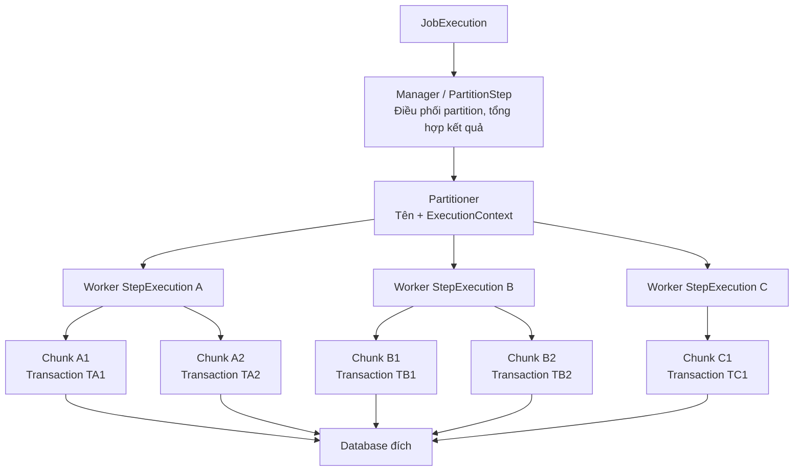
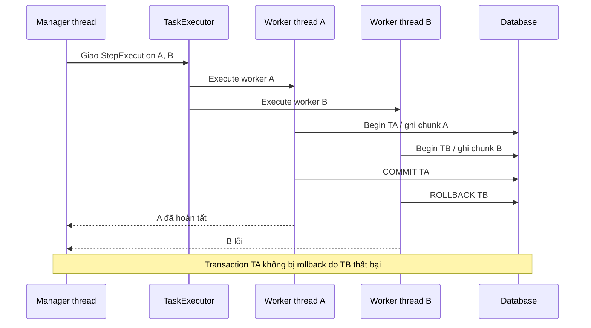
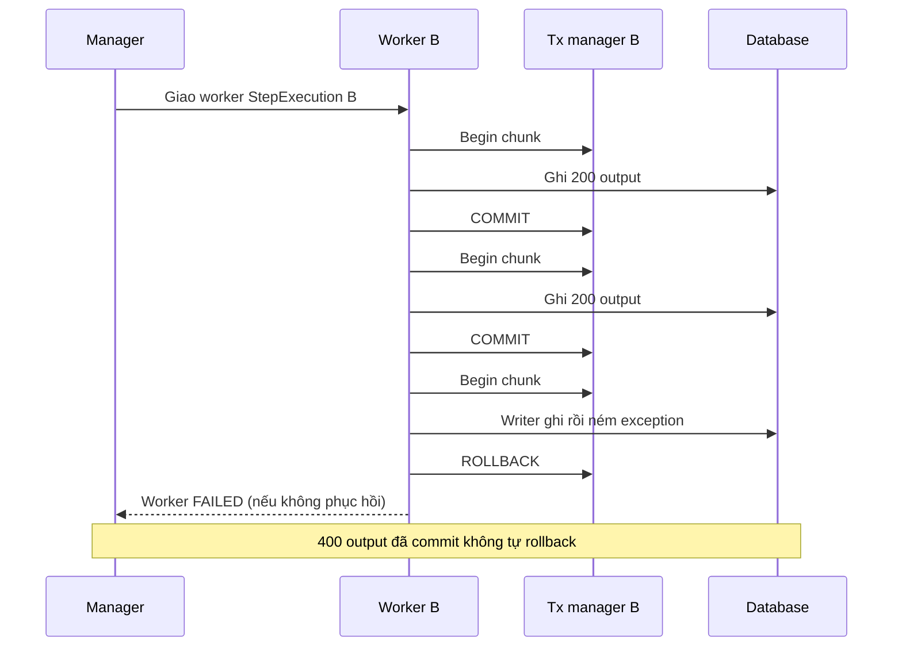
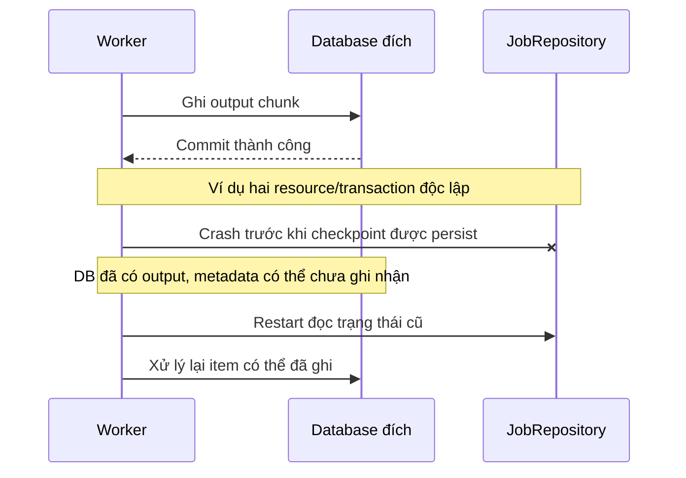
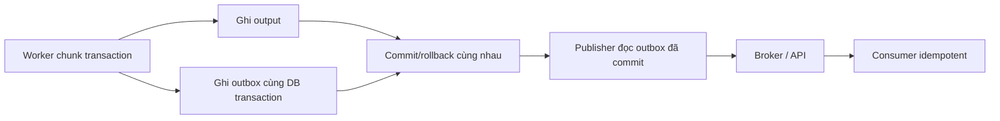

# Transaction của partition worker trong Spring Batch

Partitioning cho phép Spring Batch chia một workload dữ liệu lớn thành nhiều phần độc lập, sau đó thực thi các **worker Step** đồng thời. Nhờ vậy, job có thể sử dụng nhiều CPU core, nhiều kết nối database hoặc nhiều JVM. Tuy nhiên, việc chia một Step thành nhiều worker **không tạo ra một transaction toàn cục**: mỗi worker có `StepExecution` của riêng mình và, nếu dùng chunk-oriented processing, thường thực hiện **nhiều transaction theo từng chunk**.

Ví dụ, worker A đã commit 20 chunk, worker B thất bại ở chunk thứ ba, còn worker C hoàn tất. Khi manager Step báo `FAILED`, dữ liệu đã commit ở A và C vẫn tồn tại. Nếu restart không quản lý đúng checkpoint, phạm vi partition và tính idempotent của writer, job có thể đọc lại dữ liệu đã xử lý, bỏ sót một số bản ghi hoặc lặp side effect bên ngoài database.

Bài thuộc chương **Transaction boundary** của module **SPRING_BATCH_SCALING_OPERATIONS**. Trong định hướng mở rộng Spring Batch bằng multi-threaded step, parallel steps, partitioning và kiến trúc phân tán, bài tập trung giải thích **transaction của partition worker**: ai mở và commit transaction, ranh giới giữa manager và worker, rollback/retry/restart, giới hạn với nhiều nguồn tài nguyên, kiểm tra thread safety và cách đo bottleneck khi vận hành.

## 1. Những điều cần nắm trước tiên

- Một **partition** là một phần việc logic, thường được định danh bằng tên partition và `ExecutionContext` chứa range, bucket, tenant hoặc file đầu vào.
- Mỗi partition do Spring Batch quản lý thường có một **worker `StepExecution`** riêng. Worker có lifecycle và số đếm riêng, không chỉ là một `Runnable` không trạng thái.
- Một worker chunk-oriented có thể thực hiện nhiều chunk; **mỗi chunk thường có transaction riêng** theo `PlatformTransactionManager` được cấu hình cho worker Step.
- **Manager Step không sở hữu một transaction bao trùm tất cả worker.** Manager điều phối, ghi metadata và tổng hợp trạng thái, chứ không tự rollback mọi worker khi một phần thất bại.
- `JobRepository` lưu metadata và `ExecutionContext` bền vững, nhưng tính nguyên tử giữa metadata, dữ liệu đích, message broker và API phụ thuộc transaction manager/resource thực tế.
- **Commit của chunk** khác **StepExecution COMPLETED**, khác **manager COMPLETED**, và khác **dữ liệu nghiệp vụ đã đối soát đầy đủ**.
- Khi worker chạy song song, phải kiểm tra cả transaction, thread safety, checkpoint, idempotency và giới hạn CPU/DB pool.

## 2. Ba ranh giới không được nhầm lẫn



| Phạm vi | Đối tượng quản lý | Ranh giới commit/rollback |
| --- | --- | --- |
| **Job/manager** | `JobExecution`, `PartitionStep`, `PartitionHandler` | Các transaction metadata/điều phối; **không** là transaction bao tất cả worker |
| **Worker partition** | Worker `StepExecution`, reader/processor/writer riêng theo thiết kế | Nhiều chunk nối tiếp hoặc theo cấu hình worker; **không mặc định một transaction duy nhất cho cả worker** |
| **Chunk** | `read → process → write` cùng xử lý checkpoint | Transaction chính cho một nhóm item; commit hoặc rollback **ở chunk đó** |
| **Hệ thống ngoài** | API, file, broker, datastore khác | Có transaction/ack riêng hoặc không transactional; không tự rollback theo transaction DB của worker |

Cần phân biệt thêm **local partitioning** (các worker trên những thread trong cùng JVM) và **remote partitioning** (worker có thể chạy ở JVM khác). Chúng cùng dựa trên khái niệm `StepExecution`/`ExecutionContext`, nhưng không có cách “truyền nguyên” JDBC transaction từ manager sang remote worker qua network.

### Ví dụ trạng thái sau lỗi

Giả sử mỗi partition có 5.000 item, chunk size 500:

| Partition | Chunk đã commit | Chunk lỗi | `BatchStatus` của worker |
| --- | ---: | --- | --- |
| A | 10/10 | Không có | `COMPLETED` |
| B | 4/10 | Chunk thứ 5 rollback, không phục hồi được | `FAILED` |
| C | 10/10 | Không có | `COMPLETED` |
| Manager | Không trực tiếp commit dữ liệu của các worker | Tổng hợp thấy B thất bại | Thường `FAILED` |

Trong ví dụ, B đã commit tối đa 2.000 output ở bốn chunk đầu nếu mỗi input tạo một output và không filter/skip. Lỗi chunk thứ năm **không hoàn tác** bốn chunk trước. Với worker C, dữ liệu đã commit cũng không bị đảo ngược vì B thất bại. Các `writeCount` trong StepExecution là metadata, vẫn phải đối soát database đích để xác minh dữ liệu bền vững.

## 3. Transaction của một worker chunk bắt đầu và kết thúc ở đâu?

Khi khai báo:

```java
new StepBuilder("workerStep", jobRepository)
        .<InputOrder, OutputOrder>chunk(200, transactionManager)
        .reader(reader)
        .processor(processor)
        .writer(writer)
        .build();
```

Spring Batch tổ chức vòng lặp xử lý chunk với một transaction manager được truyền vào. Trong chu trình chunk đồng bộ thông thường:

```mermaid
sequenceDiagram
    participant W as Worker StepExecution
    participant TM as TransactionManager
    participant R as ItemReader
    participant P as ItemProcessor
    participant O as ItemWriter
    participant DB as Database
    W->>TM: Begin transaction cho chunk #1
    loop Đọc tới commit interval hoặc EOF
        W->>R: read()
        R-->>W: item
        W->>P: process(item)
        P-->>W: output / null để filter
    end
    W->>O: write(Chunk<output>)
    O->>DB: DML tham gia transaction nếu cấu hình đúng
    alt Không có lỗi ở commit
        W->>TM: Update checkpoint/metadata phù hợp; commit
        TM-->>W: Commit thành công
    else Lỗi cần rollback
        W->>TM: Rollback chunk #1
        TM-->>W: Kết thúc transaction không commit
    end
    Note over W,DB: Chunk #2 nếu được xử lý sẽ dùng transaction mới
```

**Chú ý từng mốc:**

1. `process(item)` không tạo transaction riêng cho từng item chỉ vì nó được gọi nhiều lần. Với chunk 200, có thể có 200 lượt `process()` trong một transaction chính.
2. `ItemWriter.write(...)` trả về không có nghĩa commit đã thành công. Commit có thể gặp lỗi sau khi writer hoàn tất.
3. Nếu processor trả `null`, item được **filter** và không đưa vào writer; đó không phải lỗi phải rollback.
4. Writer chỉ tham gia rollback nếu các thao tác ghi được quản lý bởi **đúng transaction/resource**. HTTP, email, file và các thao tác khác ngoài transaction không được tự động hoàn tác.
5. Sau khi chunk lỗi, framework có thể rollback, retry hoặc skip tùy chính sách và pha lỗi. **Không suy số lần callback từ commit count** khi có phục hồi.
6. Các chunk trước đã commit sẽ không tự bị rollback chỉ vì worker `StepExecution` cuối cùng `FAILED`.

Với reader JDBC cursor, cơ chế kết nối/cursor và việc lưu trạng thái có thể khác writer; không mặc định rằng vị trí đọc trong bộ nhớ được rewind chỉ vì transaction ghi DB rollback. Phải kiểm chứng contract `ItemStream`, `ExecutionContext` và tính ổn định của nguồn dữ liệu.

## 4. Transaction nằm ở thread đang thực thi chunk

Trong transaction imperative của Spring, `TransactionSynchronizationManager` gắn các tài nguyên transaction với **thread hiện tại**. Khi local partitioning sử dụng `TaskExecutor`, mỗi worker Step chạy trên một worker thread và mở transaction chunk **tại nơi nó thực thi**.



Một transaction đang mở ở thread manager **không tự chuyển** sang worker chỉ vì manager gọi `executor.execute(...)`. Tương tự, không truyền `Connection`, `EntityManager` hay các tài nguyên bind bằng `TransactionSynchronizationManager` qua thread để “chia sẻ” transaction.

### So sánh với multi-threaded step

| Kiến trúc | StepExecution | Chia sẻ reader state | Transaction |
| --- | --- | --- | --- |
| Multi-threaded Step | Thường một `StepExecution` có nhiều chunk concurrent | Có thể dùng chung một reader step-scoped giữa các thread | Transaction theo chunk/thread thực thi |
| Local partitioning | Một worker `StepExecution` cho mỗi partition | Reader `@StepScope` có thể riêng từng worker | Mỗi worker có nhiều transaction chunk độc lập |
| Parallel steps | Mỗi Step có `StepExecution` riêng | Tùy bean được dùng chung hay không | Mỗi Step/chunk dùng transaction theo cấu hình |
| Remote partitioning | Worker StepExecution ở môi trường worker | Bean/context của worker JVM | Transaction local của worker, không lan từ manager |

**`@StepScope` là scope theo StepExecution, không phải theo thread.** Nếu cấu hình một worker Step vừa có partitioning vừa chạy multi-threaded chunk, các thread của cùng worker vẫn có thể chia sẻ reader step-scoped; yêu cầu thread safety và checkpoint trở nên phức tạp hơn.

## 5. Ví dụ xuyên suốt: mỗi worker đọc một khoảng ID

Ta xây dựng một ví dụ local partitioning Spring Batch 5.x, Java 17+ với PostgreSQL. Một job xử lý đơn hàng đã được chốt theo `batchId`; manager tạo bốn partition với khoảng ID nửa mở, mỗi worker đọc một khoảng và ghi đầu ra.

Các giả định nghiệp vụ:

- Nguồn `staging_orders(batch_id, id, gross_amount)`; cặp `(batch_id, id)` xác định duy nhất item.
- Dữ liệu của `batchId` không bị thay đổi trong vòng đời một JobInstance và những lần restart của nó.
- Đích `processed_orders(batch_id, order_id, normalized_amount)` có khóa duy nhất `(batch_id, order_id)`.
- Mỗi input có một output trừ khi được filter/skip theo một policy được công bố.
- `partitionCount`, các khoảng khóa và tên partition được chốt và giữ ổn định khi restart.

### 5.1. Các kiểu dữ liệu nhỏ, bất biến

```java
import java.math.BigDecimal;

public record InputOrder(long id, BigDecimal grossAmount) {}

public record OutputOrder(
        String batchId, long orderId, BigDecimal normalizedAmount) {}
```

Trong project Java thực, mỗi `public record` thuộc file tương ứng; ví dụ đặt cạnh nhau để minh họa dữ liệu đi qua pipeline.

### 5.2. Partitioner tạo công việc, không mở transaction cho mọi item

```java
import java.util.LinkedHashMap;
import java.util.Locale;
import java.util.Map;

import org.springframework.batch.core.partition.support.Partitioner;
import org.springframework.batch.item.ExecutionContext;

public final class RangePartitioner implements Partitioner {
    private final long minInclusive;
    private final long maxExclusive;
    private final int partitionCount;

    public RangePartitioner(
            long minInclusive, long maxExclusive, int partitionCount) {
        long total = Math.subtractExact(maxExclusive, minInclusive);
        if (total <= 0 || partitionCount <= 0 || partitionCount > total) {
            throw new IllegalArgumentException("Invalid range plan");
        }
        this.minInclusive = minInclusive;
        this.maxExclusive = maxExclusive;
        this.partitionCount = partitionCount;
    }

    @Override
    public Map<String, ExecutionContext> partition(int gridSize) {
        long total = maxExclusive - minInclusive;
        long base = total / partitionCount;
        long extra = total % partitionCount;
        long start = minInclusive;
        Map<String, ExecutionContext> result = new LinkedHashMap<>();

        for (int i = 0; i < partitionCount; i++) {
            long size = base + (i < extra ? 1 : 0);
            long end = Math.addExact(start, size);
            ExecutionContext context = new ExecutionContext();
            context.putLong("startId", start);
            context.putLong("endId", end);
            result.put(String.format(Locale.ROOT, "range-%03d", i), context);
            start = end;
        }
        return result;
    }
}
```

Mỗi key như `range-000` là định danh logic của partition, còn `startId/endId` mô tả tập input. Ví dụ `new RangePartitioner(1, 10001, 4)` tạo bốn khoảng: `[1,2501)`, `[2501,5001)`, `[5001,7501)`, `[7501,10001)`.

**`gridSize` trong API là tham số gợi ý từ infrastructure**; Partitioner này cố ý dùng `partitionCount` đã chốt để giữ mapping ổn định khi restart. Trong production, kế hoạch chia dữ liệu cần được xây từ snapshot có kiểm soát, không tự lấy `MAX(id)` mới rồi thay đổi partition plan khi restart cùng JobInstance.

Partitioner không làm thay việc chứng minh hai partition không ghi chồng nhau, không đưa hàng vào sai tenant và không dùng nguồn dữ liệu biến động. Các điều kiện đó thuộc thiết kế dữ liệu và reader/writer.

### 5.3. Worker reader được late bind từ StepExecutionContext

```java
import javax.sql.DataSource;

import org.springframework.batch.core.configuration.annotation.StepScope;
import org.springframework.batch.item.database.JdbcCursorItemReader;
import org.springframework.batch.item.database.builder.JdbcCursorItemReaderBuilder;
import org.springframework.beans.factory.annotation.Value;
import org.springframework.context.annotation.Bean;

@Bean
@StepScope
public JdbcCursorItemReader<InputOrder> partitionReader(
        DataSource dataSource,
        @Value("#{jobParameters['batchId']}") String batchId,
        @Value("#{stepExecutionContext['startId']}") Long startId,
        @Value("#{stepExecutionContext['endId']}") Long endId) {

    if (batchId == null || batchId.isBlank()
            || startId == null || endId == null || startId >= endId) {
        throw new IllegalArgumentException("Invalid partition input");
    }

    return new JdbcCursorItemReaderBuilder<InputOrder>()
            .name("partitionReader")
            .dataSource(dataSource)
            .sql("""
                SELECT id, gross_amount
                FROM staging_orders
                WHERE batch_id = ? AND id >= ? AND id < ?
                ORDER BY id
                """)
            .preparedStatementSetter(ps -> {
                ps.setString(1, batchId);
                ps.setLong(2, startId);
                ps.setLong(3, endId);
            })
            .rowMapper((rs, rowNum) -> new InputOrder(
                    rs.getLong("id"),
                    rs.getBigDecimal("gross_amount")))
            .saveState(true)
            .build();
}
```

Giá trị `startId`/`endId` đến từ **worker `StepExecutionContext`**, không phải context của manager hay một biến mutable singleton. `@StepScope` giúp Spring tạo reader instance theo worker StepExecution. Kiểu trả về `JdbcCursorItemReader` cũng thể hiện contract `ItemStream` của reader stateful trong cấu hình Step.

**Giới hạn:** `saveState(true)` không tự bảo đảm mọi tình huống restart. Cần `ORDER BY` xác định, input snapshot bất biến, `ExecutionContext` persist được, và cơ chế transaction/checkpoint đúng với datasource. Một cursor JDBC có lifecycle và connection riêng; không được tự giả định mọi lần `read()` đều nằm cùng transaction vật lý với writer.

### 5.4. Processor chỉ biến đổi dữ liệu

```java
import java.math.RoundingMode;

import org.springframework.batch.core.configuration.annotation.StepScope;
import org.springframework.batch.item.ItemProcessor;
import org.springframework.beans.factory.annotation.Value;
import org.springframework.context.annotation.Bean;

@Bean
@StepScope
public ItemProcessor<InputOrder, OutputOrder> partitionProcessor(
        @Value("#{jobParameters['batchId']}") String batchId) {

    if (batchId == null || batchId.isBlank()) {
        throw new IllegalArgumentException("Missing batchId");
    }

    return item -> new OutputOrder(
            batchId,
            item.id(),
            item.grossAmount().setScale(2, RoundingMode.HALF_UP));
}
```

Processor này không gọi API, không lưu `lastProcessedId` vào field, không gửi message và không update bảng đích trực tiếp. Khi worker rollback và xử lý lại item, phép biến đổi được thực hiện lại mà không có side effect phát sinh.

`@StepScope` trong ví dụ dùng để late bind `batchId`; một processor stateless, không cần truy cập `StepExecutionContext` và dùng dependency thread-safe **không bắt buộc** phải step-scoped. Đừng dùng `@StepScope` như vật thay thế cho thiết kế thread-safe.

### 5.5. Writer tham gia transaction chunk và chống ghi lặp

Tạo bảng đích và constraint:

```sql
CREATE TABLE processed_orders (
    batch_id          varchar(80) NOT NULL,
    order_id          bigint NOT NULL,
    normalized_amount numeric(18, 2) NOT NULL,
    PRIMARY KEY (batch_id, order_id)
);
```

Writer PostgreSQL:

```java
import javax.sql.DataSource;

import org.springframework.batch.item.database.JdbcBatchItemWriter;
import org.springframework.batch.item.database.builder.JdbcBatchItemWriterBuilder;
import org.springframework.context.annotation.Bean;

@Bean
public JdbcBatchItemWriter<OutputOrder> partitionWriter(
        DataSource dataSource) {

    return new JdbcBatchItemWriterBuilder<OutputOrder>()
            .dataSource(dataSource)
            .sql("""
                INSERT INTO processed_orders
                    (batch_id, order_id, normalized_amount)
                VALUES (?, ?, ?)
                ON CONFLICT (batch_id, order_id)
                DO UPDATE SET
                    normalized_amount = EXCLUDED.normalized_amount
                """)
            .itemPreparedStatementSetter((item, ps) -> {
                ps.setString(1, item.batchId());
                ps.setLong(2, item.orderId());
                ps.setBigDecimal(3, item.normalizedAmount());
            })
            .build();
}
```

Nếu `PlatformTransactionManager` của worker thực sự quản lý datasource mà writer dùng, các lệnh DML của writer tham gia transaction chunk. Khi writer hoặc commit thất bại, cần xét tình trạng transaction và checkpoint, thay vì kết luận chỉ từ số lần `write()`.

**Upsert có điều kiện:** với mô hình “mỗi cặp batch/order có một trạng thái kết quả”, cùng input và cùng thuật toán tạo lại cùng output là idempotent. Nhưng nếu nghiệp vụ cần append lịch sử, tạo nhiều event hoặc tích lũy `balance = balance + delta`, `ON CONFLICT DO UPDATE` không đủ. Phải chọn khóa nghiệp vụ, version/snapshot và cách xử lý lặp phù hợp.

### 5.6. Worker Step: nơi khai báo transaction boundary

```java
import org.springframework.batch.core.Step;
import org.springframework.batch.core.repository.JobRepository;
import org.springframework.batch.core.step.builder.StepBuilder;
import org.springframework.batch.item.ItemProcessor;
import org.springframework.batch.item.database.JdbcBatchItemWriter;
import org.springframework.batch.item.database.JdbcCursorItemReader;
import org.springframework.context.annotation.Bean;
import org.springframework.transaction.PlatformTransactionManager;

@Bean
public Step workerStep(
        JobRepository jobRepository,
        PlatformTransactionManager transactionManager,
        JdbcCursorItemReader<InputOrder> partitionReader,
        ItemProcessor<InputOrder, OutputOrder> partitionProcessor,
        JdbcBatchItemWriter<OutputOrder> partitionWriter) {

    return new StepBuilder("workerStep", jobRepository)
            .<InputOrder, OutputOrder>chunk(200, transactionManager)
            .reader(partitionReader)
            .processor(partitionProcessor)
            .writer(partitionWriter)
            .build();
}
```

Ở đây `chunk(200, transactionManager)` đặt **transaction boundary cho chunk trong mỗi worker**, không đặt một transaction cho toàn bộ partition. Một partition xử lý 1.000 item có thể cần khoảng 5 chunk nếu không có filter/skip và điều kiện nguồn như giả định; commit/rollback được xử lý theo từng chunk.

Với `@StepScope` trên reader/processor, Step có thể được lắp bằng scoped proxy lúc khởi tạo application, còn đối tượng thực được tạo khi worker `StepExecution` đang chạy.

### 5.7. Manager Step giao việc qua local TaskExecutor

```java
import java.util.concurrent.ThreadPoolExecutor;

import org.springframework.batch.core.Step;
import org.springframework.batch.core.repository.JobRepository;
import org.springframework.batch.core.step.builder.StepBuilder;
import org.springframework.context.annotation.Bean;
import org.springframework.scheduling.concurrent.ThreadPoolTaskExecutor;

@Bean
public RangePartitioner orderPartitioner() {
    // Chỉ dùng demo; plan production phải được chốt theo JobInstance.
    return new RangePartitioner(1L, 10_001L, 4);
}

@Bean
public ThreadPoolTaskExecutor partitionExecutor() {
    ThreadPoolTaskExecutor executor = new ThreadPoolTaskExecutor();
    executor.setCorePoolSize(4);
    executor.setMaxPoolSize(4);
    executor.setQueueCapacity(8);
    executor.setThreadNamePrefix("partition-worker-");
    executor.setRejectedExecutionHandler(
            new ThreadPoolExecutor.AbortPolicy());
    return executor; // Container Spring quản lý lifecycle bean.
}

@Bean
public Step managerStep(
        JobRepository jobRepository,
        Step workerStep,
        RangePartitioner orderPartitioner,
        ThreadPoolTaskExecutor partitionExecutor) {

    return new StepBuilder("managerStep", jobRepository)
            .partitioner(workerStep.getName(), orderPartitioner)
            .step(workerStep)
            .gridSize(4)
            .taskExecutor(partitionExecutor)
            .build();
}
```

Đặt các method `@Bean` này trong class `@Configuration` của ứng dụng cùng các bean khác và Job flow thích hợp. Cấu hình giả định sử dụng Spring Batch 5.x; các kiểu `InputOrder`/`OutputOrder`, DataSource, JobRepository và manager giao dịch cần được đăng ký phù hợp.

Manager dùng executor để **đồng thời hóa worker Step**, không làm transaction của worker tự gộp thành một giao dịch. `gridSize(4)` chỉ là gợi ý về số phần cho cơ chế partitioning; với custom Partitioner, số partition thực tế phụ thuộc map được trả về. Tổng giới hạn đồng thời do handler/executor, pool DB và resource quyết định.

## 6. Điều gì xảy ra khi một worker thất bại giữa chừng?

Giả sử partition B có 1.000 item, chunk size 200:



Nếu worker B `FAILED` vì chunk #3 không được retry/skip thành công:

- Chuỗi commit #1 và #2 đã bền vững nếu transaction thành công.
- Thao tác ghi của chunk #3 trong đúng transaction thường bị rollback.
- Partition A/C/D có thể đã commit độc lập.
- `StepExecution` của B ghi lỗi và tiến độ đến mức metadata được persist. `ExitStatus` có thể kèm mô tả nguyên nhân.
- Manager tổng hợp kết quả của các worker; với lỗi không phục hồi, manager thường thất bại. **Không có rollback nguyên tử xuyên mọi partition**.
- Sau khi sửa nguyên nhân, cơ chế restart của Spring Batch cùng reader checkpoint và writer idempotent phải xử lý phần chưa hoàn tất.

### Ba mốc lỗi có tính chất khác nhau

| Mốc lỗi | Dữ liệu DB của chunk | Trạng thái cần xác minh |
| --- | --- | --- |
| Lỗi processor trước writer | Chưa ghi từ writer của chunk; những thay đổi DB khác trong transaction có thể rollback | Filter/skip/retry, state reader |
| Writer đã chạy một phần rồi ném lỗi | Các DML cùng transaction được rollback, **nếu thực sự tham gia** | Có thao tác ghi ngoài transaction không? |
| Mất kết nối ở lúc commit | Client có thể không biết DB đã commit hay chưa | Kiểm tra DB thực, checkpoint, khóa idempotency |

**Không nên xóa toàn bộ dữ liệu của worker khi worker `FAILED`** chỉ vì không biết chính xác chunk nào đã commit. Làm vậy có thể xóa kết quả hợp lệ, phá dữ liệu downstream hoặc tạo một cửa sổ lỗi mới. Hãy xác định trạng thái commit và thực hiện một kế hoạch khôi phục/đối soát có kiểm soát.

## 7. Retry, skip và rollback của worker không phải một khái niệm

Một worker Step có thể dùng tính năng fault tolerance để xử lý exception. Ví dụ chỉ minh họa phần mở rộng của cấu hình worker `StepBuilder` ở trên:

```java
import org.springframework.dao.TransientDataAccessException;

// Nối sau .reader(...).processor(...).writer(...) ở worker Step:
.faultTolerant()
    .retry(TransientDataAccessException.class)
    .retryLimit(3)
    .skip(InvalidInputException.class)
    .skipLimit(10)
.build();
```

`InvalidInputException` là exception nghiệp vụ do ứng dụng định nghĩa, ví dụ hàng có dữ liệu không hợp lệ. Trong ứng dụng thật, phải phân biệt lỗi transient và lỗi vĩnh viễn; không retry không giới hạn, không skip lỗi làm sai dữ liệu bắt buộc.

| Khái niệm | Chức năng | Điều cần nhớ |
| --- | --- | --- |
| `rollback` | Không commit những thay đổi thuộc transaction hiện hành | Không tự hoàn tác chunk khác hoặc external side effect |
| `retry` | Thử lại thao tác lỗi trong giới hạn được cấu hình | Có thể gọi processor/writer nhiều lần cho cùng item |
| `skip` | Bỏ qua item lỗi theo chính sách cho phép | Cần đếm/đối soát item bị bỏ |
| `filter` | Processor trả `null` để loại item trước writer | Không đồng nghĩa skip hoặc lỗi |
| `restart` | Khởi chạy tiếp JobInstance theo metadata trước đó | Khác retry nội bộ chunk; phải giữ snapshot/partition mapping |

Một exception được cấu hình skip **không có nghĩa luôn tránh được rollback** ở mọi pha read/process/write; fault-tolerant chunk có quy tắc và đường phục hồi khác nhau. Khi writer lỗi, framework có thể gọi lại một số callback để xác định item lỗi. Vì thế số lần `process()` thực tế không nhất thiết bằng `readCount`, và số lần `write()` không phải số commit.

Nếu giới hạn retry/skip đã hết, worker Step có thể `FAILED`, còn các worker khác đã commit vẫn không bị tự rollback. **Chính sách retry của worker** cần được thiết kế cùng với retry/timeout của datasource, broker và Job orchestrator để tránh các tầng retry nhân lên thành một lượng lớn request.

## 8. Propagation khi processor hoặc writer gọi service khác

Trong chunk-oriented worker Step, transaction chunk đã được mở trên thread của worker. Khi processor gọi một service có `@Transactional` qua Spring AOP proxy, hành vi phụ thuộc propagation và transaction manager.

| Propagation của service | Khi worker đang có transaction chunk | Hệ quả |
| --- | --- | --- |
| `REQUIRED` | Tham gia transaction đang có nếu manager/resource phù hợp | Commit/rollback cùng chunk |
| `SUPPORTS` | Có thể tham gia transaction hiện hữu | Không tạo ranh giới commit riêng |
| `MANDATORY` | Yêu cầu đang có transaction | Phát hiện cách gọi service ngoài transaction |
| `REQUIRES_NEW` | Tạm ngưng transaction hiện tại và mở transaction mới | Transaction mới có thể commit dù chunk rollback; tăng nhu cầu connection |
| `NOT_SUPPORTED` | Chạy ngoài transaction của chunk | Side effect không tự rollback theo chunk |
| `NESTED` | Dùng savepoint/nested transaction khi manager hỗ trợ | Không mặc định khả dụng trên mọi resource |

Đặt `@Transactional(REQUIRED)` trên service không có nghĩa tạo “transaction riêng của processor”. Nếu chunk đã có transaction phù hợp, service thường **tham gia** nó. Ngược lại, một service dùng `REQUIRES_NEW` có thể làm mất tính nguyên tử mong muốn.

Ví dụ rủi ro:

```java
import org.springframework.stereotype.Service;
import org.springframework.transaction.annotation.Propagation;
import org.springframework.transaction.annotation.Transactional;

@Service
public class AuditService {

    @Transactional(propagation = Propagation.REQUIRES_NEW)
    public void recordSeenOrder(long orderId) {
        // Ghi audit trong transaction độc lập.
    }
}
```

Nếu worker xử lý order 42, ghi audit bằng `REQUIRES_NEW` rồi writer lỗi, audit có thể đã commit trong khi kết quả order bị rollback. Retry có thể ghi thêm audit. Nếu nhiều worker cùng giữ outer connection rồi đòi thêm connection cho `REQUIRES_NEW`, còn có nguy cơ cạn connection pool.

**Cẩn trọng với proxy:** `@Transactional` thường được áp dụng khi lời gọi đi qua Spring proxy. Method tự gọi qua `this.method()` trong cùng bean có thể bỏ qua interception trong chế độ proxy thông thường. Phải kiểm tra đường gọi thật, không chỉ đọc annotation.

### Quan sát transaction của thread worker

```java
import org.springframework.transaction.support.TransactionSynchronizationManager;

boolean active =
        TransactionSynchronizationManager.isActualTransactionActive();

String name =
        TransactionSynchronizationManager.getCurrentTransactionName();
```

Nếu gọi từ `process()` trong worker chunk bình thường, `active` có thể là `true` vì transaction chunk đang hoạt động. Tuy nhiên điều đó **không chứng minh** một HTTP call, broker hoặc datasource thứ hai nằm trong transaction đó. Kiểm thử rollback với DB thật là bằng chứng quan trọng hơn flag.

## 9. Worker metadata và dữ liệu đích có luôn commit nguyên tử?

**Không mặc định trong mọi cấu hình.** Spring Batch dùng `JobRepository` để lưu trạng thái `StepExecution` và `ExecutionContext`; worker Step dùng `PlatformTransactionManager` để quản lý transaction chunk. Tính nhất quán phụ thuộc:

1. `JobRepository` dùng datasource nào, với transaction manager nào.
2. Reader và writer dùng datasource nào và kết nối nào tham gia transaction.
3. Các thao tác metadata được cập nhật vào thời điểm nào trong vòng đời chunk/Step.
4. Có transaction đa tài nguyên/JTA được thiết kế đúng hay không.
5. Có side effect ngoài transaction (file, API, message) hay không.

### Trường hợp dùng cùng database và đúng transaction manager

Nếu writer, checkpoint metadata và các thao tác liên quan thực sự cùng tham gia **một transaction local** trên database, khả năng commit/rollback nhất quán sẽ tốt hơn. Tuy vậy vẫn cần phân biệt reader cursor, các transaction metadata ở thời điểm khác và đường lỗi khi process crash. Không suy đoán atomicity chỉ từ việc hai bean đều dùng JDBC.

### Trường hợp dùng nhiều database hoặc metadata khác hệ

Ví dụ:

- `JobRepository` lưu ở DB-A.
- Worker writer ghi ở DB-B.
- Manager dùng broker giao việc remote.

Một transaction local ở DB-B không làm DB-A và broker cùng commit nguyên tử. Có thể xảy ra dữ liệu đã ghi ở DB-B nhưng metadata ở DB-A chưa cập nhật, khiến restart gửi lại công việc. **Idempotent writer và reconciliation** là thiết kế phòng vệ cần thiết; nếu nghiệp vụ đòi atomicity across resources, phải xem xét giao dịch phân tán hoặc mô hình nhất quán cuối cùng phù hợp, cùng chi phí vận hành thực tế.

### Sơ đồ cửa sổ lỗi



Sơ đồ mô tả **tình huống có thể xảy ra khi các resource không commit nguyên tử**, không khẳng định Spring Batch luôn persist checkpoint sau DB commit theo một thứ tự cố định. Tùy implementation/config, thứ tự thao tác metadata và commit khác nhau. Trách nhiệm của thiết kế là **chịu được trạng thái không chắc chắn** ở biên lỗi.

## 10. External side effect: rollback DB không thu hồi được email hoặc message

Ví dụ không an toàn trong processor:

```java
@Override
public OutputOrder process(InputOrder order) {
    notificationClient.send("ORDER_PROCESSED", order.id());
    return normalize(order);
}
```

Worker gửi notification cho 200 item, sau đó writer gặp deadlock, transaction DB rollback. Framework có thể retry và gọi lại processor, làm notification bị phát lần thứ hai. Đây không phải lỗi transaction manager: **notification không nằm trong transaction DB của worker**.

### Thiết kế transactional outbox

Một mẫu hữu ích khi cần phát event gắn với kết quả DB:

1. Processor chỉ tạo output và event data thuần, không gửi trực tiếp.
2. Trong **cùng transaction DB** với bản ghi kết quả, writer lưu record outbox có `eventId`/khóa nghiệp vụ duy nhất.
3. Sau commit, một publisher riêng đọc outbox chưa gửi, gửi message và ghi nhận trạng thái.
4. Consumer xử lý lặp theo `eventId` để phòng trường hợp message redelivery.



Outbox làm giảm rủi ro “DB rollback nhưng event đã được gửi”. Nó **không tự đảm bảo exactly-once delivery**: publisher có thể bị crash sau khi broker nhận event nhưng trước khi đánh dấu outbox là đã gửi. Idempotency ở downstream vẫn cần thiết.

Với các công việc như thu phí, trừ kho hay cập nhật hệ thống ngoài, có thể cần saga, idempotency key hoặc trạng thái bù trừ theo contract nghiệp vụ, chứ không mặc định chỉ một JDBC transaction là đủ.

## 11. Restart sau lỗi worker: checkpoint và input phải ổn định

Một worker `StepExecution` không chỉ có `BatchStatus` mà còn có `ExecutionContext`. Reader `ItemStream` có thể dùng context để lưu checkpoint; khi restart, framework có thể quyết định partition nào cần chạy lại hoặc tiếp tục theo trạng thái lưu trước đó.

**Điều kiện quan trọng:**

- **Tên partition cố định**: `range-001` luôn đại diện cùng vùng input của JobInstance. Đừng thay tên/range theo số thread được cấp lúc restart.
- **Input snapshot không đổi**: đừng lấy lại `MAX(id)` mới rồi phân vùng khác; nếu nguồn đang biến động, phải có cơ chế snapshot/watermark đủ chặt.
- **Reader restartable**: `ItemStream.open/update/close` và checkpoint vận hành đúng với loại reader, ordering và transaction.
- **Writer idempotent**: xử lý lại một item/chunk không tạo duplicate hoặc cộng dồn side effect.
- **Không dùng field của processor làm checkpoint**: `lastSeenId` có thể tiến trước khi chunk được commit.
- **Không coi worker `FAILED` là 0 output**: worker có thể đã commit nhiều chunk.
- **Không sửa `JobRepository` trực tiếp bằng SQL** để gán trạng thái `COMPLETED` hoặc bỏ qua partition lỗi.

### Khi nào một partition COMPLETED có thể được bỏ qua?

Spring Batch có logic restart dựa vào metadata `StepExecution`/JobRepository và các điều kiện của Step. Với partition name và context ổn định, các worker đã hoàn tất thường có thể không cần xử lý lại; các worker chưa hoàn thành có thể được chạy/tiếp tục. Không nên tự suy luận chỉ từ chuỗi `ExitStatus.exitCode` hoặc từ thứ tự thread, bởi trạng thái lifecycle, thông tin restart và implementation splitter/handler đều quan trọng.

### Mất kết nối ở biên commit: kết quả không chắc chắn

Nếu connection mất đúng lúc commit, phía client đôi khi không biết DB thực sự đã nhận commit hay chưa. Cần:

1. Tra cứu DB theo `batchId` và khóa nghiệp vụ.
2. Đối chiếu metadata worker `StepExecution` và checkpoint.
3. Kiểm tra event/API đã phát nếu có.
4. Đánh giá writer idempotency trước khi restart.
5. Restart qua cơ chế Spring Batch sau khi giải quyết nguyên nhân, rồi đối soát lần nữa.

Không lặp Job vô hạn chỉ vì exception được đánh dấu transient; khi backend đang quá tải, retry quá dày có thể làm lỗi lan rộng.

## 12. Local partitioning và remote partitioning có những biên bổ sung gì?

| Khía cạnh | Local partitioning | Remote partitioning |
| --- | --- | --- |
| Nơi chạy worker | Thread trong cùng JVM | Một hoặc nhiều JVM/host khác nhau |
| Ranh giới transaction | Transaction chunk local ở worker thread | Transaction chunk local ở JVM worker |
| `ExecutionContext` | Manager/splitter gán vào worker StepExecution | Phải phân phối/khôi phục metadata worker theo cơ chế remote |
| JobRepository | Thường dùng repository chung của ứng dụng | Cần thiết kế quyền truy cập/trạng thái worker theo kiến trúc phân tán |
| Giao việc | `TaskExecutor`/`PartitionHandler` | Middleware/message/remote handler |
| Lỗi điều phối | Executor rejection, worker exception | Thêm network timeout, message loss/redelivery, worker offline |
| Độ tin cậy | Transaction + checkpoint + idempotency | Tất cả yêu cầu local, **thêm** ack/retry, deduplication và trạng thái không chắc chắn |
| Giám sát | Thread pool, StepExecution, DB | Thêm queue depth, consumer lag, heartbeat, request correlation |

**Remote worker không thể “kế thừa” transaction local của manager** qua message. Nếu worker đã commit output rồi process mất kết nối trước khi phản hồi, manager có thể chưa chắc đã nhận được kết quả. Khi công việc được giao lại, writer phải chịu được việc chạy lặp.

### Đừng nhầm remote partitioning với remote chunking

Trong **remote partitioning**, manager tạo partition và worker thực thi **toàn worker Step** (gồm reader/process/write và nhiều chunk). Trong **remote chunking**, manager thường đọc/chia chunk và gửi dữ liệu tới worker để xử lý/ghi; ranh giới transaction và chủ sở hữu reader khác. Một công thức rollback/ack cho mô hình này không được áp nguyên xi cho mô hình kia.

## 13. Thread safety và transaction isolation khi nhiều worker cùng ghi

Một `PartitionStep` thường chạy nhiều worker song song. Mỗi worker có transaction riêng không có nghĩa database ngăn mọi race nghiệp vụ.

| Rủi ro | Dấu hiệu | Phòng vệ |
| --- | --- | --- |
| Hai partition đọc chồng vùng | Trùng khóa, upsert conflict, tổng lệch | Chứng minh tập input rời nhau, tên/range ổn định |
| Hai worker cập nhật chung account/aggregate | Lost update, lock wait, deadlock | Phân vùng theo khóa tranh chấp, lock/version, cập nhật có điều kiện |
| Writer singleton giữ batch/tenant mutable | Ghi nhầm partition | Ưu tiên writer stateless, config bất biến, dependency thread-safe |
| Processor dùng cache mutable không khóa | Kết quả phụ thuộc thứ tự thread | Stateless/immutable, cache đồng thời đúng contract |
| `@StepScope` bị hiểu là thread scope | Race trong worker dùng multi-threaded chunk | Kiểm tra StepExecution vs thread, không chia sẻ reader stateful tùy tiện |
| Nhiều worker giữ transaction dài | Pool cạn, chờ lock lâu, timeout | Chunk size hợp lý, index, pool/concurrency có giới hạn |
| Retry đồng loạt khi DB quá tải | Lỗi dây chuyền, tăng rollback | Backoff, jitter, giới hạn đồng thời, phân loại exception |

**Transaction isolation** (ví dụ `READ_COMMITTED`, `REPEATABLE_READ`, `SERIALIZABLE`) giải quyết một số hiện tượng nhìn thấy dữ liệu và tranh chấp tùy DB. Nhưng tăng isolation không thay việc chia đúng tập dữ liệu, unique key, idempotency và thiết kế thuật toán. Đổi isolation hoặc timeout phải dựa trên yêu cầu nhất quán và kiểm thử dưới tải thực.

### Một worker Step có nên bật thêm multi-threaded chunk?

Có thể, nhưng đây là **hai lớp concurrency**: nhiều partition chạy đồng thời, mỗi partition lại có nhiều chunk concurrent. Reader step-scoped vẫn có **một instance cho StepExecution của worker đó**, nên có thể bị chia sẻ giữa các chunk thread. Checkpoint theo thứ tự đọc và thứ tự commit khác nhau có thể khó restart đúng.

Nếu yêu cầu phục hồi mạnh và nguồn stateful, ưu tiên nhiều partition độc lập với reader riêng, mỗi worker xử lý chunk tuần tự; chỉ thêm multi-threading bên trong worker sau khi chứng minh thread safety và restartability.

## 14. Đo nút thắt khi tăng số partition worker

Giả sử mỗi worker có một transaction DB đang hoạt động, dùng một connection cho writer. Tăng từ 4 lên 16 worker không bảo đảm throughput tăng bốn lần, bởi database và hạ tầng có giới hạn.

| Nhóm metric | Quan sát cụ thể | Giải thích |
| --- | --- | --- |
| Worker | Số partition đang chạy, duration theo partition | Detect skew, worker chậm |
| Chunk/transaction | Commit latency p95/p99, rollback count | Transaction có kéo dài/lỗi không |
| StepExecution | `readCount`, `writeCount`, `filterCount`, `skipCount` | Tiến độ từng partition |
| Connection pool | Active, idle, pending/wait duration | Quá nhiều worker so với số connection |
| Database | Lock wait, deadlock, I/O throughput, WAL/redo | Bottleneck ghi và transaction |
| Reader | Thời gian mở cursor, SQL latency, read throughput | Query range thiếu index/snapshot chậm |
| Writer | Write batch latency, upsert conflict | Tranh chấp output và khóa |
| Executor | Active threads, queue size/wait, rejected tasks | Scheduling/overload |
| End-to-end | Wall-clock, item/s sau commit, checksum/đối soát | Hiệu suất **và** dữ liệu đúng |

Ví dụ lý tưởng: 8 worker, mỗi worker hoàn thành một chunk 200 item mỗi giây → năng lực tính toán gần 1.600 item/s. Nhưng nếu DB chỉ commit ổn định 900 item/s, số connection và lock wait sẽ tăng; throughput cuối không đạt 1.600. Tuning hợp lý là chọn concurrency theo bottleneck, không chỉ theo số CPU.

### Chunk size và transaction duration

- Chunk nhỏ: commit nhiều hơn, overhead tương đối cao hơn, thường giảm phạm vi rollback và thời gian giữ lock.
- Chunk lớn: có thể tối ưu JDBC batch, nhưng sử dụng RAM/connection lâu hơn và khi lỗi có nhiều item cần xử lý lại.
- Nhiều worker với chunk lớn có thể làm DB giữ lock lâu, tăng deadlock hoặc timeout.
- Cần đo cùng snapshot dữ liệu, giữ logic processor/writer và so sánh cả wall-clock lẫn correctness.

Không dựa vào tổng thời gian callback của các thread để ước lượng wall-clock. Các worker chạy song song nên tổng thời gian processor có thể lớn hơn thời gian Job thực tế.

## 15. Fault injection: chứng minh rollback thật thay vì chỉ kiểm tra log

Một bộ test cần chạy trên database thực hoặc môi trường đại diện, vì việc `TransactionSynchronizationManager.isActualTransactionActive()` trả `true` **không chứng minh** mọi resource cùng transaction.

| Kịch bản | Cách tạo lỗi | Điều bắt buộc phải kiểm tra |
| --- | --- | --- |
| Processor ném exception | Item có dữ liệu không hợp lệ | Rollback/skip đúng policy; worker status hợp lý |
| Writer fail giữa batch DML | Ném lỗi sau vài câu SQL trong cùng transaction | Không còn dữ liệu ghi một phần từ chunk đã rollback |
| Lỗi transient được retry | Giả lập deadlock/timeout có kiểm soát | Không mất/trùng item; số retry hữu hạn |
| Commit không chắc chắn | Ngắt kết nối ở gần commit | Truy vấn DB thực, checkpoint và idempotency |
| Worker B fail, A/C thành công | Cho ba worker chạy đồng thời | A/C vẫn giữ output đã commit; manager không báo success giả |
| Crash giữa các chunk | Kill JVM worker sau một số commit | Restart xử lý đúng phần còn lại |
| Metadata và đích khác resource | Gây lỗi ở thời điểm commit khác nhau | Phát hiện cần xử lý lại item đã ghi; writer idempotent |
| Processor gửi API rồi writer lỗi | Side effect trước rollback | Phát hiện duplicate; đánh giá outbox/idempotency |
| Hai partition ghi chồng cùng khóa | Đưa range overlap có chủ đích | Test fail/đối soát; không chỉ nhìn duplicate row |
| Thay đổi nguồn giữa restart | Chèn/xóa item trong input | Phát hiện vi phạm snapshot thay vì chạy mù |
| Worker remote commit rồi mất ack | Bỏ response/giả lập redelivery | Worker chịu được xử lý lại, không nhân đôi kết quả |

### Đối soát SQL minh họa

```sql
-- Tìm bản ghi nguồn không có kết quả trong cùng batch.
-- Chỉ dùng trực tiếp nếu mọi input phải sinh một output.
SELECT s.id
FROM staging_orders s
LEFT JOIN processed_orders o
    ON o.batch_id = s.batch_id
   AND o.order_id = s.id
WHERE s.batch_id = :batchId
  AND o.order_id IS NULL;

-- Tìm kết quả không thuộc snapshot nguồn.
SELECT o.order_id
FROM processed_orders o
LEFT JOIN staging_orders s
    ON s.batch_id = o.batch_id
   AND s.id = o.order_id
WHERE o.batch_id = :batchId
  AND s.id IS NULL;

-- Đối chiếu tổng số và tổng giá trị.
SELECT COUNT(*) AS total_output,
       SUM(normalized_amount) AS total_amount
FROM processed_orders
WHERE batch_id = :batchId;
```

Nếu có filter/skip/aggregate, cần điều chỉnh phép đối soát theo hợp đồng nghiệp vụ. Unique key giúp chống trùng hàng nhưng **không chứng minh giá trị đúng**: một upsert có thể ghi đè sai `normalized_amount`. Nên so checksum hoặc giá trị từng khóa với baseline độc lập khi cần độ tin cậy cao.

### Kiểm thử transaction của worker bằng service

Nếu một processor gọi service `@Transactional(REQUIRED)`, integration test có thể:

1. Chạy worker Step với một range nhỏ, cho service ghi một row vào cùng DB.
2. Cho writer ném lỗi để chunk rollback.
3. Truy vấn DB sau rollback để xác nhận cả row service lẫn row writer không được commit.
4. Lặp với service `REQUIRES_NEW` chỉ trong test để thấy row inner **có thể tồn tại** sau rollback outer, từ đó xác định rủi ro.
5. Không áp dụng mẫu `REQUIRES_NEW` trong production nếu nghiệp vụ yêu cầu commit nguyên tử.

## 16. Những hiểu lầm phổ biến

| Hiểu lầm | Thực tế | Cách thiết kế |
| --- | --- | --- |
| “Một worker Step là một transaction duy nhất” | Worker chunk-oriented thường có **nhiều transaction chunk** | Thiết kế checkpoint/commit theo chunk |
| “Manager rollback được mọi partition” | Manager chỉ điều phối/tổng hợp, không có transaction toàn cục mặc định | Reader/writer idempotent, restart theo partition |
| “Worker FAILED nghĩa là chưa ghi dữ liệu” | Nhiều chunk trước có thể đã commit | Đối soát DB và metadata |
| “Writer trả về nghĩa là DB đã commit” | Commit có thể xảy ra sau writer và vẫn lỗi | Chịu được tình huống commit không chắc chắn |
| “`@StepScope` tạo bean theo thread” | Scope theo StepExecution | Audit bean dùng chung khi bật multi-threaded chunk |
| “`@Transactional` bảo vệ cả broker/API” | Local transaction chỉ bảo vệ resource tham gia | Outbox/ack/idempotency |
| “Retry tự loại bỏ duplicate” | Retry có thể chạy lại cùng item/chunk | Unique key, xử lý lặp an toàn |
| “Reader đã thấy ID X là đã commit X” | Reader có thể tiến trước khi transaction rollback | Dùng ItemStream/ExecutionContext/checkpoint đúng |
| “Hai DB có cùng transactionManager bean là atomic” | Cần chứng minh resource thực và cơ chế distributed tx | Xác định topology transaction, test lỗi |
| “Tăng worker luôn làm Job nhanh hơn” | DB pool/lock/I/O có thể nghẽn | Benchmark concurrency, chunk size và queue |

## 17. Checklist production: transaction của partition worker

- [ ] Mỗi partition có tên và `ExecutionContext` ổn định, phạm vi input không chồng lấn.
- [ ] Đã xác định rõ manager Step, worker `StepExecution` và transaction chunk là các phạm vi khác nhau.
- [ ] Worker Step dùng đúng `PlatformTransactionManager` cho resource cần ghi.
- [ ] Đã kiểm tra reader/processor/writer và JobRepository dùng datasource/transaction manager nào.
- [ ] Không dựa vào việc truyền transaction của manager qua `TaskExecutor` hoặc broker.
- [ ] Reader `@StepScope` nhận đúng range/bucket/tenant; `ItemStream`/checkpoint có thể restart.
- [ ] Processor ưu tiên stateless, không có side effect không idempotent.
- [ ] Writer có unique key hoặc thiết kế chống ghi lặp phù hợp nghiệp vụ.
- [ ] Không dùng `REQUIRES_NEW` tùy tiện bên trong processor/writer, đặc biệt khi DB pool nhỏ.
- [ ] Retry/skip/fail được phân loại theo exception, có giới hạn và observability.
- [ ] Đã kiểm thử lỗi read/process/write/commit và crash trước/sau commit.
- [ ] `JobRepository` và DB đích được đánh giá về tính nguyên tử; có reconciliation khi khác resource.
- [ ] Khi dùng remote partitioning, đã xử lý timeout, redelivery, ack và trạng thái không chắc chắn.
- [ ] Các worker không chia sẻ mutable state hoặc connection không thread-safe.
- [ ] Đã đo chunk duration, commit/rollback, DB lock, pool pending, queue wait và throughput thực.
- [ ] Đã thử restart khi một worker thất bại nhưng worker khác đã hoàn tất.
- [ ] Có runbook xác minh trạng thái commit và đối soát dữ liệu trước khi publish downstream.

## 18. Runbook khi một partition worker FAILED

1. **Khoanh vùng JobInstance/JobExecution**: xác định `batchId`, snapshot, worker name và thời gian lỗi.
2. **Thu thập metadata worker**: `BatchStatus`, `ExitStatus`, `readCount`, `writeCount`, `commitCount`, `rollbackCount`, `skipCount`, trạng thái manager.
3. **Xác định ranh giới lỗi**: lỗi trước writer, trong writer, ở commit, trong JobRepository hay khi gửi phản hồi remote.
4. **Đối soát DB** theo khóa nghiệp vụ và phạm vi partition: kết quả đã commit, khóa thiếu/thừa, checksum/giá trị bất thường.
5. **Kiểm tra side effect ngoài transaction**: outbox, broker, email, API và các ack bị mất.
6. **Xác minh điều kiện restart**: tên/range partition không đổi, nguồn snapshot đúng, reader checkpoint và writer idempotent.
7. **Khắc phục nguyên nhân**: sửa SQL/lock, cấu hình DB pool, dữ liệu lỗi hoặc retry policy, không tự gán JobRepository `COMPLETED`.
8. **Restart qua cơ chế Spring Batch được hỗ trợ** khi an toàn; theo dõi worker chạy lại.
9. **Đối soát lần cuối** và chỉ cho bước publish chạy khi mọi phần dữ liệu bắt buộc đạt điều kiện nghiệp vụ.

## 19. Câu hỏi thực hành và tự đánh giá

1. Manager tạo 8 partition nhưng worker B thất bại sau bốn chunk thành công. Transaction nào được rollback, những dữ liệu nào có thể còn lại?
2. Vì sao `@Transactional(REQUIRED)` bên trong processor có thể tham gia transaction chunk mà không tạo transaction riêng cho mỗi item?
3. Nếu service `REQUIRES_NEW` commit rồi writer của chunk rollback, trạng thái hai bảng có thể như thế nào?
4. Một worker remote commit DB nhưng broker mất ack. Transaction local của worker có ngăn message được xử lý lại không?
5. Khi reader cursor đọc đến ID 800 nhưng chunk chứa ID 700–800 rollback, vì sao field `lastSeenId=800` không thể làm checkpoint?
6. Tại sao `@StepScope` phù hợp với reader riêng từng partition nhưng không tự làm reader thread-safe trong worker có multi-threaded chunk?
7. Nếu `JobRepository` ở DB-A và output ở DB-B, bạn sẽ thiết kế kiểm tra/khôi phục thế nào khi process crash ở biên commit?
8. Một unique constraint ngăn duplicate row. Điều đó đã chứng minh mọi `normalized_amount` đúng chưa?
9. Khi tăng số worker từ 4 lên 16, `rollbackCount` và lock wait tăng còn throughput giảm. Nên đo và điều chỉnh những tài nguyên nào?
10. Hãy viết test fault injection trong đó A/C commit, B fail; sau restart, xác minh tập khóa và checksum toàn batch đúng như baseline tuần tự.

## Kết luận

**Transaction của partition worker không phải một transaction duy nhất cho toàn worker, càng không phải transaction bao trùm mọi partition.** Trong Spring Batch chunk-oriented, mỗi worker `StepExecution` thực hiện các chunk có commit/rollback riêng trên thread hoặc JVM của nó. Manager điều phối và tổng hợp trạng thái; JobRepository lưu tiến độ, nhưng dữ liệu ở những resource khác nhau không tự commit nguyên tử. Vì vậy, mở rộng partitioning an toàn cần ba yếu tố đồng thời: **input/partition mapping ổn định, checkpoint và writer có khả năng phục hồi, cùng đối soát dữ liệu sau lỗi**. Hãy kiểm thử rollback, restart và trạng thái commit không chắc chắn ở mức đồng thời dự kiến trước khi đưa job lên production.
