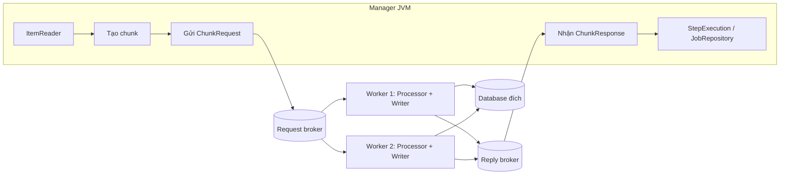
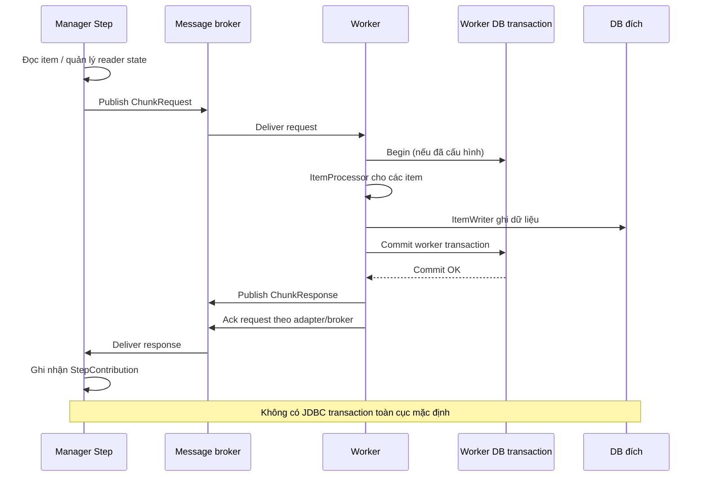
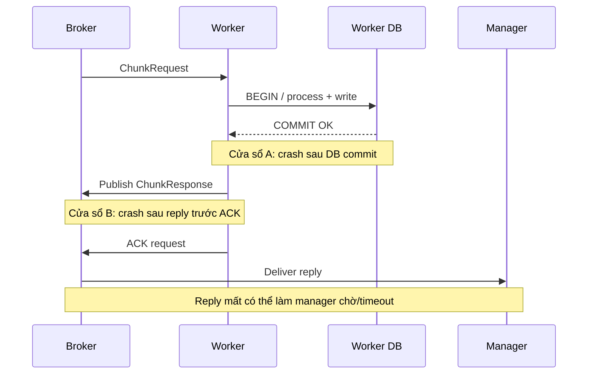
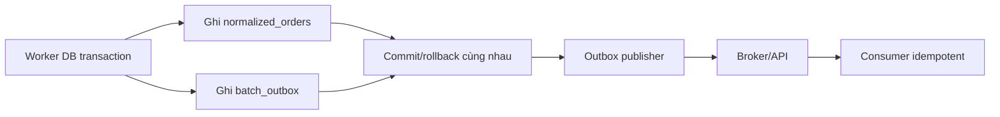

# Transaction của remote chunk worker trong Spring Batch

Khi một Spring Batch job xử lý hàng triệu item, **remote chunking** cho phép manager đọc dữ liệu, chia thành các chunk rồi gửi `ChunkRequest` qua middleware để các worker ở JVM khác thực hiện `ItemProcessor` và `ItemWriter`. Kiến trúc này hữu ích khi đọc dữ liệu tương đối nhanh nhưng xử lý hoặc ghi dữ liệu tốn CPU, I/O và cần mở rộng độc lập.

Vấn đề quan trọng là: **transaction database của manager không tự đi theo message sang remote chunk worker**. Một request có thể được giao lại khi broker mất acknowledgement; một worker có thể đã commit dữ liệu nhưng manager chưa nhận reply. Nếu hiểu sai ranh giới transaction, hệ thống có thể xử lý lặp, ghi một phần chunk, mất dữ liệu khi restart hoặc báo Job hoàn tất dù output chưa đúng.

Bài thuộc chương **Transaction boundary** của module **SPRING_BATCH_SCALING_OPERATIONS**. Module hướng tới mở rộng Spring Batch qua multi-threaded step, parallel steps, partitioning và các mô hình phân tán phù hợp, đồng thời đo bottleneck, giữ thread safety, retry/restart đúng và vận hành theo tài nguyên thực tế.

**Mục tiêu học tập:**

- Phân biệt transaction ở manager, transaction ở worker, broker acknowledgement và dữ liệu nghiệp vụ.
- Biết tại sao remote chunk worker **không mặc định có một transaction bao trọn process/write**.
- Cấu hình Java Spring Batch 5.x để bao worker handler trong transaction phù hợp.
- Phân tích exception, failed response, timeout, ack/redelivery và crash sau commit.
- Thiết kế idempotency, dedupe, outbox và đối soát dữ liệu khi restart.
- Đo throughput end-to-end và xây ma trận fault injection cho production.

## 1. Nhận diện đúng remote chunking



Trong remote chunking điển hình:

1. **Manager sở hữu reader:** đọc input, đóng gói các item thành chunk, gửi request qua Spring Integration/middleware.
2. **Worker sở hữu processor và writer:** xử lý các item có trong request, ghi output và trả response.
3. **Manager nhận response:** dùng thông tin `ChunkResponse`/`StepContribution` để quản lý kết quả Step.
4. **Broker vận chuyển dữ liệu:** các request/reply có lifecycle gửi, nhận, ack, timeout và redelivery độc lập với DB transaction.

Điều này **khác remote partitioning**: ở remote partitioning, manager phân chia các worker `StepExecution` và `ExecutionContext`; mỗi worker Step thường có **reader, processor, writer** và tự thực hiện nhiều chunk. Trong remote chunking, worker thường là **request handler**, không mặc định một StepExecution đầy đủ có reader/checkpoint riêng.

| Mô hình | Reader nằm ở đâu? | Đơn vị giao việc | Transaction ghi đích |
| --- | --- | --- | --- |
| Chunk Step tuần tự | Step | Chunk trong cùng JVM | Step chunk transaction |
| Local chunking | Thành phần quản lý cùng JVM | Chunk chạy trên worker thread | Delegate worker cần transaction phù hợp |
| Local/remote partitioning | Worker Step | Partition/StepExecution | Chunk transaction của worker Step |
| **Remote chunking** | **Manager** | **ChunkRequest chứa item** | **Phải xác định ranh giới transaction tại remote worker** |

**Không gán mặc định `@StepScope` và `stepExecutionContext` của remote partition worker cho remote chunk handler.** Nếu worker không chạy như một StepExecution của Spring Batch, các scope/context theo Step không tự xuất hiện. Metadata như `batchId`, `tenantId` và version xử lý phải được đưa qua payload/header hoặc nguồn cấu hình bền vững có kiểm soát.

## 2. Ba transaction boundary khác nhau



Sơ đồ trên mô tả **trình tự mong muốn**: xử lý/ghi, commit DB, rồi phản hồi. Thứ tự publish reply và ack request, thời điểm manager checkpoint và cách một adapter giao message có thể thay đổi theo cấu hình middleware. Phải thử nghiệm triển khai thật, không coi mọi mũi tên là bảo đảm mặc định.

| Ranh giới | Tài nguyên tham gia | Rollback được điều gì? | Không tự rollback |
| --- | --- | --- | --- |
| Transaction manager của **manager** | Resource đọc, metadata/JobRepository theo cấu hình | Thay đổi do transaction manager phía manager bảo vệ | Ghi DB ở worker, broker ack độc lập |
| Transaction manager của **worker** | JDBC connection và các resource worker tham gia | DML đã thực hiện trong transaction worker | Reader state của manager, external HTTP/email |
| Transaction/ack của **broker** | Message nhận/gửi, acknowledgement theo broker | Việc giao/nhận message theo hợp đồng broker | JDBC commit của worker khi không có phối hợp phân tán |
| **Business idempotency** | Khóa nghiệp vụ, version, dedupe | Không phải transaction; nhận diện xử lý lại | Không tự bảo vệ dữ liệu nếu không có unique constraint/quy trình đúng |

Một `PlatformTransactionManager` ở JVM manager không khiến Spring tự tạo transaction trên JVM worker. Transaction imperative của Spring gắn với thread hiện tại; message payload không thể mang một JDBC transaction đang hoạt động sang process khác.

## 3. Vì sao worker handler cần cấu hình transaction riêng?

Spring Batch Integration cung cấp `RemoteChunkingWorkerBuilder`; builder tạo integration flow nhận request và dùng `ChunkProcessorChunkHandler` (với `ChunkProcessor`) để gọi processor/writer.

**Không có nghĩa worker tự động mở một DB transaction cho toàn request.** Nếu writer dùng connection autocommit, một request 100 item có thể ghi được 80 item rồi ném lỗi, và 80 item đó đã bền vững. Dù manager nhận failure và retry, kết quả không còn all-or-none.

Đừng nhầm:

- **Chunk size 100 ở manager** = số item logic gửi đi mỗi `ChunkRequest`, không phải một cam kết DB commit tại worker.
- **Một lời gọi `JdbcBatchItemWriter.write(...)`** = lời gọi ghi batch, không tự tạo transaction ứng dụng xuyên tất cả SQL nếu không có transaction phù hợp.
- **`@Transactional` trên từng `process(item)`** = có thể mở transaction theo item, không đảm bảo nguyên tử của toàn bộ request.
- **Spring Integration nhận request thành công** = broker đã chuyển dữ liệu; không có nghĩa DB đích đã commit.

Nếu nghiệp vụ yêu cầu **hoặc ghi toàn bộ output của một remote chunk, hoặc không ghi item nào**, phải bao toàn bộ phần xử lý/ghi cần nguyên tử trong **một transaction ở worker** và xác minh writer dùng đúng manager/datasource.

### Những câu hỏi nên trả lời trước khi code

1. `ChunkHandler.handleChunk(...)` đang được gọi ở đâu?
2. Thread nào chạy handler? Bean có Spring proxy không?
3. Có transaction manager nào mở transaction ở worker?
4. ItemWriter thực sự dùng connection của transaction đó hay resource khác?
5. Nếu handler **trả failed `ChunkResponse` mà không ném exception**, transaction có rollback không?
6. Nếu DB commit lỗi hoặc kết quả commit không rõ, worker có gửi success reply không?
7. Nếu broker giao lại request, business output có được ghi lặp an toàn không?

Một log `txActive=true` chỉ chứng minh transaction được gắn với thread hiện tại, **không chứng minh** mọi datasource/API/broker đều tham gia cùng transaction đó.

## 4. ChunkRequest và ChunkResponse mang gì?

Trong Spring Batch Integration 5.x:

- `ChunkRequest<T>.getItems()`: các item manager gửi đến worker.
- `ChunkRequest.getSequence()`: số thứ tự giúp correlate request.
- `ChunkRequest.getJobId()`: định danh dạng số do API giao thức cung cấp.
- `ChunkRequest.getStepContribution()`: contribution liên quan chu trình Step.
- `ChunkResponse.isSuccessful()`: trạng thái xử lý của request.
- `ChunkResponse.getSequence()`, `getJobId()` và `getStepContribution()`: thông tin để manager nhận biết và tổng hợp.
- `ChunkResponse.getMessage()`: thông điệp chẩn đoán khi cần.

**Cẩn trọng:** sequence và ID trong request là **metadata giao thức**, không tự là khóa nghiệp vụ ổn định qua mọi tình huống restart. Nếu manager tạo lại một request khác chứa cùng item, số thứ tự có thể khác. Muốn idempotency thực tế, cần business key như `(batchId, orderId)`, version hoặc operation ID được đảm bảo ổn định.

```text
Lần đầu:
  ChunkRequest sequence=17 chứa orderId 101,102
  Worker A commit DB, nhưng reply bị mất

Sau timeout/restart:
  Manager hoặc broker gửi lại cùng item
  Worker B có thể nhận request với sequence/correlation khác
  Writer phải nhận diện 101,102 đã có hiệu ứng nghiệp vụ
```

**Không dùng thread name, queue delivery tag hoặc một số thứ tự tạm thời làm khóa duy nhất để chống ghi trùng.** Những giá trị này hữu ích khi debug, nhưng không nhất thiết ổn định qua redelivery/restart.

## 5. Ví dụ nghiệp vụ: chuẩn hóa đơn hàng

Manager đọc `staging_orders` theo `batchId` và gửi chunk có tối đa 100 đơn. Worker xử lý số tiền, ghi output vào `normalized_orders`.

Các bất biến cần giữ:

- Mỗi `(batchId, orderId)` chỉ có một kết quả chuẩn hóa cho đúng version nghiệp vụ.
- Nếu một request thất bại khi DB chưa commit, các DML của request đó phải rollback nếu được bảo vệ chung.
- Nếu DB đã commit nhưng reply mất, request có thể chạy lại mà kết quả không nhân đôi.
- Manager chỉ được thông báo success cho request sau khi worker transaction hoàn tất.
- Restart dùng input snapshot/version ổn định, không thay đổi quy tắc xử lý mà không có kế hoạch.

### 5.1. Các record truyền trên wire

```java
import java.io.Serializable;
import java.math.BigDecimal;

// Mỗi public record đặt trong file Java riêng khi triển khai thật.
public record OrderInput(
        String batchId,
        long orderId,
        BigDecimal grossAmount) implements Serializable {}

public record OrderOutput(
        String batchId,
        long orderId,
        BigDecimal normalizedAmount) implements Serializable {}
```

`Serializable` chỉ minh họa ý tưởng payload có thể chuyển qua middleware. Ứng dụng cần chọn **serializer/message schema và version hợp đồng** thích hợp (JSON, Avro, Protobuf hoặc định dạng được kiểm soát), xử lý tương thích khi nâng cấp worker và giới hạn kích thước/thông tin nhạy cảm. Không mặc định mọi Java class có thể được deserialise an toàn trên tất cả worker versions.

### 5.2. Processor thuần dữ liệu

```java
import java.math.RoundingMode;
import org.springframework.batch.item.ItemProcessor;

public final class NormalizeOrderProcessor
        implements ItemProcessor<OrderInput, OrderOutput> {

    @Override
    public OrderOutput process(OrderInput order) {
        if (order.batchId() == null || order.batchId().isBlank()
                || order.grossAmount() == null
                || order.grossAmount().signum() < 0) {
            throw new IllegalArgumentException(
                    "Invalid order: " + order.orderId());
        }
        return new OrderOutput(
                order.batchId(),
                order.orderId(),
                order.grossAmount().setScale(2, RoundingMode.HALF_UP));
    }
}
```

Processor không gửi email, không gọi API thanh toán, không tăng counter nghiệp vụ không transactional. Cùng input và cùng version xử lý cho cùng output. Nếu logic phụ thuộc tỷ giá, lịch thuế hoặc thời điểm hiện tại, cần pin snapshot/phiên bản trong batch để kết quả tái hiện được sau retry.

### 5.3. Writer có khóa nghiệp vụ bền vững

Ví dụ PostgreSQL:

```sql
CREATE TABLE normalized_orders (
    batch_id          varchar(80) NOT NULL,
    order_id          bigint NOT NULL,
    normalized_amount numeric(18, 2) NOT NULL,
    PRIMARY KEY (batch_id, order_id)
);
```

```java
import javax.sql.DataSource;
import org.springframework.batch.item.database.JdbcBatchItemWriter;
import org.springframework.batch.item.database.builder.JdbcBatchItemWriterBuilder;
import org.springframework.context.annotation.Bean;

@Bean
public JdbcBatchItemWriter<OrderOutput> normalizedOrderWriter(
        DataSource workerDataSource) {

    return new JdbcBatchItemWriterBuilder<OrderOutput>()
            .dataSource(workerDataSource)
            .sql("""
                INSERT INTO normalized_orders
                    (batch_id, order_id, normalized_amount)
                VALUES (?, ?, ?)
                ON CONFLICT (batch_id, order_id)
                DO UPDATE SET normalized_amount =
                    EXCLUDED.normalized_amount
                """)
            .itemPreparedStatementSetter((item, ps) -> {
                ps.setString(1, item.batchId());
                ps.setLong(2, item.orderId());
                ps.setBigDecimal(3, item.normalizedAmount());
            })
            .build();
}
```

Với bảng lưu **trạng thái hiện tại** mỗi `(batchId, orderId)`, upsert giúp xử lý lại cùng item mà không tạo duplicate row. Nhưng nếu nghiệp vụ cần **append-only ledger**, ghi lịch sử sự kiện hoặc `balance = balance + delta`, thì phải thiết kế khóa/dedup riêng; upsert trạng thái hiện tại không giải quyết mọi thứ.

Một upsert cũng có thể ghi đè sai giá trị khi hai request ghi cùng khóa với **version khác nhau**. Nếu quy tắc xử lý có version, hãy đưa version vào idempotency contract và chỉ update khi version phù hợp. Đối soát giá trị cuối, không chỉ đếm row.

## 6. Cấu hình manager Step (Spring Batch 5.x)

Spring Batch Integration có `RemoteChunkingManagerStepBuilder`. Mẫu sau giả định đã có `ItemReader<OrderInput>` và các channel kết nối với middleware:

```java
import org.springframework.batch.core.step.tasklet.TaskletStep;
import org.springframework.batch.core.repository.JobRepository;
import org.springframework.batch.integration.chunk.RemoteChunkingManagerStepBuilder;
import org.springframework.batch.item.ItemReader;
import org.springframework.context.annotation.Bean;
import org.springframework.messaging.MessageChannel;
import org.springframework.messaging.PollableChannel;
import org.springframework.transaction.PlatformTransactionManager;

@Bean
public TaskletStep remoteChunkManagerStep(
        JobRepository jobRepository,
        PlatformTransactionManager managerTransactionManager,
        ItemReader<OrderInput> managerReader,
        MessageChannel outgoingChunkRequests,
        PollableChannel incomingChunkReplies) {

    return new RemoteChunkingManagerStepBuilder<OrderInput, OrderOutput>(
            "remoteChunkManagerStep", jobRepository)
            .chunk(100)
            .reader(managerReader)
            .transactionManager(managerTransactionManager)
            .outputChannel(outgoingChunkRequests)
            .inputChannel(incomingChunkReplies)
            .build();
}
```

Code này chỉ cấu hình **Step tại manager**. Ứng dụng còn phải định nghĩa request/reply broker adapters, converter, authentication, routing, timeout, publisher confirms và các tính năng phù hợp. Builder tạo message-channel writer và nhận reply theo cơ chế remote chunking.

**Điều không xảy ra:** `managerTransactionManager` không tự mở transaction của writer ở worker. Manager có transaction của việc đọc/điều phối/metadata theo resource, còn việc process/write remote cần ranh giới ở JVM worker. Trạng thái manager `FAILED` không có nghĩa DB worker chắc chắn rollback.

Đừng đo throughput từ số request đã **gửi**. Điều cần quan sát là số output đã được ghi bền vững và response được xử lý đúng.

## 7. Worker builder cơ bản và giới hạn cần hiểu

`RemoteChunkingWorkerBuilder` tiện lợi để tạo Spring Integration flow nhận request và gọi processor/writer:

```java
import org.springframework.batch.integration.chunk.RemoteChunkingWorkerBuilder;
import org.springframework.batch.item.ItemProcessor;
import org.springframework.batch.item.ItemWriter;
import org.springframework.context.annotation.Bean;
import org.springframework.integration.dsl.IntegrationFlow;
import org.springframework.messaging.MessageChannel;

@Bean
public IntegrationFlow basicWorkerFlow(
        MessageChannel incomingChunkRequests,
        MessageChannel outgoingChunkReplies,
        ItemProcessor<OrderInput, OrderOutput> processor,
        ItemWriter<OrderOutput> writer) {

    return new RemoteChunkingWorkerBuilder<OrderInput, OrderOutput>()
            .inputChannel(incomingChunkRequests)
            .outputChannel(outgoingChunkReplies)
            .itemProcessor(processor)
            .itemWriter(writer)
            .build();
}
```

Builder tạo handler xử lý `ChunkRequest`, nhưng **không có đối số transaction manager của worker** trên API builder này. Do đó, đoạn code trên **không tự chứng minh** rằng toàn bộ item trong một request ghi vào DB trong cùng transaction. Nếu database có autocommit và writer thực hiện nhiều statement, có thể có ghi một phần khi lỗi.

Có thể dùng transaction advice trên Spring Integration handler/consumer, `@Transactional` trên public proxied method hoặc `TransactionTemplate` bao toàn bộ xử lý. Nhưng phải xác định chính sách khi handler trả **failed response** mà không ném exception. Chỉ thêm annotation mà không xét đường lỗi này chưa đủ.

## 8. Bao handler trong TransactionTemplate

Mẫu dưới minh họa rõ **transaction boundary của remote worker**. Nó dùng các API Spring Batch 5.x; với Spring Batch 6+, tên implementation và khả năng cấu hình có thể khác, cần đối chiếu đúng phiên bản.

### 8.1. Delegate xử lý chunk

```java
import org.springframework.batch.integration.chunk.ChunkProcessorChunkHandler;
import org.springframework.batch.core.step.item.SimpleChunkProcessor;
import org.springframework.batch.item.ItemProcessor;
import org.springframework.batch.item.ItemWriter;
import org.springframework.context.annotation.Bean;

@Bean
public ChunkProcessorChunkHandler<OrderInput> chunkDelegate(
        ItemProcessor<OrderInput, OrderOutput> processor,
        ItemWriter<OrderOutput> writer) {

    ChunkProcessorChunkHandler<OrderInput> handler =
            new ChunkProcessorChunkHandler<>();
    handler.setChunkProcessor(
            new SimpleChunkProcessor<>(processor, writer));

    return handler; // Spring khởi tạo bean và kiểm tra properties.
}
```

`ChunkProcessorChunkHandler` chuyển `ChunkRequest` thành việc gọi `ChunkProcessor` rồi tạo `ChunkResponse`. Nó là delegate; **transaction bao quanh delegate là trách nhiệm riêng của cấu hình worker** trong mẫu này.

### 8.2. TransactionTemplate bao trọn process/write

```java
import java.util.Objects;

import org.springframework.batch.integration.chunk.ChunkHandler;
import org.springframework.batch.integration.chunk.ChunkRequest;
import org.springframework.batch.integration.chunk.ChunkResponse;
import org.springframework.batch.integration.chunk.ChunkProcessorChunkHandler;
import org.springframework.context.annotation.Bean;
import org.springframework.transaction.PlatformTransactionManager;
import org.springframework.transaction.support.TransactionTemplate;

@Bean
public ChunkHandler<OrderInput> transactionalChunkHandler(
        PlatformTransactionManager workerTransactionManager,
        ChunkProcessorChunkHandler<OrderInput> chunkDelegate) {

    TransactionTemplate txTemplate =
            new TransactionTemplate(workerTransactionManager);

    return (ChunkRequest<OrderInput> request) ->
            Objects.requireNonNull(txTemplate.execute(status -> {
                try {
                    ChunkResponse reply =
                            chunkDelegate.handleChunk(request);

                    // Có handler trả FAILED thay vì ném exception.
                    if (!reply.isSuccessful()) {
                        status.setRollbackOnly();
                    }
                    return reply;
                } catch (Exception error) {
                    status.setRollbackOnly();
                    throw new IllegalStateException(
                            "Remote chunk processing failed", error);
                }
            }));
}
```

**Những điều code bảo vệ:**

1. `txTemplate.execute(...)` mở transaction **tại worker thread đang xử lý request**.
2. `process + write` được gọi bên trong transaction đó, miễn các lệnh DB dùng đúng transaction manager/datasource.
3. Nếu delegate ném exception, transaction rollback.
4. Nếu delegate **trả `reply.isSuccessful() == false`**, ta chủ động `setRollbackOnly()` để không commit DML rồi báo request thất bại.
5. Nếu transaction commit thất bại, template ném lỗi; handler không thể trả một success reply sau commit thất bại như đường thành công thông thường.
6. Nếu thành công, lời gọi template kết thúc rồi integration flow mới phát reply.

**Cần phân biệt hai chính sách lỗi:**

- **Trả failed response sau rollback:** manager có thông tin lỗi; inbound adapter có thể ack request vì handler trả bình thường. Không tự kỳ vọng broker sẽ redeliver.
- **Ném exception cho broker listener:** adapter có thể nack/requeue request theo chính sách, nhưng manager có thể chỉ thấy timeout và cùng request có thể quay vòng vô hạn nếu không có retry budget/DLQ.

Mẫu trên dùng lựa chọn thứ nhất cho trường hợp handler trả failed response. Nếu bài toán yêu cầu broker redelivery, cần đổi đường lỗi và cấu hình adapter tương ứng; **không dùng cả hai cơ chế một cách ngẫu nhiên**.

### 8.3. Nối transactional handler vào IntegrationFlow

```java
import org.springframework.batch.integration.chunk.ChunkHandler;
import org.springframework.beans.factory.annotation.Qualifier;
import org.springframework.context.annotation.Bean;
import org.springframework.integration.dsl.IntegrationFlow;
import org.springframework.messaging.MessageChannel;

@Bean
public IntegrationFlow transactionalWorkerFlow(
        MessageChannel incomingChunkRequests,
        MessageChannel outgoingChunkReplies,
        @Qualifier("transactionalChunkHandler")
        ChunkHandler<OrderInput> transactionalChunkHandler) {

    return IntegrationFlow.from(incomingChunkRequests)
            .handle(transactionalChunkHandler, "handleChunk")
            .channel(outgoingChunkReplies)
            .get();
}
```

Flow này là **phương án thay thế** `basicWorkerFlow` ở mục 7, **không bật đồng thời cả hai flow để nhận cùng request**. Bạn vẫn phải cấu hình inbound/outbound broker adapter, message conversion, reply routing/correlation, concurrency, error channel và acknowledgement.

Khi tự thay thế builder bằng flow tùy chỉnh, phải kiểm thử toàn bộ request/reply protocol, nhất là response identity và việc manager ghép `StepContribution`, thay vì chỉ kiểm tra rằng SQL đã ghi được.

### 8.4. Nếu dùng @Transactional thay vì TransactionTemplate

Có thể đặt `@Transactional(transactionManager = "workerTransactionManager")` trên một public method được gọi qua Spring AOP proxy, bao cả xử lý chunk. Nhưng **một annotation không tự rollback khi method trả failed `ChunkResponse` mà không ném exception**. Khi đó cần:

- Ném exception theo policy phù hợp, hoặc
- Đánh dấu rollback-only trong transaction hiện hành, hoặc
- Dùng programmatic wrapper như trên.

Ngoài ra, tự gọi method trong cùng class (`this.handleChunk(...)`) có thể bỏ qua proxy ở chế độ Spring AOP thông thường. Test phải xác nhận transaction thật, không chỉ dựa trên sự hiện diện của annotation.

## 9. Một ChunkResponse thất bại không đồng nghĩa rollback

`ChunkHandler` có thể chọn ném exception nếu cần rollback và kỳ vọng request được redeliver, hoặc trả `ChunkResponse` báo lỗi. Đây là hai con đường có tác động khác nhau lên broker và transaction.

| Đường xử lý | Phản ứng của TransactionTemplate minh họa | Hành vi message có thể gặp |
| --- | --- | --- |
| Delegate trả successful response | Commit worker DB nếu không có lỗi commit | Phát success reply rồi ack theo policy |
| Delegate trả failed response | Gọi rollback-only, trả failed reply | Manager biết lỗi; broker có thể ack request |
| Delegate ném RuntimeException/Exception | Rollback, ném lỗi ra listener | Adapter có thể nack/requeue/DLQ |
| Commit DB thất bại sau delegate báo thành công | TransactionTemplate ném exception | Không có success reply hợp lệ; cần retry/đối soát |
| Worker process crash bất ngờ | DB transaction chưa commit thường rollback; commit có thể không chắc chắn tại biên | Request có thể được redeliver hoặc timeout |

**Tại sao phải đọc response?** Một handler có thể ghi một số lệnh rồi bắt exception và chuyển nó thành status failure. Nếu transaction interceptor chỉ dựa vào việc method **có ném exception hay không**, đường “return FAILED” có thể bị commit như một request thành công ở cấp JDBC.

**Đừng dùng `noRollback(...)` để che các lỗi DB** mà chưa hiểu trạng thái rollback-only của transaction. Nhiều lỗi SQL khiến transaction không còn phù hợp để tiếp tục. Thiết kế retry/skip phải được chứng minh bằng thử nghiệm DB thật.

## 10. Ack broker và commit DB không tự nguyên tử

Cửa sổ lỗi quan trọng nhất nằm giữa **worker DB commit**, **publish reply** và **ack request**.



Không có **một local JDBC transaction** mặc định đồng thời commit DB, publish broker message, ack request và cập nhật JobRepository ở manager.

### Các lựa chọn và trade-off

| Chiến lược | Lợi ích | Giới hạn |
| --- | --- | --- |
| Ack sau DB commit | Giảm nguy cơ mất request khi DB chưa ghi | Crash giữa commit và ack tạo duplicate delivery |
| Broker transaction cho receive/reply | Điều phối nhận/gửi message theo broker | Không tự làm broker và JDBC commit nguyên tử |
| XA/JTA/distributed transaction | Phối hợp nhiều tài nguyên nếu mọi resource hỗ trợ | Chi phí cao và vận hành phức tạp, không mặc định tồn tại |
| At-least-once + idempotent DB effect | Phục hồi sau redelivery mà không nhân đôi nghiệp vụ | Cần unique key/dedup/version và kiểm thử race |
| Transactional outbox | Phát event sau khi output DB commit | Publisher vẫn có thể gửi lặp, consumer cần idempotent |

Một cam kết thực tế thường là **at-least-once delivery, idempotent business effect**, không phải exactly-once execution. Worker có thể chạy cùng callback nhiều lần, nhưng business output vẫn đúng khi kiểm soát idempotency.

**Cẩn thận với “ack trước commit”.** Nếu worker ack request trước rồi DB rollback hoặc JVM crash, broker có thể không giao lại request nữa. Khi đó manager có thể rơi vào timeout hoặc mất công việc. Cần thiết kế thứ tự commit/ack rõ và có đường recovery.

## 11. Idempotency: item-level, request-level và reply-level

### 11.1. Item-level — lớp bảo vệ bắt buộc

Khóa `(batchId, orderId)` giữ ổn định ngay cả khi cùng item được manager gửi lại dưới một request sequence mới. Đây là lý do unique constraint/upsert trong ví dụ phù hợp để chống duplicate row.

Nếu item đại diện thao tác cộng dồn hoặc event append-only, cần operation ID và bảng dedup phù hợp; không mặc định upsert trạng thái hiện tại đủ cho mọi nghiệp vụ.

### 11.2. Request-level — giảm việc chạy lại cả chunk

Một bảng trạng thái request có thể dùng:

```sql
CREATE TABLE processed_chunk_requests (
    operation_id varchar(120) PRIMARY KEY,
    payload_hash varchar(64) NOT NULL,
    committed_at timestamp NOT NULL DEFAULT CURRENT_TIMESTAMP
);
```

**Quy tắc đúng:** ghi dấu `DONE` và toàn bộ business output trong **cùng DB transaction**. Khi worker crash trước commit, cả output và marker rollback; khi crash sau commit, cả hai cùng tồn tại. Worker nhận lại cùng operation ID có thể nhận ra đã xử lý.

**Quy tắc sai:** kiểm tra bằng `SELECT exists` rồi `INSERT` không có unique constraint/locking; hai worker có thể cùng thấy “chưa xử lý” và cùng ghi. Không ghi dấu `DONE` trong một transaction riêng **trước** output, vì crash sau marker sẽ khiến lần retry bỏ qua công việc chưa hoàn thành.

Dedupe request chỉ đúng khi `operation_id`/payload hash thật sự ổn định theo hợp đồng. ID chỉ dựa trên `ChunkRequest.getSequence()` không đủ nếu manager tạo một request mới chứa cùng item sau restart.

### 11.3. Reply-level — tránh tính StepContribution hai lần

Khi worker đã gửi reply nhưng chưa ack request, broker có thể redeliver; manager có thể nhận hai reply cho cùng request. Correlation/dedupe ở manager giúp không cộng `StepContribution` lặp. Tuy nhiên **manager-side dedupe không thay thế worker-side idempotency**: worker có thể ghi DB lặp trước khi reply đến.

Phải kiểm tra implementation/adapter thật về cách ghép reply theo sequence/job ID và xử lý redelivery. Không tự xây thêm một bộ đếm dựa vào số message nhận rồi xem đó là số item đã commit.

## 12. Transactional outbox cho side effect bên ngoài

Một processor gửi email, event hoặc gọi API thanh toán có thể gây side effect **trước khi DB commit**. Nếu writer lỗi, chunk rollback rồi được giao lại, side effect có thể xảy ra hai lần.

```java
// Anti-pattern: gửi event ngoài JDBC transaction trong processor.
public OrderOutput process(OrderInput order) {
    notificationClient.send("ORDER_NORMALIZED", order.orderId());
    return normalize(order);
}
```

Đối với event phải phát sau khi DB ghi thành công, có thể dùng **transactional outbox**:

1. Processor tạo output và metadata event, không gọi broker trực tiếp.
2. Writer ghi output và một dòng outbox có `eventId` duy nhất **trong cùng transaction worker DB**.
3. Sau commit, publisher riêng lấy event từ outbox và gửi đến broker.
4. Consumer dùng `eventId` để dedupe nếu publisher crash giữa send và đánh dấu delivered.



Mẫu này không tự cung cấp exactly-once delivery. Khi publisher crash sau khi broker đã nhận nhưng chưa cập nhật `published_at`, cùng event có thể gửi lại. Ngoài ra, outbox business event **khác** với `ChunkResponse` của remote chunking; không thay thế cơ chế báo kết quả về manager mà không thiết kế protocol đầy đủ.

## 13. Retry, redelivery và restart: ba tầng khác nhau

- **Retry ngay trong worker:** xử lý lại một lỗi transient trong request, có thể ở DB/service layer; cần backoff và giới hạn.
- **Broker redelivery:** cùng message được giao lại khi không ack/nack hoặc mất kết nối, có thể đến worker khác.
- **Job restart ở manager:** manager phục hồi theo `JobRepository` và reader state, có thể tái tạo/gửi lại những item chưa được ghi nhận.

Chúng không tương đương. Một lỗi có thể kích hoạt nhiều tầng retry; nếu mỗi tầng có chính sách riêng, số attempt thực tế có thể tăng mạnh.

### Ví dụ restart nguy hiểm

1. Manager đọc 100 item, gửi request.
2. Worker ghi/commit 100 output.
3. Worker không gửi được reply; manager `FAILED` hoặc crash.
4. Khi restart, reader/manager có thể đọc/gửi lại một số item.
5. Nếu writer cộng dồn `balance = balance + delta`, dữ liệu bị cộng đôi.
6. Nếu writer dùng business key ổn định và phép ghi idempotent, dữ liệu vẫn có thể đúng.

**Không suy luận “message không thấy trong queue = xử lý đã xong”.** Nó có thể đã được ack nhưng reply thất lạc, hoặc đã vào DLQ, hoặc consumer đang giữ unacked. Kiểm tra broker state, DB state và JobRepository đồng thời.

### Phân loại lỗi và chính sách

| Loại lỗi | Retry? | Skip/fail? | Ghi chú |
| --- | --- | --- | --- |
| Deadlock/transient DB | Có thể, hữu hạn/backoff | Fail khi hết budget | Tránh retry storm khi database bão hòa |
| Dữ liệu sai schema/thiếu khóa | Thường không nên retry nhiều | Fail/DLQ hoặc skip theo nghiệp vụ | Không tự bỏ dữ liệu bắt buộc |
| Broker timeout | Chưa biết worker đã commit chưa | Đối soát trước retry | Timeout không chứng minh rollback |
| Commit result không chắc chắn | Tránh assumption | Kiểm tra DB/idempotency | Có thể đã commit phía server |
| Poison message lặp mãi | Không retry vô hạn | DLQ/alert/runbook | Đừng để chặn mọi request |
| Worker crash | Redelivery/restart | Kiểm tra state | Cần chống duplicate effect |

Mặc dù builder manager kế thừa một số API fault tolerance, **không được giả định các rule skip/retry của chunk Step local được áp nguyên xi vào worker remote**. Worker handler, broker adapter và manager có trách nhiệm khác nhau; phải test đường lỗi thực.

## 14. Worker scope và thread safety

Worker remote chunking thường nhận message qua Spring Integration, có thể xử lý nhiều request đồng thời bằng nhiều consumer thread.

| Thành phần | Rủi ro khi concurrent | Biện pháp |
| --- | --- | --- |
| Processor singleton giữ field `currentTenant` | Trộn tenant của hai request | Truyền tenant qua payload, dùng biến local/config immutable |
| Writer giữ `Connection` trong field | Dùng chung JDBC connection/transaction không an toàn | DataSource + transaction manager gắn theo thread |
| Handler giữ list kết quả trong field | Item của request A/B bị trộn | State riêng trong scope của method |
| ThreadLocal tự quản không cleanup | Worker sau nhìn thấy context trước | `try/finally` + `remove()` |
| Dedupe dùng `HashSet` in-memory | Mất sau crash và race giữa JVM | Unique constraint/DB transaction |
| Consumer prefetch quá cao | Nhiều message unacked, DB pool cạn | Giới hạn consumer/prefetch/queue, đo pool wait |

`@StepScope` gắn bean theo `StepExecution` trong Spring Batch, **không phải scope tự có theo mỗi message handler**. Nếu worker không được thiết lập Step context hợp lệ, SpEL `stepExecutionContext['tenantId']` sẽ không hoạt động như reader của remote partitioning. Với remote chunking, nên đóng metadata nghiệp vụ vào payload có schema/version rõ.

Với transaction imperative, thread mới không kế thừa transaction của manager. Mỗi lời gọi `TransactionTemplate.execute(...)` của worker có thể mở transaction riêng đúng manager; không đưa `EntityManager`/`Connection` đang có transaction giữa consumer threads hoặc giữa JVM.

## 15. Chọn mô hình theo bottleneck và tài nguyên

Remote chunking có thể mở rộng phần processor/writer, nhưng **manager reader vẫn có thể là nút thắt duy nhất**.

| Điểm nghẽn | Dấu hiệu | Hướng xử lý |
| --- | --- | --- |
| Manager reader | item/s thấp, DB nguồn query chậm | Tối ưu reader/index hoặc cân nhắc partitioning nếu cần phân tán đọc |
| Serialization/network | Payload lớn, GC/bytes/chunk tăng | Giảm payload, chọn serializer, thử chunk size |
| Broker | Queue backlog, publish confirm chậm | Capacity/partition queue, giới hạn inflight |
| Worker processor | CPU cao, latency p95 lớn | Tăng worker có kiểm soát, stateless logic |
| Writer/DB | DB lock wait, pool pending, commit latency tăng | SQL batch/index, concurrency, transaction duration |
| Reply flow | Reply queue backlog, timeout, duplicate | Tuning consumer/correlation/reply handling |
| Retry/redelivery | Message attempts tăng, output throughput không tăng | Phân loại lỗi, backoff, DLQ, idempotency |

Giả sử 4 worker JVM, mỗi JVM chạy 2 request đồng thời, mỗi request 100 item mất 0,5 giây, năng lực xử lý lý tưởng:

\[
T \approx \frac{4 \times 2 \times 100}{0.5}
= 1.600\ \text{item/giây}
\]

Nếu manager chỉ đọc được 700 item/s hoặc database đích chỉ ghi ổn định 900 item/s, toàn job không thể đạt 1.600 item/s. Retry/redelivery và broker overhead còn làm throughput hữu ích thấp hơn.

**Không chọn chunk size chỉ để giảm số message.** Chunk lớn hơn có thể tăng JDBC batching nhưng giữ transaction lâu, tăng payload/heap, kéo dài timeout và làm nhiều item phải chạy lại sau lỗi. Benchmark nhiều mức chunk size trên cùng snapshot, cùng policy và cùng công suất DB/broker.

## 16. Ma trận fault injection trước production

Chạy test trên một môi trường có database transactional và middleware gần production. Không chỉ mock processor rồi kết luận transaction đúng.

| Thử nghiệm | Fault injection | Bằng chứng cần lấy |
| --- | --- | --- |
| Worker chưa có transaction | Writer lỗi sau nhiều SQL | Thấy nguy cơ partial write và sửa cấu hình |
| Handler có TransactionTemplate | Writer ghi một phần rồi ném lỗi | **Không còn** output chưa commit trong chunk lỗi |
| Handler trả failed response | Trả `isSuccessful=false` sau DML | Rollback-only hoạt động, manager nhận failure phù hợp |
| Commit DB lỗi | Giả lập lỗi gần commit | Không gửi success giả; đối soát trạng thái DB |
| Worker crash sau DB commit | Kill trước reply | Redelivery không tạo kết quả trùng/sai |
| Reply gửi, request chưa ack | Kill trước ack | Duplicate reply/request không tạo double effect |
| Ack trước commit (test tiêu cực) | Crash sau ack trước DB commit | Phát hiện mất request; loại trừ flow không an toàn |
| Manager crash sau gửi | Kill manager giữ worker/broker | Restart đúng, dữ liệu vẫn đầy đủ |
| Duplicates đồng thời | Hai worker nhận cùng business key | Constraint/locking bảo vệ đúng |
| Worker poison message | Input schema invalid | Fail/DLQ có giới hạn, không kẹt queue |
| Worker pool bão hòa | Tăng consumer/prefetch | Pool DB/lock/queue không sụp đổ |
| Side effect ngoài DB | Gửi API rồi làm DB fail | Phát hiện duplicate, xác minh outbox/idempotency |
| Upgrade serializer | Worker versions khác nhau | Compatibility/rollout không làm sai payload |

### Test trọng tâm: rollback request và redelivery

1. Manager gửi chunk A chứa `orderId` 1–100.
2. Worker ghi dữ liệu của 80 item rồi bị inject exception trước khi commit.
3. Nếu transaction worker bao toàn bộ DML, DB **không có item nào được commit từ request A**.
4. Retry chunk với writer bình thường; DB có đủ 100 item, không thiếu.
5. Giao lại cùng chunk một lần nữa; vẫn có 100 business key và giá trị đúng.
6. Kill worker sau commit trước reply; manager restart, đối soát dữ liệu sau khi request xuất hiện lại.
7. Kiểm tra count/correlation ở manager và broker, không chỉ dữ liệu đích.

### SQL đối soát minh họa (PostgreSQL)

```sql
-- Tìm key nguồn chưa có output (nếu mỗi input phải có output).
SELECT s.order_id
FROM staging_orders s
LEFT JOIN normalized_orders o
  ON o.batch_id = s.batch_id
 AND o.order_id = s.order_id
WHERE s.batch_id = :batchId
  AND o.order_id IS NULL;

-- Tìm output không thuộc input snapshot.
SELECT o.order_id
FROM normalized_orders o
LEFT JOIN staging_orders s
  ON s.batch_id = o.batch_id
 AND s.order_id = o.order_id
WHERE o.batch_id = :batchId
  AND s.order_id IS NULL;

-- Tổng số và tổng tiền.
SELECT COUNT(*) AS output_count,
       SUM(normalized_amount) AS total_amount
FROM normalized_orders
WHERE batch_id = :batchId;
```

Nếu processor filter/skip/aggregate, phải sửa kỳ vọng theo nghiệp vụ. Unique constraint có thể khiến duplicate row bằng 0 nhưng không chứng minh **không thiếu row hoặc không ghi sai amount**. Cần kiểm tra tập khóa và checksum/số tiền dự kiến.

## 17. Runbook khi worker mất reply hoặc manager FAILED

1. Ghi nhận `JobExecutionId`, `StepExecutionId` tại manager, `batchId`, request correlation, thời điểm và input snapshot.
2. Kiểm tra request/reply queues: ready/unacked, redelivery count, DLQ, publisher confirm, adapter errors.
3. Truy worker logs/traces theo correlation, tìm mốc bắt đầu handler, lỗi processor/writer, begin/commit/rollback DB.
4. Kiểm tra output DB theo business key và marker dedup/outbox; phân biệt **chắc chắn rollback, chắc chắn commit hoặc không chắc chắn**.
5. Kiểm tra side effect ngoài DB (email, API, event, downstream) trước khi replay.
6. Không restart tràn lan nhiều JobInstance chồng lấn trên cùng snapshot khi chưa xác nhận tính tách biệt.
7. Sửa nguyên nhân hạ tầng hoặc dữ liệu; xác nhận transaction manager, retry budget, DLQ và idempotency.
8. Restart/replay theo protocol đã thiết kế và đường hỗ trợ của Spring Batch/middleware.
9. Đối soát toàn bộ batch sau phục hồi; chỉ publish downstream khi dữ liệu bắt buộc đúng.

**Các dấu hiệu cần alert:** worker trả success nhưng DB output thiếu; manager completed nhưng còn message liên quan ở DLQ; redelivery tăng liên tục; DB pool pending/lock wait tăng; cùng business key bị cập nhật trái version; duplicate reply làm bộ đếm Step bất thường.

## 18. Các lỗi thiết kế cần tránh

| Sai lầm | Tác động | Khắc phục |
| --- | --- | --- |
| Coi manager transaction là transaction worker | DML worker nằm ngoài rollback mong muốn | Tạo transaction worker tường minh |
| Coi JDBC batch là một transaction tự động | Có thể commit một phần | Bao `process + write` bằng transaction manager phù hợp |
| Chỉ dùng `@Transactional` cho từng item | Không atomic cả request | Đặt boundary ở handler/chunk |
| Failed response không ném exception nên commit | Ghi một phần nhưng manager thấy FAILED | Kiểm tra `isSuccessful` và rollback-only |
| Gửi reply success trước khi DB commit | Thông báo thành công giả | Commit trước khi trả success |
| Ack request trước commit | Crash có thể làm mất work | Ack/transaction protocol an toàn + recovery |
| Dedupe bằng sequence tạm thời | Restart tái phát cùng item với sequence khác | Khóa nghiệp vụ/operation ID ổn định |
| Dedupe bằng RAM | Race/đánh mất state giữa JVM | DB constraint/atomic marker |
| Đánh dấu DONE trước output ở tx riêng | Bỏ sót output sau crash | Marker cùng DB transaction |
| Gọi API/broker trong processor | Side effect lặp sau rollback | Outbox/saga/idempotency |
| Giả định worker có `@StepScope` sẵn | Resolve sai context hoặc lỗi scope | Metadata trong payload/header rõ ràng |
| Retry không giới hạn | Poison message, DB/broker quá tải | Budget, backoff, DLQ |
| Tăng worker không đo manager reader | Chỉ tăng backlog/DB lock | Benchmark end-to-end |
| Đếm response thay cho dữ liệu đã commit | Overcount khi duplicate reply | Correlation/dedupe/reconciliation |

## 19. Checklist production cho transaction remote chunk worker

- [ ] Đã xác định manager reader, worker processor/writer và request/reply channels.
- [ ] Đã phân biệt remote chunking với remote partitioning.
- [ ] Worker DB transaction bao đúng những DML của toàn request cần nguyên tử.
- [ ] Transaction manager worker quản lý chính xác datasource/connection của writer.
- [ ] Exception **và failed response** dẫn đến rollback khi nghiệp vụ yêu cầu.
- [ ] Success reply không phát trước khi worker DB commit thành công.
- [ ] Broker ack/reply/redelivery được cấu hình theo đúng adapter và kiểm thử.
- [ ] Khi worker commit rồi crash trước reply, request xử lý lại vẫn an toàn.
- [ ] Có business key/operation ID ổn định, unique constraint và quy tắc version.
- [ ] Dedupe marker nếu có được commit cùng output, chịu được concurrent duplicates.
- [ ] Processor stateless; handler/writer/listener an toàn khi consumer concurrency tăng.
- [ ] Không chia sẻ connection/transaction context qua thread hoặc JVM.
- [ ] Không mặc định `@StepScope` worker nếu không có Step context hợp lệ.
- [ ] Event/API dùng outbox/idempotency, không giả định rollback DB bảo vệ chúng.
- [ ] Input snapshot, message schema và business version không đổi tùy tiện khi restart.
- [ ] Retry, timeout, DLQ, broker prefetch và consumer concurrency có giới hạn rõ.
- [ ] Theo dõi queue lag, duplicate/redelivery, commit latency, DB lock và throughput đã commit.
- [ ] Đã thử crash trước/sau commit, trước/sau reply, trước/sau ack và manager restart.
- [ ] Đã đối soát thiếu/thừa key, checksum và dữ liệu nghiệp vụ sau lỗi.
- [ ] Có runbook xác định commit không chắc chắn trước khi replay/publish.

## 20. Câu hỏi và bài tập tự đánh giá

1. Trong remote chunking, vì sao manager có transaction không bảo đảm lệnh SQL của worker được rollback theo manager?
2. Remote chunking và remote partitioning khác nhau thế nào về reader, StepExecution và checkpoint?
3. Nếu worker writer ghi 80 trên 100 item rồi ném lỗi, điều kiện nào bảo đảm cả 80 DML rollback?
4. Vì sao cần xét `ChunkResponse.isSuccessful()` thay vì chỉ dựa vào exception?
5. Nếu worker commit DB thành công rồi crash trước reply, manager có thể làm gì? Cách nào ngăn ghi trùng?
6. Tại sao ack broker trước DB commit có thể làm mất công việc khi worker chết?
7. Nếu cùng operation được giao đồng thời cho hai worker, vì sao `SELECT exists` không có unique constraint/lock là chưa đủ?
8. Vì sao `request.getSequence()` không phải business idempotency key chắc chắn qua restart?
9. Bao `TransactionTemplate` quanh riêng writer khác bao quanh cả handler thế nào khi processor cũng ghi DB?
10. Worker remote chunking có thể dùng `stepExecutionContext['tenantId']` một cách mặc định không? Vì sao?
11. Manager reader đạt 600 item/s, workers tổng cộng đạt 3.000 item/s. Tăng worker có giúp job nhanh hơn không?
12. Hãy lập kế hoạch fault injection ở ba mốc **sau commit trước reply**, **sau reply trước ack** và **trước commit** rồi chỉ rõ các SQL/query đối soát.

## Tài liệu tham khảo

Các API và mô hình cần đối chiếu với phiên bản đang chạy:

- [Spring Batch Integration — Externalizing Batch Execution](https://docs.spring.io/spring-batch/reference/spring-batch-integration/externalizing-execution.html) — mô hình remote chunking manager/worker.
- [RemoteChunkingWorkerBuilder — Spring Batch 5.2 API](https://docs.spring.io/spring-batch/docs/5.2.x/api/org/springframework/batch/integration/chunk/RemoteChunkingWorkerBuilder.html) — flow, processor, writer, input/output channels.
- [ChunkProcessorChunkHandler — Spring Batch 5.2 API](https://docs.spring.io/spring-batch/docs/5.2.x/api/org/springframework/batch/integration/chunk/ChunkProcessorChunkHandler.html) — xử lý request và response.
- [ChunkHandler — Spring Batch 5.2 API](https://docs.spring.io/spring-batch/docs/5.2.x/api/org/springframework/batch/integration/chunk/ChunkHandler.html) — điều kiện ném exception khi cần rollback và redelivery.
- [RemoteChunkingManagerStepBuilder — Spring Batch 5.2 API](https://docs.spring.io/spring-batch/docs/5.2.x/api/org/springframework/batch/integration/chunk/RemoteChunkingManagerStepBuilder.html) — xây manager Step với reader, transaction manager, request/reply.

**Ghi nhớ:** Remote chunking chia **vị trí thực thi**, không tự tạo transaction chung giữa manager, worker và broker. Hãy chủ động đặt transaction bao quanh worker process/write, không gửi success trước commit, hiểu rõ ack/redelivery, và bảo vệ dữ liệu bằng **idempotency + correlation + reconciliation**. Chỉ khi đã thử các cửa sổ lỗi trước/sau commit, reply và ack, kiến trúc mới có cơ sở để chạy an toàn ở quy mô lớn.
