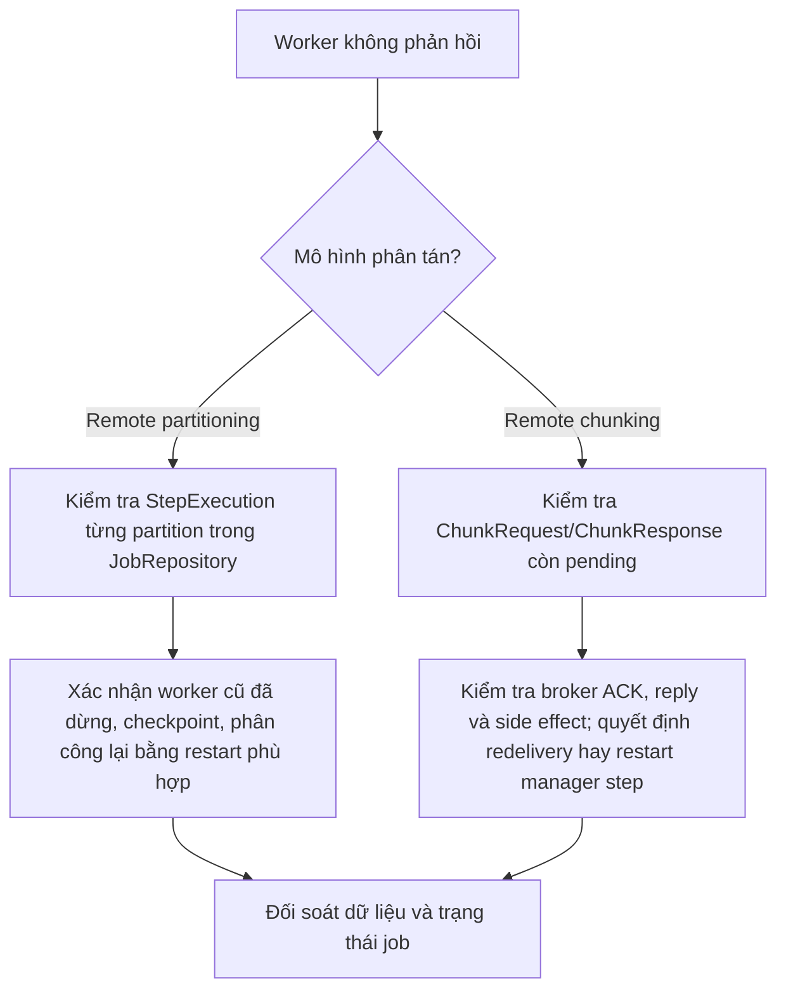
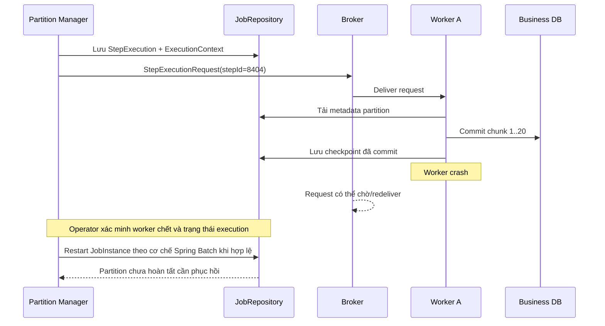
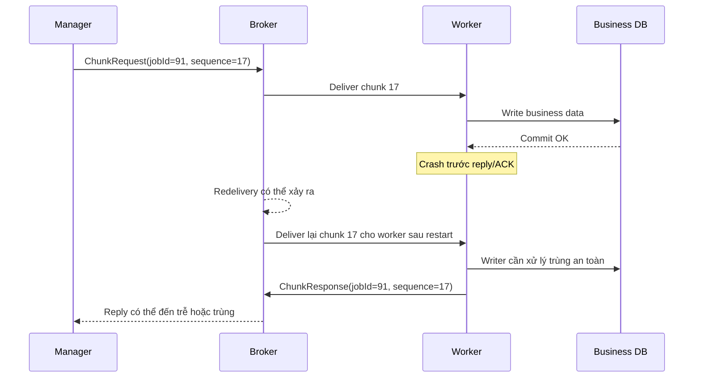

# Restart remote worker trong Spring Batch: phục hồi đúng khi tiến trình phân tán gặp sự cố

Trong một batch job chạy phân tán, **worker có thể chết bất cứ lúc nào**: trước khi nhận yêu cầu, giữa một transaction, sau khi đã commit dữ liệu nhưng chưa gửi reply, hoặc sau khi kết thúc step mà manager chưa kịp cập nhật kết quả. Khi khởi động worker trở lại, hệ thống có thể chạy tiếp, giao lại thông điệp hoặc cần restart một `JobExecution`. Các hành động này **không đồng nghĩa nhau**.

Bài học thuộc chương **Restartability** của module `SPRING_BATCH_SCALING_OPERATIONS`: mở rộng Spring Batch với parallel steps, partitioning và các mô hình phân tán, đồng thời giữ an toàn luồng, retry/restart, tính đúng dữ liệu và vận hành theo tài nguyên thực tế. Trọng tâm là **restart remote worker**, phân biệt **remote partitioning** và **remote chunking**, kết hợp `JobRepository` với middleware, xử lý request/reply trễ hoặc trùng, và xây runbook phục hồi có thể kiểm chứng. Các ví dụ Java nhắm tới **Spring Batch 5.x**; chúng minh họa những phần cấu hình quan trọng, không phải ứng dụng triển khai production đầy đủ.

## 1. Hai nghĩa của từ “restart”

Khi operator nói “restart worker”, hãy làm rõ họ muốn thực hiện thao tác nào:

| Thao tác | Điều gì được khởi động lại? | Tác động tới Spring Batch |
| --- | --- | --- |
| **Restart process/container** | JVM, pod, service consumer | Worker đăng ký nhận message trở lại; **không tự tạo một `JobExecution` mới** |
| **Broker redelivery** | Cùng request/message được giao lại | Có thể khiến xử lý lặp; không nhất thiết đồng nghĩa “restart step” |
| **Spring Batch job restart** | Tạo lần `JobExecution` mới cho **cùng `JobInstance`** | Framework dùng metadata để quyết định step/partition nào cần chạy lại |
| **Application retry** | Thử lại processor, writer, lệnh gọi API hoặc message handling | Có thể xảy ra trong một execution, không thay thế restart job |
| **Rerun job mới** | `JobInstance` mới với identifying parameters khác | Thường xử lý từ đầu theo dataset của lần chạy mới, trừ khi ứng dụng tự định nghĩa resume |

**Quy tắc đầu tiên:** restart container không có nghĩa `StepExecution` đang `STARTED` sẽ tự chuyển thành `FAILED` hay tự được restart an toàn. Nếu tiến trình chết giữa chừng, metadata có thể còn trạng thái đang chạy. Cần biết worker cũ có thực sự dừng chưa và ai chịu trách nhiệm điều phối trạng thái.

## 2. Kiến trúc ảnh hưởng trực tiếp đến cách restart

Spring Batch có ít nhất hai kiểu xử lý phân tán liên quan đến remote worker, với **đơn vị giao việc** khác nhau.

| Đặc tính | Remote partitioning | Remote chunking |
| --- | --- | --- |
| Manager phân phối | **`StepExecutionRequest`** cho một partition | **`ChunkRequest`** cho một chunk |
| Worker đọc dữ liệu nguồn? | Có, thông qua `ItemReader` của worker step | Thông thường **không**; manager đọc và gửi item |
| Metadata tiến độ chính | `StepExecution`/`ExecutionContext` của **từng partition** | `StepExecution`/reader checkpoint của **manager step** |
| Kết quả worker | `StepExecution` hoặc cập nhật repository để manager poll | `ChunkResponse` với thông tin kết quả chunk |
| Sau worker crash | Khôi phục partition, quyết định chạy lại `StepExecution` chưa hoàn tất | Broker có thể redeliver chunk; manager còn chờ reply, hoặc phải restart job/step |
| Nguy cơ dễ gặp | Chạy trùng partition, trạng thái `STARTED` treo, đổi range khi restart | Chunk đã commit nhưng reply thất lạc; request/reply cũ hoặc trùng |

**Đừng dùng quy trình recovery của remote partitioning để giả định mỗi remote chunking worker đều có một `StepExecution` riêng trong `JobRepository`.** Với cấu hình remote chunking thông thường, worker xử lý `ChunkRequest` qua message listener, còn manager sở hữu step đọc dữ liệu.



## 3. JobInstance, JobExecution và StepExecution: ba cấp độ phải phân biệt

Trong Spring Batch:

- **`JobInstance`** biểu diễn một lần chạy logic, xác định bởi tên job và các **identifying `JobParameters`**.
- **`JobExecution`** biểu diễn một lần thử thực thi `JobInstance`. Restart thành công theo framework có thể tạo **JobExecution mới cùng JobInstance**.
- **`StepExecution`** chứa trạng thái/counter của một lần thực thi step; trong partitioning có các `StepExecution` cho từng partition.

Ví dụ:

```text
JobInstance: billingJob(date=2026-11-26, runKey=region-vn)
  JobExecution #501 -> FAILED
    managerStep                       FAILED
      invoiceWorker:partition00       COMPLETED
      invoiceWorker:partition01       FAILED
      invoiceWorker:partition02       COMPLETED

  JobExecution #502 -> COMPLETED (restart cùng JobInstance)
    managerStep                       COMPLETED
      partition01 được xử lý lại theo metadata
      partition00/02 đã hoàn thành thường không cần chạy lại
```

Đây là **mô hình minh họa**, không phải dump một cấu trúc cây được `JobRepository` trả sẵn. Số lần chạy và tên step execution thực tế phụ thuộc cấu hình và tình trạng restart.

### 3.1. Metadata quan trọng

Các bảng chuẩn thường bao gồm `BATCH_JOB_INSTANCE`, `BATCH_JOB_EXECUTION`, `BATCH_JOB_EXECUTION_PARAMS`, `BATCH_STEP_EXECUTION` và `BATCH_STEP_EXECUTION_CONTEXT`. Chúng cho biết:

- Job/step thuộc instance/execution nào.
- `BatchStatus` và `ExitStatus` của từng execution.
- Read/write/skip/commit/rollback counters.
- `ExecutionContext` phục vụ checkpoint và dữ liệu chia partition.
- Start/end time, lỗi và thông tin liên quan đến restart.

**JobRepository không phải queue broker.** Nó không tự giữ một bản sao hoàn chỉnh của mọi request/reply để phát lại, và không chứng minh các side effect bên ngoài đã rollback.

## 4. Remote partitioning: worker crash giữa một StepExecution

Xét manager phân một triệu invoice thành 10 partition theo dải primary key. Worker A nhận `StepExecutionRequest` của `invoiceWorker:partition04` với context:

```text
stepName             = invoiceWorker
stepExecutionId      = 8404
jobExecutionId       = 8300
stepExecutionContext:
  minId              = 400000
  maxIdExclusive     = 500000
  snapshotId         = billing-2026-11-26
```

Worker đọc từng chunk gồm 200 item; sau 20 chunk commit, JVM bị kill. Thông thường:

1. Những transaction **đã commit** trong DB vẫn tồn tại.
2. Transaction đang mở lúc crash thường được DB rollback, nhưng tác dụng với hệ thống ngoài DB không được đảm bảo rollback.
3. `StepExecution` có thể còn `STARTED`, `FAILED` hoặc trạng thái trung gian khác tùy thời điểm metadata được ghi.
4. Nếu broker chưa nhận ACK, nó có thể giao lại cùng `StepExecutionRequest`.
5. Việc chạy lại partition **phải đi qua chính sách execution/restart phù hợp**, không đơn giản xử lý message như một lệnh “chạy lại không điều kiện”.



**Tại sao không chỉ “force status = FAILED” trong DB?** Tự sửa hàng `BATCH_STEP_EXECUTION` có thể tạo trạng thái giả, bỏ qua thông tin checkpoint, cho phép hai process cùng chạy hoặc phá logic restart. Dùng công cụ quản trị/`JobOperator` và runbook có kiểm soát; chỉ xem can thiệp metadata thủ công là thủ tục khẩn cấp được chuyên gia đánh giá riêng.

## 5. Remote chunking: crash không tạo một partition StepExecution mới

Ở remote chunking:

1. Manager reader đọc item.
2. Manager tạo `ChunkRequest` mang `jobId` và `sequence` cùng `StepContribution`.
3. Worker nhận request, chạy processor/writer và trả `ChunkResponse`.
4. Manager đối chiếu reply, tính đóng góp của chunk và hoàn thành step.

Khi một worker crash, manager vẫn có thể đang đợi reply của chunk đó, trong khi các worker khác tiếp tục chạy.



Khác với partitioning, **restart worker process** ở đây thường chỉ giúp consumer tiếp tục nhận message. Nếu manager step đã bị đánh dấu `FAILED` hoặc `STOPPED` vì quá thời gian chờ/lỗi middleware, vẫn cần xử lý **restart JobInstance ở phía manager** khi đủ điều kiện. Broker redelivery không tự tạo `JobExecution` mới.

**Điểm mấu chốt:** dù mã reply khớp `jobId/sequence`, điều đó **không đảm bảo** nghiệp vụ chỉ được ghi một lần. Worker phải chống trùng ở tầng side effect, nhất là khi đã commit rồi crash trước khi ACK.

## 6. Bảng các thời điểm lỗi và hệ quả

Không thể thiết kế restart dựa trên một tình huống “worker chết” chung chung. Cần đặt câu hỏi: **worker chết ở giữa hai cột mốc nào?**

| Thời điểm lỗi | Rủi ro | Điều cần kiểm khi phục hồi |
| --- | --- | --- |
| Trước khi worker nhận request | Request vẫn ở queue hoặc chưa publish thành công | Publisher confirm, queue depth, destination, broker retry |
| Sau khi nhận, trước khi bắt đầu ghi DB | Message có thể unacked/redelivered | Broker ACK/NACK, việc tra `StepExecution` |
| Trong transaction đang mở | DB có thể rollback transaction đó; output bên ngoài có thể đã phát | Checkpoint, transaction boundary, external idempotency |
| Sau DB commit, trước khi metadata checkpoint | Trạng thái batch chưa chắc phản ánh side effect | Dedupe business key, đối chiếu nguồn/đích |
| Sau metadata checkpoint, trước reply | Manager có thể chờ dù worker đã thành công | Repository status, reply path, thời gian chờ |
| Sau publish reply, trước broker ACK request | Request có thể redeliver dù reply đã tồn tại | Duplicate request/reply, correlation, idempotency |
| Worker `COMPLETED` nhưng manager chết | Reply có thể đến manager mới/cũ | Phân biệt execution attempt, cơ chế restart và cleanup |
| Broker tạm ngừng | Manager hoặc worker không gửi/nhận message | Queue durability, retry/backoff, DLQ, reconnect |

**Không suy từ `status=STARTED` rằng worker vẫn còn chạy**, cũng không suy từ “queue trống” rằng mọi chunk/partition đã được manager chấp nhận. Cần đối chiếu nhiều nguồn: process, broker, `JobRepository` và dữ liệu nghiệp vụ.

## 7. Checkpoint quyết định worker đọc lại từ đâu

Trong chunk-oriented step, Spring Batch có thể lưu trạng thái reader/writer trong `ExecutionContext` qua `ItemStream.open/update/close`. Với remote partitioning, mỗi partition có checkpoint riêng. Để restart đúng:

- Reader phải khai báo tên ổn định, thực hiện state management tương thích `ItemStream`.
- `ExecutionContext` chứa thông tin nhận diện input/snapshot, phạm vi partition và checkpoint cần thiết.
- Biên phân vùng phải **không chồng nhau** và giữ ổn định khi retry/restart.
- Các statement đọc cần thứ tự ổn định, đặc biệt với paging reader.
- Dữ liệu nguồn phải có chiến lược snapshot/cutoff hoặc bảo đảm không đổi khiến offset/page dịch chuyển.
- Writer và processor có thể được gọi lại cho phần việc chưa checkpoint; mọi side effect cần idempotent.

### 7.1. Reader @StepScope với khoảng ID độc lập

Ví dụ Spring Batch 5.x dùng paging reader theo ID nửa mở `[minId, maxIdExclusive)`:

```java
import java.util.Map;
import javax.sql.DataSource;

import org.springframework.batch.core.configuration.annotation.StepScope;
import org.springframework.batch.item.database.JdbcPagingItemReader;
import org.springframework.batch.item.database.Order;
import org.springframework.batch.item.database.builder.JdbcPagingItemReaderBuilder;
import org.springframework.beans.factory.annotation.Value;
import org.springframework.context.annotation.Bean;
import org.springframework.context.annotation.Configuration;

@Configuration
class InvoiceReaderConfiguration {

    @Bean
    @StepScope
    JdbcPagingItemReader<Invoice> invoiceReader(
            DataSource dataSource,
            @Value("#{stepExecutionContext['minId']}") Long minId,
            @Value("#{stepExecutionContext['maxIdExclusive']}") Long maxIdExclusive) {
        if (minId == null || maxIdExclusive == null
                || minId >= maxIdExclusive) {
            throw new IllegalArgumentException("Invalid partition ID range");
        }

        return new JdbcPagingItemReaderBuilder<Invoice>()
                .name("invoiceReader")
                .dataSource(dataSource)
                .selectClause("SELECT id, amount")
                .fromClause("FROM invoices")
                .whereClause("WHERE id >= :minId AND id < :maxId")
                .parameterValues(Map.of(
                        "minId", minId,
                        "maxId", maxIdExclusive))
                .sortKeys(Map.of("id", Order.ASCENDING))
                .rowMapper((rs, rowNum) -> new Invoice(
                        rs.getLong("id"),
                        rs.getBigDecimal("amount")))
                .pageSize(200)
                .saveState(true)
                .build();
    }
}
```

`Invoice` là DTO nghiệp vụ giả định, ví dụ `record Invoice(long id, BigDecimal amount) {}` trong file Java riêng. Snippet chưa khai báo datasource, processor, writer, job và middleware nên **không phải ứng dụng hoàn chỉnh**.

**Vai trò của `@StepScope`:** reader được tạo theo **`StepExecution`** và đọc đúng `stepExecutionContext`. Nó **không** tự tạo instance cho từng thread trong một step multi-threaded. Không dùng cùng một cursor/paging reader stateful không được thiết kế thread-safe cho các thread song song trong **cùng `StepExecution`**.

### 7.2. Khi nào saveState(false) nguy hiểm?

Đặt `saveState(false)` bỏ việc reader lưu vị trí trong context, có thể phù hợp một số trường hợp đặc biệt mà input được xử lý lại nguyên khối bằng phương án idempotent. Nhưng với restart chunk-oriented step dựa vào checkpoint, nó có thể khiến reader đọc lại từ đầu hoặc không phục hồi vị trí mong muốn.

Không bật/tắt `saveState` chỉ để tránh lỗi “ExecutionContext không thread-safe”. Hãy phân biệt **multi-threaded step** với **mỗi partition một StepExecution** và thiết kế checkpoint/transaction dựa trên mô hình thực tế.

## 8. Partition keys và identifying parameters phải ổn định

Khi restart **cùng `JobInstance`**, các identifying `JobParameters` phải khớp. Nếu thêm tham số identifying như timestamp mới ở mỗi lần chạy, Spring Batch có thể tạo **JobInstance khác** thay vì restart instance thất bại.

Với partitioning, `Partitioner` nên tạo các key ổn định:

```text
partition00 -> [0, 100000)
partition01 -> [100000, 200000)
partition02 -> [200000, 300000)
...
```

Nếu lần chạy đầu có `partition00..partition09`, nhưng lần restart thay đổi thành `partition_0..partition_19` với biên mới, metadata cũ không còn đối chiếu theo cách dự kiến. Có nguy cơ xử lý lại vùng đã xong hoặc bỏ sót vùng chưa xong.

**Chiến lược vận hành tốt:**

1. Chốt snapshot/cutoff và quy tắc chia partition cho từng `JobInstance`.
2. Lưu các biên partition hoặc tiêu chí chia đủ bền vững để tái tạo trên restart.
3. Giữ tên worker step và key context nhất quán qua các version.
4. Nếu cần thay đổi hẳn chiến lược phân vùng, xem đó là migration/đợt job mới được đối soát, không phải “restart tương đương” mặc định.
5. Kiểm tra `allowStartIfComplete(true)`: khi được bật, step đã `COMPLETED` có thể chạy lại; chỉ dùng khi có lý do và side effect idempotent.

## 9. Idempotent writer: bảo vệ quan trọng nhất khi có redelivery

Không thể bảo đảm “exactly once” chỉ bằng cách bật durable queue, ACK hoặc `JobRepository`. Trong một hệ phân tán, có thể có **at-least-once delivery** và nhiều cửa sổ lỗi giữa transaction database với broker.

Ví dụ writer cộng dồn:

```sql
UPDATE account_summary
   SET total_amount = total_amount + :invoiceAmount
 WHERE account_id = :accountId;
```

Nếu cùng một invoice được xử lý lại, tổng tiền sẽ tăng hai lần. Thay vì thế, thiết kế cập nhật theo **khóa nghiệp vụ và kết quả tính toán xác định**, hoặc dùng bảng dedupe.

### 9.1. Ví dụ idempotent upsert theo business key

Minh họa PostgreSQL:

```sql
INSERT INTO invoice_normalized(invoice_id, normalized_amount, snapshot_id)
VALUES (:invoiceId, :amount, :snapshotId)
ON CONFLICT (invoice_id)
DO UPDATE
  SET normalized_amount = EXCLUDED.normalized_amount,
      snapshot_id = EXCLUDED.snapshot_id;
```

Yêu cầu có unique constraint trên `invoice_id`. Khi cùng invoice được gửi lại với **cùng input và cùng quy tắc tính**, kết quả cuối không tăng thành hai bản ghi. Tuy nhiên, nếu một invoice có thể tồn tại ở nhiều snapshot cần lưu tách biệt, khóa duy nhất có thể phải là `(snapshot_id, invoice_id)`. Chọn khóa theo **ngữ nghĩa nghiệp vụ**, không theo tiện lợi của ví dụ.

### 9.2. Dedupe trong một transaction nghiệp vụ

Nếu không thể chuyển thao tác thành upsert xác định (ví dụ “cộng balance”), lưu idempotency key và business update trong **cùng DB transaction**:

```text
BEGIN TRANSACTION
    INSERT processed_operation(operation_key)
    VALUES (:operationKey)
    -- Nếu unique conflict: đã xử lý, không thực hiện side effect thêm.

    UPDATE account_summary
       SET total_amount = total_amount + :amount
     WHERE account_id = :accountId
COMMIT
```

Đây là **pseudocode**: ứng dụng phải xử lý unique conflict đúng theo transaction semantics của DB, không đơn giản nuốt lỗi rồi tiếp tục một transaction đã bị đánh dấu rollback. Với external payment/email/event, cần idempotency key tại hệ thống đích, outbox hoặc cơ chế tương đương; transaction DB nội bộ không rollback được một API call đã hoàn thành bên ngoài.

**Dedupe theo broker `messageId` thường chưa đủ:** một chunk/partition nghiệp vụ có thể được publish lại bằng một message ID mới sau restart. Khóa dedupe cần ổn định theo operation/item/run scope.

## 10. Điều chỉnh broker ACK, retry và dead-letter

Trong remote processing, ba mốc dưới đây không đồng nghĩa:

- **Broker nhận message**: publisher confirm đã thành công theo cơ chế broker.
- **Worker đã hoàn tất business write**: transaction nghiệp vụ commit.
- **Manager đã ghi nhận kết quả**: `StepExecution` hoàn thành trong repository hoặc `ChunkResponse` được chấp nhận.

Nếu worker ACK request **trước** commit rồi crash, broker có thể không redeliver dù nghiệp vụ chưa hoàn tất. Nếu worker ACK **sau** commit nhưng crash trước ACK, broker có thể redeliver dù nghiệp vụ đã hoàn tất. Bởi vậy, cần thiết kế cả hai tình huống.

| Cấu hình middleware | Điều cần quyết định |
| --- | --- |
| Durable queue/message | Message còn sau broker restart ở mức bảo đảm broker |
| Publisher confirm / return | Manager biết publish đã được broker xác nhận hay bị unroutable |
| Consumer ACK/NACK | Khi nào coi request đã tiêu thụ, khi nào redeliver |
| Prefetch | Số request mỗi consumer giữ in-flight; với partition lâu nên tránh ôm nhiều request |
| Retry/backoff | Giới hạn lỗi tạm thời, không tạo retry storm |
| DLQ/quarantine | Lưu poison message khi lỗi không thể tự phục hồi |
| Message TTL | Hạn chế backlog cũ nhưng không xóa nhầm yêu cầu chưa được xử lý |
| Reply routing/correlation | Phản hồi về đúng manager và đúng execution đang chờ |

**Đối với partition lâu:** consumer có thể giữ request không ACK trong nhiều phút/hàng giờ. Xem timeout và delivery acknowledgment của broker/listener/container có phù hợp duration partition không; không dùng cấu hình phù hợp message ngắn để áp máy móc lên partition dài.

## 11. Reply trễ/trùng sau worker restart

Ngay cả khi worker hoàn thành step, reply vẫn có thể gặp sự cố: broker chậm, converter lỗi, manager crash hoặc nhiều manager cùng nghe một queue reply.

### 11.1. Phân biệt request và reply

| Remote partitioning | Remote chunking |
| --- | --- |
| Request: `StepExecutionRequest` | Request: `ChunkRequest` |
| Reply: thông tin `StepExecution` hoặc manager poll repository | Reply: `ChunkResponse` |
| Correlation dựa trên `JobExecution` / `StepExecution` và routing | Correlation dựa vào thông tin `jobId`/`sequence` và giao thức framework |

Một reply có thể đến **sau khi manager đã thất bại hoặc restart**. Không được nhận reply chỉ vì sequence trùng, cũng không được coi reply đến sai thứ tự là lỗi nếu tất cả metadata khác hợp lệ.

### 11.2. Shared reply queue có thể giao nhầm manager

Nếu Manager A và Manager B là **hai consumer** trên cùng queue reply, broker có thể giao reply của A cho B. B kiểm tra thấy ID không thuộc mình rồi **ACK bỏ qua** khiến A mất reply. Đây là lỗi routing, không đơn thuần là lỗi string correlation.

Các phương án thường gặp: reply queue theo manager instance/job execution; gateway/router có lưu trạng thái pending và ACK an toàn; hoặc repository polling cho remote partitioning khi phù hợp. Cần giải quyết vấn đề **ownership và message cũ** khi manager restart.

### 11.3. Không cộng kết quả hai lần

Nếu một reply bị redeliver hoặc worker publish lại, manager/audit không được tự tăng completion counter hai lần. Khi có custom audit, đối chiếu theo **khóa pending request** và chỉ chấp nhận chuyển trạng thái một lần (`PENDING → ACKNOWLEDGED`). Các counter chuẩn của framework phải được kiểm tra qua integration test; đừng chèn một bộ đếm ứng dụng cạnh tranh với manager logic.

## 12. Restart remote partitioning bằng cơ chế Spring Batch

Quy trình vận hành có kiểm soát:

1. **Xác nhận lỗi thực:** worker process đã chết hoặc đang treo; broker có redelivery, manager có timeout hay không.
2. **Cô lập cạnh tranh:** không để worker cũ và mới xử lý cùng một partition đồng thời. Kiểm leader/owner, listener, container lifecycle.
3. **Kiểm metadata:** `JobExecution`/`StepExecution` nào đang `COMPLETED`, `FAILED`, `STOPPED`, `STARTED` hoặc `UNKNOWN`; không “đổi status cho đẹp”.
4. **Kiểm DB/side effect:** các chunk đã commit và output còn chưa được đối chiếu.
5. **Khắc phục nguyên nhân:** DB connection, thiếu queue, thiếu bean `Step`, serializer, schema, quyền truy cập, memory, CPU.
6. **Chỉ khi execution ở trạng thái có thể restart**, dùng `JobOperator.restart(...)` hoặc cơ chế launch lại cùng `JobInstance` theo khả năng/cấu hình của ứng dụng.
7. **Giữ partition keys/context/reader name** ổn định, xác nhận chỉ những partition cần chạy lại được xử lý.
8. **Đối soát dữ liệu**, không chỉ xem job chuyển sang `COMPLETED`.

### 12.1. Ví dụ gọi JobOperator.restart

Đây là ví dụ cho một thao tác operator **sau khi đã xác minh job không còn chạy và đủ điều kiện restart**:

```java
import org.springframework.batch.core.launch.JobOperator;

public final class BatchRecoveryService {
    private final JobOperator jobOperator;

    public BatchRecoveryService(JobOperator jobOperator) {
        this.jobOperator = jobOperator;
    }

    public Long restartFailedExecution(long failedExecutionId)
            throws Exception {
        // Caller cần kiểm tra trạng thái, ownership và chính sách vận hành.
        return jobOperator.restart(failedExecutionId);
    }
}
```

API `JobOperator.restart(long executionId)` trả ID của execution mới và có thể ném exception nếu execution không restart được (ví dụ vẫn đang chạy, đã hoàn thành hoặc job không restartable). **Không dùng nút restart như một phương án thử vô hạn**, và không gọi trực tiếp từ mỗi worker khi nhận message lỗi. Quyền quyết định restart toàn job thuộc thành phần điều phối/operator.

Nếu job hoàn thành với `COMPLETED`, việc “restart cùng instance” thông thường không được phép. Muốn rerun dữ liệu mới phải dùng tham số identifying tạo `JobInstance` phù hợp; không làm sai trạng thái cũ để buộc Spring Batch chạy lại.

## 13. Restart remote chunking khi manager vẫn còn sống

Một số tình huống worker restart **không cần restart toàn job**:

- Request vẫn nằm trong durable queue và worker mới đã đăng ký consumer.
- Request chưa ACK được broker giao lại.
- Worker xử lý lại an toàn và gửi `ChunkResponse` đúng request.
- Manager còn sống và đang đợi reply, chưa vượt giới hạn timeout.

Với trường hợp này, restart process consumer có thể đủ **nếu** broker retry và idempotency được thiết kế đúng. Nhưng operator vẫn phải kiểm:

1. Request nào pending theo `jobId/sequence`.
2. Message có bị DLQ hoặc timeout/TTL không.
3. Worker cũ đã commit side effect hay chưa.
4. Reply có bị kẹt trên inbound adapter/`PollableChannel` của manager không.
5. Manager step đã `FAILED`/`STOPPED` hay còn chạy.

Nếu manager đã chuyển trạng thái thất bại, **giao lại một chunk cũ không tự hoàn tất JobExecution cũ**. Cần chọn quy trình restart manager job đúng với checkpoint và điều kiện nhận reply cũ.

**Giới hạn cần biết:** `QueueChannel` thông thường giữ message trong bộ nhớ. Nếu reply đã được adapter ACK khỏi broker nhưng manager chưa đọc rồi manager JVM crash, reply có thể biến mất khỏi channel. Dùng durable request/reply queue là tốt nhưng phải kiểm tra **ACK boundary vào channel**, không giả định broker durability tự giải quyết mọi cửa sổ mất message.

## 14. Theo dõi “đang chạy” và “mồ côi” trong production

`BatchStatus.STARTED` là trạng thái metadata, **không phải heartbeat đáng tin của process**. Khi một container chết không graceful, `END_TIME` có thể trống; status còn `STARTED`. Không nên tự động coi một execution “mồ côi” chỉ vì đã chạy lâu: partition nặng thật có thể vẫn đang xử lý.

Nên kết hợp:

- Metadata job/step (`START_TIME`, `END_TIME`, `STATUS`, `EXIT_CODE`, counters).
- Liveness/readiness của worker process, mã instance/pod, container restart count.
- Broker ready/unacked, số consumer, redelivery, DLQ, age của message.
- Logs/traces từ `StepExecutionId` hoặc `ChunkRequest.sequence`.
- DB lock/transaction activity và tốc độ commit thực.
- Một heartbeat **của ứng dụng** nếu cần, được thiết kế độc lập với batch checkpoint.

### Truy vấn Spring Batch metadata

```sql
SELECT JOB_EXECUTION_ID,
       STATUS,
       EXIT_CODE,
       START_TIME,
       END_TIME
FROM BATCH_JOB_EXECUTION
WHERE JOB_EXECUTION_ID = :jobExecutionId;
```

```sql
SELECT STEP_EXECUTION_ID,
       STEP_NAME,
       STATUS,
       EXIT_CODE,
       READ_COUNT,
       WRITE_COUNT,
       COMMIT_COUNT,
       ROLLBACK_COUNT,
       START_TIME,
       END_TIME
FROM BATCH_STEP_EXECUTION
WHERE JOB_EXECUTION_ID = :jobExecutionId
ORDER BY STEP_EXECUTION_ID;
```

Nếu remote partitioning có nhiều partition, so danh sách `STEP_NAME` (ví dụ `invoiceWorker:partition07`) với dải dữ liệu trong `ExecutionContext`. Với remote chunking, metadata manager step **không tự liệt kê mỗi worker** như một `StepExecution` riêng; dùng queue metrics và correlation logs cho các chunk.

Không dùng `WRITE_COUNT` thay cho **số side effect nghiệp vụ không trùng**. Reader/writer có thể chạy lại, external API có thể đã xử lý trước rollback, và retry có thể tạo thêm call dù count cuối cùng không tăng.

## 15. Runbook xử lý sự cố theo trạng thái

| Trạng thái quan sát | Rủi ro | Quyết định ưu tiên |
| --- | --- | --- |
| Worker chết, manager vẫn `STARTED`, queue còn request | Có thể chưa giao/đã giao nhưng chưa ACK | Khởi động worker consumer, quan sát redelivery và pending reply |
| Worker chết, partition `STARTED` lâu, không có process đang chạy | Execution có thể mồ côi | Xác nhận mọi worker cũ đã dừng; xử lý theo quy trình stop/recovery của job |
| Worker partition `FAILED`, manager job `FAILED` | Cần restart partition lỗi | Sửa nguyên nhân; restart cùng JobInstance, kiểm checkpoint |
| Worker `COMPLETED`, manager còn chờ reply | Reply mất/trễ/sai route | Kiểm reply queue/headers hoặc repository polling trước khi restart |
| Worker đã commit DB nhưng request redeliver | Duplicate side effect | Chặn publish/ACK không kiểm soát; kiểm idempotency |
| Manager chết nhưng worker còn chạy | Race giữa execution cũ và restart mới | Xác định ownership, đợi/stop worker cũ có kiểm soát |
| Job `COMPLETED` nhưng output sai | Metadata không chứng minh đúng nghiệp vụ | Đối soát, tạo quy trình sửa dữ liệu/job mới được kiểm toán |
| Queue chứa message từ job cũ | Stale/unknown request hoặc reply | Cô lập theo run; không xóa bừa toàn queue chứa job đang chạy |

### Runbook cụ thể cho một partition lỗi

Giả sử `invoiceWorker:partition07` thất bại do DB timeout:

1. Từ dashboard lấy `jobExecutionId`, `stepExecutionId`, tên worker instance và thời điểm lỗi.
2. Kiểm logs xác nhận lỗi là timeout thật, không phải lỗi schema/correlation.
3. Truy vấn `StepExecution` và `ExecutionContext` của partition07; xác minh dải ID và checkpoint.
4. Kiểm worker cũ đã dừng, DB không còn transaction giữ lock cho partition07.
5. Sửa connection pool/SQL hoặc giới hạn concurrency nếu DB bão hòa.
6. Kiểm business table không có duplicate hoặc side effect chưa đối soát.
7. Restart job theo `JobOperator` nếu `JobExecution` hợp lệ để restart.
8. Quan sát partition07 được xử lý lại, partition hoàn tất trước đó không bị làm lại ngoài chủ đích.
9. Đối chiếu tập business ID, metrics và status trước khi đóng incident.

## 16. Sizing worker để restart ít xảy ra hơn

Nhiều lỗi crash xuất phát từ **tải vượt tài nguyên**: quá nhiều partition chạy đồng thời, DB pool cạn, queue prefetch quá cao hoặc payload lớn làm heap tăng.

| Tham số | Tác động khi tăng | Cần đo |
| --- | --- | --- |
| Số worker process | Tăng năng lực xử lý phân tán | CPU/heap tổng, DB connections, broker consumers |
| Consumer concurrency mỗi worker | Nhiều partition/chunk cùng chạy | Thread safety, DB pool, locks |
| Số partition | Chia nhỏ workload, giảm skew | Overhead tạo `StepExecution`, queue, metadata |
| Chunk size bên trong partition | Giảm số transaction/checkpoint | Transaction dài, memory, chi phí retry |
| Request prefetch | Consumer giữ thêm request in-flight | Độ trễ phân phối lại sau crash, RAM |
| Timeout/retry | Chịu được độ trễ tạm thời | Phát hiện worker chết, retry storm, SLA |

Ví dụ: 32 partition, 4 worker process, mỗi process xử lý 2 request đồng thời ⇒ tối đa khoảng **8 partition active** nếu không có giới hạn khác. Tăng gridSize lên 128 không đồng nghĩa có 128 process. Nếu DB chỉ cho 20 connection phục vụ toàn bộ job và mỗi worker thread cần một connection, việc mở concurrency thêm có thể làm job **chậm hơn**, tăng timeout và restart.

**Mục tiêu:** không phải tối đa hóa số worker, mà là tối ưu throughput **đã commit đúng**, giới hạn failure blast radius và thời gian khôi phục.

## 17. Kiểm thử failure injection trước production

Test chỉ chạy happy path không đủ cho remote worker. Hãy sử dụng broker/DB gần với production và dữ liệu xác định, ví dụ 10.000 invoice có ID duy nhất. Khi thử, lưu `JobExecutionId`, snapshot và danh sách partition/chunk.

| Thử nghiệm | Cách gây lỗi có kiểm soát | Kết quả cần chứng minh |
| --- | --- | --- |
| Worker crash trước xử lý | Kill consumer ngay sau receive | Request có thể redeliver, không mất business item |
| Worker crash giữa transaction | Kill process khi writer đang giao dịch | Rollback/checkpoint đúng, restart không trùng |
| Worker crash sau commit trước ACK | Tạm dừng đường reply/ACK rồi kill worker | Idempotency không tạo thêm side effect |
| Worker crash sau khi step `COMPLETED` trước reply | Chặn reply outbound | Manager có cách nhận biết/recover đúng |
| Manager crash khi worker còn chạy | Kill manager process, giữ worker | Không chạy đồng thời hai execution trùng partition khi khôi phục |
| Broker restart | Khởi động lại broker theo chính sách môi trường test | Độ bền queue và reconnect hoạt động như thiết kế |
| Poison message | Gửi request sai schema vào queue test | Reject/quarantine, không retry vô hạn |
| Reply trùng/đến trễ | Publish lại response đã có hoặc delay reply | Không cộng trạng thái nhiều lần, không áp vào attempt mới |
| Thay đổi số worker | 1, 2, 4, 8 consumer | Đo bottleneck mà vẫn giữ bất biến dữ liệu |
| Job restart | Restart một `JobInstance` lỗi sau khi sửa nguyên nhân | Chỉ xử lý lại phần hợp lệ, trạng thái `COMPLETED` cuối |

### Các bất biến cần so

```text
Input distinct invoice IDs                = 10.000
Output distinct invoice IDs               = 10.000
Missing business IDs                      = 0
Duplicate committed business operations   = 0
Unexpected partition overlaps             = 0
Unreconciled requests/replies after close = 0 (theo chính sách)
Final JobExecution status                 = COMPLETED sau recovery hợp lệ
```

Với tính toán aggregate, có thể kiểm thêm **tổng số tiền/giá trị hash** trên tập ID đã chốt, không chỉ row count. Đối với remote chunking, duplicate request có thể làm count message lớn hơn số chunk logic; điều này không được phép làm biến đổi kết quả nghiệp vụ cuối.

## 18. Những sai lầm thường gặp

| Sai lầm | Vì sao sai? | Thay bằng |
| --- | --- | --- |
| Restart pod = restart JobInstance | Pod không tạo metadata execution mới | Kiểm `JobRepository` và dùng điều phối job có chủ đích |
| Gửi lại mọi request chưa ACK là chắc chắn an toàn | Một số request đã commit side effect | Writer idempotent + đối soát |
| Coi `STARTED` lâu là `FAILED` rồi đổi SQL thủ công | Có thể worker vẫn chạy hoặc metadata chưa nhất quán | Xác minh process/ownership và recovery có kiểm soát |
| Coi `COMPLETED` của job là chứng minh không trùng | External side effect có thể nằm ngoài transaction | Kiểm unique business IDs và downstream |
| Đổi partition key khi restart để “cân bằng tải” | Không match checkpoint/metadata cũ | Giữ partition key/biên đã chốt |
| Dùng `saveState(false)` để chữa lỗi concurrency | Bỏ checkpoint làm restart khó đúng | Thiết kế thread-safe, mỗi partition một execution |
| Chỉ có durable request queue, bỏ reply durability | Manager có thể mất reply đã ACK vào memory | Xác định ACK boundary, reply routing và recovery |
| Chỉ dùng broker message ID để chống trùng | Re-publish cùng nghiệp vụ có thể tạo ID khác | Business operation key bền vững |
| Cho nhiều manager consume chung reply queue không route | Reply có thể tới manager sai | Reply ownership/destination và correlation |
| Tăng timeout vô hạn | Che broker/worker chết, kéo dài recovery | Timeout theo latency thực + cảnh báo |
| Restart job mới với timestamp identifying mỗi lần | Tạo `JobInstance` khác, chạy lại toàn bộ | Giữ identifying parameters khi cần restart |

## 19. Câu hỏi tự kiểm tra

**Câu 1.** Một worker process chết, operator khởi động lại container. Điều đó có tạo `JobExecution` mới để restart partition không?

**Đáp án:** Không. Container restart chỉ khởi động consumer lại. Restart `JobInstance` là thao tác ở tầng Spring Batch/điều phối, phụ thuộc trạng thái execution và metadata.

**Câu 2.** Remote partitioning có 16 partition, 15 partition `COMPLETED`, 1 partition `FAILED`. Khi restart đúng cùng `JobInstance`, thông thường có cần chạy lại cả 16 không?

**Đáp án:** Không. Framework dựa vào `StepExecution`/partition keys để bỏ qua phần đã hoàn tất và xử lý lại phần chưa hoàn tất, tùy cấu hình restart.

**Câu 3.** Worker remote chunking commit DB rồi chết trước reply. Broker giao lại chunk. `correlationId` có bảo đảm không ghi trùng không?

**Đáp án:** Không. Correlation dùng ghép request/reply; cần writer idempotent hoặc dedupe theo business key để ngăn side effect lặp.

**Câu 4.** Tại sao không đổi `BATCH_STEP_EXECUTION.STATUS='FAILED'` bằng SQL ngay khi thấy `STARTED` lâu?

**Đáp án:** Có thể worker vẫn còn chạy, metadata có checkpoint chưa nhất quán và job restart có nguy cơ chạy hai execution trên cùng dữ liệu. Phải xác minh trạng thái thực và dùng thủ tục recovery phù hợp.

**Câu 5.** Một job restart với `run.id` identifying khác, nhưng cùng ngày dữ liệu. Đây có chắc là restart cùng instance?

**Đáp án:** Không. Identifying parameters khác có thể tạo `JobInstance` mới, dẫn đến xử lý từ đầu ngoài ý muốn.

**Câu 6.** Vì sao `QueueChannel` reply của manager không mặc nhiên bền vững chỉ vì RabbitMQ queue được khai báo durable?

**Đáp án:** Adapter có thể ACK reply khỏi broker trước khi manager đọc message từ `QueueChannel` trong bộ nhớ. Nếu JVM crash trong khoảng đó, message nội bộ có thể mất. Cần kiểm inbound ACK và lưu trữ/recovery.

**Câu 7.** Có 50 partition và 5 worker process × 2 consumer/process. Tối đa bao nhiêu partition xử lý đồng thời theo cấu hình danh nghĩa?

**Đáp án:** Khoảng 10, nếu broker và tài nguyên không giới hạn thêm. Grid size 50 không tương đương 50 thread hoặc process.

## 20. Tài liệu đối chiếu

- [Spring Batch 5.2 — Configuring a Job / Restartability](https://docs.spring.io/spring-batch/reference/5.2/job/configuring.html): cấu hình và hành vi restart job.
- [Spring Batch 5.2 — Controlling Step Flow](https://docs.spring.io/spring-batch/reference/5.2/step/controlling-flow.html): tác động của `end`, `fail`, `stopAndRestart` lên restart.
- [Spring Batch 5.2 — Scaling and Parallel Processing](https://docs.spring.io/spring-batch/reference/5.2/scalability.html): remote chunking, partitioning, workload mở rộng.
- [Spring Batch 5.2 — Spring Batch Integration](https://docs.spring.io/spring-batch/reference/5.2/spring-batch-integration/sub-elements.html): manager/worker remote partitioning, reply aggregation và repository polling.
- [Spring Batch 5.2 API — JobOperator](https://docs.spring.io/spring-batch/docs/5.2.x/api/org/springframework/batch/core/launch/JobOperator.html): `restart`, `stop` và các operation điều phối.
- [Spring Batch 5.2 API — StepExecutionRequestHandler](https://docs.spring.io/spring-batch/docs/5.2.x/api/org/springframework/batch/integration/partition/StepExecutionRequestHandler.html): chạy partition execution từ message.
- [Spring Batch 5.2 API — ChunkMessageChannelItemWriter](https://docs.spring.io/spring-batch/docs/5.2.x/api/org/springframework/batch/integration/chunk/ChunkMessageChannelItemWriter.html): manager của remote chunking gửi/thu chunk.
- [Spring Batch 5.2 API — JdbcPagingItemReaderBuilder](https://docs.spring.io/spring-batch/docs/5.2.x/api/org/springframework/batch/item/database/builder/JdbcPagingItemReaderBuilder.html): reader paging, `saveState` và key sắp xếp.

**Ghi nhớ:** **Restart remote worker** là bài toán phối hợp **process, middleware, Spring Batch metadata và giao dịch nghiệp vụ**. Trong remote partitioning phải phục hồi đúng `StepExecution`/`ExecutionContext` của partition; trong remote chunking phải xử lý đúng `ChunkRequest/ChunkResponse` pending và checkpoint của manager. **Không tự sửa metadata để ép chạy lại, không coi ACK/reply là business commit, không thay partition identity khi restart và luôn thiết kế writer idempotent**. Kết quả chỉ thật sự phục hồi khi trạng thái job đúng **và** dữ liệu cuối không thiếu, không trùng.
