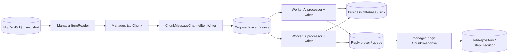
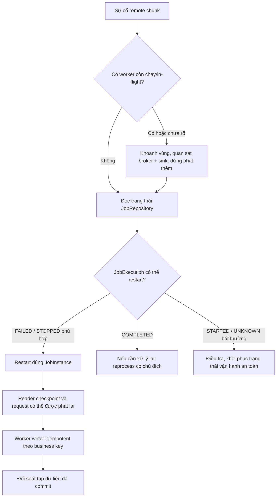
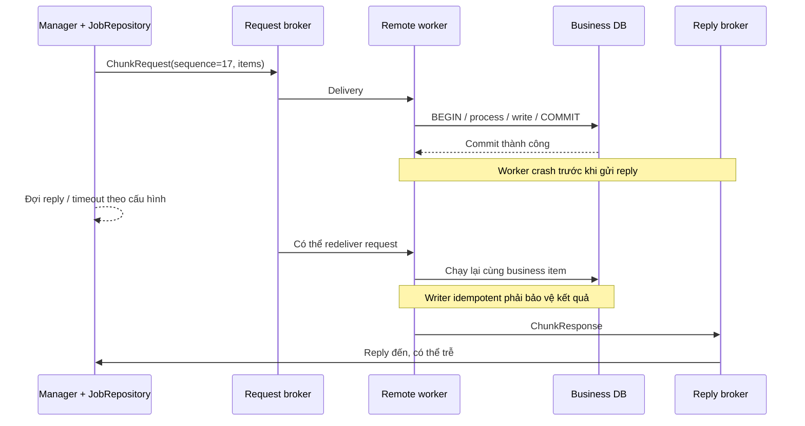

# Restart remote chunk trong Spring Batch: khôi phục đúng sau lỗi phân tán

## Mục tiêu bài học

Trong chương **Restartability** của module **SPRING_BATCH_SCALING_OPERATIONS**, ta đi sâu vào khả năng khôi phục một job dùng **remote chunking**. Đây là mô hình mở rộng Spring Batch cho workload lớn khi **manager đọc và chia chunk**, sau đó **worker ở process khác xử lý và ghi kết quả** qua middleware. Đổi lại, transaction, message delivery, checkpoint và trạng thái nghiệp vụ không còn nằm trong một phạm vi thực thi duy nhất.

Sau bài học, bạn có thể:

- Phân biệt **restart một JobInstance**, retry của chunk, redelivery từ broker và replay nghiệp vụ.
- Mô tả vai trò của manager `StepExecution`, `JobRepository`, `ChunkMessageChannelItemWriter`, `ChunkRequest`, `ChunkResponse` và worker `ChunkProcessorChunkHandler`.
- Giải thích vì sao việc worker commit thành công **không bảo đảm** manager đã nhận reply hoặc lưu checkpoint tương ứng.
- Xây dựng danh tính nghiệp vụ ổn định qua restart; tránh dùng các định danh tạm của message/chunk/JobExecution làm khóa idempotency duy nhất.
- Thiết kế worker writer idempotent, input snapshot ổn định, kênh request/reply và quy trình đối soát in-flight work.
- Kiểm thử crash/timeout/lost reply, duplicate/redelivery, rollback, late reply và hiệu năng trước khi vận hành production.

> **Phiên bản:** Ví dụ Java hướng tới **Spring Batch Integration 5.2.x**, Spring Framework 6 và Java 17+. API manager `RemoteChunkingManagerStepBuilderFactory`, worker `RemoteChunkingWorkerBuilder` và `PollableChannel` ở đây thuộc dòng 5.2. Các API Spring Batch 6.x đã và đang thay đổi, nên không trộn code giữa các phiên bản mà không kiểm tra Javadoc tương ứng.

## 1. Remote chunking khác local chunking ở đâu?

Trong chunk-oriented step tuần tự, reader, processor, writer và transaction thường nằm trong **cùng process**. Với remote chunking, Spring Batch tách phần **đọc và tập hợp item thành chunk** ở manager khỏi phần **xử lý/ghi item** ở các worker.



Các vai trò chính:

| Thành phần | Vai trò trong remote chunking | Quan hệ với restart |
| --- | --- | --- |
| **Manager `Step`** | Đọc input và tạo các chunk; sở hữu vòng đời StepExecution của manager | JobRepository lưu trạng thái step, reader checkpoint và lịch sử JobExecution |
| `ChunkMessageChannelItemWriter` | Writer phía manager chuyển chunk thành request, thu reply và đóng góp kết quả worker | Có state điều phối in-flight; cần xem version/timeouts và recovery |
| `ChunkRequest<T>` | Message chứa chunk item và metadata như sequence/định danh liên hệ job | Dùng correlation/đối soát, không mặc nhiên là idempotency key nghiệp vụ |
| **Worker** | Nhận request, xử lý chunk qua processor/writer, gửi `ChunkResponse` | Có thể bị redelivery hoặc chạy lại cùng item |
| `ChunkResponse` | Kết quả chunk, status/contribution và correlation | Reply đến không chứng minh atomic commit xuyên manager/broker/DB |
| **Middleware** | Định tuyến, lưu/chuyển request và reply theo cấu hình | Delivery, ack, retention, redelivery, DLQ và timeout phải được thiết kế |
| `JobRepository` | Metadata JobInstance/JobExecution/StepExecution và ExecutionContext phía manager | Tìm được JobInstance để restart, nhưng **không tự deduplicate external business side effects** |

### Remote chunking không phải remote partitioning

| Đặc điểm | Remote chunking | Remote partitioning |
| --- | --- | --- |
| Reader nằm ở đâu? | **Manager** đọc và chia chunk | Worker Step thường tự đọc phần dữ liệu được giao |
| Đơn vị gửi đi | Chunk các item | Yêu cầu thực thi `StepExecution` con |
| Worker nhận gì? | `ChunkRequest` và xử lý `ChunkProcessor` | Một worker `Step` với `ExecutionContext` của partition |
| Metadata worker | Worker remote chunking **không bắt buộc truy cập JobRepository** của manager để xử lý chunk | Các worker partition dùng metadata StepExecution/JobRepository tương ứng |
| Cách restart | Manager reader checkpoint + chunk message/reply + idempotent sink | Tên partition, StepExecution con, ExecutionContext và worker restart |
| Điểm nghẽn | Manager reader và broker có thể thành bottleneck | Partitioner, độ lệch partition, broker và DB/worker |

Không lấy các ví dụ `PartitionStep`, `PartitionHandler` hoặc `MessageChannelPartitionHandler` rồi gắn trực tiếp vào manager remote chunking: đó là **mô hình remote partitioning khác**. Trong remote chunking 5.2, API thuận tiện là `RemoteChunkingManagerStepBuilderFactory` / `RemoteChunkingWorkerBuilder`.

## 2. “Restart” có ít nhất bốn tầng cần phân biệt

**Tầng 1 — Spring Batch restart:** Lặp lại **cùng JobInstance** bằng identifying JobParameters tương ứng sau khi lần thực thi trước `FAILED` hoặc `STOPPED` và đủ điều kiện restart. `JobRepository` giúp khôi phục state StepExecution/reader.

**Tầng 2 — Retry của xử lý chunk:** Khi có lỗi nhất thời, một chunk hoặc item có thể được thực hiện lại tùy policy, luồng lỗi và implementation. Retry không phải một JobExecution mới và không đương nhiên có cùng biên chunk nếu dữ liệu/reader không ổn định.

**Tầng 3 — Broker redelivery:** Worker nhận lại message vì consumer crash, timeout hoặc broker không quan sát được acknowledgement. Đây là hành vi của transport; nó có thể diễn ra **ngay cả khi manager chưa được restart**.

**Tầng 4 — Business replay/reconciliation:** Vận hành chủ động phát lại dữ liệu để sửa thiếu sót, ví dụ dựa vào một run key đã xác định hoặc lập run mới có version. Đây là quyết định nghiệp vụ, không nên đánh tráo bằng cách tùy tiện tạo JobParameters mới.



**Nguyên tắc:** Restart không đồng nghĩa “gửi lại tất cả message”. Manager cần khôi phục đúng JobInstance và reader state; broker có thể có request cũ; worker phải chịu được việc cùng business item đến thêm lần nữa.

## 3. Vấn đề cốt lõi: không có một transaction toàn cục

Remote chunking thường có các ranh giới transaction/ack riêng:

1. Transaction/metadata của **manager** với reader và `JobRepository`.
2. Cơ chế gửi/ack request của **broker**.
3. Transaction ghi business data của **worker**.
4. Gửi/ack reply từ **worker** về **manager**.
5. Tiến độ/đóng góp `StepExecution` được manager ghi nhận.

Không có lý do mặc định để kết luận năm hoạt động trên cùng được commit/rollback nguyên tử. Chẳng hạn worker ghi xong dữ liệu và commit transaction DB, rồi crash **trước khi reply về manager**: job ở manager chưa quan sát được thành công, nhưng side effect đã tồn tại.



Trong Spring Batch Integration 5.2, manager `ChunkMessageChannelItemWriter` có cơ chế gửi chunk và thu contribution từ `ChunkResponse`; nó còn có giới hạn chờ reply. Cơ chế này giúp manager điều phối **nhưng không phải chứng nhận exactly-once end-to-end** cho payment/API/file ở hệ thống đích.

### Ma trận cửa sổ lỗi

| Sự cố xảy ra tại | Manager có thể thấy | Business sink có thể có | Cách phục hồi an toàn |
| --- | --- | --- | --- |
| Trước khi request được gửi thành công | Chưa có reply, chunk có thể chưa ghi nhận | Chưa có side effect | Restart/đọc lại theo checkpoint và xác minh broker |
| Gửi request thành công, manager crash | Metadata có thể chưa theo kịp message đã gửi | Worker có thể chưa chạy hoặc đã chạy | Đối soát request in-flight; writer idempotent nếu phát lại |
| Worker nhận request rồi lỗi trước DB commit | Không có reply thành công | Transaction bị rollback nếu cấu hình đúng | Broker redelivery/worker retry có giới hạn |
| **Worker commit rồi crash trước reply** | Manager chưa chắc thấy success | **Dữ liệu đã ghi** | Dedupe bằng business key, không cộng/insert trùng |
| Reply bị mất hoặc đến sau timeout | Manager thấy pending/timeout tùy config | Worker có thể đã hoàn tất | Đọc business sink; xử lý late reply, không đoán “chưa chạy” |
| Manager nhận reply nhưng crash trước checkpoint bền vững | Metadata chưa chắc phản ánh toàn bộ result | Dữ liệu worker đã commit | Restart có thể xử lý lại; kiểm chứng idempotency |
| Broker gửi trùng request | Hai lần xử lý có thể song song | Có nguy cơ ghi trùng/đè không đúng version | Unique key/transaction hoặc inbox dedupe |
| Worker ghi side effect API trước DB commit, sau đó DB rollback | Manager có thể thấy lỗi | API đã thực thi | Idempotency key tại API hoặc outbox/saga |
| Manager đã chuyển thành FAILED nhưng worker cũ còn chạy | Người vận hành có thể bắt đầu restart quá sớm | Dữ liệu đang tiếp tục thay đổi | Drain/stop/đối soát in-flight trước khi restart |

Bảng mô tả các **khả năng xảy ra**, không khẳng định một implementation mặc định sẽ xử lý mọi trường hợp theo một cách duy nhất. Timeout, broker acknowledgement, transaction, retry, thread model và lifecycle phải được kiểm thử trong môi trường thật.

## 4. Danh tính ổn định: dùng business item key, không dùng ID tạm

Một yêu cầu thiết kế cực quan trọng là mỗi thao tác nghiệp vụ phải có khóa nhận diện nhất quán qua **retry, broker redelivery và Batch restart**.

Ví dụ job xử lý giao dịch cho một `snapshotId` cụ thể. Ta định nghĩa:

```text
runKey          = "settlement-2026-11-25-v1"
paymentId       = 912345
operation       = "normalize"
idempotencyKey  = (runKey, paymentId, operation)
```

Nếu worker nhận cùng payment hai lần, cả hai phải cùng quy về **một kết quả logic**.

### Vì sao không dùng mỗi `JobExecutionId`?

Một `JobInstance` có thể trải qua **nhiều JobExecution** khi restart. Nếu dùng `jobExecutionId` làm key dedupe duy nhất, lần restart có ID mới và không nhận ra payment đã ghi bởi lần trước. Tương tự, message ID hoặc sequence của chunk có thể thay đổi khi phân nhóm item/reader restart.

Dùng khóa nghiệp vụ độc lập với lượt gửi, ví dụ `(runKey, paymentId)`; `runKey` cần được chốt theo **JobInstance/đơn vị xử lý logic** và giữ nguyên khi restart. Nếu có nhiều bản thay đổi của cùng payment, thêm `paymentVersion` hoặc snapshot version và định nghĩa upsert policy rõ ràng.

| Định danh | Có ích cho | Rủi ro nếu làm khóa idempotency duy nhất |
| --- | --- | --- |
| `JobInstanceId` hoặc identifying JobParameters | Liên kết các lần restart của một job logic | Khóa quá rộng nếu nhiều item trong cùng job |
| `JobExecutionId` | Phân biệt mỗi lần launch/restart | **Thay đổi** giữa các lần restart |
| `StepExecutionId` | Truy vấn metadata của một lần thực thi step | Không phải định danh business item |
| Message ID của broker | Tracing delivery | Redelivery/republication có thể sinh ID khác |
| Chunk sequence | Correlation request/reply trong một luồng điều phối | Không mặc định ổn định khi thay chunk boundary hoặc restart |
| `(runKey, paymentId, operation/version)` | Idempotency nghiệp vụ per-item | Cần định nghĩa chính sách version và run key rõ |

**Không dùng** toàn bộ payload có dữ liệu nhạy cảm làm message key hoặc metric tag; đặt ID kỹ thuật ngắn, ổn định và bảo vệ thông tin nghiệp vụ theo yêu cầu.

## 5. Ví dụ kiến trúc Spring Batch Integration 5.2.x

Đây là skeleton làm rõ nơi đặt **reader**, **worker processor/writer**, kênh request/reply và trạng thái restart. Nó **chưa phải ứng dụng chạy được ngay**: cần import, Spring Integration transport adapter, schema, JobRepository, transaction managers, deployment manager/worker, serializer tương thích và hạ tầng broker.

### 5.1. DTO đầu vào và output

```java
public record PaymentCommand(
        String runKey,
        long paymentId,
        String currency,
        BigDecimal grossAmount) implements Serializable {}

public record NormalizedPayment(
        String runKey,
        long paymentId,
        String currency,
        BigDecimal netAmount) {}
```

`PaymentCommand` được gửi qua message transport và phải tương thích serializer/mapping của middleware. Nếu dùng JSON serializer, cần cấu hình mapping DTO/type headers, version schema và kiểm thử thay đổi version giữa manager/worker. Việc DTO implement `Serializable` không có nghĩa mọi broker mặc định dùng Java serialization hoặc nên bật Java deserialization không kiểm soát.

Output `NormalizedPayment` chỉ cần tồn tại ở worker trong ví dụ. Các field là immutable value nên processor không cần chia sẻ mutable state.

### 5.2. Manager reader có input ổn định

```java
@Bean("remotePaymentReader")
@StepScope
JdbcPagingItemReader<PaymentCommand> remotePaymentReader(
        DataSource dataSource,
        @Value("#{jobParameters['runKey']}") String runKey,
        @Value("#{jobParameters['snapshotId']}") String snapshotId) {

    return new JdbcPagingItemReaderBuilder<PaymentCommand>()
            .name("remotePaymentReader")
            .dataSource(dataSource)
            .selectClause("SELECT id, currency, gross_amount")
            .fromClause("FROM payment_snapshot")
            .whereClause("WHERE snapshot_id = :snapshotId")
            .parameterValues(Map.of("snapshotId", snapshotId))
            .sortKeys(Map.of("id", Order.ASCENDING))
            .pageSize(100)
            .rowMapper((rs, rowNum) -> new PaymentCommand(
                    runKey,
                    rs.getLong("id"),
                    rs.getString("currency"),
                    rs.getBigDecimal("gross_amount")))
            .build();
}
```

Manager giữ `ItemStream` state và lưu checkpoint theo `StepExecution`. Bảng `payment_snapshot` là **dữ liệu đã cố định** cho một snapshot/run (ví dụ được materialize từ nguồn trước khi chạy), không chỉ là một bảng live được lọc với ngày mà vẫn bị update liên tục.

- `id` là sort key duy nhất bên trong `snapshotId`.
- `snapshotId` và `runKey` phải giống giữa lần chạy lỗi và lần restart.
- Trong production cần index `(snapshot_id, id)` và kiểm tra query plan.
- Không thay đổi page size, rule filter, sort key, schema hoặc logic mapping giữa restart khi chưa đánh giá tác động đến checkpoint.
- Mỗi `PaymentCommand` mang `runKey` để worker không phải đọc một singleton `currentJob` trên process riêng.

### 5.3. Manager step với request/reply

Spring Batch Integration 5.2 cho phép dùng `RemoteChunkingManagerStepBuilderFactory`. Ví dụ:

```java
@Bean("remotePaymentManagerStep")
TaskletStep remotePaymentManagerStep(
        JobRepository jobRepository,
        PlatformTransactionManager transactionManager,
        @Qualifier("remotePaymentReader")
        ItemStreamReader<PaymentCommand> reader,
        @Qualifier("managerRequests") MessageChannel requests,
        @Qualifier("managerReplies") PollableChannel replies) {

    var factory = new RemoteChunkingManagerStepBuilderFactory(
            jobRepository, transactionManager);

    RemoteChunkingManagerStepBuilder<
            PaymentCommand, NormalizedPayment> builder =
            factory.get("remotePaymentManager");

    return builder
            .chunk(100)
            .reader(reader)
            .outputChannel(requests)
            .inputChannel(replies)
            .build();
}
```

Ý nghĩa:

- `remotePaymentManager` là tên manager `StepExecution`.
- `chunk(100)` là commit interval/đơn vị gửi ở manager; worker có thể có thời gian xử lý rất khác nhau.
- `reader(reader)` chạy ở manager, không đặt reader trên worker remote chunking.
- `outputChannel(requests)` là kênh gửi `ChunkRequest` tới middleware.
- `inputChannel(replies)` là **`PollableChannel`** nhận `ChunkResponse`, theo API 5.2.
- Builder tạo `ChunkMessageChannelItemWriter` và cơ chế thu reply; không tự thêm một `ItemWriter` nghiệp vụ vào manager builder.
- Transaction manager phía manager không tự mở rộng thành một transaction chung với worker DB.

```java
@Bean("remotePaymentJob")
Job remotePaymentJob(
        JobRepository jobRepository,
        @Qualifier("remotePaymentManagerStep") Step managerStep) {

    return new JobBuilder("remotePaymentJob", jobRepository)
            .start(managerStep)
            .build();
}
```

Có thể dùng `@EnableBatchIntegration` để autowire builder factory như tài liệu 5.2, thay vì tự tạo factory. Với Spring Boot, chọn một chiến lược cấu hình JobRepository/Batch Integration nhất quán; tránh trộn auto-configuration và manual `@EnableBatchProcessing` theo cách làm sinh nhiều bean repo/launcher không mong muốn.

### 5.4. Worker processor và writer

```java
@Bean("paymentProcessor")
ItemProcessor<PaymentCommand, NormalizedPayment> paymentProcessor() {
    BigDecimal factor = new BigDecimal("0.98");

    return input -> new NormalizedPayment(
            input.runKey(),
            input.paymentId(),
            input.currency().trim().toUpperCase(Locale.ROOT),
            input.grossAmount()
                    .multiply(factor)
                    .setScale(2, RoundingMode.HALF_EVEN));
}
```

Processor tạo output mới cho một item và không giữ field mutable. Đây là ví dụ làm tròn giả lập; nghiệp vụ tài chính thực tế phải có quy tắc chuẩn hóa/phí/tiền tệ được kiểm chứng.

Cấu hình writer sau dùng PostgreSQL với unique key `(run_key, payment_id)`:

```sql
CREATE TABLE processed_payment (
    run_key         varchar(100) NOT NULL,
    payment_id      bigint       NOT NULL,
    currency        varchar(3)   NOT NULL,
    net_amount      numeric(20,2) NOT NULL,
    processed_at    timestamptz  NOT NULL DEFAULT CURRENT_TIMESTAMP,
    PRIMARY KEY (run_key, payment_id)
);
```

```java
@Bean("idempotentPaymentWriter")
JdbcBatchItemWriter<NormalizedPayment> idempotentPaymentWriter(
        DataSource workerDataSource) {

    return new JdbcBatchItemWriterBuilder<NormalizedPayment>()
            .dataSource(workerDataSource)
            .sql("""
                INSERT INTO processed_payment
                    (run_key, payment_id, currency, net_amount)
                VALUES
                    (:runKey, :paymentId, :currency, :netAmount)
                ON CONFLICT (run_key, payment_id) DO NOTHING
                """)
            .itemSqlParameterSourceProvider(item ->
                    new MapSqlParameterSource()
                            .addValue("runKey", item.runKey())
                            .addValue("paymentId", item.paymentId())
                            .addValue("currency", item.currency())
                            .addValue("netAmount", item.netAmount()))
            .assertUpdates(false)
            .build();
}
```

Khi hai message chứa cùng payment đến lại, unique constraint ngăn **hai hàng** cùng khóa. `assertUpdates(false)` phù hợp vì `ON CONFLICT DO NOTHING` có thể tác động 0 row.

**Giới hạn:** Đây là chính sách “first write wins” đơn giản. Nếu lần xử lý lại mang phiên bản mới hoặc amount khác, silently `DO NOTHING` có thể che bất thường. Production nên kiểm tra payload/version hoặc viết UPSERT có điều kiện, log conflict và báo mismatch. Mọi phép ghi khác phải cùng transaction/chiến lược idempotency thích hợp nếu muốn coi business operation đã hoàn tất.

### 5.5. Worker flow và ranh giới transaction

```java
@Bean("paymentWorkerFlow")
IntegrationFlow paymentWorkerFlow(
        @Qualifier("workerRequests") MessageChannel requests,
        @Qualifier("workerReplies") MessageChannel replies,
        @Qualifier("paymentProcessor")
        ItemProcessor<PaymentCommand, NormalizedPayment> processor,
        @Qualifier("idempotentPaymentWriter")
        ItemWriter<NormalizedPayment> writer) {

    return new RemoteChunkingWorkerBuilder<
            PaymentCommand, NormalizedPayment>()
            .itemProcessor(processor)
            .itemWriter(writer)
            .inputChannel(requests)
            .outputChannel(replies)
            .build();
}
```

`RemoteChunkingWorkerBuilder` dựng `ChunkProcessorChunkHandler` cùng Spring Integration `IntegrationFlow`. Worker **không cần một worker `Step` trong JobRepository của manager** chỉ để xử lý remote chunk; khác với remote partitioning.

Tuy nhiên, muốn bảo đảm DB rollback khi worker bị lỗi, phải cấu hình **transaction đúng ở message listener/inbound endpoint và các resource phía worker**. Không mặc định rằng việc sử dụng builder ở trên đã tự tạo một transaction bao phủ broker receive, writer DB commit và reply publication. Cần xem acknowledgement mode, local/JTA transaction nếu áp dụng, retry và chính sách DLQ của broker. Gửi reply khi DB chưa commit làm sai ý nghĩa “worker hoàn thành”.

### 5.6. Kênh nội bộ không phải broker phân tán

Ở manager, `managerRequests` có thể là `DirectChannel` và `managerReplies` là `QueueChannel`; ở worker, `workerRequests` và `workerReplies` là các channel nội bộ. Nhưng **chỉ khai báo các channel đó không truyền được message giữa hai JVM**.

```text
Manager JVM:
  managerRequests (MessageChannel)
     -> outbound adapter
     -> broker destination payment.requests

  broker destination payment.replies
     -> inbound adapter
     -> managerReplies (PollableChannel)

Worker JVM(s):
  broker destination payment.requests
     -> inbound adapter
     -> workerRequests (MessageChannel)
     -> ChunkProcessorChunkHandler
     -> workerReplies (MessageChannel)
     -> outbound adapter
     -> broker destination payment.replies
```

Có thể dùng JMS, AMQP/RabbitMQ hoặc transport khác qua Spring Integration adapters phù hợp. Chọn một stack broker và định nghĩa rõ serializer, delivery guarantee, durable queues, TTL, redelivery, consumer concurrency, receive timeout và dead-letter policy. Queue reply dùng chung giữa nhiều manager phải có cơ chế **routing/correlation và cô lập** để reply từ job khác không bị đọc nhầm.

## 6. Những điều Spring Batch có thể khôi phục — và không tự khôi phục

### 6.1. JobRepository và reader checkpoint

JobRepository giúp:

- Xác định `JobInstance` bằng tên job + identifying JobParameters.
- Ghi lịch sử `JobExecution`, `StepExecution`, `BatchStatus` và `ExitStatus`.
- Persist `ExecutionContext` phục vụ restart reader và step.
- Ngăn launch một số trạng thái trái phép, ví dụ cùng JobInstance đang chạy hoặc đã hoàn tất theo semantics mặc định.

Nhưng JobRepository **không thay thế** danh sách “business item nào đã commit ở worker DB” trừ khi chính ứng dụng xây dựng ràng buộc và đối soát dữ liệu đó. Worker remote chunking thông thường không tự mở một StepExecution riêng cho từng chunk bên JobRepository như remote partitioning.

### 6.2. Reply và StepContribution

`ChunkResponse` gói kết quả xử lý chunk, bao gồm `StepContribution` và thông tin correlation. Manager dùng các reply nhận được để tổng hợp tiến độ. Khi message đến trễ hoặc lỗi, các số đếm metadata có thể **không phải một phép đếm tuyệt đối các business side effect đã tồn tại**.

Ví dụ writer `ON CONFLICT DO NOTHING` nhận cùng payment thêm lần nữa: `writeCount` phản ánh semantics item writer/StepContribution chứ không nhất thiết bằng số hàng **mới** được insert. Để đối soát nghiệp vụ, truy bảng `processed_payment` theo `runKey` và snapshot nguồn.

### 6.3. Timeout không phải rollback từ xa

Nếu manager hết thời gian chờ reply, không có bảo đảm worker đã dừng hoặc transaction của worker đã rollback. Worker có thể còn chạy, đang commit hoặc đang gửi reply. Không coi timeout như một tín hiệu để xóa toàn bộ dữ liệu worker đã ghi, hoặc tự gửi lại message vô hạn.

Cần một quy trình vận hành xác định trạng thái thật:

1. Kiểm tra broker request/reply, số message pending/in-flight và DLQ.
2. Kiểm tra worker logs theo correlation và business keys.
3. Đọc business sink theo `runKey` và số lượng khóa đã commit.
4. Xác định manager StepExecution status; chờ/stop/đối soát worker in-flight.
5. Sau khi an toàn mới thực hiện restart cùng JobInstance hoặc reprocess có chủ đích.

## 7. Chính sách restart đề xuất

### Bước 1 — Chốt input của JobInstance

Các tham số identifying như `snapshotId`, `runKey` và chính sách transformation version phải gắn với một tập dữ liệu bất biến. Reader phải có sort key ổn định và checkpoint có thể khôi phục. Nếu input live thay đổi, paging/offset có thể bỏ sót/trùng item sau restart dù writer chống duplicate.

Ví dụ:

```java
JobParameters parameters = new JobParametersBuilder()
        .addString("runKey", "settlement-2026-11-25-v1", true)
        .addString("snapshotId", "snapshot-2026-11-25-v1", true)
        .toJobParameters();
```

Khi restart **cùng JobInstance**, dùng lại identifying values tương ứng. Thêm một `run.id` identifying mới chỉ để “cho chạy được” thường tạo JobInstance khác và có thể gây replay ngoài ý muốn.

### Bước 2 — Định nghĩa idempotency per-item

Mỗi worker phải quyết định kết quả từ `(runKey, paymentId, operation/version)`, không từ thread, message ID hoặc chunk sequence. Dùng unique constraint và transaction; nếu ghi sang API/file/queue, dùng idempotency key tại đích hoặc outbox/inbox.

**Không dùng một singleton `Set<PaymentId>` trong worker để dedupe:** worker có thể chạy ở nhiều JVM và state RAM mất khi crash.

### Bước 3 — Bảo vệ ranh giới worker commit / reply

Cần thống nhất: worker chỉ phát reply success **sau khi** write đã commit theo semantics được cấu hình. Nếu broker và database có transaction riêng, acknowledge receive và publish reply phải được thiết kế để chịu crash. Chính sách nên chấp nhận xử lý lại (at-least-once) ở biên lỗi, rồi dựa vào idempotency.

### Bước 4 — Phân biệt lỗi có thể retry và lỗi phải dừng

- **Transient:** DB deadlock, network ngắt ngắn, broker timeout — retry có giới hạn và backoff.
- **Permanent/business:** amount sai format, vi phạm hợp đồng dữ liệu, thiếu snapshot — ghi failure có nguyên nhân, quyết định skip/quarantine/reprocess theo nghiệp vụ.
- **Unknown:** không biết request đã commit hay chưa — **đối soát** trước khi gửi lại/đánh dấu thành công.

Không retry vô hạn một payload luôn gây lỗi; dùng DLQ và quy trình sửa dữ liệu có kiểm soát.

### Bước 5 — Đóng/đối soát in-flight work trước khi restart

Đảm bảo không có **hai manager** vô tình điều phối cùng một JobInstance và cùng run key. Một worker cũ có thể còn ghi dù manager đã timeout; cần có cách drain, xác nhận phiên/attempt và ngăn chồng chéo nguy hiểm. Không chỉnh `BATCH_JOB_EXECUTION` trực tiếp để ép `STARTED` thành `FAILED` khi chưa có bằng chứng tiến trình đã dừng.

### Bước 6 — Restart và hậu kiểm

Sau khi xử lý nguyên nhân lỗi, restart bằng cơ chế Spring Batch chuẩn cho execution đủ điều kiện. Chạy đối soát đầu vào/đầu ra theo `runKey` và business keys trước khi publish; job status COMPLETED **chưa đủ** chứng minh không có thiếu/trùng do hệ thống bên ngoài.

## 8. SQL đối soát: điều gì đã thực sự được ghi?

Giả sử bảng nguồn snapshot có khóa `(snapshot_id, id)`. Một job đã kết thúc hoặc thất bại có thể được đánh giá bằng các query sau.

### 8.1. Tổng số item nguồn dự kiến

```sql
SELECT COUNT(*) AS expected_items
FROM payment_snapshot
WHERE snapshot_id = :snapshotId;
```

### 8.2. Tổng số item worker đã ghi

```sql
SELECT COUNT(*) AS committed_items
FROM processed_payment
WHERE run_key = :runKey;
```

### 8.3. Những item nguồn chưa có ở đích

```sql
SELECT s.id
FROM payment_snapshot s
LEFT JOIN processed_payment p
  ON p.payment_id = s.id
 AND p.run_key = :runKey
WHERE s.snapshot_id = :snapshotId
  AND p.payment_id IS NULL
ORDER BY s.id;
```

Nếu processor có filter hợp lệ, hãy thêm chính xác **predicate được chấp nhận** vào query. Nếu nguồn có nghiệp vụ nhân bản ID theo tenant, khóa join cần chứa tenant/version tương ứng.

### 8.4. Bản ghi đích không thuộc snapshot

```sql
SELECT p.payment_id
FROM processed_payment p
LEFT JOIN payment_snapshot s
  ON s.id = p.payment_id
 AND s.snapshot_id = :snapshotId
WHERE p.run_key = :runKey
  AND s.id IS NULL;
```

Bộ query này giúp điều tra thiếu/trùng theo business key thay vì chỉ nhìn `readCount`/`writeCount`. Trong production, cần truy vấn có index, tránh scan rất lớn trực tiếp khi tải cao; có thể tạo bảng reconciliation riêng và phân vùng query.

## 9. Cẩn thận với việc phát lại bằng chunk ID

Trong remote chunking, `ChunkRequest` và `ChunkResponse` có sequence/correlation để manager đối chiếu reply. Nhưng:

- Cùng một business item có thể nằm trong chunk khác sau restart nếu `chunkSize`, reader state, filter hoặc dữ liệu nguồn thay đổi.
- Sequence không phải mã nghiệp vụ được định nghĩa để duy trì qua mọi phiên bản job.
- Message có thể bị broker redeliver cùng sequence, hoặc ứng dụng re-publish tạo message ID mới.
- Một chunk chứa nhiều item: nếu worker xử lý một phần rồi crash và external side effect không thuộc transaction, chỉ dùng chunk ID có thể không biết item nào đã commit.

**Đề xuất:** Dedupe ở mức **business item** và lưu kết quả commit theo `runKey/paymentId`. Chunk correlation dùng cho quan sát/chờ reply, không phải cơ chế correctness duy nhất.

Khi rất cần pre-aggregation theo chunk, phải tạo một định danh contribution **bền vững và ổn định qua replay**, ghi nhận nó trong cùng transaction với aggregate, và xác định rõ partial failure. Nếu không bảo đảm được, staging per-item rồi aggregate sau barrier thường dễ chứng minh hơn.

## 10. Khi nào có thể tin một reply là “thành công”?

Xét ba loại tín hiệu:

| Tín hiệu | Điều có thể suy ra | Không thể suy ra |
| --- | --- | --- |
| Broker xác nhận đã nhận request | Transport đã chấp nhận message theo cấu hình | Worker đã commit business data |
| Worker gửi `ChunkResponse` success | Worker flow cho biết chunk xử lý thành công theo cấu hình xử lý của nó | Có một distributed transaction atomic với manager JobRepository |
| Manager StepExecution COMPLETED | Spring Batch ghi nhận manager step hoàn tất theo lifecycle của nó | Từng side effect ngoài transaction chắc chắn exactly-once |

Một hệ thống cần “đã thanh toán/chốt sổ chính xác” phải thêm một **business completion contract**, ví dụ:

- Output rows theo run key có đầy đủ business keys dự kiến.
- Không có bản ghi với version/snapshot khác.
- Mọi outbox event cần thiết đã được tạo và giao theo chính sách.
- Không có request/worker cũ còn ghi cùng run key ngoài tầm kiểm soát.
- Aggregation/checksum theo dimension nghiệp vụ khớp nguồn.

Không dùng metric `writeCount` làm căn cứ duy nhất để phát hành báo cáo tài chính.

## 11. Xử lý late reply, duplicate reply và queue dùng chung

Nếu manager job A dừng, request A vẫn còn trong broker và worker phản hồi sau đó; manager job B hoặc lần restart A có thể đang dùng reply queue.

Rủi ro:

1. Reply từ execution trước được tiêu thụ bởi listener của execution mới.
2. Reply thiếu correlation hoặc routing sai bị tính cho job khác.
3. Duplicate reply làm báo cáo count bị tăng hai lần nếu ứng dụng tự cộng dồn.
4. Một broker queue bị dồn message từ các job khác nhau, tăng receive timeout.
5. Worker đang chạy bản code mới xử lý payload do manager bản cũ gửi, gây mismatch schema/semantics.

Biện pháp:

- Cấu hình reply destinations/selector/correlation tương thích `ChunkResponse` của phiên bản đang dùng.
- Tránh nhiều manager khác JobInstance cùng đọc một `PollableChannel` mà không có phân luồng.
- Thiết lập chính sách TTL, retention và DLQ; không xóa reply “không nhận diện” nếu chưa đối soát.
- Ghi log `jobName`, `jobInstanceId`, `jobExecutionId`, `stepExecutionId`, request sequence, message ID, run key và trạng thái reply ở hệ thống có kiểm soát truy cập.
- Cấu hình serializer/schema versioning; deploy manager/worker tương thích hoặc draining traffic khi upgrade.

Spring Batch Integration có kiểm tra thông tin liên quan đến JobInstance trong reply; nhưng việc chọn queue/topology đúng và quản trị message vẫn là trách nhiệm ứng dụng. Không dựa vào một kiểm tra framework đơn lẻ để bảo đảm chính xác mọi trường hợp multi-tenant hoặc late reply.

## 12. Kiểm thử failure/restart: ma trận bắt buộc

Thử nghiệm tốt nhất là **fault injection có thể tái hiện** bằng container/broker test và database thật hoặc Testcontainers với engine gần production. Một test toàn bộ qua `DirectChannel` không chứng minh behavior khi broker timeout/redelivery.

| Kịch bản | Cách tạo lỗi | Điều cần khẳng định |
| --- | --- | --- |
| Happy path | 1 manager, 2 worker, 1.000 item | Manager COMPLETED; đủ business keys; không trùng |
| Worker crash trước commit | Kill worker ngay trước DB commit | Không có partial write đã commit nếu transaction đúng; request có đường phục hồi |
| **Worker crash sau commit trước reply** | Fault injection giữa commit và publish reply | Replay không tạo duplicate; manager có thể đi đến trạng thái cuối sau recovery |
| Lost reply | Drop reply hoặc ngắt reply adapter | Manager không tự coi request thành công; biết điều tra timeout |
| Duplicate request | Re-deliver cùng payload 2–3 lần | Một kết quả nghiệp vụ cuối theo idempotency key |
| Late reply | Trả reply sau manager timeout/restart | Không tính vào job khác; xử lý correlation rõ ràng |
| Manager crash sau send | Kill manager khi request còn in-flight | Dữ liệu sau restart không thiếu hoặc bị xử lý trùng nghiệp vụ |
| Reader checkpoint stale | Kill sau worker commit nhưng trước manager metadata persist | Restart đọc lại theo checkpoint; writer dedupe đúng |
| Lỗi dữ liệu cố định | Item không hợp lệ luôn fail | Giới hạn retry, DLQ/quarantine, không lặp vô tận |
| 2 JobExecution cùng run key | Chủ động tạo va chạm ngoài quy trình chuẩn | Cơ chế khóa/chính sách triển khai ngăn ghi chồng hoặc báo conflict |
| Broker down | Ngắt broker khi manager đang gửi | Job fail/stop có thể chẩn đoán; restart sau broker phục hồi |
| Data skew | 1% chunk chậm hơn nhiều | Timeout/backpressure đủ rộng; không tạo retry storm |

### Test idempotency writer ở mức tích hợp

Sau khi cấu hình reader/processor/writer và schema, hãy tạo **một `NormalizedPayment` cố định** rồi gọi writer hai lần trong **hai transaction riêng** trên PostgreSQL test database:

```java
NormalizedPayment item = new NormalizedPayment(
        "settlement-2026-11-25-v1",
        912345L,
        "USD",
        new BigDecimal("98.00"));

Runnable writeOnce = () -> transactionTemplate.executeWithoutResult(
        status -> {
            try {
                writer.write(new Chunk<>(List.of(item)));
            } catch (Exception ex) {
                throw new IllegalStateException("Test writer failed", ex);
            }
        });

writeOnce.run();
writeOnce.run();

Long count = jdbcTemplate.queryForObject("""
    SELECT COUNT(*)
    FROM processed_payment
    WHERE run_key = ? AND payment_id = ?
    """,
    Long.class,
    "settlement-2026-11-25-v1",
    912345L);

assertEquals(1L, count);
```

Đây là **mẫu test logic**, cần đặt trong class test có `writer`, `transactionTemplate`, `jdbcTemplate` và các imports thích hợp. Callback chuyển lỗi checked từ `ItemWriter.write` thành runtime exception để transaction có thể rollback. Việc hai lần gọi writer để lại một row chứng minh **idempotency của bảng đích cho cùng payload**; chưa chứng minh end-to-end restart của manager/broker. Với worker ghi API/outbox, cần test riêng side effect đó.

### Kiểm thử end-to-end đúng JobInstance

1. Chuẩn bị `payment_snapshot` bất biến cho `snapshotId` và đặt `runKey`.
2. Launch `remotePaymentJob`, cho worker lỗi ở cửa sổ cần kiểm thử.
3. Lưu `JobExecutionId` và bằng chứng trạng thái broker/sink; xác nhận execution lỗi hoặc được dừng an toàn.
4. Nếu execution đã `FAILED`/`STOPPED` và đủ điều kiện, restart qua cơ chế Spring Batch chuẩn; **không thêm identifying JobParameter mới**.
5. Sau khi job cuối COMPLETED và in-flight đã được giải quyết, chạy các SQL đối soát nguồn/đích.
6. So sánh kết quả với baseline chạy tuần tự cùng snapshot (có run key riêng nếu hai lần chạy độc lập).
7. Kiểm tra không có late reply làm thay đổi job khác và không có payment bị ghi sai version.

Không giả định một process kill sẽ tự chuyển `BatchStatus.STARTED` thành `FAILED` ngay lập tức; cần quy trình vận hành xác minh tiến trình thật sự dừng và xử lý trạng thái bất thường theo API/quy tắc Spring Batch, không sửa trực tiếp các bảng metadata.

## 13. Các chỉ số cần quan sát trước và sau restart

| Chỉ số | Vì sao cần |
| --- | --- |
| JobInstanceId / JobExecutionId / StepExecutionId | Tách các lượt restart và truy lịch sử manager |
| Run key / snapshot ID / transformation version | Liên kết input với business sink một cách ổn định |
| Reader checkpoint và số item dự kiến | Xác định manager đọc được bao nhiêu input, restart từ đâu |
| Request sent, in-flight, redelivered, DLQ | Biết broker còn việc cũ hay không |
| Reply received, timeout, late/invalid correlation | Điều tra mismatch giữa manager và worker |
| Business committed rows theo run key | Nguồn chân lý về kết quả đã ghi |
| Unique conflict count / payload mismatch | Phát hiện retry hợp lệ hoặc dữ liệu đầu vào thay đổi |
| Worker processing p95/p99, broker lag | Chọn timeout và mức concurrency thực tế |
| DB pool/lock wait/CPU/GC của manager và worker | Phân biệt bottleneck do tài nguyên với message delivery |

Khi chọn timeout, tránh đặt ngưỡng thấp hơn p99 thời gian chunk cộng queue lag và thời gian recovery kỳ vọng. Ngược lại, timeout vô hạn làm job treo khó chẩn đoán. Cần deadline, backoff và alert được xác định theo SLA, không coi timeout là cơ chế rollback.

### Chi phí throughput của correctness

Unique constraint, inbox/outbox và bảng reconciliation có I/O bổ sung. Tuy nhiên, bỏ các cơ chế này để đạt benchmark cao thường chỉ chuyển chi phí sang sửa dữ liệu khi xảy ra duplicate/lost work. Cần đo **throughput end-to-end bao gồm retry/restart/đối soát**, thay vì chỉ số chunk/giây trong happy path.

## 14. Những sai lầm thường gặp

| Sai lầm | Hậu quả | Cách xử lý |
| --- | --- | --- |
| “Worker gửi success thì chắc chắn exactly-once” | Không có atomic transaction xuyên manager/broker/worker DB | Idempotency và đối soát bền vững |
| Dedupe theo `JobExecutionId` | Restart tạo ID mới nên ghi trùng | Khóa business per JobInstance/run key |
| Giả định mất reply = worker chưa chạy | Worker có thể đã commit | Tra DB và in-flight broker trước replay |
| Lưu “đã xử lý” bằng `ConcurrentHashMap` worker | Mất khi JVM chết, không chia sẻ giữa workers | DB unique/inbox |
| Thay chunk size/sort logic khi restart | Input được nhóm/đọc lại khác | Giữ snapshot, reader checkpoint và mapping ổn định |
| Dùng `MessageChannelPartitionHandler` cho remote chunk | Nhầm hai mô hình phân tán | Dùng RemoteChunkingManager/Worker builder |
| Cho hai manager dùng reply queue chung không có routing | Reply có thể vào nhầm job | Correlation/routing và isolation |
| Bật redelivery vô hạn với payload invalid | Poison message gây retry storm | Retry giới hạn, DLQ, quarantine |
| Worker gửi reply trước business DB commit | Manager có thể đánh dấu thành công quá sớm | Quy định transaction/ack/reply ordering |
| Xóa broker queue khi job fail | Có thể mất request/reply chưa đối soát | Drain/reconcile có quy trình |
| Ép `STARTED` thành `FAILED` bằng SQL | Metadata giả, nguy cơ hai execution cùng chạy | Xác minh worker/manager đã dừng và dùng operational API |
| Không kiểm thử failure windows | Happy path pass, production phát sinh duplicate | Fault injection ở từng ranh giới |

## 15. Checklist triển khai production

- [ ] Phân biệt remote **chunking** và remote **partitioning**; manager remote chunking giữ reader.
- [ ] JobRepository manager và input snapshot được cấu hình bền vững, có backup và retention phù hợp.
- [ ] Identifying JobParameters và `runKey/snapshotId` không thay đổi khi restart cùng JobInstance.
- [ ] Reader checkpoint có sort key duy nhất và không đọc nguồn đang biến động ngoài kiểm soát.
- [ ] Business writer idempotent per-item, có unique constraint và policy xử lý payload/version khác.
- [ ] Đã xác định transaction và acknowledgement của request receive, business commit và reply send.
- [ ] Broker requests/replies có retention, correlation, timeout, DLQ và quy trình xử lý late replies.
- [ ] Không có hai manager/worker cũ gây chồng chéo với cùng run key mà không có cơ chế khóa/đối soát.
- [ ] Có cách chẩn đoán trạng thái execution `STARTED/FAILED/STOPPED/UNKNOWN` sau crash.
- [ ] Có test worker crash **sau commit trước reply**, mất reply, manager crash, duplicate delivery và restart.
- [ ] Có SQL đối soát thiếu/thừa business keys trước khi publish/downstream.
- [ ] Có metric broker lag, request/reply timeout, conflict, worker DB commits và p95/p99 chunk time.
- [ ] Có quy trình dừng/drain và triển khai rolling upgrade manager/worker tương thích message schema.
- [ ] Chỉ tối ưu worker concurrency/batch size sau khi correctness dưới failure đạt yêu cầu.

## Tài liệu tham khảo

- [Spring Batch 5.2 — Remote Chunking / Externalizing Batch Process Execution](https://docs.spring.io/spring-batch/reference/5.2/spring-batch-integration/sub-elements.html): mô hình manager-reader, worker-processor/writer, `ChunkMessageChannelItemWriter` và ví dụ request/reply adapter.
- [Spring Batch 5.2 — Scaling and Parallel Processing](https://docs.spring.io/spring-batch/reference/5.2/scalability.html): so sánh remote chunking và partitioning.
- [Spring Batch 5.2 API — EnableBatchIntegration](https://docs.spring.io/spring-batch/docs/5.2.x/api/org/springframework/batch/integration/config/annotation/EnableBatchIntegration.html): cấu hình `RemoteChunkingManagerStepBuilderFactory` và `RemoteChunkingWorkerBuilder`.
- [Spring Batch 5.2 API — RemoteChunkingManagerStepBuilder](https://docs.spring.io/spring-batch/docs/5.2.x/api/org/springframework/batch/integration/chunk/RemoteChunkingManagerStepBuilder.html): request output channel, reply pollable channel, chunk và manager Step.
- [Spring Batch 5.2 API — RemoteChunkingWorkerBuilder](https://docs.spring.io/spring-batch/docs/5.2.x/api/org/springframework/batch/integration/chunk/RemoteChunkingWorkerBuilder.html): IntegrationFlow worker, processor và writer.
- [Spring Batch 5.2 API — ChunkResponse](https://docs.spring.io/spring-batch/docs/5.2.x/api/org/springframework/batch/integration/chunk/ChunkResponse.html): correlation, status và StepContribution của worker reply.
- [Spring Batch 5.2 — Batch Domain](https://docs.spring.io/spring-batch/reference/5.2/domain.html): `JobInstance`, `JobExecution`, `StepExecution` và `ExecutionContext`.
- [Spring Batch 5.2 — Configuring a Step for Restart](https://docs.spring.io/spring-batch/reference/5.2/step/chunk-oriented-processing/restart.html): restart/checkpoint semantics cho reader và step.

**Điều cần nhớ:** Restart remote chunk không phải chỉ gọi lại `JobOperator` hay phát lại request. **Manager checkpoint, broker delivery, worker commit và reply không mặc định nguyên tử**. Thiết kế có thể phục hồi phải dựa trên **input snapshot ổn định, định danh business item qua mọi lần restart, writer idempotent, correlation/timeout rõ ràng và đối soát kết quả đã commit**. Chỉ khi kiểm thử được các cửa sổ lỗi — đặc biệt **worker commit rồi mất reply** — mới nên mở rộng worker/concurrency theo tài nguyên thực tế.
