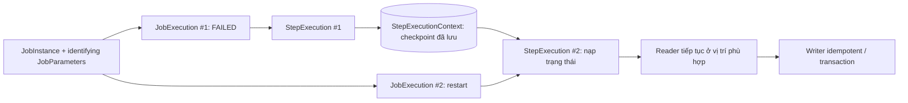
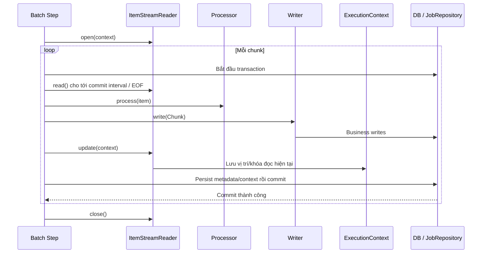
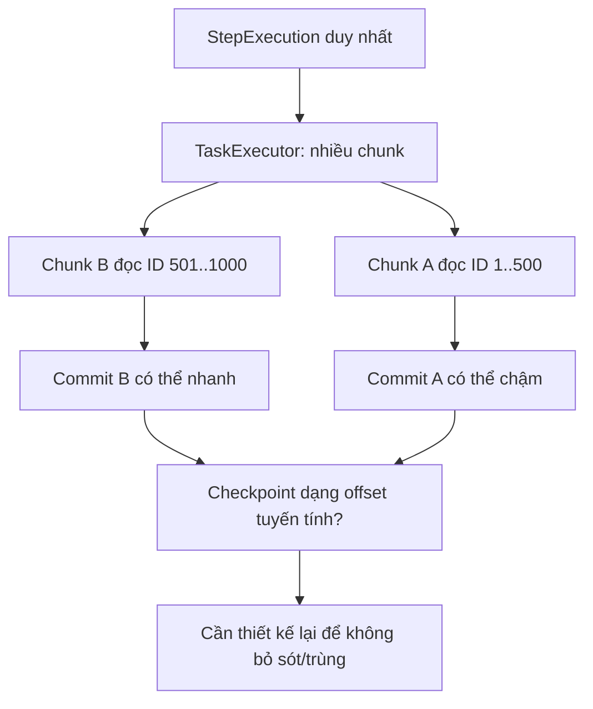

# ExecutionContext và checkpoint trong Spring Batch: thiết kế restart an toàn

## Mục tiêu bài học

Trong module **SPRING_BATCH_SCALING_OPERATIONS**, việc mở rộng Spring Batch cho workload dữ liệu lớn bằng multi-threaded step, parallel steps, partitioning hay mô hình phân tán chỉ hữu ích khi job có thể **khôi phục đúng sau lỗi**. Bài thuộc chương **Restartability** này tập trung vào hai cơ chế nền tảng: **`ExecutionContext`** và **checkpoint**.

Sau bài học, bạn có thể:

- Phân biệt `JobInstance`, `JobExecution`, `StepExecution`, `JobParameters` và hai loại `ExecutionContext`.
- Giải thích chính xác **khi nào context được lưu** và quan hệ giữa `ItemStream.open/update/close` với commit của chunk.
- Thiết kế khóa checkpoint không đụng nhau, nhỏ gọn, có thể serialize và ổn định qua restart.
- Cấu hình reader/writer hỗ trợ lưu trạng thái bằng `saveState` và tên reader riêng.
- Viết một `ItemStreamReader` tùy chỉnh, hiểu failure window giữa đọc item, ghi output và commit metadata.
- Dùng `ExecutionContextPromotionListener` để truyền dữ liệu giữa các step mà không trộn lẫn phạm vi job và step.
- Kiểm thử restart cùng `JobInstance` với một lần lỗi sau các chunk đã commit; đối soát đầu ra bằng khóa nghiệp vụ.
- Hiểu giới hạn của checkpoint khi chạy nhiều thread, partitioning, remote chunking và remote partitioning.

> **Phiên bản:** Các ví dụ dựa trên Spring Batch **5.2.x**, Spring Framework 6.x và Java 17+. Với Spring Batch 6.x hoặc phiên bản cũ, hãy đối chiếu API và vòng đời thực thi đúng phiên bản. Code minh họa các cơ chế chính; `DataSource`, transaction manager, schema và một số bean hạ tầng phải được ứng dụng cung cấp.

## 1. Tại sao chỉ “restart job” là chưa đủ?

Giả sử job nhập 10 triệu payment, mỗi chunk 500 bản ghi. Sau 8 triệu payment, tiến trình bị dừng do lỗi hạ tầng. Nếu khởi chạy lại từ đầu mà không có checkpoint, hệ thống vừa mất thời gian xử lý lại vừa có nguy cơ ghi trùng hoặc phát side effect nhiều lần.

Một cơ chế restart đáng tin cậy cần trả lời **ba câu hỏi độc lập**:

1. **Điểm tiếp tục:** Reader nên bắt đầu đọc ở đâu, sau chunk nào hoặc từ tập item nào chưa xử lý?
2. **Tính đúng của kết quả:** Những gì đã commit vào hệ thống đích có cần ghi lại không, và ghi lại có gây trùng không?
3. **Danh tính lượt chạy:** Ta đang tiếp tục **cùng JobInstance** hay tạo một lần xử lý logic hoàn toàn mới?

`ExecutionContext` giúp giải quyết **trạng thái khôi phục**; `JobRepository` lưu metadata để framework hỗ trợ restart. Nhưng **checkpoint không tự bảo đảm exactly-once cho side effect** như gọi API, gửi message hoặc ghi sang database nằm ngoài transaction của step.



**Điều cần nhớ ngay từ đầu:** Một `JobInstance` có thể có **nhiều `JobExecution`** nếu job restart. `JobExecutionId`, `StepExecutionId` thường khác giữa các lần thực thi; identifying JobParameters là một phần trong danh tính logic của `JobInstance`.

## 2. `ExecutionContext` là gì?

`ExecutionContext` là vùng lưu **key/value** được framework quản lý và persist qua `JobRepository`. Đây là nơi reader/writer hoặc step lưu **trạng thái tối thiểu cần để tiếp tục**: chỉ số item đã đọc, khóa sort cuối, tên file, vị trí trong file hoặc snapshot ID.

Trong Spring Batch có hai phạm vi:

| Tiêu chí | `StepExecutionContext` | `JobExecutionContext` |
| --- | --- | --- |
| Gắn với | Một `StepExecution` | Một `JobExecution` |
| Truy cập | `stepExecution.getExecutionContext()` | `stepExecution.getJobExecution().getExecutionContext()` |
| Mục đích chính | Checkpoint tiến độ bên trong step | Truyền trạng thái/metadata giữa các step trong job |
| Thời điểm persist điển hình | Tại commit point của chunk-oriented step | **Giữa các lần thực thi step** / tại ranh giới step |
| Khả năng khôi phục | Context từ lần thực thi trước được tái lập khi restart cùng JobInstance theo semantics framework | Job-scoped context từ lần thực thi trước được phục hồi phục vụ continuation |
| Phạm vi chia sẻ | Các stream/listener trong một StepExecution cùng dùng keyspace | Các thành phần thuộc JobExecution có thể đọc/ghi cùng keyspace |
| Cảnh báo concurrency | Không phải atomic counter cho nhiều thread trong cùng StepExecution | Không phải distributed cache/accumulator cho parallel steps |

Trong code, hai object **khác nhau**:

```java
StepExecution stepExecution = /* do Spring Batch truyền vào */;
ExecutionContext stepContext = stepExecution.getExecutionContext();
ExecutionContext jobContext =
        stepExecution.getJobExecution().getExecutionContext();

stepContext.putLong("reconcile.nextIndex", 2L);
jobContext.putString("sourceSnapshotId", "snapshot-2026-11-25");
```

Đoạn trên chỉ minh họa cách truy cập. **Không** nên chủ động sửa `JobExecutionContext` trong từng item/chunk rồi kỳ vọng framework lưu sau mỗi commit: job context thường được persist **giữa các step**, còn step context gắn với checkpoint của chunk.

### Những bảng metadata liên quan

- `BATCH_JOB_INSTANCE`: danh tính JobInstance.
- `BATCH_JOB_EXECUTION` và `BATCH_JOB_EXECUTION_PARAMS`: từng lần chạy và tham số.
- `BATCH_STEP_EXECUTION`: lịch sử StepExecution, status, count, thời gian.
- `BATCH_STEP_EXECUTION_CONTEXT`: trạng thái context của step, gắn với `STEP_EXECUTION_ID`.
- `BATCH_JOB_EXECUTION_CONTEXT`: trạng thái context của job, gắn với `JOB_EXECUTION_ID`.

Một JobInstance restart tạo StepExecution mới cho những step phải chạy lại; framework có trách nhiệm phục hồi context phù hợp từ lần thực thi trước. Không copy thủ công toàn bộ hàng `BATCH_STEP_EXECUTION_CONTEXT` sang execution mới rồi coi đó là restart hợp lệ.

## 3. Checkpoint được lưu vào thời điểm nào?

Một chunk-oriented step thường theo chu trình:



Sơ đồ thể hiện **trình tự khái niệm**, không phải đầy đủ mọi callback nội bộ. Theo hợp đồng Spring Batch 5.2, `ItemStream.update(context)` được gọi **trước commit** để đưa state mới vào `ExecutionContext`, sau đó framework persist state này. Nếu transaction rollback, checkpoint đã lưu bền vững **không nên được xem là tiến lên thành công** chỉ vì biến trong bộ nhớ của reader đã thay đổi.

Tính nhất quán tốt nhất khi business writer và JobRepository cùng tham gia một transaction phù hợp. Nếu output và repository nằm ở **hai transaction resource khác nhau**, hoặc có side effect ngoài DB (API, queue, file), không tự suy ra chúng commit nguyên tử.

### Ví dụ các chunk 500 item

| Thời điểm | Reader in-memory | Checkpoint được commit | Đầu ra đã commit |
| --- | --- | --- | --- |
| Trước xử lý | 0 | 0 hoặc chưa có | 0 |
| Sau chunk 1 thành công | 500 | 500 | 500 |
| Chunk 2 đọc xong nhưng writer chưa commit | 1.000 | **500** | 500 |
| Chunk 2 rollback | Có thể vẫn ở 1.000 trong memory | **500** | 500 |
| Restart cùng JobInstance | Được khởi tạo lại từ context đã persist | **500** | 500 |
| Sau khi chunk 2 chạy lại và commit | 1.000 | 1.000 | 1.000 |

Bảng là **mô hình đơn giản** trên input bất biến, không filter/skip và writer transaction chung. Thực tế readCount, filter, retry và metadata có thể khác; phải quan sát behavior của reader cụ thể. Với reader giữ object state trong memory, lỗi khiến step kết thúc rồi restart thường tạo lại instance và gọi `open()` bằng context đã persist.

### `ExecutionContext` khác transaction nghiệp vụ

`ExecutionContext.putLong(...)` chỉ **đổi một giá trị trong context in-memory**; nó không tự gọi commit DB hay flush message broker. Framework persist context theo lifecycle. Nếu bạn cập nhật một key bất kỳ giữa hai commit, giá trị đó có thể chưa bền vững khi crash.

Với các thao tác ngoài transaction, checkpoint có thể cho biết “đã đọc qua item X” nhưng hệ thống đích chưa chắc đã có side effect tương ứng, hoặc ngược lại. Bảo vệ bằng **idempotency key, transaction/outbox, snapshot và đối soát**.

## 4. Hợp đồng `ItemStream`: `open`, `update`, `close`

`ItemReader` chỉ định nghĩa `read()`. Khi reader hoặc writer cần lưu trạng thái restart, chúng có thể implement `ItemStream`:

```java
public interface ItemStream {
    void open(ExecutionContext executionContext)
            throws ItemStreamException;

    void update(ExecutionContext executionContext)
            throws ItemStreamException;

    void close() throws ItemStreamException;
}
```

Ý nghĩa:

- **`open(context)`:** Mở resource/khởi tạo trạng thái; nếu context có checkpoint trước đó, chuyển reader đến vị trí cần đọc tiếp.
- **`update(context)`:** Ghi state hiện tại vào context trước commit/checkpoint; tránh lưu dữ liệu nghiệp vụ khổng lồ.
- **`close()`:** Giải phóng cursor/file/connection hoặc resource tương ứng khi step kết thúc.

`ItemStreamReader<T>` kết hợp `ItemReader<T>` với `ItemStream`; `ItemStreamWriter<T>` tương tự cho writer.

### Đăng ký stream đúng với step

Nếu reader/writer implement `ItemStream` và được gắn **trực tiếp** vào step, Spring Batch thông thường tự đăng ký lifecycle. Với delegate lồng trong một wrapper/composite **không lộ hợp đồng `ItemStream`**, cần đăng ký stream delegate riêng:

```java
return new StepBuilder("exportPayments", jobRepository)
        .<Payment, Payment>chunk(500, transactionManager)
        .reader(reader)
        .writer(compositeWriter)
        .stream(fileWriterA)  // File writer delegate cần open/update/close
        .stream(fileWriterB)
        .build();
```

Nếu quên đăng ký, delegate không nhận `open/update/close`, làm file writer hoặc reader mất checkpoint khi restart. Ngược lại, không đăng ký hai lần cùng một stream không cần thiết; kiểm tra cách composite/wrapper của phiên bản bạn dùng quản lý lifecycle.

## 5. Ví dụ một reader tùy chỉnh có checkpoint

Để nhìn rõ cơ chế, tạo một reader đơn giản đọc **danh sách ID đã cố định**. Reader này phục vụ học thuật/test: nó tải cả danh sách vào RAM, không phù hợp cho hàng chục triệu ID. Với dữ liệu lớn, dùng JDBC paging/cursor hoặc reader có khả năng streaming và restart phù hợp.

### 5.1. Cấu trúc reader

```java
public final class CheckpointingIdReader
        implements ItemStreamReader<Long> {

    private static final String STATE_KEY = "checkpointingIdReader.nextIndex";

    private final List<Long> immutableIds;
    private int nextIndex;

    public CheckpointingIdReader(List<Long> ids) {
        this.immutableIds = List.copyOf(ids);
    }

    @Override
    public void open(ExecutionContext context) {
        int saved = context.getInt(STATE_KEY, 0);
        if (saved < 0 || saved > immutableIds.size()) {
            throw new ItemStreamException(
                    "Checkpoint không hợp lệ: " + saved);
        }
        nextIndex = saved;
    }

    @Override
    public Long read() {
        return nextIndex < immutableIds.size()
                ? immutableIds.get(nextIndex++)
                : null;
    }

    @Override
    public void update(ExecutionContext context) {
        context.putInt(STATE_KEY, nextIndex);
    }

    @Override
    public void close() {
        // Không có file/cursor cần giải phóng ở ví dụ.
    }
}
```

Đây là một implementation minh họa có các đặc tính:

1. Reader bắt đầu từ `nextIndex=0` nếu chưa có checkpoint.
2. Sau khi đọc N item, `nextIndex=N`; `update` ghi N vào `ExecutionContext`.
3. Khi job restart cùng JobInstance, `open` nhận context trước đó và tiếp tục từ index đã persist.
4. Danh sách `ids` phải có **cùng thứ tự/nội dung** ở lần restart. Nếu danh sách bị thay đổi, index N không còn trỏ tới cùng item.
5. `STATE_KEY` phải **không xung đột** với các stream khác dùng chung StepExecutionContext.

Reader này **không thread-safe**: `nextIndex++` có mutable state và không được bảo vệ. Chỉ dùng cho step tuần tự hoặc phân biệt instance theo StepExecution khi partitioning. `@StepScope` không tự làm nó an toàn cho nhiều chunk thread trong **cùng StepExecution**.

### 5.2. Tạo reader từ snapshot ID đã khóa

```java
@Bean("idReader")
@StepScope
CheckpointingIdReader idReader(
        JdbcTemplate jdbc,
        @Value("#{jobParameters['snapshotId']}") String snapshotId) {

    List<Long> ids = jdbc.queryForList("""
        SELECT payment_id
        FROM payment_snapshot
        WHERE snapshot_id = ?
        ORDER BY payment_id
        """, Long.class, snapshotId);

    return new CheckpointingIdReader(ids);
}
```

`snapshotId` thuộc identifying JobParameters và trỏ tới tập ID **bất biến** có thứ tự. Với test, bạn có thể seed các ID `[10, 20, 30, 40, 50, 60]`.

**Caveat:** Ví dụ khởi tạo bean đọc toàn bộ ID một lần nên tốn RAM `O(N)`; production nên dùng `JdbcPagingItemReader` hoặc cách đọc streaming với checkpoint phù hợp. Dữ liệu cũng có thể thay đổi giữa lần reader khởi tạo và lần restart nếu không có snapshot vật lý hoặc chính sách versioning; việc chỉ đặt tên `snapshotId` không tự bảo đảm snapshot thật.

### 5.3. Step và writer idempotent

Một output đơn giản:

```java
public record ProcessedPayment(String runKey, long paymentId) {}

@Bean("paymentProcessor")
@StepScope
ItemProcessor<Long, ProcessedPayment> paymentProcessor(
        @Value("#{jobParameters['runKey']}") String runKey) {

    return id -> new ProcessedPayment(runKey, id);
}
```

Writer PostgreSQL có unique key `(run_key, payment_id)`:

```sql
CREATE TABLE processed_payment (
    run_key      varchar(100) NOT NULL,
    payment_id   bigint NOT NULL,
    PRIMARY KEY (run_key, payment_id)
);
```

```java
@Bean("paymentWriter")
JdbcBatchItemWriter<ProcessedPayment> paymentWriter(
        DataSource dataSource) {

    return new JdbcBatchItemWriterBuilder<ProcessedPayment>()
            .dataSource(dataSource)
            .sql("""
                INSERT INTO processed_payment (run_key, payment_id)
                VALUES (:runKey, :paymentId)
                ON CONFLICT (run_key, payment_id) DO NOTHING
                """)
            .itemSqlParameterSourceProvider(item ->
                    new MapSqlParameterSource()
                            .addValue("runKey", item.runKey())
                            .addValue("paymentId", item.paymentId()))
            .assertUpdates(false)
            .build();
}
```

Trong step:

```java
@Bean("processPaymentsStep")
Step processPaymentsStep(
        JobRepository jobRepository,
        PlatformTransactionManager transactionManager,
        @Qualifier("idReader")
        ItemStreamReader<Long> reader,
        @Qualifier("paymentProcessor")
        ItemProcessor<Long, ProcessedPayment> processor,
        @Qualifier("paymentWriter")
        ItemWriter<ProcessedPayment> writer) {

    return new StepBuilder("processPayments", jobRepository)
            .<Long, ProcessedPayment>chunk(2, transactionManager)
            .reader(reader)
            .processor(processor)
            .writer(writer)
            .build();
}

@Bean("paymentCheckpointJob")
Job paymentCheckpointJob(
        JobRepository jobRepository,
        @Qualifier("processPaymentsStep") Step step) {

    return new JobBuilder("paymentCheckpointJob", jobRepository)
            .start(step)
            .build();
}
```

Không gọi `taskExecutor(...)` ở bài mẫu: reader có mutable cursor và dựa trên **một trình tự checkpoint**. Writer dùng `ON CONFLICT DO NOTHING` để xử lý khi một item được đọc lại do rollback/restart. Chính sách này phù hợp demo nhưng production cần kiểm tra payload/version nếu nghiệp vụ cho phép ID đã tồn tại với giá trị khác.

### 5.4. Truy vết 6 ID qua các lần commit

Với `chunk(2)` và danh sách ổn định:

| Chunk | ID đọc | Checkpoint sau commit | Output sau commit |
| --- | --- | ---: | --- |
| 1 | 10, 20 | 2 | 10, 20 |
| 2 | 30, 40 | 4 | 10, 20, 30, 40 |
| 3 | 50, 60 | 6 | 10, 20, 30, 40, 50, 60 |

Nếu writer fail ở chunk 2 **trước khi commit**, checkpoint bền vững vẫn là 2, output đã commit vẫn chỉ gồm 10, 20. Khi khởi động lại đúng JobInstance, `open` nhận `nextIndex=2` và đọc lại 30, 40.

Trong một số đường lỗi, item có thể đã được xử lý ở memory hoặc external sink mà không thuộc transaction DB. Writer phải có idempotency và có kiểm thử failure windows riêng.

## 6. Dùng `JdbcPagingItemReader` trong production

Không nhất thiết tự viết một reader chỉ để lưu cursor: Spring Batch có nhiều triển khai `ItemStream` đã hỗ trợ `ExecutionContext`.

Ví dụ đọc từ snapshot của PostgreSQL:

```java
@Bean("snapshotReader")
@StepScope
JdbcPagingItemReader<Payment> snapshotReader(
        DataSource dataSource,
        @Value("#{jobParameters['snapshotId']}") String snapshotId) {

    return new JdbcPagingItemReaderBuilder<Payment>()
            .name("snapshotPaymentReader")
            .dataSource(dataSource)
            .selectClause("SELECT payment_id, amount, currency")
            .fromClause("FROM payment_snapshot")
            .whereClause("WHERE snapshot_id = :snapshotId")
            .parameterValues(Map.of("snapshotId", snapshotId))
            .sortKeys(Map.of("payment_id", Order.ASCENDING))
            .pageSize(500)
            .rowMapper((rs, rowNum) -> new Payment(
                    rs.getLong("payment_id"),
                    rs.getBigDecimal("amount"),
                    rs.getString("currency")))
            .saveState(true)
            .build();
}
```

`Payment` là DTO ứng dụng định nghĩa, ví dụ `record Payment(long id, BigDecimal amount, String currency) {}`. Khi đưa code vào project, cung cấp record, import và schema tương thích.

**Điều kiện quan trọng:**

- `name("snapshotPaymentReader")` cung cấp namespace cho các key checkpoint của reader. Đặt tên **ổn định** qua restart.
- `saveState(true)` (mặc định của builder) cho phép lưu tiến độ; đổi thành `false` nghĩa là reader **không lưu trạng thái này** để khôi phục bằng checkpoint.
- `sortKeys` cần **unique**, được index tốt và ổn định theo snapshot. Paging reader có thể dùng last sort key để tìm trang tiếp theo khi restart; nếu key không unique, nguy cơ mất/bỏ sót item.
- `snapshotId` phải thực sự chọn một tập dữ liệu không đổi hoặc có quy tắc versioning chặt chẽ.
- `pageSize` và `chunkSize` không bắt buộc bằng nhau để đúng, nhưng chọn phù hợp có thể cải thiện I/O và giảm overhead.
- Nếu thay sort key, tên reader, filter, schema hoặc quy tắc snapshot trong một job đang fail, checkpoint cũ có thể **không còn hợp lệ**. Hãy version job và có kế hoạch migration/reprocess.

### Khi nào dùng `saveState(false)`?

Có những pattern không dựa vào “đã đọc tới vị trí N” mà dựa vào **trạng thái nghiệp vụ bền vững**, ví dụ bảng xử lý có cột `status = 'PENDING'` và writer chuyển item sang `DONE` theo transaction/khóa an toàn. Trong pattern này, có thể đọc lại từ đầu tập chưa xử lý sau crash mà không cần lưu offset của reader; `saveState(false)` có thể phù hợp.

```java
new JdbcPagingItemReaderBuilder<Payment>()
        .name("paymentReader")
        .dataSource(dataSource)
        // Cấu hình query/sort/row mapper phù hợp...
        .saveState(false)
        .build();
```

**Không bật `saveState(false)` chỉ để “sửa lỗi checkpoint”.** Nếu writer không có cơ chế đánh dấu và dedupe bền vững, restart sẽ đọc lại các item đã xử lý hoặc bỏ sót item theo cách không mong muốn.

Một số reader như `JdbcPagingItemReader` có lưu ý riêng khi được dùng đồng thời: tài liệu hướng dẫn vô hiệu hóa state khi dùng trong multi-threaded client, **đồng nghĩa mất cơ chế restart dựa trên reader state đó**. Quyết định chuyển concurrency phải có thiết kế restart thay thế.

## 7. `ExecutionContext` nên lưu cái gì?

Một checkpoint tốt thường **nhỏ, có ý nghĩa, ổn định và có thể serialize**:

| Nên lưu | Vì sao |
| --- | --- |
| Vị trí/offset hoặc last committed key | Hỗ trợ reader tiếp tục |
| `snapshotId` hoặc watermark ổn định | Xác định đúng tập dữ liệu |
| Tên file, shard/partition bounds | Khôi phục đúng phần việc |
| Một số phiên bản schema/algorithm cần thiết | Ngăn dùng nhầm checkpoint với code không tương thích |
| ID của tài nguyên staging bền vững | Truy vết side effect đã commit |
| Thông tin kỹ thuật tối thiểu phục vụ resume | Giảm rủi ro serialization và metadata overhead |

Những thứ **không nên lưu**:

- Toàn bộ item list hàng triệu bản ghi hoặc object graph lớn.
- `DataSource`, `Connection`, socket, stream, open file handle.
- Spring bean/proxy phức tạp, lambda/closure hoặc đối tượng không tương thích serializer.
- Mutable `HashMap`/`List` dùng chung mà các worker thread cùng sửa.
- Secret/token nhạy cảm chưa được bảo vệ theo chính sách dữ liệu.
- “Số tiền đã commit” chỉ dựa trên việc processor tăng counter trong RAM.

Spring Batch yêu cầu giá trị không transient trong context có khả năng **serialize** theo serializer cấu hình. Thay đổi class/version hoặc serializer mà không có kế hoạch migration có thể khiến context cũ không đọc được và job không restart được.

### Đặt tên key không xung đột

Một `StepExecution` chỉ có một context tương ứng, và mọi stream trong step chia sẻ **cùng keyspace**. Hai reader/writer cùng dùng `"current.count"` có thể ghi đè nhau.

Ưu tiên khóa namespace:

```text
snapshotReader.read.count
snapshotReader.start.after
invoiceWriter.lastCommittedSequence
reconciliation.schemaVersion
paymentPartition.fromId
paymentPartition.toId
```

Các tên trên là **ví dụ minh họa**, không phải cam kết tên key nội bộ của mọi reader Spring Batch. Đừng dựa vào tên key nội bộ không được bảo đảm giữa các phiên bản nếu không cần thiết.

**Đặc biệt:** Đổi `ItemStream.name` giữa hai lần restart có thể khiến reader tìm không thấy key cũ, khởi tạo từ đầu hoặc báo trạng thái không phù hợp. Cần quản trị tên step, tên stream và key checkpoint như một phần của hợp đồng tương thích.

## 8. Truyền dữ liệu giữa step bằng `ExecutionContextPromotionListener`

Step context phục vụ checkpoint. Nếu **step B cần dữ liệu mà step A tính ra**, không nên truy cập trực tiếp object trong memory của step A hoặc giả định step context được chia sẻ sang B. Có thể promote một vài key từ step context lên job context sau khi step A hoàn tất.

Ví dụ step A ghi `sourceSnapshotId` vào **StepExecutionContext** lúc bắt đầu, và listener promote key này sau khi step A hoàn thành:

```java
@Bean
StepExecutionListener snapshotKeyListener() {
    return new StepExecutionListener() {
        @Override
        public void beforeStep(StepExecution stepExecution) {
            String snapshotId = stepExecution
                    .getJobExecution()
                    .getJobParameters()
                    .getString("snapshotId");

            stepExecution.getExecutionContext()
                    .putString("sourceSnapshotId", snapshotId);
        }
    };
}

@Bean
ExecutionContextPromotionListener snapshotPromotionListener() {
    ExecutionContextPromotionListener listener =
            new ExecutionContextPromotionListener();
    listener.setKeys(new String[]{"sourceSnapshotId"});
    return listener;
}
```

Đăng ký vào builder của **step A**:

```java
return new StepBuilder("prepareSnapshot", jobRepository)
        .<Input, Output>chunk(500, transactionManager)
        .reader(reader)
        .processor(processor)
        .writer(writer)
        .listener(snapshotKeyListener)
        .listener(snapshotPromotionListener)
        .build();
```

Trong step B, lấy từ **JobExecutionContext**:

```java
@Bean
@StepScope
ItemReader<SummaryInput> summaryReader(
        @Value("#{jobExecutionContext['sourceSnapshotId']}")
        String sourceSnapshotId) {

    // Khởi tạo reader từ snapshot đã được promote.
    return buildSummaryReader(sourceSnapshotId);
}
```

`buildSummaryReader` là hàm factory do ứng dụng cài đặt; snippet minh họa late binding, không phải method có sẵn của Spring Batch.

**Lưu ý:**

- Theo cấu hình mặc định, listener promote trên `ExitStatus` **COMPLETED**, không phải mọi loại kết thúc. Có thể cấu hình pattern status nếu nghiệp vụ yêu cầu.
- Job context thường persist **giữa các step**, vì vậy không dùng nó để giữ checkpoint của một step đang chạy.
- Listener giúp truyền **một ít dữ liệu đã xác định**, không biến job context thành accumulator atomic cho hai parallel flows.
- Nếu muốn truyền kết quả aggregate lớn, tốt hơn là lưu vào DB/staging theo `runKey` rồi chỉ promote ID của tập dữ liệu.

## 9. Restart sau lỗi: chính xác framework làm gì?

Giả sử job `paymentCheckpointJob` chạy với:

```java
JobParameters params = new JobParametersBuilder()
        .addString("runKey", "settlement-2026-11-25-v1", true)
        .addString("snapshotId", "snapshot-2026-11-25", true)
        .toJobParameters();
```

Một lần chạy gặp lỗi:

1. `JobExecution #1` tạo `StepExecution #1` cho step `processPayments`.
2. Reader đọc chunk 1, writer commit, context có `nextIndex=2` đã persist.
3. Reader đọc chunk 2; writer ném exception, chunk rollback, step và job kết thúc `FAILED`.
4. Operater kiểm tra nguyên nhân lỗi, business sink và trạng thái metadata.
5. Launch/restart **cùng JobInstance** với identifying JobParameters **không đổi**.
6. `JobExecution #2` có `StepExecution #2`; context restart được khôi phục từ lần trước.
7. Reader `open` nhận `nextIndex=2`, đọc lại ID 30, 40; writer idempotent bảo vệ nếu có item bị replay ngoài dự kiến.
8. Job hoàn tất; vận hành đối soát tập ID đã commit theo run key.

**Không** tạo `run.id` identifying mới chỉ để tránh trạng thái `FAILED`; làm vậy có thể tạo JobInstance mới và không dùng checkpoint cũ. Nếu JobInstance đã `COMPLETED`, framework mặc định không launch lại cùng identifying params như một lần chạy mới.

### `allowStartIfComplete`, `startLimit` và restartability

- Một step đã `COMPLETED` trong lần thực thi trước thường **được bỏ qua** khi restart; `allowStartIfComplete(true)` cho phép nó chạy lại theo cấu hình.
- `startLimit(n)` giới hạn số lần một step được khởi chạy; nếu vượt, framework báo lỗi.
- Job/step có thể được cấu hình không cho restart; không phải cứ có `ExecutionContext` là mọi job đều restartable.
- Với step có side effect không idempotent, cân nhắc policy không restart, hoặc thêm bước xác nhận/sửa sai trước khi cho chạy lại.

Những điều này là **policy cấp step/job**, khác với việc reader có lưu cursor hay không.

## 10. Kiểm thử checkpoint bằng JUnit và Spring Batch Test

### 10.1. Đơn vị: giả lập chu trình `open/read/update/open`

Có thể test reader tùy chỉnh **không cần JobRepository** để xác nhận cơ chế lưu vị trí:

```java
@Test
void customReaderRestoresCheckpoint() throws Exception {
    List<Long> ids = List.of(10L, 20L, 30L, 40L);

    CheckpointingIdReader first = new CheckpointingIdReader(ids);
    ExecutionContext context = new ExecutionContext();

    first.open(context);
    assertEquals(10L, first.read());
    assertEquals(20L, first.read());
    first.update(context);
    first.close();

    CheckpointingIdReader restarted = new CheckpointingIdReader(ids);
    restarted.open(context);

    assertEquals(30L, restarted.read());
    assertEquals(40L, restarted.read());
    assertNull(restarted.read());
    restarted.close();
}
```

Test này chứng minh `update` và `open` diễn giải cùng key, **không chứng minh** framework đã persist context/transaction đúng; cần test tích hợp dưới đây.

### 10.2. Tích hợp: fail ở chunk thứ hai rồi restart

Với input `[10,20,30,40,50,60]`, `chunk(2)` và writer ném lỗi **một lần trước khi delegate ghi** chunk chứa ID 30:

```java
public final class FailOnceWriter implements ItemWriter<ProcessedPayment> {
    private final ItemWriter<ProcessedPayment> delegate;
    private final AtomicBoolean failOnce;

    public FailOnceWriter(
            ItemWriter<ProcessedPayment> delegate,
            AtomicBoolean failOnce) {
        this.delegate = delegate;
        this.failOnce = failOnce;
    }

    @Override
    public void write(Chunk<? extends ProcessedPayment> items)
            throws Exception {
        boolean has30 = items.getItems().stream()
                .anyMatch(p -> p.paymentId() == 30L);
        if (has30 && failOnce.compareAndSet(true, false)) {
            throw new IllegalStateException("Injected failure");
        }
        delegate.write(items);
    }
}
```

Trong test profile, inject decorator thay cho writer của step, nhưng giữ **cùng `AtomicBoolean` qua hai lần launch** để lần thứ hai không ném lỗi nữa. Không thêm fail-once decorator vào production.

Skeleton assertion với `@SpringBatchTest`, `JobLauncherTestUtils` và một database metadata riêng cho test:

```java
JobParameters params = new JobParametersBuilder()
        .addString("runKey", "test-run", true)
        .addString("snapshotId", "test-snapshot", true)
        .toJobParameters();

JobExecution first = jobLauncherTestUtils.launchJob(params);
assertEquals(BatchStatus.FAILED, first.getStatus());

Long firstCount = jdbcTemplate.queryForObject(
        "SELECT COUNT(*) FROM processed_payment WHERE run_key = ?",
        Long.class, "test-run");
assertEquals(2L, firstCount);

JobExecution second = jobLauncherTestUtils.launchJob(params);
assertEquals(BatchStatus.COMPLETED, second.getStatus());

Long secondCount = jdbcTemplate.queryForObject(
        "SELECT COUNT(*) FROM processed_payment WHERE run_key = ?",
        Long.class, "test-run");
assertEquals(6L, secondCount);
```

Đây là **skeleton cho test tích hợp**, không phải test class hoàn chỉnh: cần `@SpringBatchTest`, fixture DB/PostgreSQL hoặc Testcontainers, bean `jobLauncherTestUtils`, `jdbcTemplate`, writer decorator được nối vào step, và cleanup giữa các test. Kỳ vọng sau lần lỗi là **2 hàng** vì lỗi được cố ý tiêm trước khi ghi chunk 2; nếu tiêm tại ranh giới commit khác, số hàng sau failure sẽ khác.

### 10.3. Assert metadata checkpoint

Trong test tích hợp, có thể inspect `StepExecution`:

```java
StepExecution step = first.getStepExecutions().iterator().next();
ExecutionContext ec = step.getExecutionContext();

assertEquals(
        2,
        ec.getInt("checkpointingIdReader.nextIndex"));
```

Assertion này phù hợp **chính implementation của `CheckpointingIdReader` ở phần 5**. Với `JdbcPagingItemReader`, không viết test dựa trên một key private/không thuộc hợp đồng public trừ khi có lý do rõ ràng. Chú ý giá trị context in-memory của StepExecution sau lỗi không nhất thiết tự chứng minh **đã persist**; kiểm tra JobRepository và restart thực tế để có bằng chứng mạnh hơn.

### 10.4. Các kịch bản cần thêm

| Kịch bản | Điều cần kiểm tra |
| --- | --- |
| Lỗi trước chunk 1 commit | Restart đọc lại từ đầu và không có side effect trùng |
| Lỗi sau chunk N commit | Context persist khớp kết quả đã commit |
| Crash process thực sự | Context từ DB được phục hồi, không chỉ state còn trong RAM |
| Writer làm side effect ngoài transaction | Idempotency key/outbox chống replay |
| Source thay đổi khi restart | Snapshot ổn định hoặc phát hiện mismatch, không im lặng bỏ sót |
| Đổi reader name/key | Không đọc nhầm checkpoint; cần migration hoặc new JobInstance |
| `saveState(false)` không có process indicator | Test phát hiện đọc lại/trùng hoặc mất trạng thái |
| Multi-threaded step với shared cursor | Kiểm tra race và commit thứ tự khác nhau |
| Partitioning | Mỗi StepExecution con có checkpoint riêng, tên partition ổn định |
| Job context promotion | Chỉ có key sau step completion theo policy, không trộn giữa job |
| Serializer/schema metadata nâng version | Các JobInstance cũ restart được hoặc có kế hoạch giải quyết |

## 11. Concurrency thay đổi cách checkpoint hoạt động

### 11.1. Multi-threaded step: một StepExecution, nhiều chunk thread

Khi thêm `taskExecutor(...)` vào chunk-oriented step, nhiều chunk có thể hoạt động đồng thời nhưng thường thuộc **cùng một `StepExecution`**.



Một cursor `nextIndex` đơn lẻ không nhất thiết diễn tả được **tập item đã commit không liên tiếp**. `@StepScope` gắn với StepExecution, **không** tạo reader riêng cho mỗi chunk thread. Thêm `synchronized` vào `read()` có thể giảm race nhưng **không tự bảo đảm restart** nếu chunks hoàn tất khác thứ tự.

Nếu reader có state kiểu `JdbcPagingItemReader` được dùng multi-threaded theo hướng dẫn `saveState(false)`, bạn sẽ mất checkpoint dựa trên reader state đó. Cần chiến lược khác: process indicator với transaction, claim/lease có recovery, input immutable + idempotent writer, hoặc chuyển sang partitioning.

### 11.2. Local partitioning: StepExecution riêng cho partition

Trong partitioning, manager tạo các worker `StepExecution` con; mỗi partition có `ExecutionContext` và checkpoint riêng:

```text
managerStep
  worker:partition-0  ctx{fromId=1,      toId=100000, readerPosition=...}
  worker:partition-1  ctx{fromId=100001, toId=200000, readerPosition=...}
  worker:partition-2  ctx{fromId=200001, toId=300000, readerPosition=...}
```

Ở đây tên worker step và tên partition phải **ổn định qua restart**. Nếu thay `partitioner`, grid size, mapping key hoặc bounds của một partition sau failure, checkpoint trước đó có thể áp dụng cho vùng dữ liệu khác.

Một reader `@StepScope` theo partition có instance riêng cho mỗi `StepExecution` và không cần chia sẻ mutable cursor giữa các partition. Điều này giúp reasoning về checkpoint đơn giản hơn so với một shared cursor trong multi-threaded step, nhưng không miễn trừ yêu cầu idempotency.

### 11.3. Remote partitioning: thêm metadata và truyền yêu cầu

Worker remote partitioning thực thi `StepExecution` của partition qua nhiều JVM. JobRepository dùng chung/cấu hình metadata nhất quán giúp worker đọc context và ghi status. Khi restart, manager cần tái xác định các partition còn phải chạy; **tên partition, snapshot và mapping không thay đổi**.

Timeout ở manager không bảo đảm worker đã dừng. Trước khi restart, kiểm tra các worker cũ/in-flight và trạng thái business sink để tránh hai execution cùng ghi một vùng dữ liệu.

### 11.4. Remote chunking: checkpoint nằm ở manager, side effect ở worker

Trong **remote chunking**, manager giữ reader và gửi các chunk qua middleware cho worker. Context checkpoint ở manager **không commit nguyên tử** với broker delivery, DB commit của worker và reply. Worker có thể đã ghi thành công nhưng reply bị mất; manager có thể phát lại chunk khi restart.

Đừng dùng checkpoint làm bằng chứng tuyệt đối rằng **worker side effect đã commit đúng một lần**. Cần:

- Idempotency per business item trên worker.
- Request/reply correlation, timeout và xử lý late reply.
- Input snapshot và run key ổn định.
- Kiểm thử “worker commit rồi crash trước reply”.
- Đối soát business keys đã commit sau khi job hoàn tất.

## 12. Các anti-pattern thường gặp

| Sai lầm | Biểu hiện | Cách xử lý |
| --- | --- | --- |
| Lưu checkpoint trong field singleton | Chạy job đồng thời trộn vị trí, crash mất RAM | `StepExecutionContext` + `ItemStream` scoped đúng |
| Dùng `JobExecutionContext` như per-chunk checkpoint | Fail giữa step làm mất state chưa persist | Lưu vào StepExecutionContext qua stream |
| Hai stream dùng chung key `count` | Giá trị checkpoint bị ghi đè | Key/name riêng và ổn định |
| Đổi `ItemStream.name` khi restart | Reader không tìm thấy key cũ, có thể đọc lại từ đầu | Giữ tên ổn định; version/migration có kế hoạch |
| Đưa object không serializable vào context | Persist/deserialize lỗi, job không restart | Giá trị nhỏ, serializable và serializer phù hợp |
| Lưu danh sách hàng triệu item trong context | Metadata phình, commit chậm, rủi ro recovery | Lưu ID/offset/watermark và đọc lại từ nguồn |
| `saveState(false)` nhưng không có trạng thái nghiệp vụ bền vững | Restart đọc lại hoặc bỏ sót | Giữ state hoặc dùng process indicator chuẩn |
| Writer không idempotent | Retry/restart gây side effect trùng | Unique key, upsert, inbox/outbox |
| Đổi sort key hoặc snapshot | Vị trí checkpoint không còn có ý nghĩa | Giữ input/logic ổn định |
| Dùng counter trong processor để ghi “đã commit” | Counter tăng cả khi chunk rollback | Lấy từ DB đã commit/metadata theo semantics |
| Cho các chunk multi-threaded dùng chung cursor state | Race, checkpoint đảo thứ tự | Audit reader hoặc chuyển sang partitioning |
| Copy trực tiếp context row giữa JobExecution | Metadata sai, rủi ro corruption | Dùng restart API/JobRepository chuẩn |
| Reset JobParameters bằng run ID mới để “restart” | Tạo JobInstance khác, mất checkpoint | Giữ identifying params |
| Đánh dấu Step COMPLETED bất chấp lỗi | Bỏ qua công việc chưa xử lý | Xác minh trạng thái thật và business reconciliation |

## 13. Vận hành và đối soát

### Truy vấn trạng thái StepExecution

```sql
SELECT STEP_EXECUTION_ID,
       JOB_EXECUTION_ID,
       STEP_NAME,
       STATUS,
       READ_COUNT,
       WRITE_COUNT,
       COMMIT_COUNT,
       ROLLBACK_COUNT
FROM BATCH_STEP_EXECUTION
WHERE JOB_EXECUTION_ID = :jobExecutionId
ORDER BY STEP_EXECUTION_ID;
```

### Kiểm tra bảng context

```sql
SELECT sec.STEP_EXECUTION_ID,
       se.STEP_NAME,
       sec.SHORT_CONTEXT
FROM BATCH_STEP_EXECUTION_CONTEXT sec
JOIN BATCH_STEP_EXECUTION se
  ON se.STEP_EXECUTION_ID = sec.STEP_EXECUTION_ID
WHERE se.JOB_EXECUTION_ID = :jobExecutionId
ORDER BY sec.STEP_EXECUTION_ID;
```

`SHORT_CONTEXT` chỉ là **một phần representation**; tùy schema, serializer và độ dài state, dữ liệu đầy đủ có thể nằm trong cột khác. Không parse/edit chuỗi này bằng SQL tùy ý để “sửa checkpoint”; dùng API/framework hoặc quy trình recovery được thiết kế trước.

### Đối soát business keys

```sql
SELECT s.payment_id
FROM payment_snapshot s
LEFT JOIN processed_payment p
  ON p.payment_id = s.payment_id
 AND p.run_key = :runKey
WHERE s.snapshot_id = :snapshotId
  AND p.payment_id IS NULL
ORDER BY s.payment_id;
```

Nếu output phải có một hàng cho mọi item snapshot, query trên phải trả 0 hàng sau khi job COMPLETED. Nếu có filter/skip hợp lệ, thêm predicate chính xác theo hợp đồng nghiệp vụ. **Không dùng chỉ số `writeCount` thay cho việc đối soát tập ID thực tế.**

### Metric cần theo dõi

- JobInstanceId/JobExecutionId/StepExecutionId và trạng thái restart.
- Commit/rollback count, read/write/skip/filter count.
- Thời gian khôi phục sau fail, số item phải replay và tỷ lệ duplicate bị unique constraint chặn.
- Kích thước serialized ExecutionContext và độ trễ cập nhật `JobRepository`.
- CPU, heap/GC, JDBC pool, lock wait và thời gian transaction.
- Với partitioning: số partition FAILED/COMPLETED, partition chậm nhất, skew và checkpoint theo partition.
- Với remote: in-flight requests, broker redelivery, reply timeout/late replies và business row counts.

Checkpoint quá dày/metadata lớn có thể tăng chi phí commit; checkpoint quá thưa làm tăng phần việc cần replay sau lỗi. Tuning chunk size phải cân bằng throughput, rollback cost, metadata I/O và yêu cầu restart.

## 14. Checklist production

- [ ] Input được chốt bằng snapshot/watermark/JobParameters đủ ổn định qua restart.
- [ ] Reader/writer stateful implement `ItemStream` hoặc dùng implementation đã hỗ trợ restart đúng.
- [ ] Lifecycle `open/update/close` được framework gọi; delegate streams được đăng ký nếu không được tự phát hiện.
- [ ] Tên `Step`, `ItemStream.name` và key của context ổn định/không xung đột qua restart.
- [ ] Step context dùng cho checkpoint; job context chỉ dùng cho thông tin phù hợp phạm vi job và handoff giữa step.
- [ ] Context gọn, serializable, không chứa resource sống hoặc bí mật ngoài kiểm soát.
- [ ] `saveState` được quyết định có chủ đích; nếu false thì có cơ chế khôi phục khác đã kiểm thử.
- [ ] Business sink có transaction và idempotency phù hợp khi reader/worker xử lý lại item.
- [ ] Identifying JobParameters được giữ nguyên khi restart cùng JobInstance.
- [ ] Có test fail trước commit, sau nhiều chunk commit, crash tiến trình, restart và đối soát business keys.
- [ ] Có test input thay đổi, tên reader đổi, serializer/version upgrade trước khi deploy.
- [ ] Nếu multi-threaded, không giả định một cursor/checkpoint tuyến tính có thể diễn tả chunks commit không theo thứ tự.
- [ ] Nếu partitioned, mapping partition/bounds/tên worker ổn định; worker đọc context riêng.
- [ ] Nếu remote, quản trị in-flight/timeout/late reply cùng transaction/idempotency của sink.
- [ ] Có runbook kiểm tra metadata, trạng thái tiến trình thực và rollback/restart; không chỉnh SQL trực tiếp vào JobRepository để ép status.

## Câu hỏi tự kiểm tra

**1. `StepExecutionContext` và `JobExecutionContext` có phải cùng một object không?** Không. Chúng thuộc phạm vi, lifecycle và thời điểm persist khác nhau.

**2. `ItemStream.update(context)` có nghĩa business DB đã commit chưa?** Chưa. Nó đưa state vào context **trước commit**; kết quả được xem là checkpoint bền vững khi transaction/metadata liên quan persist thành công.

**3. Nếu `saveState(false)`, job còn có thể restart không?** Có thể, nếu **thiết kế khác** (process indicator, idempotent writer, snapshot) bảo đảm công việc chưa xử lý được xác định đúng. Nhưng reader đó không còn checkpoint dựa trên state nội bộ của nó.

**4. `@StepScope` có khiến reader an toàn khi multi-threaded chunk step không?** Không tự động. Scope gắn với `StepExecution`, không tương đương mỗi chunk thread có một reader riêng.

**5. Khi nào nên promote step context sang job context?** Khi một step đã tạo thông tin nhỏ mà **step kế tiếp** cần, điển hình sau step COMPLETED và theo policy đã định. Không dùng promotion như một atomic reducer của hai nhánh chạy song song.

**6. Vì sao vẫn cần writer idempotent nếu đã có checkpoint?** Vì có thể có retry/replay hoặc side effect ngoài transaction; checkpoint và business commit không luôn nguyên tử, đặc biệt trong mô hình phân tán.

## Tài liệu tham khảo

- [Spring Batch 5.2 — The Domain Language of Batch](https://docs.spring.io/spring-batch/reference/5.2/domain.html): JobInstance/JobExecution/StepExecution, StepExecutionContext và JobExecutionContext.
- [Spring Batch 5.2 — ItemStream](https://docs.spring.io/spring-batch/reference/5.2/readers-and-writers/item-stream.html): vòng đời `open/update/close` và checkpoint trước commit.
- [Spring Batch 5.2 — Configuring a Step for Restart](https://docs.spring.io/spring-batch/reference/5.2/step/chunk-oriented-processing/restart.html): start limit, allowStartIfComplete và chính sách restart.
- [Spring Batch 5.2 — Preventing State Persistence](https://docs.spring.io/spring-batch/reference/5.2/readers-and-writers/process-indicator.html): `saveState(false)` và process indicator.
- [Spring Batch 5.2 — Common Batch Patterns](https://docs.spring.io/spring-batch/reference/5.2/common-patterns.html): chuyển dữ liệu giữa các step bằng `ExecutionContextPromotionListener`.
- [Spring Batch 5.2 — The Delegate Pattern and Registering with the Step](https://docs.spring.io/spring-batch/reference/5.2/readers-and-writers/delegate-pattern-registering.html): đăng ký `ItemStream` delegate.
- [Spring Batch 5.2 — Database Readers and Writers](https://docs.spring.io/spring-batch/reference/5.2/readers-and-writers/database.html): `JdbcPagingItemReader`, sort key và paging.
- [Spring Batch 5.2 API — ExecutionContext](https://docs.spring.io/spring-batch/docs/5.2.x/api/org/springframework/batch/item/ExecutionContext.html): API key/value, thay đổi state và serialization.

**Điều cần nhớ:** **`ExecutionContext` ghi lại cách tiếp tục, còn transaction/idempotency quyết định tính đúng của kết quả**. Trong Spring Batch, `StepExecutionContext` và `ItemStream.update` là nền tảng checkpoint của chunk; `JobExecutionContext` chủ yếu hỗ trợ truyền dữ liệu giữa các step. Để restart an toàn khi workload lớn, phải giữ input snapshot và tên/key ổn định, persist context đúng ranh giới, bảo vệ business sink trước replay, rồi kiểm thử cả failure và restart — đặc biệt khi chuyển sang multi-threaded, partitioned hoặc remote execution.
