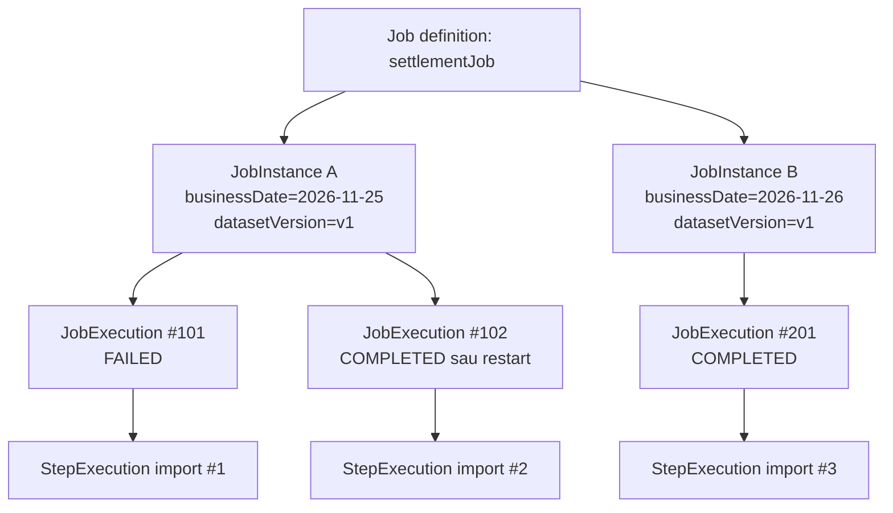
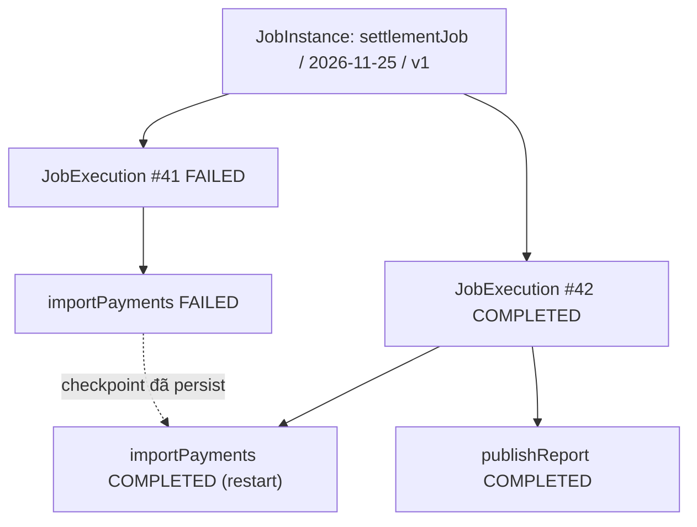

# JobInstance và JobExecution: danh tính, lượt chạy và restart trong Spring Batch

## Mục tiêu bài học

Trong module **SPRING_BATCH_SCALING_OPERATIONS**, ta mở rộng Spring Batch cho workload dữ liệu lớn bằng multi-threaded step, parallel steps, partitioning hoặc xử lý phân tán. Dù dùng kiến trúc nào, vận hành an toàn vẫn bắt đầu từ việc phân biệt hai khái niệm nền tảng của chương **Restartability**:

- **`JobInstance`**: một **lần xử lý logic** của một định nghĩa job, được nhận diện bằng **tên job và bộ JobParameters có thuộc tính identifying**.
- **`JobExecution`**: một **lần cố gắng thực thi** JobInstance đó; một JobInstance có thể có nhiều JobExecution khi thất bại, dừng rồi restart.

Sau bài học, bạn có thể:

1. Trả lời chính xác “job hôm nay” là JobInstance nào và lần restart là JobExecution thứ mấy.
2. Chọn identifying/non-identifying `JobParameters` mà không vô tình tạo JobInstance mới hoặc tái sử dụng sai kết quả.
3. Giải thích `BatchStatus`, `ExitStatus`, `StepExecution`, `ExecutionContext` và cách `JobRepository` ghi lịch sử thực thi.
4. Viết Java DSL Spring Batch 5.2.x để launch một job, restart sau lỗi và ngăn chạy lại JobInstance đã hoàn tất.
5. Phân biệt **restart**, **rerun/reprocess**, **retry** và **RunIdIncrementer**.
6. Chẩn đoán sự cố ở local/multi-threaded/partitioned/remote job qua metadata, business key và các khoảng lỗi ở ranh giới commit.
7. Kiểm thử danh tính, restart, idempotency và xung đột khi nhiều job chạy đồng thời.

> **Phiên bản:** Bài viết dựa trên Spring Batch **5.2.x**, Spring Framework 6.x và Java 17+. API, schema JobRepository hoặc thuật ngữ ở phiên bản khác cần được đối chiếu với tài liệu tương ứng. Ví dụ Java/SQL bên dưới là các mảnh cấu hình minh họa, cần import và hạ tầng phù hợp để chạy trong ứng dụng thật.

## 1. Mô hình quan hệ: một JobInstance, nhiều JobExecution

Một bean `Job` là **định nghĩa công việc**, không phải lịch sử chạy. Cùng định nghĩa đó có thể xử lý nhiều ngày dữ liệu, nhiều snapshot hoặc nhiều tenant; mỗi bộ identifying parameters tương ứng một **JobInstance**.



Số `#101`, `#102` trong sơ đồ chỉ là ID giả định. ID thực tế do repository cấp, không phải cách bạn tự nhận diện một tập dữ liệu nghiệp vụ.

Một cách nhớ hữu ích:

| Khái niệm | Trả lời câu hỏi | Tồn tại qua restart? |
| --- | --- | --- |
| **`Job`** | Định nghĩa xử lý gồm những step/flow nào? | Có, do application cấu hình |
| **`JobInstance`** | Đây là lần xử lý logic nào của Job đó? | **Có** khi restart cùng identifying parameters |
| **`JobExecution`** | Đây là lần thực thi thứ mấy của JobInstance? | **Mỗi lần launch/restart là một bản ghi khác** |
| **`StepExecution`** | Một step được thực thi ra sao trong một JobExecution? | Lần chạy lại step có StepExecution mới và metadata riêng |
| **`JobParameters`** | Đầu vào và thành phần nhận diện JobInstance là gì? | Được gắn vào mỗi JobExecution |
| **`ExecutionContext`** | Reader/step/job cần nhớ trạng thái nào để tiếp tục? | Có, khi được persist và phục hồi đúng |
| **`JobRepository`** | Lưu metadata nhận diện và lịch sử ở đâu? | Phải bền vững nếu cần restart |

**Điểm then chốt:** Không nói “restart một JobExecution cũ cho chạy lại chính bản ghi đó”. Framework tạo một **JobExecution mới** cho **cùng JobInstance**, dùng metadata/checkpoint của execution trước khi phù hợp.

## 2. Công thức nhận diện JobInstance

Về mặt logic:

```text
JobInstance identity
    = jobName + identifying JobParameters
```

Trong đó **jobName** là tên của `Job` trong Spring Batch, còn **identifying JobParameters** là những tham số được đánh dấu `identifying=true`. Các tham số khác vẫn được truyền vào job nhưng không tham gia tạo danh tính JobInstance.

### Ví dụ ba lần launch

```text
Job name = settlementJob

A:
  businessDate = "2026-11-25"   identifying
  datasetVersion = "v1"          identifying
  traceId = "request-a"          non-identifying

B:
  businessDate = "2026-11-25"   identifying
  datasetVersion = "v1"          identifying
  traceId = "request-b"          non-identifying

C:
  businessDate = "2026-11-25"   identifying
  datasetVersion = "v2"          identifying
  traceId = "request-c"          non-identifying
```

- **A và B:** Cùng JobInstance, vì `traceId` không identifying. Nếu A đã COMPLETED, B không thể launch như một JobInstance mới chỉ bằng cách đổi traceId.
- **A và C:** Hai JobInstance khác nhau, vì `datasetVersion` identifying đã thay đổi. Chúng có thể chạy cùng thời điểm nếu hạ tầng cho phép, nên bảng đích vẫn cần business isolation.
- Nếu A `FAILED`, B **có thể tạo một JobExecution tiếp theo** của cùng JobInstance khi job restartable. Nhưng thay `traceId` không được dùng để âm thầm thay đổi nghiệp vụ khi restart.

### Java: tạo identifying và non-identifying parameters

```java
JobParameters params = new JobParametersBuilder()
        .addString("businessDate", "2026-11-25", true)
        .addString("datasetVersion", "v1", true)
        .addString("runKey", "settlement-2026-11-25-v1", true)
        .addString("traceId", "request-a", false)
        .toJobParameters();
```

`JobParametersBuilder.addString(key, value, identifying)` cho phép chỉ rõ thuộc tính này. Nếu dùng overload không truyền boolean, tham số thường mặc định là **identifying**.

Không nên đặt toàn bộ thông số vào non-identifying chỉ để “ít tạo JobInstance”: khi các giá trị thực sự quyết định tập dữ liệu hoặc logic xử lý thay đổi, checkpoint cũ có thể được áp lên input khác.

### Tham số nào nên identifying?

| Tham số | Khuyến nghị ban đầu | Giải thích |
| --- | --- | --- |
| `businessDate` / kỳ hạch toán | Identifying | Quyết định phạm vi dữ liệu |
| `tenantId` / chủ thể xử lý | Identifying nếu mỗi tenant là một job logic | Tránh hai tenant vô tình dùng cùng JobInstance |
| `snapshotId` / datasetVersion | Identifying | Quy định tập dữ liệu cố định qua restart |
| `pipelineVersion` có làm thay đổi output hợp đồng | Cân nhắc identifying hoặc versioned reprocess | Không dùng checkpoint cũ với logic mới không tương thích |
| `runKey` là khóa dữ liệu nghiệp vụ ổn định | Thường identifying | Giúp nối input/đích trong toàn bộ các lần restart |
| `traceId` / request correlation | Non-identifying | Chỉ phục vụ quan sát |
| `operator` / tên người yêu cầu | Non-identifying nếu không ảnh hưởng logic | Không nên tách JobInstance chỉ vì người kích hoạt khác |
| `debug` | Cẩn thận | Nếu ảnh hưởng nghiệp vụ/skip policy, không nên thay tùy tiện khi restart |
| `run.id` của `RunIdIncrementer` | Thường identifying | Cố ý tạo JobInstance mới, **không phải restart** |

**Quy tắc thực hành:** Identifying parameters trả lời “đây có phải cùng một đơn vị công việc nghiệp vụ và cùng tập dữ liệu không?”. Non-identifying parameters chỉ nên là metadata vận hành an toàn khi khác nhau giữa các execution.

## 3. Phân biệt JobInstance, JobExecution và StepExecution qua ví dụ

Giả sử job `settlementJob` có hai step chạy lần lượt:

```text
settlementJob (Job definition)
    |
    +-- importPayments (chunk step)
    |
    +-- publishReport (tasklet step)
```

Lần đầu:

1. `JobExecution #41` được tạo cho JobInstance `(settlementJob, 2026-11-25, v1)`.
2. `importPayments` xử lý được 4/6 payment rồi lỗi: step `FAILED` và JobExecution `FAILED`.
3. Các chunk đã commit vẫn nằm trong DB; checkpoint được persist theo StepExecution/ItemStream.

Lần restart:

1. Spring Batch tạo **`JobExecution #42`** nhưng vẫn thuộc **JobInstance cũ**.
2. Step `importPayments` có StepExecution mới và tiếp tục theo checkpoint nếu reader/step hỗ trợ.
3. Khi import hoàn tất, `publishReport` chạy theo flow.
4. Nếu JobExecution #42 `COMPLETED`, JobInstance đó đã hoàn tất.

Một kịch bản khác: import đã `COMPLETED` nhưng `publishReport` `FAILED`. Khi restart, Spring Batch **thường bỏ qua step import đã hoàn tất** và chạy lại phần chưa hoàn tất, trừ khi được cấu hình `allowStartIfComplete(true)` hoặc flow/policy đặc biệt thay đổi hành vi.



**Mỗi `StepExecution` không phải một JobInstance mới**. Trong local partitioning, một manager `PartitionStep` còn tạo nhiều worker StepExecution con, tất cả vẫn nằm trong JobInstance logic của job.

## 4. JobRepository lưu gì?

`JobRepository` là thành phần trung tâm cho trạng thái và restart. Trong triển khai dùng relational database chuẩn, các bảng metadata quan trọng gồm:

| Bảng | Nội dung chính |
| --- | --- |
| `BATCH_JOB_INSTANCE` | `JOB_INSTANCE_ID`, `JOB_NAME` và `JOB_KEY` đại diện identifying parameters |
| `BATCH_JOB_EXECUTION` | Mỗi lần thực thi: `JOB_EXECUTION_ID`, `JOB_INSTANCE_ID`, trạng thái, thời gian, exit code |
| `BATCH_JOB_EXECUTION_PARAMS` | Các JobParameters của từng JobExecution, type/value và cờ `IDENTIFYING` |
| `BATCH_JOB_EXECUTION_CONTEXT` | ExecutionContext phạm vi job |
| `BATCH_STEP_EXECUTION` | StepExecution, trạng thái, read/write/skip/commit/rollback counts |
| `BATCH_STEP_EXECUTION_CONTEXT` | State checkpoint theo StepExecution |

`JOB_KEY` là giá trị framework tạo từ identifying parameters, **không phải business key tự đặt**. Không tự tính hoặc update `JOB_KEY` bằng SQL để “sửa” JobInstance.

### SQL: xem lịch sử các execution của một instance

```sql
SELECT ji.JOB_INSTANCE_ID,
       ji.JOB_NAME,
       je.JOB_EXECUTION_ID,
       je.STATUS,
       je.EXIT_CODE,
       je.CREATE_TIME,
       je.START_TIME,
       je.END_TIME
FROM BATCH_JOB_INSTANCE ji
JOIN BATCH_JOB_EXECUTION je
  ON je.JOB_INSTANCE_ID = ji.JOB_INSTANCE_ID
WHERE ji.JOB_INSTANCE_ID = :jobInstanceId
ORDER BY je.JOB_EXECUTION_ID;
```

Với ví dụ trước, truy vấn sẽ cho hai hàng tương ứng `JobExecution #41 FAILED` và `#42 COMPLETED` của cùng JobInstance.

### SQL: xem identifying parameters của một lần thực thi

```sql
SELECT p.PARAMETER_NAME,
       p.PARAMETER_TYPE,
       p.PARAMETER_VALUE,
       p.IDENTIFYING
FROM BATCH_JOB_EXECUTION_PARAMS p
WHERE p.JOB_EXECUTION_ID = :jobExecutionId
ORDER BY p.PARAMETER_NAME;
```

Các tên cột trên phù hợp schema chuẩn Spring Batch 5.x. Với version khác, migration/schema tùy chỉnh hoặc vendor DB, cần kiểm tra schema thật. Không sửa các hàng này thủ công khi job đã được tạo.

### SQL: xem các step và khoản việc đã commit

```sql
SELECT se.JOB_EXECUTION_ID,
       se.STEP_EXECUTION_ID,
       se.STEP_NAME,
       se.STATUS,
       se.READ_COUNT,
       se.WRITE_COUNT,
       se.COMMIT_COUNT,
       se.ROLLBACK_COUNT
FROM BATCH_STEP_EXECUTION se
JOIN BATCH_JOB_EXECUTION je
  ON je.JOB_EXECUTION_ID = se.JOB_EXECUTION_ID
WHERE je.JOB_INSTANCE_ID = :jobInstanceId
ORDER BY se.JOB_EXECUTION_ID, se.STEP_EXECUTION_ID;
```

**Không cộng bừa `READ_COUNT`/`WRITE_COUNT` của mọi StepExecution** trong một JobInstance để suy ra số item nghiệp vụ duy nhất: retry/restart/partitioning có thể tạo nhiều lượt xử lý, writer có thể upsert hoặc skip. Đối soát phải dựa vào kết quả đã commit theo business key.

## 5. BatchStatus và ExitStatus: giống nhau không?

Không. Hai khái niệm có vai trò khác nhau:

- **`BatchStatus`:** Trạng thái thực thi kỹ thuật của JobExecution/StepExecution, ví dụ `STARTING`, `STARTED`, `STOPPING`, `STOPPED`, `FAILED`, `COMPLETED`, `ABANDONED`, `UNKNOWN`.
- **`ExitStatus`:** Kết quả logic/flow của step/job (exit code và optional description), ví dụ `COMPLETED`, `FAILED` hoặc một mã do ứng dụng đặt như `COMPLETED_WITH_WARNINGS`.

`ExitStatus` có thể được dùng trong flow transitions. Không suy ra **JobInstance đã hoàn thành** chỉ bằng một chuỗi exit code tùy chỉnh; phải xem `BatchStatus` và lịch sử trong JobRepository.

### Các trạng thái quan trọng với restart

| BatchStatus | Ý nghĩa thường gặp | Khi muốn tiếp tục |
| --- | --- | --- |
| `STARTING` | Metadata đã tạo, execution chuẩn bị bắt đầu | Theo dõi tiến trình, không tạo execution trùng |
| `STARTED` | Job/step đang chạy | Không restart cùng JobInstance khi đang chạy bình thường |
| `STOPPING` | Có yêu cầu stop, chưa dừng hoàn toàn | Chờ xác nhận dừng |
| `STOPPED` | Đã dừng có kiểm soát | Có thể restart nếu job/policy cho phép |
| `FAILED` | Thực thi thất bại | Có thể restart sau khi xử lý lỗi, nếu job restartable |
| `COMPLETED` | Thực thi thành công theo flow | JobInstance hoàn tất; launch cùng identity sẽ bị từ chối mặc định |
| `ABANDONED` | Được đánh dấu bỏ qua, không tiếp tục execution đó | Không tự restart step/instance bị abandoned theo cách thông thường |
| `UNKNOWN` | Không xác định rõ trạng thái | Phải điều tra; không đoán có thể restart an toàn |

Nếu **process bị kill** hoặc máy mất điện, JobExecution trong repository có thể vẫn là `STARTED` thay vì tự chuyển thành `FAILED`. Không chạy SQL `UPDATE BATCH_JOB_EXECUTION SET STATUS='FAILED'` theo thói quen: cần kiểm tra process/worker/broker/DB thực sự đã dừng và dùng quy trình phục hồi được tổ chức cho hệ thống.

### Mối quan hệ trạng thái job và step

Một step có thể `COMPLETED` nhưng job `FAILED` vì một step khác thất bại. Ngược lại, một flow có chính sách chuyển hướng hoặc xử lý lỗi được cấu hình có thể tạo `ExitStatus` theo yêu cầu nghiệp vụ; không khái quát rằng một lỗi bất kỳ luôn làm toàn job FAILED. Cần đọc flow definition và cả `BatchStatus`/`ExitStatus`.

## 6. Launch mới, restart, reprocess và retry khác nhau ra sao?

| Hành động | Có tạo JobInstance mới? | Có JobExecution mới? | Dữ liệu xử lý |
| --- | --- | --- | --- |
| Launch lần đầu với identity chưa tồn tại | Có | Có | Bắt đầu đơn vị công việc mới |
| Restart sau JobExecution FAILED/STOPPED đủ điều kiện | **Không** | **Có** | Tiếp tục cùng đơn vị công việc qua metadata/checkpoint |
| Launch lại cùng identity khi instance đã COMPLETED | Không | Thông thường bị từ chối | Không coi là một lần chạy mới |
| Tạo identifying params khác để reprocess | **Có** | Có | Một lần xử lý logic khác; cần bảo vệ output |
| Retry item/chunk bên trong một JobExecution | Không | Không | Thử lại thao tác trong cùng execution |
| Broker redelivery trong remote chunking | Không tự động | Không tự động | Message/item có thể tới worker nhiều lần |
| `RunIdIncrementer` tạo run.id kế tiếp | **Có** khi run.id identifying thay đổi | Có | Một JobInstance mới, không phải restart |

### Vì sao `RunIdIncrementer` không phải “nút restart”?

`RunIdIncrementer` tạo giá trị tham số `run.id` tăng dần cho lần chạy **kế tiếp**. Khi `run.id` là identifying (cách dùng mặc định thường gặp), mỗi giá trị mới làm thay đổi danh tính JobInstance. Điều này hữu ích khi có lịch chạy mới cần xử lý lại/đánh dấu kỳ mới, **không dùng để khôi phục checkpoint của JobInstance đã FAILED**.

```java
@Bean
Job scheduledImportJob(JobRepository repository, Step importStep) {
    return new JobBuilder("scheduledImportJob", repository)
            .incrementer(new RunIdIncrementer())
            .start(importStep)
            .build();
}
```

Nếu một job chạy ngày D bị lỗi và bạn tạo `run.id=42` thay cho `run.id=41`, framework sẽ nhận đó là một JobInstance khác nếu cả hai là identifying. Snapshot, output business key và side effect có thể bị xử lý lại từ đầu; đó là **reprocess**, không phải restart.

## 7. Java DSL: một Job và Step có thể restart

Ví dụ Spring Batch 5.2.x: đọc `payment_snapshot` của một `snapshotId`, tính amount rồi ghi `processed_payment`. Run key được giữ nguyên giữa các JobExecution của cùng JobInstance.

### 7.1. Mô hình dữ liệu và khóa duy nhất

```java
public record Payment(long id, BigDecimal amount) {}

public record ProcessedPayment(
        String runKey,
        long paymentId,
        BigDecimal netAmount) {}
```

Ví dụ PostgreSQL:

```sql
CREATE TABLE payment_snapshot (
    snapshot_id VARCHAR(100) NOT NULL,
    payment_id  BIGINT NOT NULL,
    amount      NUMERIC(18, 2) NOT NULL,
    PRIMARY KEY (snapshot_id, payment_id)
);

CREATE TABLE processed_payment (
    run_key     VARCHAR(100) NOT NULL,
    payment_id  BIGINT NOT NULL,
    net_amount  NUMERIC(18, 2) NOT NULL,
    PRIMARY KEY (run_key, payment_id)
);
```

`payment_snapshot` phải thực sự được cố định theo snapshot trước khi job chạy; nếu cập nhật source sau failure, cùng checkpoint có thể đọc dữ liệu khác.

### 7.2. Reader dùng identifying JobParameter

```java
@Bean("paymentReader")
@StepScope
JdbcPagingItemReader<Payment> paymentReader(
        DataSource dataSource,
        @Value("#{jobParameters['snapshotId']}") String snapshotId) {

    return new JdbcPagingItemReaderBuilder<Payment>()
            .name("paymentReader")
            .dataSource(dataSource)
            .selectClause("SELECT payment_id, amount")
            .fromClause("FROM payment_snapshot")
            .whereClause("WHERE snapshot_id = :snapshotId")
            .parameterValues(Map.of("snapshotId", snapshotId))
            .sortKeys(Map.of("payment_id", Order.ASCENDING))
            .pageSize(200)
            .rowMapper((rs, n) -> new Payment(
                    rs.getLong("payment_id"),
                    rs.getBigDecimal("amount")))
            .saveState(true)
            .build();
}
```

`@StepScope` bind tham số tại thời điểm thực thi step; `name` và `saveState(true)` giúp reader lưu checkpoint trong `StepExecutionContext`. `payment_id` phải là sort key duy nhất bên trong snapshot và được index phù hợp.

### 7.3. Processor stateless và writer idempotent

```java
@Bean("paymentProcessor")
@StepScope
ItemProcessor<Payment, ProcessedPayment> paymentProcessor(
        @Value("#{jobParameters['runKey']}") String runKey) {

    BigDecimal factor = new BigDecimal("0.98"); // Chỉ để minh họa.
    return input -> new ProcessedPayment(
            runKey,
            input.id(),
            input.amount().multiply(factor)
                    .setScale(2, RoundingMode.HALF_EVEN));
}
```

```java
@Bean("paymentWriter")
JdbcBatchItemWriter<ProcessedPayment> paymentWriter(
        DataSource dataSource) {

    return new JdbcBatchItemWriterBuilder<ProcessedPayment>()
            .dataSource(dataSource)
            .sql("""
                INSERT INTO processed_payment
                    (run_key, payment_id, net_amount)
                VALUES
                    (:runKey, :paymentId, :netAmount)
                ON CONFLICT (run_key, payment_id)
                DO UPDATE SET net_amount = EXCLUDED.net_amount
                """)
            .itemSqlParameterSourceProvider(item ->
                    new MapSqlParameterSource()
                            .addValue("runKey", item.runKey())
                            .addValue("paymentId", item.paymentId())
                            .addValue("netAmount", item.netAmount()))
            .build();
}
```

Unique key hỗ trợ retry/restart không tạo hàng trùng. Tuy vậy, upsert có thể **ghi đè giá trị** nếu cùng payment ID mang amount thay đổi; cần snapshot đúng và version policy rõ ràng. Nếu gọi API hoặc phát message ngoài transaction, writer DB idempotent không tự bảo vệ side effect đó.

### 7.4. Step và Job

```java
@Bean("importPaymentsStep")
Step importPaymentsStep(
        JobRepository repository,
        PlatformTransactionManager transactionManager,
        @Qualifier("paymentReader")
        ItemStreamReader<Payment> reader,
        @Qualifier("paymentProcessor")
        ItemProcessor<Payment, ProcessedPayment> processor,
        @Qualifier("paymentWriter")
        ItemWriter<ProcessedPayment> writer) {

    return new StepBuilder("importPayments", repository)
            .<Payment, ProcessedPayment>chunk(200, transactionManager)
            .reader(reader)
            .processor(processor)
            .writer(writer)
            .build();
}

@Bean("settlementJob")
Job settlementJob(
        JobRepository repository,
        @Qualifier("importPaymentsStep") Step importStep) {

    return new JobBuilder("settlementJob", repository)
            .start(importStep)
            .build();
}
```

Không cần `TaskExecutor` cho baseline này: đây là chunk-oriented step tuần tự, giúp chứng minh semantics restart trước khi tăng concurrency. Bean `Step` không đặt `@StepScope`; scope dành cho reader/processor cần late binding.

### 7.5. Launch một JobInstance cụ thể

```java
@Service
public class SettlementLauncher {
    private final JobLauncher jobLauncher;
    private final Job settlementJob;

    public SettlementLauncher(
            JobLauncher jobLauncher,
            @Qualifier("settlementJob") Job settlementJob) {
        this.jobLauncher = jobLauncher;
        this.settlementJob = settlementJob;
    }

    public JobExecution launch(
            String businessDate,
            String snapshotId,
            String runKey,
            String traceId) throws Exception {

        JobParameters params = new JobParametersBuilder()
                .addString("businessDate", businessDate, true)
                .addString("snapshotId", snapshotId, true)
                .addString("runKey", runKey, true)
                .addString("traceId", traceId, false)
                .toJobParameters();

        return jobLauncher.run(settlementJob, params);
    }
}
```

`JobLauncher.run(job, params)` thực hiện launch theo trạng thái JobRepository; nếu chạy đồng bộ, lời gọi có thể trả về sau khi job kết thúc, còn nếu cấu hình task executor bất đồng bộ, có thể trả về khi execution đang chạy. **Không suy ra status trả về luôn là COMPLETED.**

Các tình huống điển hình:

- Identity chưa tồn tại: tạo JobInstance và JobExecution đầu.
- Identity đã tồn tại với execution FAILED và job restartable: tạo JobExecution tiếp theo của cùng instance.
- Identity đã COMPLETED: ném `JobInstanceAlreadyCompleteException`.
- Đang có execution chạy của cùng instance: `JobExecutionAlreadyRunningException` hoặc lỗi theo repository/lifecycle.
- Tham số thiếu hoặc sai validation: `JobParametersInvalidException` nếu job có validator.
- Job không restartable: `JobRestartException` khi cố restart.

Các exception cụ thể phụ thuộc thời điểm và JobRepository implementation; khi xử lý lỗi, kiểm tra loại lỗi thực tế thay vì chỉ so sánh chuỗi message.

## 8. Dùng JobOperator để restart đúng execution

`JobOperator` cung cấp các thao tác vận hành: start, restart, stop và truy vấn metadata (tùy API/phiên bản). Ở Spring Batch 5.2.x, có thể yêu cầu restart từ ID của **JobExecution thất bại**:

```java
@Service
public class SettlementOperations {
    private final JobOperator jobOperator;

    public SettlementOperations(JobOperator jobOperator) {
        this.jobOperator = jobOperator;
    }

    public Long restartFailedExecution(long failedJobExecutionId)
            throws Exception {
        return jobOperator.restart(failedJobExecutionId);
    }
}
```

Phương thức `restart(long executionId)` tạo **một JobExecution mới** cho JobInstance của execution được chỉ định nếu đủ điều kiện; ID đầu vào là `JobExecutionId`, **không phải JobInstanceId**.

**Không tự truyền một `run.id` khác để “restart”**. Nếu cần reprocess một ngày đã hoàn tất, thiết kế versioned JobInstance mới và cách xử lý output thay vì ép framework bỏ qua bảo vệ.

### Tình huống process chết khi trạng thái vẫn STARTED

Nếu manager/JVM bị kill, metadata có thể còn status `STARTED` trong DB dù không còn tiến trình. Đặc biệt với remote workers, worker cũ có thể vẫn tiếp tục ghi. Cần runbook:

1. Xác minh tiến trình manager/worker và broker in-flight đã dừng/được drain.
2. Truy metadata JobExecution, StepExecution, ExitStatus và logs.
3. Đối soát business sink theo runKey.
4. Thực hiện quy trình recovery được tổ chức chấp nhận và hỗ trợ bởi hạ tầng/framework.
5. Chỉ sau đó mới restart hoặc reprocess theo danh tính phù hợp.

Không chuyển `STARTED` thành `FAILED` bằng SQL tùy tiện khi chưa xác minh an toàn; việc này có thể tạo hai execution cùng tác động lên một tập dữ liệu.

## 9. JobExecution và StepExecution khi restart: có phải mọi step đều chạy lại?

Không. Spring Batch dùng metadata của JobInstance để quyết định step nào đã hoàn tất hoặc cần chạy tiếp.

Giả sử job có ba step:

```text
prepareSnapshot -> processPayments -> publishSummary
```

Lần chạy đầu:

| Step | Trạng thái JobExecution #71 | Giải thích |
| --- | --- | --- |
| `prepareSnapshot` | COMPLETED | Tập snapshot đã tạo và lưu |
| `processPayments` | FAILED | Đã commit 5 chunk rồi lỗi ở chunk tiếp theo |
| `publishSummary` | Chưa chạy | Phụ thuộc step trước thành công |

Lần restart:

| Step | Kỳ vọng JobExecution #72 | Giải thích |
| --- | --- | --- |
| `prepareSnapshot` | **Bỏ qua theo mặc định** nếu đã hoàn tất | Không tạo lại input snapshot bất chợt |
| `processPayments` | **Chạy lại/tiếp tục** | Reader `ExecutionContext` phục hồi checkpoint |
| `publishSummary` | Chạy khi process thành công | Xuất số liệu đã hoàn tất |

Có thể cấu hình `allowStartIfComplete(true)` nếu cố ý muốn step đã hoàn tất chạy lại khi restart. Dùng thận trọng: nếu step tạo snapshot mới hoặc gửi notification, chạy lại có thể phá tính nhất quán.

```java
new StepBuilder("prepareSnapshot", repository)
        .tasklet(prepareSnapshotTasklet, transactionManager)
        .allowStartIfComplete(false)
        .build();
```

Với một job instance đã COMPLETED, `allowStartIfComplete(true)` **không biến launch lần nữa cùng identifying params thành lần chạy mới**; nó chỉ ảnh hưởng cách xử lý step khi **job có thể restart hợp lệ**.

### ExecutionContext và checkpoint

`StepExecutionContext` lưu trạng thái reader/writer per step và thường được persist tại commit point. `JobExecutionContext` dùng cho trạng thái cấp job và handoff giữa các step, thường persist ở ranh giới step.

`ItemStream.open(context)` có thể đọc state từ lần StepExecution trước; `ItemStream.update(context)` ghi tiến độ trước commit. Khi chunk rollback, checkpoint bền vững không nên bị coi là đã tiến lên chỉ vì biến reader in-memory thay đổi.

Đặc biệt:

- **`readCount` không phải số row đích mới.**
- **`writeCount` không chứng minh đúng một lần ghi business side effect.**
- **`ExecutionContext` không phải transaction phân tán.**
- **`JobExecutionId` thay đổi sau restart**, vì thế không nên làm idempotency key duy nhất.

## 10. Kịch bản test: FAILED → restart → COMPLETED

Để chứng minh danh tính và restart, dùng Spring Batch Test/JUnit 5 với JobRepository trên database test bền qua **hai lần launch**.

### 10.1. Fixture mẫu

Bảng `payment_snapshot` chứa 6 ID: `10, 20, 30, 40, 50, 60`, cùng `snapshotId="test-v1"`. Dùng `chunk(2)`. Writer được bọc bởi một decorator **fail once** trước khi delegate ghi chunk chứa ID 30.

```java
public final class FailOnceWriter
        implements ItemWriter<ProcessedPayment> {

    private final ItemWriter<ProcessedPayment> delegate;
    private final AtomicBoolean failOnce;

    public FailOnceWriter(
            ItemWriter<ProcessedPayment> delegate,
            AtomicBoolean failOnce) {
        this.delegate = delegate;
        this.failOnce = failOnce;
    }

    @Override
    public void write(Chunk<? extends ProcessedPayment> items)
            throws Exception {

        boolean hasPayment30 = items.getItems().stream()
                .anyMatch(item -> item.paymentId() == 30L);

        if (hasPayment30 && failOnce.compareAndSet(true, false)) {
            throw new IllegalStateException("Injected failure");
        }

        delegate.write(items);
    }
}
```

Đây là **fixture cần được nối vào bean writer trong test profile**; chỉ định nghĩa class không khiến Spring tự dùng nó. `AtomicBoolean` giữ nguyên instance giữa hai lần launch trong một test. Không dùng decorator gây lỗi ở môi trường production.

### 10.2. Assertions về JobInstance và JobExecution

```java
@Test
void failedRunRestartsSameJobInstance() throws Exception {
    JobParameters params = new JobParametersBuilder()
            .addString("businessDate", "2026-11-25", true)
            .addString("snapshotId", "test-v1", true)
            .addString("runKey", "test-run-1", true)
            .toJobParameters();

    JobExecution first = jobLauncherTestUtils.launchJob(params);

    assertEquals(BatchStatus.FAILED, first.getStatus());
    assertEquals(2L, jdbcTemplate.queryForObject(
            "SELECT COUNT(*) FROM processed_payment WHERE run_key = ?",
            Long.class, "test-run-1"));

    JobExecution second = jobLauncherTestUtils.launchJob(params);

    assertEquals(BatchStatus.COMPLETED, second.getStatus());
    assertNotEquals(first.getId(), second.getId());
    assertEquals(first.getJobInstance().getInstanceId(),
                 second.getJobInstance().getInstanceId());

    assertEquals(6L, jdbcTemplate.queryForObject(
            "SELECT COUNT(*) FROM processed_payment WHERE run_key = ?",
            Long.class, "test-run-1"));
}
```

Test ở đây là **skeleton minh họa**, phải đặt trong class `@SpringBatchTest`/`@SpringBootTest` có `JobLauncherTestUtils`, `JdbcTemplate`, test database/schema và decorator đã được inject. Các giá trị đếm kỳ vọng phụ thuộc chính xác fault injector được ném **trước khi ghi chunk thứ hai**, transaction cùng DataSource và checkpoint hợp lệ.

**Kiểm tra mạnh hơn:** Truy hai hàng `BATCH_JOB_EXECUTION` có cùng `JOB_INSTANCE_ID` và khác `JOB_EXECUTION_ID`. Điều này xác nhận bản chất restart thay vì chỉ nhìn JobStatus.

### 10.3. Đã COMPLETED thì không launch cùng identity như một lần mới

```java
@Test
void completedInstanceIsNotStartedAgain() throws Exception {
    JobParameters params = new JobParametersBuilder()
            .addString("businessDate", "2026-11-25", true)
            .addString("snapshotId", "test-v1", true)
            .addString("runKey", "completed-test", true)
            .toJobParameters();

    JobExecution first = jobLauncherTestUtils.launchJob(params);
    assertEquals(BatchStatus.COMPLETED, first.getStatus());

    JobParameters changedTrace = new JobParametersBuilder()
            .addString("businessDate", "2026-11-25", true)
            .addString("snapshotId", "test-v1", true)
            .addString("runKey", "completed-test", true)
            .addString("traceId", "another-request", false)
            .toJobParameters();

    assertThrows(
            JobInstanceAlreadyCompleteException.class,
            () -> jobLauncherTestUtils.launchJob(changedTrace));
}
```

Bằng cách chỉ đổi non-identifying `traceId`, job vẫn thuộc cùng JobInstance đã hoàn tất. Nếu thay `runKey` hoặc `snapshotId` identifying, test sẽ tạo JobInstance khác và không kiểm tra đúng điều muốn chứng minh.

### 10.4. Trường hợp cần kiểm thử thêm

| Test | Điều chứng minh |
| --- | --- |
| Hai JobExecution có cùng identifying params và status FAILED → COMPLETED | Restart cùng JobInstance |
| Non-identifying `traceId` đổi nhưng identity không đổi | Phân biệt tham số định danh và vận hành |
| Identifying `snapshotId` đổi | Tạo JobInstance mới, không dùng checkpoint cũ |
| JobInstance đã COMPLETED | Launch cùng identity bị từ chối |
| Cùng identity có execution STARTED | Repository không cho chạy chồng bất hợp pháp |
| Step A COMPLETED, step B FAILED | Restart không chạy lại step A mặc định |
| `allowStartIfComplete(true)` | Step đã COMPLETED có thể chạy lại trong một restart hợp lệ |
| `restartable(false)` | Job không cho restart dù execution FAILED |
| Writer lỗi trước/sau DB commit | Context và business output có thể chênh, cần idempotency |
| JVM kill khi status STARTED | Cần quy trình kiểm tra/recovery, không tự launch vô điều kiện |

### 10.5. Dọn metadata test, không dọn production

`JobRepositoryTestUtils.removeJobExecutions()` hữu ích để cô lập test nhưng **chỉ được dùng với test database**. Khi viết test restart, không xóa repository **giữa lần FAILED và lần launch thứ hai**; làm vậy sẽ xóa chính lịch sử cần xác minh.

## 11. Idempotency phải bám business run, không bám execution attempt

Giả sử một JobInstance chạy ngày 2026-11-25 và có hai JobExecution:

```text
JobInstance 900
  businessDate=2026-11-25
  snapshotId=snapshot-v1
  runKey=settlement-2026-11-25-v1

JobExecution 901: FAILED
JobExecution 902: COMPLETED
```

Nếu writer dùng unique key `(jobExecutionId, paymentId)`, mỗi lần restart sẽ có **jobExecutionId mới** và có thể ghi một hàng trùng payment. Dùng một business key không đổi qua restart, ví dụ `(runKey, paymentId)` hoặc `(tenantId, snapshotId, paymentId, operationVersion)` phù hợp nghiệp vụ.

### Tại sao cần phân biệt khóa job và khóa đích?

- `JOB_INSTANCE_ID` do JobRepository quản lý, có thể không tồn tại/không ổn định nếu di chuyển repository giữa môi trường hoặc cần reprocess độc lập.
- `runKey` do nghiệp vụ định nghĩa để nhận diện một lần xử lý logic và được đưa vào output.
- `paymentId` phân biệt item bên trong run; thêm `operation`/`version` khi một item có thể được xử lý nhiều lần theo các quy tắc khác nhau.
- `JobExecutionId` chỉ nên dùng để audit/trace **lần cố gắng**; không phải khóa chống duplicate duy nhất.

Một hệ thống có thể dùng `JobInstanceId` làm correlation nội bộ trong cùng repository, nhưng nên tránh biến nó thành business key duy nhất của side effect ở hệ thống ngoài khi chưa có hợp đồng tích hợp chặt chẽ.

### Failure window khi commit

Nếu DB nghiệp vụ commit nhưng JobRepository chưa persist checkpoint, job restart có thể đọc lại item. Ngược lại, nếu metadata tiến lên nhưng side effect ngoài transaction thất bại, job có thể bỏ sót side effect. Một process đơn thuần không bảo đảm transaction nguyên tử qua nhiều resource.

| Trường hợp | Rủi ro | Chiến lược |
| --- | --- | --- |
| Ghi DB cùng transaction với checkpoint/metadata thích hợp | Tính nhất quán thuận lợi hơn | Kiểm tra transaction manager đúng |
| Ghi DB khác transaction manager | Hai commit có thể lệch nhau | Idempotency và đối soát |
| Gửi API ngay trong processor | Retry có thể gọi nhiều lần | Idempotency key/outbox |
| Gửi message qua broker | Redelivery và mất reply | Inbox/outbox, correlation, retry giới hạn |
| Writer ghi file append | Replay có thể nhân đôi dòng | File per-run/partition, temp + atomic publish hoặc manifest |

**JobExecution COMPLETED không đủ chứng minh “exactly-once” cho mọi side effect**. Đối soát doanh nghiệp vẫn phải dựa trên output commit và ràng buộc nghiệp vụ.

## 12. JobInstance trong các kiến trúc mở rộng

### 12.1. Multi-threaded step

Các chunk được xử lý qua `TaskExecutor` trong **cùng một StepExecution** của một JobExecution. Khi restart, JobInstance vẫn giống, JobExecution mới, nhưng reader/writer cần thật sự thread-safe và checkpoint phải chịu được thứ tự chunk commit khác nhau. Một cursor tuyến tính không tự mô tả đầy đủ những chunk hoàn tất không liên tiếp.

Không dùng `@StepScope` như bằng chứng “mỗi thread một reader”: scope gắn với **StepExecution**, không phải mỗi chunk thread.

### 12.2. Parallel steps

Hai flow độc lập trong cùng JobExecution có hai StepExecution khác nhau, nhưng chung JobInstance và có thể chia sẻ singleton application bean/JobExecutionContext. Nếu một flow thành công còn flow kia lỗi, khi restart framework phải dựa vào step/flow metadata. Đừng dùng một bộ đếm mutable trong singleton để “gộp” output giữa các flow.

Nếu cần tổng hợp kết quả, đặt aggregation step sau barrier/join, đọc dữ liệu đã commit từ staging theo runKey.

### 12.3. Local partitioning

Manager `PartitionStep` chia thành nhiều worker `StepExecution` con. Tất cả thuộc JobExecution tương ứng và JobInstance logic hiện tại. Khi restart:

- Giữ tên worker step, tên partition và bounds ổn định.
- Worker đã COMPLETED có thể được framework bỏ qua theo metadata.
- Worker FAILED cần resume đúng `StepExecutionContext`.
- Không thay `gridSize`/logic partitioner làm map partition cũ sang dữ liệu khác nếu chưa có kế hoạch.

**Không có một JobInstance riêng cho từng partition**. Nếu mỗi worker chạy một job độc lập với parameters riêng, đó là thiết kế khác cần điều phối riêng.

### 12.4. Remote partitioning

Remote worker thực thi StepExecution của partition ở các JVM khác, dùng metadata JobRepository nhất quán. Manager timeout **không có nghĩa worker cũ đã ngừng**. Trước khi restart JobInstance, cần kiểm tra các worker in-flight, transactional sink và idempotency để tránh hai execution cùng ghi một vùng dữ liệu.

### 12.5. Remote chunking

Manager giữ reader và JobExecution/StepExecution, gửi chunk tới worker qua broker. Worker có thể đã commit business data nhưng reply về manager bị mất. Restart **cùng JobInstance** có thể phát lại một phần item/chunk; idempotency per-item và đối soát là bắt buộc khi side effect ở xa.

Trong mô hình này, `JobExecutionId` có thể thay đổi khi manager restart, nên không dùng nó làm business dedupe key duy nhất trên worker.

## 13. Nhiều JobInstance chạy đồng thời: tránh dữ liệu chồng chéo

`JobRepository` quản lý danh tính và trạng thái JobInstance; nó không tự bảo vệ mọi dữ liệu nghiệp vụ. Hai JobInstance khác identifying parameters **có thể chạy đồng thời** và vẫn ghi vào cùng một bảng/tài khoản/file.

Ví dụ:

- Instance A: `businessDate=2026-11-25, datasetVersion=v1`.
- Instance B: `businessDate=2026-11-25, datasetVersion=v2`.

Nếu cả hai cùng ghi bảng `settlement_summary` chỉ có khóa `businessDate`, một instance có thể ghi đè summary của instance kia. Cần chính sách version/routing, unique key theo runKey hoặc lock nghiệp vụ xác định version nào được phép publish.

### Ma trận quyết định concurrency

| Tình huống | Nguy cơ | Biện pháp |
| --- | --- | --- |
| Hai JobInstance khác ngày, output có key theo ngày | Thường ít chồng lấn | Vẫn audit shared resources và transaction |
| Hai JobInstance cùng ngày, khác snapshot version | Ghi đè kết quả, publish sai phiên bản | Staging theo runKey/version; publish với CAS/lock |
| Hai launch cùng identifying params khi một execution đang chạy | Xung đột vòng đời | Dựa vào JobRepository để từ chối; scheduler retry hợp lý |
| Broker gửi lại item của execution cũ | Duplicate side effect | Idempotency per business key |
| Hai process sử dụng cùng job name nhưng khác code version | Metadata/checkpoint có thể không tương thích | Versioning/migration và deploy coordination |
| Nhiều scheduler đồng thời trigger cùng đơn vị logic | Race ở thời điểm launch | Bảo vệ bằng JobRepository + scheduler lock thích hợp |

**Không** coi việc “JobRepository không cho hai JobExecution đang chạy của cùng JobInstance” là bảo đảm dữ liệu không bị xử lý đồng thời bởi **hai JobInstance khác**.

## 14. Runbook xử lý sự cố

Khi nhận cảnh báo một job không chạy được hoặc restart không thành công:

1. **Xác định JobInstance:** lấy `jobName`, toàn bộ identifying params, `JOB_INSTANCE_ID`. Tránh hỏi chỉ “job nào chạy hôm nay?” mà không có snapshot/version.
2. **Xem lịch sử executions:** truy `BATCH_JOB_EXECUTION` xem lần cuối `COMPLETED`, `FAILED`, `STOPPED` hay `STARTED` bất thường.
3. **Xem step/partition:** truy `BATCH_STEP_EXECUTION` cùng JobInstance để xác định step nào đã commit, lỗi ở đâu và còn công việc chưa hoàn tất.
4. **Đánh giá context:** xem reader checkpoint, tên step, snapshot, sort key và phiên bản code. Không sửa metadata SQL bừa bãi.
5. **Kiểm tra in-flight:** với remote/parallel, xác nhận không còn worker/process cũ tác động lên cùng business key.
6. **Kiểm tra business sink:** đối chiếu nguồn và output theo runKey; đừng coi writeCount là số hàng chắc chắn đã insert.
7. **Chọn hành động:** restart cùng JobInstance nếu đủ điều kiện; nếu instance đã COMPLETED nhưng cần sửa dữ liệu, tạo reprocess versioned có chủ đích.
8. **Xác minh sau thực thi:** status, row coverage, checksum/tổng theo business dimension, duplicate/skip và downstream publish.
9. **Ghi audit:** ai restart, từ JobExecutionId nào, tại sao, dùng snapshot nào, kết quả reconciliation ra sao.

### SQL đối soát tập dữ liệu

```sql
SELECT s.payment_id
FROM payment_snapshot s
LEFT JOIN processed_payment p
  ON p.payment_id = s.payment_id
 AND p.run_key = :runKey
WHERE s.snapshot_id = :snapshotId
  AND p.payment_id IS NULL
ORDER BY s.payment_id;
```

Sau khi job COMPLETED, query phải trả **0 hàng** nếu hợp đồng nghiệp vụ yêu cầu một output cho mọi item nguồn. Nếu processor lọc/skip item hợp lệ, thêm predicate chính xác vào query; nếu nhiều tenant/operation version, mở rộng join key.

### Metadata retention

Không xóa bừa `BATCH_JOB_INSTANCE`, `BATCH_JOB_EXECUTION` hoặc execution context của một job đang FAILED nếu vẫn muốn **restart theo Spring Batch**. Dọn repository theo retention policy phải phân biệt job hoàn tất lâu ngày với job có thể còn cần restart, và lưu bằng chứng audit/đối soát phù hợp.

## 15. Hiệu năng và quan sát

Trong workload dữ liệu lớn, JobRepository ghi nhiều metadata; chia quá nhỏ hoặc commit quá thường xuyên có thể tạo overhead đáng kể.

Theo dõi:

- Tổng số **JobInstance** mới theo kỳ/snapshot/tenant.
- Số **JobExecution** trên mỗi instance; instance có nhiều lần FAILED/restart là tín hiệu cần điều tra.
- `BatchStatus`/`ExitStatus` và time-to-recovery sau failure.
- StepExecution read/write/skip/filter, commit/rollback, duration, partition skew.
- Metadata DB query/commit latency, pool active/pending, lock wait và dung lượng context.
- Business coverage, số duplicate/upsert conflict và số item phải replay.
- Worker active/queue/broker lag và timeout trong mô hình multi-threaded/remote.

### Hai chỉ số có ý nghĩa khác nhau

```text
new_job_instances_per_day
    = số đơn vị công việc logic mới

executions_per_job_instance
    = số lần phải thử chạy một đơn vị công việc
```

Nếu executions-per-instance tăng, có thể do job thường xuyên thất bại, retry vận hành quá nhiều hoặc launch trùng. Không tăng thread/pool vô điều kiện trước khi xác định lỗi DB, checkpoint, business data, listener và hạ tầng.

Với benchmark, hãy so throughput và SLA trên **JobInstance được xử lý hoàn chỉnh**, không chỉ nhìn số JobExecution được launch hoặc số chunk worker bắt đầu.

## 16. Những hiểu nhầm thường gặp

| Phát biểu | Kết luận |
| --- | --- |
| “`JobInstance` là một lần JVM khởi động.” | **Sai.** Một JobInstance có thể trải qua nhiều JVM và JobExecution khi restart. |
| “`JobExecutionId` giữ nguyên sau restart.” | **Sai.** Mỗi execution attempt có ID mới. |
| “Đổi non-identifying `traceId` là có JobInstance mới.” | **Sai.** Tham số này không tham gia identity. |
| “`RunIdIncrementer` dùng để khôi phục checkpoint.” | **Sai.** Nó thường tạo identifying run.id mới, tương ứng instance mới. |
| “Instance đã COMPLETED có thể launch lại với đúng identity.” | **Sai theo semantics mặc định.** Framework từ chối. |
| “`StepExecution` có thể là một worker partition.” | **Đúng.** Nhưng nó vẫn thuộc JobExecution/JobInstance của job, không tự là JobInstance riêng. |
| “JobExecution FAILED thì mọi transaction đã rollback.” | **Sai.** Các chunk/partition đã commit có thể vẫn tồn tại. |
| “`JobRepository` ngăn mọi duplicate side effect.” | **Sai.** Cần unique constraint/idempotency ở business sink. |
| “JobExecution STARTED sau process crash nghĩa là job vẫn chạy.” | **Không đủ kết luận.** Cần kiểm tra tiến trình thực và metadata. |
| “`allowStartIfComplete(true)` cho phép launch JobInstance đã COMPLETED.” | **Sai.** Nó điều khiển step khi có một restart hợp lệ. |
| “Hai JobInstance khác version luôn an toàn khi chạy đồng thời.” | **Sai.** Họ có thể ghi cùng business key/file. |

## 17. Checklist trước production

- [ ] Job name ổn định và JobParameters phân loại identifying/non-identifying theo nghiệp vụ rõ ràng.
- [ ] Những giá trị xác định input như tenant, snapshot, business date hoặc version được nhận diện đúng.
- [ ] Không dùng `JobExecutionId` hoặc message ID làm khóa idempotency duy nhất qua restart.
- [ ] Reader có snapshot ổn định, unique sort key, tên stream ổn định và checkpoint hỗ trợ restart.
- [ ] Writer có transaction/unique key/upsert/outbox phù hợp; business runKey được giữ nguyên trong các attempts.
- [ ] Đã kiểm thử cùng identity: FAILED → JobExecution mới → COMPLETED trong **cùng JobInstance**.
- [ ] Đã kiểm thử instance COMPLETED không launch lại và non-identifying param không tạo instance mới.
- [ ] Step đã COMPLETED được bỏ qua theo mặc định khi restart, trừ khi `allowStartIfComplete` được cấu hình có chủ đích.
- [ ] Có runbook cho process chết khi repository còn STARTED/UNKNOWN và remote worker còn in-flight.
- [ ] Không dùng `RunIdIncrementer` làm phương án né lỗi restart.
- [ ] Mọi JobInstance chạy đồng thời có cách cô lập business output, snapshot/version và publish.
- [ ] Có SQL/metrics kiểm tra tất cả JobExecution của một JobInstance và kết quả business theo runKey.
- [ ] Metadata retention bảo đảm các JobInstance còn cần restart không bị xóa.
- [ ] Benchmark đo thời gian end-to-end, recovery và resource contention, không chỉ số thread hoặc launches.

## Câu hỏi tự kiểm tra

**1. Hai lần launch cùng job name, businessDate và snapshotId (đều identifying) nhưng traceId khác nhau là mấy JobInstance?** Một JobInstance. Nếu lần đầu FAILED, lần sau có thể là JobExecution restart; nếu lần đầu COMPLETED, lần sau bị từ chối theo semantics mặc định.

**2. Sau restart, JobExecutionId có được tái sử dụng không?** Không. Spring Batch tạo JobExecution mới; StepExecution của những bước chạy lại cũng mới.

**3. Tại sao không dùng `jobExecutionId` làm unique key của writer?** Vì ID đổi sau restart; cùng payment có thể được ghi lại dưới ID execution khác.

**4. `RunIdIncrementer` và `JobOperator.restart` giải quyết cùng mục tiêu không?** Không. `RunIdIncrementer` dùng cho instance mới; `restart` hướng tới một JobInstance cũ chưa hoàn tất đủ điều kiện.

**5. Nếu JobExecution FAILED sau 9/10 chunk đã commit, bảng nghiệp vụ có trống không?** Không nhất thiết. Các chunk đã commit vẫn tồn tại; restart phải kiểm tra checkpoint và idempotency.

**6. Với partitioning, mỗi worker là một JobInstance?** Không. Mỗi partition có thể là StepExecution con; tất cả thuộc job logic do manager điều phối.

## Tài liệu tham khảo

- [Spring Batch 5.2 — The Domain Language of Batch](https://docs.spring.io/spring-batch/reference/5.2/domain.html): định nghĩa `JobInstance`, `JobExecution`, `StepExecution`, `JobParameters` và `ExecutionContext`.
- [Spring Batch 5.2 — Configuring and Running a Job](https://docs.spring.io/spring-batch/reference/5.2/job/configuring.html): JobBuilder, restartability và định nghĩa job.
- [Spring Batch 5.2 — Running a Job](https://docs.spring.io/spring-batch/reference/5.2/job/running.html): JobLauncher, JobOperator, JobParameters và vòng đời launch.
- [Spring Batch 5.2 — Configuring a Step for Restart](https://docs.spring.io/spring-batch/reference/5.2/step/chunk-oriented-processing/restart.html): `allowStartIfComplete`, `startLimit`, reader checkpoint.
- [Spring Batch 5.2 — Testing](https://docs.spring.io/spring-batch/reference/5.2/testing.html): `@SpringBatchTest` và `JobLauncherTestUtils`.
- [Spring Batch 5.2 API — JobInstance](https://docs.spring.io/spring-batch/docs/5.2.x/api/org/springframework/batch/core/JobInstance.html): danh tính instance.
- [Spring Batch 5.2 API — JobExecution](https://docs.spring.io/spring-batch/docs/5.2.x/api/org/springframework/batch/core/JobExecution.html): mỗi lần thực thi, status, metadata.
- [Spring Batch 5.2 API — JobParametersBuilder](https://docs.spring.io/spring-batch/docs/5.2.x/api/org/springframework/batch/core/JobParametersBuilder.html): đánh dấu identifying params.
- [Spring Batch 5.2 API — JobOperator](https://docs.spring.io/spring-batch/docs/5.2.x/api/org/springframework/batch/core/launch/JobOperator.html): operations như restart/stop.

**Điều cần nhớ:** **`JobInstance` xác định *công việc logic nào*; `JobExecution` xác định *lần thử thực thi nào*.** Restart sau failure tạo **JobExecution mới của cùng JobInstance**, nên identifying JobParameters, snapshot và business runKey phải ổn định. Đổi `run.id` để launch lại là tạo instance mới, không phải resume. Khi workload được mở rộng sang nhiều thread, partition hoặc worker phân tán, hãy luôn phối hợp **JobRepository + checkpoint + idempotent business sink + đối soát** để một JobInstance có thể hoàn tất đúng sau nhiều lần thử.
