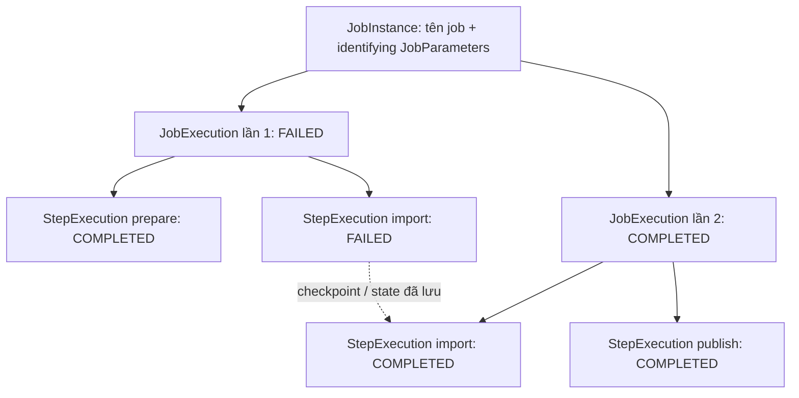
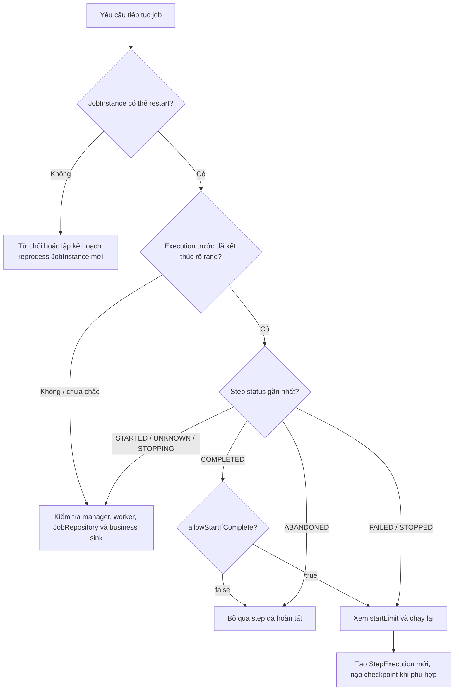
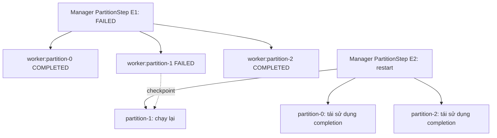

# StepExecution status khi restart trong Spring Batch

## Mục tiêu bài học

Trong module **SPRING_BATCH_SCALING_OPERATIONS**, mở rộng Spring Batch cho workload dữ liệu lớn bằng multi-threaded step, parallel steps, partitioning hoặc worker phân tán chỉ an toàn khi **trạng thái thực thi được hiểu đúng và công việc chưa hoàn tất có thể tiếp tục một cách đáng tin cậy**.

Bài học thuộc chương **Restartability**, tập trung vào câu hỏi: **Khi một JobInstance được restart, Spring Batch dựa vào trạng thái StepExecution trước đó như thế nào để bỏ qua, chạy lại hoặc từ chối một step?**

Sau khi học, bạn có thể:

- Phân biệt `BatchStatus` của `StepExecution` với `ExitStatus` và trạng thái `JobExecution`.
- Lý giải vì sao step đã `COMPLETED` thường được bỏ qua, còn `FAILED`/`STOPPED` có thể được thực hiện lại trong một restart hợp lệ.
- Hiểu ý nghĩa vận hành của `STARTED` còn treo, `STOPPING`, `UNKNOWN` và `ABANDONED`; không sửa metadata tùy tiện.
- Nắm hai cấu hình quan trọng: `allowStartIfComplete` và `startLimit`.
- Kết nối bước chạy lại với `StepExecutionContext`, checkpoint, transaction đã commit, idempotency và dữ liệu thực tế ở đích.
- Thiết kế kịch bản kiểm thử restart nhiều step và phân biệt restart với tạo `JobInstance` mới.
- Áp dụng nguyên tắc status vào multi-threaded step, parallel flows, local/remote partitioning và remote chunking.

> **Phiên bản minh họa:** Spring Batch **5.2.x**, Java 17+ và Spring Framework 6.x. Các ví dụ có thể cần thêm imports, bean và schema để chạy trong project cụ thể. Những nhận định về tính đúng của business data chỉ có hiệu lực khi transaction và idempotency được thiết kế phù hợp.

## 1. Ba tầng trạng thái không được đánh đồng

Trước khi xem `StepExecution.status`, cần xác định đúng đơn vị đang bàn tới.



**`JobInstance`** biểu diễn một đơn vị công việc logic, ví dụ `settlementJob` cho snapshot ngày D. **`JobExecution`** là một lần thử chạy của instance đó. Khi restart, Spring Batch tạo **JobExecution mới**, không biến execution cũ thành một lần chạy mới.

**`StepExecution`** là một lần thực thi của một step trong JobExecution. Khi step phải thực hiện lại trên lần restart, nó có **StepExecution mới** với ID và thời gian/status riêng. Các StepExecution cũ vẫn ở repository để phục vụ audit và khôi phục trạng thái.

| Thuộc tính | Câu hỏi trả lời | Điều không nên suy ra |
| --- | --- | --- |
| `JobInstance` | Đang xử lý đơn vị dữ liệu logic nào? | Không phải mỗi lần JVM khởi động |
| `JobExecution.status` | Toàn job trong lần thực thi hiện tại ra sao? | Không nói mọi step đều đã thành công |
| `StepExecution.status` | Step này trong lần thực thi cụ thể ra sao? | Không nói mọi external side effect đã commit đúng một lần |
| `StepExecution.exitStatus` | Flow nên diễn giải kết quả step thế nào? | Không thay thế `BatchStatus` |
| `StepExecution.executionContext` | State nào được lưu để tiếp tục? | Không tự bảo đảm exactly-once |
| `JobRepository` | Metadata và lịch sử được lưu ở đâu? | Không thay thế transaction của hệ thống nghiệp vụ |

### BatchStatus khác ExitStatus

`BatchStatus` là enum thể hiện **vòng đời kỹ thuật**: `STARTING`, `STARTED`, `STOPPING`, `STOPPED`, `FAILED`, `COMPLETED`, `ABANDONED`, `UNKNOWN`.

`ExitStatus` chứa **exit code** và mô tả tùy chọn, thường là `COMPLETED`, `FAILED` hoặc mã tùy chỉnh do listener/flow thiết lập. Flow transitions như `on("FAILED")` dựa vào **exit code**, không đơn thuần là enum `BatchStatus`.

```java
StepExecution stepExecution = /* listener nhận từ Spring Batch */;
BatchStatus technicalStatus = stepExecution.getStatus();
ExitStatus flowResult = stepExecution.getExitStatus();

String exitCode = flowResult.getExitCode();
String exitDescription = flowResult.getExitDescription();
```

Một listener có thể thêm mã cảnh báo vào `ExitStatus` trong khi StepExecution vẫn `COMPLETED` về mặt kỹ thuật. Ngược lại, nếu flow được cấu hình `end()` khi một step fail, **JobExecution có thể kết thúc COMPLETED** và không restart theo mặc định dù step trước đó có `FAILED`. Vì thế kiểm tra **cả status kỹ thuật, exit code và flow definition**.

## 2. Ma trận StepExecution.status khi restart

Các trạng thái dưới đây mô tả **StepExecution của lần chạy trước**; không phải lời khẳng định rằng tất cả đều tạo được JobExecution mới. **Trước tiên JobInstance và JobExecution phải đủ điều kiện restart**, rồi mới xét status của từng step.

| Status của lần trước | Cách xử lý khi có restart hợp lệ | Ý nghĩa vận hành |
| --- | --- | --- |
| **`COMPLETED`** | **Thường bỏ qua step** nếu `allowStartIfComplete=false`; có thể chạy lại nếu `true` | Step đã được framework ghi nhận hoàn tất, không muốn lặp side effect vô ích |
| **`FAILED`** | **Có thể thực hiện lại**, tạo StepExecution mới, dùng checkpoint phù hợp | Phải tìm nguyên nhân và bảo đảm retry/replay không gây trùng |
| **`STOPPED`** | **Có thể tiếp tục** khi JobExecution đủ điều kiện restart và chính sách step cho phép | Stop có kiểm soát; vẫn phải xem transaction/in-flight |
| **`ABANDONED`** | **Bỏ qua trên restart** theo cơ chế restart step thông thường | Dùng cho step không muốn framework tự chạy lại; cần quyết định vận hành rõ |
| **`UNKNOWN`** | Không coi là an toàn để tự restart; cần kiểm tra và khôi phục trạng thái | Không biết kết quả thực tế có commit hay chưa |
| **`STARTING` / `STARTED`** | Thường là trạng thái đang chạy; **không được tự launch chồng** chỉ vì nghi process đã chết | Cần xác minh worker/manager và metadata |
| **`STOPPING`** | Chưa phải `STOPPED`; chờ hoàn tất stop hoặc xử lý sự cố | Các transaction/worker có thể vẫn đang hoạt động |

**Phân biệt ABANDONED:** Một **StepExecution `ABANDONED`** có ý nghĩa đặc biệt là step đó được bỏ qua khi restart theo xử lý mặc định; còn **JobExecution `ABANDONED`** không được xem là một lượt chạy có thể restart bình thường. Không tự gán `ABANDONED` để che lỗi hoặc ép workflow đi tiếp nếu nghiệp vụ thực sự cần xử lý lại dữ liệu.

Không biến bảng trên thành logic kiểu:

```java
// Sai: lựa chọn restart chỉ từ một chuỗi status.
if ("FAILED".equals(previousStatus)) {
    forceRunStepAgain();
}
```

Spring Batch sử dụng `JobRepository`, lịch sử StepExecution của **cùng JobInstance**, cấu hình `Step`, chính sách start limit, status của JobExecution và flow. Việc tự ép bước chạy ngoài framework có thể bỏ qua checkpoint và tạo side effect trùng.

## 3. Ví dụ ba step: prepare → import → publish

Giả sử job `dailySettlement` có ba bước tuần tự:

1. `prepareSnapshot`: tạo snapshot bất biến của input, có thể đã hoàn tất.
2. `importPayments`: reader/processor/writer theo chunk; có checkpoint và writer idempotent.
3. `publishSummary`: kiểm tra đủ dữ liệu, xuất báo cáo cuối.


Một lần chạy đầu có lỗi ở `importPayments` sau khi một số chunk đã commit:

| Lần thực thi | prepareSnapshot | importPayments | publishSummary | JobExecution |
| --- | --- | --- | --- | --- |
| Lần 1 | **COMPLETED** | **FAILED** | Chưa được thực hiện | FAILED |
| Lần 2, restart mặc định | **Bỏ qua**, không thực thi lại | **Thực hiện lại** với StepExecution mới | Chạy sau khi import thành công | COMPLETED |

Các row `StepExecution` của lần 1 không bị “đổi trạng thái thành COMPLETED” khi lần 2 thành công. Repository giữ **lịch sử các lần thử**.

### Nếu lỗi ở publish?

Nếu `prepareSnapshot` và `importPayments` đã `COMPLETED` nhưng `publishSummary` `FAILED`, restart thông thường bỏ qua hai step đầu và thực thi lại bước publish. Đây là một lợi ích chính của restartability: **không tái xử lý toàn bộ dữ liệu khi chỉ phần cuối bị lỗi**.

Tuy nhiên, nếu `publishSummary` đã gọi API bên ngoài thành công rồi mới fail trước khi ghi trạng thái, lần restart có thể gọi lại API. Status `FAILED` không cho biết API đó đã thực hiện hay chưa. Cần idempotency key hoặc outbox/manifest.

## 4. Quyết định chạy lại không chỉ dựa vào status cuối

Spring Batch cần xét ít nhất bốn yếu tố:

1. **JobInstance có thể restart không?** Cùng tên job và identifying `JobParameters`; một JobInstance đã `COMPLETED` không được launch lại như một restart theo hành vi mặc định.
2. **Lần JobExecution trước kết thúc/đủ điều kiện chưa?** Với `FAILED`/`STOPPED`, có thể restart; với `STARTED` còn active hoặc `UNKNOWN`, phải xác minh và khôi phục an toàn.
3. **Step cuối cùng của cùng tên trong JobInstance có status gì?** `COMPLETED` thường skip, `FAILED`/`STOPPED` có thể chạy lại, `ABANDONED` có logic skip đặc biệt.
4. **Chính sách step cho phép không?** `allowStartIfComplete`, `startLimit`, transition flow, cấu hình restartability và dependency của step có thể quyết định kết quả.



Lưu ý sơ đồ giản lược; Spring Batch có thể kiểm tra thêm metadata và policy của flow/JobRepository. Không dùng sơ đồ thay cho hành vi thực tế của phiên bản cài đặt.

## 5. `allowStartIfComplete`: cho phép một step đã hoàn tất chạy lại

Mặc định, step đã `COMPLETED` trong cùng JobInstance thường **không chạy lại** khi restart. Nhưng một số bước có mục đích được thực hiện lại, ví dụ xác thực lại dữ liệu, dọn staging tạm hoặc tạo báo cáo từ dữ liệu bền vững. Khi đó, cân nhắc `allowStartIfComplete(true)`.

```java
@Bean("validateSnapshotStep")
Step validateSnapshotStep(
        JobRepository jobRepository,
        PlatformTransactionManager transactionManager,
        @Qualifier("validateTasklet") Tasklet tasklet) {

    return new StepBuilder("validateSnapshot", jobRepository)
            .tasklet(tasklet, transactionManager)
            .allowStartIfComplete(true)
            .build();
}
```

**Ý nghĩa chính xác:** Khi **JobInstance đủ điều kiện restart**, framework được phép thực thi lại step này kể cả khi một StepExecution trước đó của nó đã `COMPLETED`.

`allowStartIfComplete(true)` **không có nghĩa**:

- Cho phép launch lại một **JobInstance đã COMPLETED** với cùng identifying JobParameters.
- Tự bảo đảm rằng side effect của step chạy nhiều lần là an toàn.
- Ép step phải chạy bất chấp flow không đi đến step đó.
- Bỏ qua giới hạn `startLimit` hoặc các kiểm tra repository khác.

### Khi nào không nên bật?

Giả sử `prepareSnapshot` ghi đè bảng snapshot từ một nguồn đang thay đổi. Nếu lần 1 import fail và lần 2 restart lại `prepareSnapshot`, snapshot có thể khác nhưng reader checkpoint của `importPayments` vẫn trỏ vào vị trí trên input cũ. Kết quả có thể **bỏ sót hoặc xử lý sai item**.

Vì vậy, với step **tạo snapshot đầu vào cho các bước khác**, thường muốn nó `COMPLETED` và **không chạy lại** trong restart, trừ khi có versioning và migration checkpoint rõ ràng.

## 6. `startLimit`: giới hạn số lần một step được khởi chạy

`startLimit(n)` giới hạn số lần step có thể được bắt đầu trong **một JobInstance**; khi vượt, Spring Batch có thể ném `StartLimitExceededException` hoặc lỗi theo tình huống thực thi.

```java
@Bean("importPaymentsStep")
Step importPaymentsStep(
        JobRepository jobRepository,
        PlatformTransactionManager transactionManager,
        ItemStreamReader<Payment> reader,
        ItemProcessor<Payment, ProcessedPayment> processor,
        ItemWriter<ProcessedPayment> writer) {

    return new StepBuilder("importPayments", jobRepository)
            .<Payment, ProcessedPayment>chunk(200, transactionManager)
            .reader(reader)
            .processor(processor)
            .writer(writer)
            .startLimit(3)
            .allowStartIfComplete(false)
            .build();
}
```

Ví dụ `startLimit(3)` đặt **giới hạn khởi chạy step**, không phải “ba lần retry của từng item”, cũng không phải “ba lần fail rồi còn một lần restart”. Mỗi lần step thực sự được bắt đầu trong cùng JobInstance được tính theo metadata tương ứng; skip step đã COMPLETED không nhất thiết tiêu thụ thêm một start.

Nếu cần retry lỗi nhất thời trong chunk, sử dụng cấu hình fault tolerance như `retry(...)/retryLimit(...)` ở cấp item/chunk, không nhầm với `startLimit`.

### Phân biệt ba bộ giới hạn

| Giới hạn | Điều bị kiểm soát | Ví dụ |
| --- | --- | --- |
| `startLimit` | Số lần bắt đầu **Step** trong JobInstance | Tối đa ba lần chạy import |
| `retryLimit` | Số lần thử xử lý lại theo policy fault tolerance | Retry lỗi DB transient |
| Broker max redelivery | Số lần gửi lại message tới worker theo middleware | Ba lần trước DLQ |

Các giới hạn có thể cộng hưởng: một JobExecution có nhiều retry item, và nhiều JobExecution có thể chạy cùng step lại. Không dùng `startLimit` như một chính sách thay thế cho broker retry hay idempotency.

## 7. Checkpoint: STEP FAILED không có nghĩa mọi dữ liệu bị rollback

Chunk-oriented step thường commit từng chunk. Nếu step fail tại chunk thứ tư, **các chunk trước đã commit có thể vẫn tồn tại**.

Ví dụ `chunk(2)`, input snapshot bất biến gồm ID 10, 20, 30, 40, 50, 60:

| Thời điểm | StepExecution status | Kết quả DB đã commit | Reader checkpoint bền vững |
| --- | --- | --- | --- |
| Trước khi chạy | STARTING / STARTED | Trống | 0 |
| Sau chunk 1 | STARTED | 10, 20 | Sau item 20 |
| Sau chunk 2 | STARTED | 10, 20, 30, 40 | Sau item 40 |
| Chunk 3 lỗi trước commit | FAILED sau xử lý lỗi | **Vẫn có 10–40** | **Vẫn sau item 40** |
| Restart JobInstance | StepExecution mới STARTED | Giữ 10–40 | Reader tiếp tục từ checkpoint |
| Sau khi hoàn tất | COMPLETED | 10–60 | Cuối input |

Đây là **mô hình lý tưởng** với input bất biến, một transaction manager phù hợp và reader/writer tuân theo vòng đời `ItemStream`. Với output nằm ở API/queue/DB khác transaction, checkpoint **không đảm bảo** side effect đã commit cùng lúc.

### `ExecutionContext` của step khi restart

`StepExecutionContext` chứa trạng thái cần tiếp tục như vị trí reader, last sort key, file offset hoặc partition bounds. `ItemStream.open(context)` dùng state đã persist khi khởi tạo; `ItemStream.update(context)` cập nhật vị trí ở ranh giới checkpoint trước commit.

```java
@Override
public void open(ExecutionContext context) {
    currentIndex = context.getInt("paymentReader.nextIndex", 0);
}

@Override
public void update(ExecutionContext context) {
    context.putInt("paymentReader.nextIndex", currentIndex);
}
```

Snippet chỉ là phần giao ước của reader tùy chỉnh, không phải implementation đầy đủ. Tên key phải ổn định và không xung đột với ItemStream khác trong cùng StepExecution.

**JobExecutionContext khác StepExecutionContext:** Job context phù hợp truyền dữ liệu giữa step và thường được persist ở ranh giới step, không dùng như checkpoint cập nhật từng chunk hoặc accumulator concurrent cho parallel steps.

### Khi restart không thể tin checkpoint?

- Reader đọc nguồn **live** bị update/delete/insert giữa hai JobExecution.
- Sort key không duy nhất hoặc thay đổi giữa các lần chạy.
- Reader bị đổi `name`, `saveState`, schema serialization hoặc logic paging.
- Multi-threaded step có nhiều chunk hoàn tất **không theo thứ tự** nhưng reader chỉ lưu một offset tuyến tính.
- Worker remote đã commit nhưng reply/metadata phía manager chưa kịp lưu.
- Writer có side effect nằm ngoài transaction của checkpoint.

Khi đó cần snapshot/watermark, idempotency, process indicator, partition theo range ổn định, hoặc một kế hoạch reprocess có kiểm soát.

## 8. Ví dụ Spring Batch 5.2.x: một job ba step và listener trạng thái

Các đoạn dưới trình bày một cấu hình tham khảo. Tập trung vào status và restart; DataSource, JobRepository, transaction manager, migrations và một số bean được giả định đã được cấu hình.

### 8.1. Input, output và job identity

```java
public record Payment(long id, BigDecimal amount) {}

public record ProcessedPayment(
        String runKey,
        long paymentId,
        BigDecimal netAmount) {}
```

```java
JobParameters params = new JobParametersBuilder()
        .addString("businessDate", "2026-11-25", true)
        .addString("snapshotId", "snapshot-2026-11-25-v1", true)
        .addString("runKey", "settlement-2026-11-25-v1", true)
        .addString("traceId", "operator-req-001", false)
        .toJobParameters();
```

Identifying parameters xác định **JobInstance**. Khi restart cùng JobInstance, giữ nguyên các giá trị identifying; đổi `run.id` identifying sẽ tạo JobInstance khác, **không phải resume checkpoint cũ**.

### 8.2. Reader StepScope có checkpoint

```java
@Bean("paymentReader")
@StepScope
JdbcPagingItemReader<Payment> paymentReader(
        DataSource dataSource,
        @Value("#{jobParameters['snapshotId']}") String snapshotId) {

    return new JdbcPagingItemReaderBuilder<Payment>()
            .name("paymentReader")
            .dataSource(dataSource)
            .selectClause("SELECT payment_id, gross_amount")
            .fromClause("FROM payment_snapshot")
            .whereClause("WHERE snapshot_id = :snapshotId")
            .parameterValues(Map.of("snapshotId", snapshotId))
            .sortKeys(Map.of("payment_id", Order.ASCENDING))
            .pageSize(200)
            .rowMapper((rs, rowNum) -> new Payment(
                    rs.getLong("payment_id"),
                    rs.getBigDecimal("gross_amount")))
            .saveState(true)
            .build();
}
```

Đối với bảng `payment_snapshot`, khóa `(snapshot_id, payment_id)` nên unique; tập item phải ổn định qua restart. `@StepScope` giúp late binding tham số theo StepExecution nhưng **không bảo đảm riêng một reader cho mỗi thread** của multi-threaded step.

### 8.3. Processor stateless và writer idempotent

```java
@Bean("paymentProcessor")
@StepScope
ItemProcessor<Payment, ProcessedPayment> paymentProcessor(
        @Value("#{jobParameters['runKey']}") String runKey) {

    BigDecimal factor = new BigDecimal("0.98");
    return payment -> new ProcessedPayment(
            runKey,
            payment.id(),
            payment.amount()
                    .multiply(factor)
                    .setScale(2, RoundingMode.HALF_EVEN));
}
```

```java
@Bean("paymentWriter")
JdbcBatchItemWriter<ProcessedPayment> paymentWriter(
        DataSource dataSource) {

    return new JdbcBatchItemWriterBuilder<ProcessedPayment>()
            .dataSource(dataSource)
            .sql("""
                INSERT INTO processed_payment
                    (run_key, payment_id, net_amount)
                VALUES (:runKey, :paymentId, :netAmount)
                ON CONFLICT (run_key, payment_id)
                DO UPDATE SET net_amount = EXCLUDED.net_amount
                """)
            .itemSqlParameterSourceProvider(item ->
                    new MapSqlParameterSource()
                            .addValue("runKey", item.runKey())
                            .addValue("paymentId", item.paymentId())
                            .addValue("netAmount", item.netAmount()))
            .build();
}
```

SQL dùng **PostgreSQL** và yêu cầu unique key trên `(run_key, payment_id)`. Đây là idempotency ở mức row cho cùng payload/version; nếu input thay đổi, UPSERT có thể thay kết quả cũ, nên snapshot và chính sách version cần được bảo đảm.

### 8.4. Listener quan sát trạng thái step

```java
@Bean("stepAuditListener")
StepExecutionListener stepAuditListener() {
    return new StepExecutionListener() {
        @Override
        public void beforeStep(StepExecution stepExecution) {
            System.out.printf(
                    "START step=%s execution=%d jobExecution=%d%n",
                    stepExecution.getStepName(),
                    stepExecution.getId(),
                    stepExecution.getJobExecutionId());
        }

        @Override
        public ExitStatus afterStep(StepExecution stepExecution) {
            System.out.printf(
                    "END step=%s status=%s exit=%s read=%d write=%d "
                    + "commits=%d rollbacks=%d%n",
                    stepExecution.getStepName(),
                    stepExecution.getStatus(),
                    stepExecution.getExitStatus().getExitCode(),
                    stepExecution.getReadCount(),
                    stepExecution.getWriteCount(),
                    stepExecution.getCommitCount(),
                    stepExecution.getRollbackCount());

            return null; // Không thay đổi ExitStatus đã tính.
        }
    };
}
```

`beforeStep` và `afterStep` chỉ được gọi khi **step thực sự chạy** theo lifecycle của step. Với một step được bỏ qua khi restart, không nên kỳ vọng listener của nó chạy lại; dùng JobRepository để xem StepExecution cũ.

**Không** dùng listener ghi một singleton `lastStepStatus` cho nhiều job chạy đồng thời: trạng thái sẽ bị trộn giữa các StepExecution. Với production, dùng structured logging và metric có tag cardinality kiểm soát.

### 8.5. Hai tasklet và Step xử lý

```java
@Bean("prepareSnapshotStep")
Step prepareSnapshotStep(
        JobRepository repository,
        PlatformTransactionManager transactionManager,
        @Qualifier("prepareSnapshotTasklet") Tasklet tasklet) {

    return new StepBuilder("prepareSnapshot", repository)
            .tasklet(tasklet, transactionManager)
            .allowStartIfComplete(false)
            .listener(stepAuditListener())
            .build();
}

@Bean("importPaymentsStep")
Step importPaymentsStep(
        JobRepository repository,
        PlatformTransactionManager transactionManager,
        @Qualifier("paymentReader") ItemStreamReader<Payment> reader,
        @Qualifier("paymentProcessor")
        ItemProcessor<Payment, ProcessedPayment> processor,
        @Qualifier("paymentWriter")
        ItemWriter<ProcessedPayment> writer) {

    return new StepBuilder("importPayments", repository)
            .<Payment, ProcessedPayment>chunk(200, transactionManager)
            .reader(reader)
            .processor(processor)
            .writer(writer)
            .startLimit(3)
            .allowStartIfComplete(false)
            .listener(stepAuditListener())
            .build();
}

@Bean("publishSummaryStep")
Step publishSummaryStep(
        JobRepository repository,
        PlatformTransactionManager transactionManager,
        @Qualifier("publishSummaryTasklet") Tasklet tasklet) {

    return new StepBuilder("publishSummary", repository)
            .tasklet(tasklet, transactionManager)
            .listener(stepAuditListener())
            .build();
}

@Bean("dailySettlementJob")
Job dailySettlementJob(
        JobRepository repository,
        @Qualifier("prepareSnapshotStep") Step prepare,
        @Qualifier("importPaymentsStep") Step importStep,
        @Qualifier("publishSummaryStep") Step publish) {

    return new JobBuilder("dailySettlement", repository)
            .start(prepare)
            .next(importStep)
            .next(publish)
            .build();
}
```

`prepareSnapshotTasklet` và `publishSummaryTasklet` là **bean do ứng dụng cung cấp**. Ví dụ khung:

```java
@Bean("prepareSnapshotTasklet")
Tasklet prepareSnapshotTasklet() {
    return (contribution, context) -> {
        // Kiểm tra snapshot đã tồn tại và bất biến;
        // không ghi đè snapshot trong restart.
        return RepeatStatus.FINISHED;
    };
}

@Bean("publishSummaryTasklet")
Tasklet publishSummaryTasklet() {
    return (contribution, context) -> {
        // Đối soát business key và tạo publish marker idempotent.
        return RepeatStatus.FINISHED;
    };
}
```

Các comment ở tasklet nhấn mạnh hợp đồng phải được cài đặt trong sản phẩm thật. Không coi skeleton này là giải pháp publish có thể chịu failure ngay lập tức.

## 9. Kiểm thử FAILED → restart và StepExecution history

Một bài test quan trọng phải xác nhận **khác JobExecution, cùng JobInstance**, step trước đó `COMPLETED` **không chạy lại**, step `FAILED` được chạy lại và dữ liệu đã commit không trùng.

### 9.1. Tiêm lỗi một lần ở writer

Tạo decorator trong **test profile**, ném lỗi trước khi ghi chunk chứa `paymentId=30`:

```java
public final class FailOnceWriter
        implements ItemWriter<ProcessedPayment> {

    private final ItemWriter<ProcessedPayment> delegate;
    private final AtomicBoolean failOnce;

    public FailOnceWriter(
            ItemWriter<ProcessedPayment> delegate,
            AtomicBoolean failOnce) {
        this.delegate = delegate;
        this.failOnce = failOnce;
    }

    @Override
    public void write(Chunk<? extends ProcessedPayment> items)
            throws Exception {

        boolean has30 = items.getItems().stream()
                .anyMatch(p -> p.paymentId() == 30L);

        if (has30 && failOnce.compareAndSet(true, false)) {
            throw new IllegalStateException("Injected writer failure");
        }

        delegate.write(items);
    }
}
```

Đặt `AtomicBoolean(true)` ở phạm vi test bao trùm **hai lần launch**; inject decorator vào `importPaymentsStep` thay cho writer gốc. Nếu dùng chunk size 2 với IDs 10,20,30,40,50,60, lần đầu chunk 1 có thể commit còn chunk 2 fail trước delegate.

**Caveat:** Ví dụ step production ở trên cấu hình `chunk(200)`. Để dùng fixture lỗi tại chunk 2 và dự kiến có **2 hàng commit sau lần đầu**, test profile phải cấu hình riêng `chunk(2)`. Không dùng assertion “2 hàng” với cấu hình `chunk(200)` khi chỉ có 6 input.

### 9.2. JUnit + Spring Batch Test

Khai báo test context dùng `@SpringBatchTest`, `@SpringBootTest`, `JobLauncherTestUtils`, `JdbcTemplate` và test datasource/schema. Đây là **skeleton logic**, không phải test class chạy ngay nếu thiếu bean/fixture/fault injector.

```java
@Test
void failedStepRestartsButCompletedStepIsSkipped() throws Exception {
    JobParameters params = new JobParametersBuilder()
            .addString("businessDate", "2026-11-25", true)
            .addString("snapshotId", "fixture-v1", true)
            .addString("runKey", "fixture-run-1", true)
            .toJobParameters();

    JobExecution first = jobLauncherTestUtils.launchJob(params);
    assertEquals(BatchStatus.FAILED, first.getStatus());

    StepExecution firstPrepare = findStep(first, "prepareSnapshot");
    StepExecution firstImport = findStep(first, "importPayments");

    assertEquals(BatchStatus.COMPLETED, firstPrepare.getStatus());
    assertEquals(BatchStatus.FAILED, firstImport.getStatus());

    JobExecution restarted = jobLauncherTestUtils.launchJob(params);
    assertEquals(BatchStatus.COMPLETED, restarted.getStatus());

    assertEquals(
            first.getJobInstance().getInstanceId(),
            restarted.getJobInstance().getInstanceId());
    assertNotEquals(first.getId(), restarted.getId());

    StepExecution secondImport = findStep(restarted, "importPayments");
    StepExecution secondPublish = findStep(restarted, "publishSummary");

    assertEquals(BatchStatus.COMPLETED, secondImport.getStatus());
    assertEquals(BatchStatus.COMPLETED, secondPublish.getStatus());
    assertNotEquals(firstImport.getId(), secondImport.getId());

    // Step đã COMPLETED ở attempt 1 thường không được thực thi lại.
    assertTrue(restarted.getStepExecutions().stream()
            .noneMatch(s -> s.getStepName().equals("prepareSnapshot")));
}

private StepExecution findStep(JobExecution execution, String name) {
    return execution.getStepExecutions().stream()
            .filter(s -> s.getStepName().equals(name))
            .findFirst()
            .orElseThrow();
}
```

Test này cần job/flow tuyến tính như cấu hình ở phần 8, và fixture idempotent. Trong một số harness sử dụng decorator/flow tùy chỉnh, nên **đếm invocation của prepare tasklet** thay vì chỉ dựa trên có/không có đối tượng trong collection in-memory; điều quan trọng là step **không được thực thi lại**.

### 9.3. Assert output và checkpoint, không chỉ status

```java
Long count = jdbcTemplate.queryForObject(
        "SELECT COUNT(*) FROM processed_payment WHERE run_key = ?",
        Long.class,
        "fixture-run-1");

assertEquals(6L, count);
```

Với 6 ID đầu vào hợp lệ và writer idempotent, kết quả cuối phải có đúng 6 business keys. Kiểm tra thêm tập ID hoặc `LEFT JOIN` để phát hiện bỏ sót; `COUNT(*)=6` chỉ đủ khi ràng buộc khóa duy nhất và coverage đã được xác minh.

### 9.4. Test `allowStartIfComplete`

Với job mà `validateSnapshot` đã `COMPLETED`, một step sau bị lỗi, hãy restart:

- Nếu `allowStartIfComplete=false`, expect validation không chạy lại.
- Nếu `true`, expect listener/tasklet validation được gọi lại **một lần trong JobExecution mới**, khi flow đi qua step đó.
- Cả hai test đều phải để job **chưa COMPLETED** trước khi restart. Không dùng một JobInstance đã COMPLETED để kiểm tra flag này.

### 9.5. Test `startLimit`

Cố ý làm step `importPayments` fail qua nhiều lần chạy của cùng JobInstance, với `startLimit(2)`. Hai lần bắt đầu step được phép trong ví dụ; lần tiếp theo vượt giới hạn và job không thể tiếp tục step bình thường. Test phải dùng metadata JobRepository **không bị xóa giữa các lần launch**; nếu test reset DB mỗi lần, start count không còn ý nghĩa.

## 10. Đọc trạng thái từ JobRepository

Khi điều tra restart, đừng chỉ xem log của lần chạy mới nhất; phải xem lịch sử **tất cả JobExecution của cùng JobInstance** và các StepExecution liên quan.

### 10.1. SQL danh sách StepExecution theo JobInstance

```sql
SELECT ji.JOB_INSTANCE_ID,
       je.JOB_EXECUTION_ID,
       je.STATUS AS JOB_STATUS,
       se.STEP_EXECUTION_ID,
       se.STEP_NAME,
       se.STATUS AS STEP_STATUS,
       se.EXIT_CODE,
       se.READ_COUNT,
       se.WRITE_COUNT,
       se.COMMIT_COUNT,
       se.ROLLBACK_COUNT,
       se.START_TIME,
       se.END_TIME
FROM BATCH_JOB_INSTANCE ji
JOIN BATCH_JOB_EXECUTION je
  ON je.JOB_INSTANCE_ID = ji.JOB_INSTANCE_ID
JOIN BATCH_STEP_EXECUTION se
  ON se.JOB_EXECUTION_ID = je.JOB_EXECUTION_ID
WHERE ji.JOB_INSTANCE_ID = :jobInstanceId
ORDER BY je.JOB_EXECUTION_ID, se.STEP_EXECUTION_ID;
```

Một JobInstance có thể có các hàng như:

| JobExecution | StepExecution | Step status |
| --- | --- | --- |
| E1 (FAILED) | prepareSnapshot | COMPLETED |
| E1 (FAILED) | importPayments | FAILED |
| E2 (COMPLETED) | importPayments | COMPLETED |
| E2 (COMPLETED) | publishSummary | COMPLETED |

Không cộng `READ_COUNT`/`WRITE_COUNT` của **mọi execution** rồi cho rằng đó là số item nghiệp vụ duy nhất: một item có thể được đọc/làm lại khi retry hoặc restart, trong khi writer dùng UPSERT hoặc side effect bên ngoài transaction.

### 10.2. SQL xem context checkpoint của step

```sql
SELECT se.JOB_EXECUTION_ID,
       se.STEP_EXECUTION_ID,
       se.STEP_NAME,
       se.STATUS,
       sec.SHORT_CONTEXT
FROM BATCH_STEP_EXECUTION se
JOIN BATCH_STEP_EXECUTION_CONTEXT sec
  ON sec.STEP_EXECUTION_ID = se.STEP_EXECUTION_ID
WHERE se.JOB_EXECUTION_ID = :jobExecutionId
ORDER BY se.STEP_EXECUTION_ID;
```

`SHORT_CONTEXT` là biểu diễn lưu trữ, có thể bị rút gọn hoặc thay đổi theo serializer/schema. Không update/delete các hàng context bằng SQL để “reset checkpoint” mà không có runbook và kiểm chứng dữ liệu.

### 10.3. JobExplorer thay vì tự đọc schema khi thích hợp

`JobExplorer` cung cấp API read-only để truy lịch sử job:

```java
JobInstance instance = jobExplorer.getJobInstance(jobInstanceId);
if (instance == null) {
    throw new IllegalArgumentException("Unknown JobInstance");
}

List<JobExecution> attempts = jobExplorer.getJobExecutions(instance);
for (JobExecution attempt : attempts) {
    System.out.printf("jobExec=%d status=%s%n",
            attempt.getId(), attempt.getStatus());

    for (StepExecution step : attempt.getStepExecutions()) {
        System.out.printf("  step=%s id=%d status=%s exit=%s%n",
                step.getStepName(),
                step.getId(),
                step.getStatus(),
                step.getExitStatus().getExitCode());
    }
}
```

API có thể trả về bản sao/lần tải snapshot metadata; không dùng đối tượng từ `JobExplorer` để tự thay đổi trạng thái đang chạy, và không suy ra worker đã dừng chỉ từ một row `STARTED` cũ.

## 11. `STOPPED`, `STARTED` còn treo và `UNKNOWN`: vận hành thế nào?

### STOPPED có chủ đích

Một operator có thể yêu cầu dừng job qua `JobOperator.stop(jobExecutionId)`. Đây là **yêu cầu dừng có kiểm soát**, không nhất thiết có hiệu lực tức thì:

1. Execution được đánh dấu đang dừng (ví dụ `STOPPING`).
2. Step/worker đi tới điểm có thể dừng phù hợp.
3. Status chuyển thành `STOPPED` và metadata/checkpoint được persist theo lifecycle.
4. Khi JobInstance đủ điều kiện, có thể restart.

Một tasklet không kiểm tra interruption hoặc một remote worker đang chạy lâu có thể trì hoãn việc stop. **Không restart khi trạng thái còn `STOPPING` mà chưa xác minh thực thi thực sự dừng.**

### STARTED còn treo sau process crash

Nếu manager JVM chết không kịp ghi `FAILED`, JobRepository có thể vẫn chứa status `STARTED`. Điều này **không xác nhận** process còn sống, cũng **không xác nhận** tất cả chunk/remote worker đã dừng.

Runbook an toàn:

1. Xác minh manager và mọi worker cũ bằng log, orchestrator, PID/session và broker in-flight.
2. Chặn trigger trùng từ scheduler; ngăn hai execution cùng run key xử lý song song.
3. Đối soát business sink và các transaction/message còn in-flight.
4. Khôi phục metadata qua quy trình/hành động được framework và hệ thống vận hành hỗ trợ; không SQL UPDATE tùy tiện.
5. Chỉ cho phép restart sau khi có bằng chứng execution cũ đã dừng và bảo đảm replay không làm trùng side effect.

### UNKNOWN và ABANDONED

`UNKNOWN` biểu thị trạng thái không đáng tin cậy hoặc không xác định; việc tự động coi nó tương đương `FAILED` có thể làm lặp một tác động đã hoàn tất. Cần điều tra metadata, logs, broker và business sink trước khi chọn reprocess/recovery.

`ABANDONED` ở cấp step thường dùng để **bỏ qua step trên restart**, ví dụ một step lỗi nhưng việc xử lý tiếp được quyết định ngoài luồng. Đây là quyết định có tác động nghiệp vụ lớn: nếu step đó tạo dữ liệu bắt buộc, bỏ qua có thể làm các bước sau chạy trên dữ liệu thiếu.

**Không** dùng `ABANDONED` hoặc `UNKNOWN` để che một tình huống mất dữ liệu, và không sửa database metadata trực tiếp khi chưa có quy trình đã thử nghiệm.

## 12. Những mô hình concurrency thay đổi điều gì?

### 12.1. Multi-threaded step

Multi-threaded chunk-oriented step có thể chạy nhiều chunk thread nhưng **vẫn thuộc một StepExecution**. Status chỉ báo kết quả tổng thể step; nó không phải một status riêng cho mỗi chunk thread.

Các chunk có thể commit lệch thứ tự. Nếu reader chỉ lưu một offset tuyến tính, StepExecution `FAILED` có thể còn nhiều chunk đã commit không liên tiếp. Thêm `@StepScope` không tự tách reader theo thread. Cần kiểm chứng restart hoặc cân nhắc partitioning/process-indicator.

### 12.2. Parallel steps

Một job có hai flow song song với hai StepExecution độc lập. Một step `COMPLETED`, step khác `FAILED` có thể khiến JobExecution thất bại tùy flow transition. Restart phải bảo toàn phần đã hoàn tất và quyết định chạy lại theo cấu hình flow.

Không dùng một singleton mutable status/counter chung để quyết định step nào đã thành công; đọc metadata JobRepository của đúng JobInstance và kết quả business đã commit.

### 12.3. Local partitioning

`PartitionStep` ở manager tạo nhiều worker `StepExecution` con, thường có tên như `worker:partition-0`. Mỗi partition có status và `ExecutionContext` riêng. Khi restart:

- Giữ tên step, tên partition, range và snapshot ổn định.
- Partition `COMPLETED` có thể được bỏ qua theo metadata.
- Partition `FAILED` có thể được thực hiện lại với context phù hợp.
- Manager aggregate/điều phối kết quả và có status StepExecution riêng.
- Không thay partition naming/grid mapping giữa các attempts nếu checkpoint cũ đang gắn với các tên đó.



Đây là hành vi **điển hình** khi naming/metadata phù hợp và chính sách partition restart bình thường. Không diễn giải rằng manager luôn tạo một execution mới cho tất cả worker đã COMPLETED; logic splitter/handler và trạng thái thực tế quyết định partition nào được gửi lại.

### 12.4. Remote partitioning

Worker nằm ở JVM khác và thực thi StepExecution con. Manager có thể timeout hoặc kết thúc FAILED khi một worker **vẫn còn chạy**. Trước khi restart, phải biết worker cũ có còn tác động lên DB; một status `STARTED` có thể đã stale, nhưng cập nhật metadata không tự dừng worker đó.

Checkpoint/StepExecutionStatus phải tương thích với JobRepository dùng chung và broker/transport. Bảo vệ bằng idempotency, khóa vùng dữ liệu và runbook drain in-flight.

### 12.5. Remote chunking

Manager giữ reader và StepExecution điều phối, gửi `ChunkRequest` tới worker qua broker. Worker có thể đã commit nhưng reply chưa về; manager StepExecution `FAILED` không suy ra mọi chunk thất bại. Khi restart cùng JobInstance, một item/chunk có thể được phát lại.

Với remote chunking, **idempotency per business item và đối soát kết quả worker** quan trọng hơn suy luận chỉ từ StepExecution status. `JobExecutionId` thay đổi giữa các attempts, nên không dùng làm unique key duy nhất của business side effect.

## 13. Khi nào nên cố ý cho step chạy lại?

Một step đã `COMPLETED` có thể cần chạy lại khi job restart nếu nó:

- Chỉ đọc và xác nhận trạng thái của dữ liệu đã commit, không tạo side effect mới.
- Tạo lại một cache tạm không tham gia business source of truth.
- Tính lại validation/checksum sau khi những step khác được sửa.
- Dọn resource tạm theo một thao tác idempotent đã được thiết kế.

Nhưng những bước sau **không nên tự chạy lại** nếu thiếu kế hoạch:

- Tạo snapshot mới từ nguồn live.
- Gọi API chuyển tiền, phát email hoặc ghi message không có idempotency key.
- Append vào một file chung không có manifest/versioning.
- Tạo ID ngẫu nhiên mới làm thay đổi business identity.
- Ghi đè bảng output đang được một JobInstance khác sử dụng.

Nếu cần reprocess sau khi job **đã COMPLETED**, tạo JobInstance mới với identifying parameters/version có chủ đích và đảm bảo output đích được version hóa hoặc thay thế an toàn. Không lạm dụng `allowStartIfComplete` để “chạy lại cả job”.

## 14. Các anti-pattern và lỗi thường gặp

| Anti-pattern / hiểu nhầm | Hậu quả | Cách xử lý |
| --- | --- | --- |
| “FAILED nghĩa là DB phải trống” | Bỏ qua các chunk trước đã commit | Đối soát checkpoint và output thực tế |
| “COMPLETED của step nghĩa job đã hoàn tất” | Không biết bước sau bị FAILED | Xem JobExecution và cả flow |
| “Job COMPLETED thì allowStartIfComplete sẽ rerun” | Launch cùng identity bị từ chối | Tạo JobInstance mới nếu thực sự reprocess |
| “STEP ABANDONED sẽ tự retry như FAILED” | Bỏ qua phần việc quan trọng hoặc lệch kỳ vọng | Hiểu chính sách ABANDONED |
| “STARTED trong DB nghĩa process còn sống” | Sai trong crash, nhưng cũng có thể vẫn in-flight | Điều tra process/broker/worker |
| “UNKNOWN cứ đổi thành FAILED” | Có thể phát lại side effect đã commit | Recovery và reconciliation có kiểm soát |
| “startLimit=3 là retryLimit=3” | Giới hạn sai tầng, job dừng sớm | Phân biệt step start với item retry |
| “StepExecution cũ được chuyển sang COMPLETED khi restart” | Mất lịch sử và hiểu sai metadata | New StepExecution, giữ execution cũ |
| “writeCount bằng số row mới” | Sai nếu UPSERT, skip, side effect | Query business sink theo run key |
| “JobExecutionId là idempotency key ổn định” | Restart tạo ID mới, ghi trùng | Business run key bất biến |
| “@StepScope là mỗi thread một reader” | Race/cursor sai trong multi-threaded step | Audit state, dùng partitioning nếu phù hợp |
| “Thay tên partition không ảnh hưởng restart” | Checkpoint không còn gắn đúng worker | Giữ tên/mapping ổn định |
| “Update STATUS trực tiếp trong SQL cho nhanh” | Hai execution/worker cùng ghi hoặc metadata corrupt | Dùng runbook/framework có kiểm chứng |

## 15. SQL đối soát business data sau restart

Giả sử input snapshot có khóa `(snapshot_id, payment_id)` và output có unique key `(run_key, payment_id)`.

### Item nguồn còn thiếu ở đích

```sql
SELECT s.payment_id
FROM payment_snapshot s
LEFT JOIN processed_payment p
  ON p.payment_id = s.payment_id
 AND p.run_key = :runKey
WHERE s.snapshot_id = :snapshotId
  AND p.payment_id IS NULL
ORDER BY s.payment_id;
```

Sau khi JobInstance hoàn tất, truy vấn phải trả 0 hàng **nếu hợp đồng yêu cầu mỗi item hợp lệ có một output**. Nếu có filter/skip theo nghiệp vụ, thêm predicate hợp lệ cụ thể. Một StepExecution `COMPLETED` không tự chứng minh tập ID đích đã đủ.

### Output không thuộc snapshot dự kiến

```sql
SELECT p.payment_id
FROM processed_payment p
LEFT JOIN payment_snapshot s
  ON s.payment_id = p.payment_id
 AND s.snapshot_id = :snapshotId
WHERE p.run_key = :runKey
  AND s.payment_id IS NULL;
```

### Tổng hợp theo run key

```sql
SELECT run_key,
       COUNT(*) AS committed_rows,
       SUM(net_amount) AS net_total
FROM processed_payment
WHERE run_key = :runKey
GROUP BY run_key;
```

Nếu hệ thống có nhiều currency, **không cộng amount của các đơn vị tiền tệ khác nhau thành một tổng nghiệp vụ**. Thêm `currency` vào bảng, nhóm theo currency hoặc quy đổi tỷ giá qua snapshot đã định nghĩa. Kết quả SQL bền vững mới là nguồn chính xác để đối soát, không phải tổng `writeCount` của tất cả StepExecution.

## 16. Runbook xử lý lỗi restart trong production

1. **Nhận diện JobInstance:** lấy job name và toàn bộ identifying JobParameters; xác nhận đây là restart hay reprocess version mới.
2. **Xem JobExecution cuối:** `FAILED`/`STOPPED`, `COMPLETED` hay `STARTED`/`UNKNOWN` bất thường? Có scheduler khác đang trigger không?
3. **Xem mọi StepExecution:** Step nào `COMPLETED`, `FAILED`, `ABANDONED`; step nào chưa chạy? Xem `ExitStatus` và flow transition.
4. **Đọc checkpoint:** `StepExecutionContext`, tên reader/step, sort key, snapshot ID và metadata commit. Không sửa context bằng SQL theo suy đoán.
5. **Kiểm tra in-flight:** với parallel/partitioned/remote, tìm worker cũ, broker message và transaction chưa kết thúc.
6. **Đối soát business data:** SQL theo run key, business key, version; xác định hàng đã commit và sự kiện đã publish.
7. **Xử lý nguyên nhân gốc:** input lỗi, schema thay đổi, deadlock, pool bão hòa, message timeout hoặc logic side effect.
8. **Thực hiện restart hợp lệ:** dùng JobLauncher/JobOperator theo policy của framework, **giữ identifying JobParameters**; không tạo run ID mới vô ý.
9. **Xác minh sau restart:** lịch sử JobExecution mới, StepExecution mới/step được skip, count và business coverage; quan sát worker late reply.
10. **Ghi audit và tối ưu:** phát hiện retry storm, start limit, bottleneck, SLA; cải thiện test và dashboard.

### Metrics cần theo dõi

- JobInstanceId, JobExecutionId, StepExecutionId, `BatchStatus` và `ExitStatus`.
- Số lần bắt đầu step trong một JobInstance; tỷ lệ `FAILED`/`STOPPED` và thời gian phục hồi.
- `readCount`, `writeCount`, `filterCount`, `skipCount`, `commitCount`, `rollbackCount`.
- Checkpoint age, thời gian update `JobRepository`, độ lớn serialized `ExecutionContext`.
- CPU/GC, pool DB, lock wait, thread pool queue, partition skew và broker in-flight.
- Business coverage theo `runKey/snapshotId`, duplicate/upsert conflict và external side effect status.

## 17. Checklist trước khi bật restart tự động

- [ ] JobInstance được định danh bằng snapshot/run key ổn định; không dùng `JobExecutionId` làm business key.
- [ ] Có flow definition rõ và kiểm thử status/ExitStatus ở tất cả nhánh lỗi.
- [ ] Đã phân biệt `COMPLETED` skip mặc định với `allowStartIfComplete(true)`.
- [ ] `startLimit` được thiết kế theo số lần **Step** chạy, không nhầm với retry item/broker.
- [ ] Step `FAILED`/`STOPPED` được restart với context đúng và writer idempotent.
- [ ] Step `ABANDONED` chỉ được sử dụng khi có quyết định nghiệp vụ bỏ qua rõ ràng.
- [ ] JobExecution `STARTED/STOPPING/UNKNOWN` bất thường không được restart chồng thiếu điều tra.
- [ ] Input snapshot, sort key, tên reader và tên partition ổn định qua các lần chạy.
- [ ] Context/metadata và output business được bảo vệ theo transaction thực tế; không giả định một distributed transaction tự tồn tại.
- [ ] Multi-threaded step đã được kiểm thử chunks hoàn tất ngoài thứ tự.
- [ ] Partitioning đã được kiểm thử worker `COMPLETED`/`FAILED` hỗn hợp và mapping restart.
- [ ] Remote worker có chính sách drain, timeout, correlation và idempotency.
- [ ] Có fault injection test `FAILED → restart → COMPLETED`, test stop, test completed-step-skip và test start limit.
- [ ] Có SQL đối soát đủ/thiếu/trùng theo business key trước khi publish.
- [ ] Có dashboard, alert và runbook khi metadata/worker trạng thái không nhất quán.

## Câu hỏi tự kiểm tra

**1. Khi restart một JobInstance đã FAILED, StepExecution của step đã COMPLETED có bị sửa status hay chạy lại không?** Thông thường không. Metadata lịch sử vẫn nguyên; step được bỏ qua nếu `allowStartIfComplete=false` và flow đi qua step đó.

**2. StepExecution FAILED đồng nghĩa tất cả write trong step rollback hết không?** Không. Các chunk trước đó có thể đã commit; chỉ transaction bị rollback mới mất phần write tương ứng.

**3. `allowStartIfComplete(true)` cho phép rerun một JobInstance đã COMPLETED?** Không. Nó cho phép một **step đã COMPLETED** được thực thi lại **trong một restart của job hợp lệ**.

**4. `startLimit(2)` có nghĩa hai lần item retry?** Không. Đây là giới hạn số lần **step bắt đầu** trong JobInstance; retry item/chunk có cấu hình khác.

**5. Khi thấy `STARTED` trong DB sau JVM crash, có thể sửa luôn thành FAILED không?** Không nên. Phải xác minh manager/worker/broker còn chạy không và output đã commit chưa, sau đó dùng quy trình recovery an toàn.

**6. Worker partition đã COMPLETED trong lần trước có luôn phải chạy lại khi manager restart?** Không. Framework thường sử dụng metadata để tránh chạy lại partition hoàn tất theo chính sách, miễn naming/mapping/context ổn định.

**7. Vì sao cần idempotency dù có StepExecution.status?** Vì status/checkpoint không mặc định commit nguyên tử với side effect ở DB/API/broker khác; replay có thể đến lại cùng business item.

## Tài liệu tham khảo

- [Spring Batch 5.2 — Domain Language](https://docs.spring.io/spring-batch/reference/5.2/domain.html): `JobExecution`, `StepExecution`, trạng thái và ExecutionContext.
- [Spring Batch 5.2 — Configuring a Step for Restart](https://docs.spring.io/spring-batch/reference/5.2/step/chunk-oriented-processing/restart.html): `startLimit`, `allowStartIfComplete` và xử lý step khi restart.
- [Spring Batch 5.2 — Controlling Step Flow](https://docs.spring.io/spring-batch/reference/5.2/step/controlling-flow.html): `ExitStatus`, flow transitions, end/fail/stop.
- [Spring Batch 5.2 — Running a Job](https://docs.spring.io/spring-batch/reference/5.2/job/running.html): JobLauncher, JobOperator và điều kiện restart.
- [Spring Batch 5.2 — Chunk-oriented Processing](https://docs.spring.io/spring-batch/reference/5.2/step/chunk-oriented-processing.html): commit interval và rollback.
- [Spring Batch 5.2 — Scaling and Parallel Processing](https://docs.spring.io/spring-batch/reference/5.2/scalability.html): multi-threaded, partitioning và remote execution.
- [Spring Batch 5.2 — Testing](https://docs.spring.io/spring-batch/reference/5.2/testing.html): `@SpringBatchTest`, `JobLauncherTestUtils` và kiểm thử restart.
- [Spring Batch 5.2 API — StepExecution](https://docs.spring.io/spring-batch/docs/5.2.x/api/org/springframework/batch/core/StepExecution.html): status, exit status và bộ đếm.
- [Spring Batch 5.2 API — BatchStatus](https://docs.spring.io/spring-batch/docs/5.2.x/api/org/springframework/batch/core/BatchStatus.html): các giá trị trạng thái và tiện ích đánh giá lifecycle.

**Điều cần nhớ:** **StepExecution.status mô tả kết quả của một lần thực thi step, không phải toàn bộ trạng thái nghiệp vụ đã commit.** Khi một JobInstance được restart hợp lệ, step `COMPLETED` thường được bỏ qua, step `FAILED`/`STOPPED` có thể chạy lại với StepExecution mới, còn `ABANDONED`/`UNKNOWN`/`STARTED` bất thường cần xử lý theo chính sách và bằng chứng vận hành. Để một restart thực sự an toàn, phải kết hợp **JobRepository, ExecutionContext checkpoint, transaction, idempotency và đối soát dữ liệu** — đặc biệt khi job chạy song song hoặc phân tán.
