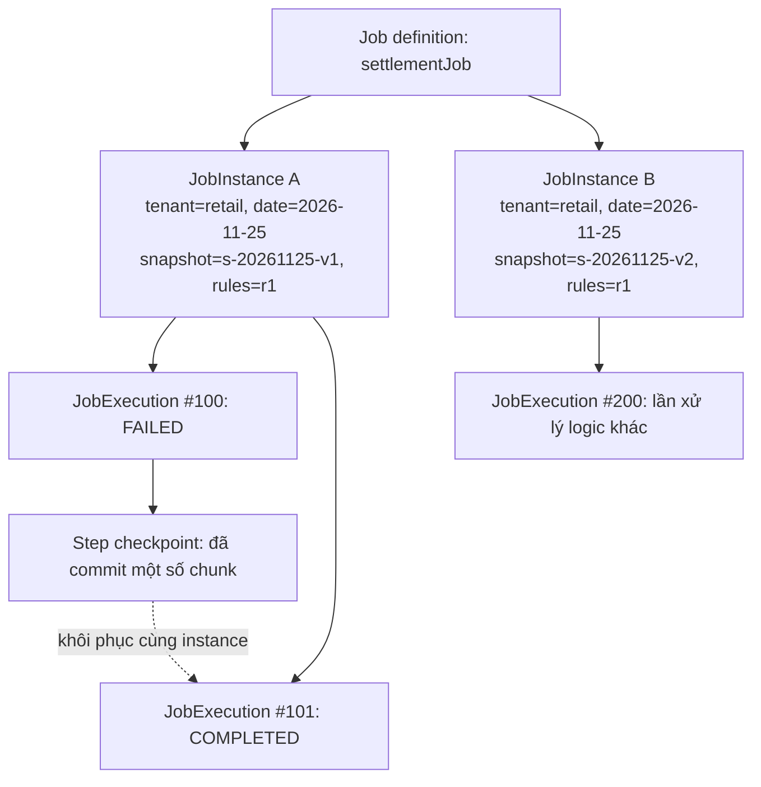
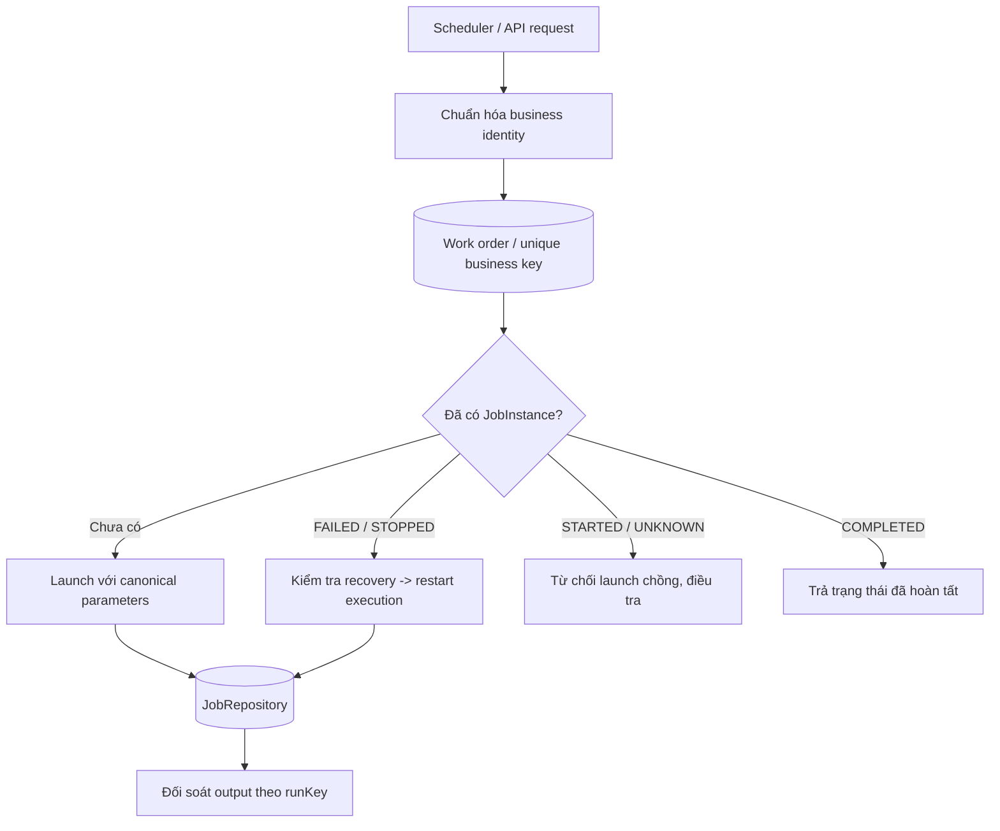

# Không tạo JobInstance mới ngoài ý muốn trong Spring Batch

## Mục tiêu bài học

Trong chương **Restartability** của module **SPRING_BATCH_SCALING_OPERATIONS**, một lỗi vận hành nguy hiểm không phải lúc nào cũng đến từ reader hoặc writer. Đôi khi job chạy thành công về mặt kỹ thuật, nhưng **khởi tạo nhầm một `JobInstance` mới** khi lẽ ra phải **restart `JobInstance` cũ**. Hệ quả có thể là đọc lại hàng triệu bản ghi từ đầu, mất cơ hội khôi phục checkpoint, ghi trùng tác động nghiệp vụ hoặc tạo hai bản báo cáo cho cùng kỳ đối soát.

Bài này tập trung vào cách **giữ danh tính của một công việc logic ổn định**, đặc biệt khi job được chạy bởi scheduler, REST API, CI/CD, Kubernetes CronJob hoặc bộ điều phối phân tán.

Sau bài học, bạn có thể:

- Nêu chính xác quy tắc xác định `JobInstance` từ **job name** và **identifying `JobParameters`**.
- Phân biệt **new instance**, **restart**, **new execution**, **item retry** và **business reprocess**.
- Tránh những tham số ngẫu nhiên hoặc phụ thuộc thời điểm như `UUID.randomUUID()`, `System.currentTimeMillis()`, `run.id` làm lệch danh tính.
- Chuẩn hóa ngày nghiệp vụ, timezone, tenant, snapshot, kiểu dữ liệu và cờ `identifying` giữa mọi đường chạy.
- Dùng `JobLauncher`, `JobOperator.restart` và `JobOperator.startNextInstance` đúng mục đích.
- Kiểm thử rằng hai yêu cầu cùng đơn vị công việc thực sự trỏ tới **một JobInstance**, nhưng các lần restart tạo **JobExecution khác nhau**.
- Thiết kế cách reprocess đã hoàn tất có chủ đích, tránh làm hỏng checkpoint hoặc ghi trùng.
- Xử lý va chạm scheduler, job chạy đồng thời, worker còn in-flight và metadata bất thường mà không tự sửa trực tiếp `JobRepository`.

> **Phiên bản:** Nội dung minh họa dùng Spring Batch **5.2.x**, Java 17+ và Spring Framework 6.x. Một số API khác ở Spring Batch 6.x; phải đối chiếu đúng phiên bản triển khai. `SPECIAL_NOTE` của bài được giao rỗng, vì vậy bài không thêm yêu cầu phụ ngoài chủ đề.

## 1. Quy tắc nền tảng: JobInstance không phải một lần launch

Một `Job` là **định nghĩa** pipeline. `JobInstance` là một **lần xử lý logic** của pipeline; `JobExecution` là một **lần thử chạy** JobInstance đó.

```text
JobInstance identity
    = Job name + tập identifying JobParameters

Một JobInstance
    -> JobExecution lần đầu: FAILED
    -> JobExecution lần restart: COMPLETED
```

Ví dụ đơn vị công việc: tổng hợp giao dịch của tenant `retail` trong ngày `2026-11-25` trên snapshot `s-20261125-v1` theo bộ quy tắc `r1`.



Khi `E1` bị lỗi, hành động đúng để tiếp tục thường là **một JobExecution mới cho JobInstance A**, không phải tạo JobInstance C với timestamp mới. Việc chọn **JobInstance mới** có nghĩa framework xem đó là đơn vị công việc khác và **không tự sử dụng checkpoint của JobInstance cũ**.

> **Quan trọng:** Spring Batch không tự biết “snapshot này và snapshot kia có thực sự là cùng dữ liệu hay không”. Reader và ứng dụng phải thực thi đúng ràng buộc nghiệp vụ. Repository chỉ áp dụng danh tính theo **tham số identifying** đã cung cấp.

### Ba thuật ngữ dễ nhầm

| Thuật ngữ | Tác động đến JobInstance | Ví dụ |
| --- | --- | --- |
| **Restart** | Giữ **JobInstance cũ**, tạo `JobExecution` mới | Job FAILED xử lý tiếp checkpoint đã lưu |
| **Rerun/Reprocess** | Thường tạo **JobInstance mới có chủ đích** | Chạy lại ngày cũ với snapshot/rules version mới |
| **Retry trong step** | Vẫn thuộc JobExecution hiện tại | Retry một chunk sau deadlock |
| **Redelivery broker** | Không tự sinh JobExecution hay JobInstance | Remote worker nhận lại một request |
| **Khởi chạy lịch mới** | Một JobInstance mới nếu có identifying key mới | Chạy thêm ngày `2026-11-26` |

## 2. Ví dụ: chỉ một tham số thay đổi cũng làm lệch danh tính

Giả sử cùng `Job name = settlementJob` và các tham số sau:

| Launch | businessDate | tenantId | snapshotId | traceId | JobInstance |
| --- | --- | --- | --- | --- | --- |
| A | 2026-11-25 | retail | s1 | req-1 | Instance A |
| B | 2026-11-25 | retail | s1 | req-2 | **Vẫn A**, nếu traceId non-identifying |
| C | 2026-11-25 | retail | s2 | req-3 | **Instance mới**, snapshotId identifying |
| D | 2026-11-26 | retail | s1 | req-4 | **Instance mới**, businessDate identifying |
| E | 2026-11-25 | retail | s1 | req-5 + một `run.id` mới | **Instance mới** nếu `run.id` identifying |
| F | 2026-11-25 | retail | s1 | req-6 + một timestamp identifying mới | **Instance mới** |

Giả định `businessDate`, `tenantId`, `snapshotId` là **identifying** và cùng kiểu dữ liệu. Bảng chỉ minh họa quan hệ identity, không phải bằng chứng các bộ snapshot tồn tại hoặc hợp lệ về nghiệp vụ.

Một tham số **non-identifying** vẫn được truyền vào JobExecution để đọc trong step; nó chỉ **không tham gia tính danh tính JobInstance**. Vì vậy không được giấu tham số ảnh hưởng dữ liệu/logic trong non-identifying rồi cho phép thay đổi tùy ý khi restart.

### Cờ identifying mặc định là true

```java
new JobParametersBuilder()
        .addString("businessDate", "2026-11-25")  // identifying=true
        .addString("traceId", "request-1")         // cũng identifying=true!
        .toJobParameters();
```

Cách viết trên khiến `traceId` **vô tình trở thành thành phần của identity**. Mỗi request khác ID có thể tạo JobInstance mới dù vẫn xử lý cùng ngày.

Viết rõ ràng:

```java
new JobParametersBuilder()
        .addString("businessDate", "2026-11-25", true)
        .addString("tenantId", "retail", true)
        .addString("snapshotId", "s1", true)
        .addString("rulesVersion", "r1", true)
        .addString("traceId", "request-1", false)
        .toJobParameters();
```

**Không chỉ cần cùng giá trị mà còn phải đồng nhất tên, kiểu và cờ identifying** ở tất cả entry point (scheduler, REST, CLI, test). Repository định danh dựa trên tập parameter và metadata kiểu tương ứng.

## 3. Sáu nguồn tạo JobInstance mới ngoài ý muốn

### 3.1. Timestamp hoặc UUID thêm vào tham số mỗi lần launch

```java
// Anti-pattern: mỗi lần retry request lại tạo một JobInstance mới.
JobParameters params = new JobParametersBuilder()
        .addString("businessDate", businessDate)
        .addLong("timestamp", System.currentTimeMillis())
        .addString("requestId", UUID.randomUUID().toString())
        .toJobParameters();

jobLauncher.run(settlementJob, params);
```

Các overload không truyền boolean mặc định identifying. Chỉ cần timestamp mới là identity thay đổi, làm Spring Batch **không nhìn lại checkpoint của instance lỗi trước**.

**Sửa:** Bỏ tham số ngẫu nhiên không cần thiết; nếu mục đích chỉ là tracing, đặt non-identifying. Dù vậy, một attempt mới có thể nên có correlation ở tầng logging/trace thay vì sửa JobParameters giữa các lần restart.

```java
JobParameters params = new JobParametersBuilder()
        .addString("businessDate", businessDate, true)
        .addString("snapshotId", snapshotId, true)
        .addString("traceId", traceId, false)
        .toJobParameters();
```

### 3.2. Lạm dụng `RunIdIncrementer` hoặc `startNextInstance`

`RunIdIncrementer` tạo giá trị `run.id` mới, thường là **identifying**.

```java
@Bean
Job settlementJob(JobRepository repo, Step settlementStep) {
    return new JobBuilder("settlementJob", repo)
            .incrementer(new RunIdIncrementer())
            .start(settlementStep)
            .build();
}
```

Chỉ khai báo incrementer **không tự động** sinh một `run.id` mới mỗi khi `jobLauncher.run(job, params)` được gọi. Incrementer được dùng bởi các luồng điều phối yêu cầu **next instance**, ví dụ:

```java
// Dùng khi muốn một JobInstance MỚI, không phải resume instance FAILED.
Long newExecutionId =
        jobOperator.startNextInstance("settlementJob");
```

Theo tài liệu Spring Batch 5.2, `startNextInstance` có chủ đích **khởi chạy instance kế tiếp kể cả khi instance trước ở trạng thái FAILED**. Không thay `restart(failedExecutionId)` bằng `startNextInstance(jobName)` chỉ để né exception restart.

### 3.3. Lấy `now()` tại thời điểm retry thay vì dùng business date đã chốt

```java
// Anti-pattern: sự cố lúc 23:59, retry sau 00:00 xử lý sang ngày khác.
String date = LocalDate.now().toString();
```

`LocalDate.now()` dùng clock/timezone của máy; manager trong hai zone khác nhau hoặc retry qua nửa đêm có thể sinh businessDate khác. Với batch theo ngày nghiệp vụ, **businessDate là một dữ liệu đầu vào của đơn vị công việc**, không phải thời gian lúc request chạy.

**Sửa:** Scheduler hoặc nghiệp vụ xác định `businessDate` một lần theo timezone được quy định, lưu cùng snapshot/run record và truyền nguyên giá trị khi restart. Dùng `Clock` được inject để test boundary ngày.

```java
ZoneId businessZone = ZoneId.of("Asia/Ho_Chi_Minh");

// Dùng khi tạo kỳ MỚI theo lịch, không dùng để xác định lại kỳ khi restart.
LocalDate businessDate = LocalDate.now(businessZone).minusDays(1);
String canonicalBusinessDate = businessDate.toString(); // ISO yyyy-MM-dd

// Khi retry/restart: lấy canonicalBusinessDate đã được lưu lúc lập work order.
```

Dùng `minusDays(1)` ở đây chỉ là **ví dụ** lịch xử lý ngày trước, không phải quy tắc cho mọi doanh nghiệp. Nếu có calendar nghỉ lễ, cut-off hoặc kỳ hạch toán đặc biệt, businessDate phải theo chính sách đó.

### 3.4. Cùng ý nghĩa nhưng khác representation, kiểu hoặc tên tham số

Các giá trị sau **không nên** được giả định là cùng identity:

```text
businessDate=2026-11-25,java.lang.String,true
businessDate=2026-11-25,java.time.LocalDate,true

businessDate=2026-11-25
businessDate=2026/11/25
businessDate=2026-11-25T00:00:00

tenantId=retail
tenantId=Retail
tenantId=retail<space>

snapshotId=s1
sourceSnapshot=s1
```

Trong Spring Batch 5.x, JobParameters có type metadata; dùng `String` ở entry point này và `LocalDate` ở entry point khác không phải cách tạo identity đồng nhất. Tương tự, whitespace, case, encoding hoặc tên key khác có thể tạo job key khác.

**Khuyến nghị:** Có một **schema tham số chuẩn**, quy định cả **tên**, **kiểu**, **format**, **identifying flag** và **quy tắc normalize**; mọi caller dùng chung factory/parser. Không normalize tùy ý business key nếu domain phân biệt chữ hoa/thường hoặc dấu cách.

### 3.5. Thay tên Job khi deployment

```java
// Trước nâng cấp
new JobBuilder("settlementJob", jobRepository);

// Sau nâng cấp (đổi tên mà không có migration plan)
new JobBuilder("settlementJobV2", jobRepository);
```

Tên `Job` là một phần identity. Dù các tham số giữ nguyên, `settlementJobV2` được xem là job khác và **không nối tiếp lịch sử `settlementJob`**.

Giữ tên logic ổn định khi thay implementation tương thích với checkpoint cũ. Nếu thay đổi pipeline không tương thích, hãy xem đây là một **versioned migration/reprocess** được quản trị, thay vì đổi tên âm thầm để “job có thể chạy”.

### 3.6. Quên hoặc thay đổi identifying parameters

Nếu `snapshotId` là identifying nhưng đôi lúc caller bỏ trống, dùng default khác hoặc đánh dấu non-identifying, hai lần launch không còn cùng identity. Ngược lại, biến một tham số nghiệp vụ quan trọng thành non-identifying có thể khiến **hai tập dữ liệu khác nhau bị coi là cùng JobInstance**.

Điều cần bảo vệ không chỉ là “không tạo quá nhiều instances”, mà còn là **không gộp hai công việc khác nhau vào một instance**. Cả hai đều có thể phá restart correctness.

## 4. Thiết kế hợp đồng tham số theo nghiệp vụ

Một hợp đồng minh bạch cho `settlementJob`:

| Tên | Type | Identifying | Nguồn | Bắt buộc |
| --- | --- | --- | --- | --- |
| `tenantId` | String chuẩn hóa theo quy tắc tenant | **true** | Work order | Có |
| `businessDate` | String ISO `yyyy-MM-dd` | **true** | Lịch nghiệp vụ | Có |
| `snapshotId` | String ID phiên dữ liệu bất biến | **true** | Snapshot registry | Có |
| `rulesVersion` | String version transform | **true** | Pipeline release/work order | Có |
| `traceId` | String | **false** | HTTP/scheduler request | Không |
| `operator` | String | **false** | Audit vận hành | Không |
| `debug` thay đổi business output | Không chấp nhận biến động tùy ý | Xác định lại thiết kế | Policy | Không nên |

Không cần nhồi cả `runKey` vào identifying khi nó có thể được **tính tất định** từ các trường trên. Quá nhiều identifying fields dư thừa tăng nguy cơ chỉ một field bị drift tạo instance mới.

Ví dụ run key ở tầng nghiệp vụ có thể sinh từ canonical identity:

```text
runKey =
  tenantId + ":" + businessDate + ":" + snapshotId + ":" + rulesVersion

retail:2026-11-25:s-20261125-v1:r1
```

Định dạng thực tế cần tránh collision/escaping và tuân giới hạn độ dài của DB; nếu dùng hash, cân nhắc lưu cả canonical fields để audit. `runKey` ở output phải ổn định **qua tất cả JobExecution của cùng JobInstance**.

### Quy tắc canonicalization

1. `businessDate` dùng `LocalDate.parse(raw)` rồi `toString()` để ra ISO cố định.
2. `tenantId` lấy từ registry đã xác định (ví dụ lowercase canonical theo hợp đồng), không từ display name tùy biến.
3. `snapshotId` là ID immutable đã được cấp, không thay bằng đường dẫn file tạm hay ID chứa timestamp phát sinh ở mỗi request.
4. `rulesVersion` được chốt lúc work order được tạo, không truy “latest rules” tại thời điểm restart.
5. `traceId` và request metadata chỉ dùng observability; không quyết định reader query, business transforms hoặc idempotency.
6. Không đổi type `String` sang `LocalDate`/`Long` giữa các entry point khi vẫn muốn tìm lại JobInstance cũ.

## 5. Java: một factory tạo tham số chuẩn dùng chung

Tạo canonical factory trong ứng dụng. Ví dụ giả định tenant ID chỉ chứa ký tự ASCII thường, số, dấu `-` và `_` theo chính sách nghiệp vụ. Nếu domain chấp nhận ký tự khác, thay validator tương ứng **nhưng phải thống nhất ở mọi caller**.

```java
public final class SettlementJobParametersFactory {

    private SettlementJobParametersFactory() {}

    public static JobParameters create(
            String rawTenant,
            String rawBusinessDate,
            String rawSnapshotId,
            String rulesVersion,
            String traceId) {

        String tenant = Objects.requireNonNull(rawTenant)
                .trim().toLowerCase(Locale.ROOT);

        if (!tenant.matches("[a-z0-9_-]+")) {
            throw new IllegalArgumentException("Invalid tenantId");
        }

        String date = LocalDate.parse(
                Objects.requireNonNull(rawBusinessDate)).toString();

        String snapshot = Objects.requireNonNull(rawSnapshotId).trim();
        String rules = Objects.requireNonNull(rulesVersion).trim();

        if (snapshot.isEmpty() || rules.isEmpty()) {
            throw new IllegalArgumentException(
                    "snapshotId/rulesVersion are required");
        }

        JobParametersBuilder builder = new JobParametersBuilder()
                .addString("tenantId", tenant, true)
                .addString("businessDate", date, true)
                .addString("snapshotId", snapshot, true)
                .addString("rulesVersion", rules, true);

        if (traceId != null && !traceId.isBlank()) {
            builder.addString("traceId", traceId, false);
        }

        return builder.toJobParameters();
    }
}
```

Tất cả entry point gọi **chung** `SettlementJobParametersFactory.create(...)`. Không tự tạo parameters tại scheduler, REST controller và test bằng ba `JobParametersBuilder` khác nhau rồi hy vọng chúng tương đương.

**Lưu ý:** `trim()`/`toLowerCase()` chỉ đúng khi tenant registry quy định như vậy. Nếu `TENANT_A` và `tenant_a` là hai thực thể khác nhau, chuẩn hóa chúng về một sẽ **gộp sai JobInstance**. Phải thống nhất danh tính nghiệp vụ trước khi thiết kế canonicalization.

### Tách rõ lập kế hoạch mới và resume

```text
New work order:
  xác định tenant/date/snapshot/rulesVersion
  -> lưu canonical identity vào bảng điều phối
  -> tạo JobParameters và launch một lần

Restart:
  lấy JobInstance/JobExecution đã FAILED từ JobRepository
  -> khôi phục cùng identity đã lưu
  -> JobOperator.restart(failedJobExecutionId)
  -> không tự gọi now()/random()/incrementer để thay identity
```

## 6. Chặn tham số sai bằng JobParametersValidator

`DefaultJobParametersValidator` của Spring Batch 5.2 có thể kiểm tra danh sách key required/optional. Tuy nhiên, để **kiểm tra cờ identifying, type, format và quan hệ giữa các key**, bạn nên viết `JobParametersValidator` riêng.

### Ví dụ validator theo schema

```java
@Bean("settlementParametersValidator")
JobParametersValidator settlementParametersValidator() {
    Set<String> required = Set.of(
            "tenantId", "businessDate", "snapshotId", "rulesVersion");

    return params -> {
        if (params == null) {
            throw new JobParametersInvalidException(
                    "Missing JobParameters");
        }

        for (String key : required) {
            JobParameter<?> parameter = params.getParameter(key);

            if (parameter == null
                    || !parameter.isIdentifying()
                    || !String.class.equals(parameter.getType())
                    || ((String) parameter.getValue()).isBlank()) {
                throw new JobParametersInvalidException(
                        "Invalid identifying String parameter: " + key);
            }
        }

        JobParameter<?> trace = params.getParameter("traceId");
        if (trace != null
                && (trace.isIdentifying()
                    || !String.class.equals(trace.getType()))) {
            throw new JobParametersInvalidException(
                    "traceId must be a non-identifying String");
        }

        String date = params.getString("businessDate");
        try {
            if (!LocalDate.parse(date).toString().equals(date)) {
                throw new IllegalArgumentException("Non-canonical date");
            }
        } catch (RuntimeException ex) {
            throw new JobParametersInvalidException(
                    "businessDate must be canonical ISO yyyy-MM-dd");
        }

        if (!params.getString("tenantId")
                .matches("[a-z0-9_-]+")) {
            throw new JobParametersInvalidException(
                    "Non-canonical tenantId");
        }

        Set<String> allowed = new HashSet<>(required);
        allowed.add("traceId");

        for (String key : params.getParameters().keySet()) {
            if (!allowed.contains(key)) {
                throw new JobParametersInvalidException(
                        "Unexpected parameter: " + key);
            }
        }
    };
}
```

Gắn validator vào định nghĩa job:

```java
@Bean("settlementJob")
Job settlementJob(
        JobRepository jobRepository,
        @Qualifier("settlementStep") Step settlementStep,
        @Qualifier("settlementParametersValidator")
        JobParametersValidator validator) {

    return new JobBuilder("settlementJob", jobRepository)
            .validator(validator)
            .start(settlementStep)
            .build();
}
```

Validator giúp từ chối tham số sai **trước khi xử lý nghiệp vụ**, nhưng **không thay thế** việc scheduler chọn đúng work order hay việc đối soát dữ liệu đích. Nếu thêm parameter mới trong một version tương lai, phải có kế hoạch backward compatibility cho những JobInstance đang FAILED và cần restart.

> **Lưu ý khi kiểm tra type:** Ví dụ chủ động dùng `String` cho tất cả identity để dễ đồng nhất. Spring Batch 5.2 cũng hỗ trợ các kiểu khác, bao gồm `LocalDate`; chọn kiểu nào cũng được khi tất cả entry point và dữ liệu lịch sử dùng cùng hợp đồng. Không tùy tiện đổi kiểu của key đang dùng cho một JobInstance chưa hoàn tất.

## 7. Dùng đúng API: launch, restart hay next instance?

### 7.1. `JobLauncher.run(job, params)`

```java
JobParameters params = SettlementJobParametersFactory.create(
        "retail",
        "2026-11-25",
        "s-20261125-v1",
        "r1",
        "request-01");

JobExecution execution =
        jobLauncher.run(settlementJob, params);
```

Hành vi điển hình:

- Nếu identity chưa tồn tại: tạo **JobInstance mới** và **JobExecution đầu**.
- Nếu identity đã tồn tại, lần trước `FAILED`/`STOPPED` và job đủ điều kiện: tạo **JobExecution mới của cùng JobInstance**.
- Nếu instance đã `COMPLETED`: ném `JobInstanceAlreadyCompleteException`.
- Nếu instance đang có execution chạy: từ chối launch chồng theo quy tắc repository.
- Nếu job không restartable hoặc context không hợp lệ: báo lỗi tương ứng.

**Điểm quan trọng:** `JobLauncher.run` **không tự động tạo instance mới mỗi lần gọi**, miễn bạn truyền **cùng identifying parameters** và cùng job name.

### 7.2. `JobOperator.restart(failedExecutionId)`

Nếu đang vận hành một execution cụ thể đã thất bại hoặc dừng:

```java
// failedExecutionId là ID của JobExecution, KHÔNG phải JobInstance.
Long resumedExecutionId =
        jobOperator.restart(failedExecutionId);
```

Đây là API phù hợp với một **yêu cầu resume** vì xác định rõ execution/instance cần khôi phục. Không tự dựng lại parameters từ thời gian hiện tại để gọi launch. Kiểm tra execution đủ điều kiện restart và worker cũ đã dừng an toàn.

### 7.3. `JobOperator.startNextInstance(jobName)`

```java
// Tạo JobInstance tiếp theo theo JobParametersIncrementer của Job.
Long newExecutionId =
        jobOperator.startNextInstance("settlementJob");
```

Đây là **new-instance operation** có chủ đích. Spring Batch có thể tạo instance tiếp theo **dù instance trước vẫn FAILED**. Dùng cho lịch xử lý mới hoặc reprocess có chủ đích, không dùng làm nút “Retry failed job”.

### 7.4. `JobOperator.start(jobName, Properties)`

API `start` trong Spring Batch 5.2 được thiết kế để bắt đầu **một instance mới với bộ tham số được chỉ định**; nó có thể từ chối khi instance với identity đó đã tồn tại. Do đó, không coi `JobOperator.start(...)` là phép thay thế trực tiếp cho `JobOperator.restart(...)`.

### Bảng quyết định thao tác

| Mục tiêu | API/luồng phù hợp | Điều phải giữ |
| --- | --- | --- |
| Lịch xử lý mới, identity chưa có | `JobLauncher.run` hoặc new-instance operation theo policy | Canonical parameters của work order mới |
| Khôi phục JobExecution FAILED/STOPPED | **`JobOperator.restart(executionId)`** hoặc `JobLauncher.run` với cùng identity khi đủ điều kiện | Job name, identifying parameters, snapshot, rules version |
| Tiếp tục một job đã COMPLETED? | Không phải restart; cần **reprocess có chủ đích** | Version mới và output isolation |
| Mở kỳ chạy tiếp theo có incrementer | `startNextInstance` nếu mô hình incrementer đúng nghiệp vụ | Không nhầm với repair |
| Retry item/chunk | Fault-tolerance policy của Step | Không phát sinh JobInstance mới |
| Broker redelivery remote worker | Cơ chế transport + idempotency | Business item key ổn định |

## 8. Tình huống thực tế: job FAILED lúc qua nửa đêm

Job `settlementJob` xử lý ngày D. Scheduler gửi tham số `businessDate=2026-11-25`, `snapshotId=s-20261125-v1`. Sau bốn triệu item, manager bị lỗi vào gần nửa đêm.

**Cách làm sai:**

```java
// HTTP "retry" endpoint tái tính input business date theo giờ hiện tại.
String nextDate = LocalDate.now().minusDays(1).toString();

JobParameters params = new JobParametersBuilder()
        .addString("businessDate", nextDate)
        .addLong("run.id", System.currentTimeMillis())
        .toJobParameters();

jobLauncher.run(settlementJob, params);
```

Ngày có thể đổi; `run.id` chắc chắn khác, vì vậy job có thể bắt đầu **instance mới**, đọc lại từ đầu, trong khi dữ liệu của lần trước đã commit một phần.

**Cách làm đúng:**

1. Scheduler lưu `workOrderId` trỏ tới **canonical identity** và `JobExecutionId` của lần lỗi.
2. Endpoint retry kiểm tra quyền, trạng thái JobRepository và nguồn dữ liệu.
3. Xác nhận manager/worker cũ không còn tác động lên cùng run key.
4. Gọi `jobOperator.restart(failedExecutionId)`; không sinh `run.id` hay tính lại business date.
5. Kiểm tra output đã commit theo business key và snapshot sau khi job kết thúc.

### Bảng work order minh họa

```sql
CREATE TABLE batch_work_order (
    work_order_id   varchar(100) PRIMARY KEY,
    job_name        varchar(100) NOT NULL,
    tenant_id       varchar(100) NOT NULL,
    business_date   date NOT NULL,
    snapshot_id     varchar(100) NOT NULL,
    rules_version   varchar(40) NOT NULL,
    run_key         varchar(300) NOT NULL UNIQUE,
    created_at      timestamp NOT NULL DEFAULT CURRENT_TIMESTAMP
);
```

Đây là **bảng ứng dụng minh họa**, không phải bảng mặc định của Spring Batch. Một work order nhận diện tập xử lý logic, có thể liên kết nhiều `JobExecutionId` trong bảng audit riêng. Nếu cần nhiều reprocess version, `run_key` phải phân biệt các phiên bản hợp lệ và không được chứa attempt ID.

## 9. Một instance mới ngoài ý muốn gây hậu quả gì?

Có bốn tác động lớn:

### 9.1. Mất checkpoint cũ

`StepExecutionContext` của JobInstance A không tự được áp dụng cho JobInstance B. Reader của B có thể đọc từ đầu, ngay cả khi A đã commit phần lớn dữ liệu.

### 9.2. Ghi trùng hoặc ghi đè dữ liệu

Nếu writer dùng `(runKey, paymentId)` và runKey cũng bị sinh mới, cùng payment có thể được ghi **thành hai lần xử lý logic**. Nếu writer chỉ dùng `paymentId` và upsert, lần chạy mới có thể ghi đè output cũ. Chính sách nào đúng phải được quyết định ở tầng nghiệp vụ.

### 9.3. Chạy trùng khi worker cũ vẫn hoạt động

Đặc biệt với remote partitioning/remote chunking, manager cũ có thể FAILED hoặc timeout nhưng worker còn xử lý. Khi tạo JobInstance mới, cả hai instance có thể cùng ghi một vùng dữ liệu. `JobRepository` ngăn một số trường hợp chạy chồng của **cùng JobInstance**, không tự khóa hai instance có identity khác nhau nhưng business output giống nhau.

### 9.4. Sai báo cáo và SLA

Báo cáo số JobInstance mới, throughput và commit count có thể tăng dù không có đơn vị công việc nghiệp vụ mới. Nếu chỉ đếm JobExecution COMPLETED, có thể bỏ qua duplicated work, mất dữ liệu hoặc publish nhiều lần.

## 10. Nếu cần chạy lại dữ liệu đã COMPLETED thì làm sao?

Một JobInstance đã `COMPLETED` thường không được launch lại với cùng identifying parameters. Đó là **bảo vệ quan trọng**, không phải lỗi cần né bằng timestamp ngẫu nhiên.

Nếu dữ liệu phải được sửa hoặc tính lại theo rule mới, quy trình **reprocess có chủ đích**:

1. Xác định lý do: snapshot mới, nghiệp vụ sửa sai, rulesVersion mới hay backfill.
2. Ghi work order mới với **version/identity rõ ràng**; không chỉ thêm timestamp tùy ý.
3. Chọn chiến lược output: staging namespace mới theo run key, so sánh với bản cũ, rồi publish bằng pointer/version hoặc transaction/khóa phù hợp.
4. Giữ bản cũ để audit/rollback khi cần.
5. Khi bản mới vượt validation, chuyển trạng thái active bằng cơ chế atomic/compare-and-swap theo version.
6. Không xóa JobRepository hoặc sửa status của instance COMPLETED để ép chạy.

Ví dụ:

```text
Instance A: settlementJob
  tenantId=retail
  businessDate=2026-11-25
  snapshotId=s-v1
  rulesVersion=r1

Instance B: settlementJob
  tenantId=retail
  businessDate=2026-11-25
  snapshotId=s-v2
  rulesVersion=r2
```

Hai instance đều hợp lệ nếu đó thực sự là **hai phiên xử lý khác nhau**. Cần xác định bản nào được phép publish cho người dùng cuối, không để hai job cùng cập nhật trực tiếp bảng `current_settlement` mà thiếu version guard.

## 11. JobRepository: kiểm tra instance trước và sau launch

Spring Batch lưu metadata trong các bảng như:

- `BATCH_JOB_INSTANCE`: `JOB_INSTANCE_ID`, `JOB_NAME`, `JOB_KEY`.
- `BATCH_JOB_EXECUTION`: `JOB_EXECUTION_ID`, `JOB_INSTANCE_ID`, `STATUS`, thời gian.
- `BATCH_JOB_EXECUTION_PARAMS`: `PARAMETER_NAME`, `PARAMETER_TYPE`, `PARAMETER_VALUE`, `IDENTIFYING` (schema Spring Batch 5.x).
- `BATCH_STEP_EXECUTION` và `BATCH_STEP_EXECUTION_CONTEXT`: status/checkpoint của từng step.

### Xác nhận số instance bị tạo

```sql
SELECT ji.JOB_NAME,
       COUNT(*) AS instance_count
FROM BATCH_JOB_INSTANCE ji
WHERE ji.JOB_NAME = :jobName
GROUP BY ji.JOB_NAME;
```

Query chỉ là số lượng; để phát hiện drift trong cùng kỳ nghiệp vụ, cần join parameters.

### So sánh identifying parameters trong lịch sử

```sql
SELECT ji.JOB_INSTANCE_ID,
       je.JOB_EXECUTION_ID,
       je.STATUS,
       p.PARAMETER_NAME,
       p.PARAMETER_TYPE,
       p.PARAMETER_VALUE,
       p.IDENTIFYING
FROM BATCH_JOB_INSTANCE ji
JOIN BATCH_JOB_EXECUTION je
  ON je.JOB_INSTANCE_ID = ji.JOB_INSTANCE_ID
JOIN BATCH_JOB_EXECUTION_PARAMS p
  ON p.JOB_EXECUTION_ID = je.JOB_EXECUTION_ID
WHERE ji.JOB_NAME = :jobName
ORDER BY ji.JOB_INSTANCE_ID,
         je.JOB_EXECUTION_ID,
         p.PARAMETER_NAME;
```

Các hàng tham số của một instance có thể lặp qua nhiều JobExecution; **không đếm số hàng params là số instances**. Hãy so sánh đủ tên, type, value và identifying flag để phát hiện `traceId` hoặc timestamp vô tình identifying.

### Cùng instance phải có nhiều JobExecution khi restart

```sql
SELECT je.JOB_INSTANCE_ID,
       COUNT(*) AS execution_count,
       MIN(je.JOB_EXECUTION_ID) AS first_execution_id,
       MAX(je.JOB_EXECUTION_ID) AS last_execution_id
FROM BATCH_JOB_EXECUTION je
WHERE je.JOB_INSTANCE_ID = :jobInstanceId
GROUP BY je.JOB_INSTANCE_ID;
```

Một JobInstance có thể có nhiều attempts; ID JobExecution mới **không phải bằng chứng đã tạo JobInstance mới**. Cần xem `JOB_INSTANCE_ID`.

### Truy theo API thay vì chỉ SQL

```java
JobInstance existing =
        jobRepository.getJobInstance(job.getName(), parameters);

JobExecution previous =
        jobRepository.getLastJobExecution(job.getName(), parameters);

if (existing != null) {
    System.out.printf(
            "Existing instance=%d lastStatus=%s%n",
            existing.getInstanceId(),
            previous == null ? "N/A" : previous.getStatus());
}
```

Hai API này hỗ trợ **quan sát/preflight**, không tạo khóa transaction ở application. Giữa lúc kiểm tra và launch, scheduler khác có thể tạo execution. Đó là **TOCTOU race**; tiếp tục để `JobRepository`/transaction xử lý tranh chấp, không tự tin rằng preflight đảm bảo unique launch.

**Không** sửa `JOB_KEY`, `IDENTIFYING` hoặc xóa hàng JobInstance bằng SQL để “làm job chạy được”. Việc đó có thể phá lịch sử/checkpoint.

## 12. Lỗi từ repository là tín hiệu kiểm soát, không phải lý do sinh runId mới

Khi gọi `JobLauncher.run(...)`:

| Lỗi / trạng thái | Điều cần làm | Không nên làm |
| --- | --- | --- |
| `JobInstanceAlreadyCompleteException` | Xác nhận kỳ đã xử lý; nếu thực sự cần reprocess, lập instance version mới | Sinh UUID/run.id tùy ý |
| `JobExecutionAlreadyRunningException` | Kiểm tra execution đang chạy và scheduler duplicate | Tạo identifying timestamp để chạy song song |
| `JobRestartException` | Kiểm tra restartable policy, state/context và cấu hình | Xóa metadata/rewrite params mù |
| `JobParametersInvalidException` | Sửa nguồn tham số theo schema chuẩn | Bỏ validator hoặc đánh dấu mọi key non-identifying |
| Job FAILED, đủ điều kiện restart | Dùng restart đúng instance | Dùng `startNextInstance` |
| Status `STARTED` tồn dư sau JVM crash | Xác minh manager/worker/in-flight, recovery có kiểm soát | Update status bằng SQL theo suy đoán |
| Tham số/type khác giữa scheduler và REST | Chuẩn hóa factory/parser và đối chiếu metadata | Coi hai JobInstance là một mà không kiểm chứng |

Nếu API phản hồi “already complete”, đây là cơ chế ngăn chạy trùng. Cần trả về một **kết quả idempotent** cho caller (ví dụ thông báo kỳ đã hoàn tất kèm execution history), thay vì tái chạy batch trong một instance mới.

## 13. Scheduler và concurrency: tránh hai luồng tạo hai identity khác nhau

### Hai scheduler gửi cùng kỳ

Một hệ thống có thể có nhiều replica scheduler. Cả hai cùng gửi request cho `tenant=retail, date=D, snapshot=s1`. Với identifying params canonical giống nhau, `JobRepository` có thể phát hiện duplicate/running cùng JobInstance qua transaction/metadata.

Tuy nhiên:

- Request chứa `requestId` identifying khác nhau vẫn tạo **hai instances**.
- Pre-check `getJobInstance(...) == null` không thay cho repository transaction/uniqueness.
- Nhiều instance khác identity nhưng cùng business target có thể va chạm.
- Một job FAILED nhưng remote worker cũ còn in-flight vẫn cần policy recovery trước restart.

### Mô hình điều phối đề xuất



Một bảng work order với unique key theo nghiệp vụ giúp **dedupe yêu cầu lập công việc**, trong khi JobRepository quản lý **execution state**. Hai lớp bổ trợ cho nhau, không thay thế nhau. Nếu bảng work order và JobRepository dùng transaction khác nhau, vẫn phải xử lý failure window giữa enqueue/launch/update status.

### Tại sao `traceId` nên non-identifying?

Vì mỗi HTTP retry có thể nhận một trace ID khác trong khi vẫn là **cùng đơn vị công việc**. Nhưng nếu ứng dụng cần biết từng attempt, hãy ghi `requestId`, `JobExecutionId` và nguyên nhân retry vào **audit/log riêng**, thay vì đổi identifying JobParameters.

## 14. CLI, Spring Boot và converter: cần thống nhất cách parse

Với `CommandLineJobRunner` của Spring Batch 5.2 và `DefaultJobParametersConverter`, cú pháp parameter có thể là:

```text
key=value,type,identifying
```

Ví dụ danh sách đối số cho **CommandLineJobRunner**:

```text
tenantId=retail,java.lang.String,true
businessDate=2026-11-25,java.lang.String,true
snapshotId=s-20261125-v1,java.lang.String,true
rulesVersion=r1,java.lang.String,true
traceId=request-42,java.lang.String,false
```

Đó là **format tham số của converter**, không phải yêu cầu mọi CLI/REST của Spring Boot đều phải dùng cùng dạng chuỗi. Boot runner, Spring Batch `CommandLineJobRunner`, Kubernetes arguments và API nội bộ có thể có đường parse khác nhau; hãy kiểm tra converter dùng thực tế.

Nếu một đường parse `businessDate` thành `LocalDate` còn đường khác thành `String`, identity có thể khác dù người đọc thấy cùng “2026-11-25”. Test contract nên bao phủ **từng đường ingress**.

**Không dùng** một ví dụ từ Spring Batch 4.x với cột metadata `TYPE_CD/DATE_VAL` rồi truy trên schema 5.x; Spring Batch 5 thay đổi representation của parameters. Khi nâng cấp version, dùng schema migration chính thức và kiểm tra lịch sử JobInstance có thể restart.

## 15. Kiểm thử tự động: chứng minh không sinh JobInstance mới

### 15.1. Unit test canonicalization và identifying flags

```java
@Test
void canonicalRequestsHaveSameIdentifyingParameters() {
    JobParameters a = SettlementJobParametersFactory.create(
            " RETAIL ", "2026-11-25", "s1", "r1", "http-1");

    JobParameters b = SettlementJobParametersFactory.create(
            "retail", "2026-11-25", "s1", "r1", "http-2");

    assertEquals(
            a.getIdentifyingParameters(),
            b.getIdentifyingParameters());

    assertFalse(a.getParameter("traceId").isIdentifying());
    assertFalse(b.getParameter("traceId").isIdentifying());
    assertEquals("retail", a.getString("tenantId"));
}
```

Test trên chỉ xác nhận chuẩn hóa và cờ identifying ở **Java layer**; còn phải kiểm tra metadata JobRepository thực tế. Nếu version API bạn dùng không expose `getIdentifyingParameters()` như dự kiến, có thể lấy `getParameters()` rồi filter các `JobParameter.isIdentifying()`; đối chiếu Javadoc 5.2 của dự án.

### 15.2. Integration test: FAILED → restart vẫn một instance

Giả định một Job có writer fault injector ném lỗi một lần tại chunk thứ hai, và test datasource/JobRepository được giữ nguyên giữa hai lần launch:

```java
@Test
void failedLaunchAndRestartUseOneJobInstance() throws Exception {
    JobParameters firstParams = SettlementJobParametersFactory.create(
            "retail", "2026-11-25", "s1", "r1", "request-1");

    JobExecution first =
            jobLauncherTestUtils.launchJob(firstParams);
    assertEquals(BatchStatus.FAILED, first.getStatus());

    JobParameters retryParams = SettlementJobParametersFactory.create(
            "retail", "2026-11-25", "s1", "r1", "request-2");

    JobExecution retry =
            jobLauncherTestUtils.launchJob(retryParams);
    assertEquals(BatchStatus.COMPLETED, retry.getStatus());

    assertNotEquals(first.getId(), retry.getId());
    assertEquals(
            first.getJobInstance().getInstanceId(),
            retry.getJobInstance().getInstanceId());
}
```

Đây là **skeleton logic**, chưa gồm `@SpringBatchTest`, fixture DB, bean writer fail-once và test cấu hình transaction/reader. Để chạy thật, cần một job restartable với input snapshot bất biến và một lỗi được tiêm trước commit. Nếu không có lỗi lần đầu thì `launchJob(retryParams)` sẽ bị từ chối do instance đã COMPLETED; đó là behavior đúng.

### 15.3. Integration test: JobInstance COMPLETED không bị chạy lại

```java
@Test
void completedInstanceRejectsNewTraceId() throws Exception {
    JobParameters initial = SettlementJobParametersFactory.create(
            "retail", "2026-11-25", "s1", "r1", "trace-a");

    JobExecution completed =
            jobLauncherTestUtils.launchJob(initial);
    assertEquals(BatchStatus.COMPLETED, completed.getStatus());

    JobParameters anotherTrace = SettlementJobParametersFactory.create(
            "retail", "2026-11-25", "s1", "r1", "trace-b");

    assertThrows(
            JobInstanceAlreadyCompleteException.class,
            () -> jobLauncherTestUtils.launchJob(anotherTrace));
}
```

`traceId` non-identifying nên chỉ đổi nó **không tạo new instance**. Cần cô lập JobRepository giữa các test bằng test fixture có kiểm soát; **không xóa metadata giữa first và retry trong một test**.

### 15.4. Test bắt lỗi khi cố tình thêm timestamp identifying

```java
@Test
void extraIdentifyingTimestampChangesIdentity() {
    JobParameters correct = SettlementJobParametersFactory.create(
            "retail", "2026-11-25", "s1", "r1", "trace-a");

    JobParameters wrong = new JobParametersBuilder(correct)
            .addLong("launchTimestamp", 123456L, true)
            .toJobParameters();

    assertNotEquals(
            correct.getIdentifyingParameters(),
            wrong.getIdentifyingParameters());
}
```

Test này là **negative example**: thay timestamp identifying làm khác danh tính; factory + validator ở production phải chặn key ngoài schema. Không dùng timestamp “để fix JobInstanceAlreadyCompleteException”.

### 15.5. Test các khác biệt type và key

| Ca test | Kỳ vọng |
| --- | --- |
| `traceId` A → B và non-identifying | Cùng identity |
| `snapshotId` s1 → s2 | Khác identity có chủ đích |
| `businessDate` String ISO → LocalDate typed | Phải được phát hiện là khác hợp đồng, không launch mù |
| `tenantId` có whitespace/case theo canonical policy | Được normalize nhất quán hoặc từ chối |
| Key `businessDate` đổi thành `date` | Validator từ chối |
| Thiếu `rulesVersion` | Validator từ chối |
| `run.id` hoặc random timestamp identifying xuất hiện | Validator từ chối |
| Job name đổi `settlementJob` → `settlementJobV2` | Cần migration/reprocess, không coi là restart |
| Hai scheduler gửi cùng canonical identity | Chỉ một JobInstance, không có hai execution đang chạy hợp pháp |
| Process chết giữa commit và metadata | Restart/reconciliation không ghi trùng/thiếu business keys |

### 15.6. SQL assert JobInstance và JobExecution

```sql
SELECT ji.JOB_INSTANCE_ID,
       COUNT(DISTINCT je.JOB_EXECUTION_ID) AS attempts
FROM BATCH_JOB_INSTANCE ji
JOIN BATCH_JOB_EXECUTION je
  ON je.JOB_INSTANCE_ID = ji.JOB_INSTANCE_ID
WHERE ji.JOB_NAME = 'settlementJob'
  AND ji.JOB_INSTANCE_ID = :expectedJobInstanceId
GROUP BY ji.JOB_INSTANCE_ID;
```

Khi test restart thành công, có **một JobInstanceId** và **ít nhất hai attempts** trong trường hợp FAILED → COMPLETED đã được chuẩn bị.

## 16. Tính đúng của output: không chỉ nhìn JobRepository

Ngay cả khi **không tạo JobInstance mới ngoài ý muốn**, retry/restart vẫn có thể phát lại item do checkpoint và transaction không hoàn toàn nguyên tử với sink bên ngoài.

Giả sử output có unique key `(run_key, payment_id)`:

```sql
CREATE TABLE processed_payment (
    run_key      varchar(300) NOT NULL,
    payment_id   bigint NOT NULL,
    currency     varchar(3) NOT NULL,
    net_amount   numeric(20,2) NOT NULL,
    PRIMARY KEY (run_key, payment_id)
);
```

Writer PostgreSQL có thể dùng UPSERT với chính sách version phù hợp. Unique constraint ngăn hai hàng cùng key, nhưng cần chọn xử lý khi payload khác nhau giữa các lần replay: từ chối mismatch, lưu version hoặc update có điều kiện.

### Đối soát thiếu input

```sql
SELECT s.payment_id
FROM payment_snapshot s
LEFT JOIN processed_payment p
  ON p.payment_id = s.payment_id
 AND p.run_key = :runKey
WHERE s.snapshot_id = :snapshotId
  AND p.payment_id IS NULL;
```

Nếu nghiệp vụ yêu cầu mọi input hợp lệ có output, kết quả phải là **0 hàng** sau completion. Nếu có filter/skip, bổ sung predicate chính xác và report riêng các item bị loại.

### Đối soát version

```text
JobInstance A -> runKey retail:2026-11-25:s1:r1
JobExecution #1 FAILED
JobExecution #2 COMPLETED

JobInstance B (reprocess chủ đích)
    -> runKey retail:2026-11-25:s2:r2
```

Cùng runKey trong các attempts của A; **runKey khác** khi tạo B theo snapshot/rules khác. Không dùng `JobExecutionId` làm khóa duy nhất vì nó thay đổi giữa attempts.

## 17. Ảnh hưởng của multi-threaded, partitioning và remote execution

| Mô hình | JobInstance quản lý thế nào? | Rủi ro khi sinh instance mới vô ý |
| --- | --- | --- |
| Chunk step tuần tự | Một JobInstance, một StepExecution cho step trong mỗi attempt | Đọc lại từ đầu, checkpoint không được khôi phục |
| Multi-threaded step | Vẫn một JobInstance/StepExecution; nhiều chunk thread | Lost/duplicate work nếu reader checkpoint không an toàn, bị nhân đôi khi mở instance khác |
| Parallel steps | Nhiều StepExecution khác nhau nhưng chung JobInstance | Các flow hoàn tất trước bị chạy lại ở instance mới |
| Local partitioning | Manager + worker StepExecution thuộc JobInstance | Partition COMPLETED không được tận dụng; tạo lại toàn bộ phân vùng |
| Remote partitioning | StepExecution phân tán với metadata dùng chung | Worker cũ có thể còn ghi cùng vùng dữ liệu với instance mới |
| Remote chunking | Manager reader, broker request/reply, worker processor/writer | Request cũ và mới trùng item; lost reply không đồng nghĩa chưa commit |

Trong **local/remote partitioning**, tên partition và bounds còn phải giữ ổn định qua restart. Trong **remote chunking**, mất reply có thể khiến manager chưa biết worker đã commit; idempotency per-item quan trọng. Việc giữ đúng JobInstance **cần thiết nhưng chưa đủ** để bảo đảm correctness cho các mô hình này.

## 18. Runbook khi nghi đã tạo instance mới ngoài ý muốn

1. **Dừng phát thêm work:** tạm dừng scheduler/endpoint retry để không tạo instance thứ ba; không kill worker một cách mù nếu có giao dịch đang commit.
2. **Thu thập danh tính nghiệp vụ:** job name, tenant, businessDate, snapshotId, rulesVersion, runKey; đối chiếu work order.
3. **Truy JobRepository:** liệt kê JobInstanceIds, các JobExecution, status, identifying parameters; tìm key nào bị drift.
4. **Xác định in-flight:** kiểm tra manager, parallel workers, partition handlers, broker và DB transactions thực tế. Status `STARTED` có thể tồn dư sau crash hoặc phản ánh process còn chạy.
5. **Đối soát sink:** tập business keys đã commit của từng runKey, số file/message/API side effects, những item thiếu/thừa.
6. **Phân loại:** instance mới đó có thể được giữ như một reprocess hợp lệ hay là duplicate phải cô lập? Xác định rõ trước khi publish.
7. **Khôi phục instance đúng:** nếu instance gốc còn `FAILED`/`STOPPED` và đã an toàn, restart bằng cơ chế framework; không đổi identity.
8. **Xử lý output sai:** dùng versioned staging, rollback/compensation có kiểm chứng hoặc mark superseded; không xóa indiscriminately các hàng đang được job khác dùng.
9. **Sửa launcher:** factory/validator/CLI converter, tắt ngẫu nhiên identifying và bổ sung negative tests; audit operator.
10. **Kiểm tra sau sửa:** JobInstanceId đúng, JobExecution mới nếu restart, checkpoint dùng lại được, output khớp snapshot và không còn message/worker cũ.

**Không** sửa `BATCH_JOB_INSTANCE.JOB_KEY` hoặc đổi `BATCH_JOB_EXECUTION.STATUS` bằng SQL để ghép hai instances đã tạo. Đó không phải thao tác merge mà Spring Batch hỗ trợ; nó có thể phá ràng buộc và lịch sử checkpoint.

## 19. Checklist production

- [ ] Mỗi job có **hợp đồng identifying parameters** đã được version hóa và review.
- [ ] `Job.name` ổn định qua các release restart-compatible.
- [ ] Các giá trị định danh lấy từ **work order/snapshot** đã chốt, không tính lại từ giờ hiện tại khi retry.
- [ ] Không có timestamp, UUID, traceId hoặc attemptId identifying nếu chúng không thực sự định nghĩa công việc logic mới.
- [ ] `RunIdIncrementer` / `startNextInstance` chỉ dùng cho **new-instance operation**, không dùng làm đường xử lý restart.
- [ ] `JobOperator.restart(executionId)` được dùng cho recovery rõ execution, kèm xác minh worker cũ.
- [ ] Mọi đường vào (REST, scheduler, CLI, tests) dùng chung canonical parameter factory/type/flag.
- [ ] Có `JobParametersValidator` chặn key lạ, kiểu sai, thiếu snapshot, identifying không đúng.
- [ ] Non-identifying parameters không được phép làm thay đổi dataset/rules/side effects khi restart.
- [ ] Khi JobInstance COMPLETED, endpoint trả kết quả/metadata hoặc yêu cầu lập reprocess có version; không tự sinh run ID để chạy thêm.
- [ ] JobRepository dùng DB persistent và transaction isolation/uniqueness phù hợp để chống simultaneous same-instance launch.
- [ ] Lịch sử JobInstance, JobExecution và execution contexts được giữ theo retention policy cho restart.
- [ ] Business output dùng runKey ổn định qua attempts và idempotency per-item/operation.
- [ ] Với partitioning/remote, xác minh worker in-flight, tên partition, correlation và dữ liệu đã commit trước restart.
- [ ] Có test FAILED → restart vẫn một JobInstance; COMPLETED không bị launch lại khi traceId khác.
- [ ] Có test thay type/key/case/timezone/timestamp để phát hiện accidental new instance.
- [ ] Có dashboard đếm JobInstance mới theo business period và alert khi một kỳ xuất hiện nhiều instances không được phê duyệt.
- [ ] Có runbook đối soát nguồn/đích và xử lý reprocess versioned nếu thật sự cần chạy lại dữ liệu.

## 20. Câu hỏi tự kiểm tra

**1. Tại sao truyền thêm `requestId=UUID` bằng `addString` không chỉ định boolean dễ gây lỗi?** Vì identifying mặc định là `true`, mỗi request ID mới có thể sinh JobInstance khác.

**2. `JobLauncher.run(...)` luôn sinh JobInstance mới?** Không. Với cùng tên job và identifying parameters, nếu instance FAILED/STOPPED và restartable, nó có thể tạo **JobExecution mới của instance cũ**.

**3. `JobOperator.startNextInstance("settlementJob")` có restart instance FAILED không?** Không. Nó tạo instance tiếp theo theo incrementer, kể cả instance trước còn FAILED.

**4. Nếu chỉ thay non-identifying `traceId` khi retry, identity có đổi không?** Không; nhưng việc thay non-identifying parameter vẫn không được làm thay đổi logic nghiệp vụ giữa attempts.

**5. Cùng `businessDate="2026-11-25"` nhưng một caller dùng String, một caller dùng LocalDate typed có an toàn không?** Không nên giả định tương đương; cần thống nhất schema kiểu và kiểm thử identity thực tế.

**6. Vì sao đổi tên job trong một release có thể làm mất restartability của job lỗi?** Tên job là một phần JobInstance identity; tên mới tạo không gian metadata khác, không tự truy hồi context cũ.

**7. JobInstance đã COMPLETED mà muốn tính lại vì rule mới thì làm gì?** Tạo reprocess versioned có chủ đích, giữ output isolation và đối soát; không thêm identifying timestamp ngẫu nhiên để lách bảo vệ.

**8. Hai scheduler dùng cùng identity có đủ để chống duplicate business effect không?** Chưa đủ. Repository kiểm soát same-instance launch, nhưng worker còn in-flight hoặc instance khác business key vẫn có thể ghi trùng; cần transaction/idempotency và điều phối.

## Tài liệu tham khảo

- [Spring Batch 5.2 — The Domain Language of Batch](https://docs.spring.io/spring-batch/reference/5.2/domain.html): JobInstance, JobExecution, JobParameters và identifying parameters.
- [Spring Batch 5.2 — Advanced Metadata Usage](https://docs.spring.io/spring-batch/reference/5.2/job/advanced-meta-data.html): JobExplorer, JobOperator, `startNextInstance` và JobParametersIncrementer.
- [Spring Batch 5.2 — Configuring a Job](https://docs.spring.io/spring-batch/reference/5.2/job/configuring.html): JobBuilder, JobParametersValidator và restartability.
- [Spring Batch 5.2 — Running a Job](https://docs.spring.io/spring-batch/reference/5.2/job/running.html): launch, restart, tham số từ entry points.
- [Spring Batch 5.2 API — JobParametersBuilder](https://docs.spring.io/spring-batch/docs/5.2.x/api/org/springframework/batch/core/JobParametersBuilder.html): `addString`/`addLocalDate` và cờ identifying mặc định true.
- [Spring Batch 5.2 API — JobRepository](https://docs.spring.io/spring-batch/docs/5.2.x/api/org/springframework/batch/core/repository/JobRepository.html): `getJobInstance`, `getLastJobExecution` và uniqueness.
- [Spring Batch 5.2 API — JobOperator](https://docs.spring.io/spring-batch/docs/5.2.x/api/org/springframework/batch/core/launch/JobOperator.html): `restart`, `start`, `startNextInstance`.
- [Spring Batch 5.2 API — DefaultJobParametersConverter](https://docs.spring.io/spring-batch/docs/5.2.x/api/org/springframework/batch/core/converter/DefaultJobParametersConverter.html): `key=value,type,identifying` cho CommandLineJobRunner.
- [Spring Batch 5.2 — Testing](https://docs.spring.io/spring-batch/reference/5.2/testing.html): `@SpringBatchTest`, `JobLauncherTestUtils` và kiểm tra restart.

**Điều cần nhớ:** Muốn **không tạo JobInstance mới ngoài ý muốn**, hãy coi **job name + identifying JobParameters** là một **hợp đồng nghiệp vụ bất biến** trong suốt vòng đời của một đơn vị công việc. Đừng đưa timestamp, UUID, trace ID hoặc `run.id` mới vào identity khi mục đích chỉ là retry/restart. Khi lỗi, **restart đúng JobInstance**; khi cần xử lý lại sau completion, **tạo versioned JobInstance mới có chủ đích**. Tính đúng cuối cùng vẫn đòi snapshot ổn định, checkpoint, idempotent writer và đối soát business output.
