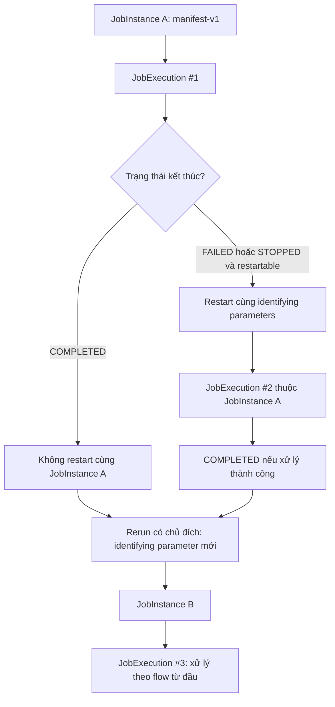

# Phân biệt restart và rerun

## 1. Vì sao phải phân biệt?

Một job Spring Batch nhập 20 triệu hóa đơn qua bốn partition. Sau 50 phút, ba partition đã hoàn tất nhưng partition thứ tư bị lỗi database. Người vận hành nhấn nút **Run** một lần nữa. Liệu hệ thống sẽ chỉ tiếp tục phần còn thiếu, hay đọc lại đủ 20 triệu hóa đơn từ đầu?

Câu trả lời **không phụ thuộc vào nút bấm có nhãn “Run”, “Retry” hay “Rerun”**, mà phụ thuộc vào **JobInstance**, các **identifying JobParameters**, trạng thái lần chạy trước và cấu hình restart trong Spring Batch.

- **Restart:** thử tiếp tục một **JobInstance đã chạy nhưng chưa hoàn thành thành công**, tạo **JobExecution mới cho chính JobInstance đó**. Framework tận dụng lịch sử `StepExecution` và `ExecutionContext` để quyết định step nào cần chạy lại, bước nào đã hoàn thành được bỏ qua, và reader có thể khôi phục checkpoint ở đâu.
- **Rerun:** trong bài này là **chủ động xử lý lại công việc dưới một JobInstance mới**, thường bằng identifying parameters mới. Không kế thừa checkpoint của JobInstance cũ theo cơ chế mặc định, nên các step được thực thi theo flow của lần mới.
- **Retry:** thử lại một thao tác/item/chunk ngay trong chính lần xử lý theo chính sách fault tolerance; **không đồng nghĩa** restart Job.
- **Replay/backfill/correction:** cách gọi nghiệp vụ cho việc xử lý lại dữ liệu hoặc sửa kết quả; có thể thực hiện bằng JobInstance mới nhưng không phải một trạng thái kỹ thuật tự có của Spring Batch.

Đây là chủ đề trong chương **Restartability** của module **SPRING_BATCH_SCALING_OPERATIONS**. Khi mở rộng Spring Batch cho workload dữ liệu lớn bằng multi-threaded steps, parallel steps, partitioning và distributed workers, quyết định sai giữa restart và rerun có thể dẫn tới **hàng triệu bản ghi trùng, side effect lặp, sai snapshot hoặc tăng tải đột biến**.

### Mục tiêu học tập

Sau bài này, bạn có thể:

1. Định danh đúng `JobInstance`, `JobExecution`, `StepExecution` và `ExecutionContext`.
2. Dự đoán hành vi khi gọi lại job với **cùng** hoặc **khác identifying parameters**.
3. Biết lúc nào Spring Batch cho phép restart, từ chối một job đã hoàn tất, hoặc khởi tạo lần xử lý mới.
4. Thiết kế reader/writer và partition identity để **restart không làm mất hoặc ghi trùng dữ liệu**.
5. Phân biệt cách vận hành lại job trong môi trường multi-threaded, partitioned và remote processing.
6. Xây dựng runbook, kiểm thử và lựa chọn giữa restart, rerun và correction dựa trên trạng thái dữ liệu thực tế.

## 2. Bốn đối tượng metadata quan trọng

### 2.1. JobInstance: công việc logic với một bộ tham số định danh

Spring Batch định danh một `JobInstance` bằng **tên Job cộng với các identifying JobParameters**. Ví dụ:

```text
Job name: monthlyInvoiceImportJob
Identifying parameters:
  businessBatchId = billing-2026-11
  manifestId      = manifest-2026-11-v1

=> Một JobInstance đại diện cho đúng đợt dữ liệu này.
```

Các parameter **không identifying** có thể dùng để cung cấp tùy chọn vận hành, nhưng **thay đổi chúng không tạo JobInstance mới**. Muốn chủ động rerun dưới một JobInstance mới, ít nhất phải có **một identifying parameter khác** hoặc tên job khác theo thiết kế. Ngược lại, thêm parameter `run.id` chỉ để né lỗi “đã hoàn thành” có thể khiến toàn bộ dữ liệu cũ được xử lý lại mà không có kế hoạch.

### 2.2. JobExecution: một lần cố gắng thực thi JobInstance

Một `JobInstance` có thể có nhiều `JobExecution` khi lần chạy trước `FAILED` hoặc `STOPPED` và được restart hợp lệ. Mỗi JobExecution có `JOB_EXECUTION_ID`, thời điểm bắt đầu/kết thúc, trạng thái và lỗi riêng.

```text
JobInstance #100: monthlyInvoiceImportJob + manifest-v1
|
+-- JobExecution #501 -> FAILED
|
+-- JobExecution #502 -> COMPLETED  (restart của #501)

JobInstance #101: monthlyInvoiceImportJob + manifest-v1 + reprocessId=2
|
+-- JobExecution #503 -> COMPLETED  (rerun là một instance mới)
```

Ở ví dụ này, `#502` không phải JobInstance mới. Ngược lại `#503` là lần chạy đầu tiên của một **JobInstance khác**, dù vẫn có thể đọc cùng snapshot nếu cấu hình như vậy.

### 2.3. StepExecution: trạng thái của từng step trong từng lần thực thi

Mỗi step được chạy có `StepExecution` ghi `STEP_NAME`, `STATUS`, `EXIT_CODE`, `READ_COUNT`, `WRITE_COUNT`, `COMMIT_COUNT`, `ROLLBACK_COUNT` và các thông tin khác. Step name là **định danh logic**, không phải tên Java method hay nhất thiết là Spring bean name.

Khi restart, Spring Batch xem lịch sử step **trong cùng JobInstance**. Những step đã `COMPLETED` thường **không được thực thi lại** theo mặc định; những step cần chạy lại được khôi phục theo quy tắc của framework và cấu hình step.

### 2.4. ExecutionContext: dữ liệu checkpoint để khôi phục

`ExecutionContext` là vùng trạng thái được persist trong `JobRepository` để hỗ trợ restart, ví dụ:

- Vị trí đọc item đã được commit.
- ID file/partition và offset được kiểm soát.
- Thông tin `ItemStream` cần dùng để mở lại reader/writer.
- Các giá trị nhỏ liên quan tới tiến độ của step.

Không đưa vào `ExecutionContext` raw payload lớn, mật khẩu, access token, toàn bộ manifest hoặc object không thể serialize. **Có metadata checkpoint không có nghĩa mọi external side effect đều exactly-once**: transaction DB, broker, HTTP và file output có thể nằm ở các ranh giới commit khác nhau.

## 3. Bảng so sánh restart và rerun

| Tiêu chí | **Restart** | **Rerun** (JobInstance mới) |
| --- | --- | --- |
| Mục đích | Hoàn thành công việc còn dang dở | Chủ động xử lý lại một đợt hoặc chạy đợt mới |
| JobInstance | **Giữ nguyên** | **Khác** |
| JobExecution | **Tạo mới** cho JobInstance cũ | Tạo JobExecution đầu tiên của JobInstance mới |
| Identifying JobParameters | Giữ cùng định danh JobInstance | Thay ít nhất một identifying parameter hoặc đổi Job name |
| Step đã `COMPLETED` ở instance cũ | Thường không chạy lại | Không có trạng thái `COMPLETED` từ instance cũ để tự bỏ qua |
| Step `FAILED` | Có thể chạy lại từ checkpoint hợp lệ | Bắt đầu như một công việc mới theo flow |
| `ExecutionContext` cũ | Được framework sử dụng cho restart khi phù hợp | Không tự kế thừa từ instance khác |
| Dữ liệu nguồn | **Cần đúng tập dữ liệu cũ** | Có thể cùng snapshot để reprocess, hoặc snapshot mới theo yêu cầu |
| Rủi ro chính | Checkpoint sai, side effect sau commit, đổi code/reader | Ghi trùng hoặc nhân đôi tác động vì chạy lại công việc |
| Điều kiện framework | Job restartable, trạng thái và metadata hợp lệ | JobInstance mới, parameters hợp lệ, không xung đột quy tắc launch |
| Người quyết định | Operator sau khi sửa lỗi hoặc cơ chế restart | Nghiệp vụ/đội vận hành muốn tạo một lần xử lý riêng |

**Quan trọng:** “Rerun” là thuật ngữ nghiệp vụ/vận hành; **không phải một `BatchStatus` và không phải nút API duy nhất có cùng semantics trong mọi ứng dụng**. Có UI gọi `restart` là “rerun”, hoặc UI tự thêm `run.id` rồi luôn tạo JobInstance mới. Cần nhìn **JobInstance ID và identifying parameters**, không đoán từ nhãn UI.

### 3.1. Sơ đồ trạng thái



Không phải mọi trạng thái đều có thể restart. `STARTED`/`STARTING` còn đang chạy, `STOPPING` chưa dừng xong, hoặc `ABANDONED` không phải trường hợp tự động tiếp tục như một lần `FAILED` thông thường.

## 4. Ví dụ cùng JobInstance: lỗi rồi restart

Một job xử lý hóa đơn có ba step:

```text
monthlyInvoiceImportJob
  1. captureSourceStep
  2. normalizeInvoicesStep
  3. publishSnapshotStep
```

Giả sử lần đầu:

| Step | Kết quả JobExecution #501 | Dữ liệu đã tác động |
| --- | --- | --- |
| `captureSourceStep` | COMPLETED | Snapshot đầu vào `manifest-v1` đã chốt |
| `normalizeInvoicesStep` | FAILED | 800.000/1.000.000 bản ghi đã commit ở những chunk trước |
| `publishSnapshotStep` | Chưa chạy | Snapshot chưa được công bố |
| **JobExecution #501** | **FAILED** | Chưa có dữ liệu cuối được publish |

Khi sửa nguyên nhân lỗi và restart **cùng JobInstance**:

| Step | JobExecution #502 | Vì sao |
| --- | --- | --- |
| `captureSourceStep` | Thường không thực thi lại | Lần trước đã `COMPLETED` |
| `normalizeInvoicesStep` | Chạy lại/tiếp tục với trạng thái checkpoint hợp lệ | Lần trước `FAILED` |
| `publishSnapshotStep` | Chạy sau khi normalization thành công | Trước đó chưa được chạy |
| **JobExecution #502** | **COMPLETED** nếu toàn job thành công | Cùng JobInstance, lần thực thi khác |

**“Bỏ qua step completed” không có nghĩa Spring Batch tạo một step mới có `BatchStatus.SKIPPED`.** Thông thường framework không thực thi lại step đó; khi phân tích lịch sử cần xem các `StepExecution` từ **mọi JobExecution thuộc JobInstance**.

### 4.1. Đã commit không bị rollback toàn job

Nếu 800.000 bản ghi đã được commit ở các chunk trước khi normalization thất bại, **restart không hoàn tác những commit đó**, và writer có thể xử lý lại một số item quanh điểm lỗi. Phải có **unique business key/idempotent write**, cơ chế transaction phù hợp và đối soát kết quả.

Tương tự với parallel steps hoặc partitioning, một nhánh đã `COMPLETED` không bị rollback vì nhánh khác `FAILED`. Không coi restart như một transaction toàn job.

## 5. Ví dụ JobInstance mới: rerun có chủ đích

Nếu JobInstance của `monthlyInvoiceImportJob` đã `COMPLETED` mà nghiệp vụ yêu cầu **tính lại toàn bộ hóa đơn** sau khi thay đổi quy tắc thuế, đó là một rerun/reprocess:

```text
JobInstance A:
  jobName=monthlyInvoiceImportJob
  businessBatchId=billing-2026-11
  manifestId=manifest-v1
  reprocessId=1
  -> COMPLETED

JobInstance B:
  jobName=monthlyInvoiceImportJob
  businessBatchId=billing-2026-11
  manifestId=manifest-v1
  reprocessId=2
  -> chạy tất cả step phù hợp trong flow của B
```

Hai instance có thể đọc cùng manifest nhưng **không được mặc định công bố cùng một output hai lần**. Phải quyết định:

- Đợt tính lại **thay thế** kết quả của đợt trước hay tạo phiên bản song song?
- Writer có dùng `businessBatchId + invoiceId`/version để tránh nhân đôi không?
- Sự kiện, email, thanh toán hoặc file đã xuất trước đó có cần bù trừ/thu hồi không?
- Có giữ được snapshot đầu vào, code version và bảng tra cứu lịch sử không?
- Ai cho phép rerun và ai xác nhận đối soát trước publish?

Nếu input đã thay đổi, một rerun mới có thể tạo kết quả khác với JobInstance A ngay cả khi job code không đổi; cần định nghĩa rõ snapshot/version của công việc mới.

### 5.1. Không thêm run.id tùy tiện để “sửa lỗi restart”

Nếu `run.id` được đánh dấu **identifying** và được tăng từ 1 lên 2, đó là **JobInstance mới**. Việc này có thể khiến step `COMPLETED` ở instance cũ **chạy lại** và reader **không khôi phục checkpoint cũ**.

Dùng `RunIdIncrementer` hoặc `startNextInstance(...)` có thể là cách tạo JobInstance mới **nếu đó thực sự là mục tiêu**, nhưng không phải lệnh “tiếp tục từ nơi bị lỗi”. Kể cả job restartable, một incrementer luôn tăng identifying parameters vẫn thay đổi identity.

## 6. Identifying JobParameters: quyết định then chốt

### 6.1. Ví dụ Java phân biệt identity

Mẫu theo API Spring Batch 5.x:

```java
JobParameters firstParameters = new JobParametersBuilder()
        .addString("businessBatchId", "billing-2026-11", true)
        .addString("manifestId", "manifest-v1", true)
        .addLong("reprocessId", 1L, true)
        .addString("requestedBy", "scheduler", false)
        .toJobParameters();

// Cùng tên Job + cùng identifying parameters: JobInstance A.
// Thay requestedBy (non-identifying) không tạo JobInstance mới.

JobParameters rerunParameters = new JobParametersBuilder()
        .addString("businessBatchId", "billing-2026-11", true)
        .addString("manifestId", "manifest-v1", true)
        .addLong("reprocessId", 2L, true)
        .addString("requestedBy", "operator", false)
        .toJobParameters();

// reprocessId là identifying và khác: JobInstance B.
```

**Không đưa** password, access token hoặc thông tin cá nhân vào `JobParameters`: chúng được lưu trong batch metadata và có thể hiện trên log/dashboard. Với manifest lớn, truyền `manifestId` thay vì hàng triệu source records.

### 6.2. Minh họa launch, restart và rerun

```java
// Đường đi 1: khởi chạy lần đầu.
JobExecution first = jobLauncher.run(
        monthlyInvoiceImportJob, firstParameters);

// Giả sử first đã kết thúc FAILED/STOPPED và Job restartable.
// Đường đi 2: restart cùng JobInstance, tạo JobExecution mới.
JobExecution restarted = jobLauncher.run(
        monthlyInvoiceImportJob, firstParameters);

// Hoặc dùng JobOperator để restart một execution đã fail/stop:
// long restartedExecutionId = jobOperator.restart(first.getId());

// Đường đi 3: rerun có chủ đích, một JobInstance mới.
JobExecution rerun = jobLauncher.run(
        monthlyInvoiceImportJob, rerunParameters);
```

Đoạn mã mang tính minh họa trình tự, **không được gọi restart khi `first` vẫn đang chạy**. `JobOperator.restart(executionId)` và các API vận hành có hành vi phụ thuộc trạng thái Job, cấu hình repository/launcher và phiên bản. Khi restart một instance, giữ **bộ tham số nghiệp vụ và snapshot ổn định**; ưu tiên dùng cơ chế restart của Spring Batch thay vì tự tạo params mới.

**Nếu lần đầu đã `COMPLETED`**, lệnh `jobLauncher.run(job, firstParameters)` **không phải rerun**: Spring Batch thường từ chối với `JobInstanceAlreadyCompleteException`. Muốn chạy lại từ đầu, phải xác định một JobInstance mới có danh tính riêng, không sửa tay status lịch sử.

### 6.3. Bảng hành vi theo parameters

| Trạng thái lần trước | Parameters khi launch | Kết quả điển hình |
| --- | --- | --- |
| JobInstance chưa tồn tại | Identifying mới | Tạo JobInstance và JobExecution mới |
| JobInstance A `FAILED` | **Cùng identifying** + restartable | Tạo JobExecution mới cho A, khôi phục |
| JobInstance A `STOPPED` | **Cùng identifying** + restartable | Có thể restart theo flow/step policy |
| JobInstance A `COMPLETED` | **Cùng identifying** | Thường bị từ chối: `JobInstanceAlreadyCompleteException` |
| JobInstance A `STARTED` còn active | **Cùng identifying** | Thường bị từ chối: `JobExecutionAlreadyRunningException` |
| JobInstance A `FAILED` | Identifying **khác** | Tạo JobInstance mới, **không** tiếp tục checkpoint của A |
| JobInstance A `COMPLETED` | Identifying **khác** | Tạo JobInstance mới để xử lý lại hoặc xử lý đợt mới |
| JobInstance A bất kỳ | Chỉ đổi **non-identifying** parameter | Vẫn là identity A; không dùng để ép rerun mới |

Có thể gặp `JobRestartException`, `JobParametersInvalidException`, `JobInstanceAlreadyCompleteException` hoặc `JobExecutionAlreadyRunningException` tùy tình huống. Không bắt lỗi chung rồi tự thêm identifying `run.id` để retry: như vậy có thể vô tình **chuyển restart thành rerun**.

## 7. Spring Batch quyết định step nào chạy lại ra sao?

Spring Batch dựa vào **lịch sử của step name trong cùng JobInstance**, trạng thái cuối và cấu hình step. Một số tùy chọn ảnh hưởng quan trọng:

### 7.1. `allowStartIfComplete(true)`

Mặc định, step đã `COMPLETED` thường không chạy lại khi restart. Với step được khai báo `allowStartIfComplete(true)`, Spring Batch có thể **chạy lại step dù trước đó đã completed** khi đi qua flow đó trong lần restart.

```java
@Bean
Step refreshReferenceDataStep(
        JobRepository repository,
        PlatformTransactionManager transactionManager,
        Tasklet refreshTasklet) {

    return new StepBuilder("refreshReferenceDataStep", repository)
            .tasklet(refreshTasklet, transactionManager)
            .allowStartIfComplete(true)
            .build();
}
```

Chỉ bật khi step thật sự **repeatable/idempotent** hoặc nghiệp vụ yêu cầu làm mới cache/reference data trong mỗi JobExecution. Nếu step gửi hóa đơn, trừ tiền hoặc publish file không idempotent thì bật lại có thể rất nguy hiểm.

### 7.2. `startLimit` và `preventRestart()`

`startLimit(n)` giới hạn số lần step được bắt đầu **trong cùng JobInstance** theo cơ chế framework; không đồng nghĩa `retryLimit` của một chunk. Một step giới hạn quá thấp có thể khiến restart bị từ chối dù lỗi hạ tầng đã được sửa.

`preventRestart()` trên Job chủ động tắt khả năng restart JobInstance đã bắt đầu. Cần cân nhắc kỹ với workload lớn có nhiều chunk/partition: mất khả năng restart có thể buộc rerun toàn bộ, tăng chi phí và rủi ro.

```java
Job nonRestartableJob = new JobBuilder("nonRestartableJob", repository)
        .start(onlyStep)
        .preventRestart()
        .build();
```

**Job không restartable vẫn có thể được chạy với một JobInstance mới** nếu parameters định danh khác và job hợp lệ; đây không phải lý do dùng rerun mù để vượt qua trạng thái chưa rõ của instance cũ.

### 7.3. `.end()`, `.fail()` và `.stopAndRestart(...)`

Khi cấu hình flow transitions, phân biệt kết quả Job:

| Cấu hình transition | Ý nghĩa | Hệ quả khi vận hành |
| --- | --- | --- |
| Step thất bại không được xử lý thành công giả | Job thường `FAILED` | Có thể restart nếu đáp ứng điều kiện |
| `.on("FAILED").fail()` | Kết thúc Job với trạng thái thất bại | Giữ khả năng restart theo thiết kế |
| `.on("FAILED").end()` | Kết thúc flow/Job theo **completed transition** | Job có thể `COMPLETED` và **không restart** cùng JobInstance |
| `stopAndRestart(...)` | Dừng có chủ đích tại điểm chờ | Có thể restart từ nhánh/step được định nghĩa |

`on("FAILED")` match **ExitStatus exit code**, không phải trực tiếp `BatchStatus`. Đặc biệt, **`.on("FAILED").end()` không phải cách “đánh dấu fail để restart”**. Dấu `.end().build()` ở cuối builder thông thường là chuyện khác với `end()` của transition lỗi.

## 8. ExecutionContext và checkpoint: điều gì thực sự được tiếp tục?

Với chunk step, reader/writer hỗ trợ `ItemStream` có thể lưu trạng thái qua `open`, `update` và `close`. Checkpoint thường được cập nhật theo ranh giới commit của chunk.

Ví dụ:

```text
Chunk size = 100
Step normalizeInvoicesStep:

chunks 1..80: COMMIT OK (8.000 items)
chunk 81:     lỗi, transaction rollback
JobExecution #501: FAILED

Restart cùng JobInstance:
- Framework dùng ExecutionContext đã persist của StepExecution trước.
- Reader có thể tiếp tục từ checkpoint sau chunk 80.
- Một số item quanh ranh giới có thể bị đọc/xử lý lại tùy reader,
  transaction manager và external side effects.
```

**Không được kết luận:** “đã xử lý đúng 8.000 item thì restart chắc chắn không gọi lại item 1–8.000”. Nếu writer gọi HTTP API hoặc xuất message trước khi transaction/metadata được xác nhận, tác động phụ có thể đã xảy ra mà framework chưa biết. Idempotency key dựa trên **business entity + operation/version** mới giúp ngăn duplication, không nên chỉ dùng `JobExecutionId` (vì ID đó thay đổi khi restart).

### 8.1. Reader cần điều kiện restart riêng

| Loại reader | Điều cần giữ ổn định |
| --- | --- |
| `FlatFileItemReader` | File/content, encoding, header, line mapping, reader name |
| `MultiResourceItemReader` | Danh sách resource, thứ tự resource, từng file version |
| `JdbcCursorItemReader` | Dataset và thứ tự row không thay đổi ngoài giả định checkpoint |
| `JdbcPagingItemReader` | Sort keys duy nhất, input snapshot, paging state |
| Object storage reader | Key + version/generation và offset/record boundary |
| CDC/broker adapter | Offset/correlation, committed boundary và xử lý replay |

Một reader lưu trạng thái (`saveState(true)`) vẫn cần **tập dữ liệu gốc bất biến hoặc chiến lược khôi phục tương thích**. Không trông đợi `ExecutionContext` tự khắc phục việc bảng nguồn có INSERT/UPDATE/DELETE làm đổi thứ tự dòng.

### 8.2. Đổi reader/writer name có thể ảnh hưởng checkpoint

Một số `ItemStream` dùng **name** của reader/writer để đặt key trạng thái trong `ExecutionContext`. Nếu code refactor đổi `reader.name(...)` hoặc step name giữa lúc JobInstance cần restart, state trước đó có thể không được tìm lại đúng.

Vì vậy, **đừng gộp refactor định danh và đổi logic xử lý với restart khẩn cấp**. Giữ tương thích serializer/context keys và kiểm thử failure → deploy → restart trên metadata tương đương.

## 9. Partitioning: restart hoàn thành phần thiếu hay chạy lại mọi partition?

Partitioning có nhiều `StepExecution` được đặt tên dựa trên worker step và partition ID. Ví dụ:

```text
JobInstance A: importJob(manifestId=M-001)

partitionWorkerStep:partition-0000  COMPLETED
partitionWorkerStep:partition-0001  COMPLETED
partitionWorkerStep:partition-0002  FAILED
partitionWorkerStep:partition-0003  COMPLETED

Restart A:
  partition-0000, 0001, 0003 thường không chạy lại
  partition-0002 được khôi phục theo checkpoint/StepExecution policy

Rerun JobInstance B (manifestId=M-001, reprocessId=2):
  không tự kế thừa StepExecution của A
  các partition được tạo/chạy theo Job flow của B
```

### 9.1. Partition identity phải bất biến khi restart

`Partitioner` thường trả `Map<String, ExecutionContext>`, trong đó key là partition name. Spring Batch gắn worker step và partition name thành định danh StepExecution. Nếu lần đầu `partition-0002` tương ứng tenant A, nhưng lần restart partitioner scan lại dữ liệu rồi gán `partition-0002` cho tenant B, checkpoint có thể bị gắn **sai dữ liệu**.

**Cần giữ bất biến:**

- Danh sách partition names và mapping name → input/range/tenant/file.
- `manifestId`, snapshot/object version, logical upper/lower bounds.
- Tên worker step và reader keys cần thiết cho checkpoint.
- Quy tắc transaction, ordering và idempotency tương thích.

`gridSize` là **hint**, không tự bảo đảm số partition cố định. Nếu đổi concurrency, đừng vì vậy đổi mapping logical partitions của cùng JobInstance. Với `MultiResourcePartitioner`, `gridSize` còn bị implementation này bỏ qua: nó tạo partition theo từng resource.

### 9.2. Multi-threaded step khác partitioning

Một multi-threaded step thường có **một StepExecution** nhưng nhiều task/chunk chạy đồng thời bên trong nó. Tùy version và reader state, hành vi ordering/restart có thể phức tạp hơn; không giả định có checkpoint riêng cho mỗi thread.

Partitioning tạo nhiều worker StepExecutions theo từng partition, thuận tiện hơn để restart phần cần làm. Tuy vậy, nếu một worker partition tự dùng multi-threaded chunk, thread safety và tính đúng checkpoint **vẫn phải được kiểm thử ở cấp worker**.

### 9.3. Remote partitioning và remote chunking

Ở distributed processing:

- Worker có thể chết sau khi ghi DB nhưng trước khi manager nhận reply.
- Broker có thể redeliver một partition/chunk.
- Manager hoặc coordinator có thể chưa biết kết quả thật của side effect.
- Retry/restart có thể gửi lại công việc đã được thực hiện một phần.

**Restart không biến messaging thành exactly-once end-to-end.** Cần correlation, idempotent writer, timeouts/retry bounded, JobRepository nhất quán và đối soát dữ liệu đích. Không tự tạo fake success reply hay sửa `BATCH_*` metadata để né lỗi.

**Rerun mới** của một distributed job có thể gửi lại **toàn bộ** partition/chunk từ đầu; phải kiểm soát tải broker, external API rate limit và version của input.

## 10. Tại sao rerun có thể gây duplicate và side effect?

Giả sử `notifyCustomerStep` gửi 50.000 email rồi job hoàn tất. Operator rerun với `run.id` mới để “chạy cho chắc”. Một JobInstance mới **không biết** email từ JobInstance trước đã gửi; step có thể gửi **thêm 50.000 email**.

Các loại side effect thường gặp:

| Side effect | Rủi ro rerun | Cách bảo vệ |
| --- | --- | --- |
| `INSERT` vào DB | Duplicate key hoặc thêm bản ghi trùng | Unique constraint, UPSERT có business key đúng |
| `UPDATE` tổng tiền bằng phép cộng | Tăng tổng hai lần | Thay bằng tính giá trị xác định, version-aware conditional write |
| HTTP payment/capture | Trừ tiền hai lần | API idempotency key ổn định, ledger và đối soát |
| Gửi email/SMS | Gửi thông báo trùng | Notification dedup/outbox theo event nghiệp vụ |
| Kafka/RabbitMQ publish | Consumer thấy sự kiện trùng | Outbox/dedup phía consumer, business event ID |
| Tạo file output | Ghi đè/append trùng | Temp path + atomic publish/rename theo version |
| Xuất báo cáo dashboard | Publish snapshot chưa đủ hoặc lùi phiên bản | Staging và publish marker theo business batch/version |

**Tuyệt đối không dựa vào `JobExecutionId` làm idempotency key duy nhất** cho side effect nghiệp vụ: restart tạo JobExecutionId mới. Tùy mục tiêu, cần dùng `businessBatchId + entityId + operation` hoặc `sourceVersion` ổn định qua restart và cả rerun có chủ đích.

### 10.1. Rerun để tính lại khác rerun để phát lại side effect

Một job có thể tách làm:

```text
1. captureSnapshotStep          -> bất biến
2. calculateInvoiceStep         -> tính dữ liệu staging có thể tái lập
3. reconcileStep                -> kiểm chứng tính đúng
4. publishVersionStep           -> chuyển con trỏ snapshot
5. notifyCustomerStep           -> side effect có dedup
```

Khi cần tính lại vì lỗi thuật toán, có thể tạo **JobInstance mới tính một version staging mới**, sau đó chỉ publish và gửi notification theo chính sách nghiệp vụ. Không mặc định mọi bước được phép thực thi lại với tác động thật ở môi trường production.

## 11. Restart hay rerun khi đầu vào thay đổi?

Một câu hỏi cốt lõi là **đợt dữ liệu của lần chạy trước có còn tồn tại và đọc lại được không?**

| Tình huống | Ưu tiên ban đầu | Lý do |
| --- | --- | --- |
| Job `FAILED` vì DB tạm thời, input snapshot cũ còn nguyên | **Restart** | Giữ progress, tránh xử lý lại phần completed |
| Partition thứ 7 lỗi do dữ liệu sai; sửa logic mà schema/checkpoint vẫn tương thích | **Restart sau kiểm thử** | Tập input và partition identity giữ nguyên |
| File nguồn bị overwrite, không còn version cũ | **Không restart mù** | Checkpoint có thể trỏ tới dữ liệu mới |
| Job đã `COMPLETED` nhưng cần tính lại toàn bộ theo luật mới | **Rerun JobInstance mới** | Đợt tính lại có phạm vi/version riêng |
| Job đã `COMPLETED`, có thêm dữ liệu mới | **JobInstance mới cho batch mới** | Không sửa JobInstance hoàn thành |
| Sự kiện đến muộn thuộc kỳ đã công bố | **Correction/backfill** có ID riêng | Cần version-aware sink và điều chỉnh dữ liệu |
| Job `FAILED` nhưng side effect không idempotent, không rõ đã commit chưa | **Điều tra/đối soát trước** | Cả restart lẫn rerun có thể lặp tác động |
| Job đã `COMPLETED` do `.on("FAILED").end()` sai | **Sửa flow và lập recovery plan** | Không thể restart như instance FAILED bình thường |
| Đổi step name, reader name hoặc context serialization | **Kiểm thử migration trước** | Có thể mất liên kết trạng thái restart |
| Job có `preventRestart()` | **Tái thiết kế recovery hoặc rerun có kiểm soát** | Không dùng run.id mới làm giải pháp vô điều kiện |

### 11.1. Backfill không phải restart

**Backfill** xử lý một khoảng dữ liệu lịch sử bị thiếu, ví dụ ba ngày dữ liệu mới được phát hiện sau khi job tháng đã hoàn thành. Đây là một đơn vị công việc mới, thường có identifying parameters như `backfillId`, `dateFrom`, `dateTo` và manifest cố định.

Nếu dữ liệu cũ đã công bố, backfill cần quyết định có viết đè, ghi correction event hay tạo version mới. Không xóa `BATCH_JOB_INSTANCE`/`BATCH_STEP_EXECUTION` để “mở khóa” một instance completed.

### 11.2. Rerun cả source hay chỉ một Step?

Spring Batch quản lý restart theo flow và trạng thái step, nhưng **không có quy tắc chung rằng rerun chỉ một Step trong một JobInstance đã completed sẽ tự đúng về nghiệp vụ**. Có thể dùng job riêng cho correction, `JobStep` hoặc một flow reprocess có contract riêng. Khi làm vậy, phải quản lý input, transaction, output và dependencies của các bước được bỏ qua.

## 12. Truy vấn JobRepository để biết mình đang làm gì

Trước khi nhấn restart/rerun, người vận hành nên xác định:

- Job name, `JobInstanceId` và **identifying JobParameters**.
- `JobExecutionId` của lần thực thi cuối, `BatchStatus`/`ExitStatus`.
- Step nào đã `COMPLETED`, `FAILED`, `STOPPED`, step nào chưa chạy.
- `ExecutionContext`/checkpoint liên quan đã được persist chưa.
- Dữ liệu đích đã được commit và side effect nào còn chưa chắc chắn.

Với schema JDBC mặc định, truy vấn sau liệt kê các StepExecutions thuộc **mọi lần chạy** của cùng một JobInstance (điều chỉnh prefix/schema/dialect nếu hệ thống tùy biến):

```sql
SELECT
    ji.JOB_INSTANCE_ID,
    ji.JOB_NAME,
    je.JOB_EXECUTION_ID,
    je.STATUS AS JOB_STATUS,
    je.EXIT_CODE AS JOB_EXIT_CODE,
    se.STEP_EXECUTION_ID,
    se.STEP_NAME,
    se.STATUS AS STEP_STATUS,
    se.EXIT_CODE AS STEP_EXIT_CODE,
    se.READ_COUNT,
    se.WRITE_COUNT,
    se.COMMIT_COUNT,
    se.ROLLBACK_COUNT,
    se.START_TIME,
    se.END_TIME
FROM BATCH_JOB_INSTANCE ji
JOIN BATCH_JOB_EXECUTION je
  ON je.JOB_INSTANCE_ID = ji.JOB_INSTANCE_ID
LEFT JOIN BATCH_STEP_EXECUTION se
  ON se.JOB_EXECUTION_ID = je.JOB_EXECUTION_ID
WHERE ji.JOB_INSTANCE_ID = :job_instance_id
ORDER BY je.JOB_EXECUTION_ID, se.STEP_EXECUTION_ID;
```

Lưu ý:

- Chỉ xem `BATCH_STEP_EXECUTION` của JobExecution restart mới **có thể không đủ** để hiểu step completed ở lần trước; xem toàn bộ JobInstance.
- `STATUS` và `EXIT_CODE` khác vai trò: `BatchStatus` thể hiện lifecycle, `ExitStatus` phục vụ flow transitions.
- Với các bảng `BATCH_JOB_EXECUTION_PARAMS` và `BATCH_STEP_EXECUTION_CONTEXT`, schema/cột có thể khác giữa các version; dùng `JobExplorer`/`JobRepository` API được hỗ trợ khi có thể, không chỉnh raw metadata bằng SQL.
- Parameter nào identifying phải được kiểm tra đúng theo metadata/version đang chạy; **chỉ giống một vài giá trị hiển thị không chứng minh hai launches là cùng JobInstance**.

### 12.1. Không sửa `BATCH_*` bằng tay để ép restart

Những hành động như:

```text
UPDATE BATCH_JOB_EXECUTION SET STATUS='FAILED' ...
DELETE FROM BATCH_STEP_EXECUTION WHERE ...
DELETE FROM BATCH_JOB_INSTANCE WHERE ...
```

**Không phải quy trình recovery an toàn.** Chúng có thể phá invariant và relation giữa các execution, checkpoint, job/step state, khiến duplicated side effects hoặc mất khả năng audit. Chỉ thực hiện can thiệp metadata có kiểm soát bằng công cụ/quy trình Spring Batch hỗ trợ sau khi hiểu toàn bộ rủi ro; đừng xem một lệnh SQL sửa trạng thái là tương đương restart chính thức.

## 13. Runbook quyết định restart và rerun

### Bước 1 — Xác định mục tiêu nghiệp vụ

Người yêu cầu muốn **hoàn thành một đợt đã fail**, **tính lại đợt đã completed**, hay **xử lý đợt dữ liệu mới**? Ghi rõ `businessBatchId`, snapshot/manifest và version đầu ra.

### Bước 2 — Kiểm tra metadata

Tra `JobInstance`, các `JobExecution`, step/partition status và exception. Kiểm tra job đã `FAILED`/`STOPPED` thật chưa hay vẫn `STARTED`/`STOPPING`.

### Bước 3 — Đối chiếu side effects

Kiểm tra sink DB, file output, broker, API call, notification hoặc payment đã thực hiện. Nếu chưa biết có commit hay không, **chưa nên restart hoặc rerun**.

### Bước 4 — Xác nhận input và checkpoint

Còn đúng file version, snapshot, reader ordering, schema và partition mapping không? Code sau deploy có tương thích với state trong `ExecutionContext` không?

### Bước 5 — Lựa chọn

- **Restart:** instance chưa hoàn thành, metadata/checkpoint và input còn đúng, side effect idempotent hoặc có đối soát.
- **Rerun có chủ đích:** muốn xử lý lại toàn bộ dưới một JobInstance/version mới, có cơ chế kiểm soát duplicates/publish.
- **Correction/backfill:** cần sửa kết quả của batch cũ hoặc thêm dữ liệu đến muộn, có flow nghiệp vụ riêng.
- **Khoanh vùng chờ điều tra:** không rõ commit, snapshot bị thay đổi, hoặc nguy cơ tác động tài chính/dữ liệu nghiêm trọng.

### Bước 6 — Chạy ở tải có kiểm soát

Không mở hàng chục JobInstances mới cùng lúc chỉ vì các JobExecution cũ bị fail. Xem giới hạn thread pool, DB connections, API quota, broker backlog và scheduler admission control.

### Bước 7 — Xác minh kết quả

Đối soát số input unique, output unique, tổng số tiền/giá trị nghiệp vụ, skip/filter counts, publish version và ID của mỗi side effect. Ghi lại `JobInstanceId`/`JobExecutionId` cùng quyết định recovery.

### Bước 8 — Ngăn lặp lỗi

Bổ sung regression test **failure → restart**, **completed → rerun**, crash sau commit, file đổi version và cảnh báo JobExecution không kết thúc; cập nhật runbook và naming/JobParameters policy.

## 14. Kiểm thử tích hợp hai luồng một cách rõ ràng

| Test case | Kỳ vọng |
| --- | --- |
| Launch với parameters chưa từng có | Tạo JobInstance mới và JobExecution đầu tiên |
| Step 1 COMPLETED, Step 2 FAILED, sau đó restart | Step 1 thường không chạy lại; Step 2 tiếp tục hoặc xử lý lại hợp lệ |
| Launch lại cùng identifying parameters sau COMPLETED | Bị từ chối (thường `JobInstanceAlreadyCompleteException`) |
| Chỉ đổi non-identifying parameter sau COMPLETED | **Vẫn** không tạo JobInstance mới |
| Thay identifying `reprocessId` | JobInstance mới; các step thực thi theo flow mới |
| Một step `allowStartIfComplete(true)` | Step đó có thể được thực thi lại khi restart đi qua nó |
| Job `preventRestart()`, lần đầu FAILED | Restart bị từ chối theo cấu hình |
| `.on("FAILED").end()` làm Job COMPLETED | Phát hiện không thể restart như job thất bại |
| Restart với manifest bị sửa | Preflight phát hiện fingerprint/version mismatch |
| Restart khi partitioner đổi mapping | Kiểm tra bị chặn, không gắn checkpoint sang tenant/file khác |
| Worker crash sau writer commit trước reply | Idempotent sink không tạo record trùng khi replay |
| Rerun cùng business batch nhưng version mới | Publish đúng version, không gửi notification/payment trùng |
| JobExecutions chạy đồng thời cùng identity | Repository/launcher không chấp nhận một launch trùng đang chạy |
| Các JobInstances mới cùng quét một nguồn | Admission/dedup tránh double processing khi không chủ đích |

Nên dùng một `JobRepository` **persistent** trong integration test (không xóa schema giữa failure và restart), với database/source/sink tương thích môi trường triển khai. Với remote partitioning/remote chunking, thêm broker/worker crash và redelivery tests.

**Không kiểm thử restart bằng cách khởi tạo database metadata trống rồi launch lần hai**: như vậy bạn đã đánh mất JobInstance, StepExecution và checkpoint cần kiểm tra.

## 15. Benchmark: tại sao restart có thể nhanh hơn rerun?

Giả sử job có 10 partition, xử lý 100 triệu records. Tám partition hoàn tất, hai partition thất bại. Đây là số liệu **giả định**:

| Phương án recovery | Khối lượng có thể phải xử lý lại | Lợi ích | Rủi ro |
| --- | --- | --- | --- |
| Restart cùng JobInstance | Hai partition lỗi từ checkpoint/logic thích hợp | Tránh xử lý lại phần completed | Input/partition mapping phải ổn định |
| Rerun JobInstance mới | Có thể là toàn bộ 10 partition | Tạo kết quả mới hoàn chỉnh theo version | Tốn CPU/DB, dễ duplicate side effect |
| Backfill một khoảng dữ liệu | Chỉ khoảng được chỉ định | Sửa vùng thiếu | Phải chứng minh phạm vi bao phủ/không overlap |
| Rebuild staging snapshot rồi rerun | Dựng lại nguồn và toàn bộ partition | Khôi phục khi input cũ không còn tin cậy | Thời gian dài hơn, cần đối soát và cắt chuyển version |

**Không được hứa** restart luôn chỉ xử lý chính xác 20% dữ liệu. Một partition lỗi có thể cần đọc lại nhiều chunk tùy checkpoint, reader state, transaction và bảo đảm của nguồn. Đặc biệt với một job đã bật `allowStartIfComplete(true)` hoặc custom flow transitions, một số step completed vẫn có thể chạy lại.

### 15.1. Những metric nên đo

- Số lần restart trên một `JobInstance` và thời gian từ lần lỗi tới khi completed.
- Số step/partition đã completed được **không thực thi lại**.
- Số read/write thực tế trong JobExecution restart, so với dữ liệu output duy nhất.
- Runtime `FAILED` vs `COMPLETED`, throughput và recovery time objective (RTO).
- Số database connections, locks, deadlocks, task queue và CPU/GC khi rerun.
- Số replay duplicate bị chặn, failed idempotency checks và side effect cần compensation.
- Thời gian xác minh snapshot/manifest/reader state trước restart.

## 16. Tình huống thực tế: import hóa đơn trên nhiều worker

Một nền tảng tài chính nhập **36 triệu hóa đơn** qua remote partitioning trên nhiều pod, chia theo tháng và tenant. `manager` tạo 24 partition với manifest bất biến. Worker đã hoàn tất 20 partition; bốn partition còn lại lỗi khi DB failover.

### Phương án sai: “rerun cho chắc”

Operator tăng `run.id` và tạo JobInstance mới với 24 partitions:

- 20 partition đã hoàn tất cũng bị đọc và ghi lại.
- Nhiều side effect có thể bị gửi lại nếu writer không idempotent.
- 24 partition cạnh tranh DB vừa phục hồi, có nguy cơ thêm lock timeout.
- Metadata JobInstance cũ vẫn `FAILED`, khó giải thích khi audit.
- Nếu input đã đổi, kết quả hai JobInstances có thể khác nhau và gây publish version sai.

### Phương án phù hợp hơn: restart có kiểm soát

1. Khôi phục database và xác nhận JobExecution cũ đã `FAILED`/`STOPPED`.
2. Kiểm tra manifest, tên `StepExecution` của partition và input version còn nguyên.
3. Đối chiếu dữ liệu đích theo `invoiceId + sourceVersion`, đặc biệt các chunk vừa failover.
4. Dùng `JobOperator.restart(failedJobExecutionId)` hoặc cơ chế restart phù hợp với cùng JobInstance.
5. Theo dõi những partition lỗi được thực thi lại, các partition completed không chạy lại theo default.
6. Nếu worker side effect đã commit nhưng reply mất, dùng reconciliation/idempotency, không synthesize reply success.
7. Chỉ publish kết quả khi tất cả partition thành công và tổng hóa đơn được đối soát.
8. Đóng sự cố với ID hai JobExecutions thuộc một JobInstance và kết quả audit.

**Khi nào vẫn nên rerun?** Nếu cần tính lại toàn bộ do thay đổi logic nghiệp vụ hoặc phát hiện snapshot ban đầu không đúng, hãy tạo một **JobInstance mới với manifest/version/correction ID riêng**, không chỉnh sửa dữ liệu cũ hoặc giả định rerun tự xóa tác động đã công bố.

## 17. Những hiểu lầm thường gặp

| Nhận định | Thực tế |
| --- | --- |
| “Rerun và restart chỉ là hai tên gọi.” | Restart giữ JobInstance; rerun có chủ đích tạo JobInstance mới. |
| “Nhấn Run lần nữa là Spring Batch tự chạy từ đầu.” | Phụ thuộc identifying params và trạng thái JobInstance. |
| “Mỗi JobExecution đều là JobInstance mới.” | Một JobInstance có thể có nhiều JobExecutions sau restart. |
| “Đổi `requestedBy` là rerun mới.” | Nếu non-identifying thì không đổi JobInstance. |
| “Tăng `run.id` là cách restart an toàn.” | Nếu identifying, nó tạo JobInstance mới, mất checkpoint cũ. |
| “JobInstance COMPLETED có thể restart với cùng params.” | Thường bị `JobInstanceAlreadyCompleteException` từ chối. |
| “Step COMPLETED luôn chạy lại khi restart.” | Mặc định thường không; `allowStartIfComplete(true)` là ngoại lệ. |
| “`preventRestart()` nghĩa job này không thể được launch với params mới.” | Không; nó cấm restart của instance đã bắt đầu, không cấm instance mới hợp lệ. |
| “Restart rollback mọi chunk đã commit.” | Không có transaction toàn job tự hoàn tác các commit trước. |
| “ExecutionContext bảo đảm exactly-once với HTTP/API.” | Không; cần idempotency/đối soát external side effect. |
| “Đổi step name là refactor không ảnh hưởng restart.” | Tên step là một phần identity của trạng thái, đổi có thể mất liên kết checkpoint. |
| “Partitioner có thể lập lại nhóm khác khi restart.” | Không nên; mapping partition → data phải bất biến. |
| “Rerun hoàn thành sẽ tự dọn JobInstance FAILED cũ.” | Không; lịch sử các instances riêng vẫn tồn tại. |
| “Run lại với cùng JobParameters nhưng code mới sẽ tự sửa dữ liệu cũ.” | Còn phụ thuộc trạng thái, checkpoint, input compatibility và business rules. |
| “DLQ/replay message nghĩa là đang restart Job.” | Message redelivery là tầng transport; có thể xảy ra trong một JobExecution. |

## 18. Câu hỏi tự kiểm tra

**Câu 1.** Job `monthlyInvoiceImportJob` với `manifestId=M-001` và identifying `run.id=1` bị `FAILED`. Operator đổi `run.id=2` rồi launch. Đây là restart hay rerun?

*Trả lời gợi ý:* JobInstance mới (rerun theo cách định nghĩa ở bài), **không** tiếp tục checkpoint của instance cũ.

**Câu 2.** JobInstance đã `COMPLETED`. Operator chỉ đổi một `requestedBy` parameter `identifying=false`. Có chạy lại từ đầu không?

*Trả lời gợi ý:* Không. Identifying params không đổi nên vẫn cùng JobInstance completed; thường bị từ chối.

**Câu 3.** Step A `COMPLETED`, Step B `FAILED`. Sau restart, A có mặc nhiên chạy lại không?

*Trả lời gợi ý:* Thông thường không. Nhưng có thể chạy lại khi `allowStartIfComplete(true)` hoặc flow policy yêu cầu.

**Câu 4.** Worker đã gửi một request thanh toán thành công nhưng crash trước checkpoint. Restart có thể gọi lại không?

*Trả lời gợi ý:* Có. Transaction/JobRepository không tự xác nhận exactly-once với API ngoài DB; cần idempotency key và reconciliation.

**Câu 5.** Một `Partitioner` trả tên `partition-0001` nhưng lần restart nó trỏ từ file A sang file B. Nguy cơ gì?

*Trả lời gợi ý:* StepExecution/ExecutionContext cũ gắn nhầm input, gây mất/trùng dữ liệu. Phải cố định manifest và partition mapping.

**Câu 6.** JobInstance cũ `COMPLETED`, sau đó nghiệp vụ phát hiện dữ liệu đến muộn của cùng kỳ. Nên làm gì?

*Trả lời gợi ý:* Tạo correction/backfill có phạm vi và định danh mới, áp idempotency/version-aware sink; không xóa metadata cũ rồi giả restart.

## 19. Checklist trước khi thực hiện thao tác

- [ ] Đã xác định mục tiêu: restart dang dở, rerun toàn bộ, batch mới hay correction/backfill.
- [ ] Đã xác minh JobInstanceId, JobExecutionId, Job name và toàn bộ identifying JobParameters.
- [ ] Trạng thái JobInstance cũ phù hợp với thao tác được chọn; không còn JobExecution đang active.
- [ ] Có snapshot/manifest và input version đúng để dùng lại khi restart.
- [ ] Tên Step, partition ID, reader/writer state keys và ExecutionContext tương thích.
- [ ] Hiểu `allowStartIfComplete`, `startLimit`, `preventRestart()` và flow transitions.
- [ ] Các chunk đã commit và external side effects được đối soát trước khi retry/reprocess.
- [ ] Writer idempotent theo khóa nghiệp vụ; biết giới hạn của UPSERT/unique constraints.
- [ ] Rerun mới có identifying reprocess/version ID và chính sách publish/rollback rõ ràng.
- [ ] Không thay `run.id` vô thức chỉ để né lỗi completed/failed.
- [ ] Không sửa/xóa `BATCH_*` metadata thủ công để ép trạng thái.
- [ ] Với partition/remote, mapping input và correlation vẫn đúng sau worker crash/redeploy.
- [ ] Có admission control để nhiều JobInstances mới không quá tải CPU, DB, broker/API.
- [ ] Đã kiểm thử failure → restart, completed → rerun và crash sau commit.
- [ ] Đối soát output unique, business totals và side effects trước khi công bố dữ liệu.
- [ ] Ghi đầy đủ audit: ai yêu cầu, mục tiêu, source version, JobInstanceId/JobExecutionId.

## Tài liệu tham khảo

- [Spring Batch Reference — Domain Language of Batch](https://docs.spring.io/spring-batch/reference/domain.html): `JobInstance`, `JobExecution`, `StepExecution`, `ExecutionContext` và `JobParameters`.
- [Spring Batch Reference — Configuring and Running a Job](https://docs.spring.io/spring-batch/reference/job/configuring-job.html): JobInstance identity, restartability và Job configuration.
- [Spring Batch Reference — Advanced Metadata Usage](https://docs.spring.io/spring-batch/reference/job/advanced-meta-data.html): `JobOperator`, `JobExplorer` và các thao tác vận hành.
- [Spring Batch Reference — Configuring a Step for Restart](https://docs.spring.io/spring-batch/reference/step/chunk-oriented-processing/restart.html): `allowStartIfComplete`, `startLimit` và restart semantics.
- [Spring Batch Reference — Controlling Step Flow](https://docs.spring.io/spring-batch/reference/step/controlling-flow.html): `end()`, `fail()`, `stopAndRestart(...)` và exit status.
- [Spring Batch Reference — Scaling and Parallel Processing](https://docs.spring.io/spring-batch/reference/scalability.html): multi-threaded step, partitioning, remote scaling và metadata/restart.
- [Spring Batch Reference — Database Schema](https://docs.spring.io/spring-batch/reference/schema-appendix.html): bảng `BATCH_JOB_INSTANCE`, `BATCH_JOB_EXECUTION`, `BATCH_STEP_EXECUTION` và contexts.
- [Spring Batch API — JobParametersBuilder](https://docs.spring.io/spring-batch/reference/api/org/springframework/batch/core/JobParametersBuilder.html): identifying parameters và cách xây `JobParameters`.

**Ghi nhớ:** **restart = JobExecution mới trong cùng JobInstance**, tận dụng lịch sử step/checkpoint để hoàn thành công việc còn dang dở; **rerun = JobInstance mới có chủ đích**, thường xử lý lại toàn bộ theo flow từ đầu. Cả hai đều có thể gây lặp side effects nếu writer không idempotent. Hãy xác nhận identifying parameters, trạng thái metadata và **snapshot nghiệp vụ**, rồi mới quyết định tiếp tục, xử lý lại hay chạy correction.
