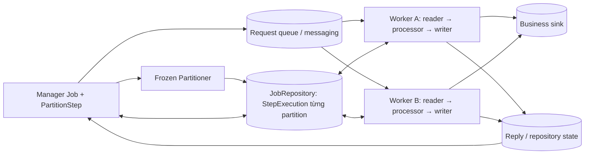
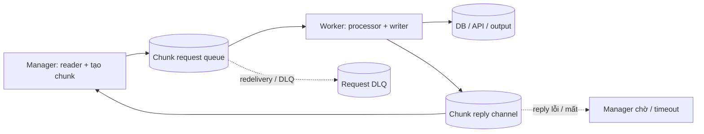
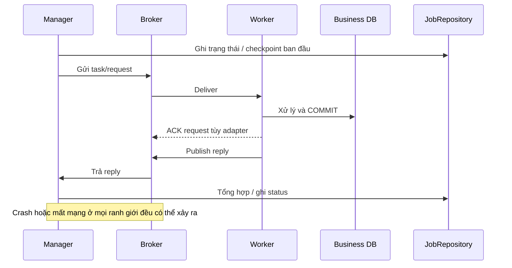
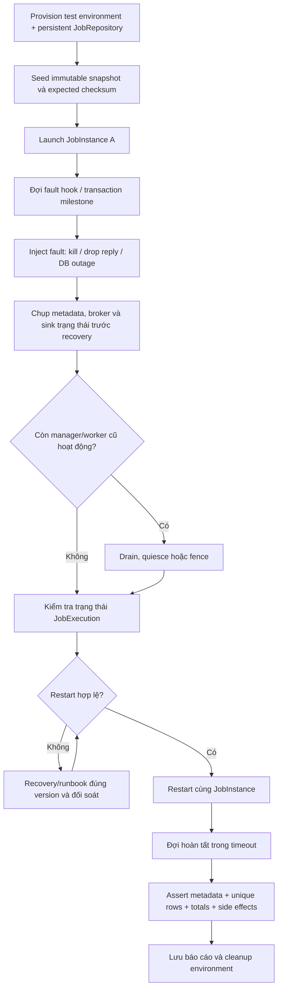

# Kiểm chứng restart trong môi trường phân tán

## 1. Vì sao “job restart được” chưa đủ?

Một Spring Batch job xử lý 40 triệu giao dịch trên nhiều worker. Manager gửi việc qua broker; mỗi worker đọc dữ liệu, xử lý và ghi vào database. Khi 90% công việc đã xong, một worker bị kill, broker mất kết nối hoặc manager restart vì node bảo trì. Sau đó, dashboard hiển thị `JobExecution COMPLETED`.

Có thể kết luận **không mất, không trùng và không lặp side effect** hay chưa? **Chưa.** Thành công về trạng thái Spring Batch là một điều kiện cần, nhưng tính đúng còn phụ thuộc vào dữ liệu đích, thời điểm commit, thông điệp đang bay, checkpoint của từng worker và cách restart được điều phối.

Trong chương **Restartability** của module `SPRING_BATCH_SCALING_OPERATIONS`, **kiểm chứng restart trong môi trường phân tán** nghĩa là **cố tình tạo lỗi ở các điểm nhạy cảm, khởi động lại đúng JobInstance, rồi chứng minh dữ liệu và metadata vẫn khớp contract nghiệp vụ**.

Module hướng tới scaling workload lớn bằng multi-threaded steps, parallel steps, partitioning và các cách xử lý phân tán. Trong môi trường này, tăng throughput có thể làm tăng số transaction, message đang chờ và các trường hợp lỗi khó tái hiện. **Restartability phải được chứng minh bằng thử nghiệm, không chỉ bằng việc cấu hình `restartable=true`.**

### Mục tiêu học tập

Sau bài này, bạn có thể:

1. Xác định trạng thái `JobInstance`, `JobExecution`, `StepExecution` và `ExecutionContext` cần giữ nguyên khi restart.
2. Phân biệt bài toán restart của **remote partitioning**, **remote chunking** và **remote step execution** theo phiên bản.
3. Thiết kế test cố ý làm rơi worker, manager, broker, DB hoặc reply ở từng **failure window**.
4. Kiểm chứng **không mất dữ liệu, không ghi trùng nghiệp vụ, đúng phiên bản và đúng phạm vi đầu vào** sau restart.
5. Xây dựng test harness, metric, SQL đối soát, runbook và bằng chứng kiểm thử có thể lặp lại.
6. Nhận biết trường hợp **không được restart ngay**: metadata `STARTED` mồ côi, còn worker đang ghi, snapshot thay đổi hoặc side effect chưa rõ kết quả.

## 2. Các khái niệm phải chốt trước khi test

| Khái niệm | Trong Spring Batch | Ý nghĩa khi restart |
| --- | --- | --- |
| `JobInstance` | Job name + **identifying JobParameters** | Định danh đúng đợt dữ liệu và snapshot |
| `JobExecution` | Một lần thực thi JobInstance | Restart hợp lệ tạo JobExecution mới cho **cùng** JobInstance |
| `StepExecution` | Lần thực thi một step | Lưu trạng thái, read/write/commit/rollback counts |
| `ExecutionContext` | Trạng thái checkpoint tại step/job | Khôi phục reader/stream/partition state nếu tương thích |
| `Partitioner` | Tạo tên partition và input context | Tên, mapping và phạm vi đầu vào phải ổn định |
| `PartitionHandler` | Giao việc cho worker local/remote | Tương tác middleware, timeout, reply, kết quả |
| `JobRepository` | Lưu metadata batch | Không phải transaction coordinator cho mọi DB, broker, HTTP |
| Broker | Vận chuyển request/reply | Ack, redelivery, timeout và dedup tùy cấu hình |
| Business sink | DB/file/API thực nhận kết quả | Nơi cần chứng minh dữ liệu duy nhất, đúng phiên bản |
| Snapshot/manifest | Tập đầu vào đã chốt | Không thay đổi khi restart cùng JobInstance |

**Restart không phải rerun:** nếu operator tăng identifying `run.id`, `manifestId` hoặc đổi job name, framework có thể tạo **JobInstance mới** và xử lý lại toàn bộ dữ liệu. Bài này tập trung vào restart **cùng JobInstance**; rerun/correction là workflow riêng với contract khác.

### 2.1. Bốn mức “đúng” cần chứng minh

1. **Metadata correctness:** trạng thái Job/Step hợp lệ, các partition hoàn tất đúng, checkpoint có thể đọc lại.
2. **Data correctness:** tập bản ghi đích khớp nguồn/snapshot, không thiếu, không dư, không sai phiên bản.
3. **Effect correctness:** API payment, email, broker event hoặc file publish không bị tác động ngoài ý muốn khi redelivery/restart.
4. **Operational correctness:** có thể phát hiện lỗi, cô lập tiến trình cũ, restart có kiểm soát, theo dõi và hoàn tất trong RTO/SLA.

Không chỉ assert `BatchStatus.COMPLETED`; một job có thể completed nhưng processor filter sai, writer thực hiện side effect hai lần hoặc một reply được tổng hợp không đúng.

## 3. So sánh restart theo từng mô hình phân tán

| Mô hình | Ai đọc input? | Đơn vị gửi qua middleware | Metadata quan trọng | Điểm lỗi đặc trưng |
| --- | --- | --- | --- | --- |
| **Remote partitioning** | Worker của từng partition | Lệnh thực thi **StepExecution** | Worker step name/partition ID, `ExecutionContext` | Worker commit nhưng manager không nhận kết quả |
| **Remote chunking** | Manager | **Chunk request** chứa items | Manager step/reader checkpoint, chunk request–reply correlation | Worker ghi xong nhưng reply thất lạc hoặc request redeliver |
| **Remote step** (Spring Batch 6.x+) | Remote worker step | Lệnh chạy một remote step | Remote step name, step execution/request context | Manager/worker bất đồng trạng thái remote step |
| **Local partitioning** | Worker trong cùng JVM | Task phân vùng nội bộ | Partition StepExecution, reader state | JVM chết cùng lúc với nhiều tasks |
| **Multi-threaded step** | Phụ thuộc phiên bản và kiểu step | Công việc trong cùng StepExecution | Reader/processor state, chunk checkpoint | Không có một StepExecution riêng cho mỗi thread |

### 3.1. Remote partitioning



Spring Batch quản lý metadata từng worker partition. Ví dụ `ordersWorkerStep:range-0001` và `ordersWorkerStep:range-0002` có StepExecution riêng; partition completed thường không bị chạy lại khi restart, partition failed được khôi phục theo checkpoint/step policy. **Tuy nhiên**, không được suy ra mọi side effect ngoài `JobRepository` chỉ xảy ra một lần vật lý: worker có thể bị gọi trùng hoặc chết trước khi trạng thái được xác nhận.

**Lưu ý kiến trúc:** worker cần cách truy cập `JobExplorer`/`JobRepository` phù hợp với topology; remote integration dùng request/reply hoặc polling repository tùy cấu hình. Không giả định tất cả worker dùng được một JDBC URL hoặc một transaction chung với manager.

### 3.2. Remote chunking



Ở đây worker xử lý một **chunk request**, không phải một `StepExecution` riêng cho từng chunk theo đúng mô hình remote partitioning. Vì vậy **không kiểm chứng remote chunking bằng cách đếm completed worker partitions**. Phải theo dõi **request–reply correlation, reader checkpoint của manager, số chunk in-flight, DB commit và redelivery**.

Một worker có thể đã commit DB nhưng reply bị mất. Nếu request được gửi lại, sink cần idempotency hoặc transaction protocol phù hợp; việc manager nhận được **reply thành công** cũng không tự chứng minh chỉ có một lần tác động bên ngoài.

### 3.3. Khác nhau giữa Spring Batch 5.x và 6.x

- Spring Batch **5.x** có các ví dụ Java cho local/remote partitioning, remote chunking thông qua Spring Batch Integration, cùng `JobRepository` và `StepExecution`.
- Spring Batch **6.x** bổ sung những mô hình như `RemoteStep` và local chunking; một số builder API, interface và tính năng vận hành thay đổi.
- Spring Batch **6.x** có API `JobOperator.recover(...)` để hỗ trợ tình huống JobExecution còn `STARTED` sau khi JVM dừng đột ngột (kiểm tra phiên bản/phương thức trước khi dùng).
- Khi dùng **JMS** với Spring Integration 7.0.6+ trong remote chunking/partitioning, cần kiểm tra header mapping cho `correlationId`, `sequenceNumber`, `sequenceSize` ở reply adapter, nếu không reply aggregator có thể không ghép đúng.

Các đoạn Java phía sau chủ yếu theo **Spring Batch 5.x** để minh họa API quen thuộc; phần mô hình và phép kiểm chứng dùng được cho cả 5.x/6.x sau khi đối chiếu tài liệu cụ thể. Không copy lẫn builder API giữa các version mà chưa biên dịch thử.

## 4. Định nghĩa tiêu chí thành công trước khi gây lỗi

Một bài test có tính quyết định phải có **expected input, expected output và trạng thái metadata đã định nghĩa trước**.

Giả sử một job nhập 120.000 sự kiện từ snapshot `S-2026-11-26`. Manifest có bốn partition, mỗi partition 30.000 records và writer tạo một row/business event duy nhất tại sink.

| Tiêu chí | Điều phải assert |
| --- | --- |
| Coverage | Mọi input record cần xử lý đều có output hợp lệ, theo policy filter/skip |
| No duplicates | Mỗi `(businessBatchId, sourceRecordId)` xuất hiện đúng một lần ở sink |
| Correct version | Sink lưu bản nghiệp vụ/latest source version đúng theo contract |
| Partition isolation | Partition A không đọc/ghi data của range B |
| Metadata | Sau restart cùng JobInstance có **JobExecution mới**, kết quả cuối đúng |
| Completed partition | Những partition đã hoàn thành không bị thực thi lại theo default, trừ cấu hình khác |
| Failed partition | Được retry/restart từ state hợp lệ, không bỏ sót vùng crash |
| External effects | Chỉ một tác động nghiệp vụ theo idempotency key, dù có nhiều delivery |
| Snapshot | Input của lần restart vẫn đúng snapshot/manifest ban đầu |
| Recovery time | Mọi bước đạt RTO và không gây overload pool/broker |
| Audit | Trace/correlation nối được manager–worker–message–StepExecution–sink |

**Không dùng chỉ một chỉ số `writeCount` để kiểm tra no duplicates**: `writeCount` đo hoạt động của step theo framework, không phải số **unique business rows** trong DB. Replay có thể khiến `writeCount` tăng trong khi idempotent UPSERT bỏ qua thay đổi, hoặc ngược lại một writer custom ghi nhầm nhưng count vẫn đẹp.

### 4.1. Contract về đầu vào: bất biến là điều kiện nền

Tạo manifest một lần:

```json
{
  "businessBatchId": "billing-2026-11",
  "manifestId": "billing-2026-11-v1",
  "snapshotId": "snapshot-2026-11-26T00",
  "partitions": [
    {"name": "range-0000", "fromInclusive": 0, "toExclusive": 30000},
    {"name": "range-0001", "fromInclusive": 30000, "toExclusive": 60000},
    {"name": "range-0002", "fromInclusive": 60000, "toExclusive": 90000},
    {"name": "range-0003", "fromInclusive": 90000, "toExclusive": 120000}
  ]
}
```

Đây là mẫu minh họa, **không phải API snapshot của database**. Số range chỉ là một chiến lược chia dữ liệu; manifest thực phải xác minh coverage, không overlap và mapping name → dataset **cố định qua restart**. Snapshot ID phải dẫn đến tập input thực sự bất biến, không chỉ một tên bảng live.

### 4.2. Identifying parameters: cùng JobInstance

```java
JobParameters parameters = new JobParametersBuilder()
        .addString("businessBatchId", "billing-2026-11", true)
        .addString("manifestId", "billing-2026-11-v1", true)
        .addString("testScenario", "worker-crash-after-commit", false)
        .toJobParameters();
```

`testScenario` chỉ là **non-identifying parameter minh họa** để không đổi identity khi restart; tốt hơn điều khiển fault injection bằng hệ thống test bên ngoài thay vì sửa parameter giữa các lần chạy. Một JobInstance được xác định bởi **job name + identifying parameters**. Đừng tăng `run.id` để cố restart, vì nếu nó identifying thì tạo JobInstance mới.

## 5. Failure windows: nơi restart dễ sai nhất

Trong phân tán, một thao tác nghiệp vụ gồm nhiều mốc không nằm trong cùng một transaction:



**Thứ tự ACK và publish reply trong sơ đồ là minh họa, không phải cam kết giao thức của mọi adapter.** Trong thực tế `ack`, commit DB và publish reply có thể sắp xếp khác nhau, hoặc được phối hợp bằng transaction/outbox. Bài test phải quan sát **chính triển khai đang chạy**.

### 5.1. Ma trận lỗi và kỳ vọng

| Điểm inject | Điều có thể xảy ra | Chứng cứ bắt buộc |
| --- | --- | --- |
| **Trước publish request** | Manager chưa giao việc; status có thể đang chạy | Không mất partition; restart/dispatch phù hợp |
| **Publish thành công, mất confirmation** | Manager tưởng gửi thất bại; có thể gửi lại | Broker message ID/correlation và sink không duplicate |
| **Sau broker deliver, trước worker xử lý** | Message redelivery hoặc timeout | Task được xử lý cuối cùng hoặc job fail quan sát được |
| **Giữa transaction writer** | Rollback hoặc partial external effects | DB row atomicity, rollback counts, idempotency |
| **Sau DB COMMIT, trước ACK/reply** | Message có thể giao lại, manager thiếu phản hồi | Sink một bản ghi nghiệp vụ, không trùng side effect |
| **Sau publish reply, trước manager consume** | Worker đã xong, manager vẫn chờ | Reply retention/correlation, recovery status đúng |
| **Manager nhận reply nhưng trước ghi metadata** | Side effect hoàn tất, repository chưa ghi nhận | Reconciliation, không replay nguy hiểm |
| **Worker đang viết, manager crash** | Worker có thể vẫn chạy sau khi manager chết | Fencing/đợi quiescence trước khi restart |
| **Broker mất kết nối hoặc restart** | In-flight/ack/message retention không chắc | Durability, redelivery, DLQ và timeout metrics |
| **JobRepository mất kết nối** | Worker commit dữ liệu nhưng không persist checkpoint | Tái chạy có idempotency, trạng thái không được giả success |
| **Snapshot hoặc object đổi giữa restart** | Checkpoint trỏ nguồn khác | Fail với mismatch, không âm thầm đọc bản mới |

**Điều kiện test thành công** không phải “mọi lỗi đều tự động restart không cần can thiệp”. Với các trường hợp trạng thái không xác định, **fail rõ + cần runbook/reconciliation** có thể an toàn hơn việc tự khởi động lại vô hạn.

## 6. Kiểm thử remote partitioning: StepExecution là đơn vị chính

### 6.1. Partition ID và StepExecution phải bền vững

Ví dụ job `invoiceDistributedJob` có bốn worker partition:

```text
JobInstance #77: invoiceDistributedJob(manifestId=M-001)

JobExecution #120:
  workerStep:range-0000 -> COMPLETED
  workerStep:range-0001 -> COMPLETED
  workerStep:range-0002 -> FAILED
  workerStep:range-0003 -> COMPLETED
  managerStep           -> FAILED

JobExecution #121 (restart cùng JobInstance #77):
  range-0000, range-0001, range-0003 thường không chạy lại
  range-0002 được xử lý lại/tiếp tục từ checkpoint phù hợp
  managerStep -> COMPLETED nếu mọi điều kiện đạt
```

Đây là trạng thái kỳ vọng **với cách restart mặc định và các partition đã completed được ghi nhận hợp lệ**. Nếu bật `allowStartIfComplete(true)`, custom splitter, cấu hình flow khác hoặc trạng thái cũ không được persist, hành vi có thể khác. Không giả định mọi worker đã completed nếu chỉ nhìn log worker “xử lý xong”; phải kiểm tra metadata thật.

### 6.2. Preflight bắt buộc của Partitioner

Một `Partitioner` tốt phải:

- Trả **chính xác các partition names** đã chốt trong manifest của JobInstance.
- Không chọn lại range dựa trên `MAX(id)` hiện tại hay danh sách file đang thay đổi.
- Không tạo mapping mới chỉ vì `gridSize` hoặc số replica thay đổi.
- Không đặt credential/raw payload vào `ExecutionContext`.
- Giữ tên step logic, reader name và state keys tương thích với checkpoint.

Ví dụ deterministic partitioner (Spring Batch 5.x SPI):

```java
record RangeSlice(String name, long fromInclusive, long toExclusive) {}

final class FrozenRangePartitioner implements Partitioner {

    private final String snapshotId;
    private final List<RangeSlice> slices;

    FrozenRangePartitioner(
            String snapshotId,
            List<RangeSlice> frozenSlices) {
        this.snapshotId = snapshotId;
        this.slices = List.copyOf(frozenSlices);
    }

    @Override
    public Map<String, ExecutionContext> partition(int gridSize) {
        Map<String, ExecutionContext> partitions = new LinkedHashMap<>();

        for (RangeSlice slice : slices) {
            if (slice.fromInclusive() >= slice.toExclusive()) {
                throw new IllegalArgumentException("Invalid range");
            }
            ExecutionContext context = new ExecutionContext();
            context.putString("snapshotId", snapshotId);
            context.putLong("fromInclusive", slice.fromInclusive());
            context.putLong("toExclusive", slice.toExclusive());

            if (partitions.putIfAbsent(slice.name(), context) != null) {
                throw new IllegalStateException("Duplicate partition name");
            }
        }
        return partitions;
    }
}
```

Code **chưa tự kiểm tra tất cả overlap/gap**; đó là điều kiện của manifest producer và test preflight. Trong ví dụ này `gridSize` là hint bị implementation bỏ qua: tạo số partition đúng bằng `slices.size()`, không tự động đúng bằng số worker.

### 6.3. Worker reader theo snapshot cố định

```java
@Bean("partitionReader")
@StepScope
JdbcPagingItemReader<InputRow> partitionReader(
        DataSource dataSource,
        @Value("#{stepExecutionContext['snapshotId']}") String snapshotId,
        @Value("#{stepExecutionContext['fromInclusive']}") Long from,
        @Value("#{stepExecutionContext['toExclusive']}") Long to) {

    return new JdbcPagingItemReaderBuilder<InputRow>()
            .name("partitionReader")
            .dataSource(dataSource)
            .selectClause("SELECT record_id, source_version, amount")
            .fromClause("FROM immutable_invoice_snapshot")
            .whereClause(
                    "WHERE snapshot_id = :snapshotId " +
                    "AND record_id >= :from " +
                    "AND record_id < :to")
            .parameterValues(Map.of(
                    "snapshotId", snapshotId,
                    "from", from,
                    "to", to))
            .sortKeys(Map.of("record_id", Order.ASCENDING))
            .rowMapper((rs, rowNum) -> new InputRow(
                    rs.getLong("record_id"),
                    rs.getLong("source_version"),
                    rs.getBigDecimal("amount")))
            .pageSize(200)
            .saveState(true)
            .build();
}
```

`InputRow` là record/domain type của ứng dụng và không được Spring Batch tạo tự động. Trước khi dùng cần chứng minh `(snapshot_id, record_id)` **unique** trong tập reader; nếu có nhiều version/row cùng record ID thì sort key này chưa đủ duy nhất, phải mở rộng khóa sắp xếp.

**Lưu ý:** `@StepScope` cho phép mỗi worker StepExecution có reader riêng; điều này không tự bảo đảm một singleton writer hoặc processor khác thread-safe. Nếu source không bất biến, `JdbcPagingItemReader` có thể tiếp tục sai dù `saveState(true)`.

### 6.4. Ví dụ worker step local để kiểm thử semantics

Trước khi đưa middleware vào test, kiểm tra cùng `Partitioner` và reader/writer bằng **local partitioned step** với repository persist. Điều này giúp cô lập lỗi logic/chunk khỏi lỗi truyền thông.

```java
@Bean("invoiceWorkerStep")
Step invoiceWorkerStep(
        JobRepository repository,
        PlatformTransactionManager txManager,
        @Qualifier("partitionReader") ItemStreamReader<InputRow> reader,
        ItemWriter<InputRow> idempotentWriter) {

    return new StepBuilder("invoiceWorkerStep", repository)
            .<InputRow, InputRow>chunk(200, txManager)
            .reader(reader)
            .writer(idempotentWriter)
            .build();
}

@Bean("partitionTestExecutor")
ThreadPoolTaskExecutor partitionTestExecutor() {
    ThreadPoolTaskExecutor pool = new ThreadPoolTaskExecutor();
    pool.setCorePoolSize(3);
    pool.setMaxPoolSize(3);
    pool.setQueueCapacity(8);
    pool.setThreadNamePrefix("partition-test-");
    return pool;
}

@Bean("localPartitionManagerStep")
Step localPartitionManagerStep(
        JobRepository repository,
        @Qualifier("invoiceWorkerStep") Step worker,
        @Qualifier("frozenPartitioner") Partitioner partitioner,
        @Qualifier("partitionTestExecutor") TaskExecutor executor) {

    return new StepBuilder("localPartitionManagerStep", repository)
            .partitioner(worker.getName(), partitioner)
            .step(worker)
            .gridSize(3)
            .taskExecutor(executor)
            .build();
}
```

Đây là **cấu hình local test** minh họa Spring Batch 5.x, **không phải remote partitioning hoàn chỉnh**. Khi chuyển remote, manager sẽ dùng `MessageChannelPartitionHandler`/builder và các kênh transport thực, worker dùng step handler/JobExplorer như cấu hình phiên bản đang chạy. **Không được coi bài test local PASS là bằng chứng đường broker/reply đã an toàn**.

## 7. Kiểm thử remote chunking: request/reply và checkpoint

Remote chunking dễ gây bất đồng trạng thái bởi manager đọc và gửi chunk, worker xử lý và ghi, rồi manager chờ replies.

### 7.1. Kịch bản bắt buộc

1. Manager publish request, worker chưa nhận → broker restart.
2. Worker nhận request nhưng chết trước writer.
3. Worker đang ghi chunk, DB timeout/rollback.
4. **Worker commit xong nhưng chết trước ACK hoặc reply.**
5. Worker publish reply, đường reply bị cắt.
6. Reply tới broker nhưng manager restart trước khi consume.
7. Một request được redeliver hai lần trong lúc có nhiều worker.
8. Reply đến trễ sau khi manager đã chuyển sang trạng thái failed/restart.
9. Poison request/reply được đưa DLQ/DLT và job không thể hoàn tất.
10. Chuyển phiên bản manager/worker dẫn tới deserialize/header mismatch.

### 7.2. Correlation là phần của hợp đồng

Với request và reply, hệ thống phải bảo toàn các header/fields mà giao thức Spring Batch Integration sử dụng để ghép kết quả, chẳng hạn `correlationId` và thứ tự/sequence headers tùy adapter.

Với Spring Integration JMS trong tài liệu **6.1.x**, có ví dụ allowlist:

```java
DefaultJmsHeaderMapper replyHeaderMapper =
        new DefaultJmsHeaderMapper(
                "correlationId", "sequenceNumber", "sequenceSize");
```

**Đây là cấu hình mapper trong lớp Spring Integration/JMS, không phải thay thế toàn bộ inbound adapter.** Phải gắn mapper vào **đúng reply message-driven channel adapter**. Nếu quá ít header được map, reply aggregator có thể thiếu correlation và bị treo hoặc lỗi. Không tự tạo `correlationId` mới trong re-drive để “chữa” reply hỏng: manager có thể không nhận ra response.

### 7.3. DLQ không tự làm Job FAILED

Một request đã vào DLQ có thể khiến manager vẫn **chờ một reply không bao giờ tới**, tùy timeout/error flow. Broker biết message thất bại; `JobRepository` chỉ biết trạng thái được Spring Batch cập nhật. Vì vậy test phải có:

- **Timeout hữu hạn** cho manager và operator, không treo vô hạn.
- DLQ depth/age, message reason và correlation để điều tra.
- Cơ chế fail/stop/recover phù hợp trạng thái thực tế.
- Runbook **không replay DLQ hàng loạt** khi không biết worker đã commit chưa.

**Không gửi fake `SUCCESS` reply** hoặc sửa `BATCH_*` để đánh dấu chunk đã hoàn tất. Nếu worker đã commit nhưng reply mất, phải đối soát trước khi quyết định xử lý lại.

## 8. Business idempotency: rào chắn chống ghi trùng

Một mô hình metadata tốt vẫn không tạo exactly-once end-to-end qua **DB + message broker + HTTP API**. Ta nên thiết kế **at-least-once delivery có xử lý lặp an toàn** hoặc một transaction/outbox protocol cụ thể đã được kiểm chứng.

### 8.1. Khóa nghiệp vụ ổn định qua restart

| Khóa | Có ổn định qua restart không? | Dùng làm idempotency key? |
| --- | --- | --- |
| `JobExecutionId` | **Không**, restart tạo execution mới | Không nên làm khóa duy nhất |
| `StepExecutionId` | Có thể khác ở lần thực thi mới | Không nên làm khóa nghiệp vụ |
| Broker delivery tag | Không ổn định qua redelivery | Không |
| `businessBatchId` | Có nếu contract giữ nguyên | Là một phần tốt của khóa |
| `sourceRecordId + sourceVersion` | Có nếu nguồn cung cấp identity/version bền vững | Thường phù hợp |
| `partitionName` | Có nếu manifest ổn định | Hữu ích tracing, không đủ cho uniqueness của record |
| Message sequence/correlation | Phụ thuộc giao thức | Dùng để ghép request–reply; cần audit trước khi dùng dedup |

**Khóa đề xuất:** tùy nghiệp vụ, `businessBatchId + sourceRecordId + operation` hoặc `sourceSystem + sourceRecordId + sourceVersion`. Khi rerun theo version mới, quyết định có sử dụng chung idempotency key hay tách version của output để tránh gửi side effect hai lần.

### 8.2. Sink DB idempotent minh họa

Ví dụ bảng PostgreSQL:

```sql
CREATE TABLE invoice_projection (
    business_batch_id TEXT NOT NULL,
    record_id BIGINT NOT NULL,
    source_version BIGINT NOT NULL,
    amount NUMERIC(18, 2) NOT NULL,
    PRIMARY KEY (business_batch_id, record_id)
);

INSERT INTO invoice_projection (
    business_batch_id, record_id, source_version, amount
)
VALUES (
    :batchId, :recordId, :sourceVersion, :amount
)
ON CONFLICT (business_batch_id, record_id)
DO UPDATE SET
    source_version = EXCLUDED.source_version,
    amount = EXCLUDED.amount
WHERE invoice_projection.source_version < EXCLUDED.source_version;
```

Nếu replay cùng version, câu lệnh `DO UPDATE` có điều kiện không làm thay đổi bản mới nhất. **Điều kiện:** `source_version` phải phản ánh đúng thứ tự thay đổi nghiệp vụ; khi nhiều input có cùng version nhưng giá trị khác nhau, phải fail/đối soát chứ không tùy ý lấy lần tới trước.

`JdbcBatchItemWriter` có tùy chọn kiểm tra số hàng bị update (ví dụ `assertUpdates` ở các phiên bản API). Một conditional upsert có thể tác động **0 hàng** khi replay hợp lệ; hãy kiểm thử và điều chỉnh assertion/implementation có chủ đích, không bỏ qua mọi write failure.

### 8.3. Side effect ngoài DB cần bảo vệ riêng

- Payment API: **idempotency key** do API hỗ trợ và kiểm tra trạng thái khi timeout không rõ.
- Gửi email/SMS: dedup theo `businessEventId`, không gửi trùng do worker restart.
- Kafka/broker: producer retries, outbox hoặc consumer dedup.
- File/object output: ghi staging riêng và publish bằng marker/version, không append cùng file từ hai worker.
- Tăng counter dạng `balance = balance + amount`: **không idempotent** khi replay; dùng ledger duy nhất/aggregate từ source bền vững.

Một transaction Spring Batch ở worker **không tự rollback HTTP request đã hoàn tất**. Test failure window sau external call trước checkpoint là bắt buộc nếu nghiệp vụ có thanh toán/notification.

## 9. Thiết kế bộ kiểm thử phân tán có thể lặp lại

### 9.1. Test infrastructure tối thiểu

Một bài test E2E có thể dùng môi trường cách ly gồm:

| Thành phần | Yêu cầu kiểm thử |
| --- | --- |
| Manager JVM/container | Chạy job với identifying params cố định; có endpoint trạng thái/log |
| 2–4 worker JVM/containers | Có thể kill/pause/restart **từng worker** |
| Broker test | RabbitMQ/JMS/Kafka phù hợp production, có quan sát ack/reply |
| `JobRepository` JDBC bền vững | **Giữ nguyên** qua các lần restart, không xóa schema giữa test |
| Source snapshot | Immutable dataset/manifest, có row IDs và checksum |
| Business sink | Unique key/version-aware, độc lập với metadata batch nếu production như vậy |
| Fault controller | Có thể inject network drop, DB outage, process kill tại mốc |
| Observability | Trace/correlation và các metric per job/partition/message |

Có thể dùng Testcontainers, Docker Compose hoặc môi trường staging do đội kiểm thử quản lý. **Điểm bắt buộc không phải tên công cụ**, mà là khả năng tái hiện **thời điểm lỗi** và giữ dữ liệu/metadata qua restart.

### 9.2. Seed dữ liệu có tính quyết định

Ví dụ seed 120.000 events, bốn ranges; một số source IDs cố tình có cùng business key/version để kiểm tra dedup, nếu contract cho phép. Lưu **expected snapshot checksum** và **expected unique IDs** trước khi chạy.

Test dataset cần bao gồm:

- Item đầu/cuối mỗi partition và đúng ở các range boundaries.
- File/object bị lỗi parse, record có Unicode/nullable field.
- Dữ liệu được phép skip theo business rule và dữ liệu bắt buộc fail.
- Một partition có số item lớn hơn phần còn lại để phát hiện skew.
- Các duplicate deliveries và source versions đến sai thứ tự.
- Dữ liệu mới xuất hiện **sau seal** để xác nhận nó không lọt vào JobInstance cũ.

### 9.3. Đồng bộ tại điểm lỗi bằng test hook

Không nên dựa duy nhất vào `Thread.sleep(500)` để giết đúng giữa commit và ack: kết quả dễ flaky. Dùng **test-only instrumentation**:

- Latch/Barrier tại điểm **trước khi gọi writer** hoặc **sau khi transaction đã hoàn tất**.
- DB proxy/traffic-control để chặn commit, sau đó chủ động fail.
- Broker proxy để chặn publish/ack/reply khi đã quan sát side effect.
- Endpoint test-only để kill đúng worker theo request/partition correlation.
- Timeout cho mọi barrier để không treo CI.

**Quan trọng:** nếu `ItemWriter.write(...)` ném exception **trong transaction**, DB write cùng transaction thường rollback. Đây **không** chứng minh failure window “sau COMMIT”. Muốn thử **commit thành công nhưng mất reply/ack**, phải inject sau khi DB transaction thật sự commit (ví dụ chặn reply ở broker, kill worker sau khi xác minh DB row committed). Không nhầm hai kịch bản.

## 10. Bộ test case theo mức độ ưu tiên

### 10.1. P0 — JobRepository và worker step basic restart

**Arrange:** khởi tạo manifest bốn ranges, sink trống, manager/worker/broker sẵn sàng.

**Act:** làm `range-0002` lỗi một cách có kiểm soát trước commit một chunk; đợi JobExecution kết thúc `FAILED`, sửa nguyên nhân và restart **cùng identifying parameters**.

**Assert:**

1. Có **một JobInstance**, ít nhất **hai JobExecutions**.
2. Các completed partitions trước đó không bị chạy lại theo default.
3. Partition failed có StepExecution mới/cơ chế resume hợp lệ.
4. Sink chứa đúng expected unique IDs và totals.
5. JobExecution cuối `COMPLETED`, không có partition `FAILED/STARTED` vô cớ.
6. Không tạo JobInstance mới vì tăng `run.id`.

### 10.2. P0 — Worker chết ngay sau DB commit

**Arrange:** chọn request/partition cụ thể, cấu hình hook hoặc network proxy để giữ reply.

**Act:** đợi row/chunk đã commit ở sink, ngăn reply đến manager, kill worker; đợi manager timeout/fail theo policy. Khởi động lại worker và restart hợp lệ.

**Assert:**

- Business sink **không** thêm duplicate khi công việc được giao lại.
- Không có payment/email/side effect lặp.
- Correlation trong logs xác định được delivery và replay.
- Manager không treo vô hạn; trạng thái cuối nhất quán hoặc lỗi rõ để can thiệp.
- `JobRepository` không bị sửa tay để làm test “pass”.

### 10.3. P0 — Manager chết khi workers còn chạy

**Arrange:** làm chậm hai workers, cho một worker vừa hoàn tất.

**Act:** kill manager (không graceful) trong lúc có tasks đang chạy. Xác định workers còn hoạt động; **không restart ngay khi chưa biết worker cũ đã dừng hay chưa**.

**Assert:**

- Test controller có thể làm các workers cũ **quiescent/fenced** hoặc chứng minh không còn ghi vào sink.
- `JobExecution` cũ có thể còn `STARTED`; không đoán rằng Spring Batch tự đổi thành `FAILED`.
- Quy trình recovery của phiên bản đang chạy được áp dụng có điều kiện sau khi đối soát.
- Restart không làm hai manager/worker generations cùng tranh cùng logical partition mà không có cơ chế bảo vệ.
- Không mất hoặc duplicate data.

### 10.4. P0 — Broker restart và reply mất

**Arrange:** cấu hình queue/topic durability theo production, publisher confirm/ack/offset đúng.

**Act:** restart broker ở ba thời điểm: trước worker nhận, khi worker xử lý và sau worker publish reply.

**Assert:**

- Cơ chế retry/redelivery của middleware đúng với thiết kế.
- Không âm thầm biến request thành `SUCCESS` khi chưa có thực thi thành công.
- Correlation/sequence headers còn đầy đủ.
- DLQ/DLT/timeout có đường xử lý rõ; job không đứng mãi.
- Sink đúng sau recovery hoặc job fail có thể điều tra.

### 10.5. P0 — Snapshot thay đổi giữa restart

**Arrange:** chốt manifest với object version hoặc snapshot ID.

**Act:** cố overwrite file/object cùng key hoặc thêm rows vào nguồn live; restart từ failed job.

**Assert:** worker chỉ đọc **đúng version đã chốt** hoặc fail **rõ ràng với fingerprint mismatch**. Không “chữa” bằng cách đọc version mới và dùng checkpoint cũ. Event mới thuộc batch/correction riêng.

### 10.6. P1 — Lỗi DB/JobRepository và overload

- Kill DB trước transaction commit → rollback và checkpoint khôi phục đúng.
- Kill DB ngay sau commit của business sink nhưng trước metadata/reply → idempotency chịu được replay.
- JobRepository hết connection → manager/worker báo lỗi, không giả success.
- Worker pool/broker consumer tăng quá quota → rate limit, `TaskRejectedException` hoặc timeout được quan sát và recovery phù hợp.
- API 429/503 kéo dài → bounded retry/backoff, không storm và không duplicate.

### 10.7. P1 — Stop, scale-in và deploy rolling

- `JobOperator.stop(...)` được yêu cầu → job dừng **cooperative**, không nhất thiết tức thời.
- Kubernetes gửi SIGTERM, hết grace period → phân biệt graceful stop và kill cứng.
- Worker vừa rolling deploy code/schema → serializer và `ExecutionContext` còn tương thích.
- Scale-in từ 8 xuống 2 workers khi có in-flight messages → không mất công việc, restart đúng.
- Restart với reader/step name bị đổi → phải phát hiện migration incompatibility.

## 11. Bảng failure-injection chi tiết

| ID | Lỗi tiêm vào | Kỳ vọng metadata | Kỳ vọng dữ liệu | Tín hiệu quan sát |
| --- | --- | --- | --- | --- |
| F01 | Worker throw trước writer | Step/Job fail theo policy | Chưa có write chunk lỗi | Exception, rollback count |
| F02 | DB rollback khi writer | Retry bounded hoặc FAILED | Không có partial DB commit trong transaction | DB logs, rollback |
| F03 | Kill worker sau commit trước reply | Có thể timeout/trạng thái chưa rõ | Không duplicate sau recovery | Sink rows, missing reply |
| F04 | Drop request sau manager publish | Timeout/retry theo policy | Không mất record cuối cùng | Publisher confirms, broker |
| F05 | Duplicate request delivery | Metadata không ghi success sai | Một hiệu ứng nghiệp vụ | Message IDs, dedup |
| F06 | Drop/corrupt correlation header | Aggregator fail/timeout rõ | Không replay mù | Correlation warnings |
| F07 | Broker down 1 phút | Không tự báo completed | Không thiếu/dư sau hồi phục | Broker errors, queue lag |
| F08 | Manager killed, workers alive | Có thể stale `STARTED` | Không ghi trùng khi được fencing | Pod/generation IDs |
| F09 | JobRepository down | FAILED/stalled theo thực tế | Không coi sink success là metadata success | DB pool, error logs |
| F10 | Replace object version khi restart | Fail mismatch hoặc pin old version | Không đọc nguồn mới | Manifest checksum |
| F11 | Change partition order/ID | Preflight chặn | Không checkpoint nhầm | Manifest diff |
| F12 | Deliver source version 8 rồi 7 | Job xử lý event theo policy | Sink giữ version 8 | Version-aware write |
| F13 | Một worker output file rồi crash | Partition fail/chưa confirmed | File publish atomic/dedup | Storage version |
| F14 | Remote reply vào DLQ | Manager không được giả complete | Không replay request trước reconciliation | DLQ depth/age |
| F15 | Restart với `run.id` khác | **JobInstance mới**—test phải phát hiện | Không coi là restart thành công | JobInstance IDs |
| F16 | Dừng graceful khi worker busy | `STOPPED` khi được xử lý hoàn chỉnh | Resume đúng phần còn lại | Stop latency |

**Không phải mọi kịch bản đều bắt buộc có trạng thái `FAILED` ngay lập tức.** Ví dụ crash cứng có thể để lại `STARTED`; quan trọng là test phải chỉ ra trạng thái đó, không che giấu nó và có thủ tục recovery được hỗ trợ.

## 12. Metadata assertions: chứng minh đây là restart thật

### 12.1. JobInstance không đổi

Giả sử test sau có `first` kết thúc `FAILED` và `second` là JobExecution được tạo bằng restart hợp lệ. Mẫu kiểm tra Java/JUnit (Spring Batch 5.x; test harness cung cấp `launchAndAwaitFailure`, `restartAndAwaitCompletion`):

```java
@Test
void restartKeepsJobInstanceButCreatesNewExecution() throws Exception {
    JobExecution first = harness.launchAndAwaitFailure(
            "invoiceDistributedJob", frozenParameters());

    assertEquals(BatchStatus.FAILED, first.getStatus());

    harness.disableFault("range-0002");

    JobExecution second = harness.restartAndAwaitCompletion(first.getId());

    assertEquals(BatchStatus.COMPLETED, second.getStatus());
    assertNotEquals(first.getId(), second.getId());
    assertEquals(
            first.getJobInstance().getInstanceId(),
            second.getJobInstance().getInstanceId());

    assertEquals(EXPECTED_RECORDS, sink.countUniqueBusinessRecords());
    assertEquals(EXPECTED_AMOUNT, sink.sumAmount());
    assertEquals(0L, sink.countDuplicateBusinessKeys());
}
```

**Đây là pseudo-integration test, không tự chạy nếu thiếu `harness` và `sink`:** các helper phải truy cập **JobRepository thực** và DB sink, poll trạng thái tới khi kết thúc, rồi có timeout. Tránh mock `JobRepository` hoặc dùng in-memory repository mới cho lần restart; khi đó bạn chưa kiểm chứng metadata persistence.

### 12.2. Kiểm tra completed partitions không chạy lại

Với `partitionWorkerStep:range-0000` đã completed trong lần đầu, test nên:

1. Lấy `JobInstanceId` của JobExecution đầu và cuối.
2. Truy vấn lịch sử StepExecution **trên tất cả JobExecutions của cùng JobInstance**.
3. Xác định partition ID nào completed trước failure và có được thực thi lại không.
4. Nếu cấu hình mặc định, assert **completed partition không có lần worker execution mới** sau restart.
5. Nếu business yêu cầu `allowStartIfComplete(true)`, định nghĩa expected count riêng; **không áp assertion mặc định**.

**Không chỉ xem StepExecution thuộc JobExecution cuối:** completed partitions có thể chỉ xuất hiện ở lần chạy trước, và đó chính là hành vi mong đợi.

### 12.3. SQL kiểm tra JobRepository

Với schema JDBC mặc định (điều chỉnh prefix/schema/DB dialect nếu cần):

```sql
SELECT
    ji.JOB_INSTANCE_ID,
    ji.JOB_NAME,
    je.JOB_EXECUTION_ID,
    je.STATUS AS JOB_STATUS,
    je.EXIT_CODE AS JOB_EXIT_CODE,
    se.STEP_EXECUTION_ID,
    se.STEP_NAME,
    se.STATUS AS STEP_STATUS,
    se.EXIT_CODE AS STEP_EXIT_CODE,
    se.READ_COUNT,
    se.WRITE_COUNT,
    se.COMMIT_COUNT,
    se.ROLLBACK_COUNT,
    se.START_TIME,
    se.END_TIME
FROM BATCH_JOB_INSTANCE ji
JOIN BATCH_JOB_EXECUTION je
  ON je.JOB_INSTANCE_ID = ji.JOB_INSTANCE_ID
LEFT JOIN BATCH_STEP_EXECUTION se
  ON se.JOB_EXECUTION_ID = je.JOB_EXECUTION_ID
WHERE ji.JOB_INSTANCE_ID = :job_instance_id
ORDER BY je.JOB_EXECUTION_ID, se.STEP_EXECUTION_ID;
```

Với partitioned job, một worker step có tên dạng `invoiceWorkerStep:range-0002`; so sánh status và counts trước/sau restart. Nếu cần xem checkpoint, ưu tiên API `JobExplorer`/`ExecutionContext` được hỗ trợ thay vì giải mã hoặc chỉnh binary/serialized payload thô từ `BATCH_STEP_EXECUTION_CONTEXT`.

### 12.4. SQL kiểm tra dữ liệu đích

```sql
-- Tổng output cho một business batch:
SELECT
    business_batch_id,
    COUNT(*) AS output_rows,
    COUNT(DISTINCT record_id) AS unique_record_ids,
    SUM(amount) AS total_amount
FROM invoice_projection
WHERE business_batch_id = :business_batch_id
GROUP BY business_batch_id;

-- Nếu muốn kiểm chứng source coverage, đối chiếu snapshot:
SELECT src.record_id
FROM immutable_invoice_snapshot src
LEFT JOIN invoice_projection out
  ON out.business_batch_id = :business_batch_id
 AND out.record_id = src.record_id
WHERE src.snapshot_id = :snapshot_id
  AND out.record_id IS NULL;
```

Đây là **kiểm tra tối thiểu**, cần bổ sung rule xử lý `filter/skip` và version nếu nguồn có nhiều bản ghi cùng ID. Nếu `PRIMARY KEY` đã bắt buộc unique, `COUNT(DISTINCT)` kiểm tra thêm nhưng không phát hiện mọi duplication trong hệ thống **khác** (email/API/broker); cần audit ledger riêng.

## 13. Khi manager chết và metadata còn STARTED

Đây là trường hợp vận hành nhạy cảm nhất. Nếu kill -9 manager, tiến trình không kịp cập nhật trạng thái `JobExecution`; trong repository có thể còn `STARTED`. Cố chạy lại cùng identifying parameters thường bị chặn vì framework nghĩ JobExecution vẫn đang chạy.

### 13.1. Quy trình an toàn

1. **Xác minh manager cũ thật sự không chạy** và không có một instance khác đang sở hữu cùng công việc.
2. Xác minh **worker generations cũ đã dừng/quiescent** hoặc có cơ chế fencing để chúng không tiếp tục ghi.
3. Chờ hoặc xử lý những requests/replies in-flight theo transport contract, tránh giao trùng gây side effect.
4. Đối soát sink/business side effects và metadata để biết partition/chunk nào không chắc chắn.
5. Xác minh snapshot và `ExecutionContext` còn tương thích và source còn sẵn.
6. Chọn **cơ chế recovery được hỗ trợ theo Spring Batch version**, rồi mới restart.
7. Nếu không biết chắc trạng thái, báo incident và **không** tự ép `STARTED → FAILED` chỉ vì một TTL hết hạn.

### 13.2. Spring Batch 6.x có API recover

Tài liệu Advanced Metadata Usage của Spring Batch 6.x giới thiệu `JobOperator.recover(...)` cho trường hợp JVM dừng đột ngột khiến execution còn `STARTED`. Minh họa khái niệm:

```java
// Spring Batch 6.x: pseudo-code vận hành có điều kiện.
// KHÔNG gọi khi manager/worker cũ còn thực sự đang xử lý.
JobExecution staleExecution = jobExplorer.getJobExecution(executionId);

verifyManagerIsGone(staleExecution);
verifyWorkersQuiescentOrFenced(staleExecution);
verifySourceAndSinkConsistency(staleExecution);

// Sau khi xác thực, dùng API recover của phiên bản đang chạy.
// Các helper verify* do ứng dụng/vận hành triển khai:
jobOperator.recover(staleExecution);

// Sau đó restart theo đúng overload/API của Spring Batch version đó.
```

**Các hàm `verify*` không phải API Spring Batch.** Đoạn code là **runbook sketch**, không là chương trình production hoàn chỉnh. Với Spring Batch 5.x, có thể không có `recover(...)` tương ứng; phải theo tài liệu và quy trình quản trị được hỗ trợ cho đúng phiên bản. **Không cập nhật bảng `BATCH_JOB_EXECUTION` bằng SQL thủ công như giải pháp mặc định**.

**Không tự suy diễn:** metadata nói `STARTED` không chứng minh worker vẫn chạy, và pod đã chết cũng không chứng minh side effect đã rollback. Cần thông tin cả hai phía.

### 13.3. Fencing tránh “hai thế hệ worker cùng ghi”

Nếu cần recovery khi một worker cũ có thể **sống lại** (network partition, pause JVM, broker consumer session delay), nên có cơ chế cô lập:

- Work lease hoặc owner generation ID gắn với đợt dispatch, có kiểm tra ở sink/coordinator khi phù hợp.
- Stop/drain workers cũ và chờ hoàn tất, hoặc vô hiệu hóa credentials/route tạm thời có kiểm soát.
- Giới hạn số active manager bằng scheduler/admission control.
- Giữ idempotency key cố định qua restart để duplicate requests không tạo hai kết quả.
- Không giả định `TaskExecutor` pool size ngăn đồng thời trên nhiều pod.

**Fencing token chỉ có tác dụng nếu nơi tạo side effect thực sự kiểm tra token/generation.** Ghi một field `epoch` vào log mà sink không kiểm tra không tự ngăn stale worker commit.

## 14. Stop/restart có chủ đích và rolling deployment

### 14.1. Graceful stop khác kill cứng

`JobOperator.stop(executionId)` yêu cầu job dừng theo cơ chế hợp tác của Spring Batch. Nó không bảo đảm ngay lập tức cắt được một thread đang gọi HTTP hoặc đang blocked trong code tùy biến.

Khi một node được bảo trì:

1. Tạm dừng scheduler tạo JobInstances mới nếu cần.
2. Yêu cầu stop, giám sát `STOPPING → STOPPED` với timeout.
3. Đợi workers hoàn tất/ack các unit in-flight theo contract hoặc fenced trước khi restart.
4. Đảm bảo snapshot, offset và metadata đã được persist.
5. Chuyển worker versions/serializer đồng bộ, rồi restart cùng JobInstance hợp lệ.

Nếu hết grace period và container bị kill, đây là **test crash recovery**, không còn chỉ là graceful-stop test.

### 14.2. Deployment và compatibility

| Thay đổi giữa hai deploy | Rủi ro restart |
| --- | --- |
| Đổi worker step name | Không khớp StepExecution identity |
| Đổi reader/writer name | Mất key checkpoint trong `ExecutionContext` |
| Thay serializable context schema | Không deserialize hoặc mất state |
| Đổi JSON/Avro message schema | Request/reply giữa các worker phiên bản khác bị lỗi |
| Đổi partitioning algorithm | Cùng tên partition trỏ dữ liệu mới |
| Đổi DB schema | Reader/writer mapping hoặc query sai |
| Đổi business versioning rules | Replay cũ ghi đè bản mới |

Nên kiểm thử **failure trên build A → deploy build B → restart** bằng dữ liệu/metadata staging giống production. Không chỉ kiểm thử restart trên cùng một build mới.

## 15. Theo dõi end-to-end restart

### 15.1. Correlation log bắt buộc

Một log event có cấu trúc nên có:

```json
{
  "service": "invoice-batch-worker",
  "event": "chunk-write-committed",
  "businessBatchId": "billing-2026-11",
  "jobInstanceId": 77,
  "jobExecutionId": 120,
  "stepExecutionId": 998,
  "partitionName": "range-0002",
  "messageCorrelationId": "corr-example-123",
  "workerId": "worker-02",
  "workerGeneration": "gen-05",
  "recordCount": 200
}
```

Field names là **mẫu observability do ứng dụng định nghĩa**, không có nghĩa framework/broker tự thêm tất cả các field đó. Với remote chunking, `stepExecutionId` thường tương ứng manager step/không phải partition riêng; cần tách cách diễn giải log. Không log full payload tài chính, access token, PII hoặc serializer binary. Tránh high-cardinality labels trong metrics; giữ ID chi tiết ở log/audit có quyền truy cập.

### 15.2. Metric gợi ý

| Metric | Ý nghĩa |
| --- | --- |
| `batch_restart_attempts_total` | Số lần cố restart trên một loại job |
| `batch_restart_success_total` | Số restart hoàn tất và được đối soát |
| `batch_job_stale_started_total` | Executions có trạng thái `STARTED` nhưng mất heartbeat theo policy |
| `batch_partition_failed_total` | Partition thất bại theo job |
| `batch_partition_replay_total` | Partition/task bị giao lại |
| `remote_chunk_missing_replies` | Request không nhận đủ reply trước timeout |
| `remote_chunk_duplicate_deliveries` | Request được nhận nhiều lần |
| `broker_dlq_depth` và `broker_oldest_age_seconds` | Message lỗi cần điều tra |
| `sink_idempotency_conflicts_total` | Replay bị từ chối/không thay đổi vì business key |
| `business_reconciliation_mismatch_total` | Sai khác dữ liệu sau job/restart |
| `restart_recovery_seconds` | RTO thực tế |
| `db_pool_pending_connections` | Nguy cơ overload sau retry storm |

Đây là **tên metric đề xuất**, không phải toàn bộ metric mặc định của Spring Batch/Actuator. Cảnh báo quan trọng hơn “retry count tăng” là **retry tăng nhưng output không tiến**, reply bị mất, stale executions và reconciliation mismatch.

### 15.3. Phân biệt “đã nhận reply” với “đã ghi dữ liệu”

Cần ít nhất hai đường quan sát:

- **Control plane:** JobRepository, broker ack/reply, worker heartbeat.
- **Data plane:** business sink, unique keys, version, source coverage và publish marker.

Control plane có thể chậm hoặc sai lệch vì timeout; data plane có thể đã commit. Nếu chỉ có một trong hai, chưa đủ cơ sở tự động khôi phục các trường hợp sau commit.

## 16. Benchmark recovery và SLA

Ví dụ workload 40 triệu records, 16 partitions trên 8 workers. Bảng **hoàn toàn minh họa**:

| Kịch bản | Thời gian bình thường | Recovery sau lỗi | Nhận xét |
| --- | --- | --- | --- |
| Không inject lỗi | 42 phút | 0 | Baseline |
| Một partition fail giữa chunk | 42 phút dự kiến | 9 phút restart | Completed partitions được giữ |
| Một worker chết sau DB commit | Không áp dụng | 11 phút điều tra + restart | Phải chứng minh không duplicate |
| Manager chết, stale `STARTED` | Không áp dụng | 18 phút recovery có fencing | RTO phụ thuộc quiescence/metadata |
| Broker outage 10 phút | >42 phút | 14 phút xử lý/khôi phục | Queue và reply phải đủ |
| Rerun JobInstance mới toàn bộ | 42 phút dự kiến | 42+ phút | Không phải restart; tải lại mọi partition |

**Không có số liệu framework chuẩn** cho các mốc trên. Thời gian recovery gồm **phát hiện → cô lập → xác minh → restart → đối soát → publish**, không chỉ thời gian Spring Batch chạy một step lần hai.

### 16.1. RTO và RPO

- **RTO (Recovery Time Objective):** thời gian cho phép từ sự cố đến khi dữ liệu được phục hồi/công bố.
- **RPO (Recovery Point Objective):** mức mất dữ liệu được phép. Với batch tài chính yêu cầu không mất bản ghi đã chốt, RPO nghiệp vụ thường gần zero đối với snapshot cần xử lý, nhưng phải chứng minh bằng kiểm thử.
- **Completeness SLO:** số bản ghi hợp lệ trong snapshot đã có kết quả đúng.
- **Duplicate effect SLO:** số thanh toán/thông báo phát trùng chấp nhận được (nhiều hệ thống chọn 0 ở cấp nghiệp vụ).
- **Freshness SLA:** độ trễ từ khi nguồn chốt đến khi publish, kể cả thời gian recovery.

Đạt `BatchStatus.COMPLETED` nhanh nhưng thiếu một bản ghi tiền tệ vẫn là thất bại theo contract.

## 17. Trình tự test tự động được khuyến nghị



Để test có giá trị trong CI:

1. **Timeout mọi bước**: poll JobExecution, chờ worker, fault hook, broker recovery.
2. **Dữ liệu đầu vào deterministic**, không phụ thuộc `now()` hoặc thứ tự bất định.
3. **Giữ nguyên volume/database metadata** giữa hai lần chạy của cùng test.
4. **Không reuse môi trường còn process cũ** giữa các test; dọn sạch hoặc cô lập bằng run IDs thật sự.
5. **Collect evidence khi fail**, không xóa log/queue ngay trước điều tra.
6. **Chạy nhiều vòng** đối với các race cửa sổ nhỏ để phát hiện flaky, nhưng không chỉ dựa vào xác suất.
7. **So sánh sink trước/sau restart** để phát hiện side effects lặp đã bị “che” bởi trạng thái metadata đẹp.
8. **Thử đúng version adapters/driver/DB/broker** tương đương production, không thay toàn bộ bằng mocks.

### 17.1. Báo cáo test mẫu

```text
Scenario: F03 worker commit then reply lost
Job: invoiceDistributedJob
JobInstanceId: 77
First JobExecutionId: 120
Restart JobExecutionId: 121
Manifest: M-001 / snapshot S-001
Fault: drop reply for correlation corr-123 after sink commit
Old worker quiesced/fenced: YES
Before restart status: FAILED (validated)
Final job status: COMPLETED
Expected source unique IDs: 120000
Actual sink unique IDs: 120000
Unexpected duplicates: 0
Business amount diff: 0
Payment/notification duplicate effects: 0
Completed partitions rerun unexpectedly: 0
Result: PASS
```

Mọi số liệu trong báo cáo trên là **ví dụ**, không phải kết quả thử nghiệm đã chạy. Nếu test không thể chứng minh worker cũ đã dừng, hoặc side effect ngoài DB không quan sát được, ghi `INCONCLUSIVE/BLOCKED` thay vì `PASS`.

## 18. Runbook production khi restart bị kẹt

### 18.1. Triệu chứng thường gặp

| Triệu chứng | Khả năng cần kiểm tra | Hành động ưu tiên |
| --- | --- | --- |
| Job mãi `STARTED` nhưng không còn pod manager | Crash không cập nhật metadata | Xác minh quiescence và recovery đúng version |
| Manager còn sống nhưng chờ replies | Reply route/header/timeout lỗi | Kiểm tra correlation và broker DLQ |
| Worker status `COMPLETED` nhưng manager `FAILED` | Mất reply hoặc aggregation lỗi | Đối soát sink/metadata trước khi retry |
| Worker nhiều lần xử lý một request | Redelivery/retry storm | Kiểm tra ack, retry policy và idempotency |
| Restart tạo JobInstance khác | Identifying params thay đổi | So sánh job name, `manifestId` và `run.id` |
| Completed partition bị chạy lại | `allowStartIfComplete`/partition mapping sai | Kiểm tra cấu hình và lịch sử StepExecution |
| Restart đọc file version mới | Manifest/object không immutable | Chặn, phục hồi version cũ/correction |
| DB sink duplicate records | Thiếu unique key/idempotency | Dừng re-drive, sửa writer và đối soát |
| Reply DLQ tăng nhanh | Worker reply/mapping lỗi | Không replay request mù |
| Job `COMPLETED` nhưng output thiếu | Business validation thiếu | Incident/correction, không giả restart cùng completed instance |

### 18.2. Runbook 8 bước

1. **Khoanh phạm vi:** `businessBatchId`, `manifestId`, JobInstanceId, JobExecutionId, partition/chunk correlation.
2. **Dừng mở rộng lỗi:** khóa scheduler launch trùng và kiểm soát worker concurrency, không tạo thêm JobInstances bằng `run.id` mới.
3. **Chụp bằng chứng:** JobRepository metadata, broker queues/DLQ/headers, worker logs, DB sink versions và external side effects.
4. **Xác minh quyền sở hữu:** có manager/worker cũ đang chạy không? Drain/fence nếu cần.
5. **Đối soát:** chưa commit/đã commit/không rõ trạng thái từng đơn vị công việc; kiểm tra source snapshot có thay đổi không.
6. **Chọn recovery:** restart JobInstance cũ khi hợp lệ; với stale `STARTED` dùng cơ chế recover theo version; nếu dữ liệu không ổn định, dừng và dùng correction workflow.
7. **Chạy có kiểm soát:** bounded workers, retry/backoff, timeout, giám sát reply lag và DB connections.
8. **Đóng sự cố:** xác minh unique business output, source coverage, không lặp side effect, trạng thái Job, publish version và audit trail.

Không **UPDATE/DELETE `BATCH_*` metadata** bằng tay như một cách làm thường quy; không tạo fake reply success, không cho broker replay toàn DLQ khi chưa biết commit state và không restart trong khi workers cũ còn ghi.

## 19. Tình huống thực tế: 25 triệu bản ghi, một worker mất kết nối

Một tổ chức xử lý **25 triệu hồ sơ** đêm qua remote partitioning trên tám worker. Manager tạo 40 partitions, mỗi partition định danh theo vùng `tenant + ID range` trong manifest bất biến.

### Diễn biến

1. 35 partitions `COMPLETED`, bốn partitions đang chạy, một partition vừa commit chunk cuối.
2. Broker mất kết nối, worker đó không gửi được reply, và manager hết timeout.
3. JobExecution đầu `FAILED`; tại sink có thể đã có dữ liệu của partition vừa commit.
4. Đội vận hành muốn tăng `run.id` và chạy lại toàn bộ 25 triệu records.

### Phương án nên kiểm chứng

- Dùng repository để xác định **JobInstance cũ**, lịch sử 40 worker StepExecutions và partition nào thực sự completed.
- Đối chiếu sink theo `businessBatchId + recordId`, đặc biệt chunk cuối mất reply; kiểm tra duplicate ledger.
- Xác nhận không có worker cũ còn write sau khi manager fail.
- Khôi phục broker, correlation/routing và idempotent writer.
- Restart **cùng JobInstance**; nếu trạng thái metadata bị kẹt, dùng recovery theo version sau khi kiểm chứng.
- Quan sát worker partitions failed/unknown; các completed partitions không chạy lại theo default.
- Chỉ publish snapshot khi input count, output unique count, tổng nghiệp vụ và side effect audit đều khớp.

### Kết quả cần báo cáo

Không chỉ ghi “restart thành công”, mà ghi: **cùng JobInstance**, số JobExecutions, số partitions thực thi lại, số chunk redelivery, DB transaction commit/rollback, số unique records và sự kiện ngoài DB bị lặp. Nếu có mismatch, job phải được coi là **chưa đáp ứng business correctness** dù status đã `COMPLETED`.

## 20. Những sai lầm phổ biến

| Nhận định | Điều đúng |
| --- | --- |
| “Job restartable nghĩa remote worker tự recover tất cả lỗi.” | Restartability metadata không bảo đảm broker/DB/external API exactly-once. |
| “Một worker báo COMPLETED là manager chắc chắn nhận reply.” | Reply có thể mất hoặc correlation sai. |
| “JobRepository bảo đảm mọi side effect xảy ra đúng một lần.” | Metadata step không đồng nhất với transaction ngoài hệ thống. |
| “Job lại `STARTED` sau kill -9 thì cứ restart ngay.” | Cần xác minh process cũ đã dừng và recovery đúng version. |
| “Tăng `run.id` chính là restart.” | Có thể tạo JobInstance mới và reprocess toàn bộ. |
| “Chỉ cần assert `BatchStatus.COMPLETED`.” | Phải đối soát source/sink, duplicates và side effects. |
| “Remote chunking có worker StepExecution cho từng chunk.” | Mô hình remote chunking khác remote partitioning. |
| “Gửi request thành công nghĩa worker đã commit.” | Publish/delivery không đồng nghĩa business DB commit. |
| “ACK broker nghĩa manager đã lưu checkpoint.” | Ack và repository update có thể khác transaction. |
| “Requeue/DLQ có thể tự biết chunk chưa ghi.” | Cần đối soát; worker có thể đã commit trước khi mất reply. |
| “Reader `saveState(true)` là đủ để restart nguồn mutable.” | Checkpoint không thay thế snapshot/version bất biến. |
| “Partitioner có thể sinh tên lại theo danh sách mới nhất.” | Mapping mới có thể làm checkpoint cũ áp lên dữ liệu khác. |
| “Dùng `JobExecutionId` làm payment idempotency key.” | ExecutionId đổi khi restart, có thể trả tiền/gửi notification lặp. |
| “Fail trong `ItemWriter` chứng minh tình huống crash sau commit.” | Exception trong transaction thường rollback, không tương đương mất reply sau commit. |
| “Một pool 4 threads giới hạn toàn cluster 4 worker.” | Nhiều pod/exec pools có giới hạn riêng, cần quota chung. |
| “Không có log lỗi nên dữ liệu đúng.” | Phải có checksum, unique ID, business totals và monitoring. |
| “Sửa tay metadata để test pass là chấp nhận được.” | Che giấu lỗi thật và phá khả năng audit/recovery. |
| “Thử local partitioning đủ để chứng minh remote.” | Local không kiểm thử transport, redelivery và reply correlation. |

## 21. Câu hỏi tự kiểm tra

**Câu 1.** Một job có hai `JobExecution` nhưng cùng `JobInstanceId`. Lần thứ hai thường là restart hay rerun?

*Gợi ý:* Là một lần thực thi khác của cùng JobInstance; khi lần trước fail/stop và restart hợp lệ, đó là restart. Phải kiểm tra identifying parameters, không chỉ đếm executions.

**Câu 2.** Worker đã commit DB rồi chết trước reply. Tại sao retry chunk có thể gây duplication?

*Gợi ý:* Manager/broker không biết chắc side effect đã xảy ra; message có thể được redeliver. Sink cần idempotency theo business key/operation, không dùng delivery tag.

**Câu 3.** Sau kill -9 manager, metadata còn `STARTED`. Có nên sửa ngay thành `FAILED` bằng SQL rồi restart không?

*Gợi ý:* Không. Cần bảo đảm không còn worker cũ đang ghi, đối soát trạng thái và dùng recovery path được hỗ trợ theo phiên bản Spring Batch.

**Câu 4.** Một partition `COMPLETED` ở lần chạy trước, lần restart lại có thêm file mới trong cùng partition. Điều gì sai?

*Gợi ý:* Manifest/partition identity không bất biến; framework có thể bỏ qua công việc mới hoặc gắn checkpoint sai. File mới cần batch/correction riêng.

**Câu 5.** Vì sao một test cố tình ném exception trong writer trước commit không đủ chứng minh “commit thành công nhưng reply mất”?

*Gợi ý:* Ném exception trong transaction thường rollback. Phải quan sát commit thực, rồi chặn reply/ack ở tầng ngoài transaction.

**Câu 6.** Vì sao `JobExecutionId` không phù hợp làm duy nhất payment idempotency key?

*Gợi ý:* Restart tạo JobExecutionId mới, cùng payment có thể được gửi lại với khóa khác; dùng business operation ID ổn định.

**Câu 7.** Remote chunking manager chờ reply nhưng message nằm DLQ. Có thể tự đánh dấu step completed không?

*Gợi ý:* Không. DLQ không chứng minh worker chưa commit; cần correlation, timeout, đối soát và recovery protocol, không tạo success giả.

## 22. Checklist nghiệm thu production

- [ ] Đã tách rõ remote partitioning, remote chunking và remote step theo phiên bản đang dùng.
- [ ] Có JobRepository persistent chung với worker metadata theo topology phù hợp.
- [ ] Đã định nghĩa JobInstance identity và identifying JobParameters cố định cho restart.
- [ ] Partition IDs/manifest/snapshot/reader keys giữ nguyên qua restart.
- [ ] Có test dữ liệu thực với DB sink unique key/version-aware writes.
- [ ] Có test worker crash trước commit, giữa transaction và **sau commit trước reply**.
- [ ] Có test manager crash với workers còn sống, quiescence/fencing và stale `STARTED`.
- [ ] Có test broker outage, redelivery, reply lost, DLQ và correlation headers.
- [ ] Không dùng run.id mới để “restart” job cũ.
- [ ] Có timeout và backoff ở manager/worker, không để job chờ replies vô hạn.
- [ ] Có logic business idempotency cho DB, HTTP/API, broker events và notifications.
- [ ] Có đối soát input source IDs, unique sink IDs, totals/checksums và source versions.
- [ ] Completed partitions không được chạy lại ngoài ý muốn; failed partitions recover hợp lệ.
- [ ] Có test input changed/file version mismatch và schema/serializer drift.
- [ ] Có stop/rolling-deploy test, hiểu khác biệt graceful và hard kill.
- [ ] Có metadata SQL/`JobExplorer` report trên **mọi JobExecutions của JobInstance**.
- [ ] Có metric stale-started, missing replies, retries, duplicate deliveries và DB capacity.
- [ ] Có quy trình recovery theo Spring Batch 5.x/6.x cụ thể, không sửa bảng `BATCH_*` mù.
- [ ] Test E2E giữ nguyên repository và snapshot qua restart, không thay bằng mocks.
- [ ] Mọi fault scenarios đều có **timeout**, audit và cleanup/fencing rõ.
- [ ] Có kết quả PASS/FAIL/BLOCKED thực tế, không đánh dấu PASS khi trạng thái không xác định.
- [ ] Đã benchmark RTO, throughput sau restart và giới hạn concurrency của cả cluster.
- [ ] Chỉ publish dữ liệu khi mọi partition/chunk cần thiết hoàn tất và business reconciliation đúng.

## Tài liệu tham khảo

- [Spring Batch Reference 5.2 — Scaling and Parallel Processing](https://docs.spring.io/spring-batch/reference/5.2/scalability.html): partitioning SPI, remote chunking và restart semantics.
- [Spring Batch Reference 6.x — Scaling and Parallel Processing](https://docs.spring.io/spring-batch/reference/scalability.html): mô hình remote partitioning/chunking/remote step và khác biệt version.
- [Spring Batch Integration — Externalizing Batch Process Execution](https://docs.spring.io/spring-batch/reference/spring-batch-integration/externalizing-execution.html): `MessageChannelPartitionHandler`, worker request handler, chunk request/reply và JMS correlation headers.
- [Spring Batch — Domain Language of Batch](https://docs.spring.io/spring-batch/reference/domain.html): `JobInstance`, `JobExecution`, `StepExecution` và `ExecutionContext`.
- [Spring Batch — Advanced Metadata Usage](https://docs.spring.io/spring-batch/reference/job/advanced-meta-data.html): `JobOperator.stop(...)`, restart, recover và handling abrupt JVM shutdown.
- [Spring Batch — Configuring a Job](https://docs.spring.io/spring-batch/reference/job/configuring-job.html): `restartable`/`preventRestart()` và JobInstance.
- [Spring Batch — Configuring a Step for Restart](https://docs.spring.io/spring-batch/reference/step/chunk-oriented-processing/restart.html): checkpoint, `ItemStream`, `startLimit` và `allowStartIfComplete`.
- [Spring Batch — Database ItemReaders and ItemWriters](https://docs.spring.io/spring-batch/reference/readers-and-writers/database.html): `JdbcPagingItemReader`, sort key unique và writer.
- [Spring Batch — Database Schema Appendix](https://docs.spring.io/spring-batch/reference/schema-appendix.html): `BATCH_JOB_INSTANCE`, `BATCH_JOB_EXECUTION`, `BATCH_STEP_EXECUTION` và contexts.
- [RabbitMQ — Consumer Acknowledgements and Publisher Confirms](https://www.rabbitmq.com/docs/confirms): ack/nack/redelivery và publisher confirms.
- [RabbitMQ — Dead Letter Exchanges](https://www.rabbitmq.com/docs/dlx): dead-letter routing và lý do message bị tách khỏi queue.
- [PostgreSQL — INSERT / ON CONFLICT](https://www.postgresql.org/docs/current/sql-insert.html): conditional UPSERT cho idempotent sink.

**Điểm cần nhớ:** kiểm chứng restart phân tán không dừng ở việc `JobExecution` chuyển từ `FAILED` sang `COMPLETED`. Phải chứng minh **cùng JobInstance, checkpoint và partition identity đúng, không có worker thế hệ cũ còn ghi, mọi request/reply có đường xử lý lỗi, sink không thiếu/trùng và side effect có idempotency**. Hãy cố ý tạo lỗi **sau commit nhưng trước ACK/reply**, thu bằng chứng ở cả control plane lẫn data plane, rồi mới tuyên bố hệ thống có thể restart an toàn.
