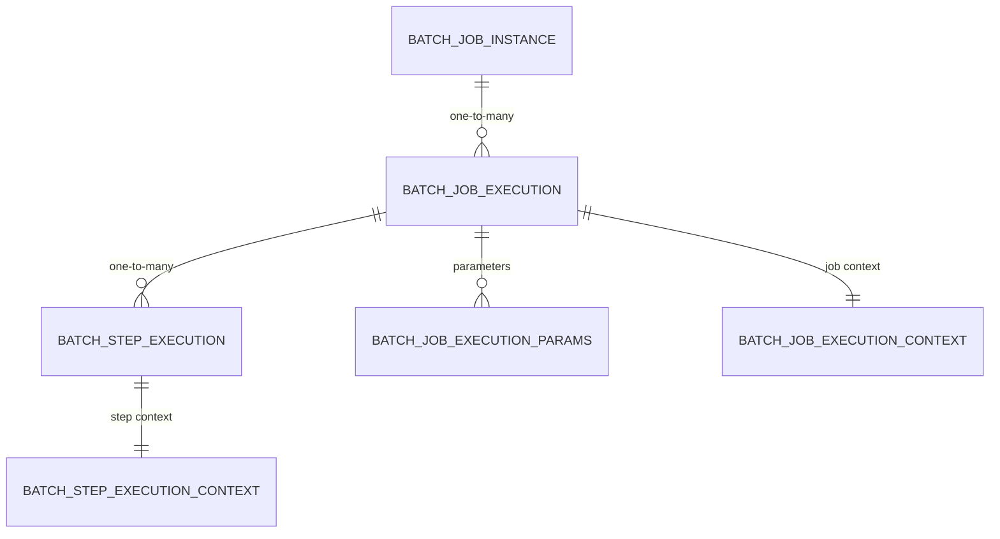

# Metadata của JobRepository

## 1. Vì sao phải hiểu metadata trước khi mở rộng Spring Batch?

Trong module **SPRING_BATCH_SCALING_OPERATIONS**, mục tiêu là mở rộng Spring Batch cho workload dữ liệu lớn bằng multi-threaded step, parallel steps, partitioning và các kiến trúc phân tán, đồng thời kiểm soát bottleneck, thread safety, retry/restart và vận hành thực tế. Để đạt được những mục tiêu đó, trước hết phải hiểu **metadata của `JobRepository`**: hệ thống ghi lại *job nào đang chạy, lần chạy nào đã thành công hoặc thất bại, step nào đã commit tới đâu và dữ liệu checkpoint nào cần dùng để chạy lại*.

Bài học thuộc chương **JobRepository**, với chủ đề **Metadata của JobRepository**.

Xét một hệ thống tính doanh thu cuối ngày cho 20 triệu giao dịch:

- Lúc 22:00, job `dailySettlement` được chạy với tham số `businessDate=2026-11-25`.
- Step `readTransactions` hoàn tất; step `aggregate` thất bại ở một trong 16 partition.
- Lúc 22:30, người vận hành restart job với cùng ngày nghiệp vụ. Họ muốn chỉ chạy lại phần chưa hoàn thành và kiểm tra các partition đã thành công.
- Nhiều worker ở các JVM khác nhau cần đọc/ghi trạng thái nhất quán mà không giẫm lên cùng một bản ghi metadata.

Các yêu cầu này phụ thuộc vào dữ liệu được quản lý bởi `JobRepository`. Nếu dùng repository chỉ giữ trạng thái tạm thời hoặc xóa nhầm metadata, khả năng xác định tiến độ và restart đúng có thể bị mất.

Sau bài này, bạn sẽ:

1. Phân biệt `Job`, `JobInstance`, `JobExecution`, `StepExecution`, `JobParameters` và `ExecutionContext`.
2. Hiểu quan hệ giữa **sáu bảng metadata JDBC** chuẩn của Spring Batch, cách đọc khóa và trạng thái.
3. Theo dõi một lần job thất bại rồi restart thông qua các bản ghi metadata.
4. Đọc metadata bằng SQL phục vụ vận hành và kiểm tra tiến độ partition, retry, rollback.
5. Chọn và cấu hình loại JobRepository phù hợp ở Spring Batch 5.x/6.x, tránh xóa hoặc sửa metadata gây mất khả năng khôi phục.

## 2. JobRepository và mô hình miền của Spring Batch

`JobRepository` cung cấp các thao tác lưu và truy xuất trạng thái thực thi batch. Đây là **metadata kỹ thuật**, không phải kho dữ liệu nghiệp vụ. Ví dụ, bảng `BATCH_STEP_EXECUTION` lưu `READ_COUNT=100000`, nhưng không lưu 100.000 bản ghi đơn hàng đã đọc. Hệ thống nghiệp vụ vẫn cần các bảng dữ liệu và cơ chế nhất quán riêng.

Các đối tượng có quan hệ như sau:

| Khái niệm | Ý nghĩa | Cách phân biệt |
| --- | --- | --- |
| `Job` | Định nghĩa luồng công việc gồm các step | Tên job, ví dụ `dailySettlement` |
| `JobParameters` | Tham số đầu vào của lần chạy | `businessDate`, `region`, `run.id`...; một số tham số có tính **identifying** |
| `JobInstance` | Một **lần chạy logic** của job | `Job name + identifying JobParameters` |
| `JobExecution` | Một **lần thử thực thi** của JobInstance | Mỗi lần chạy/restart tạo một execution riêng |
| `StepExecution` | Trạng thái một lần thực thi step trong một JobExecution | Step name, status, read/write/commit/rollback counts... |
| `ExecutionContext` | Tập giá trị nhỏ dùng làm checkpoint/trạng thái khôi phục | Phạm vi job hoặc step; được tuần tự hóa và lưu ở repository |

Cấu trúc một trường hợp restart:

```text
Job definition: dailySettlement
    |
    +-- JobInstance #100: identifying {businessDate=2026-11-25}
         |
         +-- JobExecution #500: FAILED (lần chạy lúc 22:00)
         |    +-- StepExecution #700: readTransactions  COMPLETED
         |    +-- StepExecution #701: aggregate:partition0 COMPLETED
         |    +-- StepExecution #702: aggregate:partition1 FAILED
         |        +-- Step ExecutionContext: checkpoint, dải ID...
         |
         +-- JobExecution #501: COMPLETED (restart lúc 22:30)
              +-- StepExecution #703: aggregate:partition1 COMPLETED
                  +-- Step ExecutionContext: phục hồi từ checkpoint
```

*Các ID và trạng thái trên là minh họa. Các step/partition thực sự được tạo hoặc bỏ qua phụ thuộc cấu hình flow, partitioner và chính sách restart.*

**Quy tắc cốt lõi:** `JobInstance` được xác định bằng tên job và **các tham số identifying**. Nếu execution đầu tiên thất bại, chạy lại với cùng tham số identifying sẽ tạo một `JobExecution` mới cho **cùng** `JobInstance`. Nếu đổi một tham số identifying (chẳng hạn đổi `businessDate`), đó là **JobInstance khác** và không kế thừa checkpoint của instance cũ.

Ví dụ:

| Job | JobParameters | Cùng JobInstance? |
| --- | --- | --- |
| `dailySettlement` | `businessDate=2026-11-25` (identifying) | Instance A |
| `dailySettlement` | `businessDate=2026-11-25` (identifying), `requestedBy=operator1` (non-identifying) | Vẫn là A |
| `dailySettlement` | `businessDate=2026-11-26` (identifying) | Instance B |
| `dailySettlement` | `businessDate=2026-11-25` + `run.id=2` (**identifying**) | Instance C |

Nếu mỗi lần gọi job đều đưa `run.id` mới và để nó là identifying, framework xem đây là instance mới; đó **không phải restart** của lần cũ. Với những job phải khôi phục tiến độ, hãy thiết kế khóa nhận diện theo kỳ dữ liệu hoặc đơn vị nghiệp vụ ổn định.

## 3. Sáu bảng metadata của JDBC JobRepository

Với **JDBC-backed JobRepository**, Spring Batch dùng sáu bảng metadata quan hệ, mặc định có tiền tố `BATCH_`.

| Bảng | Đối tượng / mục đích | Một số cột quan trọng |
| --- | --- | --- |
| `BATCH_JOB_INSTANCE` | Một JobInstance logic | `JOB_INSTANCE_ID` (PK), `JOB_NAME`, `JOB_KEY`, `VERSION` |
| `BATCH_JOB_EXECUTION` | Mỗi lần thử chạy JobInstance | `JOB_EXECUTION_ID` (PK), `JOB_INSTANCE_ID` (FK), `STATUS`, `EXIT_CODE`, `CREATE_TIME`, `START_TIME`, `END_TIME`, `LAST_UPDATED`, `VERSION` |
| `BATCH_JOB_EXECUTION_PARAMS` | Các tham số của từng JobExecution | `JOB_EXECUTION_ID` (FK), `PARAMETER_NAME`, `PARAMETER_TYPE`, `PARAMETER_VALUE`, `IDENTIFYING` |
| `BATCH_STEP_EXECUTION` | Mỗi StepExecution | `STEP_EXECUTION_ID` (PK), `JOB_EXECUTION_ID` (FK), `STEP_NAME`, `STATUS`, `READ_COUNT`, `WRITE_COUNT`, `COMMIT_COUNT`, `ROLLBACK_COUNT`, `VERSION` |
| `BATCH_JOB_EXECUTION_CONTEXT` | ExecutionContext phạm vi job | `JOB_EXECUTION_ID` (PK, FK), `SHORT_CONTEXT`, `SERIALIZED_CONTEXT` |
| `BATCH_STEP_EXECUTION_CONTEXT` | ExecutionContext phạm vi step | `STEP_EXECUTION_ID` (PK, FK), `SHORT_CONTEXT`, `SERIALIZED_CONTEXT` |

### Sơ đồ liên hệ



**Một số chi tiết dễ nhầm:**

- `BATCH_JOB_INSTANCE.JOB_KEY` là khóa được tạo từ tham số nhận diện, dùng cùng `JOB_NAME` để phân biệt instance. Không tự tính hoặc sửa `JOB_KEY` theo suy đoán của ứng dụng.
- `BATCH_JOB_EXECUTION_PARAMS.IDENTIFYING` phân biệt tham số góp phần xác định instance và tham số chỉ phục vụ lúc chạy. Tại Spring Batch 5.x/6.x, schema dùng `PARAMETER_NAME`, `PARAMETER_TYPE`, `PARAMETER_VALUE`; **đừng áp dụng SQL từ schema cũ có `TYPE_CD`, `KEY_NAME` hoặc `DATE_VAL`** mà không kiểm tra phiên bản.
- `JOB_EXECUTION_ID` nằm ở bảng execution và bảng params, không phải khóa instance; một instance có thể có nhiều execution.
- Một `JobExecution` có thể có nhiều `StepExecution`, nhưng Step chưa được thực thi vì step trước thất bại có thể **không có** hàng `StepExecution` trong execution đó.
- `BATCH_JOB_EXECUTION_CONTEXT` và `BATCH_STEP_EXECUTION_CONTEXT` thường có một bản ghi tương ứng với execution của phạm vi đó, không phải một hàng cho mỗi key checkpoint.
- Khóa tăng dần của `JOB_INSTANCE`, `JOB_EXECUTION`, `STEP_EXECUTION` do sequence hoặc cơ chế tương đương theo database vendor cấp. **ID lớn không bảo đảm thời điểm bắt đầu hay kết thúc muộn hơn theo thứ tự đồng hồ** trong mọi tình huống.
- Không phải mọi cách cài đặt `JobRepository` đều dùng sáu bảng này; `ResourcelessJobRepository` không lưu metadata bền vững, còn `MongoJobRepository` dùng collection MongoDB.

Schema chi tiết và tên cột chuẩn phải lấy theo script `schema-*.sql` **đúng phiên bản Spring Batch và đúng database vendor** đang triển khai.

## 4. Metadata được ghi ra sao trong một vòng đời job?

Xét job `dailySettlement` với `businessDate=2026-11-25`, gồm step đọc dữ liệu và step tổng hợp. Giả sử lần đầu thất bại, sau đó restart:

| Thời điểm / hành động | Metadata liên quan | Điều người vận hành có thể thấy |
| --- | --- | --- |
| Bắt đầu lần đầu | Tạo `JobInstance #100`, `JobExecution #500`; lưu JobParameters | `STATUS=STARTING/STARTED` theo tiến trình |
| Step đọc hoàn thành | Thêm/cập nhật `StepExecution`, context và counters | `readTransactions=COMPLETED` |
| Step tổng hợp đã commit nhiều chunk rồi lỗi | Cập nhật `StepExecution`, checkpoint, rollback/skip count; đánh dấu failure | `aggregate=FAILED`, có `EXIT_MESSAGE` hoặc mã lỗi |
| Restart với cùng identifying params | Tạo `JobExecution #501` thuộc `JobInstance #100` | Có lịch sử **hai executions** của cùng instance |
| Step đã hoàn thành và không bắt buộc chạy lại | Framework có thể bỏ qua step đó | Không giả định sẽ có StepExecution mới cho step được bỏ qua |
| Step lỗi được khôi phục, job hoàn tất | Execution mới nhận state phù hợp và cập nhật trạng thái | `JobExecution #501=COMPLETED` |

Spring Batch dựa vào metadata để quyết định có thể restart, step nào đủ điều kiện chạy lại và khôi phục trạng thái gì. Tuy nhiên, metadata **không tự làm cho các tác động bên ngoài thành exactly-once**. Ví dụ, ghi file không có transaction hoặc gọi API thanh toán có thể đã hoàn thành trước lúc job gặp lỗi; restart có thể gọi lại phần công việc đó. Cần bổ sung **business idempotency key**, ràng buộc unique, outbox hoặc cơ chế chống xử lý trùng ở tầng dữ liệu.

### BatchStatus và ExitStatus khác nhau thế nào?

- **`BatchStatus` / cột `STATUS`:** trạng thái điều khiển vòng đời như `STARTING`, `STARTED`, `COMPLETED`, `FAILED`, `STOPPED`, `ABANDONED`.
- **`ExitStatus` / `EXIT_CODE` và `EXIT_MESSAGE`:** kết quả nghiệp vụ/kỹ thuật để điều khiển flow và giải thích kết thúc; mã thoát có thể tùy biến.

`COMPLETED` biểu thị framework coi lần thực thi đã kết thúc thành công theo cấu hình job; nó không thay thế kiểm toán dữ liệu đầu ra. Tương tự, `STARTED` còn lưu trong database sau khi JVM sập không chứng minh tiến trình vẫn sống.

## 5. Dữ liệu chi tiết trong StepExecution và ý nghĩa vận hành

Các cột thống kê của `BATCH_STEP_EXECUTION` đặc biệt hữu ích cho workload lớn:

| Cột | Ý nghĩa thường dùng | Điều cần cẩn trọng |
| --- | --- | --- |
| `READ_COUNT` | Số item đọc thành công được tính trong step execution | Không nhất thiết bằng số hàng đầu ra hoặc tổng cả các lần restart |
| `WRITE_COUNT` | Số item đã ghi và commit trong step execution | Có thể khác read count do filter/skip hoặc nhiều item vào một record nghiệp vụ |
| `FILTER_COUNT` | Số item bị processor lọc | Không phải lỗi; thường do processor trả về `null` |
| `READ_SKIP_COUNT` | Số item bị skip khi đọc | Phải phù hợp skip policy |
| `PROCESS_SKIP_COUNT` | Số item bị skip khi xử lý | Kiểm tra bản ghi lỗi và chính sách retry |
| `WRITE_SKIP_COUNT` | Số item bị skip khi ghi | Cần kiểm tra ràng buộc dữ liệu và lỗi batch write |
| `COMMIT_COUNT` | Số transaction commit | Không nhất thiết bằng `WRITE_COUNT / chunkSize` |
| `ROLLBACK_COUNT` | Số lần rollback | Có thể bao gồm rollback do retry và skip recovery |
| `START_TIME` / `END_TIME` | Thời gian StepExecution được chạy và kết thúc | Phân biệt thời gian chờ từ JobExecution |
| `STATUS` / `EXIT_CODE` | Trạng thái và mã kết thúc | Có thể khác mục đích: lifecycle so với flow |
| `VERSION` | Số phiên bản phục vụ optimistic locking | Framework quản lý; không tự sửa thủ công |

Ví dụ: `READ_COUNT=100000`, `FILTER_COUNT=5000`, `WRITE_COUNT=95000` có thể là tình huống xử lý hợp lệ không có lỗi. Nhưng khi job có retry, chunk rollback, skip, dữ liệu nhiều bước và restart, **không nên lấy một phép trừ đơn giản giữa các counter làm chứng cứ dữ liệu cuối cùng đầy đủ**. Hãy đối soát thêm khóa nghiệp vụ và bảng đích.

### VERSION giúp an toàn khi cập nhật đồng thời

Spring Batch sử dụng **optimistic locking** trên metadata có cột `VERSION`. Mỗi lần update hợp lệ làm phiên bản tiến lên; nếu hai luồng/process sửa cùng bản ghi từ phiên bản cũ, một thao tác có thể thất bại với `OptimisticLockingFailureException`.

Cơ chế này đặc biệt quan trọng khi nhiều worker/JVM chia sẻ repository. Nó giúp phát hiện xung đột ghi metadata; **không thay thế thread safety của reader/processor/writer và không chống ghi trùng dữ liệu nghiệp vụ**.

Nếu xuất hiện lỗi optimistic locking dày đặc, trước tiên kiểm tra có nhiều tác nhân cùng cập nhật một `StepExecution`, cấu hình partition có tạo state riêng hay không, và có đang sửa metadata ngoài framework không. Không giải quyết bằng cách tự tăng `VERSION` bằng SQL.

## 6. ExecutionContext: checkpoint cho restart

`ExecutionContext` chứa các key/value mà framework tuần tự hóa để phục vụ restart. Có hai phạm vi:

| Đặc điểm | Step ExecutionContext | Job ExecutionContext |
| --- | --- | --- |
| Thuộc về | Một `StepExecution` | Một `JobExecution` |
| Bảng lưu | `BATCH_STEP_EXECUTION_CONTEXT` | `BATCH_JOB_EXECUTION_CONTEXT` |
| Ví dụ | `lastProcessedId`, vị trí file, dải ID partition | Tên file đã tạo, tổng số giao dịch để dùng ở step tiếp theo |
| Thời điểm lưu trong chunk step | Thường được lưu trước mỗi commit | Thường được lưu giữa các step |
| Mục đích | Tiếp tục đúng vị trí của step | Truyền state qua các step và quản lý trạng thái toàn job |

Một ví dụ lưu checkpoint ở phạm vi step:

```java
// Ví dụ minh họa cách lưu dữ liệu nhỏ vào Step ExecutionContext.
// Trong code thật, đặt logic khôi phục vào ItemStream.open/update/close
// hoặc listener phù hợp với vòng đời reader/writer.
ExecutionContext stepContext = stepExecution.getExecutionContext();
stepContext.putLong("lastCommittedTransactionId", 120_000L);
```

Dòng `putLong(...)` chỉ đổi object trong bộ nhớ; **không có nghĩa ngay lập tức đã ghi xuống database**. Framework sẽ lưu context ở những điểm vòng đời thích hợp. Đặc biệt, đừng đặt `lastCommittedTransactionId` theo item đã *đọc* hoặc đang *xử lý* rồi ngộ nhận item đó chắc chắn đã commit. Với reader checkpoint, tốt nhất để `ItemStream.update(...)` cùng nhịp commit quản lý giá trị đại diện cho tiến độ có thể khôi phục.

Tình huống: job đọc tới item số 150.000 nhưng transaction vừa xử lý bị rollback. Nếu checkpoint lưu vượt vị trí đã commit, restart có thể **bỏ sót** item. Ngược lại, checkpoint lùi lại có thể khiến một số item được đọc lại; khi đó output cần idempotent để không tạo bản ghi kép.

**Các nguyên tắc đặt state:**

1. Lưu thông tin **nhỏ, ổn định và có thể serialize**: vị trí offset, ID cuối cùng đã commit, tên nguồn, mã partition.
2. Không lưu toàn bộ batch item, kết nối JDBC, HTTP client, file handle hoặc dữ liệu nhạy cảm không cần thiết.
3. Đặt key có namespace, ví dụ `reader.orders.currentId` để tránh trùng key giữa các component trong cùng context.
4. Bảo đảm serializer tương thích khi nâng phiên bản, đổi package hoặc đổi lớp Java. Các object tùy chỉnh phải có khả năng được khôi phục sau triển khai lại.
5. Nếu cần truyền dữ liệu từ step này sang step khác, dùng `ExecutionContextPromotionListener` hoặc cơ chế tương ứng để đưa khóa từ Step Context lên Job Context **sau khi step hoàn tất phù hợp**.
6. Ở partitioning, mỗi partition nên giữ state và khóa input của riêng mình; không cho các worker cùng thay một map shared mutable để làm checkpoint.

**Điều cần nhớ:** Job-level context không được persist liên tục trong lúc một step đang thực thi như step-level context. Nếu dùng job context làm checkpoint từng chunk, mất điện giữa step có thể khiến tiến độ đó chưa được lưu.

## 7. Quan hệ metadata với retry, restart và parallelism

### 7.1 Restart đúng instance

- Một execution có `FAILED` hoặc `STOPPED` có thể được restart khi đáp ứng điều kiện của job/step; có thể dùng `JobOperator` để restart theo execution ID.
- JobInstance đã `COMPLETED` thường không thể được chạy lại với cùng identifying parameters; thiết kế `allowStartIfComplete` ở step khác với việc tạo instance mới.
- Context được khôi phục theo chính sách restart của framework, còn writer và dịch vụ bên ngoài vẫn phải xử lý các tác động đã xảy ra trước lỗi.
- Mất hoặc xóa bản ghi `JobInstance`, `StepExecution` hoặc context có thể khiến framework coi một lần chạy là mới hoặc không khôi phục được điểm trước đó.

### 7.2 Multi-threaded step

Với các mẫu Spring Batch 5.x chạy đồng thời nhiều chunk, metadata StepExecution thường được cập nhật nhiều lần trong vòng đời step. Reader/writer chia sẻ không an toàn có thể gây sai vị trí checkpoint hoặc số liệu. Ở mô hình chunk-oriented Step mới của Spring Batch 6.x, `TaskExecutor` thường cho processor chạy song song, trong khi đọc/ghi vẫn tuần tự. Dù dùng mô hình nào, vẫn cần kiểm tra transaction, checkpoint và thread safety đúng phiên bản.

### 7.3 Parallel steps

Khi các step độc lập chạy cùng lúc, mỗi step có `StepExecution` và `ExecutionContext` riêng. Chúng có thể cạnh tranh connection pool và ghi metadata thường xuyên. Hãy dùng cùng một repository đáng tin cậy nếu các step thuộc cùng một hạ tầng job, đồng thời kiểm tra các step có tranh chấp dữ liệu nghiệp vụ hay không.

### 7.4 Partitioning

Partitioner tạo nhiều step execution có tên phân biệt, chẳng hạn:

```text
aggregate:partition0
aggregate:partition1
aggregate:partition2
...
aggregate:partition15
```

Mỗi partition mang theo context mô tả dải dữ liệu/file cần xử lý. Metadata giúp manager nhận biết partition nào đã chạy và trạng thái để điều phối restart. Để bảo đảm xử lý nghiệp vụ không trùng, phần partition dữ liệu phải **không chồng lấn** hoặc writer phải idempotent; không suy diễn rằng metadata tự tạo exactly-once cho mọi write và side effect.

### 7.5 Xử lý phân tán

Nếu nhiều JVM cùng quản lý một workload, các instance cần khả năng đọc/ghi metadata ở kho lưu **chung, bền vững** cùng transaction và cơ chế khóa phù hợp. Repository ở bộ nhớ riêng mỗi JVM không cung cấp cái nhìn nhất quán về các lần chạy. Cần thiết kế connection pool, transaction isolation, network reliability và chính sách khôi phục sau mất kết nối DB. Với remote partitioning, cả cơ chế giao việc, kết quả worker và metadata đều cần được vận hành thống nhất.

## 8. Chọn implementation JobRepository và cấu hình theo phiên bản

### 8.1 Spring Batch 5.2

Trong cấu hình Java dùng `@EnableBatchProcessing` của Spring Batch 5.2, hạ tầng batch dựa trên JDBC `JobRepository` và cần một `DataSource` cùng `PlatformTransactionManager` thích hợp.

```java
@Configuration
@EnableBatchProcessing(
    dataSourceRef = "batchDataSource",
    transactionManagerRef = "batchTransactionManager",
    tablePrefix = "BATCH_"
)
public class BatchInfrastructureConfig {
    // Định nghĩa các bean batchDataSource, batchTransactionManager
    // hoặc cung cấp chúng từ cấu hình Spring của ứng dụng.
}
```

### 8.2 Spring Batch 6.x

Từ **Spring Batch 6.0**, khi dùng `@EnableBatchProcessing` hoặc `DefaultBatchConfiguration` theo mặc định, hạ tầng có thể là **`ResourcelessJobRepository`**. Implementation này không lưu metadata bền vững, không hỗ trợ restart dựa trên checkpoint và **không thread-safe**; nó dành cho job đơn giản, một lần, một JVM.

Để triển khai JDBC-backed JobRepository trong cấu hình annotation của Spring Batch 6.x, chọn tường minh:

```java
import org.springframework.batch.core.configuration.annotation.EnableBatchProcessing;
import org.springframework.batch.core.configuration.annotation.EnableJdbcJobRepository;
import org.springframework.context.annotation.Configuration;

@Configuration
@EnableBatchProcessing
@EnableJdbcJobRepository(
    dataSourceRef = "batchDataSource",
    transactionManagerRef = "batchTransactionManager",
    tablePrefix = "BATCH_"
)
public class JdbcBatchMetadataConfiguration {
    // Cần có bean batchDataSource và batchTransactionManager.
    // Tạo schema metadata đúng loại database trước khi chạy job.
}
```

Trong Spring Batch 6.x cũng có `MongoJobRepository` dùng MongoDB collections. Khi dùng Mongo, đừng mong các câu SQL truy vấn bảng `BATCH_*` ở phần sau sẽ áp dụng được.

**Lưu ý Spring Boot:** Cấu hình tự động của Spring Boot phụ thuộc phiên bản và sự hiện diện của các annotation/configuration do ứng dụng khai báo. Hãy kiểm tra **bean JobRepository thực sự được tạo** và chọn một cách cấu hình hạ tầng nhất quán; không chồng nhiều cấu hình Batch mà không biết bean nào thắng.

### 8.3 Chuẩn bị schema và khóa

- Tạo bảng bằng script `schema-*.sql` đi kèm **đúng thư viện Spring Batch** và database vendor, trước khi chạy job. Không tự suy tên cột theo hướng dẫn của phiên bản khác.
- Một số khóa ID dùng database sequence, hoặc bảng mô phỏng sequence trên vendor không hỗ trợ sequence. Không xóa hay đặt lại sequence khi metadata cũ còn tồn tại.
- Nếu thay `tablePrefix`, đổi đồng bộ **cấu hình JobRepository và tên bảng vật lý**; thuộc tính này chỉ đổi prefix, không đổi tên cột/cấu trúc.
- Để nâng cấp Spring Batch, xem migration script cho metadata và thử restart một job thất bại trong môi trường staging. Đồng thời kiểm tra khả năng đọc lại `ExecutionContext` sau nâng phiên bản.

## 9. Truy vấn metadata bằng SQL để vận hành

Các truy vấn sau dành cho **JDBC JobRepository** với prefix mặc định `BATCH_` và schema Spring Batch 5.x/6.x tương ứng. Ví dụ dùng cú pháp SQL phổ biến; giới hạn số bản ghi và phân trang có thể cần chỉnh theo database vendor.

### 9.1 Xem các lần chạy gần đây của một job

```sql
SELECT
    ji.JOB_NAME,
    ji.JOB_INSTANCE_ID,
    je.JOB_EXECUTION_ID,
    je.STATUS,
    je.EXIT_CODE,
    je.CREATE_TIME,
    je.START_TIME,
    je.END_TIME,
    je.LAST_UPDATED
FROM BATCH_JOB_INSTANCE ji
JOIN BATCH_JOB_EXECUTION je
    ON je.JOB_INSTANCE_ID = ji.JOB_INSTANCE_ID
WHERE ji.JOB_NAME = 'dailySettlement'
ORDER BY je.CREATE_TIME DESC, je.JOB_EXECUTION_ID DESC;
```

**Cách đọc:** nếu cùng `JOB_INSTANCE_ID` xuất hiện trong hai hàng có `JOB_EXECUTION_ID` khác nhau, đó là hai lần thực thi của cùng instance. Để truy vết **lý do** restart, xem thêm `EXIT_CODE`, `EXIT_MESSAGE` và `StepExecution`.

### 9.2 Xem các step và partition của một execution

```sql
SELECT
    STEP_NAME,
    STATUS,
    READ_COUNT,
    WRITE_COUNT,
    FILTER_COUNT,
    READ_SKIP_COUNT,
    PROCESS_SKIP_COUNT,
    WRITE_SKIP_COUNT,
    COMMIT_COUNT,
    ROLLBACK_COUNT,
    START_TIME,
    END_TIME,
    EXIT_CODE
FROM BATCH_STEP_EXECUTION
WHERE JOB_EXECUTION_ID = 500
ORDER BY STEP_NAME, STEP_EXECUTION_ID;
```

Thay `500` bằng execution ID cần điều tra. Với partitioning, tìm `STEP_NAME` có hậu tố như `:partition0`, `:partition1` để xác định partition nào chậm hoặc lỗi nhiều. Nếu job có nhiều `JobExecution`, cần xem các execution của **cùng instance** để thấy lịch sử restart đầy đủ.

### 9.3 Kiểm tra tham số identifying

```sql
SELECT
    je.JOB_EXECUTION_ID,
    p.PARAMETER_NAME,
    p.PARAMETER_TYPE,
    p.PARAMETER_VALUE,
    p.IDENTIFYING
FROM BATCH_JOB_EXECUTION je
JOIN BATCH_JOB_EXECUTION_PARAMS p
    ON p.JOB_EXECUTION_ID = je.JOB_EXECUTION_ID
WHERE je.JOB_EXECUTION_ID = 500
ORDER BY p.PARAMETER_NAME;
```

Câu truy vấn giúp kiểm tra `run.id` hay `businessDate` có vô tình được đặt là identifying. Giá trị tham số có thể chứa thông tin nghiệp vụ nhạy cảm; chỉ cấp quyền đọc cho nhóm vận hành cần thiết và không đưa khóa truy cập/password vào JobParameters.

### 9.4 Phát hiện execution báo đang chạy quá lâu

```sql
SELECT
    JOB_EXECUTION_ID,
    JOB_INSTANCE_ID,
    STATUS,
    START_TIME,
    LAST_UPDATED
FROM BATCH_JOB_EXECUTION
WHERE STATUS IN ('STARTING', 'STARTED', 'STOPPING')
ORDER BY START_TIME;
```

Đối chiếu danh sách với scheduler, process/JVM/pod đang sống, log và monitoring. `LAST_UPDATED` là **lần metadata được persist**, không phải heartbeat đáng tin cậy theo chu kỳ cố định. Job đang đợi I/O có thể không cập nhật nhanh; ngược lại job chết đột ngột có thể còn `STARTED`. Không tự động đổi trạng thái trong DB dựa trên một câu truy vấn.

### 9.5 Đọc ExecutionContext một cách có kiểm soát

`BATCH_JOB_EXECUTION_CONTEXT` và `BATCH_STEP_EXECUTION_CONTEXT` chứa context đã serialize; cách biểu diễn phụ thuộc serializer, phiên bản và cấu hình. Khi cần xem checkpoint, ưu tiên API của Spring Batch hoặc công cụ vận hành hiểu serializer tương ứng. Không giả định `SERIALIZED_CONTEXT` là JSON có thể sửa tay và không nên cố gắng giải mã tùy ý dữ liệu có chứa bí mật.

## 10. Hiệu năng JobRepository khi workload tăng

Khi số job, step và partition tăng, metadata có thể trở thành nguồn tạo **DB writes, contention, kích thước bảng và độ trễ commit**. Hãy quan sát cùng lúc throughput dữ liệu nghiệp vụ và độ trễ metadata.

| Tình huống | Hiện tượng | Cần kiểm tra |
| --- | --- | --- |
| Chunk quá nhỏ | Số commit cao, cập nhật `StepExecution` và context dày | Số transaction/giây, độ trễ commit, khả năng tăng chunk size |
| Số partition lớn | Tăng mạnh `StepExecution` và context | Số partition hợp lý, tần suất tạo execution, giới hạn scheduler |
| Nhiều job khởi động đồng thời | Tranh chấp khi tạo JobInstance/JobExecution | Isolation level của thao tác `create*`, index, transaction lock |
| DB pool cạn | Job chờ kết nối ngay cả khi worker còn rảnh | Pool usage, pending, timeout; phân biệt pool nghiệp vụ và metadata nếu dùng riêng |
| Query truy lịch sử chậm | Bảng metadata tăng theo thời gian | Index, thống kê DB, phân trang, retention/archival |
| Lỗi optimistic locking | Xung đột update một row metadata | Thành phần cùng ghi `StepExecution`, cấu hình parallel/partition |
| Metadata ghi chậm nhưng business DB nhanh | Store batch metadata ở DB quá tải hoặc xa | Latency mạng, transaction log, index thừa, lock wait |

### Index theo truy vấn thực tế

Tài liệu Spring Batch liệt kê các điều kiện tìm kiếm thường dùng:

- `BATCH_JOB_INSTANCE(JOB_NAME, JOB_KEY)` khi tạo hoặc tìm instance.
- `BATCH_JOB_EXECUTION(JOB_INSTANCE_ID)` khi tìm lịch sử execution của một instance.
- `BATCH_STEP_EXECUTION(STEP_NAME, JOB_EXECUTION_ID)` khi tìm step execution.
- Các index phục vụ dashboard riêng, chẳng hạn lọc theo status/thời gian, chỉ thêm khi đã đo nhu cầu.

Kiểm tra index hiện có của schema/vendor trước khi tạo mới. Index giúp đọc nhanh nhưng làm tăng chi phí ghi; không có một bộ index tối ưu cho mọi workload.

### Transaction isolation và tính đồng thời

Khi hai scheduler cùng khởi chạy **một JobInstance**, repository cần cơ chế kiểm soát để tránh cùng tạo execution đang chạy. Cấu hình JDBC JobRepository hỗ trợ `isolationLevelForCreate` cho nhóm thao tác tạo; mức mặc định được tài liệu mô tả là `SERIALIZABLE`. Không tùy ý giảm isolation chỉ để cải thiện benchmark; nếu điều chỉnh phải kiểm thử trường hợp hai launcher cùng gửi **cùng identifying params** trong điều kiện thực.

### Dung lượng và retention

Một pipeline chạy 100 lần/ngày, mỗi lần tạo hàng trăm partition có thể sinh rất nhiều dòng `BATCH_STEP_EXECUTION` và context. Vì vậy cần chính sách retention:

1. Quy định thời gian giữ metadata cho audit, điều tra và khôi phục job.
2. Không xóa job/step/context/params lẻ tẻ làm đứt liên kết; lưu và xóa **toàn bộ đồ thị bản ghi** theo thứ tự và cơ chế được hỗ trợ.
3. Không dọn metadata của job còn chạy hoặc của instance đang cần restart.
4. Sao lưu metadata cùng chiến lược backup dữ liệu nghiệp vụ; diễn tập restore và restart ở staging.
5. Khi nâng cấp schema, kết hợp migration DDL và kiểm thử serializer, không chỉ kiểm tra bảng đã tạo đủ.

## 11. Những lỗi vận hành thường gặp

| Triệu chứng | Nguyên nhân khả dĩ | Hướng điều tra |
| --- | --- | --- |
| Job restart nhưng bắt đầu từ đầu | `run.id` mới tạo JobInstance khác; reader không lưu checkpoint; context bị xóa | So sánh identifying params, instance ID và context của execution trước |
| `BadSqlGrammarException` hoặc “table not found” | Thiếu schema, sai prefix/vendor, migration chưa chạy | Kiểm tra `schema-*.sql`, schema quyền truy cập DB và cấu hình repository |
| Không thấy bản ghi `BATCH_*` sau khi job chạy | Đang dùng `ResourcelessJobRepository` hoặc Mongo repository | Kiểm tra implementation thực tế của bean và storage đang sử dụng |
| Hai launcher cùng chạy một kỳ dữ liệu | Cấu hình repository không chia sẻ hoặc tranh chấp khóa/transaction | Kiểm tra cùng DB/schema, identifying params, isolation của create |
| `STARTED` tồn tại sau khi pod bị kill | Metadata chưa có cập nhật trạng thái cuối | Xác minh process đã chết và dùng quy trình recover do hệ thống quy định |
| `OptimisticLockingFailureException` | Nhiều tác nhân cập nhật row với version cũ | Kiểm tra luồng cập nhật, partition metadata và log rollback |
| Context không deserialize sau deploy | Đổi serializer, package/lớp hoặc định dạng | Kiểm tra tương thích phiên bản, migration và bản sao dữ liệu |
| Thống kê read/write không trùng | Filter, skip, rollback, retry, ghi gộp hoặc chưa hoàn thành | Xem counters theo step/execution và đối soát dữ liệu đích |
| Job chậm khi chia nhiều partition | DB metadata contention, business DB locks, connection pool | Đo `BATCH_*` writes, active connections, lock waits, commit latency |

## 12. Bài tập thực hành và câu hỏi tự kiểm tra

### Bài thực hành: điều tra một JobInstance bị lỗi

Giả sử database có:

```text
BATCH_JOB_INSTANCE
  100 | dailySettlement | <JOB_KEY của businessDate=2026-11-25>

BATCH_JOB_EXECUTION
  500 | JOB_INSTANCE_ID=100 | FAILED
  501 | JOB_INSTANCE_ID=100 | COMPLETED

BATCH_STEP_EXECUTION
  700 | JOB_EXECUTION_ID=500 | readTransactions       | COMPLETED
  701 | JOB_EXECUTION_ID=500 | aggregate:partition0   | COMPLETED
  702 | JOB_EXECUTION_ID=500 | aggregate:partition1   | FAILED
  703 | JOB_EXECUTION_ID=501 | aggregate:partition1   | COMPLETED
```

Hãy trả lời:

1. Có bao nhiêu JobInstance và bao nhiêu JobExecution?
2. Bản ghi nào thể hiện partition bị lỗi? Dùng trường nào để tìm chi tiết nguyên nhân?
3. Khi restart, tại sao không nhất thiết có StepExecution mới cho `readTransactions`?
4. Nếu `businessDate` vẫn giữ nguyên nhưng thêm `run.id=987` identifying thì còn thuộc instance 100 không?
5. Nếu một worker gửi HTTP thành công rồi gặp rollback, metadata có bảo đảm không gửi trùng ở lần chạy sau không?
6. Có thể kết luận job đang sống chỉ từ `STATUS=STARTED` và `LAST_UPDATED` hay không?

**Đáp án định hướng:** (1) Một instance, hai executions; (2) `702`, xem `STATUS`, `EXIT_CODE`, `EXIT_MESSAGE` và log; (3) Step đã hoàn tất có thể được bỏ qua theo flow/restart policy; (4) Không, đó là identifying params khác; (5) Không, cần idempotency; (6) Không, phải kiểm tra process và monitoring.

### Câu hỏi phỏng vấn

- Vì sao `JobInstance = Job name + identifying JobParameters` quan trọng với restart?
- Phân biệt `ExecutionContext` của JobExecution với StepExecution về thời điểm được persist.
- Tại sao `BATCH_JOB_EXECUTION_PARAMS` gắn với execution, còn `JOB_KEY` nằm ở instance?
- `VERSION` bảo vệ trường hợp concurrency nào và nó **không** bảo vệ điều gì?
- Vì sao `ResourcelessJobRepository` không phù hợp để chạy partitioning đa luồng hay job nhiều máy?
- Khi nào nên tăng chunk size, khi nào cần thêm index metadata và khi nào phải giảm số partition?
- Sẽ kiểm tra gì trước khi xóa metadata của những job đã chạy xong?

## Tài liệu tham khảo chính thức

1. [Spring Batch 6.0 — Meta-Data Schema](https://docs.spring.io/spring-batch/reference/6.0/schema-appendix.html): cấu trúc sáu bảng, `VERSION`, counters, index và schema scripts.
2. [Spring Batch 6.0 — The Domain Language of Batch](https://docs.spring.io/spring-batch/reference/6.0/domain.html): `JobInstance`, `JobExecution`, `StepExecution`, `JobParameters` và `ExecutionContext`.
3. [Spring Batch 6.0 — Configuring a JobRepository](https://docs.spring.io/spring-batch/reference/6.0/job/configuring-repository.html): JDBC, MongoDB, resourceless, prefix và transaction isolation.
4. [Spring Batch 6.0 — Batch Infrastructure Configuration](https://docs.spring.io/spring-batch/reference/6.0/job/configuring-infrastructure.html): mặc định resourceless và cấu hình hạ tầng.
5. [Spring Batch 6.0 — Scaling and Parallel Processing](https://docs.spring.io/spring-batch/reference/6.0/scalability.html): metadata trong parallel steps, partitioning và remote processing.
6. [Spring Batch 6.0 — Common Batch Patterns](https://docs.spring.io/spring-batch/reference/6.0/common-patterns.html): lưu và promote `ExecutionContext` giữa các step.
7. [Spring Batch 5.2 — Configuring a JobRepository](https://docs.spring.io/spring-batch/reference/5.2/job/configuring-repository.html): cách cấu hình metadata JDBC ở Spring Batch 5.x.

**Tư duy cần giữ khi triển khai:** metadata là *bằng chứng kỹ thuật về tiến độ và lịch sử chạy*, giúp Spring Batch điều phối restart và các đơn vị xử lý song song. Chất lượng kiến trúc còn phụ thuộc vào việc xác định đúng JobInstance, checkpoint nhất quán, kho lưu bền vững và dữ liệu nghiệp vụ có thể xử lý lại an toàn.
