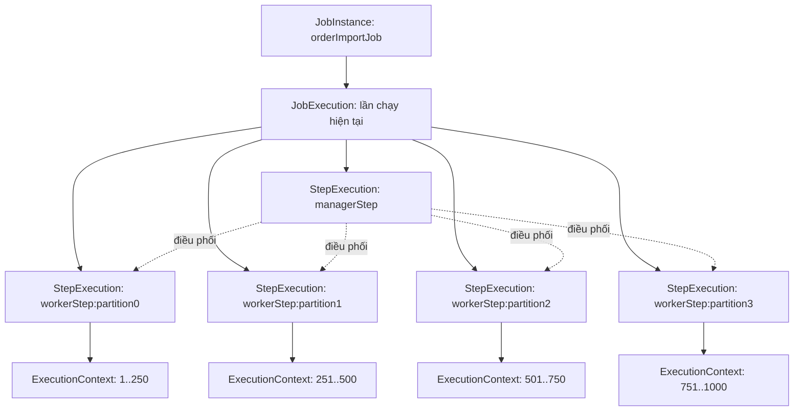
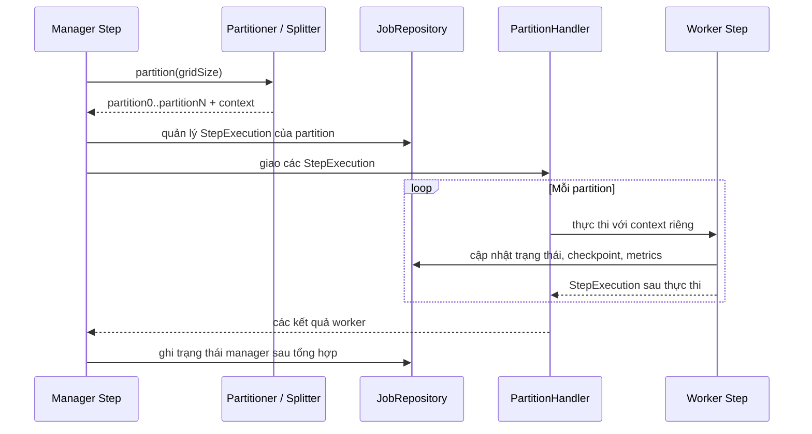

# StepExecution cho từng partition

## 1. Bối cảnh và mục tiêu

Trong chương **JobRepository** của module **SPRING_BATCH_SCALING_OPERATIONS**, mục tiêu không chỉ là chạy dữ liệu lớn nhanh hơn bằng multi-threaded step, parallel steps, partitioning hoặc mô hình phân tán, mà còn phải biết **hệ thống lưu dấu tiến độ và phục hồi công việc như thế nào**. Khi một step được chia thành nhiều partition, Spring Batch dùng `StepExecution` riêng để quản lý trạng thái thực thi của từng partition. Đây là cơ sở để quan sát hiệu năng, phân tích lỗi và restart đúng phần việc cần chạy lại.

Sau bài học, bạn có thể:

- Phân biệt `JobInstance`, `JobExecution`, `StepExecution` và `ExecutionContext`.
- Giải thích vì sao một partition có `StepExecution` riêng, thay vì tất cả cùng cập nhật một bộ đếm.
- Đọc thông tin từng partition trong các bảng metadata của `JobRepository`.
- Hiểu quan hệ giữa `Partitioner`, manager step, worker step, `StepExecutionSplitter` và `PartitionHandler`.
- Thiết kế partition key ổn định, dữ liệu không chồng lấn, checkpoint và restart an toàn.
- Đánh giá mức độ đồng thời dựa trên pool luồng, kết nối DB và những điểm nghẽn thật sự.

> **Ý chính:** Một partition là một **đơn vị thực thi có thể theo dõi riêng**. Manager step có `StepExecution` của nó; mỗi worker partition cũng có `StepExecution` riêng, cùng trạng thái và `ExecutionContext` của partition đó. `JobRepository` lưu những bản ghi này để Spring Batch quản lý vòng đời job và hỗ trợ restart.

## 2. Đặt `StepExecution` vào đúng hệ thống metadata

Spring Batch có các khái niệm liên quan nhưng khác phạm vi:

| Khái niệm | Phạm vi | Vai trò |
| --- | --- | --- |
| `JobInstance` | Một job logic được nhận diện qua tên job và bộ **identifying JobParameters** | Nhóm các lần chạy/restart của cùng một công việc logic |
| `JobExecution` | Một lần chạy cụ thể của `JobInstance` | Lưu trạng thái toàn job, thời gian, lỗi và các step được thực thi trong lần chạy |
| `StepExecution` | Một lần thực thi của một step trong một `JobExecution` | Lưu `BatchStatus`, `ExitStatus`, thời gian, read/write/skip/commit/rollback count |
| `ExecutionContext` của step | Dữ liệu checkpoint/trạng thái gắn với một `StepExecution` | Lưu thông số partition và thông tin giúp reader/step tiếp tục công việc |
| `ExecutionContext` của job | Dữ liệu trạng thái ở cấp `JobExecution` | Chia sẻ trạng thái cấp job theo quy tắc riêng, **không thay thế** context của từng partition |

Hai bảng metadata liên quan trực tiếp nhất là:

- `BATCH_STEP_EXECUTION`: mỗi dòng biểu diễn **một lần thực thi step** (có `STEP_EXECUTION_ID`, `STEP_NAME`, `JOB_EXECUTION_ID`, `STATUS`, các bộ đếm và thời gian).
- `BATCH_STEP_EXECUTION_CONTEXT`: lưu dữ liệu ngữ cảnh/checkpoint của `StepExecution` tương ứng.

`StepExecution` là **bản ghi cho một lần thực thi**, không phải đối tượng được đồng nhất vĩnh viễn bằng tên partition. Khi restart cùng `JobInstance`, Spring Batch có thể tạo `JobExecution` mới và `StepExecution` mới cho phần việc cần chạy lại. Vì vậy, **không dùng `STEP_EXECUTION_ID` như ID nghiệp vụ của partition**.

## 3. Manager step và mỗi partition sở hữu những `StepExecution` nào?

Giả sử job xử lý các đơn hàng có ID từ 1 đến 1.000. Manager chia dữ liệu thành bốn khoảng; mỗi khoảng được giao cho một worker execution:

| Đơn vị | `STEP_NAME` minh họa | Phạm vi dữ liệu |
| --- | --- | --- |
| Manager | `managerStep` | Điều phối bốn partition, tổng hợp kết quả |
| Partition 0 | `workerStep:partition0` | ID 1–250 |
| Partition 1 | `workerStep:partition1` | ID 251–500 |
| Partition 2 | `workerStep:partition2` | ID 501–750 |
| Partition 3 | `workerStep:partition3` | ID 751–1.000 |

Trong cấu hình partitioning thông thường, **manager và mỗi partition đều có `StepExecution`**. Ví dụ, một lần chạy có thể có một `JobExecution` và năm `StepExecution`: một manager, bốn worker. Tên partition trong ví dụ được ghép từ tên worker step và khóa do `Partitioner` trả về; cú pháp tên thực tế cần giữ ổn định giữa các lần chạy.



Các liên kết trong sơ đồ biểu diễn quan hệ logic. `StepExecution` của partition thuộc `JobExecution`; manager điều phối nhưng không phải đối tượng cha thay thế liên kết metadata với `JobExecution`.

### Mỗi partition độc lập ở mức nào?

Mỗi worker partition:

1. Có `StepExecution` mang tên riêng, trạng thái riêng (`STARTING`, `STARTED`, `COMPLETED`, `FAILED`, ...).
2. Có `ExecutionContext` riêng, chẳng hạn `fromId`/`toId` để reader biết dải dữ liệu.
3. Có các bộ đếm `readCount`, `writeCount`, `filterCount`, `readSkipCount`, `processSkipCount`, `writeSkipCount`, `commitCount` và `rollbackCount`.
4. Thực thi chunk và transaction theo vòng đời worker step; nếu có lỗi, thông tin lỗi và trạng thái của partition đó được lưu.
5. Có thể là đối tượng cần chạy lại sau thất bại, tùy chính sách restart và metadata đã lưu.

**Không đồng nghĩa với transaction bao trùm tất cả partition.** Một worker hoàn tất chunk không khiến các worker khác commit cùng thời điểm. Các partition có ranh giới transaction riêng. Nếu một partition lỗi, các partition khác có thể đã ghi và commit dữ liệu thành công.

## 4. Spring Batch tạo và điều phối các bản ghi này như thế nào?

Luồng xử lý ở mức khái niệm:

1. **Manager step bắt đầu.** `JobRepository` ghi nhận `StepExecution` của manager.
2. **Partitioner chia việc.** `Partitioner.partition(gridSize)` trả về `Map<String, ExecutionContext>`. Key của map là **tên partition**, value là thông tin cần để worker xử lý.
3. **Tạo hoặc xác định các worker execution.** Bộ splitter, thường là `SimpleStepExecutionSplitter` trong mô hình mặc định, phối hợp `JobRepository` để quản lý `StepExecution` ứng với từng partition.
4. **Giao việc.** `PartitionHandler` gửi các worker execution đến nơi thực thi: luồng trên cùng tiến trình với local partitioning, hoặc worker từ xa với remote partitioning.
5. **Worker chạy chunk.** Reader lấy thông số từ `stepExecutionContext`; mỗi worker cập nhật số đếm và checkpoint khi thực thi.
6. **Thu nhận kết quả.** Manager tổng hợp trạng thái, số đếm của các worker execution theo bộ aggregator của cấu hình. Kết quả manager phản ánh tình trạng chung.
7. **Lưu metadata.** `JobRepository` cung cấp dữ liệu để vận hành kiểm tra partition nào đã hoàn thành, partition nào lỗi và chuẩn bị restart.



**`gridSize` là gợi ý chia việc**, không phải lời cam kết rằng sẽ có đúng số luồng/đúng số partition trong mọi trường hợp. Số phần tử thực tế do `Partitioner` quyết định; độ đồng thời do `PartitionHandler`, executor, worker sẵn có và giới hạn tài nguyên quyết định.

## 5. Ví dụ Java: mỗi partition đọc một dải ID riêng

Ví dụ dùng API cấu hình **Spring Batch 5.x** và local partitioning. Bảng nguồn `orders(id, gross_amount)` có ID từ 1 đến 1.000; đích là `order_result(id, net_amount)`. Giả sử `DataSource`, `JobRepository` và `PlatformTransactionManager` đã được cấu hình. Các khoảng ID trong ví dụ được cố định để dễ quan sát; ngoài thực tế phải lấy biên trên/dưới từ một snapshot hoặc nguồn dữ liệu ổn định.

```java
import java.math.BigDecimal;
import java.util.LinkedHashMap;
import java.util.Map;
import javax.sql.DataSource;

import org.springframework.batch.core.Job;
import org.springframework.batch.core.Step;
import org.springframework.batch.core.configuration.annotation.StepScope;
import org.springframework.batch.core.job.builder.JobBuilder;
import org.springframework.batch.core.partition.support.Partitioner;
import org.springframework.batch.core.repository.JobRepository;
import org.springframework.batch.core.step.builder.StepBuilder;
import org.springframework.batch.item.ExecutionContext;
import org.springframework.batch.item.ItemProcessor;
import org.springframework.batch.item.database.JdbcBatchItemWriter;
import org.springframework.batch.item.database.JdbcCursorItemReader;
import org.springframework.batch.item.database.builder.JdbcBatchItemWriterBuilder;
import org.springframework.batch.item.database.builder.JdbcCursorItemReaderBuilder;
import org.springframework.beans.factory.annotation.Value;
import org.springframework.context.annotation.Bean;
import org.springframework.context.annotation.Configuration;
import org.springframework.core.task.TaskExecutor;
import org.springframework.jdbc.core.namedparam.MapSqlParameterSource;
import org.springframework.scheduling.concurrent.ThreadPoolTaskExecutor;
import org.springframework.transaction.PlatformTransactionManager;

@Configuration
class OrderPartitionConfiguration {
    record OrderRow(long id, BigDecimal gross) {}
    record OrderResult(long id, BigDecimal net) {}

    @Bean
    Partitioner orderPartitioner() {
        return gridSize -> {
            long minId = 1L;
            long maxId = 1_000L;
            int requested = Math.max(1, gridSize);
            long span = (maxId - minId + 1 + requested - 1) / requested;
            Map<String, ExecutionContext> partitions = new LinkedHashMap<>();

            for (long from = minId; from <= maxId; from += span) {
                long to = Math.min(maxId, from + span - 1);
                ExecutionContext context = new ExecutionContext();
                context.putLong("fromId", from);
                context.putLong("toId", to);
                partitions.put("partition" + partitions.size(), context);
            }
            return partitions;
        };
    }

    @Bean
    @StepScope
    JdbcCursorItemReader<OrderRow> partitionReader(
            DataSource dataSource,
            @Value("#{stepExecutionContext['fromId']}") Long fromId,
            @Value("#{stepExecutionContext['toId']}") Long toId) {
        return new JdbcCursorItemReaderBuilder<OrderRow>()
            .name("partitionReader")
            .dataSource(dataSource)
            .sql("""
                SELECT id, gross_amount
                FROM orders
                WHERE id >= ? AND id <= ?
                ORDER BY id
                """)
            .preparedStatementSetter(ps -> {
                ps.setLong(1, fromId);
                ps.setLong(2, toId);
            })
            .rowMapper((rs, rowNum) -> new OrderRow(
                rs.getLong("id"), rs.getBigDecimal("gross_amount")))
            .saveState(true)
            .build();
    }

    @Bean
    ItemProcessor<OrderRow, OrderResult> orderProcessor() {
        return item -> new OrderResult(
            item.id(), item.gross().multiply(new BigDecimal("0.95")));
    }

    @Bean
    JdbcBatchItemWriter<OrderResult> orderWriter(DataSource dataSource) {
        return new JdbcBatchItemWriterBuilder<OrderResult>()
            .dataSource(dataSource)
            .sql("""
                INSERT INTO order_result (id, net_amount)
                VALUES (:id, :net)
                """)
            .itemSqlParameterSourceProvider(row ->
                new MapSqlParameterSource()
                    .addValue("id", row.id())
                    .addValue("net", row.net()))
            .build();
    }

    @Bean
    Step workerStep(
            JobRepository jobRepository,
            PlatformTransactionManager transactionManager,
            JdbcCursorItemReader<OrderRow> partitionReader,
            ItemProcessor<OrderRow, OrderResult> orderProcessor,
            JdbcBatchItemWriter<OrderResult> orderWriter) {
        return new StepBuilder("workerStep", jobRepository)
            .<OrderRow, OrderResult>chunk(100, transactionManager)
            .reader(partitionReader)
            .processor(orderProcessor)
            .writer(orderWriter)
            .build();
    }

    @Bean
    TaskExecutor partitionExecutor() {
        ThreadPoolTaskExecutor executor = new ThreadPoolTaskExecutor();
        executor.setCorePoolSize(4);
        executor.setMaxPoolSize(4);
        executor.setQueueCapacity(4);
        executor.setThreadNamePrefix("partition-");
        executor.initialize();
        return executor;
    }

    @Bean
    Step managerStep(
            JobRepository jobRepository,
            Step workerStep,
            Partitioner orderPartitioner,
            TaskExecutor partitionExecutor) {
        return new StepBuilder("managerStep", jobRepository)
            .partitioner("workerStep", orderPartitioner)
            .step(workerStep)
            .gridSize(4)
            .taskExecutor(partitionExecutor)
            .build();
    }

    @Bean
    Job orderImportJob(JobRepository jobRepository, Step managerStep) {
        return new JobBuilder("orderImportJob", jobRepository)
            .start(managerStep)
            .build();
    }
}
```

Các điểm cần đọc kỹ trong ví dụ:

- `partitioner.partition(4)` tạo bốn context chứa `fromId`/`toId`. Các khoảng **không giao nhau** và bao phủ toàn bộ miền ID từ 1 đến 1.000.
- Bean reader có `@StepScope` và đọc giá trị từ `stepExecutionContext`. Mỗi worker partition có step execution/context riêng nên mỗi reader được cấu hình với dải ID phù hợp.
- `workerStep` là định nghĩa step dùng chung, trong khi **mỗi partition là một lần thực thi độc lập** của định nghĩa đó. Không cần tạo bốn bean `Step` thủ công.
- `managerStep` tạo các partition, giao chúng cho executor; pool tối đa bốn luồng làm việc. `gridSize(4)` không tự cấp thêm CPU hay kết nối DB.
- `order_result.id` nên có ràng buộc duy nhất. Mẫu `INSERT` minh họa đường ghi đơn giản; với replay/restart hoặc side effect ngoài DB, ứng dụng thực tế cần xác định chính sách ghi idempotent, thường bằng upsert hoặc cơ chế chống trùng phù hợp.
- `saveState(true)` cho phép reader lưu vị trí phục vụ restart **trong từng partition**. Nó không thay cho việc giữ dải dữ liệu ổn định, kiểm thử checkpoint và bảo đảm transaction đúng.

### Khi nào dùng `@StepScope`?

Nếu đặt `fromId`/`toId` trong một bean singleton được chia sẻ giữa các worker, các partition có nguy cơ dùng nhầm phạm vi dữ liệu. `@StepScope` cho phép late binding từ `ExecutionContext` của step đang thực thi. Trong local partitioning, mô hình thường là **mỗi partition một worker StepExecution**, thay vì cho nhiều luồng cùng chia sẻ một reader có trạng thái.

Điều đó khác với **multi-threaded step dùng chung reader**: partitioning chia nguồn dữ liệu thành các phần riêng; multi-threaded step truyền thống có thể cần đồng bộ hóa `read()` trên reader chung.

## 6. Đọc dữ liệu từng `StepExecution` từ `JobRepository`

Ví dụ truy vấn các partition của một lần chạy:

```sql
SELECT
    STEP_EXECUTION_ID,
    JOB_EXECUTION_ID,
    STEP_NAME,
    STATUS,
    EXIT_CODE,
    READ_COUNT,
    WRITE_COUNT,
    COMMIT_COUNT,
    ROLLBACK_COUNT,
    READ_SKIP_COUNT,
    PROCESS_SKIP_COUNT,
    WRITE_SKIP_COUNT
FROM BATCH_STEP_EXECUTION
WHERE JOB_EXECUTION_ID = ?
ORDER BY STEP_EXECUTION_ID;
```

Thay dấu `?` bằng ID của `JobExecution` khi gọi truy vấn qua JDBC. Kết quả minh họa:

| `STEP_NAME` | `STATUS` | `READ_COUNT` | `WRITE_COUNT` | Ý nghĩa |
| --- | --- | ---: | ---: | --- |
| `workerStep:partition0` | `COMPLETED` | 250 | 250 | Khoảng ID đầu hoàn tất |
| `workerStep:partition1` | `COMPLETED` | 250 | 250 | Khoảng ID thứ hai hoàn tất |
| `workerStep:partition2` | `FAILED` | 190 | 100 | Đã đọc một phần, lỗi trước khi hoàn thành |
| `workerStep:partition3` | `COMPLETED` | 250 | 250 | Khoảng ID cuối hoàn tất |
| `managerStep` | `FAILED` | *phụ thuộc aggregation* | *phụ thuộc aggregation* | Manager phản ánh kết quả chung |

**Các con số là ví dụ**, không phải output cố định của Spring Batch. `READ_COUNT` và `WRITE_COUNT` của partition là các bộ đếm xử lý của step execution, **không tự chứng minh** đã có bao nhiêu bản ghi bền vững ở đích sau mọi lần lỗi/rollback/restart. Muốn đánh giá tính đúng đắn, hãy kiểm tra dữ liệu đích theo khóa nghiệp vụ.

Với aggregator mặc định, manager có thể nhận **số đếm tổng hợp** từ các worker. Khi làm dashboard, tránh cộng `READ_COUNT` của manager với `READ_COUNT` của từng partition vì có thể đếm trùng.

`BATCH_STEP_EXECUTION_CONTEXT` chứa context được lưu theo `STEP_EXECUTION_ID`. Tùy phiên bản và cấu hình serializer, phần dữ liệu context được lưu ở dạng serialized; nên đọc qua API/khả năng quản trị chính thức, tránh phụ thuộc định dạng chuỗi serialize.

## 7. Nếu một partition thất bại, restart diễn ra ra sao?

Giả sử partition 0, 1 và 3 đã `COMPLETED`, còn partition 2 `FAILED`. Manager có thể kết thúc `FAILED`. Khi vận hành restart **cùng `JobInstance`** với cấu hình và chính sách restart phù hợp:

1. Spring Batch truy vấn metadata của các step/partition trước đó.
2. Các partition đã `COMPLETED` thường **không bị chạy lại** theo cơ chế mặc định; các partition chưa hoàn tất sẽ được xem xét thực thi tiếp.
3. Lần restart là một `JobExecution` mới. Phần việc chạy lại có `StepExecution` tương ứng trong lần thực thi mới; hệ thống có thể dùng trạng thái/checkpoint từ lần trước.
4. Nếu reader hỗ trợ restart và context còn nhất quán, nó có thể tiếp tục gần vị trí đã commit, thay vì bắt đầu lại dải ID.
5. Manager tổng hợp trạng thái của lần chạy mới và cập nhật metadata.

**Không coi “chỉ chạy lại partition lỗi” là bảo đảm vô điều kiện.** Kết quả phụ thuộc việc giữ nguyên danh tính `JobInstance`, định danh partition, trạng thái lưu trong `JobRepository`, chính sách cho phép chạy lại step đã hoàn tất và cách triển khai `Partitioner`/reader.

### Quy tắc để partition có thể restart

| Vấn đề | Cách thiết kế |
| --- | --- |
| Tên partition thay đổi giữa các lần chạy | Dùng key ổn định như `partition0`, `partition1` hoặc tên miền dữ liệu có quy tắc |
| Dải ID được tính lại từ nguồn đã biến đổi | Cố định snapshot/biên dữ liệu cho cùng một `JobInstance`; tránh đổi ý nghĩa partition khi restart |
| Các dải chồng lấn hoặc để lọt bản ghi | Thiết kế predicate không giao nhau, bao phủ đủ và kiểm tra ranh giới |
| `ExecutionContext` chứa object khó serialize | Lưu giá trị nhỏ, có thể serialize và đủ để xác định lại phần việc |
| Ghi dữ liệu bị thực hiện lại | Dùng khóa duy nhất, transaction và cơ chế ghi lặp an toàn theo nghiệp vụ |
| Bị lỗi giữa chừng sau khi thực hiện side effect bên ngoài | Thiết kế idempotency key, outbox hoặc phương án bù/truy vết |
| Reader dùng cursor và dữ liệu nguồn đang thay đổi | Xác định nhất quán snapshot và kiểm thử restart tại ranh giới commit |

Với partitioning, **ranh giới chia dữ liệu phải ổn định hơn lịch chạy của các worker**. Nếu lúc đầu `partition2` là ID 501–750 nhưng khi restart lại thành 451–675, một checkpoint cũ có thể không còn ý nghĩa đúng.

### Lưu ý về `PartitionNameProvider`

Một số triển khai có thể dùng `PartitionNameProvider` để cung cấp danh sách tên partition khi restart mà không cần tính lại toàn bộ context phân vùng. Đây là tùy chọn tối ưu hóa; tên mà provider trả về phải **trùng chính xác** với tên do partitioner dùng trong lần chạy trước. Nó không thay thế yêu cầu bảo quản `ExecutionContext` và xác định nguồn dữ liệu ổn định.

## 8. Phân biệt lỗi worker, lỗi manager và ý nghĩa các trạng thái

`BatchStatus` mô tả tiến độ/vòng đời kỹ thuật (`STARTING`, `STARTED`, `COMPLETED`, `FAILED`, `STOPPED`...). `ExitStatus` là kết quả có thể phục vụ quyết định flow tiếp theo, ví dụ chuyển nhánh theo exit code. Hai trường này liên quan nhưng **không đồng nhất**.

Trong partitioning:

- Một partition có thể `FAILED` trong khi ba partition khác `COMPLETED`.
- Manager tổng hợp trạng thái từ các worker; trạng thái chung không làm mất thông tin lỗi cụ thể của từng partition.
- Các `StepExecution` lưu số đếm và thông tin lỗi khác nhau; việc xem chỉ `JobExecution` hoặc chỉ manager là chưa đủ để chẩn đoán.
- Một partition `COMPLETED` không có nghĩa dữ liệu trong các partition khác nhất quán hoặc tất cả side effect toàn job đã được hoàn tất.

Để chẩn đoán, đối chiếu **`STEP_NAME` + `JOB_EXECUTION_ID` + `STATUS`**, sau đó xem các count, exception và execution context tương ứng. Khi phân tích nhiều lần restart, nhóm theo `JobInstance` và theo tên partition, thay vì chỉ nhìn một `JobExecution`.

## 9. Đo thông lượng và quản lý tài nguyên khi tăng số partition

`StepExecution` riêng giúp bạn phát hiện partition nào chậm:

| Quan sát | Khả năng nguyên nhân | Hướng xử lý |
| --- | --- | --- |
| Một partition xử lý ít bản ghi nhưng chạy lâu | Dữ liệu lệch, khóa DB, truy vấn hoặc xử lý bất thường | So sánh thời gian theo partition, kiểm tra query plan và dải dữ liệu |
| Nhiều partition chờ kết nối | JDBC pool nhỏ hơn mức đồng thời | Giới hạn executor hoặc tăng pool trong khả năng DB |
| Tăng `gridSize` nhưng tốc độ không tăng | I/O/DB/CPU đã bão hòa, handler không chạy thêm worker | Đo pool, CPU, I/O và số worker thực tế |
| Tỷ lệ rollback/retry cao | Deadlock, timeout, phụ thuộc tài nguyên chung | Kiểm tra transaction và ràng buộc ghi |
| Partition có `READ_COUNT` cao nhưng `WRITE_COUNT` thấp | Filter, skip hoặc lỗi trước khi commit | Đọc các skip count, checkpoint và số bản ghi thực tế |
| Worker chạy xa nhưng cập nhật metadata trễ | Kết nối `JobRepository`, messaging hoặc lỗi hạ tầng | Kiểm tra kết nối repository và tính bền vững của kênh giao việc |

Không tăng số partition chỉ vì hệ thống có nhiều CPU. Đặt mức concurrency ban đầu theo tài nguyên khan hiếm nhất: connection pool, IOPS, CPU, giới hạn API bên ngoài và bộ nhớ. Thu thập các chỉ số theo từng `StepExecution` rồi điều chỉnh `gridSize`, kích thước chunk và executor trên dữ liệu đại diện.

### Local partitioning so với remote partitioning

- **Local partitioning:** Các worker chạy trong cùng ứng dụng/JVM (thường qua `TaskExecutorPartitionHandler`). Mỗi partition vẫn có `StepExecution` riêng.
- **Remote partitioning:** Manager giao công việc tới tiến trình/nút khác qua transport; các worker thực thi phân vùng được chỉ định. Thiết kế vẫn phải duy trì danh tính `StepExecution`, metadata của `JobRepository`, truyền nhận đáng tin cậy và khả năng xử lý trường hợp worker mất kết nối.

Mở rộng sang nhiều máy **không tự động cải thiện tính nhất quán**. Độ tin cậy phụ thuộc cách các node truy cập metadata, chiến lược delivery/retry, transaction đích và idempotency của nghiệp vụ.

## 10. Bài thực hành kiểm chứng

Với dữ liệu đơn hàng có 1.000 ID duy nhất, thực hiện các bước sau:

1. Chạy cấu hình ví dụ với `gridSize(4)`, kiểm tra trong `BATCH_STEP_EXECUTION` có manager và bốn worker execution với tên dự kiến.
2. Kiểm tra mỗi worker có context từ/to đúng và tổng số ID xử lý không trùng, không thiếu. Đối chiếu số ID đầu ra phân biệt với dữ liệu nguồn.
3. Chủ động cho một partition lỗi giữa chừng, chẳng hạn tại một ID xác định; quan sát `STATUS`, `READ_COUNT`, `WRITE_COUNT`, `ROLLBACK_COUNT` và số hàng thực trong bảng đích.
4. Sửa nguyên nhân lỗi, restart **cùng `JobInstance`** và kiểm tra partition nào được chạy lại, checkpoint có giữ đúng dải ID không.
5. Tăng số worker lên 8 trong một **job mới** với cấu hình phân vùng hợp lệ, so sánh thông lượng và thời gian chờ kết nối DB. Không thay số phân vùng giữa chừng của một lần restart mà chưa đánh giá tính ổn định của partition mapping.

**Câu hỏi tự kiểm tra:**

- Vì sao manager và partition đều có `StepExecution` dù chỉ có một định nghĩa `workerStep`?
- Khi `partition2` thất bại, dữ liệu nào trong `JobRepository` hỗ trợ restart?
- Vì sao không nên dùng `STEP_EXECUTION_ID` để nhận diện lâu dài một partition?
- Vì sao cộng read count của manager và các worker có thể sai?
- Khi thay `gridSize`, những giới hạn nào quyết định có tăng throughput được hay không?

**Ghi nhớ:** `JobRepository` giữ lịch sử thực thi ở cấp step; partitioning biến mỗi phần dữ liệu thành một worker `StepExecution` có context, số đếm, trạng thái và checkpoint riêng. Nhờ đó hệ thống có thể quan sát và restart từng phần việc phù hợp. Để thực sự an toàn khi mở rộng, hãy giữ danh tính partition ổn định, chia dữ liệu không chồng lấn, kiểm thử rollback/restart và giới hạn concurrency theo tài nguyên thực tế.
