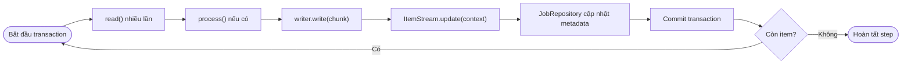
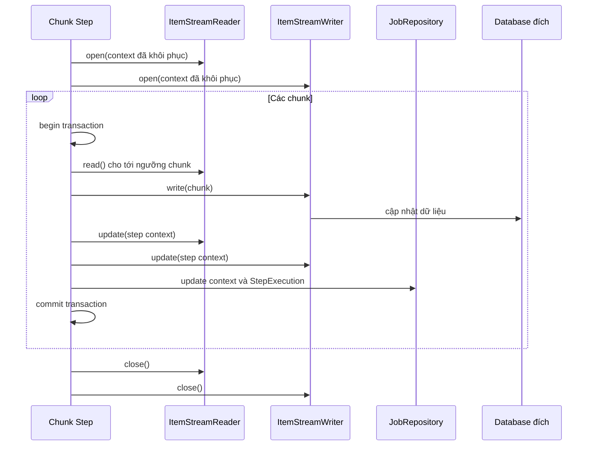

# Commit interval và checkpoint

## 1. Bài toán: xử lý nhanh nhưng phải tiếp tục được sau lỗi

Trong chương **JobRepository** của module **SPRING_BATCH_SCALING_OPERATIONS**, chúng ta cần xử lý workload dữ liệu lớn bằng chunk-oriented step, multi-threaded step, parallel steps hoặc partitioning mà vẫn quản lý được tính đúng đắn, thread safety, retry/restart và tài nguyên thực tế.

Giả sử job nhập 2 triệu giao dịch. Nếu ứng dụng ghi từng dòng rồi commit, chi phí transaction có thể rất cao. Nếu gom cả 2 triệu dòng vào một transaction, thời gian giữ khóa, sử dụng bộ nhớ và lượng công việc phải rollback khi lỗi có thể không chấp nhận được. Spring Batch giải quyết cân bằng này bằng **commit interval** và **checkpoint**:

- **Commit interval** xác định nhịp mà chunk-oriented step gom và xử lý một nhóm item trước khi commit transaction.
- **Checkpoint** là trạng thái khôi phục được lưu qua `ItemStream` và `ExecutionContext`, giúp step biết đã đi đến đâu sau khi thất bại.
- **JobRepository** lưu metadata như `JobExecution`, `StepExecution`, counters và execution context, để các lần chạy sau nhận diện công việc đã hoàn thành hoặc cần thực hiện tiếp.

Sau bài học, bạn có thể:

1. Phân biệt `chunkSize`/commit interval với số item đã được ghi và số commit quan sát trong metadata.
2. Mô tả thời điểm gọi `ItemStream.open/update/close` và cơ chế lưu `ExecutionContext`.
3. Giải thích chuyện gì xảy ra nếu JVM chết trước commit, sau commit hoặc giữa việc ghi dữ liệu và lưu metadata.
4. Thiết kế reader/writer hỗ trợ restart bằng checkpoint ổn định và xử lý ghi lặp an toàn.
5. Cấu hình một chunk step Spring Batch 5.x, đọc counters từ `JobRepository` và chọn commit interval theo benchmark.
6. Nhận diện khác biệt khi chạy multi-threaded step, partitioning hay remote chunking.

> **Ghi nhớ:** Commit interval quyết định **ranh giới transaction của chunk**; checkpoint quyết định **trạng thái mà step có thể khôi phục**. Hai cơ chế liên quan chặt chẽ nhưng không đồng nghĩa. Một checkpoint được lưu thành công cũng **không tự chứng minh** mọi side effect ngoài transaction đã xảy ra đúng một lần.

## 2. Chunk-oriented processing và commit interval

### 2.1. Điều gì xảy ra với `chunk(100, transactionManager)`?

Trong Spring Batch 5.x, cấu hình:

```java
new StepBuilder("importStep", jobRepository)
    .<InputRow, OutputRow>chunk(100, transactionManager)
    .reader(reader)
    .processor(processor)
    .writer(writer)
    .build();
```

đặt **commit interval là 100**. Trong mô hình đơn giản, framework bắt đầu transaction, đọc các item, gọi processor, chuyển chunk được tạo thành cho writer, cập nhật trạng thái liên quan, rồi commit. Chu kỳ lặp lại cho tới khi reader hết dữ liệu.



Đây là **mô hình khái niệm cho trường hợp thông thường**, không phải trình tự gọi tuyệt đối của mọi listener, mọi reader và mọi cơ chế fault tolerance. Trong thực tế còn có xử lý `read() == null`, retry, skip, rollback, đồng bộ stream và các callback transaction. Đặc biệt, `ItemStream.update()` diễn ra **trước commit**, để checkpoint có thể được lưu cùng thời điểm giao dịch tương ứng.

### 2.2. Commit interval không phải số item writer chắc chắn ghi

Giả sử step đọc 100 item, trong đó processor trả `null` cho 15 item không thuộc diện xử lý:

```text
Reader đọc                : 100 item
Processor giữ lại         :  85 item
Processor lọc (return null): 15 item
Writer nhận               :  85 item
Một chu kỳ chunk          : tới 100 lần đọc thông thường
```

Vì vậy, **`readCount` và `writeCount` có thể khác nhau** dù step hoàn thành thành công. Khi có retry, skip hoặc rollback, số lượt gọi `read()`/`write()` thực tế cũng có thể lớn hơn các count cuối được ghi nhận.

Một số điểm cần phân biệt:

| Thuật ngữ | Ý nghĩa | Không được suy ra |
| --- | --- | --- |
| **Commit interval** | Ngưỡng số item đọc/được xử lý trong một chunk thông thường trước commit | Chính xác từng ấy bản ghi đã commit vào bảng đích |
| **Chunk** | Nhóm item được xử lý trong phạm vi transaction | Một chunk tương đương một partition |
| **`readCount`** | Số item được ghi nhận đã đọc thành công | Tổng mọi lần gọi reader kể cả rollback/retry |
| **`writeCount`** | Số item được ghi nhận đã ghi | Số dòng DB duy nhất nếu writer có upsert/filter/side effect |
| **`commitCount`** | Số lần commit transaction được StepExecution ghi nhận | Luôn bằng `ceil(readCount / chunkSize)` |
| **Checkpoint** | Trạng thái dùng để resume khi restart | Giao dịch nghiệp vụ đã hoàn tất ở mọi hệ thống ngoài |

**Chunk cuối** có thể có ít item hơn commit interval. Đồng thời, chu kỳ đọc tín hiệu hết dữ liệu, skip/retry hoặc transaction quản trị khác có thể làm `commitCount` khác phép chia lý tưởng; vì vậy hãy lấy count thực từ `StepExecution` thay vì giả định một công thức bất biến.

### 2.3. Ví dụ nhiều commit

Với một step đọc 250 item hợp lệ, không skip/filter và `chunkSize=100`:

| Chu kỳ | Khoảng item minh họa | Số item ghi | Kết quả |
| --- | --- | ---: | --- |
| Chunk A | 1–100 | 100 | Commit thành công |
| Chunk B | 101–200 | 100 | Commit thành công |
| Chunk C | 201–250 | 50 | Commit cuối khi hết dữ liệu |

Từ góc nhìn nghiệp vụ, dữ liệu đã commit của A và B **không tự rollback** nếu C thất bại. Khi restart, mục tiêu là tiếp tục từ trạng thái đã lưu sau các chunk thành công, không ghi trùng A/B.

## 3. JobRepository lưu những gì?

Một batch job có các đối tượng metadata:

| Đối tượng | Vai trò | Bảng liên quan trong schema JDBC mặc định |
| --- | --- | --- |
| `JobInstance` | Định danh lần chạy logic theo tên job và identifying job parameters | `BATCH_JOB_INSTANCE` |
| `JobExecution` | Một lần thực thi/restart của JobInstance | `BATCH_JOB_EXECUTION` |
| Job `ExecutionContext` | Trạng thái chung của execution khi cần | `BATCH_JOB_EXECUTION_CONTEXT` |
| `StepExecution` | Status, counters, thời gian, commit/rollback, lỗi cho một lần thực thi step | `BATCH_STEP_EXECUTION` |
| Step `ExecutionContext` | Trạng thái checkpoint/late-binding gắn với step execution | `BATCH_STEP_EXECUTION_CONTEXT` |

`JobRepository` là API được Spring Batch dùng để lưu và truy xuất metadata này. Việc một `StepExecution` báo `COMPLETED` là trạng thái xử lý kỹ thuật; để khẳng định đủ dữ liệu nghiệp vụ, vẫn phải đối chiếu khóa nghiệp vụ hoặc kết quả đích.

### Phân biệt JobExecutionContext và StepExecutionContext

**Step context** là nơi tự nhiên để lưu checkpoint của reader/writer tại một step hoặc partition. Ví dụ:

```text
StepExecution: importOrders:partition2
ExecutionContext:
  fromId = 500001
  toId = 750000
  orderReader.read.count = 1200
  ...trạng thái khác do ItemStream quản lý...
```

Các key ví dụ trên chỉ để minh họa; **tên checkpoint thực tế phụ thuộc implementation và `name` của reader/writer**. Không viết code phụ thuộc một key nội bộ của `JdbcCursorItemReader` nếu chưa có hợp đồng rõ ràng.

**Job context** phù hợp với dữ liệu dùng chung giữa các bước, như watermark hoặc đường dẫn manifest được xác lập bởi một step chuẩn bị. Không đặt trạng thái reader riêng của nhiều partition vào một key dùng chung ở job context: dễ ghi đè và tạo race condition.

### Khi nào metadata được lưu?

Với chunk step, `StepExecution` và `ExecutionContext` được cập nhật định kỳ **trước khi commit chunk** theo cơ chế framework. Khi kết thúc step, status và metadata cuối cùng cũng được ghi lại. Điều này lý giải vì sao checkpoint thường phản ánh **ranh giới commit thành công gần nhất**, thay vì vị trí một item vừa đọc nhưng transaction chưa hoàn tất.

> **Điều kiện quan trọng:** Nếu JobRepository và database nghiệp vụ dùng **cùng transaction phù hợp**, việc lưu checkpoint và ghi dữ liệu có thể gắn kết nguyên tử theo phạm vi đó. Nếu dùng **hai transaction manager hoặc hai database độc lập**, không được giả định hai commit này là atomic. Khoảng lỗi ở giữa hai commit có thể gây lệch checkpoint và dữ liệu, cần idempotency hoặc cơ chế transaction phân tán thích hợp.

## 4. Vòng đời ItemStream: open, update và close

`ItemReader` và `ItemWriter` cơ bản chỉ có trách nhiệm đọc/ghi. Những thành phần có trạng thái nên triển khai thêm `ItemStream`:

```java
public interface ItemStream {
    void open(ExecutionContext executionContext);
    void update(ExecutionContext executionContext);
    void close();
}
```

Ý nghĩa:

- **`open(context)`:** khởi tạo tài nguyên và khôi phục từ context đã lưu, nếu đang restart.
- **`update(context)`:** đưa trạng thái hiện tại vào context **trước commit**, để framework có thể lưu checkpoint tương ứng.
- **`close()`:** giải phóng cursor, stream/file handle hoặc resource khác khi kết thúc.



Trong sơ đồ, việc quản lý transaction được rút gọn cho dễ học. **`update()` không nhất thiết tự gọi SQL vào JobRepository**; nó đưa state vào `ExecutionContext` và framework/repository chịu trách nhiệm persistence. Framework cũng quản lý thứ tự lifecycle, listener, sync và update tùy implementation.

### Ví dụ một trạng thái checkpoint do ứng dụng tự định nghĩa

Giả sử bạn viết một `ItemStream` quản lý vị trí dòng của một nguồn có thể seek lại:

```java
import org.springframework.batch.item.ExecutionContext;
import org.springframework.batch.item.ItemStream;

final class PositionCheckpoint implements ItemStream {
    private static final String KEY = "feedReader.lastCommittedPosition";
    private long position;

    @Override
    public void open(ExecutionContext context) {
        position = context.containsKey(KEY)
            ? context.getLong(KEY) : 0L;
        // Reader thực tế phải seek tới position trong nguồn ổn định.
    }

    void setPosition(long processedPosition) {
        position = processedPosition;
    }

    @Override
    public void update(ExecutionContext context) {
        context.putLong(KEY, position);
    }

    @Override
    public void close() {
        // Đóng stream / cursor tương ứng nếu class sở hữu resource.
    }
}
```

Đây là **minh họa hợp đồng checkpoint**, chưa phải `ItemReader` hoàn chỉnh. Muốn dùng trong step thực, phải liên kết nó với một reader có khả năng seek, quản lý rollback đúng và đăng ký `ItemStream` với step (hoặc triển khai trực tiếp `ItemStreamReader`). **Không tăng `position` vĩnh viễn chỉ vì đã gọi `read()` nếu thao tác còn có thể rollback**; state cần gắn với checkpoint được commit và có cách khôi phục sau lỗi.

### Vì sao phải khai báo bean đúng kiểu?

Khi tạo `@StepScope` cho writer có state như `FlatFileItemWriter`, nên trả về kiểu đủ thể hiện `ItemStream`:

```java
@Bean
@StepScope
FlatFileItemWriter<Invoice> partitionFileWriter(
        @Value("#{stepExecutionContext['outputFile']}") String outputFile) {
    return new FlatFileItemWriterBuilder<Invoice>()
        .name("partitionFileWriter")
        .resource(new FileSystemResource(outputFile))
        .lineAggregator(item -> item.id() + "," + item.amount())
        .saveState(true)
        .build();
}
```

Nếu chỉ công bố kiểu `ItemWriter<Invoice>`, scoped proxy hoặc wrapper có thể không được framework nhận diện đúng như một `ItemStream` để gọi `open/update/close`. Với decorator chứa delegate có state, cần triển khai/chuyển tiếp đầy đủ lifecycle và đăng ký stream thích hợp.

## 5. Lỗi ở ranh giới commit: những gì được thực hiện lại?

Giả sử chunk size là 100, đã commit thành công 2 chunk (200 item) và đang xử lý chunk 3:

| Thời điểm lỗi | Dữ liệu nghiệp vụ trong cùng DB transaction | Checkpoint cùng transaction | Việc có thể xảy ra khi restart |
| --- | --- | --- | --- |
| Trước khi writer ghi chunk 3 | Chunk 3 chưa commit | Vẫn ở mốc sau chunk 2 | Đọc/xử lý lại phần chưa commit |
| Writer đang ghi chunk 3, transaction rollback | Ghi trong transaction được rollback | Vẫn ở mốc sau chunk 2 | Chunk 3 được làm lại |
| `ItemStream.update()` đã chạy nhưng transaction chưa commit | Ghi chunk 3 chưa commit nếu rollback | Metadata cập nhật trong transaction cũng rollback nếu cùng transaction | Khôi phục checkpoint cuối đã commit |
| Chunk 3 commit thành công | Dữ liệu chunk 3 bền vững trong phạm vi DB | Checkpoint mới nếu cùng transaction | Tiếp tục sau chunk 3 khi restart |
| DB đích commit nhưng metadata repository dùng transaction khác chưa commit | Dữ liệu có thể đã tồn tại | Checkpoint có thể vẫn cũ | **Có nguy cơ xử lý lại chunk 3**, cần idempotent write |
| HTTP POST đã thành công rồi JDBC rollback | Side effect HTTP **không tự rollback** | JDBC/metadata có thể ở checkpoint cũ | POST có thể bị gọi lại khi retry/restart |

**Điều cần phân biệt:** Lỗi ngay sau `ItemWriter.write()` không đồng nghĩa dữ liệu chunk đã commit. Với writer JDBC và transaction đúng, câu lệnh có thể đã được thực thi nhưng vẫn **chưa bền vững** cho tới commit. Ngược lại, ghi file, gửi message hoặc gọi HTTP có thể tạo tác dụng phụ trước khi transaction Spring Batch kết thúc.

### Hai câu hỏi vận hành khác nhau

1. **JobRepository nói đã commit đến đâu?** Xem `ExecutionContext`, `StepExecution` và count.
2. **Dữ liệu đích thực sự chứa gì?** Đối chiếu theo business key, watermark, unique constraint và giao dịch đã commit.

Chỉ khi hai nguồn thông tin nhất quán mới có thể tin cậy vào kế hoạch restart. Khi một bên không đồng bộ với bên kia, cần chiến lược reconciliation thay vì chỉ tăng retry count.

## 6. Ví dụ Java Spring Batch 5.x: commit interval 100 và reader có checkpoint

Đây là cấu hình mẫu đọc bảng `source_order`, biến đổi số tiền và ghi sang bảng `normalized_order`. Mã dùng Java 17, Spring Batch 5.x; JobRepository, transaction manager và datasource đã được cấu hình trong ứng dụng.

**Giả định dữ liệu:** `source_order(id, amount)` có `id` duy nhất, tập input ổn định cho cùng `JobInstance`; `normalized_order(order_id, normalized_amount)` có unique key theo `order_id`. Ví dụ `INSERT` đơn giản được dùng để dễ theo dõi, còn production nên chọn chính sách upsert/idempotent theo nghiệp vụ.

```java
import java.math.BigDecimal;
import javax.sql.DataSource;

import org.springframework.batch.core.Job;
import org.springframework.batch.core.Step;
import org.springframework.batch.core.configuration.annotation.StepScope;
import org.springframework.batch.core.job.builder.JobBuilder;
import org.springframework.batch.core.repository.JobRepository;
import org.springframework.batch.core.step.builder.StepBuilder;
import org.springframework.batch.item.ItemProcessor;
import org.springframework.batch.item.database.JdbcBatchItemWriter;
import org.springframework.batch.item.database.JdbcCursorItemReader;
import org.springframework.batch.item.database.builder.JdbcBatchItemWriterBuilder;
import org.springframework.batch.item.database.builder.JdbcCursorItemReaderBuilder;
import org.springframework.beans.factory.annotation.Value;
import org.springframework.context.annotation.Bean;
import org.springframework.context.annotation.Configuration;
import org.springframework.jdbc.core.namedparam.MapSqlParameterSource;
import org.springframework.transaction.PlatformTransactionManager;

@Configuration
class OrderCheckpointJobConfiguration {
    record OrderRow(long id, BigDecimal amount) {}
    record NormalizedOrder(long id, BigDecimal amount) {}

    @Bean
    @StepScope
    JdbcCursorItemReader<OrderRow> orderReader(
            DataSource dataSource,
            @Value("#{jobParameters['maxOrderId']}") Long maxOrderId) {

        return new JdbcCursorItemReaderBuilder<OrderRow>()
            .name("orderReader")
            .dataSource(dataSource)
            .sql("""
                SELECT id, amount
                FROM source_order
                WHERE id <= ?
                ORDER BY id
                """)
            .preparedStatementSetter(ps -> ps.setLong(1, maxOrderId))
            .rowMapper((rs, rowNum) ->
                new OrderRow(
                    rs.getLong("id"),
                    rs.getBigDecimal("amount")))
            .saveState(true)
            .build();
    }

    @Bean
    ItemProcessor<OrderRow, NormalizedOrder> orderProcessor() {
        return item -> new NormalizedOrder(
            item.id(),
            item.amount().setScale(
                2, java.math.RoundingMode.HALF_UP));
    }

    @Bean
    JdbcBatchItemWriter<NormalizedOrder> orderWriter(
            DataSource dataSource) {
        return new JdbcBatchItemWriterBuilder<NormalizedOrder>()
            .dataSource(dataSource)
            .sql("""
                INSERT INTO normalized_order
                  (order_id, normalized_amount)
                VALUES (:id, :amount)
                """)
            .itemSqlParameterSourceProvider(item ->
                new MapSqlParameterSource()
                    .addValue("id", item.id())
                    .addValue("amount", item.amount()))
            .build();
    }

    @Bean
    Step normalizeOrdersStep(
            JobRepository jobRepository,
            PlatformTransactionManager transactionManager,
            JdbcCursorItemReader<OrderRow> orderReader,
            ItemProcessor<OrderRow, NormalizedOrder> orderProcessor,
            JdbcBatchItemWriter<NormalizedOrder> orderWriter) {

        return new StepBuilder("normalizeOrdersStep", jobRepository)
            .<OrderRow, NormalizedOrder>chunk(100, transactionManager)
            .reader(orderReader)
            .processor(orderProcessor)
            .writer(orderWriter)
            .build();
    }

    @Bean
    Job normalizeOrdersJob(
            JobRepository jobRepository,
            Step normalizeOrdersStep) {
        return new JobBuilder("normalizeOrdersJob", jobRepository)
            .start(normalizeOrdersStep)
            .build();
    }
}
```

Giải thích:

1. **`chunk(100, transactionManager)`** là commit interval 100. Với những chunk bình thường và không lỗi, một transaction gồm việc đọc/xử lý chunk, ghi rồi commit.
2. **`name("orderReader")`** cung cấp namespace ổn định cho trạng thái reader; **`saveState(true)`** bật lưu trạng thái mà reader hỗ trợ.
3. **`@StepScope`** cho phép late binding `maxOrderId` từ identifying job parameter; **khi restart cùng JobInstance, phải dùng lại tham số định danh tương ứng**.
4. **`ORDER BY id`** tạo thứ tự đọc xác định, cần thiết cho checkpoint theo vị trí. Thứ tự xác định **chưa đủ** nếu tập dữ liệu nguồn có thể thay đổi giữa các lần chạy.
5. **`JdbcBatchItemWriter`** dùng `DataSource` và transaction bên dưới. Nếu writer và JobRepository không dùng cùng phạm vi transaction, phải tính đến lệch checkpoint.
6. Unique constraint cho `normalized_order.order_id` có thể **phát hiện** phát lại, nhưng `INSERT` sẽ gây lỗi trùng khóa; muốn retry/restart êm hơn cần chiến lược `UPSERT` phù hợp nghiệp vụ, không âm thầm bỏ qua dữ liệu bị thay đổi.

Đây là ví dụ cấu hình lõi, chưa khai báo datasource, schema SQL, tạo job parameters, migration và test failover. Phải kiểm tra cả cấu hình repository/transaction manager thực tế trước khi coi job an toàn khi restart.

### Một ví dụ fault-tolerant chunk

Với nghiệp vụ cho phép retry lỗi JDBC tạm thời, có thể bổ sung theo khả năng của driver:

```java
return new StepBuilder("normalizeOrdersStep", jobRepository)
    .<OrderRow, NormalizedOrder>chunk(100, transactionManager)
    .reader(orderReader)
    .processor(orderProcessor)
    .writer(orderWriter)
    .faultTolerant()
    .retry(org.springframework.dao.DeadlockLoserDataAccessException.class)
    .retryLimit(3)
    .build();
```

Đây chỉ là **ví dụ chọn một nhóm lỗi**. Trước khi áp dụng production, phải xác nhận loại exception JDBC thực tế, database behavior, ranh giới rollback, backoff và tính an toàn của mọi side effect. Không retry tất cả `Exception` hoặc coi mọi lỗi unique constraint đều là lỗi tạm thời.

## 7. Chọn commit interval: throughput, lock và chi phí rollback

Nếu một triệu item được đọc/ghi thành công, không có skip/filter/retry và chia đều thành chunk, số chunk mang dữ liệu theo lý tưởng là:

\[
N_{\text{chunk}} \approx \left\lceil
\frac{N_{\text{item}}}{C}
\right\rceil ,
\]

trong đó `C` là commit interval. Đây là **ước lượng phục vụ so sánh**, không phải giá trị `StepExecution.commitCount` được đảm bảo khi framework gặp EOF, listener, retry/rollback hoặc cấu hình khác.

| Commit interval | Số chunk chứa dữ liệu xấp xỉ cho 1 triệu item | Lợi ích tiềm năng | Rủi ro |
| ---: | ---: | --- | --- |
| 1 | 1.000.000 | Phạm vi rollback rất nhỏ | Overhead commit và metadata rất lớn |
| 10 | 100.000 | Dễ cô lập lỗi | Nhiều transaction/round-trip |
| 100 | 10.000 | Cân bằng phổ biến để thử nghiệm | Cần đo DB lock/latency |
| 500 | 2.000 | Giảm chi phí commit | Giữ nhiều item/buffer hơn, replay lớn hơn |
| 2.000 | 500 | Ít transaction hơn | Áp lực bộ nhớ, transaction dài, phục hồi chunk tốn kém |

### 7.1. Mô hình chi phí đơn giản

Giả sử:

- `t_i` là thời gian đọc/xử lý một item.
- `t_w(C)` là tổng thời gian writer ghi một chunk có `C` item.
- `t_c` là chi phí commit/metadata của một chunk.

Một mô hình ước lượng là:

\[
T(C) \approx
\frac{N}{C}\left(Ct_i+t_w(C)+t_c\right).
\]

Nếu `t_c` cao, tăng `C` có thể giảm chi phí lặp lại. Nhưng nếu `t_w(C)` tăng không tuyến tính do lock contention, batch statement quá lớn hoặc nhiều item cần retry, commit interval lớn có thể khiến tổng thời gian **tăng**. Công thức bỏ qua concurrency, GC và rollback; phải xác nhận bằng benchmark.

### 7.2. Ngưỡng rollback và phục hồi

Với `C = 2.000`, một lỗi ở cuối chunk có thể khiến **một lượng lớn item chưa commit** phải làm lại; với `C = 100` thì lượng công việc giao dịch chưa commit nhỏ hơn. Nhưng không khẳng định số item reprocess tối đa luôn đúng bằng `C`: fault tolerance, stateful retry, writer có side effect, buffer ngoài transaction và biến động nguồn có thể làm hành vi phức tạp hơn.

### 7.3. Chunk lớn không phải cứ nhanh

Những điểm phải đo:

- Thời gian `write()`, thời gian commit, số transaction/giây.
- JDBC batch size, connection wait, lock wait, deadlock và WAL/redo I/O.
- Heap memory, GC pause và lượng item giữ trong chunk.
- Lượng work replay khi exception, tần suất retry/skip.
- Thời gian khôi phục sau restart và khả năng đối soát dữ liệu.
- Tail latency nếu mỗi item gọi HTTP hoặc một hệ thống bên ngoài.

**Cách chọn phù hợp:** thử những giá trị như 50, 100, 250, 500 trên snapshot dữ liệu đại diện, chạy lặp lại nhiều lần, giữ nguyên số worker và kiểm tra tính đúng của đầu ra. Sau khi chọn chunk size tốt, mới điều chỉnh concurrency.

## 8. Checkpoint khi chạy song song

### 8.1. Multi-threaded step: một StepExecution có thể có nhiều chunk thread

Khi gắn `TaskExecutor` vào **cùng một chunk step**, nhiều thread có thể cùng gọi reader/writer dùng chung. `ExecutionContext` và các `ItemStream` có thể được cập nhật bởi nhiều chunk đang chồng lấn. Điều này tạo thách thức về:

- Reader không thread-safe, cursor/offset bị di chuyển ngoài ý muốn.
- Chunk hoàn thành và commit **không theo thứ tự đã đọc**.
- Checkpoint có thể không tương ứng một tiền tố dữ liệu đã hoàn thành liên tục.
- Writer hoặc listener giữ state mutable dùng chung.

**`@StepScope` không tự tạo reader riêng cho mỗi chunk thread**, vì scope này theo **StepExecution**, không theo thread. Một reader hỗ trợ truy cập đồng thời vẫn cần kiểm thử restart cụ thể. Việc chỉ khóa `read()` có thể ngăn race nhưng không tự bảo đảm checkpoint chính xác nếu các chunk commit khác thứ tự.

### 8.2. Partitioning: một StepExecution và context cho mỗi partition

Với partitioning, manager chia dữ liệu:

```text
Manager StepExecution
    partition0 -> worker StepExecution 0 -> context/reader/checkpoint 0
    partition1 -> worker StepExecution 1 -> context/reader/checkpoint 1
    partition2 -> worker StepExecution 2 -> context/reader/checkpoint 2
    partition3 -> worker StepExecution 3 -> context/reader/checkpoint 3
```

Mỗi partition có thể dùng `@StepScope` để tạo reader riêng với `fromId`, `toId`. Chunk commit trong partition tạo checkpoint riêng. Khi một partition `FAILED`, các partition `COMPLETED` thường không phải chạy lại theo chính sách mặc định.

```java
@Bean
@StepScope
JdbcCursorItemReader<OrderRow> partitionReader(
        DataSource dataSource,
        @Value("#{stepExecutionContext['fromId']}") Long fromId,
        @Value("#{stepExecutionContext['toId']}") Long toId) {

    return new JdbcCursorItemReaderBuilder<OrderRow>()
        .name("partitionOrderReader")
        .dataSource(dataSource)
        .sql("""
            SELECT id, amount
            FROM source_order
            WHERE id BETWEEN ? AND ?
            ORDER BY id
            """)
        .preparedStatementSetter(ps -> {
            ps.setLong(1, fromId);
            ps.setLong(2, toId);
        })
        .rowMapper((rs, n) ->
            new OrderRow(rs.getLong("id"),
                         rs.getBigDecimal("amount")))
        .saveState(true)
        .build();
}
```

**Quan trọng:** Tên partition và ranh giới dữ liệu phải ổn định đối với cùng `JobInstance`. Nếu sau một lỗi bạn đổi `gridSize` khiến `partition2` từ dải 501–750 chuyển thành 401–600, checkpoint cũ sẽ không còn phù hợp. Nếu worker partition **còn tự bật multi-threaded chunk**, những thách thức thread safety/checkpoint trong mục 8.1 vẫn tồn tại **bên trong partition đó**.

### 8.3. Remote chunking và remote partitioning

| Mô hình | Reader/checkpoint ở đâu? | Điều cần bảo đảm |
| --- | --- | --- |
| Chunk step một luồng | Reader ở step, step `ExecutionContext` | Transaction/metadata nhất quán |
| Multi-threaded step | Một `StepExecution` có thể phục vụ nhiều chunk thread | Reader/ItemStream an toàn, commit ngoài thứ tự, restart được kiểm chứng |
| Local/remote partitioning | Reader và `ExecutionContext` riêng theo partition | Partition identity và boundary ổn định |
| Remote chunking | Manager đọc và giao chunk; worker xử lý/ghi | Checkpoint manager, request/response correlation, redelivery/idempotency |

Checkpoint từ repository **không thay thế** giao thức messaging có độ bền. Với remote chunking, worker có thể đã ghi DB nhưng manager chưa nhận reply; một chunk có thể được phát lại. Với remote partitioning, một worker có thể vẫn chạy khi manager timeout; restart phải tránh hai worker ghi đồng thời cùng phạm vi.

## 9. Khi nào reader checkpoint không đáng tin?

Ngay cả với `.saveState(true)` và `ORDER BY id`, reader có thể không restart đúng nếu dữ liệu nguồn thay đổi:

1. Job đọc 300 item rồi checkpoint.
2. Một bản ghi có ID nhỏ hơn vị trí đang đọc bị xóa hoặc chèn vào tập query.
3. Job restart và reader tiếp tục theo **vị trí** đã lưu.
4. Vị trí cũ có thể không còn tương ứng với cùng một tập record như ban đầu.

Giải pháp tùy nghiệp vụ:

- Dùng **snapshot/manifest đầu vào** bất biến cho một JobInstance.
- Chốt **watermark** (ID tối đa, thời điểm hoặc version) trong identifying job parameters, kết hợp điều kiện query.
- Với nguồn có thay đổi, cân nhắc **keyset/cursor theo business key đã xác nhận** thay vì offset, có điều kiện phù hợp để không bỏ sót hay xử lý lặp.
- Tránh đổi query, ORDER BY, tên reader hoặc ranh giới partition giữa lúc có job lỗi cần restart.
- Đối chiếu số lượng và business key sau restart.

Watermark `maxOrderId` **một mình chưa phải snapshot**: dữ liệu cũ vẫn có thể bị sửa/xóa trong lúc job chạy. Hãy chọn isolation hoặc snapshot đúng với độ chặt nghiệp vụ.

## 10. Quan sát commit và checkpoint qua JobRepository

### 10.1. Truy vấn số đếm của StepExecution

```sql
SELECT
    STEP_EXECUTION_ID,
    JOB_EXECUTION_ID,
    STEP_NAME,
    STATUS,
    EXIT_CODE,
    READ_COUNT,
    WRITE_COUNT,
    FILTER_COUNT,
    READ_SKIP_COUNT,
    PROCESS_SKIP_COUNT,
    WRITE_SKIP_COUNT,
    COMMIT_COUNT,
    ROLLBACK_COUNT,
    START_TIME,
    END_TIME,
    LAST_UPDATED
FROM BATCH_STEP_EXECUTION
WHERE JOB_EXECUTION_ID = ?
ORDER BY STEP_EXECUTION_ID;
```

Khi chạy partitioning, kết quả thường có một dòng manager step và nhiều dòng worker `workerStep:partitionN`. Manager có thể tổng hợp counters từ worker, vì vậy **không cộng manager count với tổng worker count** để tránh đếm trùng.

### 10.2. Xem ExecutionContext được lưu

```sql
SELECT
    se.STEP_EXECUTION_ID,
    se.STEP_NAME,
    se.STATUS,
    se.READ_COUNT,
    se.COMMIT_COUNT,
    sec.SHORT_CONTEXT,
    sec.SERIALIZED_CONTEXT
FROM BATCH_STEP_EXECUTION se
JOIN BATCH_STEP_EXECUTION_CONTEXT sec
    ON sec.STEP_EXECUTION_ID = se.STEP_EXECUTION_ID
WHERE se.JOB_EXECUTION_ID = ?
ORDER BY se.STEP_EXECUTION_ID;
```

`SHORT_CONTEXT` và `SERIALIZED_CONTEXT` chứa dữ liệu theo cơ chế serialization của repository, **không nên coi là JSON thuần hoặc parse bằng một format tự đoán**. Việc lưu serialized state có thể thay đổi theo phiên bản, serializer và cấu hình; công cụ ứng dụng nên sử dụng `JobExplorer`/`JobRepository` khi cần đọc metadata có cấu trúc.

### 10.3. Theo dõi nhiều lần restart

Một `JobInstance` có thể có nhiều `JobExecution`. Muốn xem quá trình một worker step qua các lần thử:

```sql
SELECT
    je.JOB_EXECUTION_ID,
    se.STEP_EXECUTION_ID,
    se.STEP_NAME,
    se.STATUS,
    se.READ_COUNT,
    se.WRITE_COUNT,
    se.COMMIT_COUNT,
    se.ROLLBACK_COUNT,
    se.START_TIME,
    se.END_TIME
FROM BATCH_STEP_EXECUTION se
JOIN BATCH_JOB_EXECUTION je
    ON je.JOB_EXECUTION_ID = se.JOB_EXECUTION_ID
WHERE je.JOB_INSTANCE_ID = ?
ORDER BY je.JOB_EXECUTION_ID, se.STEP_NAME;
```

**Không cộng tất cả `readCount` từ những execution lịch sử để suy ra số record duy nhất ở đích**: chunk có thể đã rollback hoặc item được đọc lại trong các lần retry/restart.

### 10.4. Những metric nên kết hợp

| Chỉ số | Nguồn | Câu hỏi |
| --- | --- | --- |
| `readCount/writeCount/commitCount` | JobRepository | Đã tiến đến đâu về mặt metadata? |
| `rollbackCount/skipCount` | StepExecution | Có lỗi hoặc nhiều lần retry không? |
| Chunk duration, commit latency | Micrometer/transaction manager | Commit interval có làm transaction dài quá không? |
| JDBC lock wait, connection pending | Database/pool | DB đang bão hòa hay nghẽn khóa? |
| Heap, GC pauses | JVM | Chunk lớn có tăng áp lực bộ nhớ? |
| Reader checkpoint state | Step ExecutionContext | Có lưu và khôi phục được trạng thái không? |
| Business key count/checksum | Dữ liệu đích | Có trùng, thiếu hoặc ghi sai sau restart? |
| Worker/partition duration | StepExecution | Có partition lệch tải hoặc worker kẹt? |

`LAST_UPDATED` không phải heartbeat bảo đảm liên tục; một chunk I/O dài có thể chưa cập nhật checkpoint. Không kết luận worker bị chết chỉ vì metadata chưa đổi trong một khoảng ngắn.

## 11. Lỗi thường gặp và cách tránh

| Ngộ nhận | Vì sao không đúng | Hướng xử lý |
| --- | --- | --- |
| “`chunk(100)` chắc chắn writer ghi 100 item mỗi lần.” | Processor filter, skip hoặc EOF làm số item khác | Theo dõi read/filter/write count |
| “`commitCount = ceil(readCount / 100)` luôn đúng.” | Framework có transaction chu kỳ/EOF/retry khác mô hình đơn giản | Đọc metadata thực |
| “`ItemStream.update()` nghĩa là data đã commit.” | `update()` diễn ra trước commit | Phân biệt state in-memory với state đã commit |
| “Ghi xong ở JDBC là commit xong.” | JDBC writer có thể còn trong transaction chưa commit | Xác nhận transaction boundary |
| “JobRepository khác database mà vẫn atomic mặc định.” | Hai local transaction có thể commit lệch | Cùng transaction phù hợp hoặc idempotency/reconciliation |
| “Reader không hỗ trợ ItemStream vẫn restart từ đúng item.” | Không có cơ chế checkpoint cho state bên trong reader | Dùng reader có state và lifecycle đúng |
| “`@StepScope` là một instance cho mỗi chunk thread.” | Scope theo `StepExecution` | Xem thread safety và partitioning |
| “SaveState true bảo đảm không trùng khi input thay đổi.” | Checkpoint theo vị trí có thể mất nghĩa khi nguồn thay đổi | Snapshot/watermark/keyset và kiểm thử |
| “Chunk càng lớn càng tốt.” | Transaction dài, lock, heap và replay tăng | Benchmark nhiều commit interval |
| “Checkpoint đủ thay thế idempotency của HTTP POST.” | Side effect ngoài transaction không tự rollback | Idempotency key/outbox/compensation |
| “Restart job lỗi bằng JobParameters mới là đúng.” | Có thể tạo `JobInstance` mới và chạy lại từ đầu | Restart cùng JobInstance khi cần khôi phục |
| “Một worker completed là đủ publish.” | Những partition khác có thể lỗi | Tổng hợp trạng thái và đối soát dữ liệu |

## 12. Bài thực hành: đo và kiểm tra khôi phục

**Bài toán:** Job phải chuẩn hóa 3 triệu hóa đơn. Dữ liệu nguồn là snapshot ổn định trong một kỳ chốt sổ, mỗi chunk ghi vào bảng đích theo business key. Hệ thống có thể bị dừng đột ngột và phải restart mà không ghi trùng.

Thực hiện:

1. Dùng `JdbcCursorItemReader` hoặc reader khác có `ItemStream`, cấu hình `name` và `saveState(true)`. Đảm bảo query có thứ tự ổn định.
2. Tạo step với commit interval `10`, `100` và `500`; chạy trên cùng snapshot, đo thời gian job, chunk/commit latency và memory.
3. Thêm `ItemProcessor` lọc 10% bản ghi bằng `return null`; quan sát sự khác nhau của `readCount`, `filterCount` và `writeCount`.
4. Gây lỗi **trước commit** của một chunk và kiểm tra `ExecutionContext` đã lưu; restart cùng `JobInstance` và xác nhận phần dữ liệu chưa commit được xử lý lại.
5. Cố ý gây lỗi sau khi một API bên ngoài đã xử lý request nhưng trước commit JDBC; thử lại với idempotency key và so sánh số tác dụng phụ.
6. Mô phỏng `JobRepository` và DB nghiệp vụ dùng hai transaction manager khác nhau. Phân tích khả năng dữ liệu đã commit nhưng checkpoint chưa lưu và đề xuất biện pháp bảo vệ.
7. Chia thành bốn partition có tên ổn định, thử làm một partition `FAILED`; xác minh partition hoàn thành không bị ghi lại sai cách khi restart.
8. Thu thập `BATCH_STEP_EXECUTION` và `BATCH_STEP_EXECUTION_CONTEXT`. Đối chiếu các count với tập business key duy nhất ở bảng đích, thay vì chỉ cộng metadata.
9. Tạo báo cáo chọn commit interval phù hợp dựa trên throughput, rollback work, DB lock wait, heap và khả năng restart.

**Câu hỏi tự kiểm tra:**

1. Commit interval khác checkpoint ở điểm nào?
2. Tại sao `ItemStream.update()` được gọi trước commit mà vẫn có ích cho restart?
3. Nếu writer nhận 85 item sau khi reader đã đọc 100 item, có nhất thiết đang có lỗi không?
4. Vì sao hai transaction manager độc lập có thể dẫn tới xử lý trùng sau crash?
5. Nếu reader chỉ lưu vị trí đọc nhưng dữ liệu nguồn có thay đổi, điều gì có thể sai?
6. Vì sao `@StepScope` hữu ích trong partitioning nhưng không giải quyết mọi rủi ro ở multi-threaded chunk step?
7. `commitCount` và tổng số dòng ở database khác nhau ở khía cạnh nào?
8. Khi đổi commit interval từ 100 lên 2.000, những metric và rủi ro nào phải đo?
9. Vì sao không nên cộng count của manager với các worker hoặc mọi execution qua nhiều lần restart?

## 13. Tài liệu chính thức để đối chiếu

- [Spring Batch 5.2 — Chunk-oriented Processing](https://docs.spring.io/spring-batch/reference/5.2/step/chunk-oriented-processing.html).
- [Spring Batch 5.2 — The Commit Interval](https://docs.spring.io/spring-batch/reference/5.2/step/chunk-oriented-processing/commit-interval.html).
- [Spring Batch 5.2 — Configuring a Step](https://docs.spring.io/spring-batch/reference/5.2/step/chunk-oriented-processing/configuring.html).
- [Spring Batch 5.2 — ItemStream](https://docs.spring.io/spring-batch/reference/5.2/readers-and-writers/item-stream.html).
- [Spring Batch 5.2 — Configuring a JobRepository](https://docs.spring.io/spring-batch/reference/5.2/job/configuring-repository.html).
- [Spring Batch 5.2 — Domain Language of Batch](https://docs.spring.io/spring-batch/reference/5.2/domain.html).

**Ghi nhớ:** `chunk(n, transactionManager)` xác định nhịp commit theo chunk, giúp cân bằng chi phí giao dịch và lượng công việc phải rollback. `ItemStream.update(ExecutionContext)` cung cấp checkpoint để `JobRepository` lưu trước commit, còn restart sử dụng trạng thái đã được persistence thành công của step. Tính đúng đắn phụ thuộc sự nhất quán transaction–metadata, nguồn dữ liệu ổn định, reader/writer quản lý state chính xác và idempotency của mọi side effect. Khi mở rộng bằng partitioning hoặc multi-threading, luôn kiểm tra phạm vi `StepExecution`, checkpoint và dữ liệu thực tế thay vì chỉ tăng concurrency.
