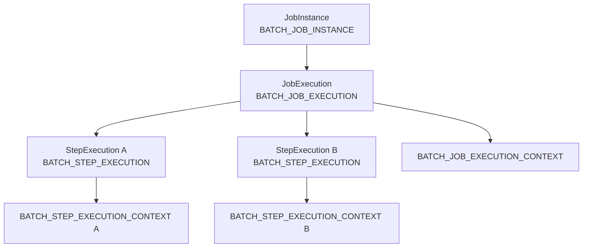
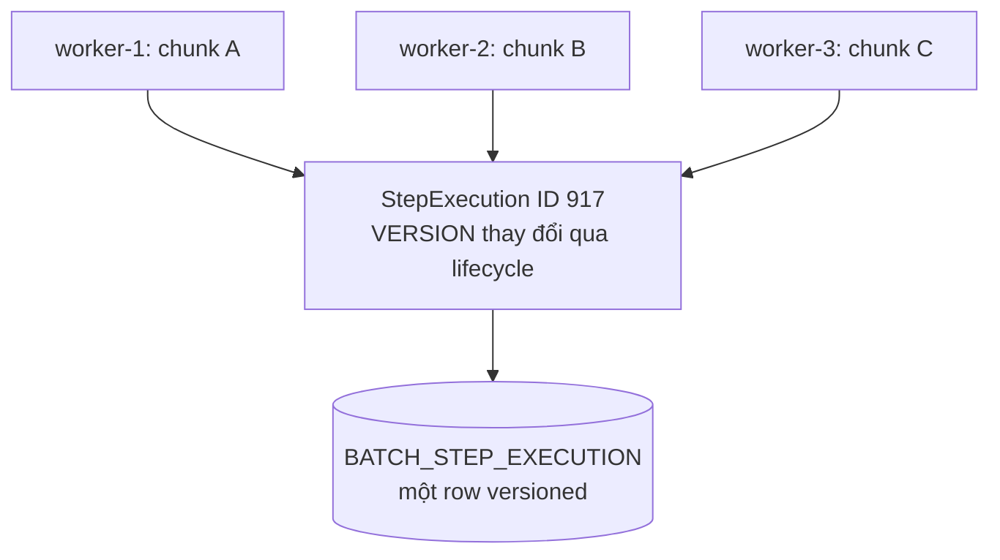
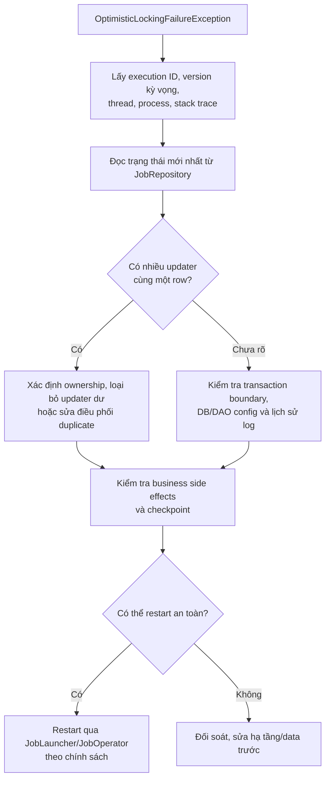

# Optimistic locking metadata trong Spring Batch JobRepository

> **Chương:** JobRepository  
> **Mục tiêu:** Hiểu cách Spring Batch dùng cột `VERSION` để bảo vệ metadata trước các cập nhật đồng thời; phân tích `OptimisticLockingFailureException`, xác định nguyên nhân khi chạy multi-threaded step, parallel steps, partitioning hoặc nhiều JVM và xử lý an toàn mà không làm hỏng trạng thái retry/restart. Ví dụ hướng đến **Spring Batch 5.2.x** và Java 17.

## 1. Bài toán: Hai worker cùng muốn cập nhật một lần thực thi

Một batch job xử lý hàng triệu bản ghi trong nhiều chunk. `JobRepository` lưu trạng thái thực thi để hệ thống biết step nào đã bắt đầu, bao nhiêu bản ghi được đọc/ghi, bao nhiêu chunk đã commit, trạng thái cuối là gì và có thể restart từ đâu.

Khi hệ thống mở rộng, các tình huống đồng thời xuất hiện:

- Nhiều thread xử lý chunk trong **một multi-threaded step**.
- Nhiều flow hoặc partition chạy song song.
- Manager và remote worker cùng kết nối tới database metadata.
- Một công cụ giám sát đọc trạng thái trong khi job vẫn chạy.
- Một đoạn code tùy biến giữ bản sao `StepExecution` rồi gọi `JobRepository.update(...)` sau khi framework đã cập nhật bản ghi đó.

Rủi ro rõ nhất ở tình huống cuối: nếu hai phía cùng có phiên bản metadata **cũ**, phía cập nhật sau có thể ghi đè kết quả mới của phía cập nhật trước — một dạng *lost update*.

Spring Batch dùng **optimistic locking** tại tầng metadata để phát hiện tình huống đó. Thay vì giữ khóa database dài từ lúc đọc đến lúc ghi, repository kiểm tra **version** của đối tượng trước khi chấp nhận cập nhật.

**Điểm chính:** Đây là cơ chế bảo vệ **metadata thực thi batch**, không phải cơ chế tự động chống trùng hoặc mất dữ liệu nghiệp vụ trong các bảng mà `ItemWriter` ghi.

## 2. Metadata nào có VERSION?

Spring Batch lưu metadata theo hệ phân cấp:



Trong schema JDBC chuẩn của **Spring Batch 5.2**:

| Bảng | Metadata chính | Cột `VERSION` trong schema chuẩn? |
| --- | --- | --- |
| `BATCH_JOB_INSTANCE` | Danh tính logic của job, job name và job key | Có |
| `BATCH_JOB_EXECUTION` | Một lần cố gắng chạy job: status, start/end, exit code | Có |
| `BATCH_STEP_EXECUTION` | Một lần thực thi step: status, read/write/skip/rollback counts | Có |
| `BATCH_JOB_EXECUTION_PARAMS` | Tham số chạy job và cờ identifying | Không |
| `BATCH_JOB_EXECUTION_CONTEXT` | Context có thể phục hồi của job | Không có cột VERSION riêng trong schema chuẩn |
| `BATCH_STEP_EXECUTION_CONTEXT` | Checkpoint/context của step | Không có cột VERSION riêng trong schema chuẩn |

Một số điều dễ nhầm:

- `JOB_EXECUTION_ID` hay `STEP_EXECUTION_ID` là **định danh bản ghi**, còn `VERSION` là **số thế hệ cập nhật** của chính bản ghi ấy.
- Mỗi hàng có version riêng; không có một bộ đếm version chung cho toàn database.
- `BATCH_JOB_INSTANCE` chứa `VERSION` trong schema, nhưng các tình huống cập nhật thường cần điều tra tập trung ở `JobExecution` và `StepExecution`.
- Context tables không có `VERSION` riêng **không có nghĩa** ứng dụng được tự do sửa `ExecutionContext` từ nhiều worker. Framework chịu trách nhiệm điều phối checkpoint và giao dịch; viết chung state sai phạm vi vẫn có thể phá restart.
- Không phải mọi thay đổi metadata đều là một lần cập nhật duy nhất. Đừng giả định `VERSION` tăng đúng một đơn vị cho **mỗi item** hoặc **mỗi chunk** trong mọi tình huống.

### Liên hệ với domain object

`JobExecution` và `StepExecution` kế thừa `org.springframework.batch.core.Entity`, có những method như:

```java
Long id = stepExecution.getId();
Integer version = stepExecution.getVersion();

Long jobExecutionId = stepExecution.getJobExecutionId();
String stepName = stepExecution.getStepName();
```

Giá trị `version` có thể chưa có trong một đối tượng chưa được lưu. Các method `setVersion(...)` và `incrementVersion()` thuộc cơ chế quản lý entity của repository; **không tự gọi chúng để vượt qua lỗi optimistic locking**.

## 3. Optimistic locking hoạt động thế nào?

Giả sử bản ghi `BATCH_STEP_EXECUTION` có:

```text
STEP_EXECUTION_ID = 917
STEP_NAME         = importInvoicesStep
STATUS            = STARTED
VERSION           = 6
READ_COUNT        = 20000
WRITE_COUNT       = 19990
```

Một bản sao Java của `StepExecution` có `version=6` muốn cập nhật số liệu. Về mặt ý tưởng, repository thực hiện thao tác dạng:

```sql
-- SQL minh họa nguyên lý; KHÔNG phải câu SQL chính xác
-- của mọi JdbcStepExecutionDao / mọi loại database.
UPDATE BATCH_STEP_EXECUTION
SET VERSION = 7,
    READ_COUNT = 20100,
    WRITE_COUNT = 20090,
    LAST_UPDATED = CURRENT_TIMESTAMP
WHERE STEP_EXECUTION_ID = 917
  AND VERSION = 6;
```

Nếu câu lệnh cập nhật đúng **1 row**, repository biết rằng tại thời điểm update, bản ghi vẫn ở version mà người ghi mong đợi. Nếu không có row nào khớp `ID + VERSION`, version có thể đã bị một writer khác thay đổi; Spring Batch ném lỗi optimistic locking (sau các bước kiểm tra phù hợp của DAO).

**Tính nguyên tử** của điều kiện `WHERE VERSION = ?` là yếu tố then chốt: hai transaction cạnh tranh trên cùng hàng không thể cùng cập nhật thành công từ một version cũ.

```mermaid
sequenceDiagram
    participant A as Worker / updater A
    participant B as Updater B
    participant DB as JobRepository DB
    A->>DB: Đọc StepExecution 917, version=6
    B->>DB: Đọc StepExecution 917, version=6
    A->>DB: UPDATE WHERE id=917 AND version=6
    DB-->>A: 1 row; version trở thành 7
    B->>DB: UPDATE WHERE id=917 AND version=6
    DB-->>B: 0 row; version không còn là 6
    Note over B: OptimisticLockingFailureException
```

Điều này **không có nghĩa worker B luôn sai về nghiệp vụ**. Nó chỉ có nghĩa bản sao metadata B đang định ghi là *stale* và không thể an toàn ghi đè trạng thái mới.

### Vì sao không sử dụng khóa pessimistic cho mọi thao tác?

Giữ khóa database kéo dài trong lúc xử lý hàng triệu record sẽ tăng lock contention và giảm thông lượng. Optimistic locking phù hợp để bảo vệ các cập nhật metadata tương đối ngắn, cho phép đọc song song và từ chối cập nhật đã lỗi thời.

Tuy vậy, optimistic locking **không miễn phí**. Khi nhiều đoạn code tranh cập nhật cùng hàng, xung đột lặp lại là dấu hiệu cần thay **quyền sở hữu state/kiến trúc**, không phải chỉ tăng retry.

## 4. Phân biệt optimistic lock metadata với transaction và dữ liệu nghiệp vụ

Ba cơ chế bảo vệ những vấn đề khác nhau:

| Cơ chế | Đối tượng được bảo vệ | Không tự bảo đảm |
| --- | --- | --- |
| **Metadata optimistic locking** | Bản ghi versioned của JobRepository, ví dụ `BATCH_STEP_EXECUTION` | Không chống ghi trùng vào `invoice` hoặc mất message |
| **Chunk transaction** | Những thao tác tham gia transaction của chunk | Không rollback side effect ngoài transaction |
| **Business idempotency/unique constraint** | Kết quả ghi theo business key, event ID, version nghiệp vụ | Không cập nhật đúng `JobExecution`/`StepExecution` trong repository |

Ví dụ worker A đã commit SQL vào bảng `invoice_import`, nhưng cập nhật checkpoint trong JobRepository bị lỗi do version cũ. Nếu metadata và business DB sử dụng **khác transaction manager/tài nguyên**, có thể tồn tại trạng thái “dữ liệu đã ghi, metadata chưa được cập nhật”. Restart cần xử lý việc phát lại dữ liệu.

Nếu cùng datasource/transaction manager và metadata update thực sự tham gia **cùng transaction chunk**, việc rollback có thể hủy cả business write và metadata write. **Không tự suy ra hai trường hợp giống nhau**; ranh giới transaction của hệ thống phải được kiểm tra bằng cấu hình và integration test.

Một `OptimisticLockingFailureException` **không chứng minh** dữ liệu nghiệp vụ đã bị trùng hoặc chưa được commit. Cần điều tra riêng transaction, DB rows, checkpoint và StepExecution status.

## 5. JobRepository và API cập nhật đúng cách

`JobRepository` chịu trách nhiệm CRUD metadata; `JobExplorer` phục vụ truy vấn trạng thái từ repository.

Các API thường gặp trong Spring Batch 5.2:

```java
// Hạ tầng Spring Batch gọi những method này trong lifecycle.
// Đừng gọi thủ công chỉ để "đồng bộ" số liệu lúc job đang chạy.
jobRepository.update(jobExecution);
jobRepository.update(stepExecution);

// ExecutionContext được lưu bởi API riêng, không phải tự động
// ghi kèm trong mọi lần update(JobExecution/StepExecution).
jobRepository.updateExecutionContext(jobExecution);
jobRepository.updateExecutionContext(stepExecution);
```

Từ hợp đồng API:

- `update(JobExecution)` cập nhật bản ghi execution, **không tự lưu** `ExecutionContext` của nó.
- `update(StepExecution)` cập nhật bản ghi step, **không tự lưu** `ExecutionContext` của nó.
- `updateExecutionContext(...)` là lời gọi riêng cho context tương ứng.
- Spring Batch đã điều phối các thao tác thích hợp trong vòng đời step/job. Code nghiệp vụ nên **để framework quản lý** thay vì tự gọi `update(...)` từ reader, processor, writer hoặc async callback.

### Vì sao JobExplorer thường an toàn hơn cho dashboard?

Khi cần hiển thị tiến độ, đọc thông qua `JobExplorer` là hướng ít xâm nhập nhất:

```java
package com.example.batch.monitoring;

import org.springframework.batch.core.JobExecution;
import org.springframework.batch.core.StepExecution;
import org.springframework.batch.core.explore.JobExplorer;

public final class BatchMetadataInspector {
    private final JobExplorer jobExplorer;

    public BatchMetadataInspector(JobExplorer jobExplorer) {
        this.jobExplorer = jobExplorer;
    }

    public StepExecution getStep(long jobExecutionId, long stepExecutionId) {
        StepExecution result =
                jobExplorer.getStepExecution(jobExecutionId, stepExecutionId);

        if (result == null) {
            throw new IllegalArgumentException(
                    "Step execution not found: " + stepExecutionId);
        }
        return result;
    }

    public JobExecution getJob(long jobExecutionId) {
        JobExecution result = jobExplorer.getJobExecution(jobExecutionId);
        if (result == null) {
            throw new IllegalArgumentException(
                    "Job execution not found: " + jobExecutionId);
        }
        return result;
    }
}
```

Mẫu sử dụng:

```java
StepExecution snapshot = inspector.getStep(412L, 917L);

log.info("stepExecutionId={} version={} status={} " +
                "read={} written={} rollbacks={}",
        snapshot.getId(), snapshot.getVersion(), snapshot.getStatus(),
        snapshot.getReadCount(), snapshot.getWriteCount(),
        snapshot.getRollbackCount());
```

`snapshot` là bản metadata **tại lúc truy vấn**, có thể nhanh chóng lỗi thời khi step đang chạy. Vì vậy:

1. Dùng để đọc, hiển thị và đối chiếu.
2. **Không** sửa snapshot rồi gọi `JobRepository.update(snapshot)` khi framework vẫn sở hữu execution.
3. Nếu cần trạng thái mới, đọc lại qua `JobExplorer` với ID phù hợp.
4. Đừng dùng version của snapshot làm một “khóa” để user tự cập nhật status qua SQL.

## 6. Một anti-pattern: Cập nhật StepExecution từ async listener

Giả sử một step đang chạy và service giám sát muốn thêm một trạng thái nghiệp vụ vào metadata. Developer viết:

```java
// PHẢN VÍ DỤ — KHÔNG sử dụng trong production.
StepExecution snapshot =
        jobExplorer.getStepExecution(jobExecutionId, stepExecutionId);

executor.execute(() -> {
    // Trong khi đó Spring Batch có thể đã cập nhật readCount,
    // commitCount, STATUS và VERSION.
    snapshot.setExitStatus(ExitStatus.COMPLETED);
    jobRepository.update(snapshot);
});
```

Các vấn đề:

- `snapshot` có thể mang `VERSION` cũ, gây `OptimisticLockingFailureException`.
- Ngay cả khi may mắn update thành công, code có thể **ghi đè trạng thái do framework quyết định**, tạo mismatch giữa thực tế và metadata.
- Việc đánh dấu `COMPLETED` trước khi các chunk thực sự hoàn tất có thể khiến quá trình restart bỏ qua dữ liệu.
- Tự tạo async task khác thread không mang theo transaction/step context; `@StepScope` cũng không tự giải quyết chuyện ấy.
- Việc sửa `ExitStatus` để thể hiện kết quả nghiệp vụ cần đi qua lifecycle/hợp đồng extension phù hợp, không phải cơ chế sửa một snapshot tùy ý.

### Hướng thiết kế tốt hơn

Nếu muốn theo dõi trạng thái bổ sung như “đã tải 5/10 file”, hãy dùng một trong các cách:

- **Log/metrics:** Đẩy số liệu từ `StepExecutionListener`, `ChunkListener` hoặc bộ đo chuyên dụng; đọc aggregate từ metadata khi cần.
- **Bảng tiến độ nghiệp vụ riêng:** Dùng business key/jobExecutionId để ghi status độc lập, với quy tắc idempotency và transaction riêng phù hợp.
- **ExecutionContext:** Chỉ lưu checkpoint/state nhỏ phục vụ restart theo đúng phạm vi step/job, để framework quản lý thời điểm persist; không ghi cùng context từ nhiều thread tùy ý.
- **Bước tổng hợp:** Đánh giá quality gate sau các partition, thay vì để từng worker đồng thời cập nhật `JobExecution` cha.

**Nguyên tắc sở hữu:** Mỗi đoạn code phải biết ai là chủ sở hữu cập nhật `StepExecution`/`JobExecution` tại thời điểm ấy. Không tạo “metadata writer thứ hai” chỉ để bổ sung thông tin giám sát.

## 7. Dùng listener để quan sát version mà không sửa repository

Spring Batch cung cấp `StepExecutionListener` để đọc thông tin ở mốc bắt đầu/kết thúc step:

```java
package com.example.batch.monitoring;

import org.slf4j.Logger;
import org.slf4j.LoggerFactory;
import org.springframework.batch.core.ExitStatus;
import org.springframework.batch.core.StepExecution;
import org.springframework.batch.core.StepExecutionListener;
import org.springframework.stereotype.Component;

@Component
public class MetadataVersionLogListener implements StepExecutionListener {

    private static final Logger log =
            LoggerFactory.getLogger(MetadataVersionLogListener.class);

    @Override
    public void beforeStep(StepExecution stepExecution) {
        log.info("step_started jobExecutionId={} stepExecutionId={} " +
                        "name={} version={}",
                stepExecution.getJobExecutionId(),
                stepExecution.getId(),
                stepExecution.getStepName(),
                stepExecution.getVersion());
    }

    @Override
    public ExitStatus afterStep(StepExecution stepExecution) {
        log.info("step_finished stepExecutionId={} version={} status={} " +
                        "readCount={} writeCount={} commitCount={} " +
                        "rollbackCount={} skipCount={}",
                stepExecution.getId(), stepExecution.getVersion(),
                stepExecution.getStatus(),
                stepExecution.getReadCount(),
                stepExecution.getWriteCount(),
                stepExecution.getCommitCount(),
                stepExecution.getRollbackCount(),
                stepExecution.getSkipCount());

        return null; // Không thay đổi ExitStatus mà framework đã tính.
    }
}
```

Cách đăng ký trong Spring Batch 5.2 (đoạn trích cấu hình step):

```java
@Bean
Step importInvoicesStep(
        JobRepository repository,
        PlatformTransactionManager transactionManager,
        ItemReader<Invoice> reader,
        ItemWriter<Invoice> writer,
        MetadataVersionLogListener versionListener) {

    return new StepBuilder("importInvoicesStep", repository)
            .<Invoice, Invoice>chunk(200, transactionManager)
            .reader(reader)
            .writer(writer)
            .listener(versionListener)
            .build();
}
```

Trong đó `Invoice`, `reader` và `writer` do ứng dụng cung cấp. Ví dụ chỉ minh họa điểm **quan sát**, không phải application có thể tự chạy nếu thiếu Job, DB hoặc bean reader/writer.

Lưu ý: `version` tại callback `afterStep` có thể chưa phản ánh **lần update metadata cuối cùng** diễn ra sau callback. Nếu cần xác minh bản ghi đã persist sau khi job kết thúc, dùng `JobExplorer`/SQL read-only truy vấn lại repository thay vì giả định callback đã là lần ghi cuối.

## 8. Đọc bảng metadata bằng SQL mà không làm thay đổi VERSION

Trong hệ thống dùng JDBC JobRepository, hai câu truy vấn sau giúp biết version hiện tại:

```sql
-- Ví dụ read-only, sử dụng prepared-statement parameter.
SELECT
    JOB_EXECUTION_ID,
    JOB_INSTANCE_ID,
    VERSION,
    STATUS,
    START_TIME,
    END_TIME,
    LAST_UPDATED
FROM BATCH_JOB_EXECUTION
WHERE JOB_EXECUTION_ID = ?;
```

```sql
SELECT
    STEP_EXECUTION_ID,
    JOB_EXECUTION_ID,
    STEP_NAME,
    VERSION,
    STATUS,
    READ_COUNT,
    WRITE_COUNT,
    READ_SKIP_COUNT,
    PROCESS_SKIP_COUNT,
    WRITE_SKIP_COUNT,
    COMMIT_COUNT,
    ROLLBACK_COUNT,
    LAST_UPDATED
FROM BATCH_STEP_EXECUTION
WHERE STEP_EXECUTION_ID = ?;
```

Không cần chạy `SELECT ... FOR UPDATE` chỉ để hiển thị dashboard. Điều đó có thể vô tình tạo lock contention với chính batch job.

**Không viết SQL trực tiếp kiểu:**

```sql
-- PHẢN VÍ DỤ — không được chạy:
UPDATE BATCH_STEP_EXECUTION
SET VERSION = 999, STATUS = 'COMPLETED'
WHERE STEP_EXECUTION_ID = 917;
```

Việc “sửa version cho khớp” phá giao kèo optimistic locking, có thể che giấu lỗi, khiến JobRepository đọc các counter/context không nhất quán và làm restart sai. Các thao tác cứu hộ metadata chỉ nên được thực hiện theo runbook đã kiểm tra, backup và hiểu đầy đủ trạng thái DB/business effects.

Nếu ứng dụng dùng `@EnableBatchProcessing(tablePrefix=...)` hoặc schema khác, tên bảng có thể có prefix khác `BATCH_`. Phải truy vấn **đúng database, schema và environment**. Hai repository độc lập có thể có execution ID trùng số nhưng đại diện công việc khác nhau.

## 9. Điều gì xảy ra khi chạy multi-threaded step?

Trong **multi-threaded step**, nhiều chunk có thể chạy đồng thời nhưng cùng thuộc **một `StepExecution`**. Các worker thread chia sẻ định danh step, và Spring Batch phải quản lý các cập nhật metadata/counters tại thời điểm commit hoặc lifecycle tương ứng.



Ở đây có hai loại vấn đề độc lập:

1. **Framework coordination:** Spring Batch có cơ chế quản lý state/counters và persist step. Không tự tạo updater khác dùng bản sao stale.
2. **User component thread safety:** Reader/processor/writer dùng chung có thể race, kể cả khi metadata repository không hề báo optimistic locking.

Một số nguyên tắc:

- Đừng tạo nhiều instance `StepExecution` từ `JobExplorer` rồi cho từng worker tự gọi `JobRepository.update(...)`.
- Đừng cho writer lưu một `StepExecution` ở singleton field để tự ghi counter/status.
- Việc tăng thread không khiến database metadata có **mỗi thread một StepExecution**. Muốn tách metadata theo phần việc, hãy cân nhắc **partitioning**.
- Nếu dùng `ExecutionContext` chung của một step để ghi checkpoint từ các chunk đồng thời, cần hiểu tính an toàn/restart; optimistic locking trên row execution **không tự tạo checkpoint riêng cho từng chunk**.
- Có thể thấy `VERSION` tăng theo các cập nhật step khi job tiến triển; mức tăng tùy callback/commit và implementation, không nên dùng nó thay `readCount/writeCount` để đo progress.

### Tại sao không nên “retry metadata update” bằng vòng lặp?

Nếu hai bản sao mang `VERSION=6`, A cập nhật thành 7, B retry lại **cùng bản sao version 6** sẽ tiếp tục thất bại. Nếu B tự đặt version thành 7 rồi ghi, nó có thể ghi đè counters/status của A.

Khi thấy lỗi này, phải **xác định writer bất thường hoặc đường cạnh tranh**, không tự thêm `@Retryable` quanh toàn bộ chunk hay `JobRepository.update(...)` và hy vọng hết lỗi.

## 10. Parallel steps và partitioning: Khóa nào thực sự cạnh tranh?

| Mô hình | Metadata chính | Điểm cần kiểm soát |
| --- | --- | --- |
| Step tuần tự | Một `StepExecution` cho mỗi lượt step | Không có updater thứ hai dùng snapshot stale |
| Multi-threaded step | Nhiều chunk chung một `StepExecution` | State chung, writer/reader thread safety, không tự update metadata |
| Parallel steps (split flow) | Các step khác nhau có `StepExecution` khác ID | Mỗi step có row riêng; tránh tự cập nhật `JobExecution` cha từ từng flow |
| Local partitioning | Mỗi partition có `StepExecution` riêng | Tên partition ổn định, reader riêng, handler aggregation đúng |
| Remote partitioning | Worker dùng StepExecution của partition trên shared repository | Không để hai remote worker chạy **cùng execution** đồng thời |
| Remote chunking | Manager nắm `StepExecution` điều phối; workers nhận chunk messages | Không để các worker tự cập nhật row metadata của manager bằng snapshot riêng |
| Hai job JVM độc lập | Có thể dùng chung database repository nhưng khác JobExecution | Isolation khi launch trùng JobInstance; resource contention |

Partitioning thường giảm tranh chấp **trên cùng một hàng StepExecution** vì mỗi partition có execution riêng. Tuy vậy nó không loại bỏ mọi tranh chấp: nhiều partition cùng ghi database nghiệp vụ, update trạng thái job cha không đúng cách hoặc manager/worker trùng quyền sở hữu vẫn gây lỗi.

### Remote partitioning và kết quả đến muộn

Một partition có thể bị giao lại sau timeout trong khi worker cũ vẫn đang chạy. Hai process cùng dùng `StepExecution ID 917` có thể cạnh tranh:

```text
worker-A đọc StepExecution(917), version=8
worker-B đọc StepExecution(917), version=8
worker-A lưu trạng thái mới -> version=9
worker-B lưu snapshot cũ  -> OptimisticLockingFailureException
```

Ở đây lỗi optimistic locking là **tín hiệu rủi ro điều phối duplicate execution**, không đơn thuần là chuyện tăng retry. Cần kiểm tra request ID, lease/claim/fencing và dữ liệu đã commit, trước khi quyết định chạy lại partition.

Không giả định mọi middleware đều có cơ chế fencing mặc định. Một worker vẫn có thể gây side effect nghiệp vụ trước khi metadata conflict được phát hiện.

## 11. Cạnh tranh khi khởi chạy JobInstance không giống metadata update

Spring Batch cũng phải bảo vệ tình huống **hai tiến trình cùng launch một job với cùng bộ identifying JobParameters**. Đây là bài toán tạo mới `JobInstance`/`JobExecution` đồng thời, không đơn thuần là CAS update `VERSION` của một `StepExecution` đã tồn tại.

`JobRepository.createJobExecution(...)` có cấu hình transaction và isolation cho các thao tác `create*`. Trong Spring Batch 5.2, cấu hình điển hình:

```java
@Configuration
@EnableBatchProcessing(
        isolationLevelForCreate = "ISOLATION_SERIALIZABLE")
public class BatchInfrastructureConfig {
    // Các bean Batch/Job ở cấu hình khác.
}
```

Đây là ví dụ thể hiện **một cấu hình isolation** (mặc định phổ biến của repository là `SERIALIZABLE` cho create). Với Spring Boot, không nên thêm `@EnableBatchProcessing` vào ứng dụng đang dựa vào auto-configuration mà chưa hiểu tác dụng thay đổi wiring của nó.

Nếu hai launcher cùng yêu cầu một JobInstance:

- Một bên có thể tạo được execution.
- Bên kia có thể nhận lỗi liên quan JobExecution đang chạy, JobInstance đã complete, transaction isolation/constraint hoặc trạng thái tương đương theo timing.
- Cần xử lý theo **business identity và JobRepository**, không tạo ngẫu nhiên timestamp để “qua được lỗi” rồi chạy lặp input.

**Phân biệt:** `isolationLevelForCreate` không phải nút tắt optimistic locking và không giải quyết vấn đề hai updater cùng ghi một `StepExecution` stale.

## 12. ExecutionContext và checkpoint có bảo vệ version giống nhau không?

`ExecutionContext` lưu state để restart (ví dụ vị trí đọc file, cursor/page state, tham số partition). Trong JDBC schema chuẩn, context được lưu ở bảng riêng:

```text
BATCH_JOB_EXECUTION_CONTEXT
BATCH_STEP_EXECUTION_CONTEXT
```

Không có cột `VERSION` riêng trên hai bảng này. Điều đó dẫn đến một nguyên tắc:

**Không dùng optimistic locking của `BATCH_STEP_EXECUTION` như lời bảo đảm tự động rằng mọi ghi đè `ExecutionContext` đều được phát hiện.**

Trong bước chunk chuẩn, Spring Batch có quy trình phối hợp persist checkpoint với metadata và transaction. Nhưng code tùy biến tự gọi `updateExecutionContext(...)` từ nhiều thread vẫn có thể tạo:

- *Lost update* của một key trong context.
- Checkpoint tiến quá xa so với các chunk thực sự đã commit.
- Trạng thái không đúng nếu restart khi một phần công việc vẫn in-flight.
- Lỗi serialization hoặc dirty tracking với object mutable không được ghi nhận đúng.

### Ví dụ không an toàn

```java
// PHẢN VÍ DỤ: Hai worker độc lập sửa cùng context.
stepExecution.getExecutionContext().putLong("lastProcessedId", id);
jobRepository.updateExecutionContext(stepExecution);
```

Với multi-threaded step, “lastProcessedId” của worker B không nhất thiết là **ID cuối cùng đã commit**. Ngay cả khi không có optimistic locking exception, checkpoint vẫn có thể sai.

**Cách đúng hơn** là chia dữ liệu thành partition với `ExecutionContext` riêng, dùng reader/writer có checkpoint hỗ trợ restart, không chỉnh context ngoài đúng lifecycle và kiểm thử crash/restart bằng đối soát business key.

## 13. Xử lý OptimisticLockingFailureException trong vận hành

Khi thấy lỗi optimistic locking, đừng lập tức xóa metadata hoặc tăng retry vô hạn. Hãy phân loại:



### Quy trình sáu bước

1. **Định vị:** Lấy `jobExecutionId`, `stepExecutionId`, version trong exception/log, tên job/step, môi trường và time window.
2. **Đọc metadata hiện tại:** Dùng `JobExplorer` hoặc SQL read-only; kiểm tra `VERSION`, `STATUS`, `LAST_UPDATED`, `COMMIT_COUNT`, `ROLLBACK_COUNT`.
3. **Tìm các updater:** Có custom listener, admin endpoint, monitoring code, remote worker duplicate, scheduler chạy đè hoặc process cũ chưa dừng?
4. **Xác định side effect:** Có chunk business write đã commit chưa? DB đích có trùng/mất key, side effect ngoài DB có lặp không?
5. **Sửa ownership/correlation:** Chỉ một tiến trình sở hữu trạng thái execution; tắt updater tự sửa metadata và kiểm soát delivery trùng.
6. **Phục hồi bằng API/lifecycle hợp lệ:** Restart đúng JobInstance khi đã bảo đảm data và checkpoint nhất quán. Không thao tác SQL `VERSION` trực tiếp để ép job chạy.

### Khi nào được retry?

- Retry **một thao tác nghiệp vụ idempotent** sau lỗi DB tạm thời là một cơ chế khác.
- Với lỗi optimistic locking **metadata**, retry không nên là phản xạ mặc định. Nếu có một workflow quản trị rõ ràng về merge state, có thể **đọc lại snapshot hiện hành, tính lại hành động dựa trên trạng thái mới và ghi qua API đúng** sau khi đã khóa ownership nghiệp vụ. Đó là một quy trình reconciliation, không phải vòng lặp giữ nguyên object stale.
- Nếu framework tự ném lỗi trong quá trình chunk, hãy giữ nguyên exception/stack trace để tìm nguyên nhân cạnh tranh trước khi điều chỉnh fault-tolerance policy.

**Không thêm** `.skip(OptimisticLockingFailureException.class)` hoặc `.retry(Exception.class)` vào step chỉ để “cho batch chạy tiếp”. Bỏ qua lỗi metadata có thể làm JobRepository báo trạng thái sai và phá restart.

## 14. Observability và dấu hiệu cảnh báo

Không nên đợi đến khi hàng triệu record thất bại mới điều tra. Với một hệ thống chạy nhiều job và worker, theo dõi:

| Tín hiệu | Cách diễn giải |
| --- | --- |
| Số lần optimistic lock failure theo job/step | Gợi ý metadata có updater cạnh tranh |
| `VERSION`, `LAST_UPDATED`, `STATUS` | Dùng điều tra **một execution cụ thể** |
| `COMMIT_COUNT`, `ROLLBACK_COUNT`, read/write/skip counts | Xác minh tiến độ và sự cố transactional |
| Cùng `stepExecutionId` xuất hiện ở nhiều process worker không mong đợi | Có thể remote duplicate execution hoặc retry dispatch sai |
| Job `STARTED` quá lâu, `LAST_UPDATED` không đổi | Có thể worker treo, mất kết nối hoặc metadata không cập nhật |
| DB connection pool pending/lock wait | Metadata DB hoặc business DB bị tranh chấp tài nguyên |
| Failed restart / mismatched checkpoint | Có thể metadata stale hoặc dữ liệu nguồn thay đổi |
| Error bursts sau khi scale up | Concurrency/ownership/configuration chưa tương thích |

Structured log nên có:

```text
service=spring-batch-scaling-operations
jobExecutionId=412
stepExecutionId=917
stepName=importInvoicesStep
metadataVersion=6
workerId=worker-A
thread=batch-partition-2
event=metadata_update_conflict
exception=OptimisticLockingFailureException
```

Những giá trị chỉ minh họa. Không đưa `stepExecutionId` hoặc `jobExecutionId` vào **Prometheus metric labels** vì cardinality rất cao; chúng phù hợp với **logs/traces**. Metric dùng nhãn ổn định như job name, step name, error family và environment.

Tần suất truy vấn `JobExplorer` cũng cần giới hạn. Polling metadata quá dày từ nhiều dashboard có thể tạo tải DB đáng kể dù chỉ đọc và không gây optimistic lock.

## 15. Các sự cố thường gặp và cách khắc phục

| Triệu chứng | Nguyên nhân khả dĩ | Hướng xử lý |
| --- | --- | --- |
| Lỗi optimistic lock khi job đang chạy bình thường | Custom updater ghi `StepExecution` stale | Bỏ lời gọi `JobRepository.update(snapshot)`, chuyển sang read-only monitoring |
| Cùng partition có hai remote worker chạy | Redelivery/timeout nhưng worker cũ vẫn hoạt động | Dedupe/claim/fencing, xác định worker owner, writer idempotent |
| Exception xuất hiện sau khi scale worker | Hai đường cập nhật metadata cùng row | Tìm theo stepExecutionId, tách execution theo partition |
| `VERSION` trong Java thấp hơn DB | Snapshot đã lỗi thời | Không ép setVersion; đọc lại và xem vì sao có updater thứ hai |
| Lỗi khác `OptimisticLockingFailureException` khi launch trùng | Cạnh tranh tạo JobInstance, isolation/constraint hoặc JobInstance đã complete | Xem create transaction + identifying parameters; không tự đổi version |
| Không có optimistic exception nhưng restart thiếu data | ExecutionContext hoặc business write sai checkpoint | Test crash/restart, đối soát nguồn/đích, không chỉ nhìn VERSION |
| `STATUS=COMPLETED` nhưng output thiếu | Metadata bị sửa tay hoặc side effect ngoài transaction chưa xong | Cấm admin update trực tiếp, kiểm tra quality gate |
| Worker DB commit nhưng metadata không phản ánh | Metadata và business DB khác transaction hoặc crash window | Idempotency/outbox/reconciliation, kiểm tra transaction boundary |
| DB metadata bị nghẽn khi tăng worker | Connection pool nhỏ, update thường xuyên, lock contention | Đo wait/throughput, giảm concurrency hoặc tối ưu DB |
| Đồng bộ hóa toàn bộ repository bằng `synchronized` | Khóa Java chỉ có tác dụng trong JVM, không bảo vệ nhiều process | Dùng JobRepository JDBC, transaction/isolation và ownership đúng |
| Không tìm thấy execution ID trong DB | Sai repository/schema/environment hoặc dữ liệu đã retention-cleanup | Xác định đúng nơi lưu metadata trước khi chỉnh |
| Tắt optimistic locking bằng SQL thủ công | Nguy cơ lost update, corruption và restart sai | Khôi phục schema/API chuẩn; điều tra nguyên nhân gốc |

## 16. Bài thực hành

**Bài A — Quan sát version tiến triển.** Chạy một job nhỏ gồm hai step; truy vấn `BATCH_JOB_EXECUTION`, `BATCH_STEP_EXECUTION` lúc bắt đầu, khi commit chunk và sau kết thúc. Ghi lại `VERSION` và counters; không suy từ version ra số item đã xử lý.

**Bài B — Hai bản sao stale trong môi trường test.** Dùng một JobExecution/StepExecution **giả lập** trên test database đã cô lập. Tạo hai snapshot cùng version, áp dụng mô hình `UPDATE ... WHERE ID AND VERSION`, xác nhận một update thành công và update còn lại có row count 0. **Không làm thí nghiệm bằng cách sửa metadata trực tiếp trên production** hoặc trên job đang hoạt động.

**Bài C — Monitoring read-only.** Tạo một service đọc `JobExplorer.getStepExecution(...)` theo ID và hiển thị status/counters. Xác nhận service không gọi `JobRepository.update(...)`, không thay đổi `VERSION` khi polling.

**Bài D — Phản ví dụ stale updater.** Trong môi trường test có thể reset, thêm một listener tùy chỉnh giữ snapshot rồi cố lưu sau khi framework đã cập nhật. Quan sát ngoại lệ optimistic locking và chứng minh việc tự đặt lại version có thể ghi đè counter mới. Sau đó xóa updater và chuyển audit sang bảng riêng.

**Bài E — Multi-threaded step.** Dùng một step có `TaskExecutor` và processor stateless; log `stepExecutionId` trong các worker. Xác nhận các thread dùng cùng StepExecution ID nhưng không tự gọi update metadata; đo throughput và restart với reader phù hợp.

**Bài F — Partitioning.** Chia input thành bốn partition, mỗi partition có reader step-scoped và StepExecution riêng. Tạo lỗi trong một partition, kiểm tra các execution IDs khác nhau, metadata/rollback độc lập và aggregation sau restart.

**Bài G — Remote duplicate.** Mô phỏng gửi lại cùng partition khi worker cũ vẫn chạy. Ghi log process/StepExecution ID; xác định có thể xảy ra cạnh tranh trạng thái và side effect DB trước khi optimistic lock báo lỗi. Thiết kế cơ chế ownership/dedup phù hợp.

**Bài H — Transaction mismatch.** Cấu hình business DB và JobRepository dùng nguồn giao dịch khác nhau trong môi trường kiểm thử; giả lập crash giữa data commit và metadata update. Kiểm tra khả năng replay và tính idempotent của writer.

### Checklist trước production

- [ ] Hiểu `ID` và `VERSION` của JobExecution/StepExecution là hai loại thông tin khác nhau.
- [ ] Code nghiệp vụ không tự ghi metadata đang được framework quản lý.
- [ ] Monitoring dùng JobExplorer/SQL read-only thay vì update snapshot.
- [ ] Không tự chỉnh `setVersion`, `incrementVersion` hoặc cột `VERSION` trong DB.
- [ ] Partition/worker có ownership và correlation ID rõ ràng; ngăn duplicate execution.
- [ ] ExecutionContext và reader checkpoint được thiết kế an toàn cho restart.
- [ ] Có idempotency business write, không nhầm bảo vệ metadata với exactly-once.
- [ ] Đã kiểm thử contention, worker crash, retry/restart và transaction boundary.
- [ ] Có log/metrics phát hiện optimistic failure mà không gây high-cardinality labels.

## 17. Tài liệu tham khảo chính thức

- [Spring Batch 5.2 — Meta-Data Schema và Version](https://docs.spring.io/spring-batch/reference/5.2/schema-appendix.html)
- [Spring Batch 5.2 — Configuring a JobRepository](https://docs.spring.io/spring-batch/reference/5.2/job/configuring-repository.html)
- [Spring Batch 5.2 — Configuring a Step, transaction và JobRepository](https://docs.spring.io/spring-batch/reference/5.2/step/chunk-oriented-processing/configuring.html)
- [Spring Batch 5.2 — The Domain Language of Batch](https://docs.spring.io/spring-batch/reference/5.2/domain.html)
- [Spring Batch 5.2 — JobRepository API](https://docs.spring.io/spring-batch/docs/5.2.2/api/org/springframework/batch/core/repository/JobRepository.html)
- [Spring Batch 5.2 — JobExplorer API](https://docs.spring.io/spring-batch/docs/5.2.2/api/org/springframework/batch/core/explore/JobExplorer.html)
- [Spring Batch 5.2 — Entity.getVersion() API](https://docs.spring.io/spring-batch/docs/5.2.2/api/org/springframework/batch/core/Entity.html)
- [Spring Batch 5.2 — JdbcStepExecutionDao API](https://docs.spring.io/spring-batch/docs/5.2.2/api/org/springframework/batch/core/repository/dao/JdbcStepExecutionDao.html)
- [Spring Batch 5.2 — Scaling and Parallel Processing](https://docs.spring.io/spring-batch/reference/5.2/scalability.html)
- [Spring Framework — OptimisticLockingFailureException API](https://docs.spring.io/spring-framework/docs/current/javadoc-api/org/springframework/dao/OptimisticLockingFailureException.html)

> **Giới hạn phiên bản:** Các import, API `JobRepository`/`JobExplorer` và cấu hình trong bài nhắm **Spring Batch 5.2.x**. Spring Batch 6 có thể thay đổi package, factory và một số phần hạ tầng; kiểm tra Javadoc/schema đúng phiên bản và database. SQL UPDATE dùng để giải thích CAS ở phần 3 là **giả lập nguyên lý**, không phải lời khuyên thực thi trực tiếp hay khẳng định từng câu SQL nội bộ của mọi DAO.

**Ghi nhớ:** Optimistic locking của `JobRepository` bảo vệ metadata bằng **ID + VERSION** và từ chối ghi từ snapshot stale. Khi xung đột, vấn đề cần giải quyết là **quyền sở hữu cập nhật**, transaction và điều phối các execution, không phải ép tăng version hoặc skip lỗi. Tính đúng đắn khi scale còn đòi hỏi checkpoint đáng tin, writer idempotent và quy trình kiểm thử retry/restart trên dữ liệu thực.
