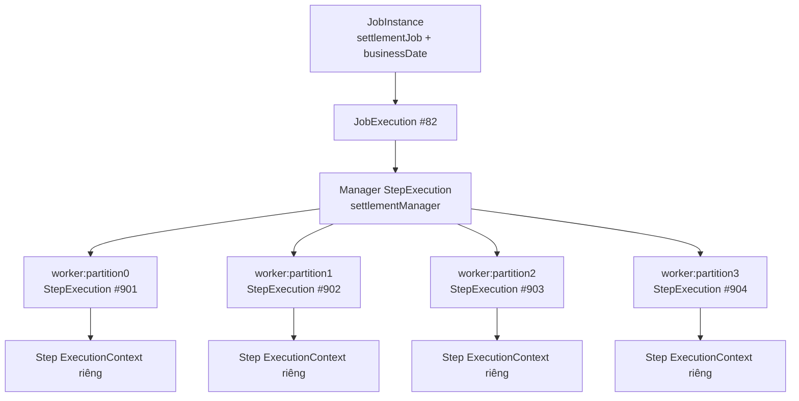
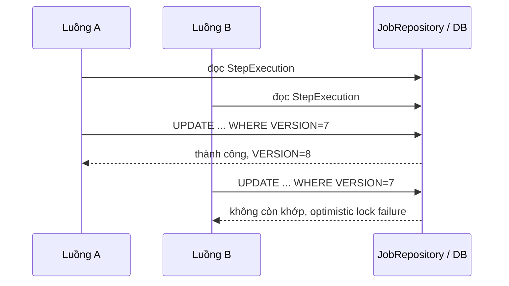
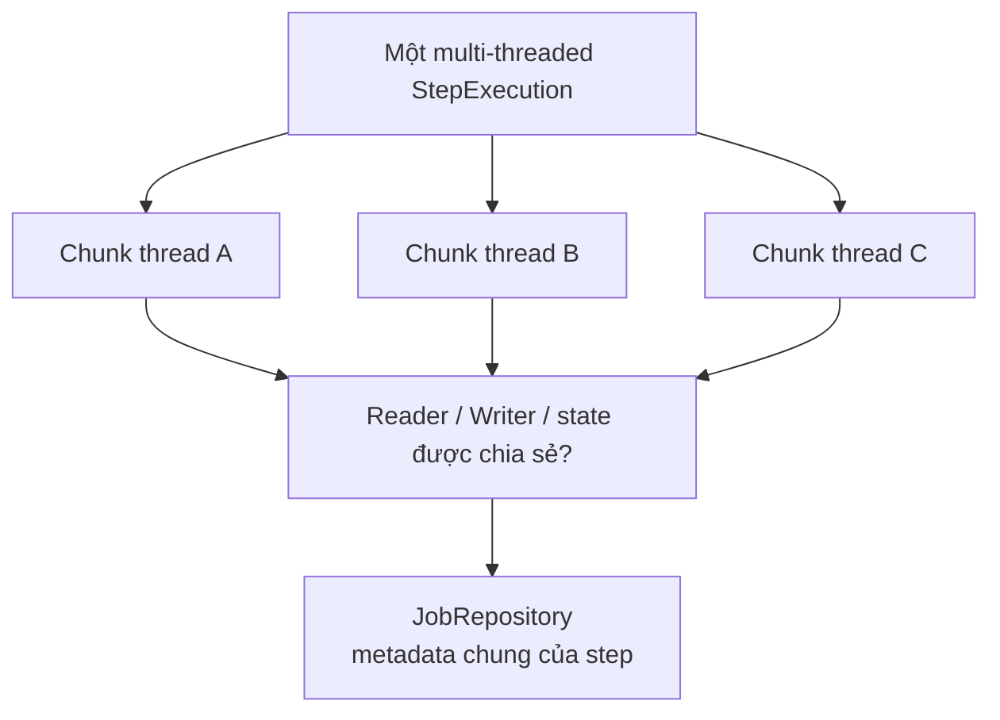
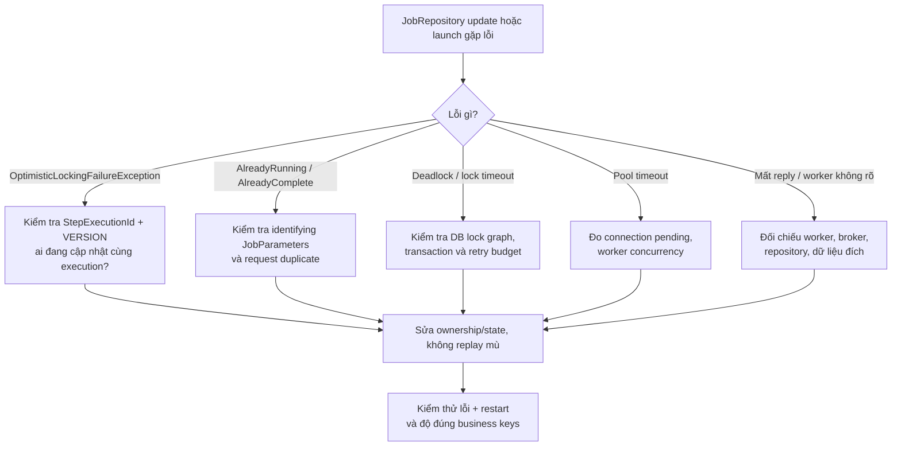

# Concurrent update trên JobRepository

## 1. Bối cảnh: càng mở rộng batch, metadata càng dễ bị tranh chấp

Trong chương **JobRepository** của module **SPRING_BATCH_SCALING_OPERATIONS**, chúng ta học cách mở rộng Spring Batch cho workload dữ liệu lớn bằng multi-threaded step, parallel steps, partitioning và các mô hình phân tán phù hợp. Để job có thể theo dõi tiến độ, dừng, retry và restart, Spring Batch không chỉ xử lý dữ liệu nghiệp vụ: nó còn phải **ghi metadata thực thi** vào `JobRepository`.

Khi chỉ có một step chạy tuần tự, những lần cập nhật metadata thường ít xảy ra đồng thời. Khi tăng số thread, số partition hoặc số worker ở nhiều JVM, nhiều transaction có thể cùng truy cập các bảng `BATCH_JOB_EXECUTION`, `BATCH_STEP_EXECUTION` và các bảng `ExecutionContext`. Có hai tình huống đặc biệt cần phân biệt:

1. **Cùng một dòng metadata bị cập nhật đồng thời**, ví dụ hai tác nhân cùng ghi một `StepExecution` dựa trên cùng phiên bản đã đọc trước đó. Cơ chế **optimistic locking** của repository có thể từ chối một lần ghi để tránh mất cập nhật.
2. **Nhiều dòng metadata khác nhau cùng được ghi**, ví dụ 16 partition có `StepExecution` riêng. Không nhất thiết có xung đột phiên bản trên cùng dòng, nhưng chúng vẫn có thể gây **lock contention, connection pool exhaustion, transaction log I/O** và tải lớn lên database metadata.

Bài học này hướng tới việc hiểu nguyên nhân thật sự của **concurrent update trên JobRepository**, không chỉ tìm cách “tắt lỗi” để job tiếp tục.

Sau bài này, bạn có thể:

- Phân biệt `JobInstance`, `JobExecution`, `StepExecution` và hai cấp `ExecutionContext` trong các trường hợp chạy đồng thời.
- Giải thích optimistic locking qua trường `VERSION`, vì sao cập nhật stale state bị từ chối và cách xử lý an toàn.
- Nhận diện race khi hai process launch cùng một `JobInstance`.
- Phân biệt metadata contention trong multi-threaded step, parallel steps và partitioning.
- Thiết kế writer/reader, tên partition, checkpoint, retry/restart và giao thức request có tính idempotent.
- Đo số lần commit, lock wait, connection wait và thời gian cập nhật repository trước khi tăng concurrency.

> **Nguyên tắc cốt lõi:** `JobRepository` bảo vệ **metadata thực thi** của Spring Batch, không phải distributed lock cho mọi dữ liệu nghiệp vụ. **Optimistic locking** giúp phát hiện cập nhật dựa trên trạng thái cũ; nó không bảo đảm writer an toàn luồng, không rollback HTTP call đã thực hiện và không tự biến request gửi lại thành đúng-một-lần.

## 2. JobRepository thực sự lưu những gì?

Một job có nhiều lớp danh tính và trạng thái:

| Thành phần | Ý nghĩa | Vị trí metadata JDBC thông dụng |
| --- | --- | --- |
| `JobInstance` | Một công việc logic: tên job và **identifying JobParameters** | `BATCH_JOB_INSTANCE` |
| `JobExecution` | Một lần thực thi hoặc restart của một `JobInstance` | `BATCH_JOB_EXECUTION` |
| `StepExecution` | Một lần thực thi step, gồm status, counters, version | `BATCH_STEP_EXECUTION` |
| Job `ExecutionContext` | Dữ liệu trạng thái được lưu ở cấp job execution | `BATCH_JOB_EXECUTION_CONTEXT` |
| Step `ExecutionContext` | Trạng thái reader/writer/checkpoint của step hoặc partition | `BATCH_STEP_EXECUTION_CONTEXT` |
| Job parameters | Những tham số gắn với một lần thực thi và định danh instance | `BATCH_JOB_EXECUTION_PARAMS` |

`JobRepository` cung cấp API thao tác metadata như tạo `JobExecution`, lưu `StepExecution`, lưu execution context và cập nhật status. Các reader/writer nghiệp vụ vẫn làm việc với database, file hoặc API riêng; chúng **không tự được bảo vệ** bởi optimistic lock trên `StepExecution`.

### 2.1. Một job partitioning có nhiều StepExecution

Giả sử manager chia một triệu giao dịch thành bốn vùng:



Bốn worker execution có **ID và dòng metadata khác nhau**, nên chúng có thể cập nhật `READ_COUNT`, `WRITE_COUNT` và checkpoint của mình mà không nhất thiết cùng sửa **một dòng**. Manager có thể tổng hợp kết quả của chúng vào `StepExecution` riêng của manager. Các con số ID là minh họa, không phải giá trị dự đoán từ framework.

Ngược lại, một **multi-threaded chunk step** vẫn có thể chỉ có **một `StepExecution`** được nhiều chunk thread tham chiếu. Vì vậy, bài toán chia sẻ state khác hẳn partitioning.

## 3. Optimistic locking: cơ chế chống mất cập nhật

### 3.1. Vì sao có cột VERSION?

Trong schema JDBC chuẩn của Spring Batch, `BATCH_JOB_EXECUTION` và `BATCH_STEP_EXECUTION` có cột `VERSION`. Repository dùng số phiên bản này để phát hiện tác nhân đang cố cập nhật một đối tượng **đã bị thay đổi bởi tác nhân khác**.

Ví dụ hai luồng cùng có snapshot `StepExecution #901` phiên bản 7:



Ý tưởng của câu SQL tương đương:

```sql
-- SQL mô tả nguyên lý; KHÔNG phải câu SQL nội bộ
-- chính xác của mọi Spring Batch DAO hoặc mọi DB.
UPDATE BATCH_STEP_EXECUTION
SET VERSION = :expected_version + 1,
    STATUS = :new_status,
    LAST_UPDATED = :update_time
WHERE STEP_EXECUTION_ID = :step_execution_id
  AND VERSION = :expected_version;
```

Nếu hàng đã được nâng phiên bản từ 7 lên 8, câu lệnh dùng `expected_version=7` không cập nhật được dòng nào. Spring Batch coi đây là dấu hiệu **stale update** và có thể phát sinh `OptimisticLockingFailureException` thay vì ghi đè trạng thái mới.

**Điều optimistic locking bảo đảm:** nhận biết một số cập nhật xung đột dựa trên phiên bản. **Điều nó không bảo đảm:** thứ tự xử lý item đúng, ghi dữ liệu nghiệp vụ exactly once, loại bỏ deadlock trong DB hoặc bảo vệ mọi object Java mutable.

### 3.2. Optimistic locking khác database row lock

| Cơ chế | Mục đích | Ví dụ |
| --- | --- | --- |
| **Optimistic locking** | Phát hiện một cập nhật sử dụng phiên bản cũ | `VERSION` không còn khớp khi update |
| **Row-level locking** | Database điều phối giao dịch cùng đọc/ghi những dòng bị khóa | Transaction B phải đợi transaction A |
| **Transaction isolation** | Quy định mức quan sát dữ liệu đồng thời giữa transaction | Hai transaction cùng tạo job execution |
| **Unique constraint** | Chặn hai bản ghi có khóa duy nhất trùng nhau | Cùng tên job và `JOB_KEY` |
| **Ứng dụng đồng bộ hóa/thread safety** | Bảo vệ state chung trong JVM | Reader có cursor và counters mutable |

Một lỗi `OptimisticLockingFailureException` **không đồng nghĩa** SQL deadlock hay timeout kết nối. Phân loại sai lỗi có thể khiến đội vận hành tăng pool/timeout mà vẫn giữ nguyên race condition.

### 3.3. Chỗ nào có VERSION, chỗ nào không?

Cột `VERSION` thường xuất hiện trên các hàng `JOB_INSTANCE`, `JOB_EXECUTION` và `STEP_EXECUTION` tùy schema chuẩn của phiên bản. **Không giả định `BATCH_STEP_EXECUTION_CONTEXT` có cùng một cột `VERSION` riêng để xử lý mọi xung đột checkpoint.** State trong `ExecutionContext` vẫn cần quản lý theo vòng đời step và quy tắc transaction của repository.

Không truy cập/sửa các hàng `BATCH_*` bằng SQL tự viết để “chữa” version mismatch. Thay `VERSION` hoặc `STATUS` trực tiếp có thể phá quan hệ giữa dữ liệu đang nằm trong bộ nhớ của framework và metadata đã commit.

## 4. Concurrent launch: hai tác nhân yêu cầu chạy cùng JobInstance

Một nguồn cạnh tranh rất dễ gặp **không nằm ở chunk worker** mà ở việc nhận request khởi chạy job.

Giả sử scheduler và message consumer cùng nhận yêu cầu chạy:

```text
jobName      = settlementJob
businessDate = 2026-11-26 (identifying parameter)
```

Hai request được gửi gần như đồng thời. Nếu không có kiểm soát repository, cả hai có thể nghĩ job chưa chạy và cố tạo `JobExecution` cho **cùng `JobInstance`**.

### 4.1. Repository giải quyết race như thế nào?

Trong Spring Batch JDBC, quá trình tạo `JobExecution` sử dụng transaction và mức isolation cấu hình riêng cho các phương thức `create*`; tài liệu Spring Batch 5.x mô tả mặc định `ISOLATION_SERIALIZABLE` nhằm tránh hai tiến trình cùng tạo job execution không hợp lệ. Database còn có các ràng buộc khóa/uniqueness của metadata.

Tùy lịch sử job, trạng thái và race thực tế, lệnh launch có thể:

- Tạo execution thành công nếu chưa có execution đang chạy và điều kiện restart cho phép.
- Bị từ chối vì một execution cùng JobInstance đã chạy: `JobExecutionAlreadyRunningException`.
- Bị từ chối vì instance đã hoàn tất: `JobInstanceAlreadyCompleteException`.
- Bị từ chối vì chính sách restart: `JobRestartException`.
- Gặp lỗi transaction/DB khi hai yêu cầu tranh chấp mạnh hoặc hạ tầng không phù hợp.

**Không tự áp dụng cùng một diễn giải cho mọi ngoại lệ.** Cần quan sát trạng thái trong `JobRepository` để xác định job đang chạy, đã hoàn tất, có thể restart hay thực sự có lỗi DB.

### 4.2. Ví dụ gọi JobLauncher với identifying parameters ổn định

```java
import org.springframework.batch.core.Job;
import org.springframework.batch.core.JobParameters;
import org.springframework.batch.core.JobParametersBuilder;
import org.springframework.batch.core.launch.JobLauncher;
import org.springframework.batch.core.repository.JobExecutionAlreadyRunningException;
import org.springframework.batch.core.repository.JobInstanceAlreadyCompleteException;
import org.springframework.batch.core.repository.JobRestartException;
import org.springframework.batch.core.repository.JobParametersInvalidException;

class DailySettlementRequestHandler {

    void handle(JobLauncher launcher, Job settlementJob) {
        JobParameters params = new JobParametersBuilder()
            .addString("businessDate", "2026-11-26", true)
            .toJobParameters();

        try {
            launcher.run(settlementJob, params);
        } catch (JobExecutionAlreadyRunningException ex) {
            // Đã có execution chạy: không tự tạo JobInstance mới.
            // Trả cho caller trạng thái "already running" theo contract.
        } catch (JobInstanceAlreadyCompleteException ex) {
            // Cùng JobInstance đã hoàn tất: không chạy lại.
        } catch (JobRestartException | JobParametersInvalidException ex) {
            throw new IllegalStateException("Không thể launch job", ex);
        }
    }
}
```

Đây là mã minh họa cho **Spring Batch 5.x** và một nghiệp vụ mà cùng ngày chỉ nên có một `JobInstance`. Trong ứng dụng thật cần logging, audit, quyền gọi job, phản hồi có ID execution và kiểm tra trạng thái từ `JobExplorer`.

**Không chữa concurrent launch bằng cách thêm `run.id=System.currentTimeMillis()` ở mọi request:** tham số identifying mới có thể tạo **JobInstance khác**, khiến hai job xử lý cùng một kỳ dữ liệu đồng thời. Nếu broker redeliver một request sau khi execution trước đã `FAILED`, Spring Batch có thể xét restart; nếu nghiệp vụ không muốn tự restart chỉ vì message gửi lại, cần thêm **request-level deduplication** riêng.

### 4.3. Isolation khi tạo execution không phải isolation của mọi chunk

Việc cấu hình `isolationLevelForCreate` chỉ liên quan transaction tạo metadata tương ứng, **không làm mọi transaction đọc/ghi dữ liệu nghiệp vụ chuyển thành SERIALIZABLE**.

Giữ mức isolation phù hợp DB, cân nhắc deadlock/chi phí khóa và đảm bảo schema/repository nhất quán giữa các node. Không tự giảm isolation chỉ vì có contention mà chưa kiểm thử race launch trên chính DB, driver và mức tải thực.

## 5. Multi-threaded step: nhiều thread chia sẻ một StepExecution

Multi-threaded chunk step có thể cấu hình một `TaskExecutor` để các chunk chạy đồng thời trong **cùng một logical step**. Cách tổ chức này cần đặc biệt quan tâm tới:

1. **Reader/writer:** nhiều chunk thread có thể cùng truy cập instance được inject vào step.
2. **ExecutionContext:** trạng thái checkpoint có thể không ánh xạ đơn giản tới tiền tố dữ liệu đã commit khi các chunk hoàn tất ngoài thứ tự.
3. **Counters và metadata:** `StepExecution` là trạng thái cấp step; nhiều hoạt động đồng thời có thể làm tăng tần suất cập nhật và tranh chấp nếu ứng dụng hoặc extension sử dụng sai đối tượng/lifecycle.
4. **Transaction:** mỗi chunk cần có ranh giới giao dịch thích hợp; không được chia sẻ kết nối/cursor mutable một cách tùy tiện.



**Không khẳng định rằng Spring Batch luôn gọi `updateStepExecution` đồng thời, không đồng bộ, cho mỗi chunk:** framework có cơ chế điều phối và đồng bộ nội bộ tùy implementation/version. Tuy nhiên việc tự tạo thread, tự gọi repository, chia sẻ state không an toàn hoặc viết listener/extension cập nhật cùng execution là nguồn lỗi thực tế. Cần quan sát stack trace và implementation thay vì suy từ sơ đồ.

### 5.1. @StepScope không bảo vệ theo thread

`@StepScope` tạo target bean theo **`StepExecution`**. Nếu có ba chunk thread của cùng execution, chúng có thể cùng dùng **một** reader step-scoped.

Với reader trạng thái không thread-safe:

- Dùng mô hình xử lý khác nếu tính restart/order quan trọng.
- Khi phù hợp, dùng wrapper đồng bộ reader và kiểm tra checkpoint; việc serialize `read()` có thể làm giảm throughput.
- Cân nhắc **partitioning** nếu dữ liệu có thể chia thành những vùng có reader/`ExecutionContext` riêng.

**Không sửa lỗi optimistic locking bằng cách gắn `synchronized` tùy tiện lên toàn bộ `JobRepository`.** Điều đó không giải quyết tranh chấp qua nhiều JVM và có thể làm nghẽn throughput. Phải sửa nơi đang dùng stale state hoặc chia lại đơn vị công việc.

## 6. Partitioning: giảm cạnh tranh bằng cách tách StepExecution

Trong local/remote partitioning, manager tạo nhiều worker `StepExecution`, mỗi execution có tên partition và `ExecutionContext` riêng. Thay vì nhiều thread dùng chung một cursor và một checkpoint, **mỗi partition đọc/ghi một phạm vi dữ liệu riêng**.

```text
Manager StepExecution
    |
    +-- workerStep:partition0 -> StepExecution #101 -> context 0
    +-- workerStep:partition1 -> StepExecution #102 -> context 1
    +-- workerStep:partition2 -> StepExecution #103 -> context 2
    +-- workerStep:partition3 -> StepExecution #104 -> context 3
```

Điều này giúp tránh nhiều worker cùng cập nhật **một dòng worker StepExecution**, miễn mỗi partition thực sự được thực thi một lần tại một thời điểm. Nhưng vẫn có các nguồn cạnh tranh:

- Các worker cùng dùng **một database metadata**, gây áp lực connection pool/transaction log.
- Manager tổng hợp status và counters, cập nhật metadata **manager StepExecution**.
- Các worker cùng ghi vào một bảng nghiệp vụ có unique index/lock nóng.
- Hai lần giao request cho **cùng một partition execution** có thể dẫn tới tác nhân trùng.
- Các job/flow khác nhau có thể chia sẻ state nghiệp vụ hoặc `JobExecutionContext` không được điều phối đúng.

**Partitioning giảm tranh chấp state theo cấp execution, không làm database metadata hay dữ liệu đích thành vô hạn throughput.**

### 6.1. Ví dụ Java Spring Batch 5.x: partition an toàn theo vùng ID

Ví dụ sau chia các hóa đơn ID từ 1 đến 1.000.000 thành tối đa tám vùng. Mỗi worker dùng `@StepScope` tạo `JdbcCursorItemReader` riêng, ghi vào bảng đích với unique key `invoice_id`. Ví dụ tập trung vào ranh giới metadata; datasource, transaction manager và schema cần được chuẩn bị riêng.

```java
import java.math.BigDecimal;
import java.util.LinkedHashMap;
import java.util.Map;
import javax.sql.DataSource;

import org.springframework.batch.core.Job;
import org.springframework.batch.core.Step;
import org.springframework.batch.core.configuration.annotation.StepScope;
import org.springframework.batch.core.job.builder.JobBuilder;
import org.springframework.batch.core.partition.support.Partitioner;
import org.springframework.batch.core.repository.JobRepository;
import org.springframework.batch.core.step.builder.StepBuilder;
import org.springframework.batch.item.ExecutionContext;
import org.springframework.batch.item.database.JdbcCursorItemReader;
import org.springframework.batch.item.database.JdbcBatchItemWriter;
import org.springframework.batch.item.database.builder.JdbcCursorItemReaderBuilder;
import org.springframework.batch.item.database.builder.JdbcBatchItemWriterBuilder;
import org.springframework.beans.factory.annotation.Qualifier;
import org.springframework.beans.factory.annotation.Value;
import org.springframework.context.annotation.Bean;
import org.springframework.context.annotation.Configuration;
import org.springframework.core.task.TaskExecutor;
import org.springframework.jdbc.core.namedparam.MapSqlParameterSource;
import org.springframework.scheduling.concurrent.ThreadPoolTaskExecutor;
import org.springframework.transaction.PlatformTransactionManager;

@Configuration
class InvoicePartitionMetadataConfiguration {

    record Invoice(long id, BigDecimal amount) {}

    @Bean
    Partitioner invoicePartitioner() {
        return gridSize -> {
            long minId = 1;
            long maxId = 1_000_000;
            int partitions = Math.max(1, gridSize);
            long span = (maxId - minId + partitions) / partitions;
            Map<String, ExecutionContext> result = new LinkedHashMap<>();

            int index = 0;
            for (long from = minId; from <= maxId; from += span) {
                long to = Math.min(maxId, from + span - 1);
                ExecutionContext context = new ExecutionContext();
                context.putLong("fromId", from);
                context.putLong("toId", to);
                result.put("partition" + index++, context);
            }
            return result;
        };
    }

    @Bean
    @StepScope
    JdbcCursorItemReader<Invoice> partitionReader(
            DataSource dataSource,
            @Value("#{stepExecutionContext['fromId']}") Long fromId,
            @Value("#{stepExecutionContext['toId']}") Long toId) {

        return new JdbcCursorItemReaderBuilder<Invoice>()
            .name("partitionInvoiceReader")
            .dataSource(dataSource)
            .sql("""
                SELECT id, amount
                FROM invoice_source
                WHERE id BETWEEN ? AND ?
                ORDER BY id
                """)
            .preparedStatementSetter(ps -> {
                ps.setLong(1, fromId);
                ps.setLong(2, toId);
            })
            .rowMapper((rs, rowNum) ->
                new Invoice(rs.getLong("id"),
                            rs.getBigDecimal("amount")))
            .saveState(true)
            .build();
    }

    @Bean
    JdbcBatchItemWriter<Invoice> partitionWriter(DataSource dataSource) {
        return new JdbcBatchItemWriterBuilder<Invoice>()
            .dataSource(dataSource)
            .sql("""
                INSERT INTO invoice_result (invoice_id, amount)
                VALUES (:id, :amount)
                """)
            .itemSqlParameterSourceProvider(item ->
                new MapSqlParameterSource()
                    .addValue("id", item.id())
                    .addValue("amount", item.amount()))
            .build();
    }

    @Bean
    Step invoiceWorker(
            JobRepository jobRepository,
            PlatformTransactionManager transactionManager,
            JdbcCursorItemReader<Invoice> partitionReader,
            JdbcBatchItemWriter<Invoice> partitionWriter) {
        return new StepBuilder("invoiceWorker", jobRepository)
            .<Invoice, Invoice>chunk(100, transactionManager)
            .reader(partitionReader)
            .writer(partitionWriter)
            .build();
    }

    @Bean
    TaskExecutor partitionExecutor() {
        ThreadPoolTaskExecutor executor = new ThreadPoolTaskExecutor();
        executor.setCorePoolSize(4);
        executor.setMaxPoolSize(4);
        executor.setQueueCapacity(8);
        executor.setThreadNamePrefix("invoice-part-");
        executor.initialize();
        return executor;
    }

    @Bean
    Step invoiceManager(
            JobRepository jobRepository,
            @Qualifier("invoiceWorker") Step worker,
            Partitioner invoicePartitioner,
            @Qualifier("partitionExecutor") TaskExecutor executor) {
        return new StepBuilder("invoiceManager", jobRepository)
            .partitioner("invoiceWorker", invoicePartitioner)
            .step(worker)
            .gridSize(8)
            .taskExecutor(executor)
            .build();
    }

    @Bean
    Job invoiceJob(JobRepository jobRepository,
                   @Qualifier("invoiceManager") Step manager) {
        return new JobBuilder("invoiceJob", jobRepository)
            .start(manager)
            .build();
    }
}
```

### 6.2. Tại sao ví dụ này giảm nguy cơ concurrent update?

1. `Partitioner` tạo context riêng với `fromId`/`toId`; mỗi context thuộc một worker `StepExecution` riêng.
2. `@StepScope` giúp mỗi execution có reader riêng, tránh chia sẻ cùng một cursor.
3. `.gridSize(8)` chỉ gợi ý cho partitioner tạo tám vùng; `ThreadPoolTaskExecutor` ở ví dụ cho tối đa bốn worker chạy đồng thời. **Không phải tám thread**.
4. Mỗi worker commit chunk của mình và cập nhật metadata riêng; manager tổng hợp kết quả khi handler trả các worker executions.
5. Tên partition và miền ID ổn định khi restart **nếu giữ nguyên identifying parameters, gridSize và snapshot nguồn**.

**Các giới hạn:** SQL `INSERT` không tự idempotent; unique key giúp phát hiện ghi trùng nhưng có thể làm retry/restart lỗi. Trong production cần chính sách upsert/dedup phù hợp với dữ liệu nghiệp vụ, không âm thầm bỏ qua bản ghi thay đổi. Cấu hình mẫu chưa có tạo schema, snapshot đầu vào, datasource/metadata pool, alert và fault injection.

## 7. Concurrent update trên ExecutionContext

`ExecutionContext` là một bản đồ key–value phục vụ checkpoint và trạng thái. Nó **không phải một concurrent map nghiệp vụ** dùng cho mọi worker cùng chỉnh sửa.

### 7.1. StepExecutionContext của mỗi partition

Ví dụ:

```text
worker:partition0
  fromId = 1
  toId = 125000
  reader checkpoint = ...

worker:partition1
  fromId = 125001
  toId = 250000
  reader checkpoint = ...
```

Tách context theo partition giúp trạng thái reader/writer không bị ghi đè nhau. Với reader/writer có `ItemStream`, framework gọi `open`, `update`, `close` phù hợp để quản lý checkpoint.

Nhưng nếu bạn **tự khởi chạy nhiều thread trong cùng một StepExecution** rồi cùng ghi một key `ExecutionContext`, `@StepScope` không tạo context mới cho từng thread. Hãy tránh cập nhật state tùy tiện, bảo vệ vòng đời và kiểm thử tính restart khi chunk commit ngoài thứ tự.

### 7.2. JobExecutionContext là vùng dùng chung — cẩn thận với promotion

Hai parallel steps có thể cần báo số liệu về job:

```text
flow A / step A -> countA
flow B / step B -> countB
join -> reconcile step -> đọc countA + countB
```

Không dùng chung một key `lastProcessedId` để cả hai step liên tục cập nhật ở cấp job rồi kỳ vọng không mất update. Hãy để từng step lưu trạng thái ở `StepExecutionContext` của mình, sau đó **tổng hợp có kiểm soát** ở step sau join. Nếu dùng `ExecutionContextPromotionListener` để promote keys lên job context, phải kiểm soát key namespace, điều kiện promotion và khả năng xảy ra race giữa các step song song.

**Ghi nhớ:** việc repository có version cho một số execution row không biến mọi thao tác đọc/sửa một key trong `ExecutionContext` thành atomic compare-and-set.

## 8. Retry sau optimistic lock failure: vì sao không được retry mù?

Giả sử worker A đã ghi dữ liệu nghiệp vụ cho chunk X, sau đó một extension lỗi khi cập nhật `StepExecution` vì nó giữ bản snapshot/version cũ. Nếu ứng dụng bắt exception rồi **chạy lại toàn bộ chunk** mà không biết transaction nào đã commit, kết quả có thể bị ghi trùng.

Không coi `OptimisticLockingFailureException` là lỗi “mạng tạm thời” mà chỉ cần tăng `retryLimit(100)`. Cần phân loại:

| Trạng thái | Câu hỏi phải trả lời | Hướng xử lý |
| --- | --- | --- |
| Stale `StepExecution` | Có hai tác nhân sửa **cùng execution** hay không? | Sửa ownership/lifecycle, không ghi lại snapshot cũ |
| Hai launch cùng `JobInstance` | Cả hai dùng cùng identifying parameters? | Xử lý already-running/completed, dedup request |
| SQL deadlock hoặc lock timeout | DB báo lỗi gì, hàng/bảng nào bị khóa? | Kiểm tra index, thứ tự lock, transaction, retry có giới hạn |
| Connection pool hết | Có bao nhiêu worker/chunk/job cùng dùng datasource? | Giới hạn concurrency, điều chỉnh pool dựa trên metric |
| Repo update chậm | `ExecutionContext` quá lớn, commit quá thường xuyên? | Giảm state, điều chỉnh chunk/partition, đo DB |
| Remote worker nhận lại request | Worker cũ còn đang chạy/đã commit? | Dedupe/fencing/idempotency, kiểm tra repository và DB đích |

Nếu retry thực sự cần thiết ở tầng transaction/DAO, phải **đọc lại trạng thái hiện hành**, thực hiện lại thao tác **còn an toàn** và đảm bảo side effect không bị lặp. Không tự sửa `VERSION` bằng SQL và không bắt lỗi rồi ép `BatchStatus.COMPLETED`.

### 8.1. Các trường hợp lỗi ở ranh giới transaction

| Sự cố | Metadata | Dữ liệu nghiệp vụ | Rủi ro |
| --- | --- | --- | --- |
| Chunk rollback trong cùng transaction với metadata | Checkpoint rollback theo | Ghi DB của chunk rollback theo | Có thể làm lại phần chưa commit |
| Dữ liệu đích dùng transaction manager độc lập với repository | Hai lần commit có thể lệch | Một phía có thể đã commit | Replay gây duplicate hoặc bỏ sót |
| Worker gửi message sau DB commit rồi mất ACK | Repository có thể đã hoàn tất | DB đã có dữ liệu | Broker redelivery, tác dụng phụ lặp |
| Extension sửa cùng StepExecution bằng bản stale | Optimistic lock failure | Có thể đã có side effect | Không biết chính xác nếu thiếu tracing/transaction |
| Job manager timeout khi worker remote vẫn chạy | Trạng thái chưa chắc đã ổn định | Worker có thể tiếp tục commit | Nguy cơ hai worker chạy cùng partition |

Điểm then chốt là **hợp đồng transaction phải được xác nhận trên đúng datasource và transaction manager**. Việc repository tồn tại không biến mọi HTTP, file write hoặc transaction khác database thành một giao dịch nguyên tử.

## 9. JobRepository database: isolation, connection pool và throughput

### 9.1. Metadata database cũng là một tài nguyên chia sẻ

Khi tăng số worker, metadata có thể trở thành nút thắt ngay cả khi reader và writer nghiệp vụ đủ nhanh. Mỗi worker ghi `StepExecution`/checkpoint, manager tổng hợp status, đồng thời job launcher tạo execution mới.

Ví dụ gần đúng với một triệu item, commit interval 100:

```text
1.000.000 item / 100 item/chunk
    = khoảng 10.000 chunk chứa dữ liệu

Khi chia thành 20 partition:
    mỗi partition nhiều lần commit/checkpoint
    + metadata tạo/hoàn tất StepExecution
    + manager tổng hợp
```

`10.000` là **ước lượng số chunk chứa dữ liệu** trong tình huống không lỗi/filter. `COMMIT_COUNT` thực có thể khác do EOF, retry/rollback, và số câu SQL metadata không đơn giản bằng một câu cho mỗi chunk. Mục đích là hiểu khi commit interval giảm mạnh, tần suất giao dịch metadata có thể tăng.

### 9.2. Các nút thắt có thể gặp

| Nút thắt | Dấu hiệu | Hướng kiểm tra |
| --- | --- | --- |
| Connection pool metadata cạn | Thread chờ lấy connection; launch/update chậm | Pool active/pending/timeout, tổng số worker |
| Row lock/transaction contention | DB lock waits, deadlocks | Truy vấn chậm, lock graph, isolation |
| Optimistic lock conflict | `VERSION` mismatch | Nhiều tác nhân cùng sửa execution? |
| Metadata quá lớn | `ExecutionContext` serialize/ghi lâu | Kích thước context và tần suất update |
| Database disk/log I/O | WAL/redo cao, commit latency tăng | Storage và transaction commit metrics |
| Quá nhiều partition | Nhiều dòng `StepExecution`, startup/finish chậm | `gridSize` và actual partition count |
| Retry storm | Job/worker lặp lỗi, số update tăng | Retry budget, backoff và root cause |

Với remote partitioning, nhiều JVM có thể chia sẻ **cùng một repository database**, nên tăng số node không làm database metadata tự động tăng công suất. Tránh sử dụng một repository in-memory không chia sẻ trong hệ phân tán: các node sẽ không thống nhất JobExecution/StepExecution.

### 9.3. Sắp xếp tài nguyên cho ổn định

- Dùng database và schema metadata **phù hợp phiên bản** Spring Batch.
- Chọn transaction manager/repository wiring nhất quán trên manager và worker.
- Giới hạn số worker/chunk đang hoạt động theo CPU, I/O, connection pool và database metadata.
- Đo thời gian `JobRepository` cập nhật và DB wait trước khi nâng thread pool.
- Giữ `ExecutionContext` nhỏ; lưu **key/offset/checkpoint**, không nhét hàng triệu item vào context.
- Tận dụng partition execution riêng để giảm tranh chấp state, không lạm dụng update một execution chung.
- Không chạy batch schema migration trong khi job lớn đang cập nhật metadata nếu chưa có quy trình tương thích/đình chỉ chạy.

**Không tăng kích thước connection pool vô hạn:** database có giới hạn kết nối/lock/IOPS. Pool lớn có thể làm tranh chấp nặng hơn thay vì tăng throughput.

## 10. Truy vấn SQL để chẩn đoán concurrent update

### 10.1. Xem version và trạng thái step execution

```sql
SELECT
    STEP_EXECUTION_ID,
    JOB_EXECUTION_ID,
    STEP_NAME,
    VERSION,
    STATUS,
    EXIT_CODE,
    READ_COUNT,
    WRITE_COUNT,
    COMMIT_COUNT,
    ROLLBACK_COUNT,
    START_TIME,
    END_TIME,
    LAST_UPDATED
FROM BATCH_STEP_EXECUTION
WHERE JOB_EXECUTION_ID = ?
ORDER BY STEP_EXECUTION_ID;
```

**Cách đọc:** Nếu step `worker:partition0` có nhiều `StepExecution` lịch sử, hãy xác định chúng thuộc `JobExecution` nào, có restart hay không; không kết luận duplicate chỉ từ việc thấy nhiều ID khác nhau.

### 10.2. Xem JobExecution và VERSION

```sql
SELECT
    JOB_EXECUTION_ID,
    JOB_INSTANCE_ID,
    VERSION,
    STATUS,
    EXIT_CODE,
    CREATE_TIME,
    START_TIME,
    END_TIME,
    LAST_UPDATED
FROM BATCH_JOB_EXECUTION
WHERE JOB_INSTANCE_ID = ?
ORDER BY JOB_EXECUTION_ID;
```

Trong Spring Batch 5.x, cột `VERSION` là tín hiệu hữu ích để biết metadata đã thay đổi. Nhưng việc một version tăng nhiều lần **không tự chứng minh** đã có xung đột; repository cập nhật hợp lệ trong suốt vòng đời execution cũng làm version tăng.

### 10.3. Theo dõi partition qua nhiều lần restart

```sql
SELECT
    je.JOB_EXECUTION_ID,
    se.STEP_EXECUTION_ID,
    se.STEP_NAME,
    se.VERSION,
    se.STATUS,
    se.READ_COUNT,
    se.WRITE_COUNT,
    se.START_TIME,
    se.END_TIME
FROM BATCH_STEP_EXECUTION se
JOIN BATCH_JOB_EXECUTION je
    ON je.JOB_EXECUTION_ID = se.JOB_EXECUTION_ID
WHERE je.JOB_INSTANCE_ID = ?
  AND se.STEP_NAME LIKE 'invoiceWorker:%'
ORDER BY je.JOB_EXECUTION_ID, se.STEP_NAME;
```

Các truy vấn trên dành cho **quan sát**, không sửa dữ liệu. Nếu cần đọc nội dung `ExecutionContext`, ưu tiên `JobExplorer`/API hỗ trợ của framework; `SHORT_CONTEXT` hoặc `SERIALIZED_CONTEXT` có format phụ thuộc serializer/phiên bản, không nên sửa trực tiếp trong DB.

### 10.4. Kết hợp với log, metrics và tracing

| Metric | Nguồn | Mục tiêu |
| --- | --- | --- |
| Số optimistic lock failures theo phút | Application logs / tracing | Phát hiện xung đột metadata |
| Tên `JobInstance`, `JobExecutionId`, `StepExecutionId` | Logging có context | Xác định hai tác nhân cùng sửa object nào |
| `VERSION` mong đợi và thực tế | Lỗi DAO/log có kiểm soát | Hiểu stale update |
| Transaction/commit latency | DB, APM, transaction manager | Tìm chi phí metadata |
| DB lock wait/deadlocks | Database metrics | Tách lỗi lock khỏi version mismatch |
| Pool active/pending/timeout | Datasource metrics | Phát hiện cạn connection |
| Số worker, partition duration | Executor/JobRepository | Correlation với concurrency |
| Read/write/commit/rollback counts | `BATCH_STEP_EXECUTION` | Đánh giá tiến độ/retry |
| Duplicate/missing business keys | Database nghiệp vụ | Kiểm chứng restart có an toàn |

Không log toàn bộ `ExecutionContext` hoặc payload chứa PII/token. Định danh và các count kỹ thuật thường đã đủ để liên kết triệu chứng.

## 11. Restart và khôi phục sau lỗi cập nhật metadata

### 11.1. Đừng tự sửa VERSION rồi chạy lại

Một lần lỗi optimistic locking có thể để lại trạng thái cần đối chiếu:

1. Ghi lại `JobExecutionId`, `StepExecutionId`, tên partition và exception.
2. Kiểm tra worker có đang chạy hoặc đang chờ transaction không.
3. Kiểm tra repository: `BatchStatus`, `ExitStatus`, `VERSION` và checkpoint hiện tại.
4. Kiểm tra database nghiệp vụ: business key nào đã commit, có side effect ngoài transaction không.
5. Chỉ restart theo API Spring Batch khi job/execution ở trạng thái cho phép và worker cũ đã thực sự dừng.
6. Giữ identifying parameters và ranh giới dữ liệu ổn định; bảo vệ ghi lặp/idempotency.

Việc sửa `STATUS` thành `FAILED` hoặc nâng `VERSION` bằng SQL để “bỏ qua optimistic locking” khi worker vẫn còn chạy là rất rủi ro: đối tượng Java cũ có thể tiếp tục cập nhật, còn job mới có thể xử lý cùng dữ liệu.

### 11.2. Một partition đã hoàn thành khác một partition còn lỗi

Giả sử bốn partition, ba đã `COMPLETED`, một `FAILED`. Khi restart **cùng `JobInstance`**, những partition hoàn thành thường được bỏ qua theo chính sách mặc định và phần lỗi được xem xét chạy lại theo checkpoint.

Không thay đổi partition key hoặc `gridSize` khiến cùng tên `partition2` đại diện dải ID mới trong khi metadata cũ vẫn tồn tại. `ExecutionContext` checkpoint cần mô tả **cùng miền dữ liệu** mới có giá trị.

### 11.3. Worker remote nhận request trùng

Một worker đã commit chunk rồi mất kết nối trước khi báo kết quả. Broker có thể redeliver `StepExecutionRequest`. Nếu hai worker xử lý trùng một `StepExecution`, rủi ro không chỉ là version mismatch mà còn là **ghi trùng dữ liệu nghiệp vụ**.

Giảm rủi ro bằng:

- Định danh partition/step execution ổn định, correlation request và kiểm soát worker đang sở hữu phần việc.
- Chống xử lý đồng thời cùng một partition bằng ownership/fencing khi cần.
- Idempotent writer/unique business key, giới hạn retry và theo dõi redelivery.
- Đối chiếu `JobRepository` với dữ liệu đích trước khi phát lại khi trạng thái mơ hồ.

**Optimistic locking trên StepExecution không phải distributed lease cho một partition.** Nó phát hiện một số cập nhật metadata xung đột, nhưng không ngăn hai request cùng gọi hệ thống ngoài trước khi cập nhật version.

## 12. Quy trình chẩn đoán theo loại lỗi



### Checklist trước khi tăng số worker

- [ ] Reader/writer có thread-safe không, có giữ mutable state hay cursor dùng chung không?
- [ ] Mỗi partition có `StepExecution` và `ExecutionContext` riêng không?
- [ ] Một partition có thể bị hai worker cùng thực thi do timeout/redelivery không?
- [ ] `JobRepository` và business database có dùng transaction manager đúng thiết kế không?
- [ ] `JobInstance` có identifying parameters ổn định, chống duplicate launch không?
- [ ] Datasource metadata có đủ connection, database có chịu được commit/sec không?
- [ ] Có metric optimistic lock failures, DB deadlocks và pool pending riêng biệt không?
- [ ] Checkpoint, retry/restart, idempotent write và data reconciliation đã được kiểm thử chưa?

## 13. Bài thực hành: mô phỏng concurrent update và tối ưu

**Tình huống:** Job tổng hợp 8 triệu hóa đơn, cần chạy với 12 worker. Khi chuyển từ hai lên 12 worker, ứng dụng bắt đầu xuất hiện `OptimisticLockingFailureException`, truy vấn metadata chậm và đôi lúc cùng kỳ dữ liệu bị khởi chạy hai lần từ scheduler và message consumer.

Thực hiện theo trình tự:

1. **Baseline:** chạy một chunk step tuần tự, lưu thời gian job, `commitCount`, repository update latency và connection pool metrics.
2. **Launch race:** gửi hai yêu cầu `JobLauncher.run(...)` đồng thời với cùng identifying `businessDate`. Quan sát `JobInstance` và kết quả/exceptions; không tự thêm timestamp định danh mới để né lỗi.
3. **Version concept:** mô phỏng hai actor đọc cùng `VERSION=7`, actor đầu update thành 8; giải thích vì sao actor thứ hai không được ghi đè row bằng state cũ.
4. **Multi-threaded chunk:** thử dùng `TaskExecutor` cùng reader/writer stateful trong môi trường cô lập; xác định rủi ro thread safety và checkpoint, kiểm tra thời điểm lỗi nếu có.
5. **Partitioning:** chuyển sang 12 partition với `@StepScope` reader riêng; kiểm tra mỗi partition tạo một worker `StepExecution` khác nhau, tên ổn định và không chồng lấn ID.
6. **Metadata load:** thử `chunkSize` 20, 100, 500 và pool 4, 8, 12. Ghi lại repository commit latency, DB lock wait, connection pending, tổng thời gian job và số execution.
7. **Redelivery:** giả lập gửi trùng một request thực thi partition; kiểm chứng không cho hai worker viết cùng dữ liệu mà không có fencing/idempotency.
8. **Failure/restart:** làm một partition lỗi sau vài chunk, xác nhận các partition hoàn thành không bị chạy lại sai cách khi restart cùng `JobInstance`.
9. **Đối soát:** so sánh tập business keys duy nhất nguồn/đích; không chỉ cộng `READ_COUNT`/`WRITE_COUNT` của manager và worker, hoặc mọi execution lịch sử.
10. **Báo cáo:** phân biệt ba nhóm nguyên nhân — stale metadata update, database lock/pool contention, duplicate job launch — rồi đề xuất thay đổi riêng cho từng nhóm.

### Câu hỏi tự kiểm tra

1. `VERSION` trong `BATCH_STEP_EXECUTION` giúp phát hiện điều gì?
2. Vì sao optimistic locking khác row-level lock và database isolation?
3. Khi nào hai request `JobLauncher.run(...)` thuộc cùng `JobInstance`?
4. Vì sao thêm identifying `run.id` ngẫu nhiên có thể làm duplicate launch trở nên nguy hiểm hơn?
5. Multi-threaded step và partitioning khác nhau thế nào về số `StepExecution` và scope của reader?
6. `@StepScope` có tạo bean riêng cho từng chunk thread không?
7. Vì sao không thể retry mù `OptimisticLockingFailureException` bằng cách ghi lại stale `StepExecution`?
8. Tại sao nhiều partition có execution riêng vẫn gây áp lực lên database metadata?
9. Nếu metadata đã update nhưng side effect HTTP chưa/đã commit ngoài transaction, repository có bảo đảm exactly once không?
10. Khi manager remote partitioning timeout, vì sao phải kiểm tra worker cũ trước khi gửi lại request?
11. Để đánh giá contention, nên đo những chỉ số nào ngoài `VERSION` và `BatchStatus`?
12. Khi restart, vì sao partition key và nguồn dữ liệu phải ổn định?

## 14. Tài liệu tham khảo

- [Spring Batch 5.2 — Domain Language of Batch](https://docs.spring.io/spring-batch/reference/5.2/domain.html).
- [Spring Batch 5.2 — Configuring a JobRepository](https://docs.spring.io/spring-batch/reference/5.2/job/configuring-repository.html).
- [Spring Batch 5.2 — Batch Meta-Data Schema](https://docs.spring.io/spring-batch/reference/5.2/schema-appendix.html).
- [Spring Batch 5.2 — Scaling and Parallel Processing](https://docs.spring.io/spring-batch/reference/5.2/scalability.html).
- [Spring Batch 5.2 — ItemStream](https://docs.spring.io/spring-batch/reference/5.2/readers-and-writers/item-stream.html).
- [Spring Batch 5.2 API — JobRepository](https://docs.spring.io/spring-batch/docs/5.2.0/api/org/springframework/batch/core/repository/JobRepository.html).
- [Spring Batch 5.2 API — StepExecution](https://docs.spring.io/spring-batch/docs/5.2.0/api/org/springframework/batch/core/StepExecution.html).

**Ghi nhớ:** Concurrent update trên `JobRepository` có thể là **stale update của cùng một metadata row**, **race khi launch cùng `JobInstance`**, hoặc **quá tải database** dù các partition cập nhật những row khác nhau. `VERSION`/optimistic locking phát hiện xung đột nhưng không giải quyết thread safety, transaction nghiệp vụ hoặc duplicate request. Hãy tách `StepExecution` theo partition khi phù hợp, giữ checkpoint/identifying parameters ổn định, giới hạn concurrency theo tài nguyên và chỉ restart sau khi đã xác minh trạng thái thực tế của worker lẫn dữ liệu đích.
