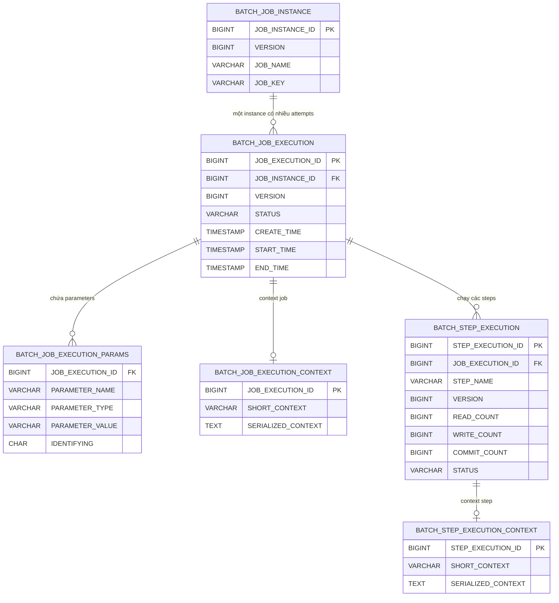

# Database schema cho batch metadata trong Spring Batch JobRepository

## 1. Vì sao Spring Batch cần một schema metadata?

Giả sử job `importOrders` xử lý 10 triệu đơn hàng, chạy thành 16 partition trên bốn máy. Sau bốn tiếng, một worker mất kết nối database. Muốn khởi động lại mà không đọc lại toàn bộ dữ liệu, hệ thống cần biết: **đây là lần chạy của job nào, đang xử lý step nào, đã đọc/ghi bao nhiêu item, partition nào hoàn thành và checkpoint cuối cùng ở đâu?**

Spring Batch lưu các thông tin này trong **JobRepository**. Khi dùng repository dựa trên JDBC, dữ liệu được lưu ở một **bộ bảng metadata** (mặc định có prefix `BATCH_`). Chúng không phải bảng dữ liệu nghiệp vụ như `orders`, `payment` hay `inventory`. Chúng là sổ ghi nhận vòng đời job/step và trạng thái cần thiết cho restart.

Trong module `SPRING_BATCH_SCALING_OPERATIONS`, mục tiêu là mở rộng Spring Batch cho workload dữ liệu lớn qua multi-threaded step, parallel steps, partitioning và xử lý phân tán; đồng thời đo bottleneck, đảm bảo thread safety, retry/restart và vận hành theo tài nguyên thực tế. **Schema metadata đúng, bền và được nhiều node truy cập nhất quán là nền tảng để các chiến lược scale có thể khôi phục an toàn.**

Sau bài này, bạn có thể:

- Vẽ quan hệ của sáu bảng metadata chính và ba sequence cấp ID trong Spring Batch 5.x.
- Phân biệt `JobInstance`, `JobExecution`, `JobParameters`, `StepExecution` và hai cấp `ExecutionContext`.
- Hiểu `VERSION`/optimistic locking, các counter, trạng thái và checkpoint khi nhiều worker cập nhật repository.
- Khởi tạo và nâng cấp schema đúng phiên bản bằng SQL script hoặc migration có kiểm soát.
- Viết SQL tra cứu job thất bại, partition bị treo, hiệu suất step, context và các lỗi liên quan đến repository.
- Nhận biết khi nào các bảng metadata không đủ để chứng minh tác động nghiệp vụ xảy ra đúng một lần.

> **Phiên bản:** ví dụ tập trung **Spring Batch 5.2.x** với **JDBC JobRepository**, Spring Boot 3.x và Java 17+. Spring Batch 6.x có thể thay đổi thành phần/DDL, và một số backend khác không dùng các bảng JDBC này. Khi triển khai phải lấy script tương ứng **đúng version Spring Batch + đúng loại database**.

## 2. Phân biệt ba danh tính quan trọng

Trước khi đọc bảng, cần phân biệt ba đối tượng thường bị gọi chung là “job”:

| Đối tượng | Một câu mô tả | Ví dụ |
| --- | --- | --- |
| `Job` | Định nghĩa luồng công việc trong code | Bean `importOrders` |
| `JobInstance` | **Một thực thể logic** của job: tên job cộng tập **identifying JobParameters** | `importOrders` với `businessDate=2026-11-26` |
| `JobExecution` | **Một lần cố gắng chạy** của một `JobInstance` | Lần đầu `FAILED`, lần restart `COMPLETED` |
| `StepExecution` | Một lần thực thi một step trong một `JobExecution` | `workerStep:partition0004`, `READ_COUNT=4500` |

Ví dụ `importOrders(businessDate=2026-11-26)` chạy lúc 01:00 và thất bại; khởi động lại đúng identifying parameters lúc 02:00 sẽ tạo **JobExecution mới** nhưng thường thuộc **JobInstance cũ**.

```text
Job definition: importOrders
  JobInstance 501  [businessDate = 2026-11-26, identifying]
    JobExecution 901  -> FAILED
      StepExecution 2010 -> COMPLETED (loadManifest)
      StepExecution 2011 -> FAILED    (workerStep:partition0004)
    JobExecution 902  -> COMPLETED  (restart)
      StepExecution ...  -> các step/partition cần chạy lại
  JobInstance 502  [businessDate = 2026-11-27, identifying]
    JobExecution 903  -> ...
```

Một giá trị `requestId` hay `runTimestamp` bị đánh dấu **identifying** và thay đổi mỗi lần chạy sẽ tạo **JobInstance khác**, làm hệ thống không restart theo instance cũ. Ngược lại, tái dùng cùng identifying parameters cho một nghiệp vụ thực sự mới có thể bị coi là job đã hoàn tất. Quy tắc nhận dạng phải xuất phát từ nghiệp vụ, không chỉ chọn theo giá trị dễ tạo.

## 3. Sáu bảng cốt lõi và quan hệ của chúng

JDBC schema metadata của Spring Batch 5.2 có **sáu bảng chính**. Các tên bên dưới giả định prefix mặc định `BATCH_`.



Sơ đồ trình bày **quan hệ logic**. Ký hiệu `o|` cho context thể hiện có thể chưa có hàng context ở một thời điểm của vòng đời, còn khi repository lưu context bình thường sẽ có **một context tương ứng mỗi execution**. Một số cấu hình database và version có khác biệt nhỏ trong định nghĩa kiểu dữ liệu, ràng buộc và index.

| Bảng | Khóa định danh / liên kết | Mục đích |
| --- | --- | --- |
| `BATCH_JOB_INSTANCE` | PK `JOB_INSTANCE_ID` | Danh tính logic của job theo `JOB_NAME` và `JOB_KEY` |
| `BATCH_JOB_EXECUTION` | PK `JOB_EXECUTION_ID`, FK `JOB_INSTANCE_ID` | Lần chạy, trạng thái, thời điểm, exit code và version |
| `BATCH_JOB_EXECUTION_PARAMS` | FK `JOB_EXECUTION_ID`; script mẫu thường không khai báo PK riêng | Các tên/kiểu/giá trị parameter cùng cờ `IDENTIFYING` |
| `BATCH_STEP_EXECUTION` | PK `STEP_EXECUTION_ID`, FK `JOB_EXECUTION_ID` | Tiến độ một step: read/write/filter/skip/commit/rollback/status |
| `BATCH_JOB_EXECUTION_CONTEXT` | PK/FK `JOB_EXECUTION_ID` | State/checkpoint ở cấp job execution |
| `BATCH_STEP_EXECUTION_CONTEXT` | PK/FK `STEP_EXECUTION_ID` | State/checkpoint ở cấp step execution |

**Không có bảng `BATCH_CHUNK` mặc định** ghi mỗi chunk đã xử lý. Spring Batch thường lưu **tiến độ và checkpoint được tổng hợp** theo `StepExecution`, không phải một dòng metadata chuẩn cho từng item/chunk/message.

## 4. `BATCH_JOB_INSTANCE`: cùng job có thể có nhiều instance

Các cột quan trọng:

- `JOB_INSTANCE_ID`: khóa chính, được repository cấp từ một sequence/incrementer.
- `JOB_NAME`: tên `Job`.
- `JOB_KEY`: khóa do `JobKeyGenerator` tạo từ **identifying JobParameters**; không phải tên job ghép tay.
- `VERSION`: phục vụ chiến lược optimistic locking khi framework cập nhật object.

Khóa logic thường được tra bằng cặp **`JOB_NAME` + `JOB_KEY`**. Đây là lý do thiết kế `JobParameters` đúng quan trọng với restart.

### 4.1. Identifying và non-identifying parameters

Giả sử cùng job `settleInvoices` có:

| Parameter | Giá trị | `IDENTIFYING` | Tác dụng |
| --- | --- | --- | --- |
| `businessDate` | `2026-11-26` | `Y` | Phân biệt ngày nghiệp vụ |
| `tenantId` | `7` | `Y` | Phân biệt tenant cần xử lý |
| `traceId` | `abc123` | `N` | Theo dõi lần thực thi, không làm đổi JobInstance |
| `requestedBy` | `scheduler` | `N` | Metadata vận hành, không làm đổi danh tính |

Hai lần chạy khác `traceId` nhưng giữ các identifying parameters không tự tạo JobInstance mới. Nếu job đã `COMPLETED` và không cho chạy lại instance hoàn thành, launcher có thể từ chối một lần launch cùng identity. **JobInstance không phải thứ có thể sửa `JOB_KEY` tùy ý để ép chạy lại.**

### 4.2. Các mối nguy về khóa nhận dạng

Không tự sửa `JOB_KEY` trong DB để “mở khóa” job. Điều này phá tính nhất quán giữa bảng instance, bảng parameters và lịch sử thực thi. Nếu muốn xử lý lại một nghiệp vụ với cùng business date, cần chính sách có chủ đích: restart instance thất bại, tạo instance mới bằng tham số xác định version hợp lệ hoặc quản lý rerun/compensation ở tầng ứng dụng.

Khi nhiều scheduler/nodes cùng launch đúng một instance, transaction/isolation của `JobRepository` và các ràng buộc database giúp ngăn hai launch xung đột. Không giải quyết bằng mutex trong RAM của riêng một node vì cluster nhiều node không chia sẻ mutex đó.

## 5. `BATCH_JOB_EXECUTION`: lịch sử những lần cố gắng chạy

Mỗi lần một job được launch/restart sẽ có một `JobExecution` tương ứng với `JOB_INSTANCE_ID`. Một JobInstance có thể có nhiều JobExecution.

| Nhóm cột | Cột điển hình | Ý nghĩa |
| --- | --- | --- |
| Identity | `JOB_EXECUTION_ID`, `JOB_INSTANCE_ID` | PK/FK để nối tới job instance |
| Concurrency | `VERSION` | Phiên bản optimistic locking |
| Thời gian | `CREATE_TIME`, `START_TIME`, `END_TIME`, `LAST_UPDATED` | Mốc vòng đời |
| Trạng thái | `STATUS`, `EXIT_CODE`, `EXIT_MESSAGE` | `BatchStatus` và trạng thái kết thúc |

`STATUS` có thể là `STARTING`, `STARTED`, `COMPLETED`, `FAILED`, `STOPPING`, `STOPPED` hoặc trạng thái khác tùy vòng đời. `EXIT_CODE` thuộc `ExitStatus`; nó không phải lúc nào cũng trùng tên `STATUS`, vì ứng dụng có thể đặt exit code nghiệp vụ.

`END_TIME IS NULL` khi job vẫn đang chạy **có thể hoàn toàn bình thường**. Nhưng nếu worker/manager đã crash lâu mà trạng thái vẫn `STARTED` và `END_TIME` trống, cần điều tra một **stale execution**. Không kết luận stale chỉ từ một cột: phải kết hợp heartbeat/host/process, thời gian `LAST_UPDATED`, lịch phát triển của step và trạng thái broker/DB.

### 5.1. Ví dụ truy vấn lịch sử job

```sql
SELECT ji.JOB_NAME,
       ji.JOB_INSTANCE_ID,
       je.JOB_EXECUTION_ID,
       je.STATUS,
       je.EXIT_CODE,
       je.CREATE_TIME,
       je.START_TIME,
       je.END_TIME,
       je.LAST_UPDATED
FROM BATCH_JOB_INSTANCE ji
JOIN BATCH_JOB_EXECUTION je
  ON je.JOB_INSTANCE_ID = ji.JOB_INSTANCE_ID
WHERE ji.JOB_NAME = :jobName
ORDER BY je.CREATE_TIME DESC, je.JOB_EXECUTION_ID DESC;
```

Đây là **query đọc để quan sát**, không can thiệp metadata. Dùng parameter binding cho `:jobName`, không nối chuỗi SQL từ input người dùng.

## 6. `BATCH_JOB_EXECUTION_PARAMS`: mô tả một lần chạy

Trong **Spring Batch 5.x**, bảng parameter chứa các cột:

```text
JOB_EXECUTION_ID
PARAMETER_NAME
PARAMETER_TYPE
PARAMETER_VALUE
IDENTIFYING
```

`PARAMETER_TYPE` chứa tên kiểu Java đầy đủ như `java.lang.String`, `java.lang.Long`; `PARAMETER_VALUE` lưu dạng biểu diễn phù hợp converter. Cờ `IDENTIFYING` cho biết tham số đóng góp vào identity của `JobInstance`. Một JobExecution có **0..n** parameter rows; script mẫu Spring Batch 5.2 không đòi một PK riêng cho từng parameter row.

**Cảnh báo migration 4.x → 5.x:** không sử dụng tài liệu cũ mô tả các cột `TYPE_CD`, `KEY_NAME`, `STRING_VAL`, `DATE_VAL`, `LONG_VAL` hoặc `DOUBLE_VAL` như schema Batch 5 hiện tại. Spring Batch 5 đã thay đổi cách lưu job parameters, nên **cần chạy migration DDL theo đường nâng cấp thực tế** trước khi khởi động ứng dụng mới.

### 6.1. Đọc parameters của một job execution

```sql
SELECT PARAMETER_NAME,
       PARAMETER_TYPE,
       PARAMETER_VALUE,
       IDENTIFYING
FROM BATCH_JOB_EXECUTION_PARAMS
WHERE JOB_EXECUTION_ID = :jobExecutionId
ORDER BY PARAMETER_NAME;
```

Không tự đổi `IDENTIFYING` hoặc `PARAMETER_VALUE` trên bản ghi lịch sử để “chuyển một instance sang job khác”. `JOB_KEY` trong `BATCH_JOB_INSTANCE` đã được tính theo tham số nhận dạng; sửa lẻ một bảng sẽ tạo mâu thuẫn không được framework hỗ trợ.

## 7. `BATCH_STEP_EXECUTION`: trạng thái và counter của từng step

`StepExecution` là đối tượng quan trọng nhất khi điều tra vì sao một job chậm, bị rollback hoặc không restart đúng.

Các cột phổ biến:

| Nhóm | Cột | Ý nghĩa |
| --- | --- | --- |
| Identity | `STEP_EXECUTION_ID`, `STEP_NAME`, `JOB_EXECUTION_ID` | ID step execution, tên step, liên kết đến JobExecution |
| Optimistic lock | `VERSION` | Tăng khi cập nhật; phát hiện ghi metadata xung đột |
| Trạng thái | `STATUS`, `EXIT_CODE`, `EXIT_MESSAGE` | Đang chạy, hoàn tất hoặc lỗi |
| Thời gian | `CREATE_TIME`, `START_TIME`, `END_TIME`, `LAST_UPDATED` | Mốc vòng đời và lần cập nhật gần nhất |
| Đếm giao dịch | `COMMIT_COUNT`, `ROLLBACK_COUNT` | Số lần commit/rollback mà Spring Batch ghi nhận |
| Đếm item | `READ_COUNT`, `WRITE_COUNT`, `FILTER_COUNT` | Số item đã đọc, ghi, bị filter |
| Skip | `READ_SKIP_COUNT`, `PROCESS_SKIP_COUNT`, `WRITE_SKIP_COUNT` | Item bị skip ở từng giai đoạn |

`STEP_NAME` là tên step **trong một JobExecution**; với partitioning có thể thấy `workerStep:partition0003`. Nhiều partition/worker step execution khác nhau có thể thuộc cùng một job execution và cùng chia sẻ schema repository.

**Đừng hiểu `WRITE_COUNT` là số dòng SQL bị thay đổi.** Một `ItemWriter` có thể ghi nhiều bảng, không thay đổi dòng nào vì dữ liệu đã tồn tại, hoặc phát side effect ngoài DB. `WRITE_COUNT` là số liệu logic theo cơ chế Batch; đối soát dữ liệu đích cần một phép kiểm riêng.

### 7.1. Kiểm tra các step của một lần chạy

```sql
SELECT STEP_EXECUTION_ID,
       STEP_NAME,
       STATUS,
       READ_COUNT,
       WRITE_COUNT,
       FILTER_COUNT,
       READ_SKIP_COUNT,
       PROCESS_SKIP_COUNT,
       WRITE_SKIP_COUNT,
       COMMIT_COUNT,
       ROLLBACK_COUNT,
       START_TIME,
       END_TIME,
       LAST_UPDATED
FROM BATCH_STEP_EXECUTION
WHERE JOB_EXECUTION_ID = :jobExecutionId
ORDER BY START_TIME, STEP_EXECUTION_ID;
```

Trong **remote partitioning**, manager có thể tạo nhiều `StepExecution` worker; metadata giúp biết partition nào hoàn tất, lỗi hoặc còn chạy. Trong **remote chunking**, manager giữ step chính và nhận `ChunkResponse` từ các worker; không mặc định có một `StepExecution` JDBC mới cho từng message/worker process.

### 7.2. Tính throughput theo step

Với một step đã hoàn tất, có thể ước lượng item/s từ số liệu:

\[
\operatorname{itemPerSecond} \approx
\frac{\operatorname{WRITE\_COUNT}}
{\operatorname{END\_TIME}-\operatorname{START\_TIME}}
\]

Trên PostgreSQL, ta có thể xem:

```sql
SELECT STEP_NAME,
       READ_COUNT,
       WRITE_COUNT,
       EXTRACT(
         EPOCH FROM (END_TIME - START_TIME)
       ) AS elapsed_seconds,
       ROUND(
         WRITE_COUNT::numeric
         / NULLIF(
             EXTRACT(EPOCH FROM (END_TIME - START_TIME)), 0
           ),
         2
       ) AS written_items_per_second
FROM BATCH_STEP_EXECUTION
WHERE JOB_EXECUTION_ID = :jobExecutionId
  AND END_TIME IS NOT NULL
  AND START_TIME IS NOT NULL;
```

Đây là throughput **trung bình theo thời gian elapsed**, không đo riêng CPU, serialization, database commit hay độ trễ mạng. Với `parallel steps` hoặc partition chạy đồng thời, cộng thời lượng mọi worker để suy ra wall-clock duration của job là sai: các khoảng chạy có thể chồng lấp.

### 7.3. Khi counter và trạng thái chưa phản ánh lần ghi gần nhất

Metadata thường được cập nhật ở các điểm checkpoint/chunk commit hoặc chuyển trạng thái step, **không phải sau từng câu SQL nghiệp vụ**. Một process crash giữa business commit và lần lưu metadata có thể để lại sai khác. Khi retry/restart, không dùng chỉ `WRITE_COUNT` để quyết định một payment đã trừ đúng một lần: phải có idempotency/audit nghiệp vụ.

## 8. Hai bảng `ExecutionContext`: nền tảng checkpoint và restart

### 8.1. Job context và step context khác nhau

| Bảng | Khóa chính/FK | Chứa state gì? |
| --- | --- | --- |
| `BATCH_JOB_EXECUTION_CONTEXT` | `JOB_EXECUTION_ID` | Dữ liệu theo job execution, ví dụ manifest ID, watermark hoặc trạng thái giữa các bước |
| `BATCH_STEP_EXECUTION_CONTEXT` | `STEP_EXECUTION_ID` | Vị trí reader, trạng thái writer, partition bounds hoặc các cursor/checkpoint cần restart |

Mỗi bảng thường có ba cột quan trọng:

```text
<JOB_EXECUTION_ID hoặc STEP_EXECUTION_ID>
SHORT_CONTEXT       -- phần biểu diễn ngắn
SERIALIZED_CONTEXT  -- payload context đầy đủ, kiểu LOB/TEXT tùy DB
```

**`ExecutionContext` không phải một bảng key/value riêng từng hàng** trong schema JDBC mặc định. Nó là một map được Spring Batch serialize để lưu trong hàng context của execution tương ứng. Chính vì vậy, không thể xem `SHORT_CONTEXT` như JSON của mọi ứng dụng rồi sửa từng key bằng SQL tùy tiện.

### 8.2. Checkpoint reader được lưu như thế nào?

Giả sử reader đọc file theo từng chunk:

```java
@Bean
@StepScope
public FlatFileItemReader<OrderLine> reader(
        @Value("#{jobParameters['sourceFile']}") Resource resource) {
    return new FlatFileItemReaderBuilder<OrderLine>()
            .name("orderLineReader")
            .resource(resource)
            .delimited()
            .names("orderId", "amount")
            .fieldSetMapper(fs -> new OrderLine(
                    fs.readLong("orderId"),
                    fs.readBigDecimal("amount")))
            .saveState(true)
            .build();
}
```

Các lớp/import cần thiết của ví dụ: `org.springframework.batch.item.file.FlatFileItemReader`, `FlatFileItemReaderBuilder`, `org.springframework.core.io.Resource`, `org.springframework.batch.core.configuration.annotation.StepScope` và `@Value`/`@Bean`. `OrderLine` là record DTO tự định nghĩa của ứng dụng.

Khi step dùng reader dạng `ItemStream`, Spring Batch có thể ghi vị trí reader vào `StepExecutionContext` tại checkpoint; khi restart **cùng JobInstance** và cùng nguồn dữ liệu, reader khôi phục vị trí theo chính sách framework.

**Hai điều kiện quyết định khả năng restart đúng:**

1. State được lưu vào metadata và tương thích với reader/serializer khi khởi động lại.
2. **Tập input và thứ tự input vẫn ổn định**. Nếu file đã bị ghi đè, sắp xếp lại hoặc xóa dòng, checkpoint vị trí cũ có thể trỏ tới dữ liệu khác.

Chỉ có `saveState(true)` không bảo đảm đúng kết quả khi nguồn đã thay đổi. Với multi-threaded step, một reader có state dùng đồng thời còn cần đánh giá **thread safety và tính đúng checkpoint**, không thể giả định `@StepScope` tự giải quyết mọi shared-state race trong cùng một step execution.

### 8.3. Context trong partitioning

Manager có thể tạo context của partition như:

```java
ExecutionContext partitionContext = new ExecutionContext();
partitionContext.putLong("tenantId", 7L);
partitionContext.putLong("startInclusive", 2501L);
partitionContext.putLong("endExclusive", 5001L);
partitionContext.putString("snapshotId", "orders-2026-11-26-v1");
```

Worker `@StepScope` lấy các giá trị qua `stepExecutionContext` rồi đọc đúng phạm vi. Khi job restart, nếu `partition0001` bỗng được gán range khác, checkpoint/trạng thái của partition có thể sai. Vì vậy, **partition names, bounds và snapshot ID phải ổn định theo JobInstance** hoặc có một kế hoạch migrate hợp lệ.

```java
@Bean
@StepScope
public JdbcCursorItemReader<Long> scopedIdReader(
        DataSource dataSource,
        @Value("#{stepExecutionContext['tenantId']}") Long tenantId,
        @Value("#{stepExecutionContext['startInclusive']}") Long start,
        @Value("#{stepExecutionContext['endExclusive']}") Long end) {
    if (tenantId == null || start == null || end == null || end <= start) {
        throw new IllegalArgumentException("Invalid partition context");
    }
    return new JdbcCursorItemReaderBuilder<Long>()
            .name("scopedIdReader")
            .dataSource(dataSource)
            .sql("SELECT id FROM orders WHERE tenant_id = ? " +
                 "AND id >= ? AND id < ? ORDER BY id")
            .preparedStatementSetter(ps -> {
                ps.setLong(1, tenantId);
                ps.setLong(2, start);
                ps.setLong(3, end);
            })
            .rowMapper((rs, rowNum) -> rs.getLong(1))
            .saveState(true)
            .build();
}
```

Ví dụ này minh họa cách context được **tiêu thụ bởi worker**; nó không tự định nghĩa manager `PartitionStep`, `Partitioner` hay database schema nghiệp vụ. Bảng metadata lưu context, còn SQL nguồn `orders` vẫn là trách nhiệm của ứng dụng.

### 8.4. Serialized context không nên chứa dữ liệu lớn hay secret

Trong Spring Batch 5.x, `DefaultExecutionContextSerializer` mặc định dùng biểu diễn **Base64** của dữ liệu serialized. Đây **không phải mã hóa bảo mật**. Không đưa password, access token, PII hoặc cả danh sách hàng triệu item vào `ExecutionContext`. Nên lưu **tham chiếu nhỏ và ổn định**, ví dụ `manifestId` hoặc `checkpointOffset`, còn payload lớn để ở storage được quản lý riêng.

Khi thay Java class chứa trong context, chuyển Java serialization sang JSON hoặc nâng Spring Batch giữa major versions, **context cũ có thể không deserialize được**. Phải thử restart từ metadata cũ trên staging trước khi nâng cấp.

Ngoài ra, `SHORT_CONTEXT` có giới hạn ký tự (schema mẫu thường khoảng 2500). Với bảng charset đa byte, độ dài tính theo **byte hay ký tự** phụ thuộc DB/collation; đối chiếu `maxVarCharLength` của JobRepository với độ dài column thực tế. Đừng chỉ tăng trường SQL mà quên cấu hình serializer/DAO và quy ước storage.

### 8.5. Context là mutable state cần nhất quán

`ExecutionContext` thuộc về `StepExecution`/`JobExecution`; nhiều worker không nên dùng nó như một global mutable map chia sẻ tùy tiện. Trong partitioning, mỗi worker step có context của mình; khi manager tổng hợp kết quả, Spring Batch quản lý theo cơ chế partition và repository.

Nếu hai thread/process cùng chỉnh cùng một execution context hoặc step execution không qua giao thức được thiết kế, các lần update có thể race, ghi đè state hoặc gây `OptimisticLockingFailureException`. Đừng “sửa” bằng cách tắt optimistic locking.

## 9. Sequence và cơ chế cấp ID

Ba bảng có khóa chính dạng số:

- `BATCH_JOB_INSTANCE.JOB_INSTANCE_ID`
- `BATCH_JOB_EXECUTION.JOB_EXECUTION_ID`
- `BATCH_STEP_EXECUTION.STEP_EXECUTION_ID`

Trong JDBC schema Spring Batch 5.x, framework dùng **sequence/incrementer** để cấp ID. Với DB có native sequences như PostgreSQL, tên mặc định thông dụng:

```sql
-- Ví dụ PostgreSQL: tên sequence chuẩn trong JDBC schema mặc định.
SELECT nextval('BATCH_JOB_SEQ');
SELECT nextval('BATCH_JOB_EXECUTION_SEQ');
SELECT nextval('BATCH_STEP_EXECUTION_SEQ');
```

**Đây là lệnh minh họa cơ chế cấp ID, không nên chạy trên production chỉ để “kiểm tra”** vì `nextval` thay đổi trạng thái sequence. Dùng truy vấn catalog hoặc công cụ quản trị để kiểm tra sự tồn tại/quyền khi cần. PostgreSQL mặc định chuyển tên không quote thành lowercase, nên khi query catalog phải xét quy tắc case folding.

Với MySQL và một số hệ không có native sequence, script mẫu có thể dùng **bảng mô phỏng sequence**, ví dụ `BATCH_JOB_SEQ`, `BATCH_JOB_EXECUTION_SEQ` và `BATCH_STEP_EXECUTION_SEQ`, mỗi bảng có một giá trị counter. Những bảng này là **hạ tầng cấp ID**, khác sáu bảng metadata miền Batch.

### 9.1. Vì sao không tự thay bằng auto-increment?

DAO của Spring Batch kỳ vọng chiến lược `DataFieldMaxValueIncrementer` tương ứng với database và cấu hình repository. Nếu tự đổi DDL sang auto-increment/identity mà không thay cấu hình DAO/incrementer phù hợp, ứng dụng có thể gặp lỗi duplicate key, không lấy đúng ID hoặc không tìm thấy sequence.

**Không chỉnh sequence value bằng tay khi job đang chạy.** Nếu restore database từ backup có các bảng metadata nhưng sequence chưa đồng bộ, phải có kế hoạch kiểm tra/migrate các giá trị **khi không có writer đang hoạt động**, rồi chứng minh ID mới không trùng PK hiện có.

### 9.2. Lỗi sequence phổ biến

| Dấu hiệu | Nguyên nhân có thể |
| --- | --- |
| `relation "batch_job_seq" does not exist` | Chưa tạo schema/sequence, sai search_path/prefix, schema khác |
| `permission denied for sequence ...` | DB user được quyền bảng nhưng chưa được quyền `USAGE`/`UPDATE` cần thiết trên sequence |
| `duplicate key value violates unique constraint` | Restore sequence thấp hơn ID đã dùng, cấu hình incrementer sai, dữ liệu metadata bị chỉnh tay |
| Repository tìm `BATCH_*` dù DDL tên `APP_*` | Prefix của repository và script tạo bảng chưa đồng bộ |
| MySQL không có hàng counter trong bảng sequence | Script khởi tạo chạy thiếu hoặc bị dọn dữ liệu |

Không nên “sửa” bằng cách xóa bảng metadata và khởi tạo lại khi còn job cần restart.

## 10. `VERSION` và optimistic locking khi nhiều worker cùng chạy

Các bảng `BATCH_JOB_INSTANCE`, `BATCH_JOB_EXECUTION` và `BATCH_STEP_EXECUTION` có cột `VERSION`. Spring Batch dùng **optimistic locking** để phát hiện việc hai tiến trình đồng thời cập nhật cùng object metadata từ trạng thái cũ.

Ý tưởng logic (SQL *minh họa*, không phải statement cố định của DAO):

```sql
UPDATE BATCH_STEP_EXECUTION
SET STATUS = :newStatus,
    VERSION = VERSION + 1,
    LAST_UPDATED = :updatedAt
WHERE STEP_EXECUTION_ID = :stepExecutionId
  AND VERSION = :expectedVersion;
```

Nếu kết quả update **0 dòng vì version khác**, repository có thể ném `OptimisticLockingFailureException`. Trong một cluster, đây là tín hiệu xung đột hoặc lỗi ownership của execution; không nên xóa `VERSION` hay tự update bỏ điều kiện chỉ để hết exception.

### 10.1. Một `JobExecution` hoặc `StepExecution` không nên có hai chủ sở hữu ghi tùy tiện

Hai worker xử lý **hai `StepExecution` partition khác nhau** là mô hình hợp lệ. Nhưng để hai worker cùng sửa một `StepExecution`, cùng `ExecutionContext` mà không qua cơ chế concurrency được framework hỗ trợ sẽ tạo race.

Với multi-threaded step, stateful reader/writer và checkpoint cần kiểm tra thread safety. Với remote partitioning, manager/worker cần chia rõ ai có quyền cập nhật trạng thái `StepExecution` theo contract. Với remote chunking, manager tổng hợp `ChunkResponse`; worker không tự ghi thẳng vào một hàng step metadata của manager nếu kiến trúc không yêu cầu.

### 10.2. Isolation khi tạo JobExecution

`JobRepository` thực hiện các thao tác tạo metadata trong transaction. Spring Batch 5.2 cho phép cấu hình `isolationLevelForCreate`; mặc định trong tài liệu là mức **`SERIALIZABLE`** để giảm xung đột khi hai process cố launch cùng JobInstance.

Mức isolation này **khác** isolation của business transaction xử lý item. Nếu đổi xuống `READ_COMMITTED` hay khác, cần thử tình huống **hai scheduler cùng launch một job với identifying parameters giống nhau** trên đúng database đang sử dụng.

Không dùng distributed lock tự viết như một cách thay thế vô điều kiện cho ràng buộc/transaction của JobRepository; nếu cần coordinator bổ sung, phải giữ đúng semantics framework.

## 11. Khởi tạo schema: dùng script đúng database và đúng version

Spring Batch Core JAR chứa các script mẫu `schema-*.sql` theo database, trong package `org/springframework/batch/core/`. Các script thiết lập bảng, khóa/constraint và sequence/incrementer; tài liệu chính thức cũng công bố các **migration DDL** khi có thay đổi giữa phiên bản.

Không nên lấy DDL từ một blog cũ rồi tự dựng các bảng Batch 5.2 cho PostgreSQL, MySQL hoặc Oracle bằng cách đổi mỗi tên kiểu dữ liệu. Khác biệt có thể nằm ở **sequence, timestamp, LOB, collation, index, key generation** và migration parameters.

### 11.1. Hai cách thường gặp

**Môi trường local/demo:** để Spring Boot khởi tạo metadata schema, ví dụ:

```yaml
spring:
  batch:
    jdbc:
      initialize-schema: always
```

Cấu hình này yêu cầu **Spring Boot** có khả năng tự khởi tạo schema Spring Batch theo database đã nhận diện. Với database embedded, Boot thường có hành vi init mặc định; với DB thật, `always` có thể tạo bảng lúc startup.

**Production:** thông thường đặt schema init của Boot thành `never` và dùng **một hệ thống migration có kiểm soát** (Flyway/Liquibase hoặc deployment DBA pipeline):

```yaml
spring:
  batch:
    jdbc:
      initialize-schema: never
```

Lý do: nếu nhiều manager/worker instance cùng khởi động và tự chạy DDL, chúng có thể tranh tạo bảng/sequence, báo lỗi “already exists”, hoặc vô tình tác động vào schema production. Migration nên chạy **một lần có kiểm soát trước rollout**, với backup, version và kiểm tra sau khi nâng cấp.

`spring.batch.jdbc.initialize-schema` là cấu hình khởi tạo **metadata Spring Batch**, khác `spring.sql.init.mode` dùng cho script SQL chung. Đừng đồng thời bật nhiều bộ khởi tạo/Flyway/Liquibase cùng tạo **một** schema mà không xác định rõ thứ tự và ownership.

### 11.2. Quy trình với Flyway/Liquibase

Một quy trình thực tế:

1. **Chốt phiên bản** Spring Batch, Spring Boot và loại database.
2. Lấy script `schema-*.sql` tương ứng từ **đúng Spring Batch Core version**, đưa nội dung cần thiết vào một migration ban đầu (hoặc sử dụng baseline/migration tương ứng nếu DB đã có dữ liệu).
3. Nếu nâng từ bản cũ, dùng các **migration scripts** trong `org/springframework/batch/core/migration` và kiểm tra dependency giữa các bước.
4. Chạy migration trên staging có bản sao **metadata thực tế**, không chỉ DB rỗng.
5. Kiểm tra sáu bảng, sequence/incrementer, FK/index, permission và khả năng đọc **ExecutionContext cũ**.
6. Dừng hoặc điều phối rollout để không có node dùng **schema cũ** trong khi node khác đã ghi theo schema mới chưa tương thích.
7. Chỉ sau migration thành công mới khởi chạy các node manager/worker và thử launch/restart.

Không viết một migration kiểu `DROP TABLE BATCH_...; CREATE TABLE ...` khi muốn nâng cấp schema có dữ liệu lịch sử. Cách đó xóa identity/checkpoint của job đang cần restart.

### 11.3. Kiểm tra sự tồn tại schema PostgreSQL

Một cách đọc-only:

```sql
SELECT table_schema, table_name
FROM information_schema.tables
WHERE table_name IN (
    'batch_job_instance',
    'batch_job_execution',
    'batch_job_execution_params',
    'batch_job_execution_context',
    'batch_step_execution',
    'batch_step_execution_context'
)
ORDER BY table_schema, table_name;
```

Đây là ví dụ cho PostgreSQL, nơi identifier không quote thông thường được chuẩn hóa về chữ thường. Nếu dùng schema khác hoặc quoted identifiers, cần điều chỉnh. Nếu thiếu một bảng, **đừng tự tạo lẻ bảng theo trí nhớ**; kiểm tra migration history và script của đúng version.

Để xem native sequences:

```sql
SELECT sequence_schema, sequence_name
FROM information_schema.sequences
WHERE sequence_name IN (
    'batch_job_seq',
    'batch_job_execution_seq',
    'batch_step_execution_seq'
)
ORDER BY sequence_schema, sequence_name;
```

Truy vấn này không gọi `nextval` nên không làm thay đổi trạng thái sequence.

### 11.4. Những điều cần xác nhận với DBA

| Hạng mục | Câu hỏi kiểm tra |
| --- | --- |
| Database/schema | App có kết nối đúng schema metadata hay đang dùng `search_path` sai? |
| DDL version | Script được lấy từ bản Spring Batch nào, có chạy đủ migration chưa? |
| Owner/grants | User chạy job có `SELECT/INSERT/UPDATE` phù hợp trên bảng và quyền dùng sequence? |
| Isolation/locks | DB có chịu được số manager và partition đang chạy đồng thời? |
| Charset/LOB | `EXIT_MESSAGE` và `SERIALIZED_CONTEXT` lưu được dữ liệu UTF-8/văn bản dài không? |
| Backup/restore | Có backup nhất quán cả metadata và business data khi cần phục hồi? |
| Retention | Những JobInstance nào đã được xác minh có thể xóa/archive an toàn? |

## 12. Cấu hình JobRepository, prefix và DataSource

Trong Spring Batch 5.2, có thể cấu hình repository bằng `@EnableBatchProcessing`:

```java
import org.springframework.batch.core.configuration.annotation.EnableBatchProcessing;
import org.springframework.context.annotation.Configuration;

@Configuration
@EnableBatchProcessing(
        dataSourceRef = "batchDataSource",
        transactionManagerRef = "batchTransactionManager",
        tablePrefix = "BATCH_",
        isolationLevelForCreate = "SERIALIZABLE"
)
public class BatchInfrastructureConfiguration {
    // Các bean batchDataSource và batchTransactionManager
    // được cấu hình riêng trong ứng dụng.
}
```

Đây là ví dụ **cấu hình Spring Batch trực tiếp**; `batchDataSource`/`batchTransactionManager` phải thật sự tồn tại. Trong Spring Boot 3.x, nếu bạn dùng Boot auto-configuration cho Batch thì **không tự động thêm `@EnableBatchProcessing` chỉ để “bật batch”**: annotation có thể làm Boot lùi lại khỏi một phần Batch auto-configuration. Hãy chọn **một chiến lược cấu hình** và xác nhận các bean thực tế.

### 12.1. Prefix có thể thay đổi, tên cột không

Mặc định prefix `BATCH_`. Khi cấu hình `tablePrefix = "APP_"`, repository sẽ tìm `APP_JOB_INSTANCE`, `APP_JOB_EXECUTION`, `APP_STEP_EXECUTION`, v.v. **Chỉ prefix là phần configurable trong naming thông thường**; không thể tự đổi `STEP_EXECUTION_ID` thành `ID` rồi kỳ vọng DAO của framework tự thích nghi.

Nếu dùng PostgreSQL schema cụ thể, prefix có thể là `app_batch.BATCH_` trong cấu hình tương ứng, ví dụ repository truy vấn `app_batch.BATCH_JOB_EXECUTION`. Nhưng DDL, sequence, quyền truy cập và JDBC `search_path` cũng phải thống nhất. **Đổi prefix trên app mà không tạo đúng các bảng/sequence tương ứng sẽ gây lỗi runtime.**

### 12.2. Metadata DB và business DB có thể khác nhau

Một kiến trúc phổ biến:

```text
Manager / workers
    |
    +-- JobRepository DataSource --> database batch_metadata
    |
    +-- Business DataSource -----> database order_service
```

Điều này giúp tách tải và quyền, nhưng transaction ghi metadata và transaction cập nhật business data **không tự atomic nếu khác tài nguyên**. Worker có thể commit business DB rồi crash trước khi cập nhật repository. Khi restart, một chunk có thể được chạy lại. Cần **idempotency theo logical operation**, không chỉ tin số lần commit từ bảng `BATCH_STEP_EXECUTION`.

Với remote partitioning, các process cần chia sẻ và nhìn thấy **cùng JobRepository logic** (hoặc một cơ chế metadata nhất quán được hỗ trợ). Nếu mỗi worker dùng metadata DB H2 in-memory riêng, manager không thể dựa vào repository chung để điều phối/restart các step phân tán.

Trong remote chunking, manager thường là bên giữ job/step metadata; worker nhận `ChunkRequest` và gửi `ChunkResponse`, không mặc định mỗi worker có một `StepExecution` JDBC của chính nó. Tuy vậy, phần **request/reply và business transaction** vẫn cần độ bền riêng ngoài metadata.

### 12.3. Không dùng H2 in-memory cho metadata production phân tán

H2 in-memory rất tiện trong test. Nhưng hai JVM có database `jdbc:h2:mem:...` riêng không tự chia sẻ dữ liệu repository. Đối với workload nhiều node và restart qua process crash, metadata phải ở storage **bền, có backup, phù hợp concurrency** và thực sự được mọi node tham gia truy cập theo thiết kế.

## 13. Thiết kế index phục vụ tra cứu và concurrency

Spring Batch JDBC metadata DAO thường tra cứu bằng:

- `JOB_NAME` và `JOB_KEY` để tìm JobInstance lúc launch;
- `JOB_INSTANCE_ID` để tìm các JobExecution;
- `JOB_EXECUTION_ID` và `STEP_NAME` để tìm StepExecution;
- primary key và `VERSION` khi update một execution.

Tài liệu schema 5.2 lưu ý **sample DDL không chọn sẵn toàn bộ index phù hợp mọi workload**. DB thực tế có thể đã có unique constraint/index từ script hoặc migration riêng. Vì vậy hãy kiểm tra `EXPLAIN`, index hiện có, tần suất query và write overhead trước khi thêm.

### 13.1. Index ứng viên cho PostgreSQL

```sql
-- Ví dụ index có thể hữu ích; chỉ áp dụng sau khi
-- kiểm tra constraint/index sẵn có và query plan.
CREATE INDEX IF NOT EXISTS IDX_BJI_JOBNAME_JOBKEY
  ON BATCH_JOB_INSTANCE (JOB_NAME, JOB_KEY);

CREATE INDEX IF NOT EXISTS IDX_BJE_JOB_INSTANCE
  ON BATCH_JOB_EXECUTION (JOB_INSTANCE_ID);

CREATE INDEX IF NOT EXISTS IDX_BSE_JOB_EXEC_STEP
  ON BATCH_STEP_EXECUTION (JOB_EXECUTION_ID, STEP_NAME);

CREATE INDEX IF NOT EXISTS IDX_BJEP_JOB_EXECUTION
  ON BATCH_JOB_EXECUTION_PARAMS (JOB_EXECUTION_ID);
```

Các statement này là **ứng viên tối ưu**, không phải migration bắt buộc hay tập index chuẩn tuyệt đối. Đặc biệt nếu đã có unique index trên `(JOB_NAME, JOB_KEY)`, thêm index trùng gây lãng phí disk và write cost. Trên bảng có traffic production lớn, `CREATE INDEX` có thể lock hoặc ảnh hưởng ghi; PostgreSQL có `CREATE INDEX CONCURRENTLY` cho trường hợp phù hợp, nhưng cần chạy ngoài transaction migration thông thường và có kế hoạch rollback.

Một index chỉ trên `VERSION` thường không giúp nhiều cho update `STEP_EXECUTION_ID = ? AND VERSION = ?`, vì lookup theo primary key `STEP_EXECUTION_ID` đã chọn tối đa một hàng. Tránh tạo index máy móc chỉ vì một cột xuất hiện trong `WHERE`.

### 13.2. Đừng biến metadata DB thành bottleneck

Nếu một job có hàng trăm nghìn partition hoặc chunk size quá nhỏ, tần suất tạo/cập nhật `StepExecution`, transaction metadata và index writes có thể tăng đáng kể. Trước khi tăng `gridSize` hoặc worker count, đo:

- Số step executions tạo mỗi phút, tốc độ commit metadata;
- Latency `INSERT/UPDATE` vào `BATCH_STEP_EXECUTION`;
- Lock wait/deadlock/optimistic locking conflict;
- Connection pool của batch metadata và business DB;
- Kích thước bảng/context, I/O và tốc độ backup;
- Số query từ dashboard/monitoring cạnh tranh với DAO.

Không nên tăng concurrency không giới hạn rồi coi mọi lỗi `OptimisticLockingFailureException` là do thiếu index. Nhiều trường hợp là lỗi owner của cùng StepExecution, reader thread safety hoặc process chạy trùng cùng JobInstance.

## 14. Truy vấn chẩn đoán khi job lỗi hoặc chạy phân tán

Các truy vấn trong phần này là **read-only**, dùng schema mặc định `BATCH_`. Thực tế cần chỉnh theo prefix/schema và DB vendor của hệ thống.

### 14.1. Xem các JobExecution đang `STARTED` lâu

Ví dụ PostgreSQL, chọn ngưỡng 30 phút:

```sql
SELECT ji.JOB_NAME,
       je.JOB_INSTANCE_ID,
       je.JOB_EXECUTION_ID,
       je.STATUS,
       je.START_TIME,
       je.LAST_UPDATED,
       CURRENT_TIMESTAMP - je.LAST_UPDATED AS metadata_age
FROM BATCH_JOB_EXECUTION je
JOIN BATCH_JOB_INSTANCE ji
  ON ji.JOB_INSTANCE_ID = je.JOB_INSTANCE_ID
WHERE je.STATUS IN ('STARTING', 'STARTED', 'STOPPING')
  AND je.LAST_UPDATED < CURRENT_TIMESTAMP - INTERVAL '30 minutes'
ORDER BY je.LAST_UPDATED;
```

**Không tự sửa `STATUS = 'FAILED'` cho các hàng trả về.** Một job lâu không update có thể đang chạy tasklet dài, đọc chunk lớn hoặc bị timeout mà chưa kết thúc transaction; repository không nhất thiết là heartbeat cập nhật từng giây. Hãy đối chiếu scheduler, log, process/container, hoạt động DB/broker và API điều khiển Batch trước khi thực hiện quy trình phục hồi.

### 14.2. Tìm step/partition lỗi của một lần chạy

```sql
SELECT STEP_EXECUTION_ID,
       STEP_NAME,
       STATUS,
       EXIT_CODE,
       LEFT(EXIT_MESSAGE, 500) AS exit_preview,
       READ_COUNT,
       WRITE_COUNT,
       ROLLBACK_COUNT,
       LAST_UPDATED
FROM BATCH_STEP_EXECUTION
WHERE JOB_EXECUTION_ID = :jobExecutionId
  AND STATUS IN ('FAILED', 'STOPPING', 'STOPPED', 'UNKNOWN')
ORDER BY STEP_NAME;
```

`LEFT` có ở PostgreSQL và một số DB khác; điều chỉnh hàm cắt chuỗi theo vendor. Với partitioning, các tên `workerStep:partition0001` giúp khoanh vùng một partition lỗi. Tuy nhiên **partition count có thể lớn**, nên dùng phân trang/giới hạn và đặt index phục vụ truy vấn giám sát nếu cần.

### 14.3. Phân bố tải giữa các partition

```sql
SELECT STEP_NAME,
       STATUS,
       READ_COUNT,
       WRITE_COUNT,
       COMMIT_COUNT,
       ROLLBACK_COUNT,
       EXTRACT(
         EPOCH FROM (COALESCE(END_TIME, CURRENT_TIMESTAMP) - START_TIME)
       ) AS elapsed_seconds
FROM BATCH_STEP_EXECUTION
WHERE JOB_EXECUTION_ID = :jobExecutionId
  AND STEP_NAME LIKE 'workerStep:%'
ORDER BY READ_COUNT DESC, STEP_NAME;
```

Ví dụ các partition có `READ_COUNT` rất chênh lệch dù `gridSize` bằng nhau: có thể do phân vùng ID thưa, nguồn có skew, worker timeout hoặc dữ liệu xử lý khác độ nặng. Metadata cho biết **triệu chứng**, không thay thế đo CPU, DB lock wait hay thời gian I/O của từng worker.

### 14.4. Phân tích lịch sử restart của một JobInstance

```sql
SELECT JOB_EXECUTION_ID,
       CREATE_TIME,
       START_TIME,
       END_TIME,
       STATUS,
       EXIT_CODE
FROM BATCH_JOB_EXECUTION
WHERE JOB_INSTANCE_ID = :jobInstanceId
ORDER BY JOB_EXECUTION_ID;
```

Nếu một instance có `FAILED` rồi `COMPLETED` ở lần execution sau, đó là lịch sử phù hợp với restart. Nếu mỗi attempt lại tạo **JobInstance mới**, hãy xem `BATCH_JOB_EXECUTION_PARAMS` và cách application đặt identifying JobParameters; không cố “gộp” instance bằng cách chỉnh FK trong DB.

### 14.5. Kiểm tra liên kết khi nghi ngờ metadata bị sửa tay

Schema chính thức thường dùng các FK, nhưng nếu DB lịch sử từng bỏ constraint hoặc migration không đầy đủ, có thể kiểm tra:

```sql
-- JobExecution không tìm được JobInstance cha:
SELECT je.JOB_EXECUTION_ID, je.JOB_INSTANCE_ID
FROM BATCH_JOB_EXECUTION je
LEFT JOIN BATCH_JOB_INSTANCE ji
  ON ji.JOB_INSTANCE_ID = je.JOB_INSTANCE_ID
WHERE ji.JOB_INSTANCE_ID IS NULL;

-- StepExecution không tìm được JobExecution cha:
SELECT se.STEP_EXECUTION_ID, se.JOB_EXECUTION_ID
FROM BATCH_STEP_EXECUTION se
LEFT JOIN BATCH_JOB_EXECUTION je
  ON je.JOB_EXECUTION_ID = se.JOB_EXECUTION_ID
WHERE je.JOB_EXECUTION_ID IS NULL;
```

Kết quả kỳ vọng **rỗng**. Nếu có orphan rows, điều tra backup/migration/truy cập trực tiếp trước khi sửa. Không xóa hàng con ngay trong lúc job vẫn chạy, vì có thể làm mất checkpoint và khiến restart sai.

## 15. Schema metadata không phải một transaction log nghiệp vụ

Một hiểu lầm nguy hiểm là: “`STATUS=COMPLETED` hoặc `WRITE_COUNT=1000` nghĩa là 1000 khoản thanh toán đã ghi đúng một lần”. Trên thực tế:

- `WRITE_COUNT` đo số item mà Batch writer báo đã ghi theo semantics step.
- Một worker có thể commit business DB rồi crash **trước khi metadata/reply được lưu**.
- JMS có thể redeliver cùng request, làm business logic chạy lại.
- Một step đã hoàn thành có thể có dữ liệu đích sai nếu writer có bug, câu SQL không kiểm tra tenant, hoặc side effect ngoài transaction bị gửi trùng.

Vì vậy, muốn chứng minh **exactly-once business effect** cần bảng idempotency/operation ledger, unique key, outbox hoặc cơ chế đối soát đúng nghiệp vụ. JobRepository chỉ giữ trạng thái Batch và giúp khôi phục, không tự thay thế database constraints của nghiệp vụ.

### 15.1. Ví dụ failure window giữa business DB và metadata

```text
T1  Worker nhận chunk 100 item.
T2  Worker COMMIT 100 thay đổi vào business DB.
T3  Process crash trước khi checkpoint/ChunkResponse hoàn tất.
T4  JobRepository chưa phản ánh đầy đủ 100 item đó.
T5  Job được restart và có thể xử lý lại công việc.
T6  Nếu writer không idempotent, business effect bị áp dụng hai lần.
```

Mỗi bảng metadata có thể **đúng** theo thông tin đã nhận được; sai khác vẫn tồn tại vì business DB và repository nằm ở các transaction khác nhau. Cách sửa là thiết kế transaction/idempotency và recovery, **không phải set `WRITE_COUNT=100` bằng SQL thủ công**.

### 15.2. Trường hợp cùng DataSource

Nếu worker step sử dụng **cùng DataSource và một transaction manager** cho business writes + metadata updates thực sự tham gia cùng local transaction, một số cửa sổ lỗi có thể được giảm. Tuy nhiên cần kiểm tra cấu hình repository, propagation, connection, transaction boundary, skip/retry và reader state. Đừng suy từ việc “cùng JDBC URL” rằng mọi hành động tự ở trong cùng một database transaction.

### 15.3. Trường hợp tách DataSource

Nếu metadata DB và business DB khác nhau, thường cần **idempotent retry**. Đặt operation key theo công việc logic ổn định, không chỉ theo `STEP_EXECUTION_ID` vì một partition có thể tạo StepExecution khác khi restart. Với external API, kết hợp idempotency token/ledger hoặc saga/compensation khi không thể có atomic transaction.

## 16. Lưu trữ lâu dài, archive và dọn metadata

Batch metadata tăng mỗi lần tạo JobExecution và StepExecution, đặc biệt khi partitioning có nhiều partition. Nếu một job tạo 10.000 partition mỗi ngày, sau 100 ngày có thể có **một triệu step execution rows** chưa kể context, parameters và lịch sử restart.

Không nên để metadata phình vô hạn, nhưng cũng **không được xóa tùy tiện** vì:

1. `JobRepository` dùng `JobInstance` để nhận biết một job đã chạy/chưa chạy và trạng thái hoàn tất.
2. `ExecutionContext` cần để khôi phục cursor/partition sau lỗi.
3. Lịch sử `JobExecution`/`StepExecution` cần cho audit, SLA, hỗ trợ sự cố và tra cứu.
4. Bảng có FK: xóa cha trước con có thể gây lỗi ràng buộc.
5. Dọn instance đang chạy hoặc cần restart có thể khiến Batch không nhận dạng được tiến độ trước đó.

### 16.1. Retention dựa trên trạng thái và yêu cầu pháp lý

Một chính sách mẫu:

| Phân loại | Hướng lưu trữ |
| --- | --- |
| Job đang `STARTING`/`STARTED`/`STOPPING` | Không archive/delete |
| Job `FAILED` hoặc `STOPPED` còn trong cửa sổ restart | Giữ đầy đủ instance, executions, contexts và parameters |
| Job `COMPLETED`, đã đối soát nghiệp vụ | Có thể xét archive theo retention và lịch sử cần giữ |
| Instance phục vụ audit/pháp lý | Giữ theo chính sách riêng, kể cả nếu đã hoàn thành |
| Test/dev environment | Có thể dọn thường xuyên hơn nhưng phải tách khỏi production |

**Không có một thời hạn lưu mặc định phù hợp mọi hệ thống.** Nếu scheduler, dashboard hoặc hệ thống báo cáo vẫn dùng metadata lịch sử, cần điều chỉnh chính sách archive kèm theo.

### 16.2. Cách archive an toàn

1. Chọn các **JobInstance đã được phê duyệt** cho việc archive (không chỉ lọc execution có `END_TIME` cũ).
2. Đảm bảo không còn job/step đang chạy hoặc request/reply/partition chưa đối soát.
3. Backup hoặc sao chép đầy đủ các bảng liên quan vào kho archive có kiểm chứng.
4. Nếu xóa khỏi DB hoạt động, phải tuân thủ FK và thứ tự **context/parameters/step rows trước, job execution trước, job instance sau**; cần thiết kế transaction/batch delete cụ thể cho DB và kích thước dữ liệu.
5. Kiểm tra JobRepository hoạt động sau dọn và các job cần restart không bị ảnh hưởng.

Không đưa một script `DELETE FROM BATCH_JOB_INSTANCE WHERE ...` chạy thẳng lên production. Xóa một JobInstance mất identity có thể khiến một lần chạy cũ được coi là **job mới**, dẫn tới thực hiện lại tác động nghiệp vụ.

### 16.3. Khôi phục từ backup phải nhất quán

Restore chỉ database metadata về một thời điểm cũ, trong khi business DB giữ dữ liệu mới hơn, có thể làm checkpoint tụt lại và kích hoạt replay. Khôi phục hai hệ phải có một **mốc consistency** hoặc một quy trình reconciliation/idempotency bảo vệ.

Nếu restore các bảng có khóa chính cấp bằng sequence/incrementer, kiểm tra giá trị sequence tiếp theo không xung đột với ID đã restore. Chỉ sửa sequence khi đã đóng luồng tạo metadata và có migration/rollback plan.

## 17. Bảo mật metadata và quyền truy cập

Job parameters, `EXIT_MESSAGE` và `ExecutionContext` có thể chứa **tên khách hàng, đường dẫn file, URL nội bộ, exception stack trace hoặc dữ liệu nhạy cảm** nếu ứng dụng ghi thiếu kiểm soát.

Các khuyến nghị:

- Không lưu secret/API token/password hoặc payload PII lớn trong `JobParameters` và `ExecutionContext`. Nếu cần tham chiếu bí mật, dùng ID tham chiếu tới secret store.
- Phân quyền DB theo vai trò: ứng dụng cần quyền cho repository, hệ thống quan sát thường chỉ cần `SELECT`, migration có quyền DDL trong quy trình riêng.
- Dùng TLS tới DB, encryption-at-rest/backup encryption theo mức nhạy cảm và audit truy cập bảng metadata.
- Không để dashboard hiển thị đầy đủ `EXIT_MESSAGE`/serialized context cho mọi người dùng, vì stack trace có thể chứa dữ liệu nội bộ.
- Đánh giá charset/encoding, độ dài `EXIT_MESSAGE` và `SHORT_CONTEXT` với dữ liệu tiếng Việt/Unicode.
- Không mở endpoint quản trị giúp sửa trực tiếp `BATCH_*` để “requeue” job không được kiểm soát.

Sáu bảng không phải công cụ authorization. Nếu nhiều tenant dùng chung repository, `JOB_NAME`/JobParameters có thể giúp lọc báo cáo, nhưng phải có tầng **access control** rõ ràng; không coi một `tenantId` trong parameter là rào chắn tự động của mọi truy vấn.

## 18. Bảng xử lý sự cố schema và JobRepository

| Triệu chứng | Nguyên nhân có thể | Hướng xử lý |
| --- | --- | --- |
| `relation "batch_job_instance" does not exist` | Script chưa chạy, sai DB/schema/search_path, prefix không khớp | Kiểm tra DataSource thực, schema, migration history và `tablePrefix` |
| `Table '...BATCH_JOB_EXECUTION' doesn't exist` | DB MySQL chưa init metadata hoặc app dùng sai catalog | Dùng đúng `schema-mysql.sql`/migration tương thích |
| `relation "batch_job_seq" does not exist` | Thiếu sequence hoặc prefix/schema sai | Kiểm tra sequence catalog và naming/incrementer config |
| `permission denied for sequence` | User chạy job thiếu quyền dùng sequence | DBA cấp quyền tối thiểu đúng schema/sequence |
| Duplicate `JOB_INSTANCE_ID`/`STEP_EXECUTION_ID` | Sequence bị restore sai, incrementer sai hoặc viết tay ID | Đóng writer, đối chiếu max ID/sequence, migration có kiểm soát |
| `BadSqlGrammarException` ở `BATCH_JOB_EXECUTION_PARAMS` | Schema 4.x nhưng runtime Batch 5.x | Chạy đúng migration 4→5, xác minh các cột `PARAMETER_NAME/TYPE/VALUE` |
| `JobInstanceAlreadyCompleteException` | Launch lại cùng identifying parameters của instance đã hoàn tất | Xác định đó là restart hay nghiệp vụ rerun; không sửa `JOB_KEY` trực tiếp |
| `JobExecutionAlreadyRunningException` | Đã có execution chưa kết thúc hoặc collision launch | Xác minh process còn chạy, trạng thái thực và chính sách restart |
| `OptimisticLockingFailureException` | Hai luồng/node cập nhật cùng execution hoặc version cũ | Kiểm tra ownership, thread safety, duplicate worker/launch, transaction boundary |
| `Cannot deserialize ExecutionContext` hoặc lỗi class | Serializer/classpath/context format khác lúc lưu | Kiểm tra version/serializer, staging test từ snapshot metadata cũ |
| `Data too long for column EXIT_MESSAGE` | VARCHAR quá ngắn hoặc multibyte encoding | Đối chiếu schema charset, `maxVarCharLength`, chiến lược log message |
| Job resume sai dòng sau restart | Input thay đổi, checkpoint thiếu/sai hoặc JobInstance mới | Kiểm tra nguồn snapshot, identifying params, context và reader state |
| Job `STARTED` mãi, `END_TIME` null | Process crash hoặc tasklet dài chưa update metadata | Đối chiếu health/DB/broker/log; dùng quy trình recovery có kiểm soát |
| Nhiều partition nhưng throughput giảm | Metadata DB/connection pool/index/DB business bị nghẽn | Đo commit latency, lock wait, index, gridSize/chunk size và worker count |
| Dashboard cho ra ít step hơn mong đợi | Query lọc sai JobExecution ID, partition chưa start hoặc bị bỏ qua | Đối chiếu tên step, trạng thái flow và JobExecution đúng |
| Mất lịch sử job sau dọn dữ liệu | Xóa metadata đang cần restart hoặc xóa theo timestamp thiếu điều kiện | Restore backup, đối soát business data; thiết kế retention theo JobInstance |

### 18.1. Phương pháp điều tra không phá dữ liệu

Khi thấy một lỗi liên quan `BATCH_*`:

1. **Xác nhận đúng DB:** connection URL, schema/catalog, user, prefix và Spring Batch version đang chạy.
2. **Đọc metadata:** tra `JobInstance`, `JobExecution`, các `StepExecution`, context cần thiết và log time window.
3. **Kiểm tra hạ tầng:** schema/sequence/permission, migrations, index, transaction isolation và pool.
4. **Xác định trạng thái nghiệp vụ:** dữ liệu đích, operation ledger/idempotency, request/reply còn trong broker.
5. **Chọn recovery:** restart đúng JobInstance nếu hợp lệ, hoặc một quy trình rerun/compensation đã được định nghĩa.

Không chỉnh `STATUS`, `VERSION`, `WRITE_COUNT` hay serialized context thủ công để “vượt qua lỗi” khi chưa hiểu trạng thái thực. Những trường này liên quan nhau và việc sửa lẻ thường che khuất nguyên nhân gốc.

## 19. Thực hành kiểm thử schema trong môi trường scale-out

Các thử nghiệm dưới đây yêu cầu **database test riêng**, không chạy trên metadata production.

### 19.1. Test khởi tạo schema mới

Với một PostgreSQL rỗng:

1. Chạy đúng schema script của Spring Batch 5.2 bằng pipeline migration.
2. Xác minh đủ sáu bảng, ba native sequences, các PK/FK và quyền cấp ID.
3. Launch một job nhỏ với một step để tạo `JobInstance`, `JobExecution`, `StepExecution` và context.
4. Truy vấn các bảng và xác minh ID/FK hợp lệ; `JobRepository` không cần một thao tác insert SQL tự viết ngoài framework.
5. Khởi chạy lại cùng identifying parameters khi instance `COMPLETED`, quan sát hành vi do Spring Batch quyết định thay vì kỳ vọng tự tạo instance khác.

### 19.2. Test restart có checkpoint

Chuẩn bị file/manifest cố định 250 bản ghi, chunk size 100, reader `saveState(true)` và writer idempotent:

| Giai đoạn | Thao tác | Điều cần xác minh |
| --- | --- | --- |
| Chạy đầu | Cho một chunk thành công, một chunk lỗi | JobExecution/StepExecution trạng thái đúng, context được lưu |
| Kiểm tra DB | Đọc `BATCH_STEP_EXECUTION_CONTEXT` và các counter | Có hàng context; không tự decode/sửa bằng tay |
| Restart | Launch lại **cùng JobInstance** sau khi sửa lỗi | JobExecution mới và checkpoint được khôi phục theo hợp đồng |
| Đối soát | So ID nguồn/đích và operation keys | Không bỏ sót hoặc nhân đôi business effect |
| Kiểm tra lịch sử | Xem hai JobExecution theo JobInstance | Lần đầu lỗi, lần sau kết thúc phù hợp |

Không chỉ test restart trên DB vừa xóa sạch: trường hợp đó thực chất giống chạy mới, không chứng minh schema phục hồi được state cũ.

### 19.3. Test hai scheduler cùng launch

Dùng **hai JVM/process** cùng trỏ vào một JDBC JobRepository. Đồng thời launch job với cùng identifying parameters. Kiểm tra:

- Repository không tạo hai JobInstance logic khác nhau cho cùng identity do race.
- Trạng thái lỗi/tranh chấp được trả về có thể xử lý ở scheduler.
- Không có hai manager vô tình chạy cùng một StepExecution mà không có ownership.
- Không có `OptimisticLockingFailureException` bị che hoặc lặp vô hạn bằng retry mù quáng.

Thử nghiệm này đánh giá transaction isolation khi **create JobExecution**; không có nghĩa mọi business side effect sẽ được bảo vệ nếu code nghiệp vụ bỏ qua idempotency.

### 19.4. Test remote partitioning và metadata dùng chung

Tạo bốn partition theo `[1,2501)`, `[2501,5001)`, `[5001,7501)`, `[7501,10001)`:

1. Manager tạo các `StepExecution`/`ExecutionContext` theo phạm vi.
2. Các worker ở process riêng đọc đúng context đã được giao và commit trong local transaction.
3. Một worker bị kill giữa chunk. Đối chiếu `BATCH_STEP_EXECUTION` và `BATCH_STEP_EXECUTION_CONTEXT` trước/sau sự cố.
4. Restart job và chứng minh partition hoàn tất không bị xử lý lại ngoài dự kiến, partition lỗi được khôi phục đúng cận.
5. Đối soát row-level business data; metadata counter một mình không chứng minh không có duplicate.

**Lưu ý:** nếu worker và manager dùng JobRepository khác nhau, test không đo được kiến trúc remote partitioning đã thiết kế; trước hết phải xác minh cùng backend metadata/schema logic.

### 19.5. Test nâng cấp schema

Với bản sao metadata một môi trường Spring Batch 4.x hoặc 5.x cũ:

- Ghi nhận trạng thái job lỗi và context cần phục hồi.
- Chạy migration DDL theo đường nâng cấp do Spring Batch cung cấp.
- Kiểm tra bảng `BATCH_JOB_EXECUTION_PARAMS` và các sequence/constraint tương thích.
- Dùng đúng serializer/reader class khi load context cũ; nếu cần chuyển đổi serializer, phải có kế hoạch riêng.
- Thử restart một JobInstance lỗi từ metadata đã migration.
- Không chỉ kiểm tra “service startup thành công”: khả năng **đọc lại và tiếp tục job cũ** mới chứng minh migration đầy đủ cho nghiệp vụ.

## 20. Checklist schema metadata trước production

- [ ] Đã chốt **Spring Batch version, database vendor và script `schema-*.sql` tương ứng**.
- [ ] Schema có sáu bảng metadata cốt lõi và cơ chế cấp ID/sequence đúng vendor.
- [ ] `BATCH_JOB_EXECUTION_PARAMS` theo định dạng Spring Batch 5.x, không còn giả định schema 4.x.
- [ ] `JobInstance`, `JobExecution` và `StepExecution` được hiểu/tra cứu bằng đúng ID, FK và parameters.
- [ ] JobRepository transaction và `isolationLevelForCreate` được kiểm thử khi nhiều node cùng launch.
- [ ] `VERSION`/optimistic locking còn nguyên; không dùng thao tác update metadata trực tiếp để che race.
- [ ] `ExecutionContext` có serializer/charset/LOB tương thích, không chứa secret hoặc payload quá lớn.
- [ ] Reader/writer cần restart có state, snapshot đầu vào và identifying parameters ổn định.
- [ ] Production dùng **một cơ chế migration có kiểm soát**, không nhiều node tự init DDL đồng thời.
- [ ] App, DDL và DBA nhất quán về table prefix, schema/search_path và tên sequence.
- [ ] DB user có quyền vừa đủ trên bảng và sequence; tài khoản dashboard chỉ có read privilege.
- [ ] Các index tra cứu quan trọng được chọn qua `EXPLAIN` và tải thực, tránh index trùng.
- [ ] Connection pool của metadata DB và business DB đủ năng lực nhưng không gây bão hòa.
- [ ] Manager/worker phân tán cùng nhìn thấy repository phù hợp kiến trúc; không dùng H2 in-memory rời rạc.
- [ ] Có backup/restore và chính sách archive theo **JobInstance và trạng thái restart**, không xóa bừa dữ liệu lịch sử.
- [ ] Đã thử job crash, restart, remote partition failure và hai launch đồng thời.
- [ ] Đã đối soát business data/idempotency; không coi `WRITE_COUNT` là chứng minh exactly-once.
- [ ] Có giám sát job lâu, stale executions, `ROLLBACK_COUNT`, optimistic lock errors, DB latency và kích thước metadata.

## 21. Tóm tắt

JDBC `JobRepository` của Spring Batch 5.2 dùng **sáu bảng metadata** để biểu diễn JobInstance, JobExecution, JobParameters, StepExecution và các ExecutionContext. **Ba sequence/incrementer** cung cấp ID; `VERSION` bảo vệ cập nhật đồng thời; context giúp checkpoint/restart. Đây là phần hạ tầng thiết yếu khi một job được chạy trên nhiều thread, partition hoặc nhiều tiến trình.

Các bảng này lưu **lịch sử và trạng thái điều phối**, không phải journal đầy đủ của từng item hay transaction nghiệp vụ. Muốn mở rộng an toàn, phải phối hợp **schema đúng phiên bản, migration có kiểm soát, transaction/locking, input ổn định, idempotency và phép đối soát dữ liệu đích**. Khi gặp sự cố, ưu tiên đọc/điều tra metadata và nghiệp vụ trước khi thay đổi bất kỳ dữ liệu repository nào.

### Tài liệu tham khảo chính thức

- [Spring Batch 5.2 — Meta-Data Schema](https://docs.spring.io/spring-batch/reference/5.2/schema-appendix.html) — sáu bảng, DDL theo vendor, sequence, indexing, archiving.
- [Spring Batch 5.2 — Configuring a JobRepository](https://docs.spring.io/spring-batch/reference/5.2/job/configuring-repository.html) — transaction, `isolationLevelForCreate`, table prefix và DataSource.
- [Spring Batch 5.2 — Domain Language of Batch](https://docs.spring.io/spring-batch/reference/5.2/domain.html) — JobInstance, JobExecution, StepExecution, ExecutionContext.
- [Spring Boot — Database Initialization](https://docs.spring.io/spring-boot/how-to/data-initialization.html) — `spring.batch.jdbc.initialize-schema` và migration tools.
- [Spring Batch 5.0 — What's New](https://docs.spring.io/spring-batch/docs/5.0.2/reference/html/whatsnew.html) — thay đổi JobParameters schema và ExecutionContext serialization từ v5.
- [Spring Batch 5.2 — DefaultExecutionContextSerializer API](https://docs.spring.io/spring-batch/docs/5.2.x/api/org/springframework/batch/core/repository/dao/DefaultExecutionContextSerializer.html).
