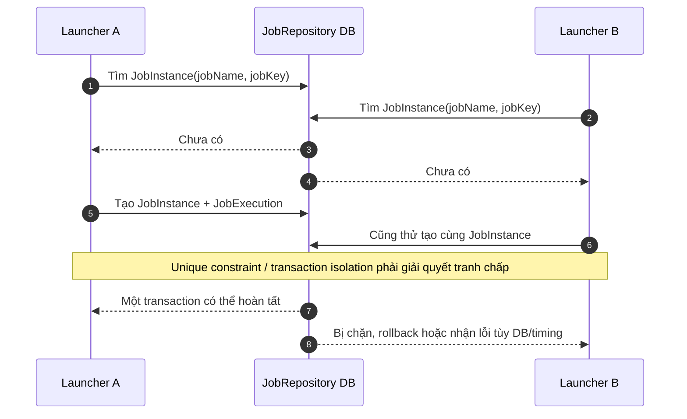
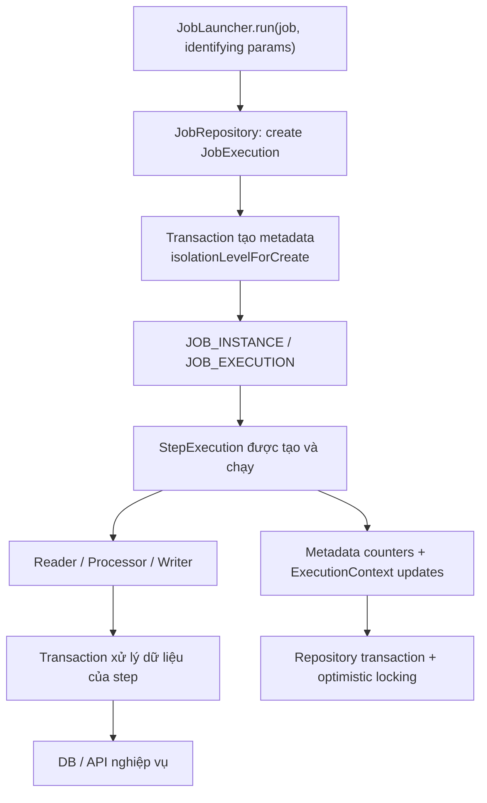
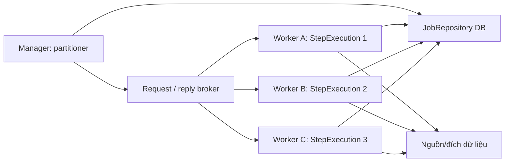
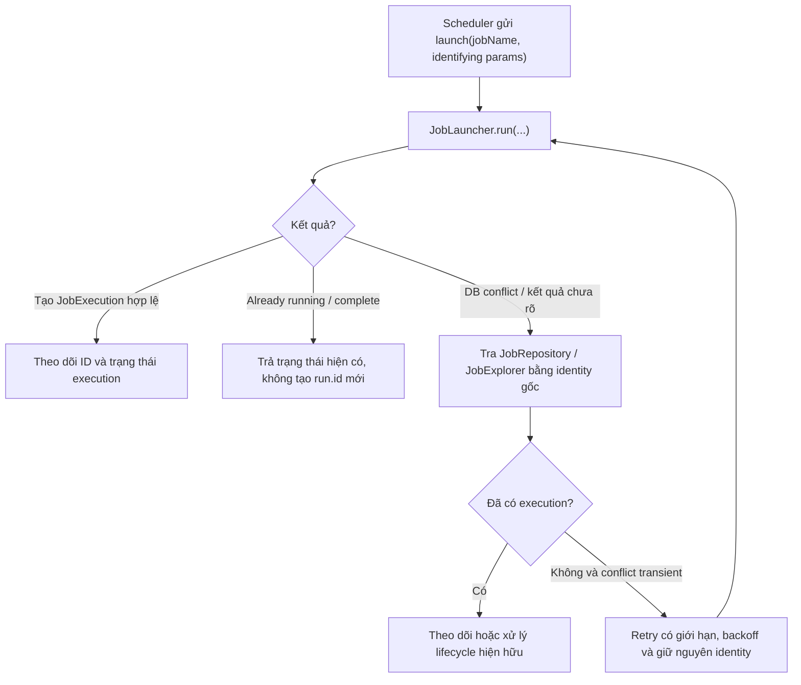

# Transaction isolation của JobRepository trong Spring Batch

Khi hai tiến trình cùng lúc gọi `JobLauncher.run(...)` với **cùng tên job và cùng tập JobParameters định danh**, mỗi tiến trình cần trả lời các câu hỏi: *JobInstance đã tồn tại chưa?*, *đã có execution nào đang chạy không?*, *có được tạo JobExecution mới không?* Nếu câu trả lời được xác định từ nhiều câu SQL mà không có bảo vệ transaction phù hợp, hai lần launch có thể **đồng thời tin rằng mình là người đầu tiên**. Kết quả có thể là lỗi khóa duy nhất, lỗi serialization, hoặc trạng thái job khó lý giải.

**Transaction isolation của JobRepository** là cơ chế phối hợp các thao tác lưu và truy vấn **metadata batch** khi nhiều launcher/worker/step truy cập cùng repository. Nó quan trọng đối với các hệ thống Spring Batch lớn dùng multi-threaded step, parallel steps, local/remote partitioning, remote chunking hoặc nhiều ứng dụng cùng khởi chạy job.

Bài thuộc chương **JobRepository** của module **SPRING_BATCH_SCALING_OPERATIONS**. Chúng ta tập trung vào mức isolation riêng cho thao tác **tạo JobInstance/JobExecution**, phân biệt nó với isolation của transaction xử lý dữ liệu, lý do Spring Batch 5.x thường mặc định `SERIALIZABLE` cho nhóm thao tác tạo, cách tùy biến an toàn, kiểm thử tranh chấp và giám sát khi throughput tăng. Mục tiêu cuối là **chỉ khởi chạy đúng phiên job được phép, lưu metadata nhất quán và phục hồi chính xác sau lỗi**.

## 1. JobRepository giữ những loại trạng thái nào?

`JobRepository` là nơi Spring Batch lưu trạng thái của quá trình thực thi: định danh job, danh sách lần chạy, các bước, counters và `ExecutionContext` phục vụ restart.

| Khái niệm | Ý nghĩa | Bảng metadata phổ biến trong repository JDBC |
| --- | --- | --- |
| `JobInstance` | Định danh logic của **job name + identifying JobParameters** | `BATCH_JOB_INSTANCE` |
| `JobExecution` | Một lần thực thi của JobInstance, có status/thời gian/exit code | `BATCH_JOB_EXECUTION` |
| `JobParameters` | Tham số khởi chạy, có cờ identifying | `BATCH_JOB_EXECUTION_PARAMS` |
| `StepExecution` | Trạng thái một bước trong một JobExecution | `BATCH_STEP_EXECUTION` |
| Job/Step `ExecutionContext` | Dữ liệu checkpoint, offset, watermark và state restart | `BATCH_JOB_EXECUTION_CONTEXT`, `BATCH_STEP_EXECUTION_CONTEXT` |

**Phân biệt ba cấp:**

- Cùng job name nhưng **identifying parameters khác** ⇒ thường là **JobInstance khác**.
- Cùng JobInstance chạy lại sau khi thất bại ⇒ có thể tạo **JobExecution mới** nếu restart hợp lệ.
- Cùng JobInstance đang chạy ⇒ thông thường không được tạo thêm một execution chạy trùng theo hành vi quản lý lifecycle của Spring Batch.

Vì thế, cơ chế isolation của repository có ý nghĩa nhất ở các **quyết định được tạo execution hay chưa**. Nó không tự chứng minh processor/writer sẽ chỉ tác động vào dữ liệu nghiệp vụ một lần.

## 2. Tại sao concurrency có thể tạo race ngay khi launch?

Giả sử có hai node A và B cùng nhận tín hiệu lịch chạy cho job `dailySettlementJob` với identifying parameter `businessDate=2026-11-26`.



Sơ đồ cố ý mô tả một **lịch xen kẽ nguy hiểm**. Thao tác tạo thực của Spring Batch có nhiều kiểm tra trạng thái hơn hai câu SQL đơn lẻ; hành vi cụ thể còn phụ thuộc cách repository triển khai, schema và database.

Tình huống này có thể xuất hiện khi:

1. Scheduler gửi cùng một event hai lần hoặc có hai scheduler active.
2. Hai pod startup rồi cùng tự động launch job.
3. Một quản trị viên bấm “run” đúng lúc hệ thống tự chạy.
4. Hai node xử lý lại cùng một sự kiện kích hoạt từ message broker.
5. Một job thất bại, hai tiến trình recovery cùng thử restart một JobInstance.
6. Một ứng dụng dùng nhiều thread launch JobExecution có cùng identifying parameters.

**Nếu mọi launcher đều nhìn thấy cùng repository**, chúng có thể phối hợp theo metadata. Nếu mỗi pod dùng repository riêng, isolation mức cao ở từng database **không thể ngăn trùng job xuyên hai kho metadata độc lập**.

## 3. Isolation level là gì?

Isolation là thuộc tính của **transaction database**: quyết định một transaction được nhìn thấy dữ liệu thay đổi đồng thời ra sao và database xử lý xung đột như thế nào. Các tên mức ANSI phổ biến:

| Isolation level | Mức cô lập tổng quát | Ý nghĩa khi nhiều launcher đọc/tạo metadata |
| --- | --- | --- |
| `READ_UNCOMMITTED` | Cho phép cách nhìn kém chặt nhất; hành vi tùy engine | Không nên dựa vào các giá trị chưa commit để xác định có được launch hay không |
| `READ_COMMITTED` | Chỉ đọc dữ liệu đã commit; mỗi statement có thể thấy snapshot khác | Hai transaction vẫn có thể cùng thấy “chưa có” trước khi một transaction insert |
| `REPEATABLE_READ` | Hạn chế thay đổi cách nhìn của các hàng đã đọc; tùy DB | Không mặc nhiên bảo vệ mọi dạng concurrent insert/check-then-act |
| `SERIALIZABLE` | Tương đương các transaction chạy theo một trật tự tuần tự hợp lệ | Có thể buộc một transaction chờ, abort/serialization failure hoặc nhận lỗi theo engine |

Cách thực hiện từng mức **khác nhau đáng kể** giữa PostgreSQL, MySQL/InnoDB, SQL Server, Oracle và các database khác. Ví dụ PostgreSQL không thực sự cho phép dirty read ở `READ_UNCOMMITTED` như định nghĩa lý thuyết; mức đó có hành vi gần `READ_COMMITTED`.

**Serializable không có nghĩa “không bao giờ lỗi”**. Một hệ quản trị có thể phát hiện xung đột và **hủy một transaction** để giữ tính tuần tự hóa. Ứng dụng cần chấp nhận lỗi cạnh tranh đó, phân loại đúng và quyết định có nên thử lại toàn thao tác khởi chạy hay không.

**Database unique constraints** vẫn là tuyến bảo vệ thiết yếu để không có hai row cùng khóa JobInstance; isolation không phải lý do để xóa ràng buộc trong schema chuẩn.

## 4. Spring Batch mặc định isolation thế nào?

Trong cách cấu hình JDBC `JobRepository` thông dụng của **Spring Batch 5.x**, framework sử dụng isolation khá chặt, **`ISOLATION_SERIALIZABLE` cho nhóm thao tác tạo** (các phương thức `create*` được bọc transaction tại repository). Mục đích là bảo vệ thời điểm nhiều tiến trình cùng tạo job metadata, nhất là khi launch trùng cùng JobInstance.

Có ba chi tiết cần nhớ:

- **Đây là thuộc tính dành riêng cho thao tác tạo metadata**, không phải lời khẳng định toàn bộ repository, mọi read/update StepExecution và mọi transaction dữ liệu đều chạy `SERIALIZABLE`.
- Thiết lập `isolationLevelForCreate` có thể cấu hình lại theo nhu cầu và đặc điểm DB; **không nên hạ mức chỉ vì cảm giác SERIALIZABLE “chậm”**.
- Tác động thật phụ thuộc việc transaction manager có bắt đầu **transaction mới** hay đã tham gia một transaction hiện hữu, cùng với chính sách validation của repository.

Trong thực tế, nhiều hệ thống có thể chạy ổn với `READ_COMMITTED` ở thao tác tạo nhờ ràng buộc khóa duy nhất và xử lý tranh chấp đúng. Nhưng việc lựa chọn phải dựa trên **database cụ thể, mẫu launch trùng, bài kiểm thử race và yêu cầu restart**, chứ không chỉ một bảng so sánh isolation.

### Đọc đúng tên cấu hình

`isolationLevelForCreate` không đồng nghĩa với:

- `spring.jpa.properties.hibernate.connection.isolation` của ứng dụng ORM.
- `@Transactional(isolation = ...)` trên service xử lý nghiệp vụ.
- Isolation mặc định của connection pool cho mọi transaction.
- `chunk(100, transactionManager)` hoặc commit interval.
- Locking của broker khi dùng remote chunking/partitioning.

Nó nhắm vào **nhóm lệnh tạo JobRepository metadata**. Một thay đổi ở đây có thể ảnh hưởng hành vi **concurrent launch**, nhưng không sửa deadlock do nhiều worker cùng ghi bảng nghiệp vụ.

## 5. JobInstance và identifying JobParameters là khóa logic thật sự

Spring Batch không xác định một job duy nhất chỉ từ tên job. `JobInstance` thường được nhận diện bằng:

\[
\text{JobInstance identity}
=\text{jobName}+\text{identifying JobParameters}
\]

Giả sử bạn có job `dailySettlementJob`:

| Job name | Parameters định danh | Cùng JobInstance? |
| --- | --- | --- |
| `dailySettlementJob` | `businessDate=2026-11-26` | Mẫu gốc |
| `dailySettlementJob` | `businessDate=2026-11-26` lần nữa | **Có** |
| `dailySettlementJob` | `businessDate=2026-11-27` | Không |
| `dailySettlementJob` | `businessDate=2026-11-26, run.id=2` và cả hai identifying | Không, nếu `run.id` thay đổi và được đánh dấu identifying |

Điều này quan trọng khi có scheduler và các utility tự động thêm `run.id`. Nếu mỗi trigger mới được sinh **identifying parameter khác**, repository sẽ coi là **JobInstance khác**, bất kể bạn đặt isolation cao đến đâu.

**Không dùng tăng `run.id` làm cách “bỏ qua lỗi already running”**. Nó có thể làm hai JobInstance độc lập cùng xử lý một business date, gây ghi trùng ở dữ liệu đích dù metadata hoàn toàn hợp lệ.

Nếu nghiệp vụ yêu cầu chỉ một job xử lý mỗi ngày, hãy thiết kế identifying parameters, scheduler deduplication và dữ liệu đầu ra idempotent theo **business date/operation key**.

## 6. Những phương thức và transaction nào chịu tác động?

Ở mức khái niệm, repository phải thực hiện hai nhóm thao tác khác nhau:

**Nhóm tạo metadata:**

- Tìm JobInstance của tên job và identifying parameters.
- Kiểm tra JobExecution hiện có còn running/hợp lệ để restart hay không.
- Tạo JobInstance nếu chưa có; tạo JobExecution mới nếu được phép.

**Nhóm vận hành metadata:**

- Cập nhật `BatchStatus`, `ExitStatus`, version và thời điểm của JobExecution/StepExecution.
- Ghi read/write/skip/rollback counts.
- Ghi `ExecutionContext` để restart.
- Tra cứu tiến độ cho monitoring và JobExplorer.

Isolation cấu hình qua `isolationLevelForCreate` chủ yếu bảo vệ nhóm **create**. Các thao tác update/context chịu transaction semantics và optimistic locking/version checks của repository, database cùng transaction manager thực tế.



Trong sơ đồ, **transaction tạo metadata** và **transaction xử lý dữ liệu** có thể dùng chung hay khác database/transaction manager tùy cấu hình. Ngay cả khi dùng cùng DataSource, không nên tự suy có một transaction toàn cục bao trùm mọi bước, mọi message hoặc toàn job.

## 7. Cách cấu hình với @EnableBatchProcessing trong Spring Batch 5.x

Trong một ứng dụng **tự khai báo hạ tầng Spring Batch 5.x** bằng `@EnableBatchProcessing`, có thể chỉ định isolation cho thao tác create qua thuộc tính annotation.

```java
import org.springframework.batch.core.configuration.annotation.EnableBatchProcessing;
import org.springframework.context.annotation.Configuration;

@Configuration
@EnableBatchProcessing(
        isolationLevelForCreate = "ISOLATION_READ_COMMITTED")
public class BatchInfrastructureConfiguration {
}
```

Đây là **ví dụ đổi từ mặc định tương đối nghiêm ngặt sang READ_COMMITTED**, nhằm minh họa cách cấu hình; không phải khuyến nghị đổi mặc định trên production. Cần bổ sung bean hạ tầng như `DataSource` và `PlatformTransactionManager` theo yêu cầu cấu hình/framework.

**Một số điều kiện quan trọng:**

1. Thuộc tính áp dụng cho **repository do cấu hình hạ tầng này tạo ra**, không nhất thiết cho một JobRepository custom khác đang được inject ở runtime.
2. Nếu dự án dùng Spring Boot, việc thêm `@EnableBatchProcessing` có thể **làm Boot Batch auto-configuration back off**; không nên thêm chỉ để đổi một tham số mà không kiểm tra toàn bộ hạ tầng job launcher/repository/schema.
3. Không trộn nhiều cách cấu hình repository (Boot auto-config, `@EnableBatchProcessing`, custom `JobRepositoryFactoryBean`) và đoán bean nào được dùng.
4. Tham số tên `"ISOLATION_READ_COMMITTED"` là tên Spring transaction isolation level; không dùng nhầm literal `"READ_COMMITTED"` ở những API yêu cầu dạng tên đầy đủ.

Nếu không có bài test cho database mục tiêu và launch đồng thời, **giữ nguyên mức mặc định** và tập trung tối ưu những nơi có bottleneck đo được.

## 8. Cách cấu hình với DefaultBatchConfiguration

Spring Batch 5.x cũng cung cấp `DefaultBatchConfiguration` để tùy biến hạ tầng qua override các phương thức cấu hình. Trong kiểu cấu hình này, isolation có thể được xác định bằng enum của Spring Transaction:

```java
import org.springframework.batch.core.configuration.support.DefaultBatchConfiguration;
import org.springframework.context.annotation.Configuration;
import org.springframework.transaction.annotation.Isolation;

@Configuration
public class CustomBatchConfiguration
        extends DefaultBatchConfiguration {

    @Override
    protected Isolation getIsolationLevelForCreate() {
        return Isolation.READ_COMMITTED;
    }
}
```

Ví dụ thể hiện **một phương án cấu hình thay thế** cho `@EnableBatchProcessing`. Không sử dụng đồng thời hai cơ chế trên mà không hiểu rõ bean discovery và cấu hình nào có hiệu lực.

Với kiểu cấu hình kế thừa `DefaultBatchConfiguration`, cần kiểm tra:

- `getDataSource()` trả về DataSource metadata nào; transaction manager dùng cho repository là gì.
- Schema bảng `BATCH_*` đã được khởi tạo đúng phiên bản hay chưa.
- Bộ `JobLauncher`/`JobExplorer`/`JobRepository` được inject có cùng nguồn metadata không.
- Cấu hình thật trên môi trường production có bị Bean override, nhiều context hoặc nhiều DataSource thay thế không.

**Tương thích phiên bản:** Code dựa trên API Spring Batch 5.x. Trước khi copy sang Spring Batch 6.x hoặc cấu hình Boot có version khác, đối chiếu JavaDoc đúng version và cơ chế auto-configuration của dự án.

## 9. Cấu hình mức thấp với JobRepositoryFactoryBean

Khi có yêu cầu đặc biệt về nhiều DataSource hoặc repository tùy biến, `JobRepositoryFactoryBean` là một lựa chọn hạ tầng cấp thấp trong Spring Batch 5.x.

Ý tưởng cấu hình cốt lõi:

```java
import org.springframework.batch.core.repository.JobRepository;
import org.springframework.batch.core.repository.support.JobRepositoryFactoryBean;
import org.springframework.context.annotation.Bean;
import org.springframework.jdbc.support.JdbcTransactionManager;
import javax.sql.DataSource;

@Bean
public JobRepository jobRepository(DataSource metadataDataSource)
        throws Exception {

    JdbcTransactionManager metadataTx =
            new JdbcTransactionManager(metadataDataSource);

    JobRepositoryFactoryBean factory = new JobRepositoryFactoryBean();
    factory.setDataSource(metadataDataSource);
    factory.setTransactionManager(metadataTx);
    factory.setIsolationLevelForCreate("ISOLATION_SERIALIZABLE");
    factory.afterPropertiesSet();

    return factory.getObject();
}
```

Đây là **mẫu trọng tâm minh họa isolation**, không phải một cấu hình hạ tầng đầy đủ thay thế Boot/Batch auto-config. Trong dự án thật có thể cần cấu hình prefix, serializer, database type, incrementer, bean lifecycle, transaction manager cho step và các bean tương tác repository. Không tạo thêm `JobRepository` bean thứ hai khi hệ thống đang có bean hợp lệ.

Tại đây, giữ `ISOLATION_SERIALIZABLE` làm ví dụ để nhấn mạnh cách **xác nhận/tường minh hóa** mặc định. Nếu chủ đích dùng `READ_COMMITTED`, cần được đánh giá nhất quán với logic launch cạnh tranh và ràng buộc bảng metadata.

## 10. Có nên hạ SERIALIZABLE xuống READ_COMMITTED không?

Không có một đáp án phù hợp mọi database và workload. Isolation nghiêm ngặt ở thao tác create giúp bảo vệ các quyết định check-then-create khi launch cùng JobInstance; isolation nhẹ hơn có thể làm thao tác ít bị blocking/serialization conflict hơn trong một số triển khai, nhưng cũng có thể khiến **lỗi tranh chấp biểu hiện ở nơi khác**.

| Điều kiện | Cân nhắc |
| --- | --- |
| Hai hoặc nhiều scheduler có thể launch cùng job và tham số cùng lúc | Giữ isolation bảo vệ chặt, kiểm thử race |
| Một launcher duy nhất có cơ chế leader election/dedup đã xác minh | Có thể đánh giá mức thấp hơn, vẫn cần schema constraints và test |
| DB thường xuyên gặp serialization failures tại `createJobExecution` | Thu thập evidence trước; đánh giá timing, retry launch và transaction scope |
| JobRepository DB có nhiều partition/step cập nhật metadata | Xác định có thật sự do isolation của `create*` hay do workload update/repository |
| Tốc độ launch thấp, duration mỗi job rất dài | Việc hạ isolation create thường không cải thiện nhiều throughput xử lý item |
| Database không hỗ trợ tốt mức isolation yêu cầu | Điều chỉnh theo khả năng engine, khuyến nghị nhà cung cấp và integration test |
| Có yêu cầu không bao giờ chạy hai lần cùng nghiệp vụ | Isolation là một lớp; cần scheduler discipline và writer idempotency |

**Tradeoff thực tế:** Với nhiều batch pipeline, overhead của thao tác tạo execution là **rất nhỏ** so với việc đọc/ghi triệu item. Hạ isolation create chỉ vì job xử lý chậm thường là sửa **sai điểm nghẽn**.

Nếu chứng minh create transaction là bottleneck, trước tiên xem lại số lượng JobInstance được tạo mỗi giây, thời gian transaction, kết nối pool, DB CPU/I/O, table/index contention và lịch sử duplicate trigger.

## 11. Unique constraints, optimistic locking và isolation bổ trợ nhau

Spring Batch dùng nhiều lớp bảo vệ, mỗi lớp giải một vấn đề khác nhau.

**Unique constraint của JobInstance:** Schema repository chuẩn có ràng buộc khóa duy nhất theo các trường xác định instance, như cặp `JOB_NAME + JOB_KEY`. Hai transaction cùng insert cùng JobInstance không thể tạo hai row trùng khóa nếu schema giữ đúng constraints.

**Transaction isolation:** Giúp chuỗi thao tác đọc/kiểm tra/tạo metadata quan sát trạng thái nhất quán theo quy tắc DB. Nó ảnh hưởng **khi nào** một transaction phải chờ, thất bại hoặc được phép commit.

**Optimistic locking/version:** Các bản ghi metadata có cột `VERSION` để phát hiện một số cập nhật cạnh tranh lên cùng JobExecution/StepExecution. Khi version không còn khớp, update có thể thất bại thay vì ghi đè trạng thái lạc hậu.

| Cơ chế | Ngăn/giảm nguy cơ gì? | Không giải quyết |
| --- | --- | --- |
| Unique `JOB_NAME, JOB_KEY` | Hai row JobInstance trùng identity | Hai JobInstance khác identity cùng xử lý một business date |
| Isolation create transaction | Race check-then-create | Tác dụng phụ trùng ở DB/API nghiệp vụ |
| Optimistic locking `VERSION` | Lost update metadata khi thay đổi version | Tất cả race ngoài repository, nhất là giữa worker remote |
| Idempotent writer / operation ledger | Chạy lại cùng business operation | Metadata job đang STARTED hoặc reply bị mất |
| Scheduler dedup/leader election | Trùng tín hiệu launch | Lỗi trong transaction batch hoặc retry sau commit |

**Không xóa unique index** để “hết duplicate key exception” khi có concurrent launches. Lỗi khóa duy nhất thường là dấu hiệu bạn cần xử lý đụng độ launch, không phải ràng buộc schema sai.

## 12. Các lỗi có thể gặp khi hai launcher cạnh tranh

Hãy phân biệt **kết quả hợp lệ theo lifecycle** với **lỗi hạ tầng do transaction**:

| Kết quả/exception | Ý nghĩa thường gặp | Hành động gợi ý |
| --- | --- | --- |
| `JobExecutionAlreadyRunningException` | Spring Batch xác định JobInstance đã có execution đang chạy | Không tạo lần chạy mới; trả trạng thái “already running” cho caller |
| `JobInstanceAlreadyCompleteException` | JobInstance đã hoàn tất, không được chạy lại như execution mới | Kiểm tra business key, không tự tăng run.id để lách |
| `JobRestartException` | Restart không hợp lệ theo trạng thái/chính sách job | Điều tra trạng thái và restartability |
| Serialization failure, ví dụ SQLSTATE `40001` ở PostgreSQL | DB hủy một transaction để giữ isolation | Xem transaction nào cạnh tranh và quy tắc retry tại tầng launch |
| Duplicate key constraint | Hai đường tạo metadata đụng một identity | Kiểm tra schema, identifying params, race và policy lỗi |
| Deadlock, ví dụ PostgreSQL `40P01` | Các transaction chờ khóa theo vòng | Xem database deadlock graph, lock ordering và retry |
| Timeout lấy connection/lock | Hệ thống repository hoặc DB pool nghẽn | Đo saturation trước khi tăng attempts |

Không hứa luôn nhận đúng một loại exception khi launch trùng: **thứ tự chạy, DB engine, isolation và translator** làm kết quả có thể khác. Một node có thể khởi chạy thành công trong khi node khác nhận lỗi lifecycle hoặc database conflict.

### Retry việc launch có phải luôn đúng?

**Không.** Trước khi retry `JobLauncher.run(...)` sau lỗi “không rõ kết quả”, phải tra cứu repository bằng **đúng identifying parameters** để xác định có JobExecution đang chạy/đã hoàn tất không. Một lỗi sau khi tạo execution nhưng trước khi caller nhận response có thể để lại execution thật.

Nếu lỗi cho biết job đã chạy, hành động phù hợp thường là **theo dõi execution hiện hữu**, không phải tạo một job mới với timestamp/run.id khác. Với lỗi transaction transient trước commit, retry có giới hạn có thể phù hợp, nhưng logic caller phải chịu được nhiều loại kết quả lifecycle.

## 13. Transaction hiện hữu có thể làm isolationLevelForCreate không có hiệu lực như tưởng

Spring transaction có **propagation semantics**. Khi một phương thức repository được gọi trong một transaction đã bắt đầu ở tầng ngoài, mặc định propagation kiểu tham gia transaction hiện hữu có thể khiến thiết lập isolation của interceptor **không tạo transaction database mới**.

Ví dụ nguy hiểm về mặt cấu hình:

```java
import org.springframework.transaction.annotation.Transactional;

@Transactional
public void launchFromBusinessTransaction(
        JobLauncher launcher,
        Job job,
        JobParameters parameters) throws Exception {

    // Không nên giả định repository có thể tự đổi isolation
    // của transaction đã được mở ở service phía ngoài.
    launcher.run(job, parameters);
}
```

Ngoài vấn đề isolation, một transaction nghiệp vụ kéo dài có thể giữ lock trong khi launcher/job lifecycle được kích hoạt.

Trong cấu hình Spring Batch JDBC mặc định, repository còn có cơ chế **kiểm tra transaction state** khi tạo execution để tránh một số lời gọi tạo metadata nằm trong transaction ngoài. Tùy cấu hình, bạn có thể gặp thông báo về existing transaction thay vì im lặng tham gia. Không nên tắt validation chỉ để workaround lỗi mà chưa hiểu hệ quả.

**Cách thiết kế tốt hơn:**

1. Kết thúc hoặc commit transaction nghiệp vụ trước khi launch job.
2. Nếu kích hoạt từ một thay đổi dữ liệu, dùng **transactional outbox** hoặc sự kiện sau commit có độ bền phù hợp.
3. Đảm bảo launcher và repository dùng transaction manager đúng với metadata DataSource.
4. Viết integration test xác nhận isolation/propagation thực trong environment đang chạy.

**Không dùng `REQUIRES_NEW` một cách máy móc**: nó có thể làm job metadata được commit riêng trong khi transaction nghiệp vụ ngoài cuối cùng rollback, dẫn tới job chạy với dữ liệu chưa tồn tại/không hợp lệ.

## 14. Phân biệt isolation của repository với transaction của chunk step

Đây là ranh giới quan trọng nhất khi scale:

```text
Launcher / JobRepository:
  kiểm tra JobInstance + create JobExecution
  -> transaction metadata (isolationLevelForCreate)

Step processing:
  ItemReader -> ItemProcessor -> ItemWriter
  -> transaction của chunk/step
  -> DB/API nghiệp vụ

Metadata checkpoint:
  update StepExecution + ExecutionContext
  -> transaction repository theo runtime/config

Remote worker / broker:
  transaction/ACK riêng nếu có, không mặc nhiên atomic với các lớp trên
```

Ví dụ Spring Batch 5.x:

```java
@Bean
public Step paymentImportStep(
        JobRepository jobRepository,
        PlatformTransactionManager businessTxManager,
        ItemReader<Payment> reader,
        ItemWriter<Payment> writer) {

    return new StepBuilder("paymentImportStep", jobRepository)
            .<Payment, Payment>chunk(200, businessTxManager)
            .reader(reader)
            .writer(writer)
            .build();
}
```

`chunk(200, businessTxManager)` điều khiển **transaction của chunk**. Nó không phải cấu hình isolation cho `createJobExecution`. Ngược lại, `isolationLevelForCreate = SERIALIZABLE` không nâng mọi câu SQL của writer sang serializable.

Nếu dùng hai DataSource (metadata và nghiệp vụ), có thể dùng hai transaction manager và hai database. Khi đó **metadata commit và business commit không mặc nhiên nguyên tử xuyên hai database**. Cần thiết kế checkpoint/restart, idempotency và đối soát thay vì dựa vào isolation riêng của repository để bảo đảm exactly-once end-to-end.

## 15. Isolation của repository khi chạy multi-threaded step và parallel steps

Khi một job chạy nhiều thread/flow:

- Nhiều `StepExecution` hoặc tiến trình cập nhật counters và context.
- Có thể có nhiều thao tác ghi metadata trên cùng JobRepository.
- Writer nghiệp vụ có thể tranh khóa trên các bảng riêng.
- Step đã kết thúc và manager đang tổng hợp status có thể trùng thời điểm với callback khác.

**Điểm cần tránh:** Nếu thấy lỗi `OptimisticLockingFailureException` hoặc lock wait khi cập nhật StepExecution, không nên mặc định rằng thay `isolationLevelForCreate` từ SERIALIZABLE sang READ_COMMITTED sẽ sửa được. Lỗi có thể nằm ở **metadata update concurrency**, reader/writer thread safety hoặc cách nhiều thread sửa cùng StepExecution.

| Tín hiệu | Cần điều tra |
| --- | --- |
| Lỗi chỉ lúc hai launcher khởi chạy cùng JobInstance | Isolation create, identifying params, unique constraint |
| Lỗi khi nhiều StepExecution update metadata | Version/optimistic locking, transaction manager, update rate |
| Batch chạy chậm do writer DB deadlock | Isolation/locking của **DB nghiệp vụ**, chunk size, key partitioning |
| JobRepository DB CPU cao, nhiều commits | Số lượng steps/chunks, commit interval, connection pool, retention |
| Job trạng thái cũ sau process crash | Runtime crash/restart policy, JobExplorer/JobRepository, in-flight workers |

Không hạ isolation để che đậy một vấn đề ở pipeline không liên quan.

## 16. Remote partitioning: nhiều worker cùng chia sẻ JobRepository

Trong remote partitioning, manager tạo nhiều partition và `StepExecution`; worker chạy partition step và thường đọc/cập nhật metadata ở **JobRepository chia sẻ**.



**Điều kiện vận hành:**

- Các worker phải nhìn thấy đúng JobRepository/metadata của cùng job, với credentials và schema/prefix nhất quán.
- Mỗi partition có StepExecution/ExecutionContext riêng; tránh cho hai worker **cùng xử lý một StepExecution** mà không có cơ chế recovery/lease hợp lệ.
- Tần suất cập nhật repository tăng khi gridSize lớn hoặc commit interval nhỏ; cần đo database capacity.
- Isolation create không đảm bảo transaction nghiệp vụ của mọi partition là atomic hoặc không trùng business key.

Nếu bạn thay isolation create để giảm bottleneck do cập nhật metadata partition, khả năng cao cần **xác định lại bottleneck** vì createJobExecution và update StepExecution là những đường transaction khác nhau.

### Remote chunking khác ở đâu?

Remote chunking thường giữ reader/checkpoint và manager StepExecution ở manager, chuyển chunk item cho worker qua broker. Worker có thể không cần trực tiếp truy cập repository của manager theo cách remote partition worker cần. Tuy nhiên vẫn có các khoảng trống commit–reply và broker redelivery; isolation của repository **không thay thế** idempotent worker writer.

## 17. JobRepository DB nên được triển khai và bảo vệ thế nào?

Một repo JDBC đúng cấu hình phải có:

1. **Schema chuẩn đúng phiên bản** Spring Batch và đúng database vendor.
2. **Unique constraints/indexes** của metadata được giữ nguyên.
3. **DataSource chung** cho các node cần phối hợp cùng một logical job.
4. Transaction manager phù hợp với DataSource metadata.
5. Pool connections đủ cho concurrent launch và metadata updates, nhưng không mở quá lớn gây saturation.
6. Quy trình migration/prefix/backup/retention rõ ràng.
7. Bảo mật truy cập metadata, đặc biệt JobParameters/ExecutionContext có thể chứa thông tin nhạy cảm.
8. Giám sát transaction latency, lock waits, deadlock/serialization errors và pool pending.

**Không dùng in-memory repository độc lập trên mỗi worker** rồi kỳ vọng remote partitioning/restart có cùng trạng thái toàn cụm. Tương tự, nếu hai môi trường dev/prod hoặc tenant cùng ghi vào các bảng `BATCH_*` mà không thiết kế isolation logic, metadata có thể bị lẫn.

Với nhiều namespace, có thể cấu hình table prefix riêng hoặc tách schema/database theo chính sách triển khai. Đừng thay table prefix chỉ ở một node mà giữ các node còn lại như cũ.

## 18. Quan sát race và contention trong metadata database

Cần đo cả **tầng Spring Batch** và **database**.

| Tầng | Metric/log | Điều trả lời |
| --- | --- | --- |
| Launcher | Số `run(...)` requests, jobName và identifying params chuẩn hóa, kết quả | Có duplicate trigger không? |
| Repository | Latency `createJobExecution`, lỗi serialization/unique, transaction time | Có tranh chấp tại tạo execution? |
| JobRepository DB | Active connections, lock waits, deadlocks, transaction aborts, CPU/I/O | DB có là nút thắt? |
| JobExplorer | Số JobExecutions theo trạng thái, create/start/end timestamps | Có execution đang chạy thật hay stale? |
| Step metadata | Số partition, commit/rollback counts, status/context updates | Concurrency nào gây update tải lớn? |
| Business data | Idempotency conflicts, số operation duy nhất, output correctness | Có double processing dù metadata đúng? |

### SQL kiểm tra các execution của một job

Giả sử schema metadata mặc định:

```sql
SELECT
    ji.JOB_INSTANCE_ID,
    ji.JOB_NAME,
    ji.JOB_KEY,
    je.JOB_EXECUTION_ID,
    je.STATUS,
    je.CREATE_TIME,
    je.START_TIME,
    je.END_TIME,
    je.LAST_UPDATED
FROM BATCH_JOB_INSTANCE AS ji
JOIN BATCH_JOB_EXECUTION AS je
  ON je.JOB_INSTANCE_ID = ji.JOB_INSTANCE_ID
WHERE ji.JOB_NAME = :jobName
ORDER BY ji.JOB_INSTANCE_ID, je.JOB_EXECUTION_ID;
```

Một JobInstance có **nhiều JobExecution** là bình thường nếu có retry/restart hợp lệ; không thể coi chúng là các row trùng lặp. Cần xem `JOB_KEY`, identifying parameters và trạng thái/timing từng execution.

### SQL kiểm tra trùng khóa instance trong metadata

```sql
SELECT JOB_NAME, JOB_KEY, COUNT(*) AS instance_count
FROM BATCH_JOB_INSTANCE
GROUP BY JOB_NAME, JOB_KEY
HAVING COUNT(*) > 1;
```

Với schema chuẩn có ràng buộc khóa duy nhất, truy vấn thường không trả dòng nào. Nếu xuất hiện row trùng, cần kiểm tra **schema đã bị sửa, unique constraint thiếu hoặc dữ liệu migration**; không chỉ điều chỉnh isolation để che giấu lỗi.

### Quan sát lock wait trên PostgreSQL

```sql
SELECT
    a.pid,
    a.application_name,
    a.wait_event_type,
    a.wait_event,
    a.query_start,
    pg_blocking_pids(a.pid) AS blocking_pids
FROM pg_stat_activity AS a
WHERE cardinality(pg_blocking_pids(a.pid)) > 0
ORDER BY a.query_start;
```

Đây là ảnh chụp các phiên **đang chờ** tại thời điểm truy vấn, không phải lịch sử mọi serialization conflict. Phải kết hợp PostgreSQL logs, error SQLSTATE và tracing client; schema có thể cần prefix/permission tùy hệ thống.

**Bảo mật:** Không đưa toàn bộ JobParameters chứa token/PII vào metric label hoặc log tự do. Dùng job name, hashed/canonical key và correlation ID phù hợp; giới hạn quyền xem metadata.

## 19. Bài kiểm thử race: hai launcher cùng một JobInstance

Để xác minh repository phù hợp production, tạo integration test với **database thật/cùng engine**, hai ứng dụng hoặc hai transaction thực sự khác nhau. Không dùng chỉ mock `JobRepository` hoặc in-memory H2 rồi suy ra PostgreSQL/MySQL sẽ hành xử giống.

**Kịch bản:**

1. Chuẩn bị job có thể giữ trạng thái RUNNING đủ lâu trong test (ví dụ tasklet chờ một latch).
2. Chọn cùng job name và **cùng identifying parameters** cho cả hai lời gọi.
3. Hai thread/process đợi một barrier rồi đồng thời gọi `JobLauncher.run(job, params)`.
4. Thu kết quả, exception chain, JobExecution ID, metadata và output.
5. Giải phóng latch, đợi execution hoàn tất, đối soát database.

### Ví dụ test bằng Java pseudo-code

```java
// PSEUDO-CODE: cần JobLauncher, Job, params,
// CountDownLatch, ExecutorService và repository thật.
CountDownLatch ready = new CountDownLatch(2);
CountDownLatch go = new CountDownLatch(1);

Callable<Object> launch = () -> {
    ready.countDown();
    go.await();
    try {
        return jobLauncher.run(job, identifyingParameters);
    } catch (Exception ex) {
        return ex;
    }
};

var f1 = executor.submit(launch);
var f2 = executor.submit(launch);
ready.await();
go.countDown();

Object first = f1.get();
Object second = f2.get();
// Sau đó query JobRepository/JobExplorer để kiểm tra
// một JobInstance logic và lifecycle execution hợp lệ.
```

**Tiêu chí đạt không phải “nhất định node B ném JobExecutionAlreadyRunningException”**. Kết quả lỗi cụ thể phụ thuộc engine, isolation và timing. Tiêu chí quan trọng hơn:

- Không có **hai JobInstance trùng identity**.
- Không có hai execution chạy cùng một JobInstance **đồng thời trái với lifecycle yêu cầu**.
- Caller thất bại nhận được trạng thái/lỗi có thể xử lý, không tạo job với identifying params khác để lách.
- Business output không bị ghi trùng hoặc thiếu.
- Job có thể được restart đúng sau một failure được chủ động tạo trong test.

### Cần thêm kịch bản nào?

| Kịch bản | Mục đích |
| --- | --- |
| Hai launch cùng params, cùng millisecond | Bắt race create khi JobInstance chưa tồn tại |
| Hai launch cùng params, execution đầu đang RUNNING | Kiểm tra bảo vệ already-running |
| Launch lại sau COMPLETED | Kiểm tra completed-instance semantics |
| Launch lại sau FAILED | Kiểm tra restart hợp lệ, có thể tạo execution mới |
| Launch với khác identifying parameter | Kiểm tra tạo **JobInstance khác** là chủ đích |
| Launch trong transaction ngoài | Kiểm tra validation/propagation/isolation |
| Hai pod cùng scheduler event | Kiểm tra phối hợp thật qua shared metadata DB |
| DB gặp serialization failure/deadlock | Xác minh caller không retry mù quáng và không sinh instance trùng |
| Worker remote đang chạy khi manager chết | Kiểm tra metadata, stale execution và quy trình recovery |

Khi thử hạ isolation, giữ **cùng test suite** và cùng DB/version. Một benchmark chỉ đo launch throughput mà không thử tạo trùng không đủ làm căn cứ vận hành.

## 20. Có cần tự retry JobLauncher khi gặp serialization failure?

Trong cơ sở dữ liệu dùng Serializable Snapshot Isolation hoặc locking, một transaction tạo metadata có thể bị abort do concurrency. Một lỗi SQLSTATE `40001` có thể là tín hiệu thử lại được — nhưng **không nên chỉ bắt exception rồi tạo JobParameters mới để chạy lại**.

Quy trình an toàn hơn:



Sơ đồ này là **mẫu điều phối khái niệm**; một số API JobExplorer/JobRepository dùng để tra trạng thái phải được chọn dựa trên việc bạn có instance ID hay chỉ có JobParameters. Nếu transaction/metadata DB đang bị outage, không thể luôn tra được ngay; cần một queue/outbox orchestration bền vững và cơ chế reconciliation sau sự cố.

Tránh hai lỗi đối xứng:

1. **Không retry bao giờ** → một serialization failure tạm thời làm mất lịch chạy.
2. **Retry vô hạn, mỗi lần tăng run.id** → sinh nhiều JobInstance hợp lệ về metadata nhưng chạy trùng một nghiệp vụ.

Một coordinator chịu trách nhiệm xử lý launch và idempotency key theo business event sẽ giúp giới hạn duplicate trigger trước khi vào repository.

## 21. Case study: 12 pod chạy cùng job định kỳ

Giả sử doanh nghiệp triển khai 12 pod Spring Batch, cả 12 nhận scheduler event `closing-2026-11-26` lúc 00:05. Mỗi pod đều có quyền gọi launcher và dùng **cùng PostgreSQL JobRepository**. Bảng nghiệp vụ cần xử lý 5.000.000 bản ghi theo business date.

Thiết kế giả định:

- Identifying parameter chỉ có `businessDate=2026-11-26`.
- JobRepository dùng schema chuẩn và `isolationLevelForCreate = SERIALIZABLE`.
- JobExecution mất khoảng 35 phút.
- Business writer có unique operation ID để chống ghi lặp nếu worker/restart xảy ra.
- Mỗi node đều có kết nối đến cùng repository và metadata có transaction manager đúng.

**Câu hỏi 1 — Có 12 JobInstance không?**

Không được suy như vậy. Nếu cả 12 launch **cùng identity**, repository phải giải quyết tranh chấp tạo cùng JobInstance. Thông thường chỉ có **một JobInstance logic**, các lời gọi không được phép tạo concurrent execution trùng sẽ bị từ chối/nhận lỗi theo lifecycle hoặc DB.

**Câu hỏi 2 — Có đảm bảo 12 caller chỉ thấy một loại exception?**

Không. Tùy thời điểm và cách DB giải quyết cạnh tranh, một caller có thể nhận `JobExecutionAlreadyRunningException`, caller khác nhận lỗi serialization/duplicate key hoặc một trạng thái khác phù hợp lifecycle. Hãy kiểm thử và xử lý theo kết quả thực.

**Câu hỏi 3 — Nếu mỗi pod tự thêm `run.id` identifying khác nhau?**

Khi đó có thể có **12 JobInstance khác identity**, vì chúng không còn dùng cùng bộ identifying parameters. Isolation SERIALIZABLE **không bảo vệ việc nghiệp vụ bị chạy trùng**; cần sửa chiến lược parameter/dedup.

**Câu hỏi 4 — Nếu JobRepository DB bị contention khi step đã chạy, hạ SERIALIZABLE có giải quyết không?**

Chưa chắc, và thường không phải nút thắt đúng. `isolationLevelForCreate` nhắm vào create transaction; contention có thể do cập nhật `StepExecution`, checkpoint quá thường xuyên, connection pool hoặc database tổng thể. Cần phân tích metrics/traces theo operation.

**Câu hỏi 5 — Nếu leader pod crash trong lúc worker đã commit dữ liệu?**

Repository metadata có thể chưa ghi nhận trạng thái cuối. Isolation cho create không hoàn tác DB/API nghiệp vụ. Cần kiểm tra JobExecution/StepExecution và output theo business key, phối hợp restart và idempotency; không mở run.id mới để “cứ chạy lại”.

**Câu hỏi 6 — Nếu công suất đọc/ghi chưa đạt SLA thì tăng mức isolation có giúp?**

Không. Tối ưu reader/processor/writer, partitioning, chunk size, resource contention và hiệu quả downstream mới giải quyết throughput xử lý. Isolation repository giải quyết **tính nhất quán metadata và race khởi chạy**, không làm tăng tốc item processing trực tiếp.

## 22. Checklist cấu hình và vận hành JobRepository isolation

- [ ] Đã xác định chính xác `JobRepository` bean, DataSource, transaction manager và schema đang dùng.
- [ ] Có tài liệu về isolation của nhóm `create*`, đặc biệt `isolationLevelForCreate`.
- [ ] Đã hiểu vì sao mặc định thường là `SERIALIZABLE`, không hạ mức vì suy đoán.
- [ ] Đã xác định identifying JobParameters và tính duy nhất của JobInstance theo nghiệp vụ.
- [ ] Scheduler/launcher xử lý trùng event và không tăng run.id để né already-running.
- [ ] Schema `BATCH_*` có unique constraints/version columns đúng chuẩn, không bị sửa tùy tiện.
- [ ] Đã tách biệt isolation repository với transaction xử lý dữ liệu/chunk.
- [ ] Không mặc định transaction tạo metadata sẽ dùng isolation cấu hình nếu đã join outer transaction.
- [ ] Đã kiểm tra validation của repository đối với transaction đang hiện hữu.
- [ ] Nếu dùng Spring Boot, hiểu tác động của `@EnableBatchProcessing` lên auto-configuration.
- [ ] Local/remote partitioning có metadata nhất quán, worker nhìn cùng JobRepository khi cần.
- [ ] Không coi thay isolation create là cách chữa deadlock writer hoặc optimistic locking của StepExecution.
- [ ] Đã đo create latency, pool pending, lock waits, serialization/deadlock exceptions và throughput.
- [ ] Đã kiểm thử concurrent launch cùng identity trên DB engine/version giống production.
- [ ] Đã kiểm thử restart sau FAILED và hành vi sau COMPLETED/STARTED.
- [ ] Có retry launch có giới hạn, giữ nguyên identity, tra trạng thái trước khi replay.
- [ ] Output nghiệp vụ có khóa idempotency/reconciliation, không dựa vào metadata để bảo đảm exactly-once.
- [ ] Có runbook backup/migrate/recover repository và giới hạn quyền truy cập metadata.

## 23. Những sai lầm phổ biến

1. **Nhầm isolationLevelForCreate với isolation của writer transaction**: thay một tham số repository rồi kỳ vọng hết DB deadlock nghiệp vụ.
2. **Hạ SERIALIZABLE chỉ để tăng throughput batch**: không đo xem create transaction có là bottleneck thật không.
3. **Dùng nhiều repository độc lập trên các pod**: không còn cơ chế chia sẻ trạng thái để chống cùng JobInstance chạy trùng.
4. **Thêm run.id mới sau lỗi already-running**: tạo JobInstance khác và xử lý trùng một business date.
5. **Xóa unique index JOB_INSTANCE** để bỏ duplicate key: làm mất hàng rào nhất quán metadata.
6. **Bắt mọi exception và retry launch vô hạn**: có thể phát sinh các execution khác hoặc gây overload repository.
7. **Không nhận biết transaction ngoài**: isolation dự kiến không được áp dụng như kỳ vọng hoặc bị validation từ chối.
8. **Trộn @EnableBatchProcessing và DefaultBatchConfiguration không kiểm soát**: khó xác định bean repository thực sự được sử dụng.
9. **Không kiểm thử DB engine thật**: H2 test xanh nhưng PostgreSQL/MySQL production vẫn có serialization/deadlock.
10. **Coi một JobInstance có nhiều JobExecution là duplicate**: bỏ qua khả năng restart hợp lệ.
11. **Dùng LAST_UPDATED như heartbeat duy nhất**: một execution có thể đang thực thi chunk dài hoặc worker crash.
12. **Không phân biệt metadata và dữ liệu đích**: JobExecution hợp lệ nhưng writer side effect vẫn có thể bị replay.
13. **Tăng gridSize để chữa create contention**: chỉ làm thêm metadata/partition work mà không sửa race launch.
14. **Ghi thẳng STATUS/VERSION bằng SQL** khi execution stale: phá optimistic locking và trạng thái recovery.

## 24. Tài liệu tham khảo

- [Spring Batch Reference — Configuring a JobRepository](https://docs.spring.io/spring-batch/reference/job/configuring-repository.html): isolation level dành cho các phương thức create và quản lý repository.
- [Spring Batch Reference — Job and Step Domain](https://docs.spring.io/spring-batch/reference/domain.html): JobInstance, JobExecution, identifying JobParameters và StepExecution.
- [Spring Batch Reference — Meta-Data Schema](https://docs.spring.io/spring-batch/reference/schema-appendix.html): bảng metadata, ràng buộc và version.
- [Spring Batch 5.2 — EnableBatchProcessing API](https://docs.spring.io/spring-batch/docs/5.2.x/api/org/springframework/batch/core/configuration/annotation/EnableBatchProcessing.html): thuộc tính `isolationLevelForCreate` và cấu hình hạ tầng.
- [Spring Batch 5.2 — DefaultBatchConfiguration API](https://docs.spring.io/spring-batch/docs/5.2.x/api/org/springframework/batch/core/configuration/support/DefaultBatchConfiguration.html): `getIsolationLevelForCreate()` và customization.
- [Spring Batch 5.2 — JobRepositoryFactoryBean API](https://docs.spring.io/spring-batch/docs/5.2.x/api/org/springframework/batch/core/repository/support/JobRepositoryFactoryBean.html): repository JDBC và cấu hình metadata.
- [Spring Batch Reference — Scaling and Parallel Processing](https://docs.spring.io/spring-batch/reference/scalability.html): các mô hình concurrency và partitioning.
- [Spring Framework — Transaction Propagation](https://docs.spring.io/spring-framework/reference/data-access/transaction/declarative/tx-propagation.html): propagation và transaction tham gia existing transaction.
- [Spring Framework — Transaction Isolation and @Transactional](https://docs.spring.io/spring-framework/reference/data-access/transaction/declarative/annotations.html): thuộc tính isolation và transaction boundaries.
- [PostgreSQL — Transaction Isolation](https://www.postgresql.org/docs/current/transaction-iso.html): READ COMMITTED, REPEATABLE READ và SERIALIZABLE theo PostgreSQL.
- [PostgreSQL — Error Codes](https://www.postgresql.org/docs/current/errcodes-appendix.html): SQLSTATE 40001, 40P01 và phân loại conflict.

> **Ghi nhớ:** **Transaction isolation của JobRepository bảo vệ quyết định tạo và quản lý metadata job, đặc biệt khi hai launcher cạnh tranh cùng JobInstance.** Trong Spring Batch 5.x, mức isolation tương đối chặt `SERIALIZABLE` thường được dùng cho nhóm `create*`, nhưng nó **không đồng nghĩa mọi transaction chunk và metadata update đều serializable**, càng không bảo đảm business output exactly-once. Hãy giữ identifying parameters ổn định, schema constraints, test concurrent launch trên DB thật và xử lý lỗi/restart theo lifecycle; chỉ tùy chỉnh isolation sau khi có bằng chứng đo được về nút thắt hoặc đặc thù database.
