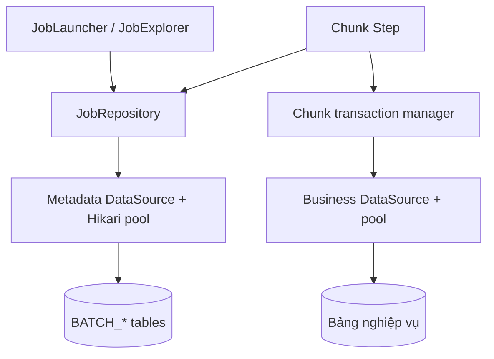
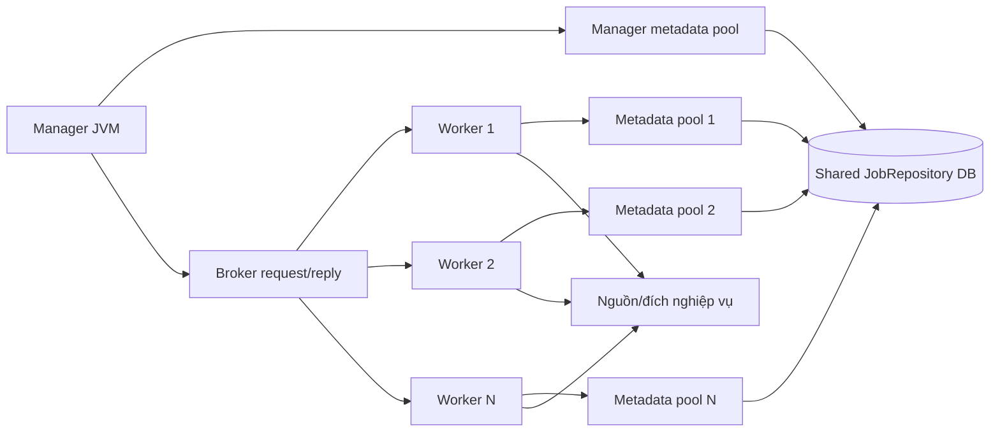

# Connection pool cho metadata trong Spring Batch JobRepository

Khi một Spring Batch job xử lý hàng triệu item, nhiều người tập trung vào `ItemReader`, `ItemProcessor`, `ItemWriter` và số worker mà quên rằng **JobRepository cũng phải truy cập database thường xuyên**. Mỗi lần tạo `JobExecution`, cập nhật `StepExecution`, ghi `ExecutionContext` hoặc tra cứu trạng thái đều có thể cần connection tới metadata database. Nếu connection pool dành cho repository bị cạn, toàn job có thể chậm, báo timeout hoặc không cập nhật được checkpoint **ngay cả khi database nghiệp vụ và worker vẫn đủ năng lực**.

Bài thuộc chương **JobRepository** của module **SPRING_BATCH_SCALING_OPERATIONS**. Ta sẽ thiết kế và định cỡ connection pool cho metadata trong Spring Batch 5.x/Spring Boot 3.x, phân biệt pool metadata với pool nghiệp vụ, phân tích hành vi khi tăng multi-threaded step, parallel steps, local/remote partitioning, retry/restart, rồi xây dựng cách quan sát và kiểm thử dựa trên tải thực tế.

**Ý chính:** Pool metadata không cần “càng lớn càng tốt”; nó cần **đủ số connection đang được dùng đồng thời**, trong ngân sách database và với transaction/checkpoint nhất quán. Mọi con số trong ví dụ đều là số giả định để tính toán và phải đo lại trước production.

## 1. Metadata connection pool phục vụ những thao tác nào?

`JobRepository` lưu trạng thái thực thi và dữ liệu checkpoint. Với repository JDBC, các thao tác này đọc/ghi các bảng metadata chuẩn của Spring Batch.

| Nhóm thao tác | Ví dụ | Tác động lên pool |
| --- | --- | --- |
| Khởi chạy job | Tìm/tạo `JobInstance`, tạo `JobExecution`, lưu parameters | Burst connection lúc scheduler kích hoạt nhiều job |
| Tạo step | Tạo `StepExecution` và context ban đầu | Tăng theo số flow/partition |
| Chạy chunk | Cập nhật counters/status và `ExecutionContext` gần các ranh giới commit | Tăng theo số chunk đã xử lý và cấu hình lưu state |
| Kết thúc step/job | Cập nhật `BatchStatus`, `ExitStatus`, timestamp | Có thể bị trễ nếu hết connection |
| Restart | Tìm execution trước, đọc checkpoint, tạo execution tiếp theo hợp lệ | Đòi metadata bền vững, đầy đủ |
| Theo dõi tiến độ | `JobExplorer`, dashboard, API kiểm tra job | Tạo read load, có thể cùng tranh pool |
| Remote partitioning | Nhiều worker đọc/update `StepExecution` và `ExecutionContext` | Tổng connection demand trên **nhiều JVM** |

Các bảng thường gặp:

- `BATCH_JOB_INSTANCE` — identity của job name + identifying JobParameters.
- `BATCH_JOB_EXECUTION` và `BATCH_JOB_EXECUTION_PARAMS` — những lần chạy và tham số.
- `BATCH_STEP_EXECUTION` — counters, status, timestamps của step/partition.
- `BATCH_JOB_EXECUTION_CONTEXT` và `BATCH_STEP_EXECUTION_CONTEXT` — checkpoint/state phục vụ restart.

**Không đồng nhất một chunk với một connection mới.** Pool tái sử dụng các connection; số lần borrow/release phụ thuộc transaction manager, phạm vi transaction, JDBC driver và cách Spring Batch cập nhật metadata. Hãy đo *connection checkout duration* và *acquisition latency*, không chỉ đếm row trong các bảng.

## 2. Phân biệt database, DataSource, pool và transaction manager

Bốn khái niệm liên quan nhưng không giống nhau:

| Khái niệm | Trách nhiệm |
| --- | --- |
| **Database** | Máy chủ/cluster lưu schema metadata, chịu giới hạn connections, CPU, IOPS, locks và transaction |
| **DataSource** | Abstraction cung cấp JDBC Connection cho repository/ứng dụng |
| **Connection pool** (ví dụ HikariCP) | Giữ và cấp lại một số lượng connection hữu hạn, quản lý timeout/lifetime |
| **PlatformTransactionManager** | Mở/commit/rollback transaction và ràng buộc connection theo execution context/thread thích hợp |

Trong Spring Batch 5.x, `JobRepository` dùng DataSource/transaction manager do hạ tầng được cấu hình. Còn `chunk(size, transactionManager)` lựa chọn transaction manager cho việc xử lý chunk; hai cấu hình **có thể trỏ cùng hoặc khác DataSource**.



Sơ đồ diễn tả trường hợp **tách pool**. Trong hệ thống đơn giản, `MDS` và `BDS` có thể là cùng một DataSource/pool. Tên bean, loại transaction manager và việc dùng cùng physical DB phải được kiểm tra trong runtime, không suy từ tên repository.

Một điều cần tránh: nếu bạn nghĩ đã tạo pool metadata riêng nhưng repository thực tế vẫn inject DataSource mặc định, mọi sizing và metric theo pool “riêng” sẽ gây kết luận sai.

## 3. Cách một pool JDBC hoạt động khi có nhiều step

Giả sử HikariCP có `maximumPoolSize=8`:

1. Khi một thao tác cần JDBC connection, thread yêu cầu từ Hikari.
2. Nếu có connection rảnh, thread nhận connection và thực thi truy vấn/transaction.
3. Nếu đã có 8 connection đang được dùng, thread đến sau **đợi connection được trả lại**.
4. Nếu chờ quá `connectionTimeout`, pool có thể ném lỗi lấy connection (thường thấy thông báo kiểu “Connection is not available, request timed out”).
5. Nếu connection được trả lại trước timeout, thread tiếp tục; connection không bị đóng/mở vật lý cho mỗi lần borrow.

Điều này đặt ra hai khái niệm:

- **Active connections**: connection đã được lấy khỏi pool; không nhất thiết đang chạy SQL. Một connection giữ trong transaction “idle in transaction” vẫn chiếm slot.
- **Pending threads**: thread đang chờ pool cấp connection. Pending kéo dài cho thấy demand vượt khả năng cấp connection trong thời gian quan sát, nhưng chưa đủ kết luận có nên tăng pool.

Nếu pending lớn **và** database CPU/IO còn nhiều dư địa, pool có thể quá nhỏ hoặc connection bị giữ quá lâu. Nếu pending lớn **và** database đã bão hòa, tăng pool có thể khiến số query tranh tài nguyên nhiều hơn, latency tệ hơn.

**Pool timeout khác query timeout:** `connectionTimeout` đo thời gian đợi **mượn connection**. Nó không giới hạn tổng thời gian SQL chạy, lock wait, HTTP call, hay thời gian transaction giữ connection.

## 4. Metadata dùng chung pool với nghiệp vụ hay tách riêng?

Hai phương án đều hợp lệ, tùy tài nguyên và yêu cầu nhất quán.

| Tiêu chí | Một pool dùng chung | Pool metadata riêng |
| --- | --- | --- |
| Độ phức tạp | Ít bean, dễ cấu hình | Phải quản lý hai DataSource/transaction managers |
| Ngân sách connection | Một mức giới hạn chung | Có thể phân bổ riêng hạn mức metadata và nghiệp vụ |
| Cô lập quá tải | Writer có thể chiếm pool khiến metadata không lấy được connection | Giảm tác động của writer saturation lên metadata |
| Tính nhất quán transaction | Khi cùng DB/transaction manager, một số cập nhật có thể chia sẻ phạm vi transaction | Metadata và nghiệp vụ ở hai transaction độc lập nếu dùng hai DS/TM |
| Quan sát | Khó tách acquisition latency metadata và business | Metrics/tên pool riêng rõ ràng |
| Triển khai nhỏ | Thường đơn giản, đủ tốt | Có thể thêm phức tạp không đáng kể |
| Triển khai nhiều partition/worker | Phải kiểm soát tác động chéo của concurrency | Có thể phân vùng pool theo loại workload |

**Lợi ích của tách pool:** Có một ngưỡng riêng để JobRepository vẫn lấy connection khi pool writer đang bận. Chẳng hạn pool metadata 8 và pool business 24 giúp dashboard dễ phân biệt bottleneck.

**Giới hạn của tách pool:** Nếu cả hai DataSource vẫn trỏ về **cùng PostgreSQL server**, chúng vẫn chia sẻ CPU, IOPS, locks, WAL và `max_connections`. Tách pool không “tạo thêm” công suất database.

**Đổi lại về transaction:** Khi metadata và data business đi qua hai connection/transaction manager độc lập, commit dữ liệu và commit checkpoint **không mặc nhiên nguyên tử**. Một chunk có thể đã ghi dữ liệu đích nhưng chưa cập nhật metadata; restart có thể xử lý lại. Vì vậy, quyết định tách pool phải đi cùng idempotent writer và kiểm thử recovery.

## 5. Khi nào nên ưu tiên pool riêng cho JobRepository?

Có thể xem xét pool riêng nếu:

- Worker thực hiện SQL nghiệp vụ lâu, giữ nhiều connection trong transaction, làm metadata bị chờ.
- Tốc độ cập nhật JobRepository khác rõ rệt so với tốc độ reader/writer hoặc có read-only dashboard poll thường xuyên.
- Nhiều JobExecution/StepExecution chạy đồng thời và cần tránh “noisy neighbor” trên pool ứng dụng.
- Có nhiều DataSource sẵn có và kiến trúc đã chuẩn hóa transaction manager riêng cho metadata.
- Muốn đặt giới hạn và alert cho repository độc lập với hệ thống đích.
- Remote partitioning có một metadata DB chung nhưng các worker lại sử dụng database nguồn/đích khác nhau.

Ngược lại, với job một thread, một database, commit interval đủ lớn và pool chưa từng có pending/timeout, **chưa có lý do bắt buộc** phải tách pool.

Tách pool cũng **không sửa được** tình huống cùng một row StepExecution bị nhiều thread cập nhật sai; đó có thể là vấn đề optimistic locking/thread safety. Không coi pool riêng là biện pháp bảo đảm exactly-once.

## 6. Những tham số HikariCP liên quan nhất

Với HikariCP, cần hiểu thông số trước khi tối ưu:

| Tham số | Ý nghĩa | Lưu ý thực hành |
| --- | --- | --- |
| `maximumPoolSize` | Số connection tối đa được pool quản lý, tính trên **mỗi JVM/pool instance** | Giới hạn concurrency, không phải throughput guarantee |
| `minimumIdle` | Số connection idle pool cố gắng duy trì | Nếu không đặt, Hikari thường hoạt động gần kiểu fixed-size pool; điều chỉnh theo profile workload |
| `connectionTimeout` | Thời gian tối đa chờ lấy connection từ pool | Không nhầm với SQL/query/transaction timeout |
| `validationTimeout` | Giới hạn thời gian kiểm tra connection còn hợp lệ | Thường cần thấp hơn `connectionTimeout` |
| `idleTimeout` | Khoảng idle trước khi connection thừa có thể bị thu hồi | Có ý nghĩa khi pool cho phép `minimumIdle < maximumPoolSize` |
| `maxLifetime` | Giới hạn tuổi connection trước khi pool thay mới theo lifecycle | Nên ngắn hơn thời gian cắt connection của DB/proxy, có dư địa |
| `keepaliveTime` | Tác vụ kiểm tra/giữ sống connection idle theo điều kiện của Hikari | Không thay thế cấu hình network timeout |
| `poolName` | Tên pool để log/metric phân biệt | Đặt tên riêng metadata và business |
| `leakDetectionThreshold` | Log cảnh báo connection bị giữ quá ngưỡng | Hữu ích khi chẩn đoán, có thể cảnh báo giả với transaction dài |

**Không set số lớn tùy tiện.** `maximumPoolSize=200` trên 10 pod có thể tạo trần 2.000 database connections dù từng pod hiếm khi sử dụng hết. PostgreSQL còn cần connections cho ứng dụng khác, replication/maintenance, admin và các tác vụ hệ thống.

**Không đặt `maxLifetime` quá ngắn** khiến pool đóng/tạo lại liên tục, gây kết nối TLS/auth và CPU overhead. Ngược lại, lifetime quá dài so với timeout của DB/proxy có thể làm connection bị cắt từ phía server giữa hai lần dùng. Chọn theo hạ tầng thật, theo dõi connection creation/eviction và lỗi.

## 7. Công thức định cỡ sơ bộ bằng concurrency và Little's Law

Đặt:

- `λ_meta`: tốc độ các thao tác cần checkout connection cho metadata, giao dịch/giây.
- `t_hold`: thời gian trung bình một connection bị giữ trong mỗi thao tác, giây.
- `U_target`: mức sử dụng pool mục tiêu để chừa headroom (ví dụ 0,7).
- `P`: số connection tối đa cho pool metadata ở **một JVM**.

Với mô hình tải tương đối đều, số connection đồng thời đang được sử dụng trung bình xấp xỉ:

\[
L_{\mathrm{active}}\approx\lambda_{\mathrm{meta}}\times t_{\mathrm{hold}}
\]

Một điểm xuất phát để benchmark:

\[
P_{\mathrm{baseline}}\gtrsim
\left\lceil \frac{\lambda_{\mathrm{meta}}\times t_{\mathrm{hold}}}
{U_{\mathrm{target}}} \right\rceil
\]

Đây **không phải công thức bảo đảm không timeout**. Nó chưa phản ánh burst, P95/P99, các loại transaction khác nhau, connection giữ quá lâu hoặc nhiều thread lấy hơn một connection. Phải kiểm thử bằng phân phối tải và pool metrics thực tế.

### Ví dụ một pod

Đo được 240 lượt checkout metadata/giây, mỗi connection được giữ trung bình 25 ms:

\[
L_{\mathrm{active}}=240\times0,025=6
\]

Nếu mong muốn mức sử dụng trung bình không quá 75%:

\[
P_{\mathrm{baseline}}\approx\lceil 6/0,75\rceil=8
\]

Có thể bắt đầu thử `maximumPoolSize=8`, rồi benchmark ở 8, 10, 12 với cùng job/concurrency, theo dõi `pending`, acquisition P95, transaction duration và DB CPU/IO.

**Điều cần xác minh trước tiên:** `λ_meta` phải được đo ở **pool đó**, không lấy số chunk/giây từ toàn cluster rồi áp cho một JVM. Và `t_hold` phải tính thời gian connection thực sự bị checkout, không chỉ duration một câu SQL.

## 8. Ngân sách connection toàn cluster quan trọng hơn số ở một pod

Nếu có nhiều instance cùng truy cập metadata DB, tổng trần connection từ ứng dụng:

\[
P_{\mathrm{cluster,max}}=
\sum_{i=1}^{n}N_i\times P_i
\]

Với `N_i` là số instance thuộc nhóm i và `P_i` là `maximumPoolSize` của pool metadata trong mỗi instance.

Ví dụ:

| Nhóm ứng dụng | Số instance | Pool metadata/instance | Tổng trần |
| --- | ---: | ---: | ---: |
| Manager pods | 4 | 6 | 24 |
| Remote partition worker pods | 8 | 4 | 32 |
| **Tổng** | **12** | | **56** |

Giả sử PostgreSQL có `max_connections=100` nhưng đã phải dự trù **30 connections** cho ứng dụng khác và **10** cho admin/vận hành/dự phòng: ngân sách cho batch metadata còn **60**. Trần **56** nằm dưới 60 nhưng vẫn còn rất ít headroom nếu rollout thêm canary hoặc worker tự động scale.

Nếu worker autoscale từ 8 lên 12 mà mỗi worker có pool 4:

\[
P_{\mathrm{cluster,max}}=4\times6+12\times4=72
\]

**72 vượt ngân sách 60**, dù từng worker chỉ dùng tối đa bốn connection. Cần giới hạn replica/pool, tăng công suất DB có kiểm soát, hoặc thiết kế kết nối phù hợp hơn; không thể xem cấu hình theo từng pod là độc lập.

**Lưu ý topology:** Worker remote chunking chỉ tiêu thụ message và ghi đích có thể **không cần pool metadata** giống remote partition worker. Đừng cộng các pool không tồn tại; inventory rõ từng loại JVM và DataSource.

### Cùng server nhưng nhiều pool

Nếu metadata và business cùng PostgreSQL instance, tổng budget phải tính:

\[
P_{\mathrm{DB,max}} \ge
P_{\mathrm{metadata,total}}+
P_{\mathrm{business,total}}+
P_{\mathrm{other}}+
P_{\mathrm{reserve}}
\]

Nếu các DataSource dùng hai database server độc lập, tính ngân sách **riêng trên từng server**. Với connection proxy (như PgBouncer), phải hiểu semantics pooling và transaction/session state trước khi thay đổi ngân sách.

## 9. Cấu hình một DataSource chung bằng Spring Boot 3.x

Trong hệ thống đơn giản dùng Spring Boot 3.x, `spring.datasource.hikari.*` điều chỉnh pool mặc định mà cả Spring Batch và code nghiệp vụ có thể sử dụng (nếu thật sự wiring vào cùng bean).

```yaml
spring:
  datasource:
    url: jdbc:postgresql://db.internal:5432/appdb
    username: ${APP_DB_USER}
    password: ${APP_DB_PASSWORD}
    hikari:
      pool-name: app-shared-pool
      maximum-pool-size: 16
      connection-timeout: 3000
      validation-timeout: 1000
      max-lifetime: 1500000

  batch:
    jdbc:
      initialize-schema: never
```

Giải thích:

- `maximum-pool-size: 16` là giới hạn **cho một instance ứng dụng**. Không phải 16 cho cả cluster.
- `connection-timeout: 3000` là **3 giây đợi checkout**, không phải timeout của query.
- `max-lifetime: 1500000` là 25 phút, chỉ là ví dụ; phải so với chính sách timeout của DB, proxy và hạ tầng.
- `initialize-schema: never` giả định schema metadata đã được quản lý bằng migration riêng; nếu chưa tạo schema, job sẽ lỗi. Đây không phải điều kiện bắt buộc cho mọi ứng dụng.
- Không ghi credentials trong file chia sẻ; dùng secret manager/environment variables.
- Trong trường hợp DataSource chung, đặt một pool name cụ thể là đủ; **đừng mặc định đã có hai pool** chỉ vì có JobRepository và business repository.

Nếu ứng dụng còn dùng JPA, asynchronous tasks, scheduled jobs hay API controllers, tất cả có thể cạnh tranh cùng pool. Phải tính concurrency **toàn ứng dụng**.

**Cảnh báo Spring Boot:** Cấu hình tùy biến `@EnableBatchProcessing`/`DefaultBatchConfiguration` có thể làm Boot Batch auto-configuration back off. Trước khi suy rằng các property được áp dụng, hãy xác nhận DataSource, JobRepository và bean transaction manager đang chạy.

## 10. Cấu hình tách pool metadata: DataSource + transaction manager

Spring Batch 5.x cho phép chỉ định DataSource và transaction manager cho hạ tầng batch. Ví dụ sau sử dụng `@EnableBatchProcessing` và bean Hikari riêng:

```java
import javax.sql.DataSource;

import com.zaxxer.hikari.HikariDataSource;
import org.springframework.batch.core.configuration.annotation.EnableBatchProcessing;
import org.springframework.beans.factory.annotation.Qualifier;
import org.springframework.boot.context.properties.ConfigurationProperties;
import org.springframework.context.annotation.Bean;
import org.springframework.context.annotation.Configuration;
import org.springframework.jdbc.support.JdbcTransactionManager;
import org.springframework.transaction.PlatformTransactionManager;

@Configuration(proxyBeanMethods = false)
@EnableBatchProcessing(
    dataSourceRef = "batchMetadataDataSource",
    transactionManagerRef = "batchMetadataTransactionManager")
public class BatchMetadataInfrastructure {

    @Bean(name = "batchMetadataDataSource")
    @ConfigurationProperties(prefix = "app.batch.metadata.datasource")
    public HikariDataSource batchMetadataDataSource() {
        return new HikariDataSource();
    }

    @Bean(name = "batchMetadataTransactionManager")
    public PlatformTransactionManager batchMetadataTransactionManager(
            @Qualifier("batchMetadataDataSource") DataSource dataSource) {
        return new JdbcTransactionManager(dataSource);
    }
}
```

Properties tương ứng:

```yaml
app:
  batch:
    metadata:
      datasource:
        jdbc-url: jdbc:postgresql://metadata-db.internal:5432/batchmeta
        username: ${BATCH_META_DB_USER}
        password: ${BATCH_META_DB_PASSWORD}
        driver-class-name: org.postgresql.Driver
        pool-name: batch-metadata-pool
        maximum-pool-size: 10
        connection-timeout: 3000
        validation-timeout: 1000
        max-lifetime: 1500000
```

Các điểm phải kiểm tra:

1. `batchMetadataDataSource` phải là DataSource repository thực sự dùng; kiểm tra bean tại runtime.
2. `batchMetadataTransactionManager` phải quản lý **cùng DataSource** đó, không vô tình dùng business DataSource.
3. Business DataSource và transaction manager phải được cấu hình rõ riêng, dùng `@Qualifier`/`@Primary` đúng nơi để không inject nhầm.
4. Các bảng `BATCH_*` phải tồn tại trên metadata DB, được migration theo đúng Spring Batch version.
5. `@EnableBatchProcessing` là một **cách cấu hình hạ tầng**, không nên trộn vô ý với cách kế thừa `DefaultBatchConfiguration` hay Boot auto-configuration.
6. Với repository không dùng JDBC hoặc kiến trúc có schema/prefix đặc biệt, cần đối chiếu API/dialect tương ứng.
7. Cấu hình `minimum-idle` không có trong ví dụ: Hikari có thể chạy kiểu fixed-size pool khi để mặc định; đo memory/connection budget và thời gian khởi tạo trước khi chọn chiến lược idle.

Đây là **khung cấu hình**, chưa bao gồm business DataSource/transaction manager, Job/Step beans, migrations, credentials thực, monitoring và deployment. Spring Batch 6.x hoặc các phiên bản Spring Boot khác có thể thay đổi API/cách auto-config; dùng tài liệu đúng phiên bản.

## 11. Tách transaction manager của step cho rõ ranh giới

Dùng repository DataSource riêng không có nghĩa step phải dùng transaction manager đó để ghi dữ liệu nghiệp vụ.

```java
import org.springframework.batch.core.Step;
import org.springframework.batch.core.repository.JobRepository;
import org.springframework.batch.core.step.builder.StepBuilder;
import org.springframework.batch.item.ItemReader;
import org.springframework.batch.item.ItemWriter;
import org.springframework.beans.factory.annotation.Qualifier;
import org.springframework.context.annotation.Bean;
import org.springframework.transaction.PlatformTransactionManager;

@Bean
public Step importOrdersStep(
        JobRepository jobRepository,
        @Qualifier("businessTransactionManager")
        PlatformTransactionManager businessTransactionManager,
        ItemReader<OrderInput> orderReader,
        ItemWriter<OrderInput> orderWriter) {

    return new StepBuilder("importOrdersStep", jobRepository)
            .<OrderInput, OrderInput>chunk(
                    200, businessTransactionManager)
            .reader(orderReader)
            .writer(orderWriter)
            .build();
}
```

**Hãy phân biệt rõ:**

- `JobRepository` metadata dùng `batchMetadataDataSource` theo cấu hình mục 10.
- `businessTransactionManager` điều khiển transaction ghi/đọc của step vào database nghiệp vụ.
- Không có transaction 2PC mặc định bao trùm metadata DB và business DB. Cần idempotency, checkpoint đúng và thiết kế khôi phục khi chỉ một trong hai bên commit.
- Nếu dữ liệu nghiệp vụ và metadata nằm trên **cùng database** nhưng dùng hai pool/TM khác nhau, vẫn có hai transaction JDBC độc lập, không mặc nhiên atomic.
- `ItemReader` và `ItemWriter` phải dùng đúng DataSource; khi có nhiều DataSource, injection không explicit có thể trỏ nhầm.

Một test đơn giản sau startup nên in/log an toàn **tên pool và JDBC URL đã ẩn credentials**, kiểm tra repository đang thao tác vào schema metadata mong muốn. Không truy cập JDBC URL đầy đủ chứa secret lên log.

## 12. Pool demand thay đổi khi tăng concurrency

Các kiến trúc scale Spring Batch có nhu cầu metadata khác nhau:

| Mô hình | Concurrency metadata điển hình | Điểm cần đo |
| --- | --- | --- |
| Một chunk step tuần tự | Một step đang cập nhật state/commit | Số commits/s, transaction hold time |
| Multi-threaded step | Nhiều chunk xử lý đồng thời trong một StepExecution | Metadata synchronization, optimistic locking, pool acquisition |
| Parallel steps | Nhiều StepExecution hoạt động trên các flow | Tổng số transaction metadata/update chạy đồng thời |
| Local partitioning | Nhiều StepExecution trong một JVM | Grid size, pool cùng JVM, JobRepository update bursts |
| Remote partitioning | Nhiều worker JVM, cùng metadata DB | Tổng pool trần, active partitions, DB connections, schema lock contention |
| Remote chunking | Manager giữ step/read metadata; worker xử lý chunk request | Manager repository pool, reply/in-flight; worker có thể không cần repository metadata |
| Nhiều scheduler/launcher | Burst tạo JobInstance/JobExecution | Isolation create transaction, pool chờ, duplicate launch |

**Không mặc định** `gridSize=32` cần metadata pool 32 connections ở mỗi JVM. Pool sizing phụ thuộc các request metadata **thực sự đồng thời** và thời gian checkout; một thread xử lý CPU/HTTP nhiều giây có thể không giữ connection metadata suốt thời gian ấy.

**Cũng không mặc định** một worker cần đúng một metadata connection. Nếu worker thực hiện nhiều bước hoặc transaction lồng nhau, cách wiring và pool checkout có thể khác. Dùng metrics và tracing để biết mức sử dụng thực.

## 13. Remote partitioning: pool metadata trên từng worker

Trong remote partitioning, manager tạo các partition và `StepExecution`, còn worker chạy step thật, thường truy cập một **JobRepository JDBC chia sẻ** để lấy/cập nhật metadata partition.



Ở mô hình này:

1. Mỗi worker JVM có **pool riêng**; tất cả pools cộng lại thành tải vào cùng metadata DB.
2. Nhiều partition không nhất thiết đồng nghĩa nhiều *active connections* liên tục, nhưng sẽ có nhiều checkout khi commit/update.
3. Worker phải được cấu hình **cùng logical repository schema/namespace** nếu giao thức remote partitioning yêu cầu, tránh worker update nhầm metadata.
4. Thêm worker có thể tăng throughput xử lý nhưng cũng tăng update rate lên `BATCH_STEP_EXECUTION`/`ExecutionContext`.
5. Nếu pool metadata worker hết connection, partition có thể chậm hoặc fail mặc dù business writer còn hoạt động.

**Remote chunking khác:** worker tiêu thụ `ChunkRequest`, process/write và trả `ChunkResponse`; trong mô hình chuẩn worker **không nhất thiết cần JobRepository chung** như remote partitioning. Đừng tự thêm metadata pool vào mọi worker remote chunking nếu không có nhu cầu nghiệp vụ/kiến trúc.

## 14. Commit interval ảnh hưởng tới metadata load như thế nào?

Chunk size/commit interval ảnh hưởng số lần commit và cập nhật checkpoint. Với `N` item và commit interval `C`:

\[
M_{\mathrm{chunks}}\approx
\left\lceil\frac{N}{C}\right\rceil
\]

Ví dụ một step có 2.400.000 item:

| Chunk size | Số chunk xấp xỉ | Kỳ vọng tác động |
| ---: | ---: | --- |
| 10 | 240.000 | Nhiều commit/checkpoint và pool borrows hơn |
| 100 | 24.000 | Ít metadata operations hơn |
| 1.000 | 2.400 | Giảm commit overhead nhưng transaction dài hơn |
| 10.000 | 240 | Rủi ro transaction/rollback, heap và lock tăng |

**Không khẳng định một chunk tương đương đúng một metadata transaction** trên mọi topology: khi metadata và business chia sẻ transaction manager, thao tác có thể tham gia transaction có sẵn; khi tách DataSource, metadata commits độc lập.

Tăng chunk size **có thể giảm tốc độ cập nhật repository**, nhưng cũng tăng rủi ro:

- Transaction giữ lock/connection lâu hơn.
- Một rollback phải thực hiện lại nhiều item hơn.
- Reader checkpoint xa hơn có thể khiến restart reprocess nhiều dữ liệu.
- Memory/serialization và tail latency tăng.
- Với remote chunking, message payload theo chunk lớn hơn.

Để tuning, đo **Job duration và data correctness** cùng với metadata write rate và pool checkout, không chỉ nhìn số row cập nhật trong `BATCH_STEP_EXECUTION`.

## 15. Dấu hiệu pool metadata nghẽn, phân biệt với database nghẽn

Hai sự cố có thể trông giống nhau ở log Spring Batch nhưng cách xử lý khác nhau:

| Tín hiệu | Nghi pool thiếu slot | Nghi database/transaction chậm |
| --- | --- | --- |
| `hikaricp.connections.active` sát max | Thường có | Cũng có thể có |
| `hikaricp.connections.pending` kéo dài | Có | Có |
| `hikaricp.connections.timeout` tăng | Có | Có |
| DB CPU/IO thấp, SQL metadata nhanh | Hợp lý với pool quá nhỏ/connection leak | Ít hợp lý hơn |
| DB CPU/IO/lock waits cao | Tăng pool có thể tệ hơn | Giả thuyết DB bottleneck mạnh |
| Connection usage P95 rất dài | Có thể giữ connection lâu hoặc leak | Query/transaction contention |
| JobRepo create/update query P95 tăng | Có thể đợi connection trước SQL | Có thể SQL đang thật sự chậm |
| Idle connection còn nhiều, pending cao | Cần kiểm tra metric/tag/snapshot; hiếm khi cùng pool ở trạng thái bền vững | Có thể quan sát sai pool hoặc thời điểm |

**Chẩn đoán ba lớp:**

1. **Checkout:** chờ bao lâu mới mượn được connection?
2. **Execution/transaction:** sau checkout, SQL/transaction mất bao lâu? Có lock wait, serialization failure hay deadlock?
3. **Repository lifecycle:** `createJobExecution`, `updateStepExecution`, lưu context, dashboard polls có thực sự là nguồn tải?

Một connection pool lớn không giúp query `UPDATE BATCH_STEP_EXECUTION ...` bị chặn bởi lock kéo dài. Ngược lại, tăng DB CPU mà bỏ qua thread giữ connection do code ngoài metadata có thể làm đổ lỗi sai nơi.

## 16. Metrics HikariCP cần đưa vào dashboard

Nếu dùng Micrometer/Actuator và Hikari metrics đã được cấu hình, có thể theo dõi:

| Metric Hikari/Micrometer | Diễn giải |
| --- | --- |
| `hikaricp.connections.active` | Số connection đang được checkout |
| `hikaricp.connections.idle` | Connection rảnh |
| `hikaricp.connections.pending` | Thread đang đợi connection |
| `hikaricp.connections.max` | Giới hạn pool |
| `hikaricp.connections.min` | Giá trị minimum idle được cấu hình |
| `hikaricp.connections.acquire` | Phân phối thời gian chờ mượn connection |
| `hikaricp.connections.usage` | Thời gian giữ connection sau checkout |
| `hikaricp.connections.creation` | Thời gian tạo physical connection |
| `hikaricp.connections.timeout` | Số lần checkout timeout |

Tên metric, tag và histogram/slo phụ thuộc version Micrometer, cách export Prometheus và cấu hình ứng dụng; trong Prometheus, tên có thể được chuyển đổi sang dạng underscore/suffix khác.

**Dashboard đề xuất:** Đặt biểu đồ metadata pool cạnh business pool, worker concurrency, chunk commits/s, DB CPU/lock waits và job SLA. Nếu metric có tag `pool`, dùng chính xác `pool-name` của Hikari để không trộn nhiều DataSource.

Một bộ cảnh báo minh họa cần điều chỉnh theo baseline:

- `pending > 0` liên tục trên nhiều khoảng đo và acquisition P95 tăng.
- Checkout timeout xuất hiện dù DB chưa đạt giới hạn công suất.
- `active / max` duy trì gần 1 trong giờ cao điểm, cùng job throughput giảm.
- `usage P95` tăng bất thường, cần tìm transaction giữ connection quá lâu.
- `creation latency/errors` tăng đồng thời với DB/proxy connection failures.
- Metadata errors tăng khi JobExplorer poll hoặc khi remote partitioning autoscale.

Không dùng một ngưỡng cố định như “pool 80% là lỗi” cho mọi hệ thống. Một pool cố định có thể ở mức sử dụng cao nhưng không có pending/timeout và vẫn đạt SLA; ngược lại một pool dùng trung bình thấp vẫn có spike ngắn gây timeout.

## 17. Query PostgreSQL để quan sát phía server

Hikari chỉ biết tình trạng **bên client**. DBA cần kiểm tra database thật để tránh tăng pool khi server đã quá tải.

### 17.1. Giới hạn kết nối

```sql
SHOW max_connections;

SELECT
    datname,
    application_name,
    state,
    COUNT(*) AS sessions
FROM pg_stat_activity
WHERE datname = current_database()
GROUP BY datname, application_name, state
ORDER BY sessions DESC;
```

Tùy JDBC driver, có thể đặt `application_name`/connection metadata để nhận diện worker/manager trong `pg_stat_activity`. Query chỉ quan sát sessions hiện tại, không phải trần connections mà pool **có thể mở**.

### 17.2. Ai đang giữ connection trong transaction?

```sql
SELECT
    pid,
    application_name,
    state,
    xact_start,
    query_start,
    wait_event_type,
    wait_event,
    NOW() - xact_start AS transaction_age
FROM pg_stat_activity
WHERE datname = current_database()
  AND xact_start IS NOT NULL
ORDER BY xact_start ASC;
```

Nếu xuất hiện nhiều session `idle in transaction` với tuổi cao, điều tra transaction scope, code giữ connection và lock trên DB. Đây là một nguyên nhân phổ biến làm pool cạn do **connection bị giữ**, không đơn giản vì pool quá nhỏ.

### 17.3. Kiểm tra blocking sessions

```sql
SELECT
    a.pid,
    a.application_name,
    a.wait_event_type,
    a.wait_event,
    pg_blocking_pids(a.pid) AS blockers,
    a.query_start
FROM pg_stat_activity a
WHERE cardinality(pg_blocking_pids(a.pid)) > 0
ORDER BY a.query_start;
```

Kết quả là **snapshot tại thời điểm truy vấn**. Khi deadlock được DB phát hiện và rollback victim, vòng chờ có thể biến mất. Cần kết hợp DB logs, SQLSTATE và trace của ứng dụng để phân biệt deadlock, pool saturation và slow query.

Không log toàn bộ SQL chứa dữ liệu nhạy cảm lên dashboard; chỉ cấp quyền cần thiết khi truy cập metadata/DB admin views.

## 18. Transaction scope: điều gì khiến connection bị giữ lâu?

Một số nguyên nhân thường gặp:

- Gọi API HTTP bên trong một transaction đã lấy connection, giữ connection khi chờ mạng.
- Đọc lượng dữ liệu lớn bằng cursor trong transaction kéo dài.
- Dùng Spring `@Transactional` ở tầng service bao trùm thao tác khởi chạy job và các công việc khác.
- Cấu hình transaction propagation làm method con tham gia transaction ngoài không mong muốn.
- Writer thực hiện nhiều câu SQL/trigger không có index phù hợp.
- Callback/listener giữ transaction hoặc tài nguyên lâu hơn dự kiến.
- Connection không được đóng/trả lại khi dùng JDBC thủ công ngoài Spring quản lý.
- Thao tác metadata có serialization/lock contention nhưng chỉ nhìn thấy timeout mượn connection ở lớp trên.

Một anti-pattern:

```java
// PHẢN VÍ DỤ: transaction giữ connection trong lúc chờ I/O ngoài DB.
@Transactional
public void processOrder(Order order) {
    repository.updateStatus(order.id(), "PROCESSING");
    remoteClient.callSlowService(order);   // Có thể chờ vài giây.
    repository.updateStatus(order.id(), "DONE");
}
```

Nếu transaction đầu tiên đã checkout connection, nó có thể bị giữ suốt lời gọi HTTP. Tách rõ ranh giới I/O, transaction, idempotency và workflow khi điều chỉnh. Không đơn giản cắt transaction thành hai phần nếu nghiệp vụ yêu cầu atomicity; cần thiết kế outbox/compensation phù hợp.

**Repository isolation khác pool timeout:** Cấu hình `isolationLevelForCreate` bảo vệ việc tạo JobInstance/JobExecution đồng thời; nó không trực tiếp tăng số connection. Tăng isolation có thể ảnh hưởng lock/serialization conflict, còn thay `maximumPoolSize` không sửa được optimistic locking conflict do hai thread sửa cùng StepExecution.

## 19. Hết connection trong lúc commit hoặc restart nguy hiểm thế nào?

Những khoảng lỗi quan trọng cần kiểm chứng:

| Thời điểm lỗi | Điều có thể xảy ra | Cần làm |
| --- | --- | --- |
| Trước khi tạo JobExecution | Launcher không tạo được execution | Phân loại transient vs cấu hình, retry launch có kiểm soát |
| Sau tạo execution nhưng caller không nhận response | Execution có thể tồn tại dù caller thấy timeout | Tra JobRepository bằng identity gốc trước khi tạo lại |
| Khi lưu StepExecution/ExecutionContext | Metadata có thể trễ hoặc transaction fail | Đối chiếu checkpoint và DB nghiệp vụ |
| Sau business commit nhưng metadata commit fail | Dữ liệu đích có thể đã ghi, state restart cũ | Idempotent writer, kiểm thử replay |
| Trong remote partition worker | Worker chưa cập nhật được StepExecution | Tránh chạy song song hai worker cho cùng partition |
| Trong cleanup/restart khi DB bận | Trạng thái nhìn qua JobExplorer có thể trễ | Chờ khôi phục DB, xác minh execution thực |
| Database từ chối kết nối do hết max_connections | Pool có thể không tạo được connection mới | Giảm tổng pool/replica hoặc tăng capacity một cách có kiểm soát |

**Không tự chuyển JobExecution từ STARTED thành COMPLETED bằng SQL** chỉ để “giải phóng pool”. Điều này phá invariant lifecycle và có thể làm job thực vẫn chạy trong khi metadata cho biết đã xong.

Cũng không chuyển từ repository JDBC bền vững sang repository in-memory riêng từng pod để tránh lỗi kết nối; làm vậy mất khả năng điều phối/restart tập trung.

## 20. Benchmark pool metadata theo workload đại diện

Một vòng tuning có kiểm soát:

1. **Chụp baseline:** số manager/worker JVM, pool sizes, DB max_connections, chunk size, partitions đang active, job duration, số item đã commit.
2. **Đo acquisition và usage:** Hikari `pending`, `active`, `acquire P95`, `usage P95`, timeout và connection creation.
3. **Đo phía DB:** CPU/IO/locks, active sessions, transaction age, query P95 và waits.
4. **Xác định loại tải:** launch burst, update StepExecution sau chunk, JobExplorer polling hay remote partition worker restart.
5. **Thay đúng một biến:** pool metadata size, worker concurrency, commit interval hoặc dashboard poll interval, giữ các biến khác ổn định.
6. **Load test lỗi:** thử worker restart, metadata DB mất kết nối, connection exhaustion, job restart và business output reconciliation.
7. **So sánh kết quả:** throughput đã commit, job completion, acquisition P95, timeout, DB CPU và tổng connections cluster.
8. **Chốt guardrails:** giới hạn autoscale/replicas, pool max, alerts và runbook khôi phục.

### Ma trận thử nghiệm minh họa

| Lần chạy | Pool metadata mỗi pod | Worker đồng thời | Điều cần so |
| --- | ---: | ---: | --- |
| A | 4 | 8 | Baseline pending/acquisition timeout |
| B | 8 | 8 | Pool tăng có giúp metadata latency và job duration? |
| C | 12 | 8 | DB đã chạm saturation chưa? Có lợi thêm không? |
| D | 8 | 16 | Khi tăng worker, metadata và DB có chịu được không? |
| E | 8 | 8 | Giảm dashboard polling, xem read load |
| F | 8 | 8 | Mô phỏng metadata DB outage rồi restart |

Các giá trị chỉ là **cấu hình thử**, không phải benchmark thực tế. Trong mỗi lần chạy phải dùng cùng dataset, cùng điều kiện hạ tầng và đo các biến theo thời gian; các con số đẹp ở trạng thái cache ấm có thể không đại diện production.

## 21. Case study: thêm worker nhưng JobRepository bắt đầu timeout

Một batch xử lý **4.800.000 record** qua remote partitioning. Ban đầu có 4 worker JVM, mỗi worker pool metadata 6 connections; manager pool 8 connections.

Sau khi tăng số worker từ 4 lên 16 để rút ngắn batch window, ta quan sát:

| Chỉ số | Trước | Sau |
| --- | ---: | ---: |
| Worker JVM | 4 | 16 |
| Pool metadata mỗi worker | 6 | 6 |
| Pool metadata manager | 8 | 8 |
| Trần metadata connections của cluster | 32 | 104 |
| Database `max_connections` | 120 | 120 |
| Connections hệ thống khác/dự phòng | 40 | 40 |
| Ngân sách metadata khả dụng | 80 | 80 |
| Hikari pending | Thấp | Cao tại nhiều worker |
| DB CPU/locks | Bình thường | Cao |
| Job duration | 58 phút | 64 phút |

### Câu hỏi 1 — Vì sao trần metadata connections tăng từ 32 lên 104?

Ban đầu:

\[
P_{\mathrm{before}}=4\times6+8=32
\]

Sau khi scale:

\[
P_{\mathrm{after}}=16\times6+8=104
\]

Ngân sách metadata chỉ 80. Hệ thống có thể chạm giới hạn database hoặc làm giảm tài nguyên dành cho dịch vụ khác. Tuy vậy, **trần 104 không đồng nghĩa luôn có 104 connection đang mở**; phải xem sessions thực và Hikari idle/active.

### Câu hỏi 2 — Có nên tăng pool worker từ 6 lên 12?

Chưa. Khi DB CPU/lock wait đã cao và trần cluster vượt budget, tăng pool có thể tăng concurrency vào database, làm tình trạng tệ hơn. Phải kiểm tra slow metadata transactions, commit interval, worker count, pool usage và DB capacity.

### Câu hỏi 3 — Nếu giảm pool mỗi worker xuống 4?

Trần mới:

\[
P_{\mathrm{new}}=16\times4+8=72
\]

72 dưới ngân sách 80, nhưng **không bảo đảm hiệu năng**: pool 4 có thể tạo nhiều pending nếu mỗi worker cần >4 connection đồng thời, trong khi DB vẫn có lock contention. Cần benchmark cả pool wait và throughput committed, không kết luận từ phép tính trần.

### Câu hỏi 4 — Làm sao xác định nên giảm concurrency hay tăng DB capacity?

Nếu DB lock wait và CPU tăng mạnh khi thêm worker, còn throughput committed **giảm từ trước**, phải điều tra tranh chấp update metadata/DB nghiệp vụ và số step/chunk; có thể giảm số partition active, tăng commit interval hợp lý hoặc tách workload. Nếu DB còn dư địa nhưng pool acquisition P95 cao và DB response nhanh, có cơ sở tăng pool trong ngân sách.

### Câu hỏi 5 — Metadata commit bị timeout sau writer commit, xử lý thế nào?

Không giả định chunk chưa ghi. Kiểm tra business operation keys và StepExecution/ExecutionContext, dùng idempotent write/restart theo JobRepository, tránh sửa status thủ công. Nếu worker cũ có thể còn chạy, cần xác minh trạng thái thật trước khi replay partition.

## 22. Runbook khi pool metadata cạn

**Bước 1 — Xác nhận đúng pool.** Xem tên Hikari `poolName`, datasource URL/schema đã che secret, metric tags; không nhầm metadata với pool JDBC của business.

**Bước 2 — Đo hiện trạng.** Thu `active/idle/pending/max`, checkout timeout, acquisition/usage P95 và error chain từ Spring `JobRepository`/JDBC.

**Bước 3 — Đối chiếu database.** Kiểm tra `max_connections`, sessions theo application_name, CPU, IO, lock waits, transaction age và lỗi SQLSTATE.

**Bước 4 — Kiểm tra tổng replica.** Nhân `maximumPoolSize` với số instance thật, tính canary/HPA và các pool khác cùng DB server.

**Bước 5 — Tìm connection giữ quá lâu.** Thread dumps, `idle in transaction`, slow SQL, callback/HTTP trong transaction, connection leak. Chỉ bật leak detection có kiểm soát để chẩn đoán.

**Bước 6 — Giảm áp lực có chủ đích.** Hạn chế worker/partition active, giảm polling dashboard, tối ưu metadata query/serialization hoặc tăng commit interval nếu an toàn. Tránh chỉnh nhiều thứ cùng lúc.

**Bước 7 — Điều chỉnh pool nếu có căn cứ.** Chỉ tăng max khi database còn capacity và checkout wait là bottleneck thật; cân nhắc tách pool nếu writer chiếm toàn bộ slot của shared pool.

**Bước 8 — Phục hồi chính xác.** Kiểm tra jobs vẫn STARTED, worker sống/chết, checkpoint và dữ liệu đích; restart bằng cơ chế Spring Batch phù hợp, không chỉnh tay metadata.

**Bước 9 — Kiểm thử sau sửa.** Load test job representative với worker/concurrency đúng mức production; đo pool metrics, DB và SLA.

**Bước 10 — Cập nhật giới hạn vận hành.** Sửa autoscale max, pool budgets, dashboard và cảnh báo trước khi sự cố lặp lại.

## 23. Những sai lầm phổ biến

1. **Chỉ nhìn maximumPoolSize của một pod:** quên tổng pool của nhiều manager/worker và rollout canary.
2. **Tăng pool khi database đã bão hòa:** làm lock/CPU/IO contention tệ hơn.
3. **Nhầm connectionTimeout với query timeout:** tăng thời gian chờ mượn connection không xử lý slow SQL.
4. **Cho rằng mỗi thread luôn giữ một metadata connection suốt job:** sizing quá lớn, không dựa trên thời gian checkout thực.
5. **Coi chunk size là số connection:** commit interval ảnh hưởng transaction rate, không quyết định trực tiếp pool size.
6. **Dùng chung một pool quá nhỏ cho writer và repository:** metadata không cập nhật được khi writer giữ connection.
7. **Tách pool nhưng quên transaction boundaries:** business commit thành công còn checkpoint fail, restart có thể replay.
8. **Tạo metadata pool riêng nhưng repository thực tế vẫn dùng DataSource mặc định:** đo nhầm pool.
9. **Trộn Boot auto-config với @EnableBatchProcessing không kiểm soát:** bean wiring hoặc schema initializer khác dự kiến.
10. **Không định danh pool bằng tên riêng:** metric của metadata và business bị trộn.
11. **Đặt minimumIdle/maximumPoolSize quá lớn ở nhiều JVM:** mở connection vượt budget DB.
12. **Đặt maxLifetime quá thấp hoặc quá dài so với DB/proxy:** tạo connection churn hoặc broken connections.
13. **Giữ transaction trong lúc gọi HTTP:** connection bị chiếm vì I/O ngoài DB.
14. **Bỏ qua JobExplorer polling:** read load có thể tăng mạnh theo số dashboard/management queries.
15. **Coi optimistic locking/deadlock là lỗi pool đơn thuần:** sai nguyên nhân, sửa không hiệu quả.
16. **Sửa JobRepository status trực tiếp sau timeout:** phá lifecycle/restart và dễ tạo xử lý trùng.
17. **Dùng repository in-memory trên mỗi remote partition worker:** không có metadata chung bền vững.
18. **Chỉ đo active trung bình:** bỏ qua burst P95/P99, pending và checkout timeout.

## 24. Checklist trước production

- [ ] Đã xác định repository JDBC sử dụng DataSource/pool/transaction manager nào ở runtime.
- [ ] Đã quyết định shared pool hay dedicated metadata pool theo phép đo, tính cả consistency tradeoff.
- [ ] Biết `maximumPoolSize` là giới hạn cho **mỗi JVM**, không phải toàn cluster.
- [ ] Có ngân sách connection trên DB server sau khi trừ ứng dụng khác, admin/maintenance, autoscale/rollout.
- [ ] Đã đo connection checkout rate, usage P95, pending và timeout theo tên pool.
- [ ] Đã kiểm tra DB CPU/IO/locks và query latency trước khi tăng pool size.
- [ ] `connectionTimeout`, `validationTimeout`, `maxLifetime` phù hợp DB/proxy/network.
- [ ] Biết tác động của `minimumIdle`/`idleTimeout` tới số connection thường trực và burst.
- [ ] Có metric Hikari/Micrometer và cảnh báo dựa trên baseline, không dùng chỉ active/max.
- [ ] Có thông tin JobRepository create/update/checkpoint và `JobExplorer` polling.
- [ ] Reader/writer dùng đúng transaction manager, metadata và business không bị trộn bean.
- [ ] Nếu tách DataSource, có idempotency và test tình huống data commit thành công nhưng metadata fail.
- [ ] Remote partition workers thấy cùng logical metadata repository và có pool budget theo số replicas.
- [ ] Không cấp metadata pool không cần thiết cho remote chunking worker chỉ xử lý request.
- [ ] Đã benchmark với số worker/partition, chunk size và batch window đại diện.
- [ ] Đã thử metadata outage, pool exhaustion, worker crash và restart cùng JobInstance.
- [ ] Có runbook kiểm tra JobExecution/StepExecution còn STARTED mà không đổi status thủ công.
- [ ] Có quy trình migration/backup schema BATCH_*, retention, secret management và database access control.

## 25. Tài liệu tham khảo

- [Spring Batch Reference — Configuring a JobRepository](https://docs.spring.io/spring-batch/reference/job/configuring-repository.html): cấu hình JobRepository, DataSource và isolation.
- [Spring Batch Reference — Meta-Data Schema](https://docs.spring.io/spring-batch/reference/schema-appendix.html): schema metadata và trạng thái restart.
- [Spring Batch Reference — Scaling and Parallel Processing](https://docs.spring.io/spring-batch/reference/scalability.html): multi-threaded step, partitioning và remote chunking.
- [Spring Batch Reference — Transaction Appendix](https://docs.spring.io/spring-batch/reference/transaction-appendix.html): transaction và retry trong chunk processing.
- [Spring Batch 5.2 API — EnableBatchProcessing](https://docs.spring.io/spring-batch/docs/5.2.x/api/org/springframework/batch/core/configuration/annotation/EnableBatchProcessing.html): `dataSourceRef`, `transactionManagerRef` và hạ tầng batch.
- [Spring Batch 5.2 API — DefaultBatchConfiguration](https://docs.spring.io/spring-batch/docs/5.2.x/api/org/springframework/batch/core/configuration/support/DefaultBatchConfiguration.html): tùy biến DataSource/TM cho JobRepository.
- [HikariCP — Configuration](https://github.com/brettwooldridge/HikariCP#configuration-knobs-baby): maximumPoolSize, minimumIdle, timeouts, lifetime và metrics.
- [HikariCP — About Pool Sizing](https://github.com/brettwooldridge/HikariCP/wiki/About-Pool-Sizing): lý do pool quá lớn có thể làm database chậm hơn.
- [Spring Boot Reference — Working with SQL Databases](https://docs.spring.io/spring-boot/reference/data/sql.html): DataSource configuration và connection pooling.
- [Micrometer Reference — Instrumentation Concepts](https://docs.micrometer.io/micrometer/reference/concepts.html): đo latency, counters và tags.
- [PostgreSQL — Monitoring Database Activity](https://www.postgresql.org/docs/current/monitoring-stats.html): `pg_stat_activity` và lock/session diagnostics.
- [PostgreSQL — Connection Settings](https://www.postgresql.org/docs/current/runtime-config-connection.html): `max_connections` và quản lý session.

> **Ghi nhớ:** Connection pool cho metadata là **một tài nguyên hữu hạn phục vụ lifecycle và checkpoint của Spring Batch**, không phải nút tăng tốc tùy ý. Định cỡ bằng thời gian checkout, concurrency thực và ngân sách connections **trên toàn cluster**; phân biệt pool wait với database transaction chậm; tách pool metadata/nghiệp vụ khi có lý do đo được, nhưng phải kiểm soát consistency khi chúng commit độc lập. Một hệ thống scale tốt chỉ đạt mục tiêu khi **JobRepository giữ trạng thái đúng, job restart an toàn và throughput nghiệp vụ vẫn đáp ứng SLA**.
