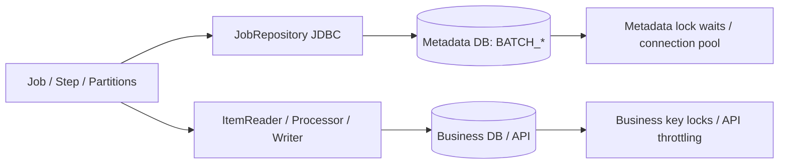
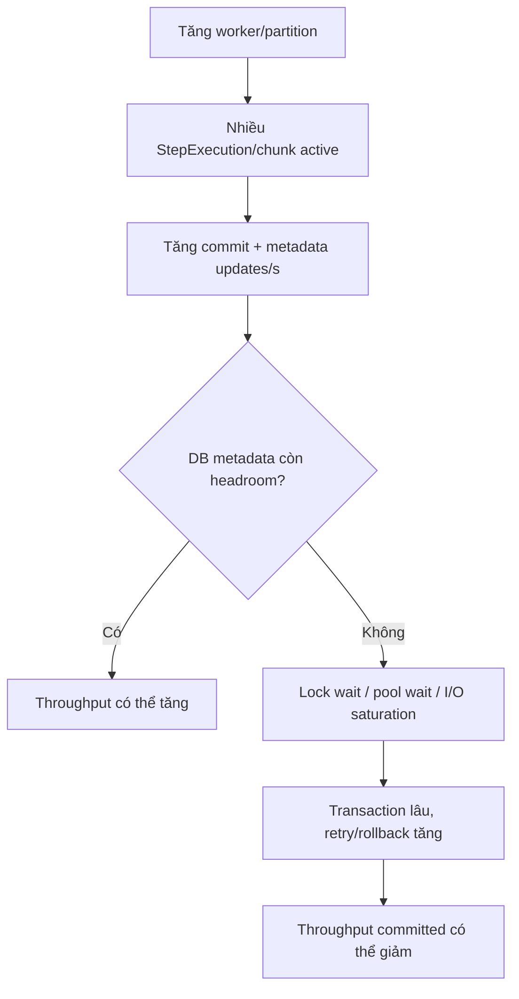
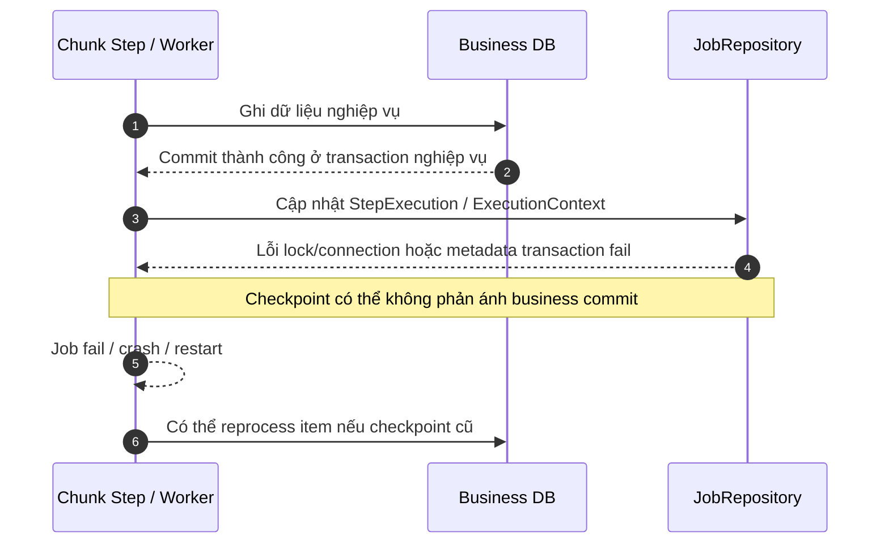

# Lock contention trong job lớn: nhận diện và tối ưu JobRepository

Một Spring Batch job có thể đọc và ghi dữ liệu nghiệp vụ rất nhanh nhưng **chậm lại ở bước cập nhật metadata**. Khi nhiều chunk, step, partition hoặc launcher cùng truy cập JDBC `JobRepository`, các transaction có thể tranh nhau khóa trên bảng `BATCH_*`; một số phải chờ, timeout hoặc bị database chọn rollback. Tăng số worker trong tình huống ấy đôi khi làm thời gian hoàn thành job **dài hơn**.

Bài thuộc chương **JobRepository** của module **SPRING_BATCH_SCALING_OPERATIONS**. Nội dung tập trung vào *lock contention trong job lớn*: phân biệt lock của metadata với lock của bảng nghiệp vụ, xác định transaction và câu SQL gây nghẽn, hiểu tác động của chunk size/parallelism/partitioning, đo trên database thật và chọn biện pháp giảm tranh chấp **mà không phá checkpoint hoặc restart**.

Sau bài học, bạn cần trả lời được: *“Job chậm vì pool hết connection, database đợi khóa, optimistic locking, hay writer nghiệp vụ?”* và *“Giảm tranh chấp bằng thay đổi nào, với bằng chứng nào?”*. Đặc biệt, không được “sửa” vấn đề bằng cách tắt metadata update hoặc cập nhật trực tiếp trạng thái bảng repository.

## 1. Lock contention là gì?

**Lock contention** xảy ra khi nhiều transaction cần một tài nguyên có cơ chế khóa không tương thích, nên một hoặc nhiều transaction phải đợi. Trong database, tài nguyên có thể là row, index/key, bảng, range hoặc cấu trúc nội bộ khác. Lock contention **không đồng nghĩa deadlock**:

| Hiện tượng | Cách nhận diện | Ý nghĩa |
| --- | --- | --- |
| Lock wait | Transaction chờ transaction khác trả lock | Có thể tự hoàn tất nếu transaction giữ lock commit sớm |
| Lock timeout | Chờ khóa quá ngưỡng policy | Một thao tác lỗi, không chứng minh có vòng chờ |
| Deadlock | Nhiều transaction chờ nhau theo chu trình | Database thường hủy một victim để phá vòng |
| Serialization failure | Database không thể cho transaction commit theo isolation yêu cầu | Có thể cần retry toàn transaction, không nhất thiết là deadlock |
| Optimistic locking conflict | Row metadata có `VERSION` khác lúc update | Kiểm tra phiên bản phát hiện thay đổi đồng thời; không phải lúc nào cũng do lock wait |

Ví dụ, hai partition đang ghi đồng thời vào bảng thống kê nghiệp vụ có thể tranh khóa ở **database đích**. Trong khi đó, hai thread cập nhật cùng `StepExecution` có thể va chạm ở **JobRepository**. Hai nguồn tranh chấp này có cách sửa khác nhau.

## 2. JobRepository cần ghi metadata ở những thời điểm nào?

Với JDBC repository, Spring Batch dùng các bảng metadata như sau:

| Bảng | Lưu thông tin | Thời điểm thường truy cập |
| --- | --- | --- |
| `BATCH_JOB_INSTANCE` | Logical JobInstance theo tên job và identifying parameters | Tạo/truy xuất instance khi launch/restart |
| `BATCH_JOB_EXECUTION` | Trạng thái một lần chạy job | Launch, chuyển trạng thái, kết thúc |
| `BATCH_JOB_EXECUTION_PARAMS` | JobParameters của execution | Tạo/tra cứu execution |
| `BATCH_STEP_EXECUTION` | Status, counters, version và thời gian của step | Tạo step, commit/checkpoint, kết thúc |
| `BATCH_JOB_EXECUTION_CONTEXT` | State checkpoint cấp job | Lưu/đọc context |
| `BATCH_STEP_EXECUTION_CONTEXT` | State checkpoint của step | Định kỳ cập nhật ở các ranh giới phù hợp |

Số transaction và câu SQL **không cố định một-một** theo số chunk trên mọi cấu hình: nó phụ thuộc loại step, transaction manager, reader, `ExecutionContext`, listener và cách tổ chức hạ tầng.

Trong chunk-oriented step thông dụng, cập nhật trạng thái `StepExecution` và context thường gắn với các ranh giới commit. Vì vậy, **chunk size nhỏ có thể tạo nhiều lần ghi metadata hơn**, còn nhiều step/partition đồng thời tạo nhiều điểm truy cập repository cùng lúc.

Nhưng **không phải mọi commit đều tranh cùng một row**. Mỗi partition có `StepExecution` riêng; chúng có thể ghi các row khác nhau dù cùng bảng, trong khi các tình huống khác có thể tập trung nhiều cập nhật vào một execution. Phải đo thực tế trước khi gọi bảng `BATCH_STEP_EXECUTION` là “hot row”.

## 3. Hai loại tranh chấp phải được tách biệt

Trong một job dữ liệu lớn, sự cố có thể ở hai đường:



| Câu hỏi | Metadata contention | Business-data contention |
| --- | --- | --- |
| Query bị chặn thuộc đâu? | `BATCH_*` hoặc schema metadata | Bảng đơn hàng, số dư, báo cáo, downstream |
| Ai giữ khóa? | Launcher/step/repository metadata transaction | Writer/reader, giao dịch online hoặc worker khác |
| Mất điều gì nếu update thất bại? | Status, counters, checkpoint có thể không cập nhật đúng | Business write/side effect có thể rollback hoặc bất định |
| Tối ưu quan trọng | Metadata transaction, update frequency, sizing, concurrency | SQL/index, business key, isolation, chunk size, lock ordering |
| Có thể sửa bằng giảm isolation create không? | Chỉ khi xác nhận contention tại `create*` | Thường **không** |

Cũng có trường hợp cả hai xảy ra đồng thời vì repository và writer dùng **cùng database/pool**. Khi đó phải quan sát **SQL thực tế, DB sessions và transaction boundary**, không chỉ tên class trên exception stack trace.

## 4. Tại sao job càng nhiều worker lại càng dễ nghẽn?

Tăng worker có thể làm ba đại lượng tăng:

1. **Số transaction thực thi đồng thời**, từ các thread/step/partition.
2. **Tốc độ commit/checkpoint**, nếu tổng throughput item tăng.
3. **Số kết nối database và câu SQL đồng thời** tới JobRepository, nguồn và đích.

Nhưng CPU, I/O, WAL/redo log, số connection và khả năng xử lý lock của DB không tự tăng theo số JVM.



Một công thức planning đơn giản:

\[
\text{metadata write demand}\ \propto\
\text{active steps}\times\text{checkpoint rate per step}
\]

Đây chỉ là **quan hệ định tính**, không phải công thức đo số SQL thực tế. Listener và repository implementation có thể bổ sung các thao tác khác.

**Tăng concurrency có ích khi thêm công suất xử lý hữu ích lớn hơn chi phí tranh chấp.** Nếu JobRepository đã bão hòa, tăng worker có thể làm *committed items per second* giảm mặc dù mỗi thread trông vẫn bận.

## 5. “Hot row” trong metadata: hiểu đúng StepExecution

Một `StepExecution` lưu `readCount`, `writeCount`, `commitCount`, `rollbackCount`, `VERSION` và các trạng thái khác. Nếu nhiều luồng cập nhật **cùng bản ghi StepExecution** bằng các phiên bản hoặc timing không nhất quán, có thể xuất hiện:

- Row lock waits vì transaction khác đang update row.
- `OptimisticLockingFailureException` khi update dựa vào `VERSION` cũ.
- Counters không phản ánh điều người vận hành kỳ vọng nếu code custom cùng sửa state thiếu đồng bộ.
- Commit latency tăng khi một transaction giữ lock quá lâu.

Trường hợp cần thận trọng là **multi-threaded step**: nhiều chunk có thể hoạt động đồng thời trong cùng một logical step. Spring Batch có cơ chế quản lý metadata, nhưng **các bean custom và listener không được tùy tiện sửa cùng `StepExecution` hoặc `ExecutionContext` từ nhiều thread**.

Trong **partitioning**, mỗi partition thường có StepExecution riêng:

```text
managerStep
  managerStep:partition0  -> StepExecution ID 901
  managerStep:partition1  -> StepExecution ID 902
  managerStep:partition2  -> StepExecution ID 903
  managerStep:partition3  -> StepExecution ID 904
```

Điều này giúp tách metadata theo đơn vị việc. Tuy nhiên, số partition rất lớn vẫn làm tăng tổng số records, metadata operations, transaction/connection demand và công việc tổng hợp; **không thể kết luận partitioning luôn không tranh khóa metadata**.

## 6. Lock wait, deadlock và optimistic locking không phải một lỗi

| Tín hiệu | PostgreSQL/JDBC/Spring thường thấy | Hướng điều tra |
| --- | --- | --- |
| Deadlock | PostgreSQL SQLSTATE `40P01`, `DeadlockLoserDataAccessException` hoặc exception tương ứng tùy translator | Đọc deadlock graph/server logs, tìm thứ tự lock |
| Serialization failure | PostgreSQL SQLSTATE `40001` | Kiểm tra isolation/transaction và retry toàn transaction đúng cách |
| Lock not available | PostgreSQL `55P03` (ví dụ `NOWAIT`/lock timeout theo ngữ cảnh) | Xác định transaction giữ lock và deadline |
| Statement canceled | PostgreSQL `57014` có thể do statement timeout/cancel | Không suy là deadlock nếu chưa đọc cause |
| Optimistic lock conflict | `OptimisticLockingFailureException` liên quan metadata `VERSION` | Xác định ai cập nhật cùng execution/version |
| Không lấy được connection | Hikari connection acquisition timeout, exception lấy DataSource connection | Kiểm tra `active/pending/max` và DB connection budget |

Tên Java exception cụ thể tùy Spring Framework, JDBC driver, ORM và translator. **Không retry mọi `DataAccessException` như deadlock**. Một lỗi unique constraint hoặc cấu hình sai sẽ không tự khỏi chỉ vì chờ thêm vài trăm millisecond.

Một `OptimisticLockingFailureException` **có thể không cần chờ khóa đáng kể**: transaction khác đã commit phiên bản mới trước khi mình update. Ngược lại, transaction có thể chờ khóa mà sau đó update thành công. Hai hiện tượng cần metric và hành động khác nhau.

## 7. Transaction isolation cho nhóm create* không quyết định mọi lock

Trong JDBC `JobRepository` Spring Batch 5.x, nhóm phương thức **tạo** metadata thường được cấu hình với `isolationLevelForCreate`, mặc định hay dùng `SERIALIZABLE`. Mục đích quan trọng là bảo vệ việc hai launcher cùng tạo một `JobInstance` cho cùng identifying `JobParameters`.

Nhưng:

- `createJobExecution(...)` không phải mọi `updateStepExecution(...)`.
- Mức isolation của transaction tạo metadata **không tự áp dụng** cho transaction writer nghiệp vụ.
- Hạ isolation create **không phải cách sửa mặc định** cho lock wait khi hàng nghìn chunk cập nhật StepExecution.
- `SERIALIZABLE` không có nghĩa không xảy ra lỗi; database có thể abort một transaction để bảo toàn tính tuần tự hóa.

Nếu log cho thấy lỗi ở thời điểm nhiều scheduler cùng launch job, hãy điều tra **duplicate trigger**, JobParameters định danh, giao dịch create và schema unique constraints. Nếu lỗi xuất hiện suốt giai đoạn xử lý chunk, cần phân tích đường metadata update hoặc database nghiệp vụ.

**Không thay `SERIALIZABLE` bằng `READ_UNCOMMITTED` chỉ để giảm lock.** Mức cô lập phải được chọn dựa trên semantics repository, DB vendor và integration test concurrent launch.

## 8. Chu kỳ commit và số lần ghi metadata

Giả sử `N` item được xử lý theo chunk size `C`, số chunk lý tưởng khoảng:

\[
M_{\mathrm{chunk}}=
\left\lceil\frac{N}{C}\right\rceil
\]

Ví dụ với **6.000.000 item**:

| Chunk size | Số chunk xấp xỉ | Tác động có thể có |
| ---: | ---: | --- |
| 20 | 300.000 | Nhiều transaction/checkpoint và metadata overhead |
| 100 | 60.000 | Giảm số lần cập nhật so với chunk 20 |
| 500 | 12.000 | Ít commits hơn, transaction dài hơn |
| 2.000 | 3.000 | Metadata nhẹ hơn nhưng tăng rollback/lock duration, memory và restart replay |

Nếu số thao tác metadata trên mỗi chunk gần tương đương, chuyển từ `C=20` sang `C=500` có thể giảm **số chu kỳ checkpoint khoảng 25 lần**. Không được suy rằng **thời gian job giảm 25 lần**, vì chi phí đọc/ghi nghiệp vụ, locks, nguồn/đích và tail latency vẫn có thể chi phối.

**Đánh đổi:** Chunk lớn khiến business transaction giữ khóa lâu hơn và một lần rollback phải xử lý lại nhiều item hơn. Tăng chunk size để giảm repository writes có thể làm deadlock ở business DB **tăng**. Tuning phải đo cả hai phía.

### Với remote chunking

Manager tạo ChunkRequest từ dữ liệu đã đọc và tổng hợp reply; số request/chunk cũng phụ thuộc chunk size. Worker có thể không có một StepExecution riêng cho từng request. **Không dùng số message broker làm số metadata rows cần tạo.**

### Với remote partitioning

Mỗi partition thường có StepExecution riêng và có thể thực thi nhiều chunk; tăng số partition tăng số bước phải theo dõi, trong khi giảm chunk size làm tăng tần suất commit/update bên trong từng partition.

## 9. Concurrency: gridSize khác số thread đang chạy

Trong partitioning, `gridSize` thường được truyền cho `Partitioner.partition(gridSize)` để gợi ý cách chia dữ liệu. **Số partition được tạo** phụ thuộc code partitioner; **số partition đang chạy đồng thời** phụ thuộc local executor hoặc số remote workers sẵn có.

Ví dụ:

- `gridSize=32`, partitioner tạo 32 partition.
- Local `ThreadPoolTaskExecutor` giới hạn tối đa 8 thread worker.
- Ở một thời điểm có thể chỉ có 8 partition đang xử lý, dù metadata đã có 32 partition StepExecution.

Ở remote partitioning, 32 partition có thể được phân phối cho số worker JVM và concurrency khác nhau. Pool metadata là tài nguyên **trên từng JVM** và tổng kết nối phải tính trên toàn cluster.

Nếu mỗi partition chứa ít item nhưng tạo một StepExecution riêng, số partition quá lớn sẽ sinh thêm overhead khởi tạo/tổng hợp. Nếu partition quá lớn và data skew, một partition chậm có thể quyết định thời gian hoàn tất. **Cần cân bằng phân phối dữ liệu, số phần việc và năng lực repository**, không chỉ đặt gridSize theo số CPU.

## 10. Ví dụ Spring Batch 5.x: chunk step và local partition manager

Cấu hình lõi chunk-oriented step:

```java
import org.springframework.batch.core.Step;
import org.springframework.batch.core.repository.JobRepository;
import org.springframework.batch.core.step.builder.StepBuilder;
import org.springframework.batch.item.ItemProcessor;
import org.springframework.batch.item.ItemReader;
import org.springframework.batch.item.ItemWriter;
import org.springframework.context.annotation.Bean;
import org.springframework.transaction.PlatformTransactionManager;

@Bean
public Step orderWorkerStep(
        JobRepository jobRepository,
        PlatformTransactionManager businessTxManager,
        ItemReader<OrderInput> reader,
        ItemProcessor<OrderInput, OrderOutput> processor,
        ItemWriter<OrderOutput> writer) {

    return new StepBuilder("orderWorkerStep", jobRepository)
            .<OrderInput, OrderOutput>chunk(200, businessTxManager)
            .reader(reader)
            .processor(processor)
            .writer(writer)
            .build();
}
```

Commit interval ở đây là **200**, nhưng không trực tiếp quy định JobRepository phải giữ đúng một connection/200 item. Điều đó phụ thuộc transaction scope, repository transaction manager và reader/processor/writer.

Local partitioning cho cùng worker step, với số thread hữu hạn:

```java
import org.springframework.batch.core.Step;
import org.springframework.batch.core.repository.JobRepository;
import org.springframework.batch.core.step.builder.StepBuilder;
import org.springframework.batch.core.partition.support.Partitioner;
import org.springframework.beans.factory.annotation.Qualifier;
import org.springframework.context.annotation.Bean;
import org.springframework.core.task.TaskExecutor;

@Bean
public Step orderPartitionManager(
        JobRepository repository,
        Partitioner orderPartitioner,
        @Qualifier("orderWorkerStep") Step orderWorkerStep,
        @Qualifier("partitionExecutor") TaskExecutor executor) {

    return new StepBuilder("orderPartitionManager", repository)
            .partitioner("orderWorkerStep", orderPartitioner)
            .step(orderWorkerStep)
            .gridSize(16)
            .taskExecutor(executor)
            .build();
}
```

Có thể dùng một `ThreadPoolTaskExecutor` **bounded**:

```java
import org.springframework.context.annotation.Bean;
import org.springframework.scheduling.concurrent.ThreadPoolTaskExecutor;
import org.springframework.core.task.TaskExecutor;

@Bean(name = "partitionExecutor")
public TaskExecutor partitionExecutor() {
    ThreadPoolTaskExecutor executor = new ThreadPoolTaskExecutor();
    executor.setCorePoolSize(4);
    executor.setMaxPoolSize(8);
    executor.setQueueCapacity(16);
    executor.setThreadNamePrefix("partition-");
    executor.initialize();
    return executor;
}
```

Các đoạn Java trên là cấu hình **trọng tâm**; ứng dụng thật phải định nghĩa `OrderInput/OrderOutput`, `Partitioner`, StepScoped reader, DataSource/TM, Job và dependencies. Một partitioner tốt gán context theo range/file/tenant không chồng lấn; nếu reader giữ state, dùng `@StepScope` để mỗi StepExecution có instance phù hợp.

**Tại sao ví dụ hữu ích cho lock contention?** Nó cho phép thay đổi **một biến** là concurrency pool (4/8) mà không sinh worker vô hạn. Bắt đầu benchmark với ít thread rồi tăng dần, đo metadata DB trước khi mở rộng tiếp.

## 11. Tách contention của metadata khỏi cạn connection pool

Một tình huống thường gây nhầm lẫn:

```text
JobRepository.update(stepExecution)
    -> lấy connection từ pool
    -> UPDATE BATCH_STEP_EXECUTION
    -> chờ transaction khác giải phóng lock
    -> commit / timeout
```

Nếu mỗi transaction giữ connection khi chờ lock, số connection **active** có thể tăng và số thread **pending** sau đó cũng tăng. Người vận hành thấy Hikari pool timeout nhưng nguyên nhân khởi đầu là **SQL/transaction bị chặn**, không phải đơn giản pool cấu hình quá nhỏ.

| Chỉ số | Khi pool quá nhỏ nhưng DB còn dư địa | Khi metadata DB bị lock/SQL chậm |
| --- | --- | --- |
| Hikari `active` sát `max` | Có thể | Có thể |
| Hikari `pending` tăng | Có thể | Có thể |
| Acquisition latency tăng | Có thể | Có thể |
| Connection usage/hold time tăng | Không bắt buộc | Thường có |
| DB lock wait, blocked sessions | Thường thấp | Có thể tăng rõ |
| DB CPU/IO/transaction latency | Thường còn headroom | Có thể cao |
| Tăng pool có cải thiện? | Có thể nếu DB chịu được | Có thể không, thậm chí tệ hơn |

Không nên điều chỉnh `maximumPoolSize` trước khi trả lời **“connection bị giữ để làm gì?”**. Nếu có nhiều session `idle in transaction`, xem code transaction/listener và lock lifetime. Nếu có SQL `UPDATE BATCH_*` đang chờ, xác định **blocking PID** và query của blocker.

## 12. PostgreSQL: xác định blocking sessions

Nếu JobRepository dùng PostgreSQL, bắt đầu từ `pg_stat_activity` và `pg_blocking_pids(...)`.

```sql
SELECT
    a.pid AS blocked_pid,
    a.application_name AS blocked_app,
    a.state AS blocked_state,
    a.wait_event_type,
    a.wait_event,
    a.query_start AS blocked_since,
    pg_blocking_pids(a.pid) AS blocking_pids,
    LEFT(a.query, 180) AS blocked_query
FROM pg_stat_activity AS a
WHERE cardinality(pg_blocking_pids(a.pid)) > 0
ORDER BY a.query_start;
```

Truy vấn cung cấp **snapshot của sessions đang bị chặn**. Sau khi database rollback một deadlock victim, vòng chờ có thể biến mất; cần server logs để phân tích lịch sử.

Khi cần biết blocker đang làm gì:

```sql
SELECT
    blocked.pid AS blocked_pid,
    blocked.application_name AS blocked_app,
    blocker.pid AS blocker_pid,
    blocker.application_name AS blocker_app,
    blocker.state AS blocker_state,
    blocker.xact_start AS blocker_transaction_started,
    NOW() - blocker.xact_start AS blocker_transaction_age,
    LEFT(blocked.query, 160) AS blocked_query,
    LEFT(blocker.query, 160) AS blocker_query
FROM pg_stat_activity AS blocked
CROSS JOIN LATERAL unnest(pg_blocking_pids(blocked.pid))
    AS waiting(blocker_pid)
JOIN pg_stat_activity AS blocker
    ON blocker.pid = waiting.blocker_pid
ORDER BY blocker.xact_start NULLS LAST;
```

Quan sát:

- `blocked.query` có phải `UPDATE BATCH_STEP_EXECUTION` hay bảng nghiệp vụ?
- `blocker.query` có là câu metadata SQL, SELECT dùng lock, hay một câu nghiệp vụ?
- Blocker đang chạy hay **idle in transaction**?
- Transaction blocker đã giữ lock bao lâu, và code path nào tạo nó?
- Các sessions thuộc cùng service hay một ứng dụng/dashboard khác?

**Đừng lập tức terminate PID trên production.** Killing một transaction có thể rollback một chuỗi thay đổi, làm step FAILED hoặc làm worker khác retry. Hãy phối hợp DBA và runbook nếu thật sự cần can thiệp.

**Bảo mật:** Nội dung `query` có thể chứa dữ liệu nhạy cảm. Giới hạn quyền xem, masking và retention khi trích xuất log.

## 13. PostgreSQL: đếm deadlock và xem tình trạng transaction

Xem counters cấp database:

```sql
SELECT
    datname,
    xact_commit,
    xact_rollback,
    deadlocks,
    temp_files,
    blks_read,
    blks_hit,
    stats_reset
FROM pg_stat_database
WHERE datname = current_database();
```

`deadlocks` là số deadlock đã được database phát hiện tính từ `stats_reset`, **không phải số deadlock riêng Spring Batch**. Nó cũng không cho biết transaction nào bị chọn làm victim hoặc bảng nào là nguồn contention. Kết hợp với logs có SQLSTATE và trace của job.

Tìm sessions có transaction tồn tại lâu:

```sql
SELECT
    pid,
    application_name,
    state,
    NOW() - xact_start AS transaction_age,
    wait_event_type,
    wait_event,
    LEFT(query, 160) AS query_sample
FROM pg_stat_activity
WHERE datname = current_database()
  AND xact_start IS NOT NULL
ORDER BY xact_start;
```

Khi nhiều transaction giữ lock lâu, nên xem SQL execution plan, trigger/index, transaction scope và listener gọi I/O bên ngoài. Không tự tăng lock timeout/statement timeout vô hạn chỉ để che hiện tượng.

Nếu bật `log_lock_waits` và logging lỗi theo quy tắc DBA, có thể xác định một số giao dịch chờ khóa dài. Tránh bật logging quá rộng trên tải cao khiến log volume làm DB/I/O nặng thêm.

## 14. Phân tích lock trên bảng metadata mà không làm sai dữ liệu

Có thể thống kê số lock liên quan quan hệ `BATCH_*` để định hướng, ví dụ PostgreSQL:

```sql
SELECT
    c.relname AS relation_name,
    l.mode AS lock_mode,
    l.granted,
    COUNT(*) AS lock_count
FROM pg_locks AS l
JOIN pg_class AS c
  ON c.oid = l.relation
WHERE c.relname LIKE 'batch_%'
GROUP BY c.relname, l.mode, l.granted
ORDER BY lock_count DESC;
```

**Giới hạn của truy vấn:** Lock trên bảng theo mức mode không chứng minh row-level conflict; trong PostgreSQL, row locks thường không hiện thành một entry cho từng row trong `pg_locks`. Relation name có thể đã được viết hoa/đổi schema/prefix, nên filter `batch_%` chỉ hợp nếu schema của bạn dùng tên chữ thường tương ứng.

Nếu `pg_stat_statements` được cài đặt và có quyền truy cập, nó giúp đo frequency/total execution time của query metadata. Không dùng extension này làm lý do tự thay cấu hình database production khi chưa có phê duyệt vận hành.

### Không dùng SELECT FOR UPDATE tùy tiện để “xác minh khóa”

Một câu `SELECT ... FOR UPDATE` trên `BATCH_STEP_EXECUTION` **chính nó có thể tạo contention**, nhất là chạy trong transaction kéo dài. Để quan sát nên ưu tiên database monitoring views/logs, tránh tạo lock mới trên row metadata đang được job dùng.

### Không sửa trực tiếp BATCH_*

Các bảng metadata có `VERSION` và lifecycle riêng của Spring Batch. Không làm `UPDATE BATCH_STEP_EXECUTION SET VERSION=...` hoặc sửa `STATUS` để xóa lỗi optimistic locking. Làm thế có thể phá khả năng restart và tạo hai worker cùng xử lý một logical step.

## 15. Phân biệt contention do khởi chạy với contention lúc chạy chunk

Có hai thời điểm khác nhau:

| Thời điểm | Metadata thường truy cập | Dạng tranh chấp cần lưu ý |
| --- | --- | --- |
| Nhiều scheduler cùng launch | `JOB_INSTANCE`, `JOB_EXECUTION`, parameters | Race check/create cùng identifying params, unique constraint, SERIALIZABLE conflict |
| Nhiều step/partition được khởi tạo | `STEP_EXECUTION`, context | Burst insert/update, connection demand |
| Hàng nghìn chunk đang commit | `STEP_EXECUTION` counters/version, context | Update/checkpoint rate, SQL latency, transaction overlap |
| Manager tổng hợp partition/step | StepExecution status/exit code | Aggregation delay, nhiều metadata reads/updates |
| Restart sau failure | JobExecution/StepExecution/context reads và create | Trạng thái incomplete, stale execution, tranh chấp với worker cũ |
| Dashboard polling | JobExplorer và query metadata | Read load, connection/CPU/I/O pressure |

**Khi chỉ thấy lỗi lúc launch**, không nên giảm chunk size hoặc tăng số partition để “giảm lock”. **Khi chỉ thấy lỗi lúc commit**, hạ `isolationLevelForCreate` thường không liên quan.

Nguyên tắc: ghi lại method call/SQL operation và thời điểm của incident, rồi mới chọn tham số được phép thay đổi.

## 16. Các anti-pattern làm transaction metadata dài hơn cần thiết

Những sai lầm đáng kiểm tra trong code mở rộng Spring Batch:

- Gọi remote HTTP/API **bên trong** transaction đang giữ connection mà không có deadline.
- Listener thực hiện SQL phức tạp hoặc I/O nặng ngay tại commit checkpoint.
- Trộn transaction manager metadata với transaction manager nghiệp vụ ngoài ý muốn.
- Bao cả `JobLauncher.run(...)` trong một outer `@Transactional` kéo dài.
- Custom DAO gọi `SELECT ... FOR UPDATE` trên bảng `BATCH_*`.
- Nhiều thread cùng sửa mutable `ExecutionContext` hoặc cùng một `StepExecution` không có thiết kế rõ ràng.
- Tăng `gridSize` đến hàng chục nghìn partition cực nhỏ mà không benchmark repository.
- Dashboard truy vấn JobRepository quá thường xuyên hoặc thực hiện full scans trên lịch sử khổng lồ.

Ví dụ anti-pattern dạng khái niệm:

```java
// PHẢN VÍ DỤ: chạy network call chậm trong outer business transaction.
@Transactional
public void updateOrderAndNotify(long id) {
    orderDao.markPending(id);
    remoteNotificationClient.send(id); // Có thể mất nhiều giây.
    orderDao.markComplete(id);
}
```

Nếu transaction giữ database connection/locks từ lệnh update đầu đến cuối, mạng chậm làm tăng lock lifetime. Đây có thể là **business DB contention**, không phải metadata; nhưng nếu hạ tầng dùng chung pool/DB, nó còn làm repository thiếu tài nguyên.

Cách sửa cần giữ **invariant nghiệp vụ**, có thể dùng transactional outbox, tách network call và một workflow idempotent, không đơn giản xóa `@Transactional` khi chưa xét consistency.

## 17. Chọn biện pháp theo bằng chứng

| Bằng chứng | Giải pháp nên đánh giá | Không nên làm ngay |
| --- | --- | --- |
| Create job cùng identity bị tranh chấp | Scheduler dedup, unique constraints, test isolation create | Tự tăng run.id để né already-running |
| `UPDATE BATCH_STEP_EXECUTION` chờ lock lâu | Tìm blocker/transaction duration, giảm cập nhật cạnh tranh custom, đo commit rate | Tắt lưu context hoặc sửa VERSION |
| Mỗi chunk commit tốn metadata time đáng kể | Benchmark chunk size hợp lý, giảm excess listeners/polling | Tăng chunk size cực lớn bất chấp rollback |
| Nhiều partition nhỏ, overhead vượt xử lý | Chia phần việc lớn hơn, giới hạn active partitions | Tăng gridSize thêm |
| Pool pending cao, DB còn dư địa | Cân nhắc pool sizing/tách pool và giới hạn HPA | Giả định mọi timeout là lock contention |
| Pool pending cao, DB lock/CPU cũng cao | Tối ưu transaction/SQL/concurrency trước | Tăng maximumPoolSize vô hạn |
| Optimistic locking do sửa StepExecution chung | Cô lập state, không update cùng execution ngoài framework | Retry Exception.class mọi nơi |
| Business table deadlock | Lock ordering, key partitioning, short transactions, retry writer hợp lệ | Chỉ hạ isolation create của JobRepository |
| DBA thấy old historical metadata rất lớn | Kiểm tra indexes, query plan, archival/retention có quy trình | DELETE bừa bảng BATCH_* đang chạy |

**Không có biện pháp đơn lẻ giải quyết mọi loại contention.** Mỗi thay đổi nên đi kèm một giả thuyết đo được: “Giảm active partitions từ 24 xuống 12 để giảm 40% lock wait P95 trong khi throughput committed không giảm quá 10%”, rồi xác minh bằng benchmark.

## 18. Tăng chunk size có thể giảm metadata contention nhưng tăng rủi ro khác

Hãy xét cùng 6 triệu item, reader và writer mỗi item có chi phí gần ổn định. Ta muốn từ 300.000 chunk (size 20) xuống 12.000 chunk (size 500).

**Lợi ích có thể đo:**

- Ít lần commit/checkpoint hơn.
- Giảm số cập nhật counters/context, nếu cấu hình lưu state tương tự.
- Giảm transaction setup/teardown và roundtrip của metadata, nguồn, đích.
- Có thể giảm contention ở một số bảng metadata.

**Đánh đổi:**

- Transaction nghiệp vụ giữ nhiều khóa hơn và lâu hơn.
- Worker thất bại ở item thứ 499 có thể rollback nhiều công việc hơn.
- Reader/page state, memory và buffer writer tăng.
- Restart có thể phải tái xử lý nhiều item chưa được commit.
- Với remote chunking, message chứa nhiều item hơn và có thể vượt giới hạn broker.
- Với hot business keys, chunk lớn có thể làm deadlock/lock wait **tăng**.

Tối ưu nên chọn **chunk size theo phép đo cả metadata và business DB**; nếu JobRepository đã nhanh nhưng writer chậm, tuning repository có thể không đem lại lợi ích.

Một lựa chọn khác là partition theo business key và giữ chunk vừa phải để tránh nhiều worker ghi cùng aggregate. Việc chia theo source ID không bảo đảm đích không trùng hot key.

## 19. Lock contention và retry/restart: failure windows phải được kiểm thử

Một cập nhật metadata thất bại không đồng nghĩa business write chưa xảy ra.



Sơ đồ minh họa một **kiến trúc mà transaction metadata và business tách rời**, ví dụ dùng hai DataSource/transaction managers. Trong cấu hình dùng **chung transaction JDBC đúng cách**, một số cập nhật dữ liệu và metadata có thể được commit/rollback cùng nhau; không được suy rằng sơ đồ là lịch sự kiện bắt buộc của mọi chunk step.

Dù dùng chung database, luôn phải xác minh transaction propagation và resource enlistment thật. Với API HTTP, broker hoặc hai DB riêng, không có ACID toàn cục mặc định.

**Quy tắc an toàn:**

1. Business operation có idempotency key ổn định qua retry/restart.
2. Writer/processor không tạo side effect trùng khi chunk replay.
3. Reader có checkpoint/sort key ổn định và nguồn dữ liệu có snapshot/watermark khi cần.
4. Không replay partition nếu worker cũ có thể vẫn đang xử lý cùng StepExecution.
5. Retry deadlock/serialization failure phải chạy lại **đúng transaction scope** sau rollback, không thử SQL trong transaction đã abort.
6. Dùng JobRepository lifecycle để restart; không sửa `STARTED/FAILED/COMPLETED` bằng SQL thủ công.

### Retry lỗi repository khác retry lỗi writer

`.faultTolerant().retry(...)` trong một chunk step được thiết kế cho các lỗi read/process/write theo semantics framework. Nó **không tự bảo đảm** rằng mọi lỗi ở DAO metadata/interceptor ngoài vòng xử lý item đều có thể được thử lại theo cùng retry policy. Cần phân tích error boundary và dùng cơ chế recovery phù hợp với version hạ tầng đang chạy.

## 20. Khả năng khôi phục khi StepExecution vẫn STARTED sau sự cố

Trong cluster, worker có thể chết hoặc mất kết nối trước khi cập nhật metadata cuối cùng. Repository còn `STARTED` không đủ để kết luận “worker đang chạy thật”; nhưng cũng không được tự hiểu “worker chắc chắn chết”.

Cần kiểm tra:

- JobExecution ID, StepExecution ID, node/worker logs và timestamps.
- JobLauncher/manager còn sống không, worker đang chạy/chờ mạng hay đã mất kết nối?
- Broker còn request in-flight/queued/replied chưa?
- DB nghiệp vụ đã commit đến operation ID/checkpoint nào?
- Có thể thực hiện restart cùng JobInstance theo chính sách Spring Batch hay cần thủ tục recovery do operator quản lý?

Nếu dùng remote partitioning, mỗi partition có StepExecution riêng; khi worker chết giữa chừng, phải tránh **hai worker đồng thời cập nhật cùng StepExecution** nếu chưa có cơ chế ownership/lease được thiết kế. Nếu dùng remote chunking, manager chịu trách nhiệm step/reply; thiếu `ChunkResponse` không chứng minh writer chưa ghi dữ liệu.

Đừng dùng trực tiếp `UPDATE BATCH_STEP_EXECUTION SET STATUS='COMPLETED'` để “đẩy nhanh tiến độ”: hành động này làm metadata mất liên hệ với dữ liệu thực và có thể phá restart.

## 21. Observability: dashboard tối thiểu để nhận diện metadata contention

Một dashboard hữu ích cần đặt các metrics cạnh nhau, tránh nhìn mỗi Hikari hoặc mỗi query time.

| Lớp | Metric | Câu hỏi |
| --- | --- | --- |
| Job | Job duration, active JobExecutions, SLA remaining | Job đang chậm thật hay chỉ một stage? |
| Step | `readCount/writeCount/commitCount/rollbackCount`, status | Progress và rollback tăng ở step nào? |
| Partition | Active partition count, execution duration, failed/stale partitions | Tail latency do skew hay contention? |
| JobRepository JDBC | Latency create/update/context writes, error categories | Metadata operations nào bị chặn? |
| Hikari pool | `active/idle/pending/max`, acquisition/usage/timeout | Pool starved hay connection bị giữ lâu? |
| Database | Lock waits, blocking PID, deadlock/serialization rate, CPU/IO | DB có đang tranh khóa hay bão hòa? |
| Business writer | Commit latency, deadlock, idempotency collisions | Nghẽn nằm ở đích nghiệp vụ? |
| Broker (remote) | Request/reply backlog, redelivery, oldest age | Hệ thống phân tán có đang chờ message? |

SQL xem StepExecution trong một JobExecution:

```sql
SELECT
    STEP_EXECUTION_ID,
    STEP_NAME,
    STATUS,
    VERSION,
    READ_COUNT,
    WRITE_COUNT,
    COMMIT_COUNT,
    ROLLBACK_COUNT,
    START_TIME,
    END_TIME,
    LAST_UPDATED
FROM BATCH_STEP_EXECUTION
WHERE JOB_EXECUTION_ID = :jobExecutionId
ORDER BY STEP_EXECUTION_ID;
```

**Không dùng `LAST_UPDATED` như heartbeat realtime duy nhất**: một chunk chạy lâu có thể chưa cập nhật state, và worker chết có thể để lại timestamp cũ. Query phục vụ đọc trạng thái, không phải chẩn đoán row lock trực tiếp.

Với Spring Boot/Actuator + Hikari/Micrometer khi đã bật metrics:

- `hikaricp.connections.active` và `hikaricp.connections.pending` cho trạng thái pool.
- `hikaricp.connections.acquire` và `hikaricp.connections.usage` cho thời gian chờ/giữ connection.
- `hikaricp.connections.timeout` báo checkout timeout.
- DB-specific lock wait/transaction duration cần lấy từ database monitoring.

Tag tên pool phải phân biệt metadata với business. Không đặt JobExecution ID/StepExecution ID vào mọi metric label nếu cardinality quá cao; dùng structured logs/traces cho định danh chi tiết.

## 22. Benchmark contention: đo đúng trước/sau khi scale

Bộ đo nên giữ cùng dataset và workload đại diện. Đặt ít nhất các cấu hình:

| Lần | Active workers/partitions | Chunk size | Điều muốn kiểm chứng |
| --- | ---: | ---: | --- |
| A | 1 | 100 | Baseline single-worker, không contention nội bộ |
| B | 4 | 100 | Scale ban đầu và metadata latency |
| C | 8 | 100 | Throughput tăng hay lock wait tăng? |
| D | 16 | 100 | Điểm DB/pool/lock bắt đầu bão hòa |
| E | 8 | 500 | Giảm checkpoint rate có giúp không? |
| F | 8 | 20 | So sánh commit overhead và recovery cost |
| G | 8 | 100 | Mô phỏng repository DB outage/restart |

Ghi **ít nhất**:

1. *Committed business items/s*, không chỉ items đọc.
2. *Job duration* và thời gian straggler partition cuối.
3. *Metadata SQL operation latency* P50/P95/P99, số calls/s.
4. *Lock wait/blocked sessions/deadlocks*, cộng optimistic locking conflicts.
5. Hikari *pending/active/acquisition P95/usage P95/timeout*.
6. DB CPU, I/O, connection count, WAL/redo log và resource pressure.
7. Output correctness: business key unique, item thiếu/trùng sau retry/restart.
8. Rollback counts, checkpoint progress, job/step statuses.

Thay **một biến mỗi lượt** rồi quan sát trong cùng điều kiện tải. Nếu tăng worker lên 16 nhưng throughput giảm còn 90% của 8 worker trong khi lock wait tăng gấp bốn, đó là tín hiệu cần sửa thiết kế/tranh chấp, không phải tăng retryLimit thêm.

## 23. Case study: 10 triệu giao dịch, metadata DB bị nghẽn

Một job đối soát có **10.000.000 giao dịch**, hạn xử lý 45 phút. Lúc đầu chạy local partitioning với 8 worker, chunk size 100. Sau khi tăng lên 32 worker, kết quả đo được:

| Chỉ số (giả định) | 8 worker | 32 worker |
| --- | ---: | ---: |
| Chunk size | 100 | 100 |
| Business throughput đã commit | 5.200 item/s | 4.100 item/s |
| JobRepository update P95 | 25 ms | 390 ms |
| Blocked metadata transactions (P95) | 1 | 14 |
| Hikari pending (P95) | 0 | 11 |
| DB CPU metadata | 48% | 92% |
| Step rollbackCount | Thấp | Tăng |
| Job duration xấp xỉ | 32 phút | 41 phút |

Đây là **số liệu minh họa**, không phải benchmark của Spring Batch.

**Câu hỏi 1 — Vì sao 32 worker chậm hơn?** Tổng số chunk commit/update metadata và transaction đồng thời tăng vượt headroom của DB; lock wait, pool wait và retries có thể ăn hết lợi ích xử lý song song. Cần xem blocker thật để xác định bao nhiêu phần là lock và bao nhiêu là CPU/I/O.

**Câu hỏi 2 — Tăng pool Hikari có chắc giúp?** Không. DB CPU đã 92% và blocked transactions cao; tăng pool có thể cho phép nhiều transaction cùng vào DB, làm tắc nặng hơn. Kiểm tra connection hold time, blocker và capacity trước.

**Câu hỏi 3 — Nếu đổi chunk size 100 thành 500?** Số chunk lý tưởng từ 100.000 xuống 20.000, có thể giảm overhead metadata khoảng năm lần **về số chu kỳ**, nhưng business transaction lớn hơn. Cần đo lock wait ở cả metadata và đích, retry cost và khả năng restart.

**Câu hỏi 4 — Có nên đổi isolationLevelForCreate từ SERIALIZABLE sang READ_COMMITTED?** Không có bằng chứng nghẽn ở launch/create. Lỗi phát sinh trong metadata updates khi xử lý chunk; hạ isolation create thường không trúng nguyên nhân.

**Câu hỏi 5 — Nếu sau giảm worker còn 12, throughput đạt 5.800 item/s nhưng SLA là 45 phút?** Yêu cầu throughput tối thiểu:

\[
R_{\mathrm{required}}=\frac{10.000.000}{45\times60}
\approx 3.704\text{ item/s}
\]

Ở 5.800 item/s, thời gian xử lý payload lý tưởng khoảng 28,7 phút. Điều kiện để đạt SLA thực tế còn startup, skew, retry, checkpoint, DB contention và validation; nên giữ headroom cho incident, không chỉ nhìn thời gian payload lý tưởng.

**Câu hỏi 6 — Sau lỗi metadata commit, có được đánh dấu StepExecution COMPLETED thủ công?** Không. Đối soát output, xác định worker thực sự đã dừng hay chưa, kiểm tra JobRepository/ExecutionContext và dùng cơ chế restart/recovery hợp lệ.

## 24. Runbook xử lý metadata lock contention

**Bước 1 — Khoanh vùng.** Ghi rõ job, StepExecution/JobExecution IDs, thời điểm tăng chậm, số worker/partition, chunk size, database/schema và SQLSTATE.

**Bước 2 — Xác nhận metadata hay nghiệp vụ.** Lấy query đang chờ và blocking PID; xem tên bảng `BATCH_*` hay business table; kiểm tra error chain.

**Bước 3 — Phân biệt lock, pool và optimistic locking.** Đo `pg_blocking_pids`, Hikari pending/usage, `VERSION` conflicts, CPU/IO.

**Bước 4 — Kiểm tra DB resource.** Connection budget toàn cluster, long transactions, deadlock rate, WAL/redo, index scans, slow queries và maintenance.

**Bước 5 — Ổn định hệ thống.** Giảm active workers/partition concurrency hoặc dashboard polling nếu thích hợp; không thay đổi nhiều biến cùng lúc khi job đang lỗi.

**Bước 6 — Xác định nguyên nhân cấu trúc.** Có custom code sửa `ExecutionContext` chung? Long transaction? Quá nhiều partition nhỏ? Chunk size quá bé? Hạ tầng dùng chung pool DB đang quá tải?

**Bước 7 — Lựa chọn biện pháp.** Tối ưu query/transaction, giới hạn concurrency, thiết kế lại partitioning, thay commit interval có kiểm chứng hoặc điều chỉnh pool/DB capacity khi còn headroom.

**Bước 8 — Đối soát trạng thái.** So JobRepository checkpoint với business operations; xác định remote workers/in-flight messages; không đổi status tay.

**Bước 9 — Test failure/restart.** Chạy thử DB outage, lock timeout, crash sau business commit và duplicate request trên môi trường cô lập.

**Bước 10 — Kết luận bằng số liệu.** Kiểm tra committed items/s, lock wait P95, JobRepository latency, SLA và output correctness đều cải thiện.

## 25. Những lỗi vận hành thường gặp

1. **Nghĩ mọi database deadlock đều thuộc JobRepository** mà không xem table/query.
2. **Đổi isolationLevelForCreate để sửa UPDATE StepExecution bị chặn**, nhầm hai transaction path.
3. **Tăng Hikari max khi DB đã bão hòa** và tạo thêm blocked sessions.
4. **Chỉ xem pool pending**, không xem connection usage/lock waits hoặc blocker.
5. **Coi optimistic locking conflict là lock timeout** rồi retry toàn job không kiểm soát.
6. **Dùng custom listener ghi BATCH_* trực tiếp**, bỏ qua VERSION/lifecycle.
7. **Lạm dụng SELECT FOR UPDATE trên metadata**, vô tình tạo thêm khóa.
8. **Tăng gridSize gấp nhiều lần nhưng giữ connection budget cũ**, overload metadata DB.
9. **Đặt chunk size cực nhỏ khi dữ liệu lớn**, overhead checkpoint/commit cao.
10. **Đặt chunk size cực lớn chỉ để giảm metadata write**, làm business transaction kéo dài.
11. **Không step-scope reader/state theo partition**, trùng/thiếu item khi restart.
12. **Để nhiều worker cùng cập nhật cùng StepExecution** do thiết kế ownership sai.
13. **Dùng remote partitioning nhưng mỗi worker có repository khác nhau**, mất trạng thái chia sẻ.
14. **Mất reply rồi replay chunk không đối soát**, business side effect bị trùng.
15. **Xem LAST_UPDATED như heartbeat chắc chắn**, kết luận sai worker đã chết.
16. **Xóa/truncate bảng metadata để tăng tốc job đang chạy**, phá checkpoint.
17. **Không theo dõi SLA trong benchmark**, tối ưu SQL P95 nhưng tổng job duration không tốt hơn.
18. **Không giữ baseline trước/sau**, không chứng minh được thay đổi concurrency có tác dụng.

## 26. Checklist thiết kế và giám sát trước production

- [ ] Xác định metadata tables, repository DataSource, transaction manager và DB engine/version.
- [ ] Tách rõ lock contention trên `BATCH_*` khỏi tranh chấp business DB/API.
- [ ] Có log SQLSTATE/vendor error code, phân biệt deadlock/serialization/lock timeout/optimistic conflict.
- [ ] Biết `isolationLevelForCreate` phục vụ tạo metadata, không phải mọi update/transaction.
- [ ] Giữ schema unique constraints và cột `VERSION` của JobRepository.
- [ ] Reader/processor/writer và custom listeners có thread safety khi tăng concurrency.
- [ ] Với partitioning, worker StepExecution/ExecutionContext riêng và ownership rõ ràng.
- [ ] Đã đo chunk size, commit rate, metadata SQL operations/s và transaction hold time.
- [ ] Có Hikari pool metrics theo tên metadata pool, DB lock wait và blocking PID.
- [ ] Tính giới hạn pool trên toàn cluster khi remote partitioning/HPA scale.
- [ ] Không điều chỉnh max pool hay retry limit khi DB đã bão hòa nếu chưa tìm nguyên nhân.
- [ ] Có benchmark ở nhiều concurrency/chunk sizes bằng dataset và workload tương đương.
- [ ] Có giới hạn active partitions và xử lý data skew/stragglers.
- [ ] Không thực thi SQL tùy tiện trực tiếp lên `BATCH_*` trong application/diagnostic.
- [ ] Writer bảo đảm idempotency hoặc có business reconciliation khi checkpoint/retry lệch.
- [ ] Đã kiểm thử deadlock, lock timeout, metadata outage, worker crash và restart.
- [ ] Không sửa status/VERSION trực tiếp để “mở khóa” StepExecution.
- [ ] Có runbook và điều kiện dừng/giảm tải dựa trên committed throughput, SLA và dữ liệu đúng.

## 27. Tài liệu tham khảo

- [Spring Batch Reference — Configuring a JobRepository](https://docs.spring.io/spring-batch/reference/job/configuring-repository.html): cấu hình metadata persistence, transaction isolation nhóm create.
- [Spring Batch Reference — Meta-Data Schema](https://docs.spring.io/spring-batch/reference/schema-appendix.html): bảng `BATCH_*`, counters, versioning và `ExecutionContext`.
- [Spring Batch Reference — Scaling and Parallel Processing](https://docs.spring.io/spring-batch/reference/scalability.html): multi-threaded steps, partitioning và remote chunking.
- [Spring Batch Reference — Transactions and Retry](https://docs.spring.io/spring-batch/reference/transaction-appendix.html): rollback, retry, transaction boundaries.
- [Spring Batch Reference — Step Execution](https://docs.spring.io/spring-batch/reference/domain.html): `JobExecution`, `StepExecution` và trạng thái.
- [Spring Batch 5.2 API — StepBuilder](https://docs.spring.io/spring-batch/docs/5.2.x/api/org/springframework/batch/core/step/builder/StepBuilder.html): cấu hình chunk và partitioning.
- [Spring Batch 5.2 API — JobRepository](https://docs.spring.io/spring-batch/docs/5.2.x/api/org/springframework/batch/core/repository/JobRepository.html): create/update và metadata lifecycle.
- [PostgreSQL — Explicit Locking](https://www.postgresql.org/docs/current/explicit-locking.html): row/table locks và deadlock.
- [PostgreSQL — Monitoring Database Activity](https://www.postgresql.org/docs/current/monitoring-stats.html): `pg_stat_activity`, `pg_locks` và `pg_stat_database`.
- [PostgreSQL — Error Codes](https://www.postgresql.org/docs/current/errcodes-appendix.html): SQLSTATE 40P01, 40001, 55P03 và 57014.
- [HikariCP — About Pool Sizing](https://github.com/brettwooldridge/HikariCP/wiki/About-Pool-Sizing): phân biệt tăng connections và tăng năng lực DB.
- [Spring Framework — Data Access Exceptions](https://docs.spring.io/spring-framework/reference/data-access/dao.html): exception translation của JDBC/ORM.

> **Ghi nhớ:** Lock contention trong job lớn cần được **định vị tới câu SQL, transaction và tài nguyên bị chặn** trước khi thay đổi cấu hình. Tranh chấp metadata `JobRepository` khác lock của writer nghiệp vụ; pool cạn khác deadlock; optimistic locking khác row lock wait. Giảm update/checkpoint thừa, giới hạn concurrency, chọn chunk size phù hợp và giám sát blocking transactions có thể cải thiện throughput, nhưng phải giữ **checkpoint, transaction, retry/restart và tính đúng dữ liệu**. Đích đến là *committed throughput* ổn định và job hoàn tất đúng SLA — không phải chỉ có nhiều worker hơn.
