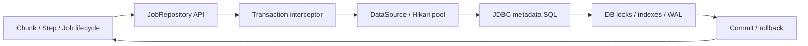
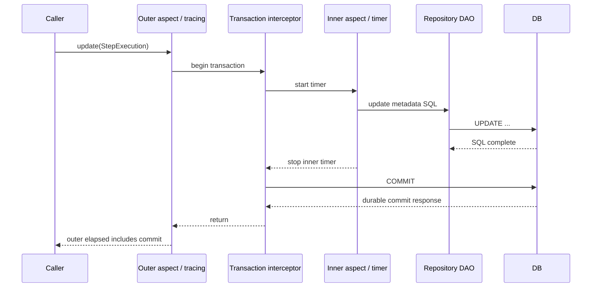
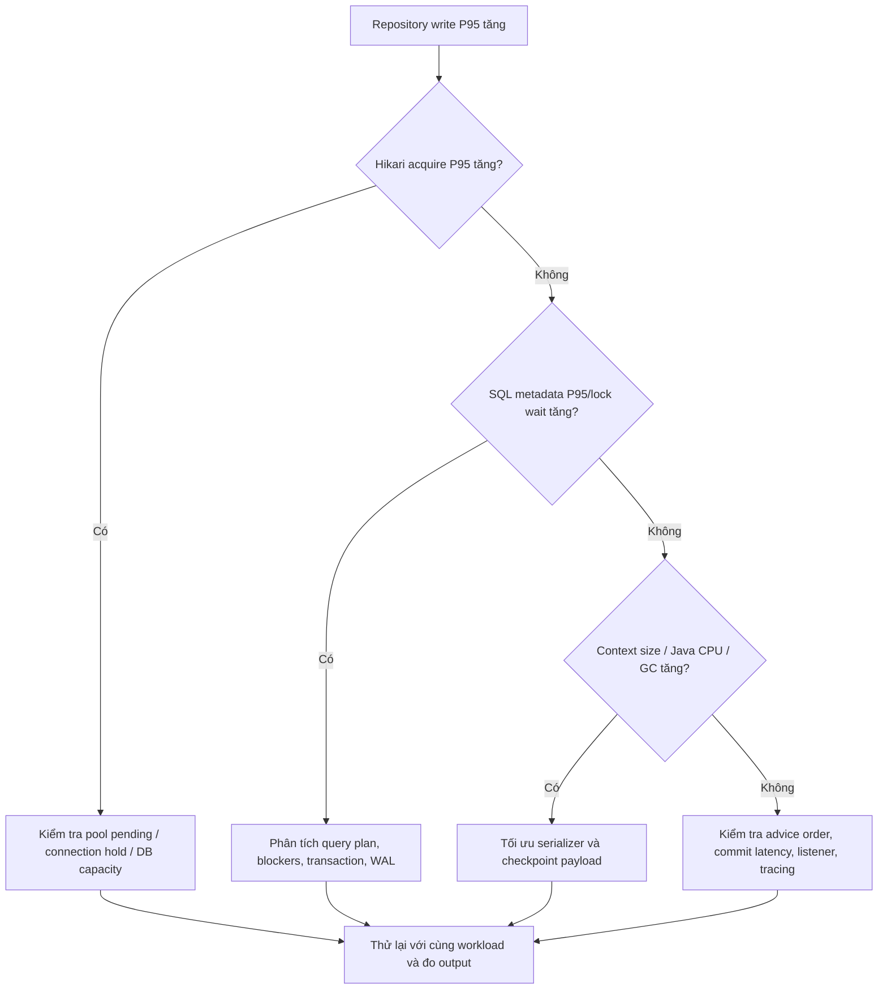

# Giám sát thời gian ghi metadata trong Spring Batch JobRepository

Một batch job có thể đọc hàng triệu bản ghi rất nhanh nhưng lại dành nhiều thời gian cho việc **ghi trạng thái và checkpoint**. Khi Spring Batch tạo `JobExecution`, lưu `StepExecution` hoặc cập nhật `ExecutionContext`, những thao tác đó phải được hoàn tất đủ tin cậy để job có thể **được theo dõi và restart đúng**. Nếu metadata database chậm, một chunk có thể bị kéo dài, worker chờ kết nối, hoặc job thất bại vào đúng thời điểm cập nhật tiến độ.

**Giám sát thời gian ghi metadata** là đo độ trễ thực tế của các thao tác ghi thông qua `JobRepository` và xác định *thời gian đi đâu*: đợi connection, đợi khóa, thực thi SQL, serialize context, commit transaction hay network. Đó là cơ sở để phân biệt một repository bị nghẽn với reader/processor/writer chậm, thay vì tăng thread và pool theo cảm tính.

Bài thuộc chương **JobRepository** trong module **SPRING_BATCH_SCALING_OPERATIONS**. Các ví dụ hướng tới Spring Batch 5.x, Spring Boot 3.x, HikariCP, Micrometer và PostgreSQL; khái niệm áp dụng cả khi mở rộng bằng multi-threaded step, parallel steps, local/remote partitioning và remote chunking. Mục tiêu cuối là bảo đảm **thông lượng đã commit, checkpoint nhất quán, retry/restart an toàn và thời hạn vận hành thực tế**.

## 1. “Thời gian ghi metadata” chính xác là thời gian nào?

Cùng một thao tác `JobRepository.update(stepExecution)` có nhiều đồng hồ khác nhau:

| Đồng hồ | Bắt đầu/kết thúc | Trả lời câu hỏi |
| --- | --- | --- |
| **Repository method latency** | Trước và sau lời gọi method repository | Caller bị chặn bao lâu ở API này? |
| **Connection acquisition latency** | Lúc yêu cầu đến khi được cấp JDBC Connection | Có chờ pool không? |
| **SQL statement execution latency** | JDBC gửi lệnh đến khi driver nhận kết quả | Query chạy/chờ DB bao lâu? |
| **Lock wait time** | Bắt đầu chờ lock đến khi được cấp/hết hạn | Có transaction khác giữ tài nguyên không? |
| **Transaction duration** | Transaction begin đến commit/rollback | Connection/khóa được giữ trong bao lâu? |
| **Commit latency** | Bắt đầu commit đến khi DB xác nhận | WAL/fsync, replication, DB/network tốn bao lâu? |
| **End-to-end checkpoint cost** | Chunk cần lưu state đến khi state bền vững | Tiến độ restart bị trì hoãn bao lâu? |

Những số này **không cộng cơ học với nhau** vì một số khoảng thời gian lồng nhau. Ví dụ statement latency có thể **bao gồm** thời gian lock wait; method latency có thể bao gồm borrow connection; transaction có thể bao trùm cả SQL và commit.

**Điểm đo quyết định kết quả:** Instrument ở tầng Spring AOP bên trong hay bên ngoài transaction advice sẽ làm thời gian method đo được có thể **bao gồm hoặc không bao gồm commit**. Muốn biết chính xác, phải kiểm tra thứ tự advice và đối chiếu trace JDBC/DB trên cùng phiên bản runtime.

## 2. JobRepository ghi những loại metadata nào?

Trong JDBC repository của Spring Batch, trạng thái batch được lưu vào các bảng `BATCH_*`.

| Thao tác nghiệp vụ batch | API/đối tượng liên quan | Bảng metadata thường bị ảnh hưởng |
| --- | --- | --- |
| Tạo JobInstance | `createJobInstance(...)`, xác định identifying parameters | `BATCH_JOB_INSTANCE` |
| Tạo JobExecution | `createJobExecution(...)` | `BATCH_JOB_EXECUTION`, bảng parameters và có thể instance mới |
| Thêm StepExecution | `add(StepExecution)` | `BATCH_STEP_EXECUTION`, context khởi tạo |
| Cập nhật JobExecution | `update(JobExecution)` | `BATCH_JOB_EXECUTION` |
| Cập nhật StepExecution | `update(StepExecution)` | `BATCH_STEP_EXECUTION` |
| Ghi ExecutionContext | `updateExecutionContext(...)` | `BATCH_STEP_EXECUTION_CONTEXT` hoặc `BATCH_JOB_EXECUTION_CONTEXT` |
| Tra cứu phục vụ restart | `getLastStepExecution(...)`, `getLastJobExecution(...)`… | Đọc metadata, **không phải write latency** |

Một số thao tác tạo/ghi diễn ra dưới transaction khác nhau; không có quy tắc “một chunk = chính xác một câu UPDATE”. Số câu SQL phụ thuộc JDBC repository, cách step chạy, cấu hình lưu state, listener, version Spring Batch và transaction manager.

Hãy thu thập **method latency + SQL latency + database metrics**; chỉ đếm số hàng `BATCH_STEP_EXECUTION` không xác định được thời gian ghi.

## 3. Đường đi của một lần cập nhật metadata



Các điểm nghẽn có thể lần lượt là:

1. Caller không tới được repository vì đang chờ hoàn thành processor hoặc writer.
2. Repository chờ mượn connection từ pool metadata.
3. SQL phải chờ lock, index page hoặc I/O.
4. Serialize một `ExecutionContext` quá lớn làm tốn CPU/GC.
5. Transaction commit chậm vì WAL/durable storage hoặc đồng bộ replica.
6. Một retry/rollback khiến thao tác thực hiện lại.
7. Một manager đang đợi worker/reply, dù DB metadata hoàn toàn nhàn rỗi.

Vì vậy, **thấy `StepExecution.LAST_UPDATED` cách hiện tại 30 giây không có nghĩa một câu UPDATE mất 30 giây**. Có thể step đang xử lý một chunk dài, reader đang chờ API hoặc worker bị treo; `LAST_UPDATED` không phải latency histogram.

## 4. Phân biệt metadata latency và business-data latency

Hai nhóm ghi phải được đo riêng:

| Vấn đề | Metadata write | Business write |
| --- | --- | --- |
| Thành phần | `JobRepository` | `ItemWriter`/DAO/API đích |
| Đối tượng | Job/Step status, counters, context | Order, payment, inventory, file, event |
| Nguồn dữ liệu | Metadata DataSource; có thể chung DB với nghiệp vụ | DataSource hoặc remote service nghiệp vụ |
| Dấu hiệu điển hình | Job/step state cập nhật chậm, lỗi repository, checkpoint kéo dài | Writer latency cao, business table locks, downstream 429 |
| Điều chỉnh thường gặp | Giảm overhead metadata, tối ưu pool/SQL, cân đối steps/partitions | Index, query, batch write, business-key partitioning |
| Rủi ro khi thất bại | Restart có thể replay hoặc trạng thái job lỗi | Dữ liệu nghiệp vụ thiếu, rollback, side effect không chắc chắn |

Nếu cả hai sử dụng cùng PostgreSQL instance, lock, CPU và connection budget có thể liên quan lẫn nhau, nhưng **SQL đang chậm thuộc bảng nào** vẫn phải được xác minh.

Một `JobRepository` riêng giúp quan sát rõ hơn, nhưng metadata và business khi đó có thể commit bằng **hai transaction độc lập**; đổi lại cần writer idempotent và quy trình đối soát khi chỉ một bên commit.

## 5. Kết quả đo tối thiểu cần có trong production

Đối với từng nhóm repository operation, thu thập:

- **Calls/s:** số lời gọi và tốc độ tạo/cập nhật metadata.
- **Latency P50/P95/P99:** tail latency có thể làm manager/worker nghẽn dù trung bình thấp.
- **Error count/rate:** timeout, connection failure, optimistic locking, deadlock, serialization conflict.
- **Active/pending pool:** pool hết slot hoặc connection giữ quá lâu.
- **SQL execution + transaction/commit latency:** để tách DB chậm với code serialization.
- **Job/step throughput:** items được commit/s, chunk duration, JobExecution elapsed time.
- **Concurrency:** số step/partition active, số JVM và số transaction đồng thời.
- **Context size:** kích thước serialized `ExecutionContext` và tốc độ ghi của nó.
- **Restart safety:** số job thất bại khi metadata ghi lỗi, kết quả đối soát dữ liệu sau recovery.

Nên phân nhóm method rõ ràng: `createJobExecution`, `addStepExecution`, `updateStepExecution`, `updateJobExecution`, `updateExecutionContext`; nếu một wrapper/AOP chỉ cung cấp tên `update`, cần thêm nhãn entity được chuẩn hóa hoặc đối chiếu SQL để biết update JobExecution hay StepExecution.

**Không gắn `JobExecutionId`, `StepExecutionId` hay business key vào mọi metric label.** Chúng tạo cardinality rất cao. Lưu định danh cụ thể trong structured log/trace với chính sách dữ liệu phù hợp.

## 6. Dùng histogram và percentiles thay vì chỉ trung bình

Giả sử một loại metadata update được gọi 10.000 lần:

- 9.900 lần mất 8 ms.
- 90 lần mất 120 ms.
- 10 lần mất 3.000 ms.

Trung bình chỉ khoảng:

\[
\overline{t}=
\frac{9.900\times8+90\times120+10\times3.000}{10.000}
=12\text{ ms}
\]

Nhưng những lần chậm 3 giây có thể trùng với các chunk cuối hoặc thời điểm manager cần cập nhật trạng thái; chỉ nhìn 12 ms sẽ che sự cố.

Các chỉ số cần hiểu:

| Chỉ số | Cách đọc | Dùng khi nào |
| --- | --- | --- |
| P50 | Khoảng một nửa lời gọi nhanh hơn giá trị này | Baseline bình thường |
| P95 | 95% lời gọi không vượt quá giá trị này | Phát hiện tail latency phổ biến |
| P99 | 99% lời gọi không vượt quá giá trị này | Phát hiện rare slow operations |
| Max | Lời gọi chậm nhất trong cửa sổ | Hữu ích khi điều tra, nhạy với outlier |
| Error rate | Tỷ lệ gọi thất bại | Đo độ tin cậy |
| Latency histogram | Phân phối theo bucket | Tổng hợp across pods, tính SLO |

**Lưu ý:** Trong ví dụ trên, đúng 99% lời gọi mất 8 ms; với cách tính phân vị nearest-rank, **P99 chỉ là 8 ms**, **P99.9 là 120 ms**, còn 10 lời gọi mất 3 giây chỉ chiếm 0,1% ở đuôi cuối. Để quan sát chúng cần xem phân vị cao hơn P99.9, max hoặc slow-operation tracing. Đừng coi P99 là cách thấy mọi ngoại lệ.

Khi tổng hợp nhiều pod, **không lấy trung bình P95/P99 của từng pod** rồi gọi đó là cluster P95. Cần histogram/timer có bucket tương thích để tính phân vị gộp hoặc dùng công cụ truy vấn histogram của hệ metrics.

## 7. Metrics có sẵn và metrics phải tự tạo

Spring Batch 5.x tích hợp quan sát/metrics cho những phần của batch execution khi được cấu hình cùng Micrometer. Tuy nhiên, **không nên mặc định đã có timer tách riêng cho từng lời gọi JDBC `JobRepository.updateExecutionContext`**.

| Nguồn metrics | Thường giúp trả lời | Có giới hạn gì? |
| --- | --- | --- |
| Spring Batch job/step metrics | Job, step chạy bao lâu | Bao gồm thời gian business processing, chưa tách riêng metadata |
| Spring Batch chunk/process/read/write metrics nếu được bật | Thành phần chunk nào chậm | Không tự đo mọi transaction repository |
| HikariCP/Micrometer | Chờ connection, thời gian giữ connection, pool saturation | Không cho biết SQL metadata nào bị chặn |
| JDBC instrumentation / SQL tracing | Query/statement duration | Thường không phản ánh toàn bộ Java-side context serialization và commit |
| Database stats/logs | Lock wait, I/O, CPU, deadlock, statement time | Phải liên hệ về job/step/request cụ thể |
| Custom Repository timer | Wall-clock ở API create/update | Có thể bỏ qua commit tùy AOP/transaction order |

**Chiến lược khuyến nghị:** Dùng nhiều lớp đo bổ trợ nhau. Một custom timer chỉ là **một góc nhìn**; không thay thế metric của pool, SQL hoặc database.

## 8. Gắn timer bằng Spring AOP và Micrometer

Ví dụ Spring Boot 3.x/Spring Batch 5.x sau đo **elapsed wall-clock của lời gọi repository write API**. Nó không thay đổi hành vi ghi metadata; chỉ thu duration sau khi gọi method. Cần có Spring AOP/Micrometer và xác nhận proxy/aspect thực sự intercept bean repository của runtime.

```java
import java.util.Set;

import io.micrometer.core.instrument.MeterRegistry;
import io.micrometer.core.instrument.Timer;
import org.aspectj.lang.ProceedingJoinPoint;
import org.aspectj.lang.annotation.Around;
import org.aspectj.lang.annotation.Aspect;
import org.springframework.stereotype.Component;

@Aspect
@Component
public final class JobRepositoryWriteTimingAspect {

    private static final Set<String> WRITE_METHODS = Set.of(
            "createJobInstance",
            "createJobExecution",
            "add",
            "update",
            "updateExecutionContext");

    private final MeterRegistry meterRegistry;

    public JobRepositoryWriteTimingAspect(MeterRegistry meterRegistry) {
        this.meterRegistry = meterRegistry;
    }

    @Around(
        "execution(* org.springframework.batch.core.repository.JobRepository.*(..))")
    public Object measureWrite(ProceedingJoinPoint invocation)
            throws Throwable {

        String method = invocation.getSignature().getName();

        if (!WRITE_METHODS.contains(method)) {
            return invocation.proceed();
        }

        Timer.Sample sample = Timer.start(meterRegistry);
        String outcome = "success";
        try {
            return invocation.proceed();
        } catch (Throwable failure) {
            outcome = "error";
            throw failure;
        } finally {
            Timer timer = Timer.builder(
                        "batch.repository.write.duration")
                    .description("Elapsed repository write method time")
                    .tags("operation", method,
                          "outcome", outcome)
                    .publishPercentileHistogram()
                    .register(meterRegistry);
            sample.stop(timer);
        }
    }
}
```

### Đọc đúng ý nghĩa ví dụ

1. `batch.repository.write.duration` là **custom metric**, không phải tên mặc định Spring Batch cung cấp.
2. Nhãn `operation` giới hạn trong tên method của `JobRepository`; `outcome` chỉ có `success/error` nên cardinality có giới hạn.
3. Hai overload `update(JobExecution)` và `update(StepExecution)` được gom vào `operation=update`. Nếu cần phân tách, bổ sung một **entity tag với tập giá trị cố định** `job/step/other`, không gắn ID.
4. Timer đo *elapsed của method được intercept*; **transaction commit có thể nằm ngoài timer** tùy thứ tự AOP transaction advice. Xác nhận bằng trace/DB metrics.
5. Pointcut theo interface có thể không bao hết đường thực thi khi repository được custom/decorate hoặc nằm trong proxy khác; cần smoke test rằng counter timer tăng đúng lúc chạy job.
6. Aspect cũng có overhead và tạo histogram. Đo overhead trên load test; không bật phân vị client-side không cần thiết trên hàng trăm series.
7. Một số operation tạo metadata có thể gọi nhiều DAO/SQL; timer không đại diện cho duration mỗi câu lệnh.

Nếu dự án không dùng Spring AOP, có thể instrument ở wrapper/facade gọi repository hoặc qua JDBC instrumentation. **Không copy nguyên Spring Batch DAO nội bộ** chỉ để thêm một lời log time; việc fork DAO làm tăng chi phí bảo trì và rủi ro sai lifecycle.

## 9. Đo lỗi theo loại thay vì chỉ success/error

Timer ở mục 8 mới chia outcome success/error. Khi chẩn đoán, một lỗi do pool cạn khác hoàn toàn với optimistic locking hoặc DB deadlock.

Một tập taxonomy hữu ích:

| Error category | Tín hiệu thường gặp | Hướng xử lý |
| --- | --- | --- |
| `pool_timeout` | Hikari checkout timeout | Pool sizing, connection hold time, DB saturation |
| `sql_lock_wait_timeout` | Database lock wait hết hạn | Blocking transaction, lock order, isolation |
| `deadlock` | PostgreSQL `40P01` hoặc vendor code tương ứng | Phân tích deadlock graph; rollback/retry đúng scope |
| `serialization_conflict` | PostgreSQL `40001` | Kiểm tra isolation, retry toàn transaction có giới hạn |
| `optimistic_conflict` | Version mismatch trong StepExecution/JobExecution | Có code cập nhật cùng execution sai concurrency không? |
| `connection_unavailable` | DB/network unavailable | Kết nối, failover, connection budget |
| `serialization_error` | Không serialize được ExecutionContext | Key/value không phù hợp serializer, dữ liệu state lớn/bất thường |

**Không dùng trực tiếp `exception.getMessage()` làm metric tag.** Message thường chứa SQL, ID, payload hoặc chuỗi không giới hạn. Viết một bộ classifier ánh xạ vào tập category cố định; giữ exception class, SQLSTATE và correlation ID chi tiết trong trace/log có kiểm soát.

Ví dụ structured log khi phát hiện một update chậm:

```json
{
  "component": "JobRepository",
  "operation": "updateExecutionContext",
  "entity": "StepExecution",
  "jobName": "nightlyImport",
  "stepName": "loadPartition",
  "durationMs": 415,
  "outcome": "success",
  "poolName": "batch-metadata-pool",
  "traceId": "example-trace-id"
}
```

Đây là schema log **do ứng dụng thiết kế**, không phải JSON Spring Batch tự xuất. Lưu ID job/step ở log để điều tra, không đặt mã định danh có số lượng lớn vào tất cả series.

## 10. Đo transaction commit và thứ tự advice

Một lỗi đo lường thường gặp là đọc timer của method và kết luận **“metadata commit chỉ mất 5 ms”**. Nếu transaction interceptor mở transaction trước method và commit **sau khi method trả về**, một aspect chạy phía **bên trong** interceptor không thấy thời gian commit.



Sơ đồ chỉ minh họa **một thứ tự interceptor có thể xảy ra**. Trên runtime thật, thứ tự advice/proxy có thể khác.

Cách xác minh:

- Quan sát trace spans cho method và transaction trên cùng request.
- Nếu dùng AOP, kiểm tra order của aspect và transaction advisor; đừng giả định default order luôn cho kết quả mong muốn.
- Đo checkout và SQL time qua datasource/JDBC instrumentation.
- Tại database, xem commit/transaction latency, WAL sync/replication wait nếu engine hỗ trợ.
- So sánh method elapsed với một span từ caller bao trùm toàn đường thao tác.

**Đừng thêm transaction wrapper chỉ để đo timer**: điều đó có thể thay đổi propagation, lock lifetime và checkpoint semantics.

## 11. Dùng HikariCP metrics để giải thích độ trễ

Nếu metadata repository sử dụng HikariCP và Micrometer metrics được bật, thường có các series kiểu:

| Metric | Giải thích |
| --- | --- |
| `hikaricp.connections.active` | Số JDBC connections đang được checkout |
| `hikaricp.connections.idle` | Số connection rảnh |
| `hikaricp.connections.pending` | Số thread đang đợi một connection |
| `hikaricp.connections.max` | Trần connection cho **một pool instance** |
| `hikaricp.connections.acquire` | Thời gian chờ mượn connection |
| `hikaricp.connections.usage` | Thời gian giữ connection |
| `hikaricp.connections.creation` | Thời gian tạo physical connection |
| `hikaricp.connections.timeout` | Số lần chờ checkout quá timeout |

Giả sử `JobRepository.updateExecutionContext` tăng P95 từ 20 ms lên 800 ms. Nếu cùng lúc:

- Pool `pending` cao, `acquire P95` cao, nhưng DB SQL latency thấp ⇒ **pool queueing** là giả thuyết mạnh.
- `acquire P95` thấp, nhưng `usage P95` và DB lock wait cao ⇒ **transaction/SQL bị chặn** có thể là nguyên nhân.
- `acquire P95` thấp, SQL thấp, nhưng context serialization CPU/GC cao ⇒ **payload ExecutionContext** cần được đánh giá.
- Pool có nhiều idle, SQL thấp nhưng caller chậm ⇒ tìm phía Java, listener, scheduling hoặc đo sai boundary.

**Không lấy `active/max` cao làm bằng chứng duy nhất** để tăng pool. Nếu DB đã bão hòa CPU/IO/locks, tăng `maximumPoolSize` có thể tạo thêm transaction tranh tài nguyên và làm latency tệ hơn.

Tên metric trong Prometheus có thể chuyển đổi dấu chấm thành underscore và thêm suffix; nên dùng tên/thang đo thật được exporter phát ra, không viết dashboard chỉ dựa vào tên minh họa.

## 12. PostgreSQL: tìm câu metadata SQL thực sự chậm

Với PostgreSQL, `pg_stat_statements` (nếu được cài đặt/kích hoạt và có quyền phù hợp) có thể giúp nhìn câu SQL được chuẩn hóa theo tổng thời gian và số lần gọi.

```sql
SELECT
    calls,
    ROUND(total_exec_time::numeric, 2) AS total_ms,
    ROUND(mean_exec_time::numeric, 2) AS mean_ms,
    ROUND(max_exec_time::numeric, 2) AS max_ms,
    LEFT(query, 220) AS sample_query
FROM pg_stat_statements
WHERE query ILIKE '%batch_step_execution%'
   OR query ILIKE '%batch_job_execution%'
ORDER BY total_exec_time DESC
LIMIT 20;
```

**Giới hạn của truy vấn:**

1. Nó trả thống kê **tích lũy từ lần reset**, không phải “latency P95 trong 5 phút gần nhất”. Muốn xem theo cửa sổ cần tính chênh lệch counters hoặc exporter/metrics phù hợp.
2. `query` là SQL normalize; `ILIKE` có thể không khớp khi tên bảng khác prefix/schema hoặc ứng dụng dùng quoted identifiers.
3. `mean_exec_time`/`max_exec_time` đo thời gian statement theo extension, **không bao gồm thời gian caller đợi Hikari checkout** hay Java serialize.
4. Không suy một statement chậm nghĩa là toàn metadata write chậm do câu ấy; còn commit, serialization và các statement khác.
5. `pg_stat_statements` có thể thiếu quyền truy cập hoặc chưa được cấu hình; không tự thay production database để bật mà không qua DBA.

Nếu extension có các cột như `min_exec_time` và statistics về plan time/blk reads, có thể dùng thêm để phân tích. Nhưng chẩn đoán phải bám phiên bản PostgreSQL và extension thực tế.

## 13. PostgreSQL: lock waits và transaction tồn tại lâu

Cùng quan sát `pg_stat_activity` để tìm session đang bị chặn:

```sql
SELECT
    a.pid,
    a.application_name,
    a.state,
    a.wait_event_type,
    a.wait_event,
    a.query_start,
    a.xact_start,
    NOW() - a.xact_start AS transaction_age,
    pg_blocking_pids(a.pid) AS blockers,
    LEFT(a.query, 180) AS query_sample
FROM pg_stat_activity AS a
WHERE a.datname = current_database()
  AND (
       cardinality(pg_blocking_pids(a.pid)) > 0
       OR a.wait_event_type = 'Lock'
  )
ORDER BY a.query_start;
```

Để biết những session giữ transaction lâu, kể cả `idle in transaction`:

```sql
SELECT
    pid,
    application_name,
    state,
    xact_start,
    NOW() - xact_start AS transaction_age,
    wait_event_type,
    wait_event
FROM pg_stat_activity
WHERE datname = current_database()
  AND xact_start IS NOT NULL
ORDER BY xact_start;
```

Các truy vấn này cho **ảnh chụp tại thời điểm chạy**. Một deadlock có thể đã được database giải quyết trước khi query, vì thế cần logs có SQLSTATE (ví dụ `40P01` cho deadlock, `40001` cho serialization failure) và tracing để điều tra sự kiện đã qua.

**Không lập tức terminate blocker PID trên production.** Điều này có thể rollback transaction nghiệp vụ hoặc metadata, làm job phải restart. Hãy thực hiện theo runbook và có DBA hỗ trợ khi cần.

## 14. ExecutionContext serialization: độ trễ không chỉ do SQL

`ExecutionContext` là nơi Spring Batch lưu trạng thái cần thiết cho restart: cursor/page marker, last processed ID, watermark, một số state của reader/writer… Nếu application đưa object lớn hoặc một danh sách hàng nghìn phần tử vào đó, metadata update có thể chậm vì:

- Serialize/deserialize nhiều dữ liệu.
- Tạo JSON/string/BLOB lớn, tốn CPU và heap.
- Tăng kích thước SQL bind parameters, truyền dữ liệu và WAL/redo log.
- Gây GC pause và tăng transaction duration.
- Làm checkpoint/restart tốn thời gian hơn.
- Có nguy cơ lỗi serializer/schema version khi deployment thay đổi.

**Không dùng ExecutionContext làm cache cho toàn bộ item.** Nên lưu **tham chiếu nhỏ, ổn định** (offset, ID, path của checkpoint file, watermark), trong khi dữ liệu lớn được lưu đúng nơi có durability/versioning riêng.

Ví dụ:

```java
// Nên: trạng thái nhỏ, dễ serialize và có ý nghĩa restart.
executionContext.putLong("lastProcessedOrderId", 987654L);
executionContext.putString("inputSnapshotVersion", "snapshot-2026-11-26");

// Không nên: nhét toàn bộ danh sách DTO hoặc binary payload
// vào ExecutionContext rồi ghi lại sau mỗi chunk.
```

Cần giữ state đủ để restart đúng. **Không xóa trường checkpoint chỉ để giảm write duration** nếu reader cần nó để tránh bỏ sót/lặp dữ liệu. Thay vào đó thiết kế một **checkpoint reference** gọn hơn và kiểm thử restart từ điểm lỗi.

### Kích thước ExecutionContext nên giám sát thế nào?

Ghi nhận kích thước payload serialized hoặc DB column size theo sampling/periodic query, phân nhóm theo step type. Không đưa raw context vào logs hay metrics vì có thể chứa dữ liệu nhạy cảm. Với dữ liệu đã tồn tại, việc query độ dài phải cân nhắc overhead, serializer/column type và quyền truy cập.

Một ví dụ PostgreSQL nhằm kiểm tra **kích thước cột dạng bytea/text theo schema hiện hành**, cần điều chỉnh tên cột/type:

```sql
-- Ví dụ với SHORT_CONTEXT dạng text trong schema Spring Batch JDBC.
SELECT
    STEP_EXECUTION_ID,
    OCTET_LENGTH(SHORT_CONTEXT) AS short_context_bytes
FROM BATCH_STEP_EXECUTION_CONTEXT
ORDER BY short_context_bytes DESC
LIMIT 20;
```

`SHORT_CONTEXT` thường là phần biểu diễn ngắn; **không phải toàn bộ context** khi context lớn được lưu ở `SERIALIZED_CONTEXT`. Để đo kích thước toàn bộ cần xem schema/type của DB và chính sách serialize thật, tránh lấy SHORT_CONTEXT làm thước đo duy nhất.

## 15. Tần suất checkpoint và commit interval ảnh hưởng write latency ra sao?

Với `N` item và commit interval `C`, số chunk lý tưởng:

\[
M_{\mathrm{chunks}}\approx\left\lceil\frac{N}{C}\right\rceil
\]

Nếu xử lý trong `T` giây, tốc độ chunk trung bình:

\[
R_{\mathrm{chunks}}=\frac{M_{\mathrm{chunks}}}{T}
\]

**Ví dụ:** 3.600.000 item trong 30 phút:

| Chunk size | Số chunk lý tưởng | Chunks/s trung bình |
| ---: | ---: | ---: |
| 50 | 72.000 | 40,0 |
| 100 | 36.000 | 20,0 |
| 200 | 18.000 | 10,0 |
| 500 | 7.200 | 4,0 |

Nếu mỗi chunk có trung bình `k` lần thao tác ghi metadata qua nhiều method/JDBC call, tải trung bình:

\[
R_{\mathrm{metadataWrites}}\approx
k\times R_{\mathrm{chunks}}
\]

Nhưng `k` **phải đo**, không gán cứng một chunk = một metadata update. Đầu job/cuối job, partition, listener và context cũng tạo thêm metadata operations.

**Đánh đổi:** Chunk lớn giảm số chu kỳ ghi/checkpoint nhưng tăng transaction length, số item rollback khi lỗi, lock contention, heap và số item cần replay sau crash. Với remote chunking nó còn làm payload mỗi `ChunkRequest` lớn hơn. Không chọn `chunk(10.000)` chỉ để repository trông nhàn rỗi.

## 16. Ước lượng concurrency metadata theo Little's Law

Để ước lượng áp lực đồng thời, gọi:

- `λ`: số metadata operations hoàn tất/giây trong một JVM hoặc trên cùng DB (phải xác định đúng phạm vi).
- `W_hold`: thời gian trung bình một connection bị giữ cho operation, tính bằng giây.
- `L_active`: số connection đang được sử dụng đồng thời trung bình.

Một xấp xỉ:

\[
L_{\mathrm{active}}\approx \lambda \times W_{\mathrm{hold}}
\]

Ví dụ: 160 metadata operations/s, connection hold time trung bình 30 ms:

\[
L_{\mathrm{active}}\approx160\times0,03=4,8
\]

Mô hình cho biết trung bình khoảng 4,8 connection đồng thời. Nó **không bảo đảm pool size 5 là đủ**, vì burst, transaction dài, P95/P99 và connection usage khác nhau theo operation. Tuning cần đo `pending`, acquisition latency và khả năng DB.

Khi dùng nhiều worker JVM:

\[
P_{\mathrm{cluster,max}}=
\sum_{i=1}^{n}
(\text{replicas}_i\times\text{poolMax}_i)
\]

Pool 8 trên 20 worker có trần 160 connections, chưa kể manager và các ứng dụng khác. Database có thể bão hòa dù mỗi worker “chỉ” cấu hình 8. Nếu tăng replicas, phải rà soát **ngân sách connection toàn cluster**.

## 17. Vì sao parallel steps và partitioning thay đổi profile metadata?

Không nên coi mọi mô hình scale như nhau:

| Mô hình | Mẫu cập nhật metadata | Điểm cần đo |
| --- | --- | --- |
| Một chunk step tuần tự | Một StepExecution, checkpoint định kỳ | Repository update rate, transaction hold |
| Multi-threaded step | Nhiều chunk có thể chạy đồng thời trong cùng step | Update StepExecution contention, thread safety |
| Parallel steps | Nhiều StepExecution chạy đồng thời | Tổng metadata writes/s theo nhiều flow |
| Local partitioning | Một manager step và nhiều StepExecution partition trong cùng JVM | Số partitions, pool contention, checkpoint overhead |
| Remote partitioning | Worker JVM cập nhật StepExecution qua JobRepository chia sẻ | Tổng nhiều pool, metadata DB CPU/IO/locks |
| Remote chunking | Manager đọc và quản lý step/chunk replies; worker process/write chunk message | Manager metadata writes, broker/worker latency, lost reply |
| Nhiều JobLaunchers | Nhiều create* transaction, có thể cùng JobInstance | Create latency, SERIALIZABLE conflict, duplicate trigger |

**Lưu ý remote partitioning:** Có metadata riêng cho partition nên có thể biết partition nào chậm, nhưng nhiều partition rất nhỏ cũng tạo rất nhiều StepExecution/context và thao tác update. Có thể tăng worker để xử lý nhanh hơn nhưng đồng thời tăng metadata write demand vượt giới hạn DB.

**Lưu ý remote chunking:** Worker xử lý một `ChunkRequest` không đồng nghĩa có một `StepExecution` riêng cho mỗi chunk. Nếu job chậm do broker reply hoặc manager reader, metadata update timer có thể vẫn đẹp. Hãy đo message latency, correlation và queue age cùng với repository.

## 18. Phân biệt latency do DB với latency do chính JobRepository

Một lần repo call kéo dài cần trả lời theo chuỗi suy luận:



Một số chẩn đoán sai thường gặp:

- **Repo timer cao ⇒ chắc chắn SQL chậm:** chưa đúng, có thể chờ pool hoặc serialize.
- **Repo timer thấp ⇒ checkpoint nhanh:** chưa chắc, commit có thể nằm ngoài aspect.
- **Hikari active sát max ⇒ tăng pool:** chưa chắc, database đã bão hòa.
- **Job StepExecution LAST_UPDATED cũ ⇒ một UPDATE chậm:** không đúng, có thể worker xử lý chunk dài.
- **Giảm isolation create giúp mọi write:** sai phạm vi; `isolationLevelForCreate` chủ yếu áp cho các phương thức tạo metadata, không phải mọi update.

## 19. Đặt SLO latency và điều kiện cảnh báo có ngữ cảnh

SLO nên bắt đầu từ **baseline và yêu cầu batch window**, không phải một ngưỡng mặc định áp mọi hệ thống.

Ví dụ SLO nội bộ (chỉ để minh họa):

- 99% lời gọi `JobRepository.update(StepExecution)` hoàn tất trong **200 ms** trên cửa sổ 30 phút.
- Không có Hikari checkout timeout trong giờ batch quan trọng.
- Metadata write errors không vượt ngưỡng rất thấp được định nghĩa theo reliability target.
- Job hoàn tất trong **30 phút** và toàn bộ output phải đối soát đúng business key.

**Tại sao cần ngữ cảnh?** Nếu job chỉ có 20 metadata writes, P99 của cửa sổ ngắn rất biến động. Nếu job có hàng trăm nghìn writes, một lỗi hiếm vẫn có thể ảnh hưởng nhiều job. Hãy chọn min request volume hoặc cửa sổ đánh giá phù hợp, kết hợp latency với lỗi và tác động lên job.

Một cảnh báo tốt thường dựa trên nhiều tín hiệu:

| Tín hiệu kết hợp | Hành động |
| --- | --- |
| Repo write P95 tăng + DB lock wait tăng | Điều tra blocking transaction, SQL metadata |
| Repo write P95 tăng + Hikari pending tăng | Kiểm tra connection checkout/usage, pool budget |
| Repo write P95 tăng + context size/GC tăng | Điều tra serializer và state payload |
| Repo errors tăng + job rollback/failure tăng | Triage khẩn vì checkpoint/restart có thể bị ảnh hưởng |
| Repo latency ổn nhưng job duration tăng | Tìm reader, processor, writer, broker hoặc data skew |
| Tail latency tăng nhưng SLA/outputs vẫn ổn | Theo dõi xu hướng và lên kế hoạch tối ưu; không thay production mù quáng |

Đừng biến “metadata write trung bình dưới 50 ms” thành mục tiêu duy nhất. **Thông lượng đã commit và tính đúng khi restart** vẫn là tiêu chí cuối.

## 20. Instrumentation overhead và sampling

Khi mỗi chunk ghi metadata, một job có thể tạo hàng trăm nghìn lần đo. Nếu mỗi lần ghi một log JSON chi tiết, log I/O và serialization có thể làm chính job chậm hơn.

Hướng tiếp cận cân bằng:

1. Dùng Micrometer Timer/histogram để tổng hợp đo lường ít overhead, tag cố định.
2. Ghi log chi tiết **chỉ khi slow threshold**, ví dụ trên 500 ms hoặc khi có lỗi; threshold cần hiệu chỉnh theo baseline.
3. Lấy mẫu tracing cho một phần request bình thường, giữ traces cho lỗi/slow operations theo khả năng hạ tầng.
4. Không log toàn bộ `ExecutionContext` hoặc SQL bind values chứa PII.
5. Không đặt JobExecution ID, StepExecution ID, file name/tenant ID số lượng lớn vào histogram labels.
6. Đảm bảo timer không chạy dưới các mutex/lock do code instrumentation tự tạo.
7. Benchmark với và không có instrumentation trên cùng workload nếu số updates/s lớn.

**Một bẫy thường gặp:** Tự tạo `Timer.builder().register(registry)` trong mỗi call với nhiều bộ tag động có thể làm registry tăng hàng triệu series và tốn heap. Với tập tag hữu hạn, Micrometer tái sử dụng meter cùng identity; dù vậy vẫn nên giữ cardinality thật thấp.

## 21. Kiểm thử metric: đo có đúng boundary không?

Các kiểm thử cần tách ba việc: *metric xuất hiện*, *metric phản ánh đúng thời gian*, và *bật metric không phá transaction*.

### 21.1. Unit test tối thiểu cho Timer

Có thể dùng `SimpleMeterRegistry` và một `JobRepository` test double, gọi qua **Spring proxy có aspect** để xác nhận:

- Timer `batch.repository.write.duration` tồn tại sau một lần write method.
- Tag `operation=update`, `outcome=success` và count tăng.
- Nếu method ném exception, `outcome=error` được ghi **và exception vẫn được ném ra**.
- Read-only methods không bị ghi nhầm thành write trong bộ lọc hiện tại.

Không chỉ new trực tiếp class aspect rồi gọi method test; phải kiểm thử proxy/AOP wiring nếu mục tiêu là xác nhận đo trên bean repository runtime.

### 21.2. Integration test với PostgreSQL

Chạy step nhỏ trên schema metadata thật và kiểm tra:

- Timer count tăng khi StepExecution/context được cập nhật.
- Query tracing tìm được SQL metadata tương ứng.
- Hikari acquire/usage metrics hoạt động theo **đúng pool name**.
- Transaction commit thành công và job COMPLETED.
- Khi DB có lock wait nhân tạo trên môi trường test, timer/tầng SQL phản ánh chậm đúng nơi.

Đừng tạo lock trên production để kiểm chứng metric. Test cần timeout/latch kiểm soát và cleanup ngay cả khi thất bại.

### 21.3. Failure test

Mô phỏng database outage hoặc connection pool exhaustion trong môi trường cô lập, sau đó xác nhận:

1. Error timer tăng; không biến exception thành success.
2. Job/step status phản ánh lỗi qua lifecycle Spring Batch phù hợp.
3. `ExecutionContext` không bị ghi nhận sai là đã checkpoint nếu transaction fail.
4. Restart/reprocess không làm dữ liệu nghiệp vụ bị trùng.
5. Metrics/traces vẫn đủ để chỉ ra sự cố bắt đầu từ pool, SQL hay transaction.

Khi metadata DB tạm thời không truy cập được, cần thiết kế metrics export **không phụ thuộc chính metadata DB đó**; nếu mất DB đồng thời làm mất mọi tín hiệu vận hành, khó triage.

## 22. Tối ưu nào thực sự giảm thời gian ghi metadata?

Sau khi xác định nguyên nhân, chọn giải pháp đúng phạm vi.

| Bằng chứng | Cải thiện cần thử | Rủi ro/kiểm chứng |
| --- | --- | --- |
| Nhiều updates/s do chunk size quá nhỏ | Benchmark tăng commit interval vừa phải | Transaction dài, rollback nhiều item, memory |
| ExecutionContext serialized rất lớn | Lưu checkpoint reference gọn/serializable | Phải giữ restart correctness |
| Pool metadata acquisition chậm, DB còn headroom | Điều chỉnh pool/transaction hold, cân nhắc pool riêng | Tổng connections cluster và consistency |
| Metadata SQL chậm vì index/scan | Kiểm tra schema/index/query plan/migration | Không chỉnh schema chuẩn tùy tiện |
| Metadata SQL chậm vì lock wait | Điều tra blockers, giảm update cạnh tranh/long transaction | Không dùng kill transaction bừa bãi |
| DB CPU/WAL/fsync bão hòa | Scale DB/I/O có kiểm chứng, giảm write rate hoặc spread schedule | Không giả định tăng pool tăng throughput |
| Quá nhiều partition quá nhỏ | Gộp partition và giới hạn active workers | Data skew, tail latency |
| Dashboard JobExplorer poll quá dày | Giảm polling/caching hợp lý | Trạng thái có thể trễ, cần SLA observability |
| Optimistic locking cùng StepExecution | Sửa concurrency/state ownership, không bypass VERSION | Phải test multi-thread/restart |
| Repo timer thấp nhưng job chậm | Đo reader/processor/writer/broker | Không tối ưu repository sai chỗ |

**Không nên tối ưu bằng cách bỏ cập nhật StepExecution/ExecutionContext tùy tiện.** State đó là cơ sở restart. Nếu xử lý không thể restart hoặc reader không còn checkpoint hợp lệ, giảm vài millisecond không bù được rủi ro mất/ghi trùng dữ liệu.

## 23. Case study: job nhiều partition, checkpoint trở thành nút thắt

Một job nhập **8.000.000 bản ghi** có SLA **40 phút**. Ban đầu sử dụng 8 partition active với chunk size 200. Khi tăng lên 32 partition active để rút ngắn thời gian, team quan sát:

| Chỉ số (giả định) | 8 partitions | 32 partitions |
| --- | ---: | ---: |
| Chunk size | 200 | 200 |
| Business committed throughput | 4.800 item/s | 3.900 item/s |
| Repo `updateExecutionContext` P95 | 18 ms | 430 ms |
| Repo `update(StepExecution)` P95 | 15 ms | 280 ms |
| Hikari metadata `acquire P95` | 3 ms | 7 ms |
| PostgreSQL lock wait / metadata writes | Thấp | Cao |
| DB metadata CPU | 42% | 88% |
| Job duration | 28 phút | 36 phút |

Các con số chỉ để minh họa phương pháp điều tra, không phải benchmark được Spring Batch công bố.

### Câu hỏi 1: Nghẽn nhiều khả năng ở pool hay SQL?

Acquisition P95 chỉ tăng từ 3 lên 7 ms, trong khi repository write P95 tăng hàng trăm ms và DB lock wait/CPU cao. Pool queueing **không phải giả thuyết mạnh nhất**; cần xem metadata SQL, blockers, context size và transaction timing.

### Câu hỏi 2: Tăng metadata pool từ 16 lên 64 có giải quyết không?

Chưa có căn cứ. Database đã có CPU và lock wait cao; tăng pool có thể làm số transaction đồng thời tăng, khiến contention nặng hơn. Thử giảm active partitions/metadata write rate trước, rồi benchmark.

### Câu hỏi 3: Chunk size 200 tạo bao nhiêu chunk?

\[
M_{\mathrm{chunks}}=
\frac{8.000.000}{200}=40.000
\]

Nếu đổi sang chunk 400, số chunk lý tưởng còn 20.000. Điều này có thể giảm số chu kỳ checkpoint, **nhưng** transaction writer sẽ lớn hơn; phải kiểm thử deadlock, memory, rollback và correctness.

### Câu hỏi 4: Khi giảm từ 32 về 12 partitions và throughput đạt 5.200 item/s, có đủ SLA?

Throughput tối thiểu:

\[
R_{\mathrm{needed}}=
\frac{8.000.000}{40\times60}
\approx3.333\text{ item/s}
\]

Thời gian xử lý payload lý tưởng với 5.200 item/s:

\[
T_{\mathrm{payload}}\approx
\frac{8.000.000}{5.200}
\approx1.538\text{ s}\approx25,6\text{ phút}
\]

Có khoảng 14,4 phút dư cho startup, straggler, retry và các overhead khác trước deadline 40 phút. Tuy nhiên phải xác minh **end-to-end job duration**, không chỉ tính tốc độ trung bình.

### Câu hỏi 5: Nếu repository update bị timeout sau khi business DB đã commit?

Khi hai DB/transaction manager tách biệt, checkpoint có thể không phản ánh kết quả nghiệp vụ mới. Restart có thể xử lý lại một số item. Writer phải idempotent theo business operation ID hoặc có reconciliation; không tự sửa StepExecution status để cho job hoàn tất.

### Câu hỏi 6: Metric nào xác nhận giải pháp thật sự thành công?

Đồng thời cải thiện `repository write P95/P99`, giảm DB lock waits/checkout failures, tăng **committed business items/s**, duy trì output đủ/không trùng, và job hoàn tất đúng SLA trong load test đại diện.

## 24. Runbook khi thời gian ghi metadata tăng bất thường

1. **Xác nhận metric đúng:** Timer có bao gồm commit không? Đang xem đúng metadata DataSource/pool và đúng operation?
2. **Khoanh vùng ảnh hưởng:** Job/StepExecution nào, thời điểm nào, số partition/worker thay đổi không, SLA còn bao nhiêu?
3. **Phân loại triệu chứng:** P95/P99 tăng nhưng error rate bằng 0, hay có timeout/deadlock/serialization/optimistic conflict?
4. **Kiểm tra pool:** `active/idle/pending/max`, acquire/usage P95, checkout timeout; tính connections toàn cluster.
5. **Kiểm tra SQL/DB:** `pg_stat_statements` theo cửa sổ, `pg_stat_activity` blockers, DB CPU/IO/WAL và long transactions.
6. **Kiểm tra ExecutionContext:** Serialized size, CPU/GC, listener, state có lỡ lưu cả danh sách item không?
7. **Phân biệt metadata/business:** Nếu business writer chậm, tránh chỉnh repo pool sai chỗ; nếu metadata chậm, xác định method SQL cụ thể.
8. **Ổn định tải:** Giảm active partitions hoặc polling khi phù hợp; không tăng pool/retryLimit đồng thời mà không có bằng chứng.
9. **Thay một biến có chủ đích:** Chunk size, pool size, partition concurrency, context size hoặc DB index/capacity, rồi benchmark lại.
10. **Kiểm tra recovery:** JobRepository status/context, business operations đã commit, worker cũ/in-flight message; restart đúng lifecycle.
11. **Đối soát kết quả:** Output unique business keys, item thiếu/trùng và job duration.
12. **Cập nhật baseline, SLO và runbook:** Đặt alert theo tín hiệu có hành động và ngưỡng đã thử nghiệm.

Không chuyển trực tiếp `BATCH_STEP_EXECUTION.STATUS` hoặc `VERSION` bằng SQL để “khắc phục metadata chậm”; điều đó phá cơ chế quản lý trạng thái và optimistic locking.

## 25. Những sai lầm quan sát hay gặp

1. **Dùng `LAST_UPDATED` như latency của một câu UPDATE.** Nó là timestamp metadata, không phải stopwatch.
2. **Chỉ xem elapsed toàn job.** Không biết thời gian ở processor/writer hay repository.
3. **Chỉ xem repository method timer.** Có thể bỏ sót transaction commit do thứ tự AOP.
4. **Chỉ xem SQL duration.** Có thể bỏ qua pool wait, context serialization và Java scheduling.
5. **Chỉ xem Hikari active.** Không phân biệt pool cạn vì connection giữ lâu hay DB bão hòa.
6. **Tăng maximumPoolSize khi DB đã bị lock.** Thêm cạnh tranh, latency xấu hơn.
7. **Nhìn trung bình 10 ms rồi bỏ qua P99/P99.9.** Một số chunk/tail update vẫn rất chậm.
8. **Lấy trung bình P95 của nhiều pod.** Kết quả không phải phân vị gộp toàn cluster.
9. **Gắn StepExecution ID vào mọi metric series.** Cardinality/memory của monitoring tăng mạnh.
10. **Log toàn bộ ExecutionContext.** Tốn I/O và có thể rò rỉ PII.
11. **Coi số chunk bằng số SQL metadata cố định.** Tùy implementation/transaction manager.
12. **Tăng gridSize để cải thiện throughput khi repository đã bão hòa.** Chỉ làm tải nặng hơn.
13. **Hạ isolationLevelForCreate để sửa context update chậm.** Không đúng transaction path.
14. **Đổi chunk size quá lớn chỉ để giảm metadata writes.** Có thể làm writer rollback/deadlock nặng hơn.
15. **Bỏ checkpoint update để đạt SLA.** Đánh đổi khả năng restart/tính đúng dữ liệu.
16. **Tắt lỗi repository thành warning.** Job có thể ghi dữ liệu trong khi metadata không nhất quán.
17. **Chỉ benchmark happy path.** Không kiểm thử metadata outage, rollback/replay và straggler partitions.
18. **Lẫn lộn remote chunking với remote partitioning.** Số StepExecution và nơi cập nhật metadata khác nhau.
19. **Dùng PostgreSQL cumulative stats như một biểu đồ 5 phút mà không tính delta.** Kết luận sai về thời điểm nghẽn.
20. **Tối ưu metric đẹp mà không đo committed throughput hoặc output correctness.** Không chứng minh được hệ thống tốt hơn.

## 26. Checklist triển khai đo metadata write latency

- [ ] Đã xác định chính xác `JobRepository` bean, DataSource, transaction manager, DB engine và schema metadata.
- [ ] Đã phân biệt timer của repository method, JDBC SQL, connection acquisition và transaction commit.
- [ ] Đã kiểm chứng thứ tự advice/wiring để biết custom timer có đo commit hay không.
- [ ] Có metric calls/s, error rate, P50/P95/P99 theo operation với tag hữu hạn.
- [ ] Có trace/log theo JobExecution/StepExecution khi chậm, nhưng không biến ID thành metric label.
- [ ] Có metrics Hikari `acquire/usage/pending/active/max/timeout` đúng pool metadata.
- [ ] Có database stats/logs cho SQL latency, lock waits, CPU/I/O và transaction age.
- [ ] Có cách quan sát kích thước ExecutionContext serialized, không log raw state.
- [ ] Biết số chunk thực, chunk size, commit interval, số partitions/steps active và checkpoint rate.
- [ ] Đã tính ngân sách connection toàn cluster khi tăng replicas/worker concurrency.
- [ ] Không coi `LAST_UPDATED` là write latency/heartbeat chắc chắn.
- [ ] Đã chọn SLO latency theo baseline, error volume, batch window và dữ liệu đúng.
- [ ] Đã benchmark measurement overhead, tránh high-cardinality metrics/traces.
- [ ] Đã kiểm thử custom metrics với proxy/AOP thực và database tương tự production.
- [ ] Đã test lỗi connection/SQL/commit và xác nhận exceptions không bị instrumentation nuốt.
- [ ] Nếu metadata/business tách transaction, đã có idempotent writer và test replay sau checkpoint fail.
- [ ] Đã benchmark với multi-threaded step/partitioning/remote tương ứng deployment.
- [ ] Có runbook cho trường hợp metadata DB nghẽn và worker/JobExecution còn trạng thái STARTED.
- [ ] Không chỉnh trực tiếp `BATCH_*` hay bỏ context để tăng tốc thiếu kiểm chứng.

## 27. Tài liệu tham khảo

- [Spring Batch Reference — Configuring a JobRepository](https://docs.spring.io/spring-batch/reference/job/configuring-repository.html): cách cấu hình repository và transaction.
- [Spring Batch Reference — Meta-Data Schema](https://docs.spring.io/spring-batch/reference/schema-appendix.html): bảng `BATCH_*` và `ExecutionContext`.
- [Spring Batch Reference — Monitoring and Metrics](https://docs.spring.io/spring-batch/reference/monitoring-and-metrics.html): metrics/observability trong Spring Batch.
- [Spring Batch Reference — Scaling and Parallel Processing](https://docs.spring.io/spring-batch/reference/scalability.html): tác động multi-threaded step, partitioning, remote chunking.
- [Spring Batch Reference — Transaction Appendix](https://docs.spring.io/spring-batch/reference/transaction-appendix.html): transaction/rollback/retry và checkpoint.
- [Spring Batch 5.2 API — JobRepository](https://docs.spring.io/spring-batch/docs/5.2.x/api/org/springframework/batch/core/repository/JobRepository.html): các method create/update/context.
- [Spring Batch 5.2 API — StepExecution](https://docs.spring.io/spring-batch/docs/5.2.x/api/org/springframework/batch/core/StepExecution.html): status, counters và metadata.
- [Micrometer — Timers](https://docs.micrometer.io/micrometer/reference/concepts/timers.html): `Timer`, distribution, histogram và latency measurement.
- [Micrometer — Naming Meters](https://docs.micrometer.io/micrometer/reference/concepts/naming.html): metrics/tags có giới hạn.
- [HikariCP — Configuration](https://github.com/brettwooldridge/HikariCP#configuration-knobs-baby): pool metrics, connection timeout/lifetime và sizing.
- [PostgreSQL — Monitoring Database Activity](https://www.postgresql.org/docs/current/monitoring-stats.html): `pg_stat_activity`, locks, DB counters.
- [pg_stat_statements](https://www.postgresql.org/docs/current/pgstatstatements.html): normalized statement timing.
- [PostgreSQL — Explicit Locking](https://www.postgresql.org/docs/current/explicit-locking.html): lock wait, deadlock và transaction.
- [Spring Framework — Transaction Propagation](https://docs.spring.io/spring-framework/reference/data-access/transaction/declarative/tx-propagation.html): phạm vi commit và advice.

> **Ghi nhớ:** **Giám sát thời gian ghi metadata là đo hành trình ghi trạng thái/checkpoint của JobRepository, không chỉ nhìn `LAST_UPDATED` hay elapsed toàn job.** Phải tách connection checkout, SQL/lock wait, context serialization và commit; theo dõi phân vị và lỗi theo operation; so sánh với số chunk/partition, tải DB và thông lượng **đã commit**. Tối ưu đúng điểm nghẽn nhưng luôn giữ transaction, idempotency và khả năng restart: một job nhanh hơn nhưng metadata sai hoặc mất item không phải là một job đã scale thành công.
