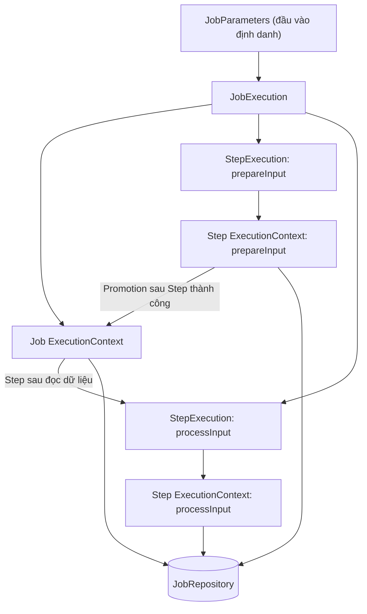
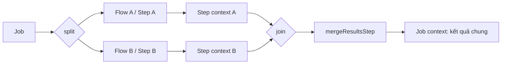

# ExecutionContext của Job trong Spring Batch

Khi một Spring Batch Job có nhiều Step, Step sau thường cần biết kết quả do Step trước tạo ra: đường dẫn tệp đã chuẩn hóa, mã đợt nhập dữ liệu, vị trí lưu báo cáo hoặc dấu mốc xử lý đã kiểm chứng. **Job ExecutionContext** là vùng lưu trạng thái theo lần thực thi Job mà Spring Batch có thể ghi xuống `JobRepository`, khôi phục khi restart và cho các Step trong cùng Job truy cập.

Trong module **SPRING_BATCH_SCALING_OPERATIONS**, kiến thức này đặc biệt quan trọng khi mở rộng khối lượng dữ liệu bằng multi-threaded step, parallel steps, partitioning và xử lý phân tán. Cùng một cơ chế lưu trạng thái có thể giúp công việc phục hồi sau lỗi, nhưng cách cập nhật không đúng trong nhiều thread cũng có thể gây mất dữ liệu. Bài học đi từ phạm vi, vòng đời, cách sử dụng trong Java đến restart, thread safety và vận hành.

## 1. Mục tiêu học tập

Sau bài này, bạn có thể:

1. Phân biệt `JobParameters`, `JobExecutionContext` và `StepExecutionContext`.
2. Giải thích thời điểm dữ liệu Job ExecutionContext được lưu bền và cách Spring Batch xử lý khi restart.
3. Đọc/ghi các khóa trong Job ExecutionContext, truyền dữ liệu từ Step này sang Step khác bằng `ExecutionContextPromotionListener`.
4. Dùng `@StepScope` để lấy giá trị Job ExecutionContext tại thời điểm Step bắt đầu.
5. Nhận diện rủi ro race condition và trạng thái không nhất quán khi có parallel steps, multi-threaded steps, partitioning.
6. Thiết kế giá trị context gọn, có thể serialize, đủ cho phục hồi và dễ quan sát.

## 2. Job ExecutionContext là gì?

`ExecutionContext` là cấu trúc **key–value** do Spring Batch cung cấp để chứa trạng thái có thể lưu và phục hồi. Một `JobExecution` có Job ExecutionContext của nó; mỗi `StepExecution` cũng có Step ExecutionContext riêng.

Hãy phân biệt các khái niệm:

| Khái niệm | Ý nghĩa | Ví dụ |
| --- | --- | --- |
| `JobInstance` | Một trường hợp chạy logic, được xác định bởi tên Job và các JobParameters **định danh** | Job nhập dữ liệu ngày 2026-11-26 |
| `JobExecution` | Một lần cố gắng thực thi JobInstance; restart tạo JobExecution mới | Lần 1 thất bại, lần 2 restart |
| `JobParameters` | Các tham số đầu vào cho Job, không dùng như vùng mutable trao đổi kết quả | `businessDate=2026-11-26` |
| **Job ExecutionContext** | Trạng thái dùng chung trong phạm vi JobExecution, được khôi phục cho lần restart thích hợp | `import.manifest.path`, `run.snapshotId` |
| **Step ExecutionContext** | Trạng thái/checkpoint của một StepExecution | Offset file, số thứ tự trang, cursor hiện tại |

**Chú ý:** mỗi `JobExecution` có context gắn với lần thực thi đó. Khi restart **cùng JobInstance**, Spring Batch sử dụng trạng thái được lưu từ lần thực thi trước để khởi tạo ngữ cảnh phù hợp cho lần chạy mới. Không nên hiểu đây là một object Java tồn tại mãi hoặc có thể tự động chia sẻ giữa những JobInstance khác nhau.

### 2.1. Phạm vi và vòng đời



- `JobExecution.getExecutionContext()` trả về Job ExecutionContext; `StepExecution.getExecutionContext()` trả về Step ExecutionContext.
- Hai context là **hai kho key–value riêng**: ghi khóa `"manifestPath"` trong Step context không tự làm khóa đó xuất hiện ở Job context.
- Job context phục vụ trao đổi trạng thái **giữa các Step**, nhưng không phải cache hoặc cơ sở dữ liệu nghiệp vụ chung cho mọi service.
- `JobRepository` lưu metadata liên quan, thường trong các bảng như `BATCH_JOB_EXECUTION_CONTEXT` và `BATCH_STEP_EXECUTION_CONTEXT` của repository dùng JDBC.

### 2.2. Thời điểm lưu bền khác nhau

Đây là khác biệt cốt lõi:

| | Step ExecutionContext | Job ExecutionContext |
| --- | --- | --- |
| Phạm vi | Một StepExecution | Một JobExecution |
| Trường hợp điển hình | Checkpoint khi đọc/ghi chunk | Giá trị đầu ra Step A để Step B sử dụng |
| Thời điểm framework thường lưu | Mỗi điểm commit của chunk và các thời điểm quản lý Step liên quan | **Giữa các lần thực thi Step**, thường khi Step kết thúc |
| Nếu tiến trình dừng giữa một Step | Có thể khôi phục đến checkpoint đã được lưu | Thay đổi chỉ nằm trong bộ nhớ của Step đang chạy có thể bị mất |
| Truy cập từ Step khác | Không tự động chia sẻ | Các Step của Job có thể truy cập |

Vì vậy, **không dùng Job ExecutionContext để checkpoint từng record/chunk**. Nếu đang xử lý Step và cần một vị trí phục hồi cập nhật thường xuyên, hãy dùng Step ExecutionContext cùng hợp đồng checkpoint của `ItemStream`. Sau khi Step hoàn thành, dùng cơ chế *promotion* đưa **kết quả cần chia sẻ** lên Job context.

Ví dụ: `readOrdersStep` đang đọc 10 triệu bản ghi. `lastProcessedId` phải được lưu qua checkpoint của Step thay vì ghi trực tiếp vào Job context sau mỗi item. Khi Step hoàn thành, đường dẫn file kết quả `orders.output.path` mới là dữ liệu hợp lý để chuyển lên Job context cho Step lập báo cáo.

## 3. API đọc và ghi dữ liệu

Spring Batch cung cấp những phương thức thao tác theo kiểu dữ liệu như `putString`, `getString`, `putLong`, `getLong`, `putInt`, `getInt` và `put`/`get`.

```java
// Trong Tasklet/Listener khi đã có StepExecution:
ExecutionContext jobContext =
        stepExecution.getJobExecution().getExecutionContext();

jobContext.putString("run.snapshotId", "snapshot-20261126");
jobContext.putLong("run.expectedRows", 1_250_000L);

String snapshotId = jobContext.getString("run.snapshotId");
long expectedRows = jobContext.getLong("run.expectedRows");

if (jobContext.containsKey("run.snapshotId")) {
    // Sử dụng snapshotId với kiểm tra hợp lệ theo nghiệp vụ.
}
```

Đoạn trên minh họa API; **vị trí và thời điểm ghi** quyết định trạng thái có được lưu bền khi xảy ra lỗi hay không. Nếu viết trong lúc Step đang xử lý và mong checkpoint an toàn, hãy ghi vào Step context rồi promotion khi hoàn tất.

Quy ước dữ liệu nên áp dụng:

- Khóa có namespace như `"import.manifest.path"` hoặc `"report.snapshot.id"` để giảm đè nhầm.
- Lưu kiểu đơn giản, ổn định và có thể serialize: `String`, `long`, `int`, mã định danh, đường dẫn, dấu mốc đã xác nhận.
- Không đưa toàn bộ danh sách bản ghi, large object graph, connection, stream đang mở hoặc bean/service vào context.
- Không ghi mật khẩu, token hay dữ liệu nhạy cảm vì metadata có thể tồn tại lâu trong JobRepository và thường được sao lưu.
- Tránh sửa **tại chỗ** một object mutable đã lấy từ context: cơ chế dirty checking thường dựa vào lời gọi `put`, không phát hiện mọi thay đổi nội bộ của object. Ưu tiên tạo giá trị mới rồi `put` lại.
- Đọc context như dữ liệu đã được lưu và có thể thiếu khóa; kiểm tra sự tồn tại, kiểu dữ liệu và giá trị trước khi dùng.

## 4. Ví dụ hoàn chỉnh: truyền đường dẫn từ Step chuẩn bị sang Step xử lý

Giả sử Job nhận `inputFile` qua `JobParameters`. Step thứ nhất kiểm tra tệp có tồn tại và lưu **đường dẫn đã chuẩn hóa** vào Step ExecutionContext. Listener chỉ chuyển đường dẫn lên Job ExecutionContext khi Step hoàn thành thành công. Step thứ hai đọc giá trị đó thông qua `@StepScope`.

### 4.1. Luồng xử lý


### 4.2. Java Configuration (Spring Batch 5.x)

Ví dụ dùng API `JobBuilder`/`StepBuilder` của Spring Batch 5.x, giả định `JobRepository` và `PlatformTransactionManager` đã được Spring Boot/Spring Batch cấu hình. Tệp nhập phải tồn tại để ví dụ chạy thành công.

```java
import java.nio.file.Files;
import java.nio.file.Path;

import org.springframework.batch.core.Job;
import org.springframework.batch.core.Step;
import org.springframework.batch.core.StepExecution;
import org.springframework.batch.core.configuration.annotation.StepScope;
import org.springframework.batch.core.job.builder.JobBuilder;
import org.springframework.batch.core.listener.ExecutionContextPromotionListener;
import org.springframework.batch.core.repository.JobRepository;
import org.springframework.batch.core.step.builder.StepBuilder;
import org.springframework.batch.core.step.tasklet.Tasklet;
import org.springframework.batch.repeat.RepeatStatus;
import org.springframework.beans.factory.annotation.Qualifier;
import org.springframework.beans.factory.annotation.Value;
import org.springframework.context.annotation.Bean;
import org.springframework.context.annotation.Configuration;
import org.springframework.transaction.PlatformTransactionManager;

@Configuration
public class JobContextExampleConfig {

    @Bean
    public ExecutionContextPromotionListener inputPathPromotionListener() {
        ExecutionContextPromotionListener listener =
                new ExecutionContextPromotionListener();
        listener.setKeys(new String[] { "import.input.path" });
        // Mặc định chỉ promotion cho ExitStatus COMPLETED.
        return listener;
    }

    @Bean
    public Step locateInputStep(
            JobRepository jobRepository,
            PlatformTransactionManager transactionManager,
            ExecutionContextPromotionListener inputPathPromotionListener) {

        return new StepBuilder("locateInputStep", jobRepository)
                .tasklet((contribution, chunkContext) -> {
                    StepExecution stepExecution =
                            chunkContext.getStepContext().getStepExecution();
                    String input = stepExecution.getJobParameters()
                            .getString("inputFile");

                    if (input == null || input.isBlank()) {
                        throw new IllegalArgumentException(
                                "Thiếu JobParameter inputFile");
                    }

                    // toRealPath xác nhận tệp tồn tại và chuẩn hóa đường dẫn.
                    String normalizedPath = Path.of(input)
                            .toRealPath()
                            .toString();

                    stepExecution.getExecutionContext()
                            .putString("import.input.path", normalizedPath);
                    return RepeatStatus.FINISHED;
                }, transactionManager)
                .listener(inputPathPromotionListener)
                .build();
    }

    @Bean
    @StepScope
    public Tasklet inspectFileTasklet(
            @Value("#{jobExecutionContext['import.input.path']}")
            String inputPath) {

        return (contribution, chunkContext) -> {
            if (inputPath == null || inputPath.isBlank()) {
                throw new IllegalStateException(
                        "Thiếu import.input.path trong Job context");
            }

            // Đọc kích thước từ metadata, không tải cả file vào RAM.
            long sizeInBytes = Files.size(Path.of(inputPath));

            chunkContext.getStepContext()
                    .getStepExecution()
                    .getExecutionContext()
                    .putLong("import.input.bytes", sizeInBytes);

            return RepeatStatus.FINISHED;
        };
    }

    @Bean
    public Step inspectFileStep(
            JobRepository jobRepository,
            PlatformTransactionManager transactionManager,
            @Qualifier("inspectFileTasklet") Tasklet inspectFileTasklet) {

        return new StepBuilder("inspectFileStep", jobRepository)
                .tasklet(inspectFileTasklet, transactionManager)
                .build();
    }

    @Bean
    public Job contextDemoJob(
            JobRepository jobRepository,
            @Qualifier("locateInputStep") Step locateInputStep,
            @Qualifier("inspectFileStep") Step inspectFileStep) {

        return new JobBuilder("contextDemoJob", jobRepository)
                .start(locateInputStep)
                .next(inspectFileStep)
                .build();
    }
}
```

Các điểm cần đọc kỹ:

1. `inputFile` là **đầu vào của Job**, không bị thay đổi trong quá trình chạy.
2. `locateInputStep` ghi `import.input.path` vào **Step ExecutionContext**, vì việc kiểm tra và chuẩn hóa vẫn đang xảy ra trong Step.
3. `ExecutionContextPromotionListener` được gắn với **Step tạo giá trị**. Listener thực hiện promotion ở cuối Step theo điều kiện `ExitStatus`; mặc định là `COMPLETED`.
4. `inspectFileTasklet` chỉ được tạo cho Step đang chạy nhờ `@StepScope`. Biểu thức `#{jobExecutionContext['import.input.path']}` được đánh giá khi Step có context thực tế; nếu đánh giá ngay lúc tạo singleton ở startup, giá trị runtime chưa sẵn sàng.
5. `inspectFileStep` ghi `import.input.bytes` vào Step context của chính nó, **chưa** đưa khóa này lên Job context. Nếu Step kế tiếp cần kích thước tệp, bạn cần thêm promotion phù hợp.

Ví dụ cố ý chỉ đọc kích thước file; trong hệ thống thật, Step xử lý có thể thực hiện chunk-oriented processing với reader, processor, writer riêng. `ExecutionContext` chỉ nên chứa **tham chiếu tới dữ liệu**, còn bản thân dữ liệu lớn nằm trong file, cơ sở dữ liệu hoặc object storage.

**Lưu ý phiên bản:** Spring Batch 6 có những thay đổi package/API so với 5.x (ví dụ vị trí của kiểu `ExecutionContext`). Khi sao chép mã, đối chiếu đúng Javadoc phiên bản đang sử dụng. Ý nghĩa hai phạm vi context, promotion và thời điểm lưu checkpoint vẫn là khái niệm trọng tâm.

## 5. Đọc trực tiếp Job ExecutionContext trong Step và Listener

Ngoài late binding, bạn có thể đọc Job context khi đang có `StepExecution`, ví dụ trong `StepExecutionListener.beforeStep`:

```java
@Override
public void beforeStep(StepExecution stepExecution) {
    String path = stepExecution.getJobExecution()
            .getExecutionContext()
            .getString("import.input.path");

    if (path == null || path.isBlank()) {
        throw new IllegalStateException(
                "Step trước chưa cung cấp import.input.path");
    }
}
```

Phương thức đọc trực tiếp phù hợp với listener hoặc service được truyền `StepExecution`; late binding phù hợp với reader/writer/tasklet cần giá trị runtime. Không lưu `StepExecution` hoặc `JobExecution` trong biến singleton để các Job đồng thời sử dụng, bởi mỗi JobExecution có state riêng.

### JobParameters, Job context hay Step context?

| Dữ liệu | Nên đặt ở đâu? | Lý do |
| --- | --- | --- |
| Ngày nghiệp vụ, nguồn đầu vào cố định | `JobParameters` | Đầu vào được xác định khi launch, có thể tham gia định danh JobInstance |
| Đường dẫn staging do Step A tạo ra, Step B cần dùng | `StepExecutionContext` rồi promotion lên `JobExecutionContext` | Chia sẻ kết quả Step đã hoàn tất |
| Vị trí đọc trong file khi Step đang chunk | `StepExecutionContext` | Được checkpoint theo commit |
| Danh sách hàng triệu bản ghi hoặc payload API lớn | DB/file/object storage; context giữ ID/URI | Giảm chi phí serialize và rủi ro bloat metadata |
| Trạng thái dùng xuyên **hai Job độc lập** | Kho dữ liệu bền ngoài JobExecution | Job context không tự là bộ nhớ toàn hệ thống |

## 6. Job ExecutionContext và cơ chế restart

Xét Job có hai Step: `locateInputStep` → `inspectFileStep`.

| Sự kiện | Hệ quả |
| --- | --- |
| `locateInputStep` hoàn thành và promotion thành công | `import.input.path` được ghi vào Job context theo chu kỳ lưu của framework |
| `inspectFileStep` xử lý rồi thất bại | JobExecution có thể kết thúc `FAILED`; trạng thái đã lưu trước đó vẫn dùng cho restart |
| Khởi chạy lại **cùng JobInstance** với điều kiện restart hợp lệ | JobExecution mới được tạo; các Step đã `COMPLETED` thường được bỏ qua |
| `inspectFileStep` được chạy lại | Có thể đọc lại `import.input.path` từ context khôi phục |
| Launch với tập tham số **định danh khác** | Thường tạo JobInstance khác; không tự thừa kế context của JobInstance cũ |

**Cơ chế phục hồi không phải rollback tổng thể.** Dữ liệu đã commit của Step A không tự bị hủy nếu Step B thất bại. Nếu Step B đã ghi một phần vào hệ thống khác, Job context cũng không bảo đảm tự động khử trùng lặp hoặc exactly-once cho các thao tác đó. Vẫn cần checkpoint, giao dịch, idempotency và khóa nghiệp vụ.

### 6.1. Trường hợp mất tiến trình giữa Step

Giả sử bạn thay đổi Job context trực tiếp trong vòng lặp đang chạy ở Step B, rồi JVM bị kill trước khi Step B kết thúc. Các giá trị mới có thể chỉ tồn tại trong RAM vì Job context thường được ghi **ở ranh giới Step**. Khi restart, bạn không nên kỳ vọng lấy lại từng cập nhật đã thực hiện trong vòng lặp.

Muốn restart từ bản ghi thứ *n*, hãy để reader/writer thích hợp triển khai checkpoint bằng `ItemStream.open/update/close` hoặc quản lý Step context theo transaction/chunk. Nếu chỉ cần truyền một kết quả cuối cùng (ví dụ tên file hợp lệ) đến Step kế tiếp, hãy promotion sau khi Step thành công.

### 6.2. Trạng thái context và tính idempotent

Nên giữ các giá trị có ý nghĩa phục hồi, ví dụ `snapshotId` xác định chính xác tập dữ liệu đầu vào đã chọn. Nếu restart mà Step nguồn bị bỏ qua, Step tiếp theo dùng cùng snapshot để tránh xử lý một tập dữ liệu đã thay đổi. Nhưng nếu file snapshot bị xóa hoặc source không giữ dữ liệu lịch sử, context chỉ còn là một chuỗi đường dẫn **không đủ** để khôi phục. Kiến trúc cần lưu giữ artifact đến khi hoàn tất/đạt retention mục tiêu.

## 7. Thận trọng khi mở rộng song song

Job ExecutionContext là vùng trạng thái chia sẻ logic trong một JobExecution; **không nên suy ra rằng các thao tác cập nhật map và lưu bền của nó tự an toàn trước mọi kiểu thực thi đồng thời**.

### 7.1. Parallel Steps (split flow)



Trong split flow, hai nhánh chạy đồng thời và có thể cùng truy cập Job context. Một nhánh thực hiện `getLong("total")` rồi `putLong("total", old + n)` trong khi nhánh kia cũng làm vậy sẽ gặp **lost update**, vì đọc–sửa–ghi không phải một thao tác nguyên tử. Ngay cả khi dùng hai khóa khác nhau, việc hai thread cùng sửa một map mutable và chu kỳ persist Job context vẫn cần được kiểm soát.

Thiết kế phù hợp cho dữ liệu lớn:

1. Mỗi nhánh ghi checkpoint vào **Step context của chính nó** và kết quả nghiệp vụ vào bảng/file staging tách biệt.
2. Chỉ sau khi split join thành công, `mergeResultsStep` đọc các đầu ra bền đã hoàn tất, kiểm tra tính nhất quán và tổng hợp kết quả.
3. `mergeResultsStep` cập nhật Step context của nó và promotion một số giá trị tổng hợp cần thiết lên Job context cho Step tiếp theo.

Nếu bắt buộc phải ghi Job context từ nhiều nhánh, cần thiết kế đồng bộ cụ thể cho toàn bộ thao tác cập nhật và persist. **Chỉ chọn tên khóa khác nhau chưa đủ** để bảo đảm an toàn đồng thời, đặc biệt khi nhiều JobExecution hoặc worker riêng tiến trình đang tham gia.

### 7.2. Multi-threaded Step và partitioning

| Mô hình | Phạm vi trạng thái cần chú ý | Hướng thiết kế |
| --- | --- | --- |
| Multi-threaded Step | Nhiều thread có thể dùng chung thành phần hoặc Step context | Tránh mutable state không an toàn, kiểm tra reader/writer và điểm checkpoint |
| Local partitioning | Các worker StepExecution theo từng partition | Mỗi partition có Step context và khóa/range riêng; tổng hợp sau khi hoàn tất |
| Remote partitioning | Worker ở các tiến trình/máy khác | Truyền metadata/checkpoint qua cơ chế partition/repository, dữ liệu lớn đặt ở storage chung |
| Parallel Steps | Nhiều Flow độc lập trong cùng Job | Nhánh ghi kết quả riêng, join trước khi hợp nhất |

Không dùng Job ExecutionContext như một **distributed shared memory**; cập nhật object trong bộ nhớ của manager không tự xuất hiện ở JVM khác. Với remote partitioning/remote chunking, cần dựa vào hợp đồng trao đổi giữa manager và worker cùng kho lưu trữ bền, kiểm tra tính nhất quán khi retry/restart.

**Lưu ý về scope:** Tài liệu Spring Batch khuyến cáo hạn chế `@JobScope` trong multi-threaded hoặc partitioned Step vì framework không kiểm soát mọi thread được tạo và không thể luôn thiết lập job scope đúng trên những thread đó. Khi cần late binding cho reader/writer/tasklet, ưu tiên cấu hình `@StepScope` phù hợp, đồng thời kiểm tra thread model và khả năng dùng chung của thành phần.

## 8. Chi phí serialize, lưu trữ và bảo mật

`ExecutionContext` được framework serialize theo cấu hình repository. Điều này ảnh hưởng trực tiếp đến hiệu năng và restart:

- **Dung lượng:** context càng lớn thì chi phí serialize, đọc/ghi metadata và backup càng cao. Hãy giữ các giá trị nhỏ và có ý nghĩa điều phối.
- **Tương thích phiên bản:** việc đổi class, package, serializer hoặc cấu trúc dữ liệu có thể làm context cũ khó khôi phục khi deploy phiên bản mới. Ưu tiên kiểu đơn giản, sơ đồ key ổn định và kế hoạch migration khi cần.
- **Khóa dùng chung:** cơ chế key–value không ngăn hai component ghi cùng key với ý nghĩa khác nhau. Dùng namespace và công bố hợp đồng key.
- **Dirty checking:** gọi `put` sẽ đánh dấu context thay đổi; chỉnh nội bộ một object đã lưu mà không gọi `put` có thể không được phát hiện.
- **Giá trị `null`:** các triển khai `ExecutionContext` thường xem `put(key, null)` như xóa key; không dùng `null` làm tín hiệu nghiệp vụ nếu có thể gây nhầm với thiếu giá trị.
- **Dữ liệu nhạy cảm:** repository là nguồn metadata lâu dài; lưu tham chiếu/ID thích hợp, không lưu bí mật truy cập hoặc dữ liệu cá nhân không cần thiết.

Nếu Job phải xử lý hàng chục triệu bản ghi, context vẫn nên chỉ chứa vài chục key nhỏ. **Số bản ghi không quyết định kích thước context**; checkpoint và kết quả lớn được đặt ở storage/stream đúng vai trò.

## 9. Quan sát và xử lý sự cố

Khi một Job restart sai vị trí hoặc Step sau không tìm thấy key, nên chẩn đoán theo thứ tự:

1. **Xác nhận JobInstance/JobExecution:** Job có restart đúng instance và tham số định danh không, hay đã tạo instance mới?
2. **Kiểm tra trạng thái Step nguồn:** Step đã `COMPLETED` và listener được đăng ký đúng Step chưa? Nếu thất bại, promotion mặc định có thể không xảy ra.
3. **Kiểm tra tên key:** key ghi trong Step context có trùng chính xác với `setKeys(...)` và key đọc ở Step sau không?
4. **Kiểm tra ranh giới persist:** dữ liệu có được ghi khi Step đã hoàn tất không, hay chỉ thay đổi trong bộ nhớ rồi bị kill giữa Step?
5. **Kiểm tra serialization:** giá trị có tương thích với serializer và phiên bản ứng dụng không?
6. **Kiểm tra concurrency:** có nhiều Flow/worker cập nhật chung context, gây đè key hoặc lưu kết quả thiếu không?
7. **Kiểm tra hệ thống lưu trữ:** đường dẫn/ID trong context còn tồn tại và thực sự trỏ tới dữ liệu của run cần restart không?

Trong môi trường sử dụng JDBC JobRepository, bảng `BATCH_JOB_EXECUTION_CONTEXT` có thể hỗ trợ chẩn đoán context đã được lưu cho từng JobExecution. Hãy ưu tiên API truy vấn metadata như `JobExplorer` và công cụ vận hành phù hợp, tránh tùy tiện sửa trực tiếp các bảng `BATCH_*` vì có thể phá vỡ trạng thái restart.

### Chỉ số và log nên theo dõi

| Chỉ số/thuộc tính | Lý do |
| --- | --- |
| Tên Job, JobInstance ID, JobExecution ID | Phân biệt lần chạy và lần restart |
| Step name, StepExecution ID, `BatchStatus`, `ExitStatus` | Xác định bước nào đã hoàn thành/thất bại |
| Timestamp và thời gian chạy từng Step | Phân biệt lỗi mất checkpoint với nút thắt hiệu năng |
| Khóa context có mặt/thiếu (không log bí mật) | Phát hiện lỗi promotion và hợp đồng dữ liệu |
| Kích thước context sau serialize, lỗi deserialize | Theo dõi metadata phình to và lỗi nâng cấp |
| Retry, skip, rollback, commit count | Đánh giá tính chính xác của checkpoint và restart |

## 10. Những hiểu nhầm thường gặp

**“JobParameters và Job ExecutionContext đều là biến của Job, nên thay thế được nhau.”** Sai. Parameters là đầu vào khi chạy Job, còn context là trạng thái được cập nhật trong execution. Thay đổi parameters định danh có thể tạo JobInstance mới.

**“Đã `put` vào Job context trong mỗi chunk thì chắc chắn restart đọc được đến chunk cuối.”** Sai. Job context thường chỉ được lưu ở ranh giới Step. Checkpoint trong Step phải dùng Step context và cơ chế commit thích hợp.

**“Step A ghi vào Step context thì Step B đọc từ Job context sẽ tự thấy.”** Sai. Hai scope khác nhau; dùng `ExecutionContextPromotionListener` hoặc cơ chế tổng hợp sau Step thành công.

**“Spring Batch tự giải quyết tranh chấp khi nhiều Flow cùng tăng một counter trong Job context.”** Sai. Các thao tác đọc–sửa–ghi và persist trong code nghiệp vụ không tự trở thành phép cập nhật nguyên tử.

**“ExecutionContext có thể chứa mọi object vì kiểu Map nhận `Object`.”** Không nên. Đối tượng phải phù hợp với serializer, dễ tương thích sau deploy và đủ nhỏ để lưu metadata.

**“Restart là một Job mới nên mất toàn bộ context.”** Khi restart **cùng JobInstance** theo cơ chế Spring Batch, context đã lưu của execution trước được dùng để tiếp tục. Launch instance mới là trường hợp khác.

## 11. Bài thực hành

Tạo `contextDemoJob` theo ví dụ mục 4 và chạy với `inputFile` trỏ đến một file thật.

1. **Chạy thành công:** kiểm tra `locateInputStep` hoàn thành, `import.input.path` xuất hiện trong Job context và `inspectFileStep` đọc được đường dẫn. Xác nhận `import.input.bytes` thuộc Step context của Step thứ hai.
2. **Mô phỏng lỗi Step thứ hai:** cho Step này throw exception trước khi kết thúc, quan sát trạng thái Job và Step. Restart với **cùng JobParameters định danh** và xác nhận Step thứ nhất không chạy lại theo cấu hình mặc định.
3. **Thử ghi trực tiếp Job context giữa Step:** cập nhật một key nhiều lần trong Step dài, kill tiến trình trước khi Step kết thúc; đối chiếu key đã lưu khi restart. So với khi checkpoint giá trị tương ứng trong Step context.
4. **Thử split hai Flow:** cho mỗi Flow tính số lượng bản ghi trên dữ liệu riêng, ghi kết quả riêng; đặt Step tổng hợp sau split. So sánh với phiên bản hai Flow cùng cập nhật `totalRows` trong Job context để thấy vì sao phải kiểm soát concurrency.
5. **Kiểm tra serializer:** dùng giá trị `String`/`long` đơn giản, sau đó thử object nghiệp vụ phức tạp trong môi trường thử nghiệm để quan sát giới hạn serialize. Không sử dụng dữ liệu nhạy cảm.

Khi thực hành, ghi lại `JobExecution ID`, `StepExecution ID`, trạng thái, nội dung các key cần thiết và số lần Step thực sự được chạy. Một kết quả restart đúng phải đồng thời **không bỏ sót** và **không tạo trùng** thao tác nghiệp vụ.

### Câu hỏi tự kiểm tra

1. Vì sao không nên dùng Job ExecutionContext để checkpoint mỗi item của một Step xử lý hàng triệu bản ghi?
2. Điều gì khác nhau giữa `getExecutionContext()` của `JobExecution` và `StepExecution`?
3. Listener nào giúp đưa dữ liệu từ Step context lên Job context, và điều kiện mặc định để listener thực hiện là gì?
4. Nếu Job đang chạy split flow, vì sao việc hai nhánh cập nhật hai khóa khác nhau trong Job context vẫn cần thận trọng?
5. Tại sao Job context có thể chứa `snapshotId` nhưng không nên chứa toàn bộ snapshot?
6. Một lần launch với tham số định danh mới có mặc nhiên được thừa hưởng context của JobInstance cũ không?

## Tài liệu tham khảo

- [Spring Batch Reference — Common Batch Patterns / Passing Data to Future Steps](https://docs.spring.io/spring-batch/reference/common-patterns.html).
- [Spring Batch Reference — Domain Language of Batch](https://docs.spring.io/spring-batch/reference/domain.html).
- [Spring Batch Reference — Late Binding of Job and Step Attributes](https://docs.spring.io/spring-batch/reference/step/late-binding.html).
- [Spring Batch API — ExecutionContextPromotionListener](https://docs.spring.io/spring-batch/reference/api/org/springframework/batch/core/listener/ExecutionContextPromotionListener.html).
- [Spring Batch Reference — Scaling and Parallel Processing](https://docs.spring.io/spring-batch/reference/scalability.html).
