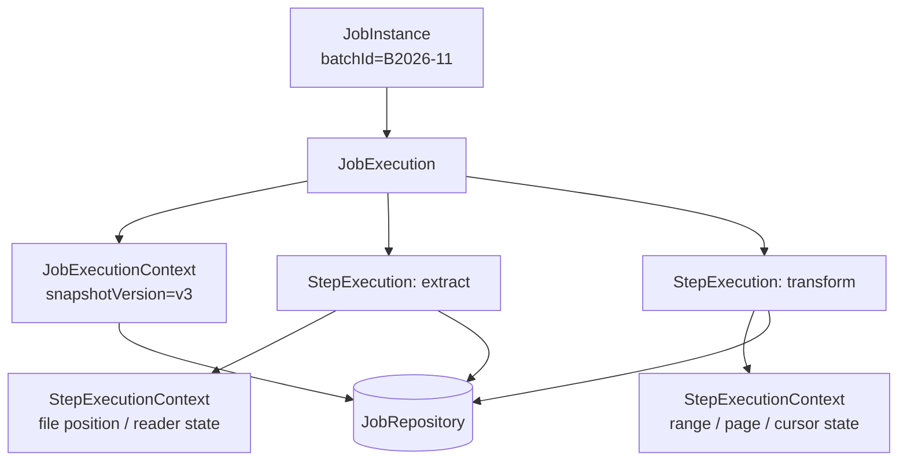
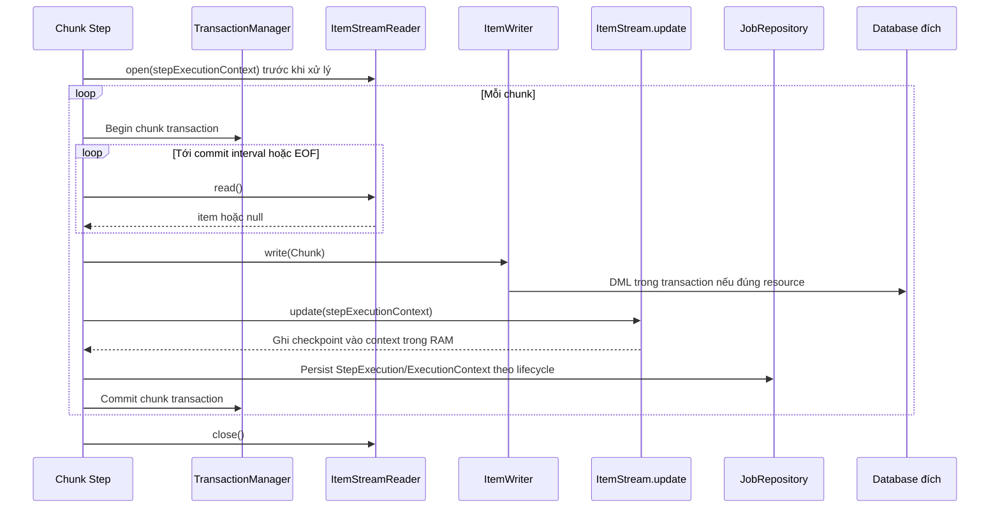
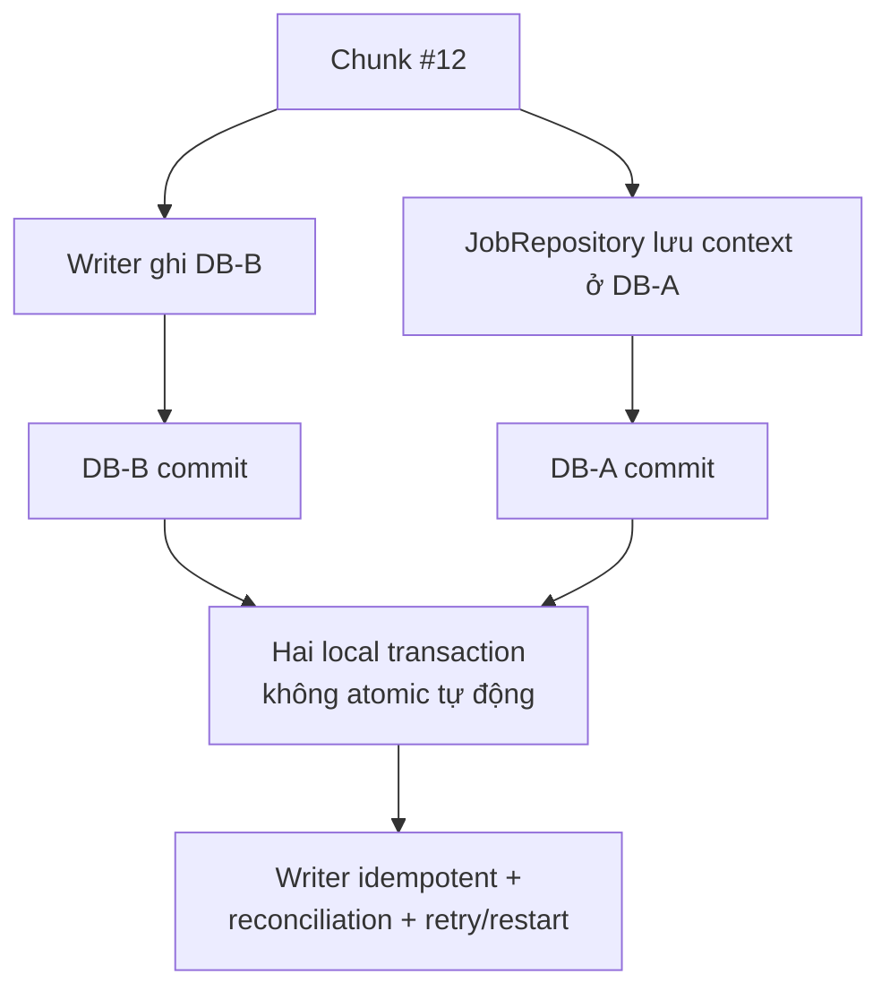
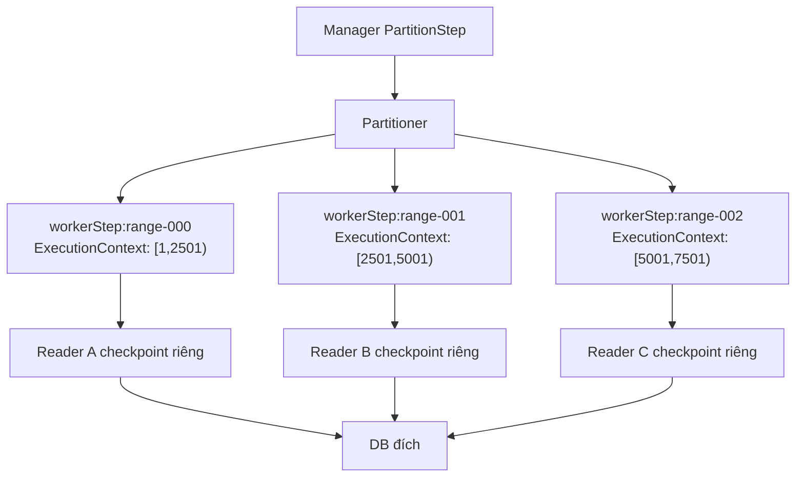

# Persist state giữa các chunk bằng ExecutionContext trong Spring Batch

Một Spring Batch job có thể xử lý hàng triệu bản ghi trong hàng giờ. Nếu worker bị lỗi ở item thứ 800.001, hệ thống không nên mặc định bắt đầu lại từ item đầu tiên, cũng không được bỏ qua dữ liệu chưa được ghi thành công. Khả năng **khôi phục tiến độ** cần một trạng thái được lưu bền vững tại **điểm commit hợp lệ**. Trong Spring Batch, công cụ trung tâm cho việc này là `ExecutionContext` kết hợp với hợp đồng `ItemStream` và `JobRepository`.

Bài thuộc chương **ExecutionContext** của module **SPRING_BATCH_SCALING_OPERATIONS**. Module hướng tới mở rộng Spring Batch cho workload dữ liệu lớn qua multi-threaded step, parallel steps, partitioning và mô hình phân tán, đồng thời đo bottleneck, bảo đảm thread safety, retry/restart và vận hành job theo tài nguyên thực tế.

**Chủ đề trực tiếp:** *Persist state giữa các chunk* — giải thích dữ liệu nào được lưu, lúc nào lưu, điều gì xảy ra khi rollback/crash, và vì sao checkpoint đúng còn phụ thuộc transaction, reader, writer, tính ổn định của dữ liệu đầu vào và cấu hình chạy song song.

Sau bài học, bạn có thể:

- Phân biệt `ExecutionContext` cấp Step và Job, với `JobParameters` và các bộ đếm `StepExecution`.
- Giải thích vòng đời `ItemStream.open()`, `read()`, `update()` và `close()` trong chunk Step.
- Hiểu điểm lưu checkpoint so với transaction commit và phân tích các cửa sổ lỗi.
- Tạo một reader có state phục hồi được sau restart, hoặc dùng reader chuẩn có `saveState(true)`.
- Tránh mất/trùng bản ghi trong multi-threaded Step, local/remote partitioning và remote chunking.
- Thiết kế kiểm thử rollback, stop, crash và đối soát dữ liệu đầu ra.

## 1. ExecutionContext là gì?

`ExecutionContext` là một kho khóa–giá trị do Spring Batch quản lý để chứa **trạng thái thực thi có thể lưu và phục hồi**. Nó không phải cache phân tán cho toàn bộ dữ liệu, cũng không phải message queue. Thay vì lưu từng item, ta thường chỉ lưu metadata tối thiểu, ví dụ:

```text
reader.orders.current.count = 1200
reader.orders.last.id       = 83500
range.startId               = 80001
range.endId                 = 100001
input.snapshotId            = B2026-11
```

Các key ở trên chỉ là ví dụ ứng dụng; key thật của reader do Spring Batch hoặc implementation đặt ra có thể khác. Sau khi tiến độ đã được persist qua `JobRepository`, một lần restart có thể dùng context để mở reader tại vị trí tương ứng.

**Phân biệt dữ liệu trong RAM và dữ liệu bền vững:**

- Gọi `executionContext.putLong("lastId", 83500)` chỉ **thay đổi đối tượng context đang có trong bộ nhớ** và đánh dấu nó thay đổi.
- Để trạng thái tồn tại sau JVM crash, `JobRepository` phải **persist** context theo lifecycle Batch.
- Với chunk Step thông thường, Spring Batch gọi `ItemStream.update(...)` và ghi Step `ExecutionContext` ở các điểm commit được quản lý.
- Nếu ứng dụng tự giữ một biến `lastSeenId` mà không đưa vào luồng `ItemStream`/metadata đúng, biến đó **không trở thành checkpoint**.

**Nguyên tắc:** *Đã đọc* không đồng nghĩa *đã xử lý xong*, và *đã ghi một câu SQL* chưa đồng nghĩa *đã commit*. Checkpoint phải đại diện cho ranh giới tiến độ có thể khôi phục, không phải con số lớn nhất từng nhìn thấy.

## 2. Có hai ExecutionContext khác nhau

| Phạm vi | Lấy từ | Nội dung thường lưu | Thời điểm persist thường gặp |
| --- | --- | --- | --- |
| **StepExecutionContext** | `stepExecution.getExecutionContext()` | Cursor/page/offset reader, khóa checkpoint, phạm vi partition, state writer | Tại các commit point của chunk và các mốc Step lifecycle do framework quản lý |
| **JobExecutionContext** | `jobExecution.getExecutionContext()` | Dữ liệu chia sẻ giữa các Step, version/snapshot chung, tham chiếu kết quả Step trước | Khi framework cập nhật metadata JobExecution, thường ở ranh giới giữa các Step |
| **JobParameters** | `jobExecution.getJobParameters()` | Input khởi chạy như `batchId`, ngày, loại job, identifying parameters | Tham số của lần chạy/JobInstance; không dùng để liên tục cập nhật checkpoint |

Cần đặc biệt chú ý: **không nên dùng JobExecutionContext làm nơi cập nhật tiến độ sau từng item**. Checkpoint reader là trạng thái của **StepExecution**; với partitioning, mỗi worker StepExecution có context riêng.

### Ví dụ cấu trúc dữ liệu



Với partitioning, manager tạo nhiều worker `StepExecution`; mỗi worker được gắn `ExecutionContext` chứa phần việc riêng. Tên partition cần ổn định để cơ chế restart có thể gắn context đã lưu với **đúng công việc logic**, không phải với worker thread bất kỳ.

## 3. Vòng đời một chunk và thời điểm lưu state

Một chunk-oriented Step có chu trình đơn giản hóa như sau:



Sơ đồ là mô hình **chunk processing thông thường**, không áp đặt thứ tự nội bộ của mọi listener/reader, hay đảm bảo mọi JDBC resource đều dùng một transaction. Một số hành vi fault tolerance, buffering, transaction queue và metadata update sẽ khác theo cấu hình.

### Điểm checkpoint so với commit

Trong một chunk bình thường, `ItemStream.update(...)` được framework gọi **trước commit** để xác định state cần lưu, và metadata được cập nhật theo giao dịch/repository phù hợp. Nếu dữ liệu đích và metadata cùng tham gia **một transaction DB thực sự**, tính nguyên tử của chúng có thể được bảo vệ tại commit.

Tuy nhiên, nếu `JobRepository` dùng DB-A còn writer ghi DB-B bằng hai transaction local độc lập, thì **không có cam kết atomic giữa metadata và output**. Các tình huống cần đối phó:

- DB-B commit output nhưng checkpoint ở DB-A chưa được ghi: restart có thể đọc/ghi lại.
- Checkpoint được ghi bền vững không đồng bộ với output: có nguy cơ bỏ sót dữ liệu nếu logic/transaction cấu hình sai.
- Commit gặp lỗi mạng: client có thể không biết chắc DB đã commit hay chưa.

Vì vậy, **`ExecutionContext` không thể thay thế writer idempotent và đối soát dữ liệu**. Cơ chế checkpoint và transaction là hai phần phối hợp, không phải một “bảo hiểm” hoạt động độc lập với thiết kế dữ liệu.

## 4. Ví dụ cụ thể: đọc 1.000 item, chunk size 100

Giả sử job xử lý tập input có ID 1–1.000, mỗi input tạo đúng một output. Với chunk size 100:

| Sự kiện | Reader đã đọc tới | Chunk đã commit | Checkpoint kỳ vọng sau commit |
| --- | ---: | --- | ---: |
| Job mới bắt đầu | 0 | Chưa | 0 |
| Chunk 1 hoàn tất | 100 | 1–100 | 100 |
| Chunk 2 hoàn tất | 200 | 101–200 | 200 |
| Chunk 3 đọc tới 300 nhưng writer lỗi | 300 | Chunk 3 rollback | **200** nếu metadata đúng ranh giới |
| Job dừng sau lỗi | Có thể có in-memory state 300 | Output 1–200 vẫn còn | State bền vững cuối 200 |
| Job restart | Reader mở từ checkpoint trước | Xử lý lại 201–300 rồi tiếp tục | Tiến lên theo commit |

Bảng chỉ là **mô hình checkpoint theo vị trí** với input ổn định và reader được thiết kế đúng. Nó không có nghĩa reader tự động “lùi vị trí trong RAM” mỗi khi SQL rollback. Trong cùng một lần Step, cơ chế buffer/retry/rollback của Spring Batch có thể giữ hoặc phát lại item tùy loại reader và fault-tolerant policy; khi **restart StepExecution**, `open(...)` dùng checkpoint đã persist.

### Vì sao `lastSeenId` nguy hiểm?

Nếu processor lưu `lastSeenId = 300` ngay khi thấy item 300 nhưng chunk 3 chưa commit, rồi chương trình khởi động lại và đọc từ 301, toàn bộ 201–300 có nguy cơ **bị bỏ sót**. Checkpoint không được định nghĩa bằng “đã nhìn thấy”, mà bằng **đã hoàn tất tại commit point có thể phục hồi**.

Ngược lại, nếu checkpoint vẫn là 200 mà một phần dữ liệu của 201–300 đã commit ở resource khác, restart sẽ đọc lại chúng. Vì vậy writer cần biết xử lý lặp mà không làm sai kết quả nghiệp vụ.

## 5. Hợp đồng ItemStream: open, update, close

Spring Batch dùng interface `ItemStream` cho các thành phần có state, trong đó có các phương thức:

```java
public interface ItemStream {
    void open(ExecutionContext executionContext)
            throws ItemStreamException;

    void update(ExecutionContext executionContext)
            throws ItemStreamException;

    void close() throws ItemStreamException;
}
```

Đây là hình thức API để giải thích contract; muốn dùng trong project cần import các kiểu từ `org.springframework.batch.item` theo phiên bản Spring Batch.

- **`open(context)`:** khởi tạo resource và phục hồi state đã persist, hoặc bắt đầu từ vị trí khởi tạo khi context chưa có key.
- **`read()`:** cung cấp item tiếp theo; có thể thay đổi trạng thái **trong RAM** (offset, line number, cursor).
- **`update(context)`:** đưa state cần checkpoint vào context mà framework đang quản lý. Đây không phải nơi gọi `JobRepository` thủ công tùy ý.
- **`close()`:** giải phóng file handle, cursor hoặc resource khi lifecycle kết thúc. Nó không thay thế commit.

Nếu reader/writer có state mà chỉ implement `ItemReader`/`ItemWriter`, framework **không thể tự biết cần gọi `open/update/close`** cho state đó. Sử dụng `ItemStreamReader<T>` hoặc `ItemStreamWriter<T>` khi cần cả xử lý item lẫn lifecycle state.

**Cần khai báo/đăng ký đúng component:** reader/writer trực tiếp trên Step builder mà implement `ItemStream` thường được tự nhận diện; với delegate bị giấu bên trong adapter/composite hoặc bean proxy không bộc lộ interface, có thể cần đăng ký qua `.stream(...)` hoặc để return type đủ rõ. Nếu không, code có `update()` nhưng lifecycle không chạy, khiến restart đọc từ đầu.

## 6. Viết reader có checkpoint để thấy cơ chế hoạt động

Ví dụ sau dùng danh sách item **bất biến và đã chốt** để tập trung vào cơ chế lưu state. Đây là ví dụ sư phạm, **không phải reader production cho dữ liệu lớn**.

### 6.1. Reader đơn giản với con trỏ vị trí

```java
import java.util.List;
import java.util.Objects;

import org.springframework.batch.item.ExecutionContext;
import org.springframework.batch.item.ItemStreamReader;

public final class ListCheckpointReader<T>
        implements ItemStreamReader<T> {

    private final List<T> snapshot;
    private final String positionKey;
    private int nextIndex;

    public ListCheckpointReader(
            String name, List<T> snapshot) {
        Objects.requireNonNull(name);
        this.snapshot = List.copyOf(snapshot);
        this.positionKey = name + ".nextIndex";
    }

    @Override
    public void open(ExecutionContext context) {
        nextIndex = context.getInt(positionKey, 0);
        if (nextIndex < 0 || nextIndex > snapshot.size()) {
            throw new IllegalStateException(
                    "Invalid checkpoint: " + nextIndex);
        }
    }

    @Override
    public T read() {
        if (nextIndex >= snapshot.size()) {
            return null;
        }
        return snapshot.get(nextIndex++);
    }

    @Override
    public void update(ExecutionContext context) {
        context.putInt(positionKey, nextIndex);
    }

    @Override
    public void close() {
        // Demo giữ List trong RAM, không có file/cursor để đóng.
    }
}
```

**Cách đọc code:**

1. `positionKey` có namespace theo tên reader, tránh xung đột với stream khác.
2. `open(...)` phục hồi `nextIndex` từ context; không có key thì bắt đầu từ 0.
3. `read()` thay đổi state trong RAM để đọc item tiếp theo.
4. `update(...)` đặt vị trí hiện tại vào context ở **checkpoint boundary** do framework gọi.
5. `close()` không có resource cần giải phóng trong demo.
6. **`snapshot` phải bất biến** qua lần restart: nếu danh sách bị chèn/xóa/sắp xếp lại, vị trí `nextIndex=200` sẽ chỉ tới các item khác.
7. **Không thread-safe:** nếu nhiều chunk threads gọi `read()`/`update()` cùng lúc trên cùng reader, các thay đổi `nextIndex` có thể race. Không dùng reader này cho multi-threaded chunk Step nếu chưa thiết kế lại cơ chế cạnh tranh và checkpoint.

Tương tự, việc chỉ gọi `synchronized read()` chưa chứng minh restart đúng khi **thứ tự commit chunk khác thứ tự đọc**. Một pointer đơn chỉ nói “đã đi tới đâu” mà không biết item nào thuộc chunk chưa commit.

### 6.2. Unit test phục hồi từ context

```java
import static org.junit.jupiter.api.Assertions.assertEquals;
import static org.junit.jupiter.api.Assertions.assertNull;

import java.util.List;
import org.junit.jupiter.api.Test;
import org.springframework.batch.item.ExecutionContext;

class ListCheckpointReaderTest {

    @Test
    void restoresPositionFromCheckpoint() {
        var context = new ExecutionContext();
        var first = new ListCheckpointReader<>(
                "ordersReader", List.of("A", "B", "C"));

        first.open(context);
        assertEquals("A", first.read());
        assertEquals("B", first.read());
        first.update(context);
        first.close();

        var restarted = new ListCheckpointReader<>(
                "ordersReader", List.of("A", "B", "C"));
        restarted.open(context);

        assertEquals("C", restarted.read());
        assertNull(restarted.read());
        restarted.close();
    }
}
```

Test trên chứng minh `open/update` có thể phục hồi **từ cùng đối tượng context trong RAM**. **Nó không chứng minh `JobRepository` đã ghi context xuống database**, không chứng minh rollback đúng, và không mô phỏng crash. Cần integration test chạy Job thật với repository bền vững.

### 6.3. Gắn reader vào Step

```java
import org.springframework.batch.core.Step;
import org.springframework.batch.core.repository.JobRepository;
import org.springframework.batch.core.step.builder.StepBuilder;
import org.springframework.batch.item.ItemProcessor;
import org.springframework.batch.item.ItemWriter;
import org.springframework.context.annotation.Bean;
import org.springframework.transaction.PlatformTransactionManager;

@Bean
public Step demoCheckpointStep(
        JobRepository jobRepository,
        PlatformTransactionManager transactionManager,
        ListCheckpointReader<String> demoReader,
        ItemProcessor<String, String> processor,
        ItemWriter<String> writer) {

    return new StepBuilder("demoCheckpointStep", jobRepository)
            .<String, String>chunk(100, transactionManager)
            .reader(demoReader)
            .processor(processor)
            .writer(writer)
            .build();
}
```

`demoReader`, `processor` và `writer` là các bean ứng dụng cung cấp; ví dụ không cung cấp đủ cấu hình để tự chạy nguyên một project. Chú ý tên Step/reader **phải ổn định** khi restart; đổi tên component có thể khiến key checkpoint cũ không được nhận ra.

## 7. Dùng reader chuẩn: saveState, name và thứ tự ổn định

Trong production, nên ưu tiên reader đã được Spring Batch triển khai và kiểm thử, như `FlatFileItemReader`, `JdbcCursorItemReader`, `JdbcPagingItemReader`, tùy đặc tính nguồn. Các reader stateful thường có API cấu hình `name` và `saveState`.

### Ví dụ JdbcPagingItemReader

```java
import javax.sql.DataSource;
import java.util.Map;

import org.springframework.batch.core.configuration.annotation.StepScope;
import org.springframework.batch.item.database.JdbcPagingItemReader;
import org.springframework.batch.item.database.builder.JdbcPagingItemReaderBuilder;
import org.springframework.batch.item.database.support.PostgresPagingQueryProvider;
import org.springframework.beans.factory.annotation.Value;
import org.springframework.context.annotation.Bean;

@Bean
@StepScope
public JdbcPagingItemReader<OrderRow> ordersPagingReader(
        DataSource dataSource,
        @Value("#{jobParameters['batchId']}") String batchId) {

    if (batchId == null || batchId.isBlank()) {
        throw new IllegalArgumentException("Missing batchId");
    }

    var query = new PostgresPagingQueryProvider();
    query.setSelectClause("SELECT id, gross_amount");
    query.setFromClause("FROM staging_orders");
    query.setWhereClause("WHERE batch_id = :batchId");
    query.setSortKeys(Map.of("id",
            org.springframework.batch.item.database.Order.ASCENDING));

    return new JdbcPagingItemReaderBuilder<OrderRow>()
            .name("ordersPagingReader")
            .dataSource(dataSource)
            .queryProvider(query)
            .parameterValues(Map.of("batchId", batchId))
            .pageSize(200)
            .rowMapper((rs, rowNum) -> new OrderRow(
                    rs.getLong("id"),
                    rs.getBigDecimal("gross_amount")))
            .saveState(true)
            .build();
}
```

`OrderRow` là record/class nghiệp vụ do ứng dụng cung cấp. Với paging reader, sort key cần **duy nhất và ổn định** trong tập được đọc; `id` ở đây giả định duy nhất trong mỗi `batchId`. Nếu không, dùng khóa sắp xếp gồm đủ tie-breaker. Cần index phù hợp (thường xem xét `(batch_id, id)`), query plan và snapshot dữ liệu ổn định.

### Phân biệt các cài đặt

| Thiết lập | Mục đích | Cảnh báo |
| --- | --- | --- |
| `name("ordersPagingReader")` | Namespace cho state keys của reader | Đổi name khi restart có thể mất checkpoint |
| `saveState(true)` | Cho phép reader lưu trạng thái vào `ExecutionContext` | Cần framework thực sự gọi `ItemStream.update` và persist context |
| `saveState(false)` | Không lưu vị trí reader vào context | Có thể cần trong một số kiến trúc concurrent, nhưng **mất khả năng restart từ vị trí reader** |
| `pageSize(200)` | Số dòng mỗi trang SQL | **Khác** `chunk(200)`; không bắt buộc trùng nhau |
| `@StepScope` | Đọc JobParameters/StepExecutionContext lúc worker Step bắt đầu | Scope theo **StepExecution**, không theo thread |

**Không tắt `saveState` chỉ để che lỗi concurrency rồi kết luận job vẫn restartable như cũ.** Khi tắt, hệ thống phải có phương án khôi phục khác: đọc lại từ đầu theo snapshot và writer idempotent, partitioning theo khóa cố định hoặc bảng công việc bền vững.

### Với FlatFileItemReader

Reader file thường cần `name`, đường dẫn file ổn định và parser nhất quán. Checkpoint theo số dòng/vị trí chỉ có ý nghĩa khi file **không bị thay đổi nội dung, thứ tự hoặc encoding** giữa các lần restart. Một file được ghi thêm hoặc sửa vài dòng ở đầu có thể làm số dòng checkpoint trỏ sai dữ liệu.

## 8. Khi nào framework ghi Step ExecutionContext?

Đây là khác biệt cốt lõi giữa *cập nhật object* và *persist state*.

```java
ExecutionContext context =
        stepExecution.getExecutionContext();

context.putLong("lastCommittedId", 5000L);
```

Code chỉ thay đổi context đang nằm trong bộ nhớ. `ExecutionContext` có cơ chế đánh dấu dirty khi dữ liệu bị thay đổi; điều đó giúp cơ chế repository nhận diện cần persist, nhưng **không tương đương đã commit xuống database**. Spring Batch phải thực hiện cập nhật `StepExecution`/`ExecutionContext` theo lifecycle thích hợp.

Với Step chunk-oriented được cấu hình chuẩn, reader/writer `ItemStream` dùng `update(...)` tại checkpoint point do framework điều khiển. Với custom code tự đưa state vào context trong listener hoặc service, phải hiểu rõ:

- Callback được gọi **trước hay sau** transaction commit?
- Field mới có thực sự được persist ở lần cập nhật metadata tiếp theo không?
- Nếu callback ném exception thì trạng thái nào được ghi?
- Nếu dùng context cấp Job thay vì cấp Step, thời điểm persist có thể không phù hợp với checkpoint từng chunk.
- Nếu metadata repository có transaction khác với writer, cập nhật context và output có atomic không?

**Không nên tự gọi `JobRepository.updateExecutionContext(...)` sau mỗi item** để “lưu cho chắc”: sẽ tăng I/O, gây lock và có thể tạo state đã persist trước khi dữ liệu nghiệp vụ tương ứng commit. Hãy để framework quản lý commit point hoặc thiết kế custom checkpoint có transaction rõ ràng.

## 9. Đặt state gì vào ExecutionContext?

| Nên lưu | Không nên lưu | Lý do |
| --- | --- | --- |
| Vị trí reader, last committed key theo hợp đồng | Toàn bộ hàng triệu input item | Context là metadata, không phải data lake |
| Tên file/URI và checksum/snapshot version | `InputStream`, JDBC `Connection`, `ResultSet` | Resource mở không thể khôi phục an toàn sau process restart |
| `startId`/`endId`/`bucketId` của partition | Spring bean, thread, executor, lock object | Không bền vững/không tương thích serializer |
| Timestamp/watermark nguồn đã chốt | `LocalDateTime.now()` thay đổi mỗi lần chạy làm checkpoint | Giá trị phải tái hiện được |
| Một số counter checkpoint được quản lý cẩn thận | Counter mutable singleton không đồng bộ | Shared state gây race khi concurrent |
| Chuỗi/số/kiểu có serializer hỗ trợ | Credential, access token, dữ liệu nhạy cảm | Rò rỉ bảo mật và làm metadata phình to |

`ExecutionContext` có thể chứa object theo serializer được cấu hình, nhưng **đừng mặc định bất kỳ custom class nào cũng serializable, tương thích sau nâng cấp hoặc an toàn với mọi JobRepository**. Với Spring Batch 5.x, lựa chọn serializer/cơ chế lưu có thể khác các version trước; ưu tiên primitive, String và cấu trúc đơn giản, có schema/version rõ nếu dùng object.

### Key naming và va chạm

Hai reader cùng ghi `position` vào **một StepExecutionContext** có thể ghi đè nhau:

```java
// Dễ va chạm nếu nhiều stream chia cùng context:
context.putInt("position", nextIndex);

// Tốt hơn: namespace theo component name ổn định:
context.putInt("ordersReader.nextIndex", nextIndex);
context.putInt("customersReader.nextIndex", customerIndex);
```

Tên namespace cần ổn định qua restart và được phân biệt giữa hai stream cùng Step. Các reader chuẩn thường sử dụng tên để xây key state; khi dùng multiple readers/delegates, hãy rà lại contract thực.

**Không lưu một key cho trạng thái chưa được commit rồi dùng nó như checkpoint ở lần restart.** Nếu key là `lastSeenId` thay vì `lastCommittedId`, tên key không sửa được lỗi thiết kế.

## 10. State và transaction của JobRepository

Xét một Step dùng `DataSourceTransactionManager` cho writer và một `JobRepository` JDBC.

### Trường hợp cùng database, resource tham gia cùng transaction

Nếu transaction của chunk bao gồm cả output DML và cập nhật checkpoint trong đúng một transaction DB, commit thành công có thể làm dữ liệu đầu ra và metadata tiến độ đồng nhất tại commit. Khi transaction rollback, cả hai loại thay đổi cùng rollback.

Đây là một lý do mô hình chunk transaction hoạt động tốt trong triển khai single database. **Nhưng đừng tự suy ra tất cả bean JDBC dùng chung một transaction**: connection/datasource/transaction manager phải thực sự thống nhất; callback hoặc service `REQUIRES_NEW` có thể phá giả định.

### Trường hợp khác database, resource hoặc message queue



Nếu DB-B commit nhưng DB-A không kịp cập nhật checkpoint, restart có thể ghi lại chunk. Ngược lại, nếu một thiết kế custom lưu checkpoint trước khi output thực sự bền vững, restart có thể bỏ sót item. Không có thay đổi đơn giản ở `ExecutionContext` giải quyết atomicity giữa hai transaction local.

Có thể cân nhắc XA/JTA khi kiến trúc và hạ tầng cho phép, nhưng chi phí và rủi ro vận hành cao hơn. Trong nhiều pipeline, **at-least-once processing với idempotent output** và đối soát là chiến lược thực tế.

### Trạng thái không chắc chắn ở lúc commit

Một lỗi kết nối xảy ra trong commit có thể khiến client không biết DB server đã commit hay chưa. Không giả định mọi `SQLException` tại commit nghĩa là rollback chắc chắn; tra DB theo khóa nghiệp vụ và metadata, rồi quyết định restart an toàn.

## 11. Cùng một StepExecution chạy trên nhiều thread: nguy cơ checkpoint sai

Với **multi-threaded Step**, nhiều chunk task có thể chạy đồng thời nhưng chia sẻ **một StepExecution** và thường cả **một StepExecutionContext**. Một số reader giữ cursor/offset mutable và không hỗ trợ truy cập đồng thời.

Ví dụ giả định:

```text
Worker A: đọc item 1..100, xử lý chậm, chưa commit
Worker B: đọc item 101..200, xử lý nhanh, COMMIT thành công
Checkpoint đơn: position=200
Worker A: ROLLBACK rồi JVM crash
Restart: nếu bắt đầu từ position=200 -> item 1..100 bị bỏ sót
```

Đây là phản ví dụ cho suy luận **“chỉ cần reader được synchronized là restart an toàn”**:

- Mutex quanh `read()` có thể tránh hai thread lấy cùng item ngay thời điểm đọc.
- Nó **không tự làm thứ tự commit giống thứ tự đọc**.
- Một checkpoint cursor đơn không đủ đại diện tập item nào đã commit khi chunk hoàn thành đảo thứ tự.
- `@StepScope` không tạo một reader riêng cho mỗi thread trong cùng `StepExecution`.

Một số implementation/adapter có thể hạn chế concurrency và có bảo vệ riêng, nhưng phải kiểm tra contract của reader, Step builder và phiên bản Spring Batch thật, không dựa trên tên lớp “thread-safe”.

### Những chiến lược an toàn hơn

1. **Chunk Step tuần tự:** nếu reader cursor stateful và yêu cầu restart mạnh, đây là baseline dễ chứng minh.
2. **Partitioning theo khóa/range/hash:** chia các worker StepExecution độc lập, mỗi worker reader riêng và checkpoint riêng.
3. **Nguồn công việc bền vững có trạng thái:** ví dụ bảng work items có khóa duy nhất và transaction/lease để phân phối item, không checkpoint bằng một offset chung đơn giản.
4. **Stateless/idempotent reread:** nếu không lưu position, mỗi lần restart đọc lại snapshot và dựa vào khóa nghiệp vụ để bỏ qua kết quả đã ghi, chấp nhận overhead.
5. **Kiểm chứng commit order:** nếu kiến trúc bắt buộc multi-threaded chunk, phải xây đúng thuật toán progress/dedup dưới concurrent commit, không chỉ tăng `TaskExecutor`.

## 12. Partitioning: mỗi worker có ExecutionContext riêng

Partitioning thường giúp tách tiến độ rõ hơn so với dùng chung một stateful reader trong multi-threaded Step.



**Manager `Partitioner`** tạo `Map<String, ExecutionContext>`; key là tên phần việc, value chứa metadata của vùng input. Spring Batch gắn context đó vào worker `StepExecution` thích hợp. Worker `ItemStream` tiếp tục ghi state reader của chính nó vào context trong các commit point.

Các điều kiện để restart đúng:

- Tên partition ổn định qua cùng JobInstance.
- Mapping tên partition → vùng dữ liệu **không thay đổi tùy tiện** khi restart.
- Input snapshot và thuật toán chia bucket/range đã được chốt.
- Reader `@StepScope` dùng đúng context của **worker StepExecution**, không phải context manager.
- Mỗi worker xử lý chunk tuần tự nếu reader stateful không hỗ trợ đồng thời.
- Writer idempotent và các partition không ghi chồng khóa nghiệp vụ.

### Ví dụ Partitioner cấp context

```java
import java.util.LinkedHashMap;
import java.util.Map;

import org.springframework.batch.core.partition.support.Partitioner;
import org.springframework.batch.item.ExecutionContext;

public final class OrdersRangePartitioner implements Partitioner {

    @Override
    public Map<String, ExecutionContext> partition(int gridSize) {
        Map<String, ExecutionContext> result = new LinkedHashMap<>();

        var p0 = new ExecutionContext();
        p0.putLong("startId", 1L);
        p0.putLong("endId", 2501L);
        result.put("range-000", p0);

        var p1 = new ExecutionContext();
        p1.putLong("startId", 2501L);
        p1.putLong("endId", 5001L);
        result.put("range-001", p1);

        return result;
    }
}
```

Ví dụ này cố định hai range **để minh họa cơ chế context**; `gridSize` không được sử dụng ở đây, nên không phải Partitioner chia được mọi dataset. Production cần tạo plan từ snapshot, đảm bảo đủ và không chồng lấn, giữ plan ổn định qua restart.

Worker reader late bind:

```java
@Bean
@StepScope
public JdbcPagingItemReader<OrderRow> partitionReader(
        DataSource dataSource,
        @Value("#{jobParameters['batchId']}") String batchId,
        @Value("#{stepExecutionContext['startId']}") Long startId,
        @Value("#{stepExecutionContext['endId']}") Long endId) {

    // Validate startId/endId và xây query range có sort key duy nhất.
    // Mỗi worker StepExecution nhận bean stateful riêng.
    return createReaderForRange(dataSource, batchId, startId, endId);
}
```

Đoạn code này là **khung minh họa**, `createReaderForRange` là helper do ứng dụng tự triển khai và cần return reader mang `ItemStream` contract. Nó không phải snippet độc lập có thể chạy ngay. Điều quan trọng là cách đưa `StepExecutionContext` vào reader; scope theo StepExecution, không theo thread.

## 13. Remote partitioning và remote chunking: context nằm ở đâu?

| Mô hình | Reader và checkpoint | `ExecutionContext` quan trọng | Lỗi hay gặp |
| --- | --- | --- | --- |
| Chunk Step tuần tự | Reader ở Step; checkpoint tại commit | StepExecutionContext của Step | Input thay đổi, custom ItemStream không được gọi |
| Multi-threaded Step | Có thể nhiều chunk thread chia reader | Một StepExecutionContext chia sẻ | Race và commit đảo thứ tự |
| Local partitioning | Reader ở worker Step trong cùng JVM | **Mỗi partition StepExecution một context** | Partition mapping thay đổi giữa restart |
| Remote partitioning | Reader ở worker JVM | Worker StepExecutionContext, JobRepository theo kiến trúc | Không khôi phục được context/file/path trên worker |
| **Remote chunking** | **Manager đọc/chia chunk** | Manager StepExecutionContext lưu reader state | Tưởng worker chunk handler có reader/StepExecutionContext riêng |

Trong remote chunking thông thường, worker nhận `ChunkRequest` chứa items và chạy processor/writer; nó không mặc định có một worker StepExecution đọc dữ liệu nguồn như remote partition worker. Do đó **checkpoint của reader ở manager**. Worker phải xử lý request bị giao lại một cách idempotent vì DB commit và broker reply/ack không tự atomic.

### Message redelivery không phải checkpoint

Broker có thể giao lại một message mà worker đã xử lý sau khi worker commit DB nhưng trước khi ack hoặc gửi reply. `ExecutionContext` của manager có thể chưa ghi nhận thành công của chunk. Chính vì vậy, cần **business key và idempotency trên output**; không chỉ dựa vào message ID hoặc `JobExecutionId` để chống lặp qua restart.

## 14. Mối quan hệ giữa retry, skip, rollback và state

Bốn cơ chế khác nhau:

| Cơ chế | Điều framework/ứng dụng làm | Tác động tới checkpoint |
| --- | --- | --- |
| **Rollback** | Không commit các DML tham gia transaction hiện tại | State chưa commit phải không bị coi là tiến độ bền vững |
| **Retry** | Thử lại thao tác bị lỗi trong giới hạn | Item/callback có thể chạy nhiều lần trước commit |
| **Skip** | Bỏ item lỗi theo fault-tolerant policy được phép | Checkpoint của chunk đã phục hồi phải phản ánh policy skip đúng |
| **Filter** | `ItemProcessor` trả `null` | Item không được ghi, nhưng có thể được coi là đã đọc/xử lý hợp lệ |
| **Restart** | Khôi phục từ JobRepository/ExecutionContext đã persist | Chỉ đúng nếu reader/snapshot/writer tuân hợp đồng |

Với lỗi writer, framework fault-tolerant có thể cần rollback và kiểm tra lại item để quyết định skip; không giả định mọi skip đều không rollback. Khi retry hoặc rollback, `ItemReader.read()` có thể được gọi lại hoặc framework có thể dùng buffer tùy cấu hình. Vì vậy, **không viết reader state dựa trên số lần callback listener xảy ra**, mà phải tuân theo contract ItemStream và kiểm thử với đúng chính sách fault tolerance.

### Trường hợp processor có side effect

Nếu processor gọi API gửi email cho 100 item, sau đó writer DB lỗi và chunk rollback, retry có thể gửi email lần thứ hai. `ExecutionContext` có checkpoint đúng vẫn **không thu hồi được email**. Dùng outbox, idempotency key hoặc kiến trúc bù trừ thích hợp; processor nên hạn chế side effect.

## 15. State được promote từ Step lên Job khi nào?

Khi cần đưa một kết quả nhỏ của Step A cho Step B, có thể dùng `ExecutionContextPromotionListener` hoặc logic cập nhật Job context có kiểm soát.

Ví dụ Step A hoàn tất và lưu:

```java
ExecutionContext stepContext =
        stepExecution.getExecutionContext();
stepContext.putString("outputManifest", "s3://bucket/batch-42/manifest.json");
```

Sau Step A, một promotion listener được cấu hình để chuyển key `outputManifest` sang `JobExecutionContext`, để Step B có thể late bind qua:

```java
@Value("#{jobExecutionContext['outputManifest']}")
String manifestPath
```

Đây là một cấu hình **chia sẻ kết quả giữa Step**, không phải cách lưu position reader sau **mỗi chunk**. `ExecutionContextPromotionListener` có lifecycle/điều kiện status; promotion xảy ra ở ranh giới Step phù hợp. Khi chạy nhiều Step song song, ghi chung Job context cần được kiểm soát tránh race và khóa trùng tên.

**Không đưa một checkpoint mutable của worker partition vào một key chung của Job context** rồi để nhiều worker cập nhật song song; nó vừa tranh chấp, vừa không còn ranh giới khôi phục riêng của từng partition.

## 16. Chính sách lưu state: độ bền, chi phí, kích thước

Persist state mỗi chunk tạo overhead metadata nhưng giúp giới hạn công việc cần xử lý lại. Với workload lớn cần cân nhắc:

| Quyết định | Lợi ích | Chi phí / rủi ro |
| --- | --- | --- |
| Chunk size nhỏ | Giới hạn số item cần replay sau lỗi | Commit và JobRepository update thường xuyên hơn |
| Chunk size lớn | Ít transaction/metadata update hơn, batch JDBC có thể tốt | Giữ lock/RAM lâu, replay chunk lớn hơn khi lỗi |
| Context gọn | Ít serialize, ít DB I/O | Cần thiết kế key/snapshot đủ để tái tạo công việc |
| Context chứa object lớn | Có vẻ thuận tiện để truyền dữ liệu | Metadata phình, serializer lỗi, upgrade khó, nguy cơ lộ dữ liệu |
| `saveState(true)` | Reader có checkpoint | Cần input ổn định và đúng ItemStream lifecycle |
| `saveState(false)` | Ít overhead reader state, tránh một số vấn đề concurrent | Không tự restart từ vị trí; yêu cầu xử lý lặp/idempotency khác |
| Partitioning | Checkpoint riêng theo worker | Thêm StepExecution, overhead điều phối, cân bằng tải |

### Ví dụ ước lượng replay

Một job xử lý 10 triệu item, mỗi chunk 1.000 item. Nếu crash ngay trước commit chunk đang chạy, tối đa khoảng **một chunk công việc đang xử lý** có thể cần replay trong **mô hình một Step tuần tự, reader input ổn định và checkpoint đúng**.

Đừng áp giới hạn “tối đa 1.000 item replay” cho multi-threaded Step hoặc remote chunking chỉ vì chunk size 1.000. Khi nhiều chunk in-flight, nhiều worker, queue, message redelivery hoặc metadata/output không atomic, số item có thể cần xử lý lại **lớn hơn** và phụ thuộc trạng thái từng đơn vị công việc.

## 17. Metrics cần quan sát để chứng minh checkpoint khỏe

| Metric / chỉ số | Dùng để phát hiện |
| --- | --- |
| `readCount`, `writeCount`, `filterCount` | Tiến độ logical trong StepExecution |
| `commitCount`, `rollbackCount` | Tần suất commit và transaction lỗi |
| `readSkipCount`, `processSkipCount`, `writeSkipCount` | Số item bị bỏ hợp lệ |
| Khoảng cách từ checkpoint tới đầu vào mới nhất | Lượng công việc có nguy cơ replay |
| Kích thước serialized `ExecutionContext` | Metadata phình hoặc object không phù hợp |
| Thời gian cập nhật JobRepository | Bottleneck metadata/lock |
| Reader latency, SQL cursor/page latency | Input I/O chậm, index không tốt |
| Writer latency, DB pool wait, lock wait | Output DB bị bão hòa |
| `StepExecution` duration và trạng thái theo partition | Skew, worker chậm, restart lặp |
| Số item thiếu/trùng, checksum/tổng giá trị | Tính đúng đắn cuối cùng sau retry/restart |

**Số `readCount` lớn không đồng nghĩa output đã commit đầy đủ.** Reader có thể filter/skip; callback có thể chạy lại; writer có thể ghi sang một resource khác. Theo dõi cả tiến độ framework và đối soát business data.

### Tuning độ lớn chunk

Thử cùng snapshot với `chunk(100)`, `chunk(500)` và `chunk(2_000)`, đo:

- Wall-clock và throughput item đã commit.
- DB commit latency, lock wait và connection pool.
- JobRepository write latency và serialized context size.
- Số item replay sau một lần lỗi cố ý.
- CPU/GC/memory và kết quả đối soát sau restart.

Tăng chunk size chỉ là một đòn tuning. Nếu reader dùng query thiếu index hoặc DB đã lock contention, giảm số lần cập nhật context không nhất thiết cải thiện toàn Job.

## 18. Ma trận kiểm thử persist state giữa các chunk

Dùng database metadata bền vững (không thay bằng repository in-memory) và input snapshot cố định. Test thường xuyên với đúng loại reader/transaction manager đang triển khai.

| Kịch bản | Fault injection | Điều cần kiểm chứng |
| --- | --- | --- |
| Job mới, chưa có context | Chạy từ đầu | Reader mở đúng vị trí đầu, context được ghi sau commit |
| Dừng sau hai chunk | Stop ở commit boundary | Restart đọc đúng phần còn lại, không lặp sai output |
| Writer lỗi giữa chunk ba | Ném exception sau một số DML | DML trong transaction rollback; checkpoint không vượt phần đã commit |
| Processor retry thành công | Exception transient một lần | Không nhân đôi side effect/đầu ra |
| Processor skip hợp lệ | Item sai nghiệp vụ | Checkpoint vẫn đúng, skipCount và tập output phù hợp |
| Thay `saveState(false)` | Restart sau khi đọc nửa input | Nhìn thấy rủi ro đọc lại từ đầu; idempotent writer xử lý |
| Đổi reader name | Restart sau checkpoint | Phát hiện key state cũ không được nhận |
| Nguồn file bị sửa | Chèn dòng ở đầu rồi restart | Test phát hiện snapshot không ổn định |
| Paging sort key không duy nhất | Nhiều hàng cùng thứ tự | Phát hiện thiếu/trùng sau restart |
| Multi-threaded Step | Cho chunk sau commit trước chunk đầu | Kiểm tra checkpoint đơn có thể mất item |
| Partition worker lỗi | Một worker commit, một worker rollback | Checkpoint riêng, restart đúng partition |
| Manager/worker remote crash | Kill ở biên request/reply | Redelivery + idempotency, không nhân đôi |
| DB output khác DB repository | Crash tại biên commit | Có thể replay, đối soát và writer idempotent |
| Context chứa object không serialize được | Gọi update/persist | Lỗi được phát hiện rõ, không báo job hoàn tất giả |
| Concurrent Step writes Job context | Hai Step cập nhật cùng key | Không lost update / định nghĩa owner |
| Job restart sau upgrade | Thay serializer/class version thử nghiệm | Context cũ đọc được hoặc có kế hoạch migration |

### Integration test mẫu theo kịch bản

1. Chuẩn bị 1.000 item đầu vào có khóa và snapshot xác định.
2. Chạy Job lần đầu, chèn lỗi vào writer ở item thuộc chunk thứ ba.
3. Xác minh `BatchStatus`/`ExitStatus` của Step và metadata context sau lỗi; kiểm tra đầu ra DB chỉ chứa chunk đã commit.
4. Bỏ lỗi, restart **cùng JobInstance** theo API được hỗ trợ, giữ nguyên identifying parameters.
5. Xác minh 1.000 item hợp lệ (trừ item filter/skip được định nghĩa) xuất hiện đúng số lần/ngữ nghĩa trong DB.
6. Kiểm tra checkpoint cuối và số chunk thực hiện lại không vượt kỳ vọng của kiến trúc.
7. Lặp test với kill process, DB commit timeout và JobRepository ở database riêng nếu môi trường sản xuất tương tự.

### Đối soát SQL minh họa

```sql
-- Kiểm tra input thiếu output cho cùng batch.
-- Chỉ áp dụng trực tiếp nếu mỗi input phải sinh một output.
SELECT s.id
FROM staging_orders s
LEFT JOIN processed_orders p
  ON p.batch_id = s.batch_id
 AND p.order_id = s.id
WHERE s.batch_id = :batchId
  AND p.order_id IS NULL;

-- Tìm output không có trong input snapshot.
SELECT p.order_id
FROM processed_orders p
LEFT JOIN staging_orders s
  ON s.batch_id = p.batch_id
 AND s.id = p.order_id
WHERE p.batch_id = :batchId
  AND s.id IS NULL;

-- Kiểm tra số lượng và tổng giá trị.
SELECT COUNT(*) AS output_count,
       SUM(amount) AS total_amount
FROM processed_orders
WHERE batch_id = :batchId;
```

Nếu processor filter/skip hoặc một input sinh nhiều output, phải điều chỉnh truy vấn theo quy tắc nghiệp vụ. Unique constraint giúp ngăn duplicate key nhưng **không chứng minh amount đúng**; upsert có thể ghi đè giá trị sai. Cần so với baseline/snapshot hoặc checksum được định nghĩa rõ.

## 19. Những anti-pattern làm checkpoint không đáng tin

| Anti-pattern | Hậu quả | Thiết kế phù hợp hơn |
| --- | --- | --- |
| Dùng biến `lastSeenId` trong processor làm checkpoint | Đánh dấu item chưa commit là đã xong | `ItemStream.update` theo commit boundary |
| Ghi context sau mỗi `read()` rồi persist riêng | State vượt output, metadata I/O quá lớn | Framework checkpoint tại commit |
| Đặt mọi worker vào một JobExecutionContext key | Race, mất tiến độ worker khác | Mỗi worker StepExecutionContext riêng |
| Dùng singleton reader stateful trong multi-threaded Step | Race trên cursor và commit đảo thứ tự | Partitioning với reader riêng |
| `synchronized read()` rồi tin restart an toàn | Đọc tuần tự nhưng commit vẫn đảo thứ tự | Test checkpoint hoặc thay mô hình |
| Tắt `saveState` mà không có replay strategy | Đọc lại từ đầu và duplicate effect | Idempotent reread hoặc checkpoint khác |
| Đổi reader name/Step name khi restart | Không tìm thấy key state | Giữ tên ổn định hoặc migration có kế hoạch |
| Thay đổi file/snapshot trong JobInstance | Offset trỏ tới item khác | Immutable input/version/checksum |
| Lưu JDBC connection hoặc object lớn trong context | Serializer lỗi, state không khôi phục | Lưu khóa và URI, mở lại resource khi chạy |
| Coi context put là dữ liệu đã persist | Crash mất state mới | Hiểu JobRepository lifecycle |
| Coi writer trả về là transaction đã commit | Sai checkpoint khi commit lỗi | Kiểm tra commit/reconciliation |
| JobRepository và writer khác DB nhưng coi atomic | Có thể replay hoặc skip | Idempotency + đối soát |
| Ghi message/API trong processor rồi trông đợi rollback | Side effect lặp | Outbox/idempotency |
| Sửa bảng `BATCH_STEP_EXECUTION_CONTEXT` thủ công | Phá invariants và restart | Dùng API/luồng Spring Batch được hỗ trợ |

## 20. Runbook khi job restart sai vị trí

1. **Giữ nguyên bằng chứng:** JobInstanceId, JobExecutionId, StepExecutionId, JobParameters, Step name, partition name, thời điểm lỗi.
2. **Kiểm tra metadata JobRepository:** Step `BatchStatus`, `ExecutionContext` đã persist, `read/write/commit/rollback` counts; không sửa DB metadata trực tiếp.
3. **Xác nhận input snapshot:** file checksum, phiên bản SQL data, khóa range/bucket và thứ tự sort.
4. **Xác minh ItemStream lifecycle:** reader/writer có `open/update/close`, đã đăng ký với Step và đúng bean scope?
5. **Soát transaction topology:** DB output có cùng transaction với JobRepository không, có `REQUIRES_NEW` hay side effect ngoài DB?
6. **Phân biệt state RAM và state bền vững:** log `lastSeenId` không phải checkpoint sau commit.
7. **Đối soát output DB:** khóa thiếu/trùng, checksum/tổng giá trị và external side effect.
8. **Sửa nguyên nhân:** key collision, input thay đổi, checkpoint custom sai, concurrency quá cao, bean không thread-safe.
9. **Restart an toàn** qua cơ chế Spring Batch khi contract cho phép; nếu cần replay toàn phần, phải có idempotent writer và kế hoạch vận hành rõ.
10. **Đối soát lại sau phục hồi**, chỉ publish downstream khi dữ liệu đã đạt yêu cầu.

Một Job báo `COMPLETED` nhưng output thiếu không phải bằng chứng `ExecutionContext` “tự sửa” được vấn đề; cần tìm lỗi logic, source snapshot, mapping input/output hoặc checkpoint.

## 21. Checklist production: persist state giữa các chunk

- [ ] Đã phân biệt `JobParameters`, `JobExecutionContext` và `StepExecutionContext`.
- [ ] Checkpoint reader được quản lý qua `ItemStream.open/update/close` và Spring Batch commit lifecycle.
- [ ] Reader/writer stateful được khai báo/đăng ký để framework thực sự gọi lifecycle.
- [ ] Tên component và key namespace ổn định, không va chạm trong cùng StepExecutionContext.
- [ ] `saveState(true)` được chọn khi cần restart từ vị trí và reader hỗ trợ đúng.
- [ ] Nếu `saveState(false)`, đã có replay/idempotency strategy riêng.
- [ ] Input snapshot, thứ tự sort, file content và partition mapping ổn định khi restart.
- [ ] Đã biết writer, reader, JobRepository dùng transaction manager/resource nào.
- [ ] Không coi `put(...)` là đã persist, không tự cập nhật checkpoint trước commit.
- [ ] Processor không có side effect không idempotent.
- [ ] Writer xử lý lặp an toàn khi checkpoint và output khác resource hoặc commit không chắc chắn.
- [ ] Không lưu payload lớn, credential, connection, thread hoặc object không tương thích serializer trong context.
- [ ] Không giả định `@StepScope` là thread scope.
- [ ] Multi-threaded Step có thiết kế checkpoint đúng dưới commit đảo thứ tự, hoặc chọn partitioning.
- [ ] Partition worker có StepExecutionContext riêng, range/bucket không chồng lấn, tên ổn định.
- [ ] Remote chunking có checkpoint reader ở manager và worker chịu được message redelivery.
- [ ] Đã đo JobRepository update latency, context size, transaction/DB lock và throughput.
- [ ] Đã thử lỗi read/process/write/commit, kill JVM, retry, skip, stop và restart.
- [ ] Đã kiểm tra output bằng tập khóa, giá trị và checksum, không chỉ dựa vào BatchStatus.
- [ ] Có runbook khôi phục checkpoint và xử lý dữ liệu đã commit trước sự cố.

## 22. Câu hỏi và bài tập vận dụng

1. Gọi `executionContext.putInt("position", 500)` đã chắc chắn persist state xuống JobRepository chưa? Vì sao?
2. `ItemStream.update(...)` khác `ItemStream.open(...)` ở trách nhiệm nào?
3. Một Step chunk size 100 đã commit hai chunk. Chunk thứ ba đọc thêm 100 item rồi rollback. State bền vững lý tưởng nằm ở vị trí nào?
4. Nếu JobRepository và output DB là hai resource không giao dịch nguyên tử, checkpoint có thể không khớp dữ liệu đã ghi trong trường hợp nào?
5. Tại sao chỉ thêm `synchronized` vào `read()` không tự bảo đảm restart an toàn ở multi-threaded Step?
6. `@StepScope` tạo bean theo StepExecution hay theo mỗi worker thread?
7. Với remote chunking, checkpoint của reader chủ yếu nằm ở manager hay remote chunk handler? Khác remote partitioning ra sao?
8. Nếu `saveState(false)`, cần những điều kiện gì để chạy lại an toàn?
9. Một `FlatFileItemReader` restart theo số dòng, nhưng file bị chèn dòng mới ở đầu. Điều gì có thể sai?
10. Hai stream trong cùng Step dùng key `position`. Lỗi nào có thể xuất hiện và sửa ra sao?
11. Sau khi SQL writer trả thành công, transaction commit gặp lỗi mạng. Có thể kết luận dữ liệu chưa commit không? Nên làm gì?
12. Hãy thiết kế integration test với một partition commit, một partition rollback, sau đó restart và đối soát output.
13. Tại sao `ExecutionContextPromotionListener` phù hợp chuyển metadata giữa các Step nhưng không nên thay StepExecutionContext checkpoint từng chunk?
14. Nếu thời gian cập nhật JobRepository tăng mạnh khi giảm chunk size, bạn cần đo thêm những bottleneck nào trước khi tuning?

## Kết luận

**Persist state giữa các chunk không phải việc lưu “item cuối đã nhìn thấy”; đó là việc lưu tiến độ có thể khôi phục tại ranh giới commit hợp lệ.** Spring Batch phối hợp `ExecutionContext`, `ItemStream.open/update/close` và `JobRepository` để làm điều này. Nhưng khi dữ liệu đầu vào thay đổi, nhiều chunk commit đảo thứ tự, worker/broker xử lý lặp hoặc metadata và output nằm ở các resource khác nhau, một checkpoint đơn không tự bảo đảm tính đúng đắn. Để mở rộng workload an toàn, hãy chốt input snapshot, dùng state key ổn định, giữ thread safety, writer idempotent và **kiểm thử crash/restart bằng đối soát dữ liệu cuối cùng**.
