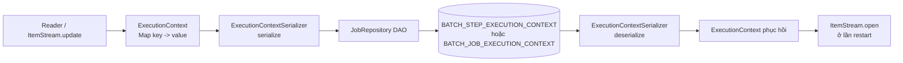
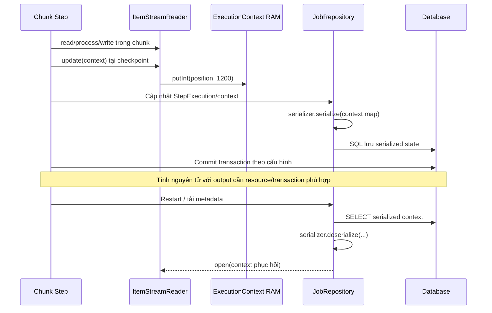
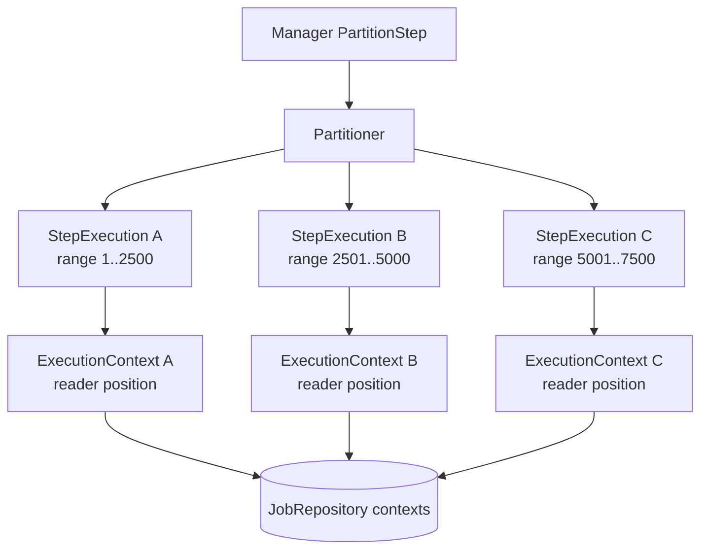

# Serial hóa giá trị context trong Spring Batch ExecutionContext

Một Spring Batch job chạy qua nhiều giờ có thể đọc hàng triệu bản ghi và cập nhật trạng thái sau mỗi chunk. Nếu tiến trình bị dừng giữa chừng, Spring Batch cần khôi phục được vị trí reader, thông tin partition, watermark hoặc dữ liệu điều phối đã lưu trước đó. Các giá trị này thường nằm trong `ExecutionContext`. Tuy nhiên, `ExecutionContext` trong RAM **chưa phải checkpoint bền vững**: để sống sót sau JVM crash, dữ liệu phải được **serialize**, ghi vào `JobRepository` và **deserialize** thành công khi restart.

Việc serialize tưởng chừng chỉ là chuyển object sang chuỗi/byte, nhưng khi scale workload lớn, nó ảnh hưởng trực tiếp đến **tính restartable, hiệu năng cập nhật metadata, tương thích phiên bản, bảo mật và độ tin cậy của job**. Một custom object hôm nay serialize được có thể không còn deserialize được sau lần deploy thay đổi package/class; một context chứa hàng nghìn item có thể trở thành nút thắt của database; hoặc hai worker ghi nhầm key chung làm checkpoint sai dù serializer hoàn toàn hoạt động.

Bài thuộc chương **ExecutionContext** của module **SPRING_BATCH_SCALING_OPERATIONS**. Module tập trung mở rộng Spring Batch cho multi-threaded step, parallel steps, partitioning và các mô hình xử lý phân tán, đồng thời đo bottleneck, giữ thread safety, retry/restart và lựa chọn kiến trúc phù hợp tài nguyên.

**Sau bài học, bạn sẽ:**

- Giải thích pipeline `ExecutionContext → ExecutionContextSerializer → JobRepository → database → deserialize`.
- Chọn kiểu dữ liệu context phù hợp, tránh object graph lớn, không ổn định hoặc nhạy cảm.
- Phân biệt serializer mặc định trong Spring Batch 5.x với các lựa chọn JSON và yêu cầu tương thích khi chuyển đổi.
- Thiết kế schema/version cho state, key namespace, migration và chiến lược restart sau deployment.
- Phân tích lỗi serialize/deserialize tại commit, startup/restart và trong partitioning.
- Viết unit test round-trip, integration test persist/restart và checklist vận hành.

## 1. ExecutionContext tồn tại ở đâu?

Spring Batch sử dụng hai context quan trọng:

| Context | Thuộc về | Giá trị ví dụ | Thời điểm lưu thường gặp |
| --- | --- | --- | --- |
| **Step ExecutionContext** | Một `StepExecution` | `reader.nextIndex`, `startId`, `endId`, vị trí file, partition watermark | Các checkpoint trong chunk và mốc cập nhật Step do framework quản lý |
| **Job ExecutionContext** | Một `JobExecution` | `snapshotId`, manifest đầu vào, version xử lý chung | Các mốc Job/Step lifecycle theo repository |
| **JobParameters** | Input của JobExecution; tham gia nhận diện JobInstance theo identifying flag | `batchId`, ngày xử lý, tên đợt | Không phải kho mutable checkpoint và không được sửa như context |

`ExecutionContext` có thể được xem như một map có các giá trị kiểu `Object`, nhưng metadata repository **không giữ nguyên đối tượng Java trong bộ nhớ**. Khi cập nhật repository, các giá trị phải đi qua `ExecutionContextSerializer`.



**Điểm then chốt:** `context.put(...)` thay đổi object context trong RAM; không có nghĩa database đã lưu giá trị mới. Muốn phục hồi, phải có **lần persist metadata thành công** và dữ liệu đó phải có thể deserialize trên tiến trình sau.

### ExecutionContext khác checkpoint theo nghiệp vụ

Serializer có thể lưu chính xác `lastSeenId=10_000`, nhưng nếu 500 item cuối chưa commit thì một checkpoint khôi phục từ `10_001` sẽ làm mất dữ liệu. Serializer **không biết** giá trị nào đại diện cho item đã commit; đó là trách nhiệm của `ItemStream`, transaction và thiết kế reader/writer.

## 2. Ba bước: cập nhật, serialize, persist

Giả sử reader xử lý file với position 1.200:

```java
ExecutionContext context = stepExecution.getExecutionContext();
context.putInt("ordersReader.nextIndex", 1_200);
context.putString("input.snapshotId", "B2026-11");
```

Đoạn code trên **chỉ đưa dữ liệu vào map context hiện tại**. Các bước tiếp theo là:

1. Framework xác định đến **điểm checkpoint** thích hợp của chunk hoặc lifecycle.
2. Các `ItemStream` được đăng ký có thể nhận `update(executionContext)` để ghi state của chúng.
3. `JobRepository`/DAO chuyển map thành dữ liệu lưu trữ thông qua `ExecutionContextSerializer`.
4. Database commit transaction metadata theo cấu hình repository/transaction manager.
5. Khi restart, Spring Batch lấy serialized content và deserialize thành object map, phục vụ `ItemStream.open(...)`.



Sơ đồ là mô hình khái niệm của một Step chunk-oriented: **không cam kết metadata và bảng output luôn nằm trong cùng transaction**. Nếu `JobRepository` dùng DB-A, writer dùng DB-B, hoặc output là API/broker, hai hệ thống không tự commit nguyên tử. Ngay cả serializer đúng vẫn cần idempotent writer và đối soát.

### Dirty flag không đồng nghĩa đã commit

`ExecutionContext` theo dõi việc map bị thay đổi qua các thao tác như `put(...)`. Nhưng dirty flag chỉ là tín hiệu cho việc cập nhật metadata; nó không đại diện cho **độ bền của giao dịch**. Đặc biệt, nếu lưu **một object mutable** vào context rồi chỉ sửa field bên trong object mà không `put` lại, cơ chế theo dõi thay đổi có thể không nhận ra state đã đổi. Vì vậy nên dùng giá trị bất biến hoặc cập nhật bằng `putXxx(...)` rõ ràng tại checkpoint.

## 3. Serialization và deserialization thực chất làm gì?

**Serialization** chuyển một map có các cặp khóa–giá trị Java sang định dạng mà `JobRepository` có thể lưu như chuỗi/byte trong metadata store. **Deserialization** khôi phục giá trị Java từ định dạng đó.

```text
ExecutionContext
  "ordersReader.current.index" -> Integer(1200)
  "batchId"                   -> String("B2026-11")
  "rangeStart"                -> Long(80001)
          |
          v
ExecutionContextSerializer.serialize(...)
          |
          v
Serialized representation (binary/base64/JSON tùy serializer)
          |
          v
JobRepository lưu bền vững
          |
          v
ExecutionContextSerializer.deserialize(...)
          |
          v
Map<String,Object> dùng để khởi tạo ExecutionContext
```

Một serializer phải thỏa ít nhất hai điều kiện:

- **Round-trip đúng:** deserialize(serialize(state)) khôi phục được các key và giá trị cần thiết với đúng kiểu/ngữ nghĩa.
- **Tương thích theo thời gian:** tiến trình sẽ restart sau khi deploy phải **đọc được dữ liệu do phiên bản trước ghi**, hoặc phải có kế hoạch chuyển đổi/khởi tạo lại an toàn.

**Chỉ “serialize không ném exception” chưa đủ.** Kiểm tra khác biệt kiểu `Integer`/`Long`, precision số thập phân, timezone, enums, đổi tên lớp, classloader và quy tắc chuyển object.

## 4. Serializer mặc định của Spring Batch 5.x

Trong nhánh Spring Batch 5.x, `DefaultExecutionContextSerializer` dùng **Java object serialization** cho dữ liệu map, sau đó biểu diễn theo dạng thích hợp để lưu ở repository (thường thấy chuỗi Base64). Giá trị custom đưa vào context phải đáp ứng các yêu cầu serializable tương ứng.

```java
import org.springframework.batch.core.repository.dao.DefaultExecutionContextSerializer;
import java.io.ByteArrayInputStream;
import java.io.ByteArrayOutputStream;
import java.util.HashMap;
import java.util.Map;

public final class SerializerRoundTripDemo {

    public static void main(String[] args) throws Exception {
        var serializer = new DefaultExecutionContextSerializer();

        Map<String, Object> values = new HashMap<>();
        values.put("schemaVersion", 1);
        values.put("reader.nextId", 10_001L);
        values.put("snapshotId", "B2026-11");

        var out = new ByteArrayOutputStream();
        serializer.serialize(values, out);

        byte[] serialized = out.toByteArray();
        Map<String, Object> restored = serializer.deserialize(
                new ByteArrayInputStream(serialized));

        if (!values.equals(restored)) {
            throw new IllegalStateException("Context round-trip failed");
        }
    }
}
```

Đây là ví dụ **kiểm tra serializer thuần**, không chạy một Step/Job thực và không ghi `JobRepository`. Nó chứng minh bộ giá trị của ví dụ có thể round-trip bằng serializer trong cùng runtime.

### Những nhận định cần chính xác

- **Base64 không phải encryption.** Nó chỉ là cách biểu diễn dữ liệu; người có quyền đọc metadata vẫn có thể giải mã nội dung.
- **Java serialization không phải một định dạng schema ổn định xuyên mọi thay đổi source code.** Class đổi package, xóa field, đổi `serialVersionUID`, classloader khác hoặc nâng Java/library có thể gây lỗi đọc context cũ.
- Không dùng Java deserialization cho input không đáng tin: cơ chế native deserialization có các rủi ro bảo mật nổi tiếng. Hạn chế quyền ghi metadata và kiểm soát dữ liệu deserialize.
- Hướng dẫn ở đây nêu cho **Spring Batch 5.x**; hãy xác minh serializer mà JobRepository **đang cấu hình thật**, đặc biệt trong ứng dụng đã nâng cấp hoặc custom infrastructure. Đừng suy từ tên version rằng hệ thống chắc chắn dùng default.

### Vì sao dữ liệu serialized nhìn không giống JSON?

Một row trong `BATCH_STEP_EXECUTION_CONTEXT` có thể chứa một chuỗi trông như Base64 thay vì map JSON dễ đọc. Điều đó **không phải lỗi** nếu serializer được cấu hình để ghi như vậy. Ngược lại, thay serializer mới sang JSON rồi cố deserialize row Base64 cũ bằng JSON serializer sẽ gây lỗi trừ khi đã có cơ chế migration hoặc đọc song định dạng.

## 5. Các kiểu giá trị nên đưa vào ExecutionContext

Bảng dưới giúp chọn format đơn giản, dễ kiểm soát và tương thích hơn custom object.

| Giá trị cần lưu | Cách lưu khuyến nghị | Lý do |
| --- | --- | --- |
| Số thứ tự reader | `putInt("reader.nextIndex", index)` | Kiểu primitive, rõ ngữ nghĩa |
| Khóa ID rất lớn | `putLong("reader.nextId", nextId)` | Tránh tràn integer, dễ phục hồi |
| Tên file / URI | `putString("input.uri", uri)` | Mở lại resource sau restart, không lưu stream |
| Phiên bản snapshot | `putString("snapshotId", version)` | Gắn input với đúng dữ liệu |
| Cờ hoàn tất một stage | Boolean theo contract hoặc chuỗi enum ổn định | Cần thống nhất kiểu và cách đọc |
| Timestamp | ISO-8601 string hoặc epoch millis | Hạn chế lệ thuộc serializer type/timezone |
| Số tiền | Chuỗi decimal cố định hoặc kiểu được serializer hỗ trợ và kiểm thử | Tránh thay đổi precision/cách parse |
| Metadata partition | `startId`, `endId`, `bucketId`, `hashVersion` | Ít dữ liệu, phục hồi mapping |
| Bộ sưu tập nhiều item | **Không lưu** toàn bộ | Context phình lớn, metadata DB tốn I/O |
| JDBC connection, cursor | **Không lưu** | Không thể mở lại resource cũ sau process restart |
| Access token / credential | **Không lưu** | Metadata có thể bị truy cập/log/backup |

Có thể dùng các kiểu object khác nếu serializer hiện tại hỗ trợ, nhưng hãy đánh giá **khả năng deserialize sau nâng cấp**, kích thước và quyền truy cập. Đối với checkpoint bền vững, **kiểu đơn giản + schemaVersion** thường là phương án rủi ro thấp.

### Ví dụ state tối giản

```java
import org.springframework.batch.item.ExecutionContext;

public final class ContextCheckpoint {
    public static final String KEY_VERSION =
            "orders.reader.schemaVersion";
    public static final String KEY_NEXT_ID =
            "orders.reader.nextId";
    public static final String KEY_SNAPSHOT =
            "orders.reader.snapshotId";

    public void save(ExecutionContext context,
                     long nextId, String snapshotId) {
        if (nextId < 0 || snapshotId == null || snapshotId.isBlank()) {
            throw new IllegalArgumentException("Invalid checkpoint");
        }
        context.putInt(KEY_VERSION, 1);
        context.putLong(KEY_NEXT_ID, nextId);
        context.putString(KEY_SNAPSHOT, snapshotId);
    }

    public long load(ExecutionContext context,
                     String expectedSnapshotId) {
        int version = context.getInt(KEY_VERSION, 1);
        if (version != 1) {
            throw new IllegalStateException(
                    "Unsupported checkpoint schema: " + version);
        }

        String stored = context.getString(
                KEY_SNAPSHOT, expectedSnapshotId);
        if (!expectedSnapshotId.equals(stored)) {
            throw new IllegalStateException(
                    "Input snapshot changed between executions");
        }

        return context.getLong(KEY_NEXT_ID, 0L);
    }
}
```

Ở ví dụ này, `nextId` được hiểu là **khóa đầu tiên chưa hoàn tất sau checkpoint**, không phải ID lớn nhất từng đọc. Một reader thực cần cập nhật nó vào context qua `ItemStream.update()` tại **ranh giới có thể commit**. Với dữ liệu có lỗ hổng khóa, phân biệt rõ next-key và lower-bound/seek semantics.

## 6. Vì sao không nên lưu nguyên object domain?

Giả sử ứng dụng lưu một instance Java:

```java
// Anti-pattern thường gặp với dữ liệu state cần sống nhiều phiên bản:
context.put("lastOrder", anOrderDomainObject);
```

Nếu `anOrderDomainObject` không triển khai `Serializable` (khi dùng native serializer), job có thể thất bại lúc framework ghi context. Ngay cả khi object serializable, code được deploy hôm sau có thể đổi package/class, thêm field có invariant mới hoặc thay đổi cấu trúc object. Khi restart, dữ liệu cũ có thể deserialize thất bại hoặc có trạng thái không hợp lệ với logic mới.

### Một lớp Serializable chưa đủ an toàn cho nâng cấp

```java
import java.io.Serializable;

public final class LegacyCheckpoint implements Serializable {
    private static final long serialVersionUID = 1L;

    private final long lastPosition;
    private final String inputId;

    public LegacyCheckpoint(long lastPosition, String inputId) {
        this.lastPosition = lastPosition;
        this.inputId = inputId;
    }
}
```

`serialVersionUID` cố định có thể giúp một số thay đổi tương thích với Java serialization, nhưng **không đảm bảo tương thích nghiệp vụ**. Nếu version mới đổi `lastPosition` từ chỉ số 0-based sang ID 1-based, object cũ vẫn deserialize được nhưng **ngữ nghĩa đã sai**. Nếu class bị xóa/đổi tên, có thể gặp `ClassNotFoundException`; nếu version serial không phù hợp, có thể gặp `InvalidClassException`.

**Giải pháp tốt hơn:** lưu các trường primitive riêng, có `schemaVersion` và mô tả ý nghĩa cố định.

```java
context.putInt("orders.checkpoint.version", 2);
context.putLong("orders.checkpoint.nextId", 50_001L);
context.putString("orders.checkpoint.snapshotId", "B2026-11");
```

Khi thay đổi ý nghĩa field, hãy hỗ trợ đọc v1/v2 hoặc lên kế hoạch migrate context theo quy trình an toàn; không “đổi key cho xong” khi vẫn phải restart JobInstance cũ.

## 7. Lựa chọn JSON serializer và khác biệt với Java serialization

Một lựa chọn khi cần representation dễ kiểm tra hoặc muốn giảm phụ thuộc native object serialization là **JSON serializer**, ví dụ `Jackson2ExecutionContextStringSerializer` ở các phiên bản Spring Batch 5.x có hỗ trợ lớp này.

### Trước khi đổi serializer, cần trả lời

1. Dự án đã có serializer nào và dữ liệu context đang lưu dạng gì?
2. Định dạng mới có giữ được **kiểu Java** mà reader dùng không (nhất là Long, Integer, Date, enum, custom type)?
3. JSON serializer có chính sách **trusted types/type metadata** nào và rủi ro deserialization nào?
4. Có các JobInstance đang `FAILED`/`STOPPED` cần restart với dữ liệu cũ không?
5. Các JVM worker/manager có dùng **cùng serializer và class/version hỗ trợ** nếu cùng truy cập JobRepository không?
6. Có cần migration để đọc metadata cũ đã ghi bằng Base64 Java serialization không?

**Không xem “chuyển sang JSON” là thao tác không ảnh hưởng dữ liệu.** Nếu repository đang chứa context kiểu A và code mới chỉ đọc kiểu B, restart sẽ fail trước khi Step có cơ hội xử lý lại item.

### Chiến lược chuyển đổi an toàn

- Đầu tiên, kiểm kê các JobInstance đang hoạt động hoặc có khả năng restart.
- Thống nhất phiên bản schema của các key context và serializer ở môi trường thử nghiệm.
- Dùng bản sao metadata thật hoặc fixture đại diện để kiểm tra **deserialize dữ liệu cũ** trên binary/library mới.
- Chọn chính sách: giữ serializer cũ đến khi hoàn tất job cũ; migrate có kiểm soát; hoặc xây lớp đọc định dạng cũ/mới có giới hạn và kiểm thử.
- Chỉ chuyển sau khi đã có backup, runbook rollback deployment và kiểm tra tính đúng đắn dữ liệu.
- Không sửa tay các trường serialized context bằng SQL tùy tiện; sai một byte có thể khiến toàn JobInstance không restart được.

### JSON không tự làm mọi object an toàn

JSON có lợi khi muốn representation có schema, nhưng khi serializer phải khôi phục object kiểu Java, nó có thể dùng **type metadata**, custom converters hoặc danh sách lớp tin cậy. Không cho phép deserialization đa hình không giới hạn trên input thiếu tin cậy; chỉ tin cậy những class thực sự cần. Không coi việc log được JSON là lý do để đưa credential hoặc payload nhạy cảm vào `ExecutionContext`.

## 8. Tùy chỉnh serializer ở Spring Batch infrastructure

`ExecutionContextSerializer` là contract để `JobRepository` lưu và tải context. Nếu dùng Java configuration dựa trên `DefaultBatchConfiguration` của Spring Batch 5.x, một điểm mở rộng thường dùng là override method cấu hình serializer, ví dụ:

```java
import org.springframework.batch.core.configuration.support.DefaultBatchConfiguration;
import org.springframework.batch.core.repository.ExecutionContextSerializer;
import org.springframework.batch.core.repository.dao.DefaultExecutionContextSerializer;
import org.springframework.context.annotation.Configuration;

@Configuration
public class BatchInfrastructureConfiguration
        extends DefaultBatchConfiguration {

    @Override
    protected ExecutionContextSerializer getExecutionContextSerializer() {
        return new DefaultExecutionContextSerializer();
    }
}
```

Đoạn trên minh họa cách **khai báo tường minh default serializer**, không thay đổi thực sự so với default tương ứng. Nó **không phải** toàn bộ cấu hình datasource, transaction manager, schema repository và Job: ứng dụng phải cung cấp infrastructure theo đúng phiên bản và mô hình Boot/non-Boot đang dùng.

**Tránh cấu hình chồng chéo:** nếu đang dùng Spring Boot Batch auto-configuration hoặc `@EnableBatchProcessing`, đừng tùy tiện thêm một `DefaultBatchConfiguration` thứ hai mà không kiểm tra cơ chế khởi tạo repository. Cần dùng một đường cấu hình infrastructure nhất quán với version và starter đang triển khai.

Trong môi trường đã có repository, thay serializer trên một JVM nhưng worker JVM khác vẫn dùng serializer cũ có thể khiến chúng **ghi/đọc cùng metadata với định dạng không tương thích**. Không rolling-deploy thay đổi định dạng metadata theo kiểu không có compatibility plan.

### Không viết custom serializer nếu không cần

Một custom `ExecutionContextSerializer` phải xử lý version, lỗi dữ liệu, stream lifecycle, security, backward compatibility và các kiểu giá trị được phép. Nếu nhu cầu chỉ là checkpoint `nextIndex`/`snapshotId`, **dùng mặc định với primitive/string** thường đơn giản và ít rủi ro hơn.

## 9. Metadata schema được lưu ở đâu?

Với `JdbcJobRepository` và schema quan hệ thường gặp, các bảng chính là:

- `BATCH_STEP_EXECUTION_CONTEXT`: gắn context với `STEP_EXECUTION_ID`.
- `BATCH_JOB_EXECUTION_CONTEXT`: gắn context với `JOB_EXECUTION_ID`.
- Các cột như `SHORT_CONTEXT` và `SERIALIZED_CONTEXT` được dùng để lưu representation, tùy schema, database vendor và phiên bản.
- `BATCH_STEP_EXECUTION` và `BATCH_JOB_EXECUTION` lưu status/metrics và tham chiếu execution.

```sql
-- Truy vấn chỉ đọc, minh họa schema JDBC thường gặp.
SELECT se.STEP_EXECUTION_ID,
       se.STEP_NAME,
       se.STATUS,
       sec.SHORT_CONTEXT,
       sec.SERIALIZED_CONTEXT
FROM BATCH_STEP_EXECUTION se
JOIN BATCH_STEP_EXECUTION_CONTEXT sec
  ON sec.STEP_EXECUTION_ID = se.STEP_EXECUTION_ID
WHERE se.JOB_EXECUTION_ID = :jobExecutionId
ORDER BY se.STEP_EXECUTION_ID;
```

**Lưu ý:** `SERIALIZED_CONTEXT` có thể là cột large text/LOB với cách khai báo khác giữa database và schema. Không suy rằng toàn bộ context đều nằm ở `SHORT_CONTEXT` hoặc giá trị của nó là JSON. Nếu muốn biết chính xác format, kiểm tra serializer và schema đã triển khai, không tự parse trực tiếp khi không có contract.

### Vì sao SHORT_CONTEXT có giới hạn?

Một số schema dành cột `SHORT_CONTEXT` có kích thước hữu hạn, và repository có cơ chế lưu nội dung dài vào cột lớn hơn khi cần. Giới hạn thực tế tùy database, encoding, schema và configuration. **Không thiết kế context lớn chỉ vì có một cột LOB**: mỗi lần checkpoint có thể phải serialize và ghi lại dữ liệu, tăng I/O, lock và chi phí backup.

Cần đo kích thước **sau serialize**, không chỉ số lượng key hoặc kích thước object trong RAM. Base64 thường lớn hơn dữ liệu nhị phân gốc; JSON có overhead tên trường/type metadata; cả hai đều có chi phí CPU/GC và lưu trữ.

## 10. Context lớn gây vấn đề gì khi scale?

Giả sử một Job có 100 partition, mỗi partition commit 1.000 chunk. Nếu mỗi `ExecutionContext` chứa hàng chục KB serialized và repository ghi lại context thường xuyên, số thao tác metadata và bytes I/O có thể trở thành nút thắt.

| Thiết kế | Điểm thuận lợi | Chi phí/rủi ro |
| --- | --- | --- |
| Context chỉ 5–20 key primitive | Đọc/ghi nhanh, tương thích tốt | Cần tham chiếu dữ liệu thực ở nơi khác |
| Lưu danh sách 100.000 ID vào context | Dễ truy cập từ JVM | Phình metadata, serialize CPU cao, restart chậm |
| Lưu object graph JPA vào context | Có vẻ tiện, không cần query lại | Có thể chứa proxy/lazy data, không serializable, dễ lỗi version |
| Lưu checksum/URI manifest | Context gọn, file ngoài có thể version | Cần manifest immutable và quyền truy cập phù hợp |
| Lưu snapshot ID và range | Khôi phục đúng dữ liệu đã chốt | Cần kiểm tra độ phủ/range và writer idempotent |

**Quy tắc thực tế:** `ExecutionContext` chỉ nên giữ **mô tả vị trí/state nhỏ cần khôi phục**, không giữ toàn bộ workload.

### Ví dụ phân tách metadata và dữ liệu

Thay vì:

```java
// Anti-pattern: không lưu danh sách lớn trong checkpoint.
context.put("orders", allOrders);
```

Hãy lưu tham chiếu ổn định:

```java
context.putString(
        "input.manifestUri",
        "s3://etl-input/B2026-11/orders-manifest-v3.json");
context.putString("input.manifestSha256", "sha256:...đã-xác-minh");
context.putLong("reader.nextId", 50_001L);
```

Manifest cần **bất biến** hoặc versioned, và worker phải truy cập được ở lần restart. Nếu URI trỏ vào “latest” có thể thay đổi nội dung thì serialize thành công cũng không khôi phục đúng snapshot.

## 11. Partitioning: serializer phải hoạt động với từng worker context

Với **local partitioning**, mỗi worker `StepExecution` có `ExecutionContext` chứa range, bucket hoặc input file riêng. Một StepExecution có thể commit nhiều chunk, đồng thời framework cập nhật state của reader trong context của worker đó.



**Quy tắc:**

- Phân biệt `JobExecutionContext` chung với `StepExecutionContext` riêng của mỗi partition.
- Cấp các key range/bucket dưới dạng primitive/string nhất quán, ví dụ `startId`, `endId` và `snapshotId`.
- Giữ tên partition và mapping tới dữ liệu **ổn định khi restart cùng JobInstance**.
- Đặt reader `@StepScope` để mỗi worker nhận đúng metadata khi chạy, không dùng singleton mutable state.
- Tất cả JVM có thể đọc/ghi cùng JobRepository phải dùng configuration serializer có khả năng tương thích.
- Không lưu một `Thread`, `Executor`, `Connection` hoặc object service vào worker context.

### Bẫy khi remote partitioning

Trong **remote partitioning**, worker chạy ở JVM khác, có thể cần tải `StepExecution` và context từ `JobRepository`. Do đó worker phải có class/schema/serializer **đọc được nội dung manager tạo**. Nếu context chứa object class chỉ tồn tại trên classpath manager, worker có thể fail deserialize trước khi bắt đầu reader.

Một thiết kế tốt chỉ truyền các giá trị đơn giản, version ổn định, thay vì cố serialize bean/DTO nội bộ manager. Ngoài ra, file path trong context phải có ý nghĩa ở **worker host**; một file nằm trên ổ local của manager không tự xuất hiện ở worker.

## 12. Multi-threaded Step: serialize đúng vẫn có thể checkpoint sai

Trong multi-threaded chunk Step, nhiều chunk có thể dùng chung một `StepExecution` và `ExecutionContext`. Một reader stateful được bọc `synchronized` có thể tránh race lúc lấy item, nhưng **không làm thứ tự commit của các chunk giống thứ tự đọc**.

```text
Chunk A đọc item 1..100, xử lý chậm, chưa commit.
Chunk B đọc item 101..200, xử lý nhanh, commit trước.
Context ghi "reader.position = 200".
Chunk A rollback rồi tiến trình crash.
Restart bắt đầu từ 201 => item 1..100 có thể bị bỏ sót.
```

Dù `reader.position` được serialize/deserialise hoàn hảo, đó vẫn là một checkpoint **không biểu diễn đúng tập item đã commit**. Vì vậy:

- `@StepScope` là scope theo **StepExecution**, không phải mỗi worker thread.
- Reader/counter/context mutable có thể bị truy cập đồng thời; phải audit thread safety.
- Đổi `saveState(false)` có thể tránh lưu vị trí sai ở một số thiết kế, nhưng không tự giải quyết restart; cần replay/idempotency theo phương án riêng.
- Khi cần checkpoint mạnh, **partitioning với mỗi worker StepExecution/context riêng** hoặc nguồn công việc bền vững thường dễ chứng minh hơn một cursor chia sẻ.
- Test phải chủ động tạo **commit đảo thứ tự**, rồi crash/restart và so sánh tập output.

Serializer có vai trò giữ nguyên **bytes state**; nó không xác nhận logic business checkpoint đúng.

## 13. Remote chunking: manager context và broker message khác nhau

Trong **remote chunking**, manager thường là phía có `ItemReader`, quản lý checkpoint reader trong `StepExecutionContext` của manager. Worker nhận `ChunkRequest` chứa item, dùng processor/writer và gửi reply. Worker chunk handler **không mặc định có một worker `StepExecutionContext` để lưu vị trí reader**.

| Khía cạnh | Remote chunking | Remote partitioning |
| --- | --- | --- |
| Reader | Manager | Worker Step |
| Checkpoint reader | Manager StepExecutionContext | Worker StepExecutionContext |
| Serializer của repository | Cần đọc/ghi manager state | Manager và worker có thể cần đọc/ghi worker state trong repository |
| Payload transport | Item/chunk requests và responses | StepExecutionRequest/worker metadata |
| Rủi ro khi crash | DB worker commit nhưng reply/checkpoint manager chưa được ghi nhận | Worker state/JobRepository và reply/ack có thể không chắc chắn |
| Cách phòng vệ | Idempotent writer, message correlation, reply dedupe | Stable partition mapping, writer idempotent, compatible serializer |

**Message serializer và ExecutionContextSerializer là hai vấn đề khác nhau.** Một job có thể serialize `ExecutionContext` bằng Java/Base64 vào JobRepository nhưng gửi `ChunkRequest` qua JSON/Avro broker. Không dùng thành công của message converter để suy rằng context trong DB sẽ deserialize được sau nâng cấp.

## 14. Schema version cho state khi nâng cấp ứng dụng

Khi checkpoint được lưu nhiều ngày/tuần, cần coi nó như dữ liệu có **schema**. Ví dụ:

```text
v1:
  orders.reader.schemaVersion = 1
  orders.reader.position = 1200  (số thứ tự 0-based)

v2:
  orders.reader.schemaVersion = 2
  orders.reader.nextId = 50101  (ID đầu tiên chưa hoàn tất)
  orders.reader.snapshotId = B2026-11
```

Không thể lấy số 1.200 ở v1 gán trực tiếp cho `nextId` của v2. Hai trường có ngữ nghĩa khác nhau. Một migration cần truy ra snapshot gốc để biến `position` thành khóa `nextId` đúng, hoặc quyết định phát lại input theo cách idempotent.

### Ví dụ helper đọc phiên bản

```java
import org.springframework.batch.item.ExecutionContext;

public final class VersionedCheckpointReader {
    public long nextId(ExecutionContext context) {
        int version = context.getInt(
                "orders.reader.schemaVersion", 1);

        if (version == 2) {
            return context.getLong("orders.reader.nextId");
        }
        if (version == 1) {
            throw new IllegalStateException(
                    "Legacy position checkpoint requires migration");
        }
        throw new IllegalStateException(
                "Unknown context schema version: " + version);
    }
}
```

**Fail có thông điệp rõ ràng tốt hơn âm thầm bắt đầu lại từ đầu.** Với hệ thống tài chính, thanh toán hoặc dữ liệu bắt buộc đầy đủ, một migration sai có thể tạo output trùng/thiếu mà chỉ xuất hiện sau hàng giờ chạy.

### Kế hoạch rollout

1. Kiểm kê các JobInstance `FAILED`, `STOPPED` hoặc đang chạy có khả năng restart.
2. Xác định serialization format, schema keys, class versions và Spring Batch version hiện tại.
3. Tạo fixture metadata thực tế; kiểm thử process mới có thể deserialize context cũ.
4. Nếu không tương thích, thiết kế dual-reader/migration/giữ runtime cũ cho JobInstance cũ.
5. Triển khai theo giai đoạn; không để nhiều serializer ghi khác format vào cùng repository khi chưa có kế hoạch tương thích.
6. Có phương án rollback deployment và đối soát dữ liệu sau nâng cấp.

## 15. Các lỗi deserialize thường gặp

| Lỗi / triệu chứng | Nguyên nhân có thể | Hướng điều tra |
| --- | --- | --- |
| `NotSerializableException` khi lưu | Giá trị custom không implement Serializable trong serializer native | Xác định key/type, thay bằng primitive hoặc DTO an toàn |
| `ClassNotFoundException` khi restart | Class không tồn tại trên worker/runtime mới | Kiểm tra classpath, package rename, serialization version |
| `InvalidClassException` | Java serialized form/class serial UID không tương thích | Kiểm tra `serialVersionUID`, migration/compatibility |
| Lỗi parse JSON | Đổi serializer, schema khác, JSON cũ không khớp | Đối chiếu format trước/sau deployment |
| Class trust/type mapping error | JSON serializer giới hạn type hoặc chuyển đổi sai | Chỉ khai báo trusted types cần thiết, test round-trip |
| `ClassCastException` khi mở reader | Kiểu deserialize khác kiểu code mong đợi | Chuẩn hóa key type, parse/validate |
| `ExecutionContext` thiếu key | Bean đổi tên, ItemStream chưa được register, context cũ không có field | Có default hợp lý hoặc fail với lỗi rõ |
| Lỗi SQL length / LOB | Serialized context quá lớn hoặc schema không phù hợp | Đo bytes, kiểm tra DB schema/encoding |
| Chạy nhanh rồi chậm dần | Context tăng liên tục, metadata update quá thường xuyên | Giảm state, đo DAO/DB I/O |
| Chạy được lần đầu nhưng restart lỗi | Class/serializer/reader name đã thay | Integration test restart sau redeploy |
| Remote worker fail khi tải Step | Worker thiếu class/serializer compatible | Đồng bộ contract classpath/serializer giữa JVM |
| Context đúng nhưng output thiếu/trùng | Checkpoint logic sai, transaction khác resource, input biến động | Đối soát commit và business keys |

**Không tự động xóa context để “chữa” lỗi deserialize** nếu chưa đánh giá dữ liệu đích: xóa state có thể khiến job đọc lại toàn bộ input hoặc bỏ qua phần cần phục hồi.

## 16. Bảo mật và dữ liệu nhạy cảm trong serialized state

`JobRepository` là một phần hạ tầng vận hành có giá trị cao. Bởi context có thể chứa URI, tenant, watermark, ID nội bộ hoặc các metadata nhạy cảm, cần:

- Giới hạn quyền **đọc/ghi** bảng JobRepository và quyền backup.
- Không lưu password, private key, access token hoặc thông tin cá nhân không cần thiết.
- Không log nguyên serialized content, kể cả khi tưởng nó chỉ là “chuỗi vô nghĩa” Base64.
- Mã hóa dữ liệu lưu trữ ở tầng database/storage khi threat model yêu cầu.
- Nếu dùng Java native deserialization, tuyệt đối không cho một nguồn không đáng tin tùy ý sửa serialized context rồi kích hoạt deserialize.
- Nếu dùng JSON type metadata, giới hạn trusted types và tránh polymorphic deserialization không kiểm soát.
- Kiểm tra đường dẫn file/URI lấy từ context trước khi truy cập: context cũ hoặc bị sửa có thể trỏ sang tài nguyên không được phép.
- Ghi log có cấu trúc với ID Job/Step và tên key; không in value nhạy cảm vào logs.

**ExecutionContext không phải kho secret.** Nếu job cần credential để mở nguồn dữ liệu, context nên lưu tham chiếu an toàn hoặc lấy credential từ secret manager/identity của workload tại thời điểm chạy, không serialize token sống lâu vào JobRepository.

## 17. Unit test: round-trip và lỗi kiểu dữ liệu

### 17.1. Round-trip với default serializer

```java
import static org.junit.jupiter.api.Assertions.*;

import java.io.ByteArrayInputStream;
import java.io.ByteArrayOutputStream;
import java.util.LinkedHashMap;
import java.util.Map;

import org.junit.jupiter.api.Test;
import org.springframework.batch.core.repository.dao.DefaultExecutionContextSerializer;

class ExecutionContextSerializationTest {

    @Test
    void preservesSimpleCheckpointTypes() throws Exception {
        var serializer = new DefaultExecutionContextSerializer();
        Map<String, Object> state = new LinkedHashMap<>();
        state.put("checkpoint.version", 1);
        state.put("checkpoint.nextId", 50_001L);
        state.put("input.snapshot", "B2026-11");

        var bytes = new ByteArrayOutputStream();
        serializer.serialize(state, bytes);

        var restored = serializer.deserialize(
                new ByteArrayInputStream(bytes.toByteArray()));

        assertEquals(state, restored);
        assertInstanceOf(Long.class, restored.get("checkpoint.nextId"));
        assertInstanceOf(Integer.class,
                restored.get("checkpoint.version"));
    }

    @Test
    void rejectsNonSerializableCustomValue() {
        var serializer = new DefaultExecutionContextSerializer();

        Map<String, Object> state = new LinkedHashMap<>();
        state.put("unsafe", new Object());

        assertThrows(Exception.class, () ->
                serializer.serialize(state, new ByteArrayOutputStream()));
    }
}
```

Những test này chỉ kiểm tra **serializer API trong một JVM**. Chúng không chứng minh `JobRepository` đã persist state tại commit, không mô phỏng classpath của worker mới và không kiểm tra tương thích của một release đã deploy.

### 17.2. Test compatibility liên phiên bản

Lưu một fixture serialized context **do phiên bản ứng dụng cũ thực sự tạo**, sau đó chạy code mới để deserialize và kiểm tra key/type/ngữ nghĩa:

```text
Fixture từ release cũ:
  Spring Batch version = 5.x
  serializer format = DefaultExecutionContextSerializer
  schemaVersion = 1
  readerName = ordersReader
  snapshot = B2026-11

Release mới:
  deserialize thành công?
  reader vẫn hiểu checkpoint?
  next item đúng với snapshot?
  output cũ đã commit có bị chạy lặp sai?
```

Dữ liệu fixture phải là bản đã khử thông tin nhạy cảm. Nếu serializer thay đổi, test cần dùng đúng trình đọc migration thay vì chỉ gọi serializer mới trên dữ liệu cũ và hy vọng tương thích.

## 18. Integration test: persist và restart thực sự

Một kiểm thử end-to-end cần `JobRepository` JDBC bền vững và data source đại diện. Không dùng context cùng object trong RAM để kết luận đã có checkpoint sau process crash.

### Kịch bản chính

1. Chuẩn bị 1.000 item với `batchId`/snapshot cố định, mỗi item có business key duy nhất.
2. Chạy Step với `chunk(100)` và một reader lưu state.
3. Cho chunk 1 và 2 commit; inject lỗi ở writer khi xử lý chunk 3.
4. Kiểm tra output DB chỉ chứa kết quả được commit và metadata context vẫn tương ứng checkpoint có thể khôi phục.
5. Tắt toàn bộ process, khởi chạy lại một JVM và restart **cùng JobInstance** bằng identifying JobParameters giống lần trước.
6. Xác nhận serializer deserialize state, `ItemStream.open()` nhận vị trí đúng, và job xử lý hoàn thành.
7. Đối soát đầu ra: không thiếu key, không nhân đôi hiệu ứng và giá trị đúng.
8. Lặp test sau khi nâng cấp class/schema/serializer trên một bản sao metadata.

### Ma trận kiểm thử

| Kịch bản | Lỗi chủ động | Kỳ vọng |
| --- | --- | --- |
| Primitive state | Lưu Integer, Long, String | Round-trip giữ đúng kiểu/value |
| Custom object không serializable | Lưu object tùy ý | Fail khi persist; không đánh dấu hoàn tất giả |
| Context quá lớn | Lưu danh sách hàng nghìn item | Phát hiện metadata I/O/SQL limit |
| Đổi serializer | Ghi Base64, đọc JSON trực tiếp | Fail có kiểm soát; migration/compatibility rõ |
| Đổi package/class | Restart bằng runtime khác | Test detect ClassNotFound/serialVersion lỗi |
| Đổi schema key | Reader mới không thấy key cũ | Migration hoặc fail-fast |
| Reader rollback | Lỗi writer sau khi đọc quá checkpoint | Không mất item chưa commit |
| Output DB khác repository DB | Crash ở biên commit | Idempotency/reconciliation hoạt động |
| Multi-threaded Step | Chunk sau commit trước chunk trước | Phát hiện sai checkpoint theo vị trí |
| Local partitioning | Worker A commit, B fail | Context riêng, restart B đúng range |
| Remote partitioning | Worker runtime khác version | Context deserialize trên worker |
| Remote chunking | Worker commit, manager mất reply | Manager checkpoint + writer dedupe không sai |
| Dữ liệu nguồn thay đổi | Sửa input snapshot rồi restart | Chặn chạy mù hoặc áp dụng quy trình có kiểm soát |
| Process crash thật | Kill JVM giữa chunk | Khôi phục từ metadata bền vững |
| SQL metadata bị timeout | Làm JobRepository không cập nhật | Không coi state RAM là bền vững |

**Tiêu chí chấp nhận:** không chỉ `JobExecution` chuyển sang `COMPLETED`. Cần xác minh tập khóa đầu ra, số bản ghi hợp lệ, tổng/giá trị nghiệp vụ và side effect bên ngoài DB.

### Truy vấn read-only khi điều tra

```sql
SELECT se.STEP_EXECUTION_ID, se.STEP_NAME,
       se.STATUS, se.READ_COUNT, se.WRITE_COUNT,
       se.COMMIT_COUNT, se.ROLLBACK_COUNT,
       sec.SHORT_CONTEXT, sec.SERIALIZED_CONTEXT
FROM BATCH_STEP_EXECUTION se
JOIN BATCH_STEP_EXECUTION_CONTEXT sec
  ON se.STEP_EXECUTION_ID = sec.STEP_EXECUTION_ID
WHERE se.JOB_EXECUTION_ID = :jobExecutionId
ORDER BY se.STEP_EXECUTION_ID;
```

Khi soát DB, không tự sửa `SERIALIZED_CONTEXT`, `STATUS` hoặc `STEP_EXECUTION_ID` để “làm đẹp” metadata. Muốn migration, cần có backup, migration script được kiểm định và hiểu rõ invariants JobRepository.

## 19. Metrics và tuning cho JobRepository

| Metric | Ý nghĩa | Hành động khi bất thường |
| --- | --- | --- |
| Serialized context bytes | Kích thước state mỗi Step/Job | Giảm payload, dùng URI/snapshot ID |
| Serialize/deserialize latency | CPU/GC, type conversion | Ưu tiên kiểu đơn giản, tối ưu serializer |
| JobRepository update duration | Thời gian lưu checkpoint | Kiểm tra DB I/O/lock, số job/partition |
| Context DB row / LOB growth | Lưu trữ và backup | Retention/archival policy đúng quy định |
| Chunk commits per second | Áp lực update metadata | Tuning chunk size với correctness |
| Partition count / active workers | Tổng số metadata writers | Giới hạn concurrency, đo contention |
| Restart failures by cause | Serializer/schema/input mismatch | Có compatibility tests và rollout gate |
| DB lock/pool wait | Repository bão hòa | Tối ưu connection pool, giảm batch metadata load |
| Output reconciliation errors | Key thiếu/trùng, dữ liệu sai | Ưu tiên sửa checkpoint/idempotency trước throughput |

Nếu tăng từ 4 lên 64 worker mà `JobRepository` trở thành bottleneck, tăng tiếp worker có thể **làm job chậm hơn** vì tranh chấp transaction và serialization overhead. Đừng chọn concurrency chỉ theo số CPU; cần đo end-to-end item/s **đã commit** và độ trễ metadata.

### Chunk size ảnh hưởng tần suất persist

Chunk nhỏ giúp giới hạn công việc cần replay sau lỗi, nhưng thường đòi nhiều commit và update context hơn. Chunk lớn giảm tần suất nhưng tăng transaction duration, RAM và khối lượng cần xử lý lại. Benchmark với snapshot và dữ liệu đích cố định, đo cả performance **lẫn kết quả khi lỗi**.

## 20. Runbook khi restart lỗi do context

1. **Thu thập thông tin:** JobInstanceId, JobExecutionId, StepExecutionId, StepName, partition name, version ứng dụng/Spring Batch và lỗi deserialize đầu tiên.
2. **Xác định serializer đang thực dùng** và định dạng metadata đã tồn tại; không suy đoán chỉ từ tên thư viện.
3. **Đọc metadata một cách an toàn**: kích thước context, schema/version, class/key nào liên quan; tránh in payload nhạy cảm.
4. **So sánh hai bản deploy**: package/class rename, `serialVersionUID`, custom serializer, ObjectMapper/type trust, cấu trúc reader state.
5. **Kiểm tra input snapshot** và key namespace; một context deserialize được nhưng gắn với snapshot sai vẫn nguy hiểm.
6. **Đối soát output đã commit** trước khi thay đổi checkpoint, nhất là khi output/repository khác resource.
7. **Chọn phương án phục hồi:** dùng runtime cũ để hoàn tất job; migrate có kiểm soát; hoặc replay với writer idempotent.
8. **Kiểm thử phương án trên bản sao dữ liệu**; không chỉnh sửa metadata production trực tiếp khi chưa có kế hoạch.
9. **Restart qua cơ chế được hỗ trợ**, xác nhận đúng Step/partition được xử lý lại.
10. **Đối soát đầu ra lần cuối** và chỉ publish downstream sau khi dữ liệu đạt điều kiện nghiệp vụ.

## 21. Những anti-pattern thường gặp

| Anti-pattern | Hậu quả | Cách phù hợp hơn |
| --- | --- | --- |
| Lưu toàn bộ danh sách item vào context | Serialize chậm, metadata phình | Lưu vị trí/snapshot/URI |
| Lưu bean, connection, thread hoặc file stream | Không deserialize được sau restart | Lưu mô tả resource, mở lại khi chạy |
| Lưu token bí mật dưới dạng Base64 | Dễ lộ qua DB/backup/log | Secret manager, giới hạn quyền |
| Lưu domain object thay đổi theo release | Class/schema incompatibility | Primitive + schemaVersion |
| Đổi serializer ngay trước restart job cũ | Context cũ không đọc được | Migration/compatibility plan |
| Tin `serialVersionUID` là đủ | Deserialize được nhưng semantics sai | Version schema và logic migration |
| Chỉnh field trong mutable object rồi không put lại | Dirty flag có thể không phát hiện | Immutable values, putXxx tại checkpoint |
| Tên key `position` dùng chung cho nhiều stream | Ghi đè checkpoint | Namespace riêng, tên ổn định |
| Dùng JobExecutionContext cho mọi worker | Race và state chồng lấn | Worker StepExecutionContext |
| Coi `put(...)` đã persist | Crash mất state | JobRepository checkpoint lifecycle |
| Serialize checkpoint sai khi chunk commit đảo thứ tự | Item bị bỏ sót | Chọn kiến trúc/checkpoint phù hợp |
| Dùng message serializer để suy DB serializer | Restart đọc metadata fail | Test độc lập hai contract |
| Đếm commitCount là dữ liệu chắc chắn đúng | Không thấy thiếu/trùng/sai giá trị | Reconciliation business output |
| Không test deploy compatibility | Job cũ không thể restart | Fixture và integration restart test |
| Sửa serialized DB row thủ công | Hỏng metadata lâu dài | Migration được kiểm chứng |

## 22. Checklist production: serial hóa giá trị context

- [ ] Đã phân biệt `StepExecutionContext`, `JobExecutionContext` và `JobParameters`.
- [ ] Có bản kê serializer thực tế của `JobRepository`, library/version và schema metadata.
- [ ] Các key context có namespace ổn định; reader name không tự đổi khi restart.
- [ ] Giá trị chỉ gồm metadata cần thiết, ưu tiên primitive/string.
- [ ] Không chứa object graph lớn, connection, stream, executor, credential hoặc secret.
- [ ] Đã kiểm tra Java serialization/JSON compatibility và policy trusted types.
- [ ] Có `schemaVersion` cho state mà ứng dụng cần duy trì qua các release.
- [ ] Không thay serializer khi còn JobInstance cần restart mà chưa có kế hoạch migration.
- [ ] `ItemStream.open/update/close` được đăng ký và checkpoint diễn ra đúng commit boundary.
- [ ] Không xem `ExecutionContext.put(...)` hoặc dirty flag là đã persist thành công.
- [ ] Đã kiểm tra tính nguyên tử giữa JobRepository và output resource theo cấu hình thật.
- [ ] Writer idempotent khi restart có thể xử lý lại item/chunk đã commit.
- [ ] Multi-threaded Step không dùng checkpoint pointer đơn nếu commit order không được chứng minh.
- [ ] Partition context riêng, partition mapping và source snapshot ổn định.
- [ ] Remote partition workers đọc được cùng format/class/schema context nếu cùng repository.
- [ ] Remote chunking tách biệt message serialization với manager ExecutionContext serialization.
- [ ] Có metrics kích thước serialized state, DAO latency, DB pool/lock và retry.
- [ ] Có unit round-trip test, cross-version fixture test và integration restart test.
- [ ] Đã thử failure ở deserialize, metadata update, output commit và worker/JVM crash.
- [ ] Có runbook/backup để phục hồi context mà không phá tính đúng đắn dữ liệu.

## 23. Câu hỏi và bài tập tự đánh giá

1. Gọi `executionContext.putLong("position", 200)` đã đủ đảm bảo restart từ 200 chưa? Cần thêm những bước nào?
2. Vì sao có thể serialize một `HashMap` thành công nhưng khi dùng sau deployment mới vẫn fail?
3. `DefaultExecutionContextSerializer` trong Spring Batch 5.x dùng định dạng/nguyên lý gì? Base64 có phải encryption không?
4. Nếu `JobRepository` đang chứa Java/Base64 context mà đổi sang JSON serializer, chuyện gì có thể xảy ra khi restart?
5. Lưu object `Order` implements `Serializable` có an toàn hơn lưu `orderId`/`snapshotId` không? Vì sao?
6. Trường hợp `serialVersionUID` không đổi nhưng field `position` đổi ý nghĩa, vấn đề gì sẽ phát sinh?
7. Khi context có một mutable list và code chỉ thêm item vào list, cơ chế dirty tracking có thể gặp rủi ro nào?
8. Một job có 200 partition và mỗi context chứa 100KB, liệu repository có trở thành bottleneck không? Đo gì để xác nhận?
9. Tại sao multi-threaded Step commit chunk B trước A có thể restart sai ngay cả khi serialize đúng byte?
10. Với remote partitioning, điều gì xảy ra nếu manager lưu object custom nhưng worker JVM không có class đó?
11. Phân biệt `ExecutionContextSerializer` của JobRepository với serializer `ChunkRequest` gửi qua Kafka.
12. Nếu serialized context có URL chứa access token, những rủi ro bảo mật nào tồn tại và nên thay bằng gì?
13. Hãy xây một fixture v1/v2 để test migrate checkpoint từ `nextIndex` sang `nextId`.
14. Hãy thiết kế integration test kill JVM sau hai chunk đã commit, nâng cấp ứng dụng và restart cùng JobInstance, rồi đối soát dữ liệu.
15. Khi output DB ở DB-B, metadata ở DB-A, làm sao xử lý trường hợp output commit nhưng checkpoint chưa persist?

## Kết luận

**Serial hóa giá trị trong `ExecutionContext` là một phần của hợp đồng phục hồi Spring Batch, không chỉ là thao tác chuyển object sang byte/string.** Serializer phải bảo toàn key/value và tương thích với những tiến trình sẽ restart; `JobRepository` phải lưu state đúng lifecycle; còn reader/writer và transaction phải bảo đảm checkpoint phản ánh tiến độ đã commit. Để mở rộng Spring Batch an toàn, hãy giữ context nhỏ, dùng kiểu đơn giản và schema version rõ, kiểm thử deserialize xuyên release, kiểm soát metadata access và chứng minh correctness bằng crash/restart cùng đối soát dữ liệu cuối.
