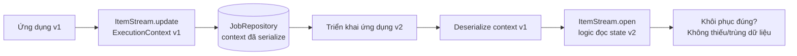
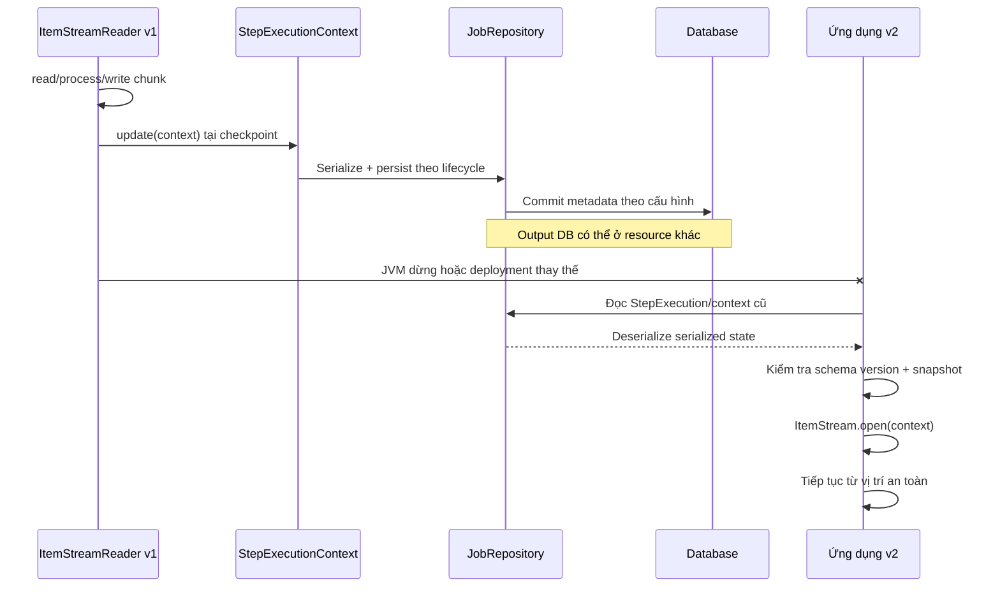
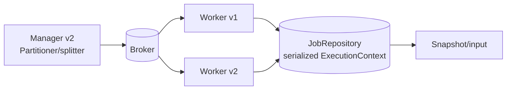
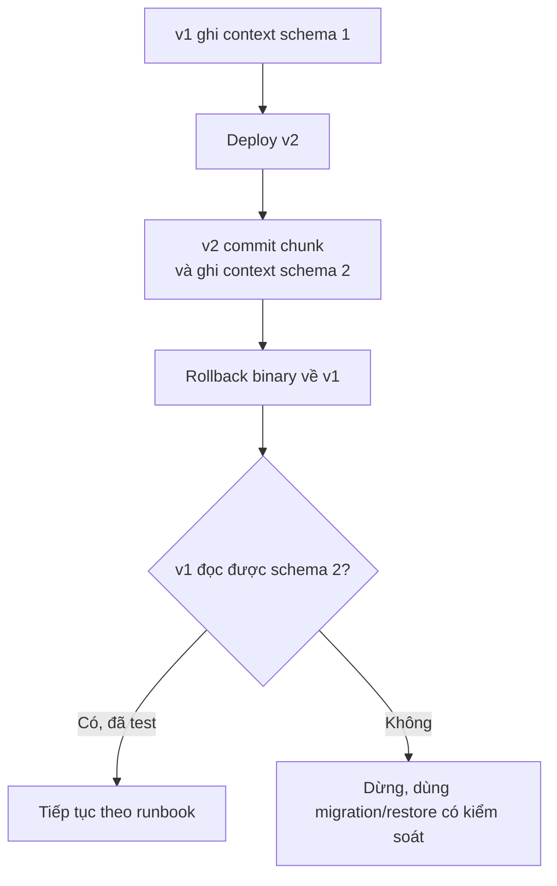

# Khả năng tương thích context khi nâng cấp Spring Batch

Một Spring Batch job chạy ổn định trong nhiều tháng có thể thất bại ngay sau lần triển khai phiên bản mới, dù không hề thay đổi dữ liệu nguồn. Nguyên nhân đôi khi không nằm ở processor hoặc SQL, mà ở **`ExecutionContext` đã lưu từ phiên bản trước**: class không còn tồn tại, serializer đổi định dạng, reader đổi tên, key checkpoint đổi kiểu hoặc cách diễn giải vị trí đọc thay đổi.

Nguy hiểm hơn, có những trường hợp **deserialize thành công nhưng khôi phục sai ngữ nghĩa**. Ví dụ phiên bản cũ lưu `position=2500` là *số bản ghi đã đọc theo thứ tự*, còn phiên bản mới hiểu `position` là *ID bản ghi cuối đã commit*. Không có exception nào bắt buộc xuất hiện, nhưng job có thể bỏ sót hoặc xử lý trùng dữ liệu sau restart.

Bài thuộc chương **ExecutionContext** của module **SPRING_BATCH_SCALING_OPERATIONS**. Trong phạm vi mở rộng Spring Batch bằng multi-threaded step, parallel steps, partitioning và các mô hình xử lý phân tán, yêu cầu không chỉ là chạy nhanh mà còn phải **restart được sau lỗi, giữ thread safety, bảo toàn dữ liệu và vận hành an toàn qua các lần nâng cấp**. Vì vậy, khả năng tương thích của context cần được coi như một **hợp đồng dữ liệu bền vững**, chứ không phải chi tiết cài đặt nội bộ.

## 1. Mục tiêu học tập

Sau bài này, bạn sẽ có thể:

- Phân biệt **tương thích định dạng serialize**, **tương thích kiểu Java**, **tương thích schema key** và **tương thích ý nghĩa checkpoint**.
- Hiểu đường đi `ItemStream.update → ExecutionContextSerializer → JobRepository → ItemStream.open` qua các lần restart.
- Biết cách đánh giá rủi ro khi nâng Spring Batch/Spring Boot/JDK, đổi reader, đổi tên Step, đổi cấu hình JobRepository hoặc đổi thuật toán chia partition.
- Thiết kế state có **`schemaVersion`**, giá trị đơn giản, namespace ổn định và cơ chế chuyển đổi có kiểm soát.
- Viết test đọc context phiên bản cũ bằng code mới, test restart sau deploy và test rollback deployment.
- Chọn chiến lược triển khai: **hoàn tất job cũ trước nâng cấp**, tương thích hai phiên bản, migrate metadata có kiểm chứng hoặc replay nghiệp vụ idempotent.
- Thiết lập runbook khi job cũ không thể khôi phục sau thay đổi phần mềm.

## 2. Vì sao ExecutionContext có thể là dữ liệu sống lâu?

`ExecutionContext` là tập khóa–giá trị do Spring Batch quản lý ở cấp **`JobExecution`** hoặc **`StepExecution`**. Một số thông tin thường được lưu:

- Vị trí hiện tại của `FlatFileItemReader` hoặc `JdbcPagingItemReader`.
- Offset, số item đã đọc, key tìm kiếm tiếp theo hoặc thông tin trạng thái `ItemStream`.
- `startId`, `endId`, `bucketId`, tenant hoặc file thuộc một worker partition.
- `snapshotId`/manifest version để bảo đảm đọc đúng tập dữ liệu sau restart.
- Tham chiếu tới kết quả của Step trước để Step sau sử dụng.

Khi chunk được commit theo lifecycle tương ứng, framework có thể cập nhật context vào `JobRepository`. Một JobInstance bị `FAILED` hoặc `STOPPED` hôm nay có thể được restart vài ngày sau, khi binary ứng dụng, dependency hoặc cấu trúc dữ liệu đã đổi.



**Tương thích ở bước deserialize chưa đủ.** Ngay cả khi `D2` thành công, `L2` vẫn có thể hiểu sai giá trị hoặc khôi phục nguồn đầu vào khác.

### ExecutionContext không phải JobParameters

| Loại dữ liệu | Phạm vi | Ví dụ | Rủi ro khi nâng cấp |
| --- | --- | --- | --- |
| `JobParameters` | Đầu vào và định danh JobInstance theo identifying parameters | `batchId`, ngày dữ liệu, snapshot ID | Đổi identifying flags/job name có thể làm thay đổi danh tính JobInstance |
| `JobExecutionContext` | Trạng thái dùng trong JobExecution | File manifest từ Step trước | Đổi tên key/kiểu có thể làm Step sau không đọc được |
| **`StepExecutionContext`** | Trạng thái của StepExecution, thường lưu checkpoint | Reader position, range/bucket | Đổi reader, thuật toán seek hoặc transaction có thể dẫn đến sai restart |
| Dữ liệu output | Database/API/file/broker ngoài framework | Đơn hàng đã ghi | Restart có thể ghi lặp nếu state/output không atomic |

## 3. Bốn tầng tương thích phải kiểm tra độc lập

Không nên đặt câu hỏi chung chung “context có tương thích không?” mà cần chia thành các tầng sau.

| Tầng | Điều cần bất biến hoặc có migration | Ví dụ lỗi |
| --- | --- | --- |
| **1. Định dạng vật lý** | Byte/string format và `ExecutionContextSerializer` | DB lưu Base64 Java serialization nhưng runtime mới chỉ đọc JSON |
| **2. Kiểu và class** | Integer/Long/String, class name, classloader, `serialVersionUID` | Object từ package cũ không còn load được |
| **3. Schema key** | Key name, namespace, kiểu dữ liệu, required/optional | `reader.current.count` đổi thành `reader.position` |
| **4. Ngữ nghĩa và nguồn dữ liệu** | Offset/ID, inclusive/exclusive, sort order, snapshot, partition mapping | Vẫn đọc được số `2500` nhưng bắt đầu ở bản ghi sai |

Còn một tầng hạ tầng độc lập: **tương thích schema `JobRepository`**. Khi nâng phiên bản Spring Batch, các migration SQL và thay đổi metadata tables/columns có thể được yêu cầu. Tương thích về database schema **không tự bảo đảm** tương thích serialized context, và ngược lại.

### Ba câu hỏi trước khi cho restart

1. **Đọc được không?** Runtime mới có deserialize được bytes đã lưu?
2. **Hiểu đúng không?** Reader/processor mới có hiểu các key/type/ý nghĩa cũ?
3. **Chạy lại an toàn không?** Với output đã commit, input snapshot và transaction thực, job có thiếu/trùng/ghi đè dữ liệu không?

Một bản nâng cấp chỉ nên được coi là tương thích restart khi trả lời được cả ba bằng bằng chứng thử nghiệm.

## 4. Vòng đời ghi và đọc state qua phiên bản

Với reader thực hiện `ItemStream`, một vòng xử lý chunk thông thường có các mốc:



**Không lưu state bền vững chỉ bằng `context.put(...)`.** Nó thay đổi map trong bộ nhớ; độ bền phụ thuộc cập nhật `JobRepository`/transaction đã commit. Nếu reader lưu sai offset trước commit, serializer dù tốt cũng chỉ lưu **một state sai**.

Ngoài ra, khi `JobRepository` và database output dùng hai transaction local khác nhau, có thể có cửa sổ lỗi output đã commit nhưng metadata chưa kịp ghi nhận. Khi đó restart phải chịu được xử lý lại nhờ **idempotency và reconciliation**.

## 5. Kịch bản thực tế: v1 chạy lỗi, v2 được deploy

Giả sử Job `importOrders` xử lý snapshot `B2026-11`, mỗi input tạo đúng một output và writer dùng khóa duy nhất `(batch_id, order_id)`.

```text
T0: Ứng dụng v1 khởi chạy JobInstance #41
    JobExecution #1501, StepExecution #7001
    Reader state: ordersReader.current.count = 2000

T1: v1 commit xong 20 chunk, mỗi chunk 100 item
T2: chunk #21 lỗi; Step FAILED, context cuối đã persist

T3: deploy ứng dụng v2
    - đổi JdbcCursorItemReader sang JdbcPagingItemReader
    - đổi name("ordersReader") thành name("ordersPagingReader")
    - đổi sort order / predicate

T4: restart cùng JobInstance #41
    JobExecution #1510, StepExecution mới
    v2 đọc được context cũ nhưng không thấy key reader mới
```

Rủi ro ở T4: reader có thể bắt đầu từ đầu, hoặc bị lỗi vì thiếu key. Nếu writer không idempotent, output bị nhân đôi. Nếu phép seek mới dựa trên một vị trí khác nghĩa, có thể mất item.

**Không nên “sửa” bằng cách đặt mặc định vị trí reader = 2000 trong mọi trường hợp.** Số 2000 của cursor cũ không nhất thiết tương ứng page offset 2000, cũng không nhất thiết tương ứng một ID. Cần phân tích contract cụ thể của hai reader và input snapshot.

## 6. Tương thích định dạng: ExecutionContextSerializer

`ExecutionContextSerializer` phụ trách chuyển map của context sang dạng lưu được và đọc trở lại từ `JobRepository`. Trong hệ Spring Batch 5.x, `DefaultExecutionContextSerializer` sử dụng Java object serialization và thường có representation Base64 trong metadata JDBC. Một số ứng dụng sử dụng serializer JSON như `Jackson2ExecutionContextStringSerializer` hoặc serializer tùy chỉnh.

**Định dạng thực tế phải được xác nhận từ cấu hình đang triển khai.** Không suy luận rằng mọi ứng dụng dùng một serializer giống nhau chỉ vì chung Spring Boot hoặc chung major version.

```java
import java.io.ByteArrayInputStream;
import java.io.ByteArrayOutputStream;
import java.util.LinkedHashMap;
import java.util.Map;

import org.springframework.batch.core.repository.dao.DefaultExecutionContextSerializer;

public class ContextRoundTrip {
    public static void main(String[] args) throws Exception {
        var serializer = new DefaultExecutionContextSerializer();

        Map<String, Object> original = new LinkedHashMap<>();
        original.put("orders.reader.schemaVersion", 1);
        original.put("orders.reader.nextIndex", 2000L);
        original.put("input.snapshotId", "B2026-11");

        var output = new ByteArrayOutputStream();
        serializer.serialize(original, output);

        Map<String, Object> restored = serializer.deserialize(
                new ByteArrayInputStream(output.toByteArray()));

        if (!original.equals(restored)) {
            throw new IllegalStateException("Round-trip mismatch");
        }
    }
}
```

Ví dụ kiểm tra việc đọc/ghi các kiểu đơn giản **trong cùng runtime**. Nó không xác nhận rằng phiên bản mới đọc được serialized bytes từ bản deploy cũ, hoặc rằng reader hiểu đúng `nextIndex`.

### Base64 không phải một chuẩn schema ổn định

Base64 chỉ biểu diễn bytes thành chuỗi, **không mã hóa bí mật**. Nếu bên trong là Java serialization, runtime mới có thể cần các class và kiểu Java tương thích. Thay bằng JSON serializer có thể làm context cũ không còn đọc được nếu không có compatibility/migration logic.

**Không chuyển serializer trực tiếp trên JobRepository còn nhiều job cần restart mà chưa có kế hoạch chuyển đổi.** Ngay cả nếu hai serializer cùng đọc được các giá trị primitive ở object map mới, chúng không nhất thiết đọc được **serialized representation đã lưu trước đó**.

### Cảnh báo nâng cấp major version

Khi nâng từ một major/minor Spring Batch lên bản khác, cần kiểm tra release notes và migration guide **đúng cặp phiên bản** về:

- Cấu hình serializer mặc định hoặc tùy chọn.
- Kiểu Java/key state của reader/writer framework.
- Schema `JobRepository`, DAO và DDL migration.
- Tương thích `JobParameters` và identifying flags.
- Các class bị chuyển package, thay đổi public API hoặc loại bỏ.
- Job/Step builder và cấu hình transaction manager.

Bài này không giả định một bản phát hành mới tương thích mọi metadata của bản cũ; **kết quả phải được kiểm chứng trên dữ liệu repository thực tế**.

## 7. Tương thích class và kiểu dữ liệu Java

Một `ExecutionContext` có thể chứa object serializable, nhưng đó thường là lựa chọn rủi ro hơn so với primitive/string.

### Kiểu nên ưu tiên

| Mục đích | Giá trị khuyến nghị | Rủi ro nếu đổi |
| --- | --- | --- |
| Số bản ghi đã đọc | `Integer`/`Long` nhất quán với reader | `getInt()` không tương thích với một `String` tùy ý |
| ID cuối đã commit | `Long` | Tràn 32-bit nếu dùng int |
| Snapshot/version | `String` | Đổi ý nghĩa từ ngày sang UUID có thể phá lookup |
| Watermark thời gian | ISO-8601 UTC string hoặc epoch rõ đơn vị | Đổi milliseconds thành seconds âm thầm sai |
| Enum trạng thái | Chuỗi cố định, có mapping/validation | Đổi tên enum hỏng deserialize |
| Cấu hình partition | `startId`/`endId`/`bucketCount` primitive | Đổi exclusive thành inclusive gây overlap |
| File đầu vào | URI + checksum/snapshot | Đường dẫn local không tồn tại trên worker khác |

Nếu ứng dụng dùng native Java serialization, một class đổi tên/package, biến mất hoặc thay đổi serialized form có thể gây `ClassNotFoundException`/`InvalidClassException`. `serialVersionUID` giúp kiểm soát một phần compatibility kỹ thuật, **không xác minh compatibility nghiệp vụ**.

### Anti-pattern: lưu entity nguyên khối

```java
// Có thể chứa lazy proxy, field thay đổi, reference vòng,
// PII và serialized form phụ thuộc release.
executionContext.put("lastOrder", orderJpaEntity);
```

Thay bằng dữ liệu tối thiểu:

```java
executionContext.putLong("orders.reader.resumeAfterId", 50000L);
executionContext.putString("input.snapshotId", "B2026-11");
executionContext.putInt("orders.reader.schemaVersion", 2);
```

Dù cùng một `Long`, **đơn vị và ý nghĩa** của nó vẫn phải được giữ ổn định. Lưu `50000` không cho biết đó là ID cuối đã commit, row index hay next-key nếu không có contract.

## 8. Schema key: namespace, reader name và thứ tự ưu tiên

Các thành phần `ItemStream` thường dùng tên reader/writer để xây namespace key trong context. Đổi tên bean/reader hoặc đổi từ loại reader này sang loại khác có thể khiến runtime mới không tìm thấy state cũ.

Ví dụ trước nâng cấp:

```java
new JdbcCursorItemReaderBuilder<Order>()
        .name("ordersReader")
        .saveState(true)
        // dataSource, sql, rowMapper...
        .build();
```

Sau nâng cấp:

```java
new JdbcPagingItemReaderBuilder<Order>()
        .name("ordersPagingReader")
        .saveState(true)
        // dataSource, paging query, sort key, rowMapper...
        .build();
```

**Hai reader không mặc định dùng cùng checkpoint key và thuật toán resume**, dù cả hai có `saveState(true)`. Thay đổi loại reader là một thay đổi **protocol checkpoint**, không đơn thuần tối ưu SQL.

| Thay đổi | Có thể gây vấn đề | Phương án |
| --- | --- | --- |
| `reader.name` đổi | Không tìm thấy key cũ | Giữ tên khi thật sự cùng contract, hoặc migration |
| `StepName` đổi | Framework có thể xem là Step khác trong restart | Giữ logical Step name hoặc xây kế hoạch JobInstance mới |
| `ExecutionContext` key đổi | Reader mới đọc default sai | Versioning + đọc legacy |
| Key giữ tên nhưng đổi kiểu | `ClassCastException`/parse fail | Validate type + chuyển đổi tường minh |
| Key giữ tên nhưng đổi nghĩa | Bỏ sót/trùng item âm thầm | Đổi schemaVersion, chuyển đổi có kiểm chứng |
| Thứ tự gọi các stream đổi | State có thể bị ghi đè hoặc update khác | Tách namespace và test integration |

**Không dựa vào key nội bộ của reader chuẩn khi chưa xem contract phiên bản và implementation thực.** Nếu cần một checkpoint độc lập với implementation, hãy thiết kế một lớp reader/adapter có protocol state riêng, test được và có kế hoạch nâng cấp.

### Key namespace nên ổn định

```text
orders.reader.schemaVersion
orders.reader.resumeAfterId
orders.reader.snapshotId

customers.reader.schemaVersion
customers.reader.resumeAfterId
customers.reader.snapshotId
```

Hai stream trong cùng `StepExecutionContext` không nên cùng dùng key chung chung `position`.

## 9. Compatibility ngữ nghĩa: “đọc được” vẫn có thể “đọc sai”

Giả sử v1 lưu:

```text
orders.reader.schemaVersion = 1
orders.reader.current.count = 2000
# Nghĩa: 2000 item đầu tiên trong danh sách có thứ tự đã commit.
```

v2 dùng:

```text
orders.reader.schemaVersion = 2
orders.reader.resumeAfterId = 2000
# Nghĩa: đọc tiếp WHERE id > 2000.
```

Nếu ID nguồn là `10001, 10003, 10007, ...`, gán `2000` từ v1 thành `resumeAfterId` của v2 sẽ làm reader **bắt đầu sai**. Nếu source có dữ liệu mới chèn vào giữa, kể cả chuyển offset sang ID bằng snapshot hiện tại cũng có thể sai.

### Khi nào có thể chuyển đổi?

Phải có đủ dữ liệu để chứng minh:

1. Snapshot nguồn của v1 vẫn tồn tại, không thay đổi.
2. Thứ tự v1 là xác định và có tie-breaker duy nhất.
3. Có cách ánh xạ **đúng vị trí offset cũ → khóa resume mới**.
4. Output commit/rollback ở thời điểm checkpoint phù hợp với vị trí v1.
5. Không có filter/skip/aggregate làm ý nghĩa checkpoint bị hiểu sai.

Nếu thiếu dữ kiện, **fail-fast và chọn chiến lược khôi phục khác** tốt hơn âm thầm đoán.

### Inclusive/exclusive boundary

Với range `[startId, endId)`, ID bằng `endId` phải được xử lý ở partition tiếp theo. Nếu bản mới đổi query thành `BETWEEN startId AND endId` (inclusive cả hai đầu), các khoảng kề nhau sẽ đọc trùng ID biên. Serialized context không đổi vẫn không cứu được correctness.

Tương tự, thay hash function, chuẩn hóa key, charset hoặc `bucketCount` sẽ làm dữ liệu chuyển partition dù tên `bucket-003` vẫn giữ nguyên.

## 10. Thiết kế checkpoint schema có version

Có thể giảm rủi ro bằng cách lưu **state có tên/kiểu/ý nghĩa rõ ràng**, kèm version và snapshot ID.

### Schema v1

```text
orders.reader.schemaVersion = 1
orders.reader.lastCommittedId = 50000
orders.reader.snapshotId = B2026-11

Ngữ nghĩa: item có id <= 50000 đã hoàn tất ở commit boundary;
reader sẽ truy vấn tiếp id > lastCommittedId.
```

### Schema v2

```text
orders.reader.schemaVersion = 2
orders.reader.resumeAfterId = 50000
orders.reader.snapshotId = B2026-11
orders.reader.sortVersion = 1

Ngữ nghĩa: id là khóa sort đơn điệu duy nhất, truy vấn id > resumeAfterId;
sortVersion=1 sử dụng cùng comparator và collation.
```

Trong trường hợp cụ thể này, `lastCommittedId` và `resumeAfterId` **có thể chuyển bằng cách sao chép số** nếu đã chứng minh ý nghĩa giống nhau, input snapshot và sort order ổn định. Đó là trường hợp khác với chuyển `offset` thành `ID` ở mục 9.

**Nguyên tắc migration:** không chỉ dựa trên tên field gần giống; phải chứng minh hai giá trị biểu diễn cùng điểm ranh giới xử lý.

## 11. Java: đọc state hai phiên bản một cách có kiểm soát

Ví dụ helper cho `ExecutionContext` tự quản lý của ứng dụng; không can thiệp trực tiếp vào private keys của reader Spring Batch. Mục tiêu là cho phép đọc v1 và v2, sau đó **ghi lại v2 tại checkpoint hợp lệ**.

```java
import java.util.Objects;
import org.springframework.batch.item.ExecutionContext;

public final class OrdersCheckpointCodec {
    private static final String VERSION =
            "orders.reader.schemaVersion";
    private static final String OLD_LAST =
            "orders.reader.lastCommittedId";
    private static final String NEXT_AFTER =
            "orders.reader.resumeAfterId";
    private static final String SNAPSHOT =
            "orders.reader.snapshotId";
    private static final String SORT_VERSION =
            "orders.reader.sortVersion";

    public record State(
            long resumeAfterId,
            String snapshotId,
            int schemaVersion) {}

    public State read(
            ExecutionContext ctx, String expectedSnapshot) {
        Objects.requireNonNull(ctx);
        Objects.requireNonNull(expectedSnapshot);

        if (!ctx.containsKey(VERSION)) {
            // Context thật sự mới: không mặc định nhận là v1.
            if (!ctx.containsKey(OLD_LAST)
                    && !ctx.containsKey(NEXT_AFTER)) {
                return new State(0L, expectedSnapshot, 2);
            }
            throw new IllegalStateException(
                    "Checkpoint exists without schemaVersion");
        }

        int version = ctx.getInt(VERSION);
        String savedSnapshot = ctx.getString(SNAPSHOT);
        if (!expectedSnapshot.equals(savedSnapshot)) {
            throw new IllegalStateException(
                    "Unexpected checkpoint input snapshot");
        }

        if (version == 1) {
            if (!ctx.containsKey(OLD_LAST)) {
                throw new IllegalStateException(
                        "Missing v1 committed key");
            }
            // CHỈ đúng khi lastCommittedId v1 và resumeAfterId
            // v2 đều dùng cùng khóa ID và cùng quy tắc id > ...
            long lastCommittedId = ctx.getLong(OLD_LAST);
            return new State(lastCommittedId, savedSnapshot, 1);
        }

        if (version == 2) {
            if (!ctx.containsKey(NEXT_AFTER)
                    || !ctx.containsKey(SORT_VERSION)
                    || ctx.getInt(SORT_VERSION) != 1) {
                throw new IllegalStateException(
                        "Invalid v2 checkpoint schema");
            }
            return new State(
                    ctx.getLong(NEXT_AFTER), savedSnapshot, 2);
        }

        throw new IllegalStateException(
                "Unsupported checkpoint version: " + version);
    }

    public void writeV2(
            ExecutionContext ctx,
            long lastSafelyCommittedId,
            String snapshotId) {
        if (lastSafelyCommittedId < 0
                || snapshotId == null || snapshotId.isBlank()) {
            throw new IllegalArgumentException(
                    "Invalid checkpoint state");
        }
        ctx.putInt(VERSION, 2);
        ctx.putLong(NEXT_AFTER, lastSafelyCommittedId);
        ctx.putString(SNAPSHOT, snapshotId);
        ctx.putInt(SORT_VERSION, 1);
        // Giữ legacy key hay xóa phải tuân rollout/rollback policy.
    }
}
```

**Đọc đoạn code theo ngữ cảnh:**

- `State` được khôi phục qua hai schema đã công bố; phiên bản không biết phải **fail rõ**.
- Không có `schemaVersion` nhưng có key state là tình huống dữ liệu không xác định; không tự coi là job mới để bắt đầu đọc từ đầu.
- `expectedSnapshot` được đối chiếu, tránh dùng checkpoint của tập dữ liệu khác.
- Nhánh v1 → v2 chỉ đúng với **hợp đồng ID giống nhau** được ghi trong comment; nếu v1 lưu row index, bắt buộc có migration khác.
- `writeV2(...)` là **hàm mã hóa state**; chỉ được gọi bởi lifecycle checkpoint đúng, chẳng hạn `ItemStream.update(...)`, không gọi ngay sau mỗi item rồi persist tùy tiện.
- Trong ví dụ, `0L` là **sentinel cho job mới**, giả định ID hợp lệ bắt đầu từ 1. Nếu nguồn cho phép ID âm/0, phải thiết kế marker ban đầu khác.

### Không dùng helper này để “ghi trạng thái đã commit” quá sớm

Trong một reader thông thường, `read()` có thể tiến tới item chưa commit. Khi `ItemStream.update(...)` được gọi tại checkpoint, implementation phải bảo đảm state phản ánh đúng ranh giới của chunk được phép commit và tương thích rollback. Với multi-threaded Step có các chunk commit đảo thứ tự, một pointer đơn **không tự an toàn**.

Ví dụ dưới chỉ mô tả điểm tích hợp, không phải code reader độc lập:

```java
@Override
public void open(ExecutionContext ctx) {
    var state = codec.read(ctx, snapshotId);
    this.resumeAfterId = state.resumeAfterId();
    // Mở lại reader bằng query có sort key xác định.
}

@Override
public void update(ExecutionContext ctx) {
    // Chỉ dùng position đã được reader định nghĩa đúng
    // cho checkpoint của chunk đang commit.
    codec.writeV2(ctx, nextCommitSafeBoundary, snapshotId);
}
```

Reader phải thực hiện thêm `read()`, quản lý cursor/resource và `close()` theo `ItemStream` contract. `nextCommitSafeBoundary` ở ví dụ là biến tượng trưng, **không phải field do Spring Batch cung cấp**. Không dùng nó để suy luận rằng callback `update` sẽ tự tính ranh giới transaction đúng cho mọi custom reader.

## 12. Test codec và ràng buộc schema

### Unit test: đọc v1 và ghi v2

```java
import static org.junit.jupiter.api.Assertions.*;

import org.junit.jupiter.api.Test;
import org.springframework.batch.item.ExecutionContext;

class OrdersCheckpointCodecTest {
    private final OrdersCheckpointCodec codec =
            new OrdersCheckpointCodec();

    @Test
    void readsLegacyCommittedIdOnlyWithMatchingSnapshot() {
        var old = new ExecutionContext();
        old.putInt("orders.reader.schemaVersion", 1);
        old.putLong("orders.reader.lastCommittedId", 50000L);
        old.putString("orders.reader.snapshotId", "B2026-11");

        var state = codec.read(old, "B2026-11");
        assertEquals(50000L, state.resumeAfterId());
        assertEquals(1, state.schemaVersion());

        assertThrows(IllegalStateException.class,
                () -> codec.read(old, "B2026-12"));
    }

    @Test
    void writesNewSchemaWithExplicitSortVersion() {
        var context = new ExecutionContext();
        codec.writeV2(context, 50000L, "B2026-11");

        var restored = codec.read(context, "B2026-11");
        assertEquals(50000L, restored.resumeAfterId());
        assertEquals(2, restored.schemaVersion());
        assertEquals(1,
                context.getInt("orders.reader.sortVersion"));
    }

    @Test
    void doesNotAssumeUnknownStateIsFresh() {
        var context = new ExecutionContext();
        context.putLong("orders.reader.lastCommittedId", 15L);

        assertThrows(IllegalStateException.class,
                () -> codec.read(context, "B2026-11"));
    }
}
```

**Phạm vi test:** kiểm tra schema logic trong RAM, chưa kiểm tra `ExecutionContextSerializer`, `JobRepository` hay restart sau process crash.

### Unit test: serialize/deserialize dữ liệu state

```java
import static org.junit.jupiter.api.Assertions.assertEquals;

import java.io.ByteArrayInputStream;
import java.io.ByteArrayOutputStream;
import java.util.LinkedHashMap;
import java.util.Map;

import org.junit.jupiter.api.Test;
import org.springframework.batch.core.repository.dao.DefaultExecutionContextSerializer;

class PersistedContextCompatibilityTest {

    @Test
    void simpleValuesSurviveSerialization() throws Exception {
        var serializer = new DefaultExecutionContextSerializer();
        Map<String, Object> v1 = new LinkedHashMap<>();
        v1.put("orders.reader.schemaVersion", 1);
        v1.put("orders.reader.lastCommittedId", 50000L);
        v1.put("orders.reader.snapshotId", "B2026-11");

        var buffer = new ByteArrayOutputStream();
        serializer.serialize(v1, buffer);

        var restored = serializer.deserialize(
                new ByteArrayInputStream(buffer.toByteArray()));

        assertEquals(v1, restored);
        assertEquals(Long.class,
                restored.get("orders.reader.lastCommittedId")
                        .getClass());
    }
}
```

Để test **nâng cấp thật**, fixture bytes cần được sinh **bởi binary cũ**, lưu có kiểm soát, rồi được đọc **bằng binary mới**. Việc cùng một phiên bản code serialize rồi deserialize lại chỉ chứng minh round-trip nội bộ, không chứng minh backward compatibility.

## 13. Compatibility test với JobRepository dữ liệu thật

Bài test quan trọng nhất không gọi riêng serializer mà **restart một JobInstance** với metadata đã commit do release cũ tạo ra.

### Các bước

1. Dùng phiên bản **v1** chạy Job trên snapshot bất biến `B2026-11` với `chunk(100)`.
2. Cho 2–3 chunk commit rồi inject lỗi vào chunk tiếp theo (hoặc stop ở điểm được hỗ trợ).
3. Ghi lại `JobInstanceId`, `JobExecutionId`, `StepExecutionId`, tên reader/Step và metadata context đã persist.
4. Tạo **bản sao** của JobRepository và DB output, đồng thời giữ phiên bản dữ liệu nguồn phù hợp.
5. Khởi động **v2** với schema/migration và serializer như dự định triển khai.
6. Restart **cùng JobInstance** bằng cơ chế `JobOperator`/`JobLauncher` được hỗ trợ, không tạo JobInstance mới bằng tham số ngẫu nhiên.
7. Xác nhận v2 đọc đúng context, chạy đúng phần còn lại, không tạo duplicate business effect.
8. Đối soát tập khóa, tổng giá trị và những side effect ngoài DB; kiểm tra tình huống rollback deployment nếu yêu cầu.
9. Thử cả v1/v2 cùng tồn tại trong kiến trúc phân tán (nếu rollout theo từng worker).

### Ma trận compatibility tối thiểu

| Fixture / tình huống | Bài kiểm thử | Điều kiện đạt |
| --- | --- | --- |
| v1 primitive context → v2 | Deserialization + schema logic | Đúng kiểu và nghĩa |
| v1 custom Serializable → v2 | Classpath/UID compatibility | Đọc được hoặc migration có kiểm soát |
| v1 JSON → v2 Java serializer | Raw metadata fixture | Không deploy mù, có reader/migration |
| v1 key names → v2 key names | Test reader `open` | Khôi phục đúng item kế tiếp |
| v1 reader → v2 reader khác loại | Restart sau commit | Không thiếu/trùng dù contract thay đổi |
| v1 `StepName` → v2 `StepName` | Restart JobInstance | Step cũ được nhận đúng, không lặp sai |
| v1 range/bucket → v2 thay grid size | Test partition mapping | Cùng logical work vẫn gắn đúng dữ liệu |
| v1 snapshot → v2 snapshot khác | Validation khi mở reader | Fail-fast nếu vi phạm input contract |
| Manager v2, worker v1 | Remote partitioning handshake | Cùng hiểu context/payload |
| Manager v1, worker v2 | Remote partitioning handshake | Không fail deserialize/không sai Step |
| Worker rollback giữa chunk | Metadata + output DB | Checkpoint không vượt phần đã commit |
| Commit DB xong nhưng metadata chưa persist | Cross-resource crash | Replay an toàn nhờ idempotency |
| Deploy v2, sau đó rollback v1 | Forward compatibility | v1 đọc được state v2 hoặc rollback có kế hoạch |

**Mục tiêu:** test phải kiểm tra **ngữ nghĩa output cuối**, không chỉ assert Step chuyển sang `COMPLETED`.

## 14. Schema JobRepository cũng phải được nâng cấp đúng

`JobRepository` chứa các bảng metadata: `BATCH_JOB_INSTANCE`, `BATCH_JOB_EXECUTION`, `BATCH_STEP_EXECUTION` cùng các bảng context tương ứng. Việc nâng phiên bản Spring Batch có thể yêu cầu migration database schema phù hợp với version đích.

Ví dụ truy vấn **read-only** để kiểm tra context của các StepExecution:

```sql
SELECT
    se.JOB_EXECUTION_ID,
    se.STEP_EXECUTION_ID,
    se.STEP_NAME,
    se.STATUS,
    ctx.SHORT_CONTEXT,
    ctx.SERIALIZED_CONTEXT
FROM BATCH_STEP_EXECUTION se
JOIN BATCH_STEP_EXECUTION_CONTEXT ctx
  ON ctx.STEP_EXECUTION_ID = se.STEP_EXECUTION_ID
WHERE se.JOB_EXECUTION_ID = :jobExecutionId
ORDER BY se.STEP_EXECUTION_ID;
```

Schema thực có thể khác về table prefix, kiểu cột, giới hạn `SHORT_CONTEXT`, LOB hoặc những thay đổi qua phiên bản. Đừng đoán cấu trúc chỉ từ một bài hướng dẫn; dùng DDL migration của đúng phiên bản Spring Batch và database vendor.

### Hai vấn đề độc lập

- **DDL migration thành công**: bảng/cột/index mới phù hợp framework.
- **Context deserialize và resume đúng**: bytes đã lưu và semantics checkpoint vẫn được hiểu.

Nâng DDL không tự chuyển JSON thành Java serialization; đổi serializer không tự sửa Step name/reader key. Cần test riêng cả hai.

**Không chỉnh `SERIALIZED_CONTEXT` thủ công trên production** để “làm job chạy tiếp” khi chưa có backup, migration plan và test. Một serialized value bị cắt hoặc sai kiểu có thể khiến toàn JobInstance không restart được.

## 15. Mixed-version deployment: manager và worker khác phiên bản

Khi có nhiều JVM, việc deploy dần từng worker là tình huống thực tế. Tuy nhiên không phải mọi kiểu nâng cấp đều an toàn khi **manager v2, worker v1** hoặc ngược lại.

### Remote partitioning

Remote partitioning gửi công việc đến worker Step; worker có thể cần tải `StepExecution` và `ExecutionContext` qua `JobRepository` theo cơ chế được triển khai.



Nếu manager v2 ghi custom object kiểu v2 vào context mà worker v1 chưa có class hoặc codec, worker v1 sẽ fail. Nếu manager đổi `startId/endId` từ `Long` sang `String`, worker cũ có thể đọc sai kiểu. Nếu đổi `bucketCount`/hash version giữa restart, các worker có thể đọc chồng lấn dù deserialize được.

**Để rolling deploy an toàn**, phải có một trong những chiến lược:

- Giữ contract context chung có thể được cả v1 và v2 đọc.
- Tạm dừng dispatch, cho worker v1 xử lý hết công việc rồi mới chuyển format.
- Dùng protocol version/routing tách queue hoặc nhóm worker theo version.
- Đưa migration sang thời điểm không còn worker cũ cần đọc context.
- Khi cần, duy trì binary cũ để hoàn tất các JobInstance cũ.

### Remote chunking

Trong remote chunking thông thường, **manager sở hữu reader và checkpoint `ExecutionContext`**. Worker nhận `ChunkRequest`/item payload để xử lý/ghi, không mặc định có worker StepExecution riêng như partitioning.

Vì vậy, cần **hai compatibility contract độc lập**:

1. **Context trong JobRepository của manager**: reader state, serializer, schema keys.
2. **Message schema/serializer giữa manager và worker**: `ChunkRequest`, item DTO, header/correlation và `ChunkResponse`.

Đọc được JobRepository context **không bảo đảm** worker v1 hiểu được item DTO do manager v2 gửi. Ngược lại, wire protocol vẫn hoạt động không chứng minh reader checkpoint cũ có thể resume.

## 16. Đổi thuật toán partition khi nâng cấp có nguy hiểm không?

Có. Một context worker có thể lưu:

```text
partition.name = bucket-003
partition.bucketId = 3
partition.bucketCount = 8
partition.hashVersion = 1
input.snapshotId = B2026-11
```

Nếu v2 tự thay `bucketCount` từ 8 sang 16 khi restart, một số item chuyển sang bucket khác. Với `StepExecution` đã `COMPLETED` và được skip khi restart, có thể xảy ra **mất dữ liệu**. Cùng tên `bucket-003` không có nghĩa cùng tập item nếu hash function hoặc bucketCount đổi.

### Quy tắc triển khai

- Giữ `partitionName → logical input` ổn định **trong cùng JobInstance**.
- `gridSize` có thể là tham số điều phối của Partitioner/handler, nhưng không được tự biến thành thay đổi chia dữ liệu khi có checkpoint cũ.
- Lưu snapshot ID, bucketCount, hash algorithm/version hoặc range plan vào metadata bền vững khi cần.
- Đổi chiến lược partition ở **JobInstance mới** sau khi xử lý trạng thái cũ.
- Nếu buộc chuyển đổi trong JobInstance cũ, phải chứng minh item nào đã commit/chưa commit rồi áp dụng migration/reconciliation, không chỉ đổi tên key.

### Range theo ID cũng có rủi ro

Một Job v1 chia `[1,1001)` và `[1001,2001)`. v2 chuyển thành `[1,2001)` rồi dùng lại một tên partition cũ. Nếu worker v1 đã hoàn tất nửa đầu, JobRepository có thể cho rằng partition cũ đã xong trong khi range mới chứa nửa sau chưa chạy. **Không dùng trạng thái COMPLETED của phạm vi cũ để suy phạm vi mới đã xử lý.**

## 17. Input snapshot phải được pin qua nâng cấp

Ngay cả khi Java code và context serializer giữ nguyên, dữ liệu nguồn thay đổi cũng làm checkpoint không tương thích về nghĩa.

| Nguồn | State được lưu | Thay đổi nguy hiểm |
| --- | --- | --- |
| CSV | Line number/byte offset | Chèn dòng, thay encoding, đổi delimiter |
| JDBC paging | Sort key/page position | Đổi ORDER BY, thêm/xóa record trước offset |
| JDBC cursor | Vị trí cursor logic | Query/filter thay đổi, dữ liệu không còn snapshot cũ |
| S3/object storage | URI + line offset | Ghi đè object cùng URI |
| Kafka/event stream | Topic/partition/offset | Retention xóa offset cũ, topic recreated, format đổi |
| Hash bucket | Bucket ID/count/version | Đổi hash hoặc normalization |

Tùy loại reader, các state key thực có thể khác. Điều quan trọng là **định danh input + thứ tự + quy tắc resume** có thể được tái hiện.

### Các biện pháp

- Chốt manifest/snapshot/version của input.
- Ghi checksum hoặc object version khi phù hợp.
- Không dùng đường dẫn `latest.csv` hoặc query không có watermark chặt làm input có thể thay đổi.
- Định nghĩa thứ tự sort **duy nhất**, đặc biệt với paging reader.
- Nếu thay cấu hình parse/normalization, version contract và test với fixture cũ.
- Với input không thể giữ bất biến, dùng business idempotency/dedup và cơ chế reconciliation rõ ràng thay vì tin offset đơn.

## 18. Multi-threaded Step: format tương thích nhưng state vẫn sai

Một `StepExecution` chạy nhiều chunk thread có thể dùng chung `ExecutionContext` và reader stateful. Khi commit đảo thứ tự, một pointer duy nhất có thể đánh dấu vượt qua chunk chưa commit.

```text
Chunk A: đọc item 1..100, chưa commit.
Chunk B: đọc item 101..200, commit xong.
Context lưu vị trí = 200.
Chunk A rollback, tiến trình crash.
Restart bắt đầu từ 201 => item 1..100 bị bỏ sót.
```

Dù v1 và v2 dùng **cùng serializer và cùng key**, checkpoint này vẫn không đúng. `@StepScope` gắn với `StepExecution`, không phải với mỗi thread. `synchronized read()` chỉ bảo vệ thao tác đọc tuần tự, không bảo đảm thứ tự commit.

**Khi nâng cấp concurrency:**

- Không coi bật `TaskExecutor`/tăng thread count là thay đổi vô hại với checkpoint cũ.
- Test với commit đảo thứ tự, rollback và restart.
- Cân nhắc partitioning mỗi worker có StepExecution/context riêng, hoặc nguồn công việc bền vững theo khóa.
- Nếu bỏ lưu state (`saveState(false)`), cần chiến lược reread/idempotent output thay thế.
- Chỉ chuyển kiến trúc cho JobInstance mới hoặc qua kế hoạch migration có chứng minh.

## 19. Chiến lược nâng cấp và phục hồi: chọn theo mức rủi ro

Không có một chiến lược duy nhất phù hợp mọi job.

| Chiến lược | Khi phù hợp | Ưu điểm | Rủi ro / điều kiện |
| --- | --- | --- | --- |
| **Hoàn tất job cũ trước deploy** | Số job restartable ít, có maintenance window | Đơn giản, không phải đọc state cũ bằng code mới | Cần đủ thời gian và đảm bảo không còn job pending |
| **Giữ binary/runtime cũ để resume** | Context legacy khó migrate | Giữ implementation/serializer cũ | Phải duy trì môi trường/cấu hình bảo mật và nguồn dữ liệu cũ |
| **Backward-compatible reader/codec** | State có schema, thay đổi nhỏ | v2 có thể đọc state v1 | Phải test và quản lý code legacy |
| **Dual-format reader** | Đổi serializer/cách biểu diễn | Có thể đọc metadata cũ lẫn mới | Dễ tăng complexity; cần phân biệt format một cách đáng tin |
| **Migrate metadata offline** | Số lượng context hữu hạn, hiểu đầy đủ schema | Chuẩn hóa context trước khi restart | Cần backup, mapping chứng minh được và script kiểm thử |
| **Replay từ đầu với idempotent writer** | Snapshot bất biến, output chống lặp | Không cần chuyển checkpoint chi tiết | Có thể tốn chi phí lớn; side effect ngoài DB phải được xử lý |
| **Tạo JobInstance mới** | Logic/snapshot thay đổi căn bản | Cô lập kết quả mới | Phải xử lý kết quả đang dở của instance cũ, không tự coi là restart |

### Chiến lược an toàn mặc định khi chưa đủ bằng chứng

1. Không deploy thay đổi phá compatibility lên JobRepository đang có job cần restart.
2. Dựng bản sao metadata và input/output đại diện, test v2 trước.
3. Nếu v2 không hiểu context v1, ưu tiên hoàn tất job bằng v1 hoặc migration đã chứng minh.
4. Nếu muốn replay, đối soát phần đã commit và thiết kế idempotency/compensation.
5. Chỉ cho publish downstream sau khi dữ liệu được kiểm chứng độc lập.

## 20. Rollback deployment khác rollback transaction

Một điểm dễ bỏ sót: **triển khai v2 rồi rollback binary về v1** không bảo đảm v1 sẽ đọc được context mà v2 vừa ghi.



Vì vậy có hai hướng compatibility:

- **Backward compatibility:** v2 đọc được context v1.
- **Forward compatibility:** v1 đọc được context do v2 ghi.

Một chiến lược triển khai có thể chỉ bảo đảm chiều thứ nhất. Nếu rollback v1 là yêu cầu bắt buộc, cần giữ định dạng viết cũ trong giai đoạn chuyển tiếp hoặc bảo đảm v1 hiểu format mới. Không giả định một `schemaVersion` mới tự làm code cũ tương thích.

**Không rollback JobRepository database bằng restore snapshot cũ mà bỏ qua output DB đã commit sau đó**, trừ khi có kế hoạch hòa giải hai resource. Metadata cũ + output mới có thể dẫn đến replay hàng loạt.

## 21. Thiết kế rollout có kiểm chứng

Quy trình release cho thay đổi ảnh hưởng context nên có các cổng kiểm tra:

### Trước release

1. Liệt kê các JobInstance cần restart và Step name liên quan.
2. Xác nhận Spring Batch, Boot, JDK, serializer, repository schema và reader implementation đang dùng.
3. Kiểm kê key/type/semantic của các context quan trọng, bao gồm worker partition.
4. Chụp fixture serialized context đại diện, khử thông tin nhạy cảm.
5. Đảm bảo v2 có compatibility/migration path cho dữ liệu v1.
6. Test restart, rollback, lỗi writer, nguồn thay đổi và remote mixed-version.
7. Xác nhận database migration theo đúng version/vendor và kế hoạch rollback.

### Khi release

1. Dừng hoặc giới hạn việc khởi chạy JobInstance mới nếu thay đổi không backward-compatible.
2. Không để worker khác phiên bản cùng ghi format context khác nhau vào một repository khi chưa có compatibility.
3. Triển khai canary trên một JobInstance thử nghiệm có metadata cũ.
4. Theo dõi deserialize errors, `ItemStream.open` failures, JobRepository latency và output reconciliation.
5. Chỉ mở rộng rollout khi điều kiện dữ liệu đúng đã được xác nhận.

### Sau release

1. Theo dõi số job restart được/chưa được.
2. Đối chiếu checkpoint restored với dữ liệu nguồn và output đã commit.
3. Giữ công cụ/binary phục hồi legacy trong khoảng thời gian cần thiết.
4. Hoàn tất migration hoặc loại code legacy **sau khi không còn context cũ cần đọc**.

## 22. Metrics và logging để phát hiện incompatibility

| Metric / log | Giá trị cần ghi nhận | Cảnh báo |
| --- | --- | --- |
| `context_deserialize_failure` | Số lần fail theo job/step/version | Fail tăng ngay sau deploy |
| `checkpoint_schema_version` | Phân bố phiên bản state (cardinality thấp) | Còn schema legacy trước khi xóa reader |
| `job_restart_failure` | Số lần restart không thành công | JobInstance bị kẹt |
| `job_repository_update_duration` | p95/p99 metadata write | Serializer/context lớn làm nghẽn |
| Serialized context bytes | Kích thước metadata | Tăng đột biến khi thêm object |
| `reader_open_failure` | Missing key/type/snapshot mismatch | Sai contract reader |
| `partition_context_mismatch` | Mapping không ổn định | Rủi ro bỏ sót/trùng partition |
| Output reconciliation errors | Key thiếu/thừa, checksum/amount sai | Nguy cơ lỗi dữ liệu im lặng |
| Remote worker version | Manager/worker compatible? | Mixed-version không hợp lệ |

Trong log điều tra, nên có `jobName`, `jobExecutionId`, `stepName`, `stepExecutionId` và `checkpointSchemaVersion`. Không đưa serialized context nguyên bản, token hoặc payload nhạy cảm vào logs.

Trong metrics cardinality cao, tránh gắn `JobExecutionId`, `StepExecutionId` hoặc từng item ID vào mọi timer/counter. Trường chi tiết phù hợp với structured logs và report theo batch.

## 23. Runbook khi restart lỗi sau nâng cấp

1. **Dừng hành động tự động nguy hiểm**: không tạo nhiều JobInstance mới chồng input, không tự xóa context và không replay mù.
2. **Xác định lỗi:** fail deserialize, thiếu class, sai kiểu, key không tồn tại, Step name khác, reader mở sai vị trí hay output không đúng.
3. **Ghi nhận identity:** JobInstanceId/JobExecutionId/StepExecutionId, identifying JobParameters, snapshot, partition name và version binary.
4. **Đọc metadata bằng cách an toàn:** xác định serializer thực dùng và serialized state trước/sau deploy; không sửa row trực tiếp.
5. **Kiểm tra transaction/output:** phần nào đã commit? DB output khác JobRepository không? Có message/API side effect đã phát?
6. **So sánh schema/semantics:** key, kiểu, reader name, sort order, hash/bucket/range, input snapshot.
7. **Quyết định phương án:** tiếp tục bằng v1, chuyển đổi bằng code kiểm chứng, migration metadata hoặc replay idempotent.
8. **Test trên bản sao** với cùng input/output/metadata trước khi thay đổi production.
9. **Restart qua API Spring Batch được hỗ trợ** khi điều kiện an toàn được đáp ứng.
10. **Đối soát cuối:** số key, checksum/giá trị nghiệp vụ và side effects; chỉ publish khi đạt chuẩn.

### Những thao tác cần tránh

- Sửa `STATUS=COMPLETED` trong `BATCH_STEP_EXECUTION` để “bỏ qua lỗi”.
- Xóa serialized context rồi chạy lại khi writer chưa idempotent.
- Tự chuyển offset sang ID không có snapshot và thứ tự duy nhất.
- Chuyển `bucketCount`/range mà giữ nguyên tên partition cũ.
- Tin `COMPLETED` nghĩa là dữ liệu cuối đã đúng.
- Rollback binary mà không kiểm tra context schema đã ghi bởi bản mới.

## 24. Case study: dữ liệu vẫn đọc được nhưng sai sau nâng cấp

**Bối cảnh:** job tổng hợp giao dịch theo `accountId`, chia thành 8 hash bucket, mỗi worker có `StepExecutionContext` riêng. v1 dùng hàm `hash(accountId) % 8`, lưu `bucketId=3`, `bucketCount=8` và checkpoint vị trí.

**Thay đổi v2:** kỹ sư muốn tận dụng 16 worker, sửa trực tiếp thuật toán thành `hash(accountId) % 16`, vẫn giữ tên `bucket-003` cho một phần mới. Serializer và Java types không thay đổi.

**Điều xảy ra:** framework có thể tiếp tục/skip StepExecution dựa trên trạng thái partition cũ. Nhưng tập account thuộc bucket 3 trong 16 bucket **khác** tập account thuộc bucket 3 trong 8 bucket. Một số account chưa xử lý có thể bị coi nhầm là đã nằm trong partition `COMPLETED`; một số account khác bị xử lý lại.

**Vì sao serializer không phát hiện?** `bucketId` vẫn là Integer và `bucketCount` cũng có thể được ghi lại thành giá trị hợp lệ. Lỗi nằm ở **invariant logical work → data subset** và việc thay đổi kế hoạch phân vùng trong JobInstance đang dở.

**Phương án đúng:**

- Giữ bucketCount/hash algorithm của JobInstance cũ để restart.
- Chỉ áp dụng 16 bucket cho JobInstance mới, với snapshot/đợt độc lập.
- Nếu muốn nâng concurrency cho job cũ, có thể tăng năng lực executor/handler mà **không thay đổi partition mapping** khi kiến trúc cho phép.
- Nếu đã thay đổi, đối soát output theo business key, xác định phần thiếu/trùng và lập kế hoạch recovery rõ.

Bài học ở đây là **compatibility về ngữ nghĩa quan trọng không kém compatibility về bytes**.

## 25. Những hiểu lầm phổ biến

| Hiểu lầm | Thực tế |
| --- | --- |
| “Deserialize thành công nghĩa là restart an toàn” | Có thể sai thứ tự, key, snapshot, commit boundary |
| “Giữ nguyên tên key là đủ” | Kiểu hoặc ý nghĩa key vẫn có thể đổi |
| “`serialVersionUID` cố định bảo đảm mọi nâng cấp” | Chỉ liên quan Java serialized form, không bảo đảm nghiệp vụ |
| “Context chỉ là RAM, deploy mới không liên quan” | JobRepository persist context để restart |
| “Đổi reader cursor sang paging chỉ là tối ưu SQL” | Reader checkpoint contract có thể khác |
| “Cùng DB schema là đủ” | Serialized bytes/semantics có thể không tương thích |
| “Rollback code sẽ rollback được context v2” | Runtime cũ có thể không đọc được schema v2 |
| “Cứ xóa context là job restart từ đầu được” | Có thể mất tiến độ và lặp side effects |
| “Partition name giống nghĩa là phần việc giống” | Mapping dữ liệu còn phụ thuộc range/hash/snapshot |
| “`@StepScope` tạo reader theo thread” | Scope theo StepExecution, concurrency có thể chia state |
| “Tăng grid size không ảnh hưởng restart” | Nếu Partitioner thay mapping thì có ảnh hưởng lớn |
| “Context serializer bảo vệ DB/broker transaction” | Không; transaction/idempotency độc lập |
| “Unit round-trip test đã đủ” | Cần cross-version fixtures và integration restart |
| “Job COMPLETED là output đúng” | Cần kiểm chứng business keys và checksum |

## 26. Checklist production: khả năng tương thích context

- [ ] Đã biết **serializer thật sự** đang dùng để ghi `ExecutionContext`.
- [ ] Có fixture serialized state từ phiên bản cũ, không chỉ state tạo bởi code mới.
- [ ] Có kiểm thử v2 deserialize được state v1 và hiểu đúng kiểu/ngữ nghĩa.
- [ ] Mỗi custom checkpoint có `schemaVersion` rõ và chính sách unknown version.
- [ ] State dùng primitive/string, key namespace ổn định, tránh object domain lớn.
- [ ] Không đổi reader name/type mà bỏ qua contract checkpoint cũ.
- [ ] Không đổi `StepName`/JobInstance identifying parameters tùy tiện khi cần restart.
- [ ] Input snapshot và thứ tự sort/parse/query giữ ổn định cho JobInstance cũ.
- [ ] Partition name, range/bucket/hash algorithm và metadata cùng ý nghĩa qua restart.
- [ ] Có test commit đảo thứ tự nếu dùng multi-threaded Step.
- [ ] Đã phân biệt backward compatibility với forward compatibility khi rollback binary.
- [ ] Có migration schema `JobRepository` đúng version/vendor, tách khỏi serializer migration.
- [ ] JobRepository và output DB transaction topology được đánh giá.
- [ ] Writer idempotent, có reconciliation khi replay/commit không chắc chắn.
- [ ] Với remote partitioning, manager/worker cùng hiểu serialized context.
- [ ] Với remote chunking, kiểm tra riêng message protocol và manager reader context.
- [ ] Có test restart từ v1 sang v2 với metadata thực, không chỉ unit test.
- [ ] Có kế hoạch giữ runtime cũ/migrate/offline replay nếu breaking change.
- [ ] Có runbook/backup, canary release và rollback strategy được thử nghiệm.
- [ ] Metrics/logs phát hiện deserialize failure, schema mismatch và data divergence.
- [ ] Không chỉnh trực tiếp metadata production hoặc xóa checkpoint để ép chạy tiếp.
- [ ] Đối soát dữ liệu đã commit trước và sau nâng cấp bằng business key/checksum.

## 27. Câu hỏi và bài tập thực hành

1. Một JobInstance `FAILED` có `ExecutionContext` lưu từ v1. v2 có cần cùng `JobExecutionId` để restart không? Điều gì thay đổi và điều gì giữ nguyên?
2. Bốn tầng compatibility của `ExecutionContext` là gì? Cho ví dụ mỗi tầng có thể hỏng độc lập.
3. Nếu deserialize Java/Base64 context cũ bằng JSON serializer mới, cần điều kiện nào để không thất bại?
4. Một reader đổi tên từ `ordersReader` sang `ordersPagingReader`. Vì sao `saveState(true)` ở cả hai không đủ chứng minh tương thích?
5. v1 lưu `current.count=2000`, v2 cần `resumeAfterId`. Có thể gán 2000 trực tiếp không? Khi nào được phép migrate?
6. Vì sao giữ nguyên `serialVersionUID` nhưng đổi ngữ nghĩa field vẫn có thể làm mất dữ liệu?
7. Thay `bucketCount` từ 8 sang 16 trong khi restart cùng JobInstance có rủi ro gì?
8. Vì sao `@StepScope` không tự giải quyết vấn đề checkpoint ở multi-threaded Step?
9. Manager remote chunking nâng v2 trong khi worker v1 vẫn chạy: cần kiểm thử hai compatibility contract nào?
10. JobRepository ở DB-A, output ở DB-B. Khi v2 crash sau output commit nhưng trước metadata commit, cần điều kiện gì để restart an toàn?
11. Thiết kế một **cross-version fixture test** dùng context serialized thực từ v1 và đọc bằng v2, kiểm tra cả semantic resume.
12. Nếu rollback ứng dụng về v1 sau khi v2 đã ghi checkpoint schema 2, bạn sẽ áp dụng chiến lược gì?
13. Hãy viết ma trận test gồm một Job/Step `FAILED`, một `STOPPED`, một partition đã `COMPLETED` và một partition cần retry khi nâng cấp.
14. Trong một job đọc CSV, file bị chèn thêm dòng đầu trước restart. Serializer có giúp tránh đọc sai vị trí không? Giải pháp là gì?
15. Hãy định nghĩa các điều kiện bắt buộc trước khi xóa code hỗ trợ context schema 1 khỏi production.

## Kết luận

**Khả năng tương thích `ExecutionContext` khi nâng cấp không chỉ là việc phiên bản mới đọc được những byte mà phiên bản cũ ghi.** Nó còn là khả năng khôi phục **đúng checkpoint, đúng dữ liệu nguồn, đúng logical partition và đúng phần output đã commit**. Hãy coi state lưu trong `JobRepository` là một hợp đồng dữ liệu có phiên bản; dùng schema key ổn định, kiểu đơn giản, metadata snapshot rõ ràng và migration có bằng chứng. Với workload Spring Batch chạy song song hoặc phân tán, chỉ triển khai thay đổi sau khi đã thử **restart liên phiên bản, rollback deployment, fault injection và đối soát business output**.
