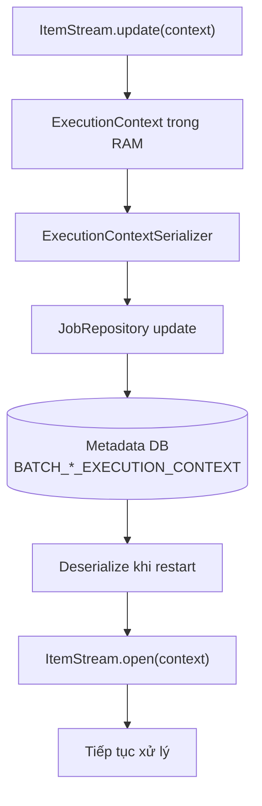
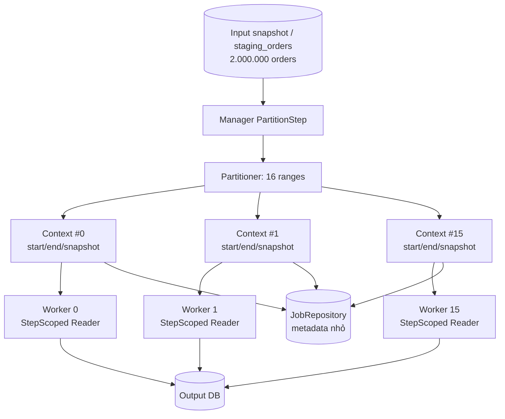
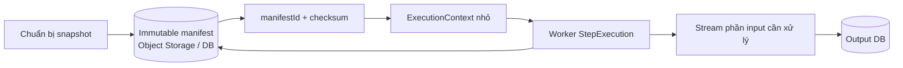
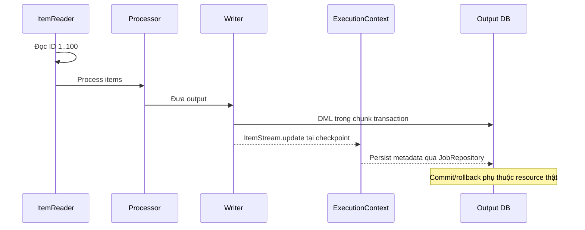

# Không lưu object quá lớn trong Spring Batch ExecutionContext

Khi viết một Spring Batch job xử lý vài triệu bản ghi, lập trình viên đôi khi muốn lưu “mọi thứ cần dùng lại” vào `ExecutionContext`: danh sách ID còn lại, một page dữ liệu đã đọc, cả một entity JPA hoặc kết quả gọi API. Cách đó có vẻ giúp restart thuận tiện. Nhưng với Spring Batch, **`ExecutionContext` là kho metadata/checkpoint nhỏ và có thể persist**, **không phải nơi lưu toàn bộ payload công việc, cache lớn hay object graph của ứng dụng**.

Mỗi lần context được lưu vào `JobRepository`, framework cần serial hóa trạng thái của nó. Một object lớn làm tăng dung lượng metadata, chi phí CPU/heap và I/O tại commit; còn khi restart, worker phải giải mã object đó trong phiên bản ứng dụng hiện tại. Nếu class thay đổi, object không serialize được, snapshot không còn hợp lệ hoặc nhiều worker cùng lưu dữ liệu lớn, hệ thống có thể chậm, lỗi và thậm chí mất khả năng phục hồi đúng.

Bài thuộc chương **ExecutionContext** trong module **SPRING_BATCH_SCALING_OPERATIONS**. Mục tiêu của module là mở rộng Spring Batch cho workload dữ liệu lớn qua multi-threaded step, parallel steps, partitioning và mô hình phân tán; đồng thời đo bottleneck, đảm bảo thread safety, retry/restart, vận hành và lựa chọn kiến trúc theo tài nguyên thực tế.

**Mục tiêu học tập:**

- Giải thích vì sao `ExecutionContext` cần **nhỏ, có schema ổn định và đủ để tái tạo trạng thái**.
- Hiểu chi phí serialize/deserialize, ảnh hưởng tới `JobRepository` và transaction của chunk.
- Nhận diện object không nên lưu: collection lớn, entity JPA, connection, stream, buffer, secret.
- Thiết kế lại theo hướng **checkpoint + snapshot/manifest URI + business key/range**, thay vì nhét payload vào context.
- Áp dụng đúng trong multi-threaded step, local/remote partitioning và remote chunking.
- Đo kích thước context, kiểm thử restart/fault injection và đối soát dữ liệu đầu ra.

## 1. ExecutionContext dùng để lưu thứ gì?

`ExecutionContext` là cấu trúc key–value do Spring Batch quản lý ở cấp `StepExecution` hoặc `JobExecution`. Context có thể được lưu vào `JobRepository` để job có khả năng khôi phục sau dừng/lỗi.

Ví dụ metadata có ích:

```text
orders.reader.schemaVersion = 1
orders.reader.resumeAfterId = 25000
input.snapshotId = B2026-11
input.manifestId = import-orders-B2026-11-v3
partition.startId = 20001
partition.endId = 30001
partition.bucketId = 2
```

Các key trên là **hợp đồng do ứng dụng tự định nghĩa**, không phải tên mặc định của tất cả reader Spring Batch. State do reader chuẩn lưu có thể dùng key khác; cần giữ đúng tên và ngữ nghĩa khi restart.

**Context trả lời câu hỏi:** *“Lần chạy lại cần biết điều gì để tiếp tục phần việc này từ checkpoint hợp lệ?”* Nó không nên cố trả lời: *“Toàn bộ các object mà worker đang có trong RAM là gì?”*

### Ba lớp dữ liệu cần tách

| Lớp | Chức năng | Ví dụ | Vị trí phù hợp |
| --- | --- | --- | --- |
| **Business input/output** | Dữ liệu thật phải được xử lý, có thể rất lớn | Hàng triệu orders, file CSV, event payload | Database, object storage, data lake, queue theo contract |
| **Metadata/checkpoint** | Tham chiếu và tiến độ tối thiểu | `snapshotId`, `nextId`, `fileUri`, `offset` | `ExecutionContext` |
| **Runtime working set/cache** | Buffer tạm để tăng throughput | JDBC page hiện tại, prefetch buffer, cache tra cứu | Heap có giới hạn, datasource/cache quản lý riêng; không persist cả buffer vào context |

Điểm hay của phân tách này: job có thể tái tạo runtime working set từ **nguồn dữ liệu bền vững** và một checkpoint nhỏ. Context không trở thành bản sao của cả dataset.

## 2. ExecutionContext là metadata có thể được persist, không phải bộ nhớ dùng chung

Phân biệt ba nguồn state:

| Thành phần | Phạm vi | Mục tiêu | Cạm bẫy |
| --- | --- | --- | --- |
| `JobParameters` | Input Job, một số parameter nhận diện JobInstance | Chốt `batchId`, version snapshot, tùy chọn cấu hình | Không cập nhật như checkpoint mỗi chunk |
| `JobExecutionContext` | `JobExecution` | Metadata chung giữa các Step | Không lưu hàng triệu item hay tiến độ riêng nhiều partition vào một key |
| **`StepExecutionContext`** | **`StepExecution`** | Checkpoint reader, range partition, trạng thái stream | Cần serialize/persist và khôi phục nhất quán |

`ExecutionContext.put(...)` chỉ cập nhật map trong bộ nhớ. Framework ghi context vào repository thông qua lifecycle của Step/Job, thường liên quan `ItemStream.update(...)` tại ranh giới chunk được quản lý. **Đã gọi `put` không có nghĩa dữ liệu đã bền vững.**

Đặc biệt, một object mutable lớn được đặt trong map rồi tiếp tục thay đổi nội bộ không phải một checkpoint rõ ràng: cơ chế dirty tracking của context có thể không nhận biết những thay đổi field mà không qua `put(...)`. Chỉ lưu giá trị đơn giản, bất biến hoặc tái ghi giá trị checkpoint rõ ràng qua API phù hợp.

## 3. Context lớn sẽ đi qua những bước nào?



Mỗi bước đều có giới hạn:

1. **RAM:** object graph vẫn cần bộ nhớ trong JVM cho tới khi không còn được tham chiếu.
2. **Serialization:** serializer phải duyệt và chuyển dữ liệu; object càng phức tạp thường càng đắt.
3. **Metadata SQL:** ghi các giá trị serialized vào bảng JobRepository; context lớn tạo nhiều byte I/O và chi phí transaction.
4. **Restart:** phải tải và deserialize toàn bộ state cần thiết; lỗi class/schema có thể ngăn worker mở reader.
5. **Triển khai phân tán:** nếu manager và worker cùng dùng JobRepository, phiên bản/class serializer không tương thích có thể gây lỗi giữa JVM.

`ExecutionContextSerializer` có thể tạo chuỗi Base64 Java serialization, JSON hoặc định dạng khác tùy cấu hình/version. **Đừng dựa vào hình thức hiển thị** để phán đoán size và khả năng tương thích. Base64 cũng không phải mã hóa bảo mật.

### Metadata JDBC thường được lưu ở đâu?

Schema `JdbcJobRepository` thường có:

- `BATCH_STEP_EXECUTION_CONTEXT`: context theo `STEP_EXECUTION_ID`.
- `BATCH_JOB_EXECUTION_CONTEXT`: context theo `JOB_EXECUTION_ID`.
- Các cột như `SHORT_CONTEXT` và `SERIALIZED_CONTEXT` (cấu trúc/kiểu cột phụ thuộc phiên bản, database và prefix).

Object quá lớn có thể vượt giới hạn cấu hình/cột hoặc gây chi phí lớn khi lưu LOB. **Không nên suy rằng có cột LOB thì context có thể tăng vô hạn mà không ảnh hưởng job.**

## 4. Sáu hậu quả của việc lưu object quá lớn

| Hậu quả | Biểu hiện | Vì sao xảy ra? |
| --- | --- | --- |
| **Heap/GC tăng** | Allocation, full GC, OOM, worker bị kill | Giữ collection và bản sao bytes/JSON khi serialize |
| **Chunk commit chậm** | Commit latency tăng, throughput giảm | Metadata phải serialize/ghi cùng chu trình checkpoint |
| **JobRepository nghẽn** | Connection pool pending, lock wait, transaction timeout | Nhiều worker cập nhật metadata lớn và thường xuyên |
| **Restart chậm hoặc không được** | Deserialize lỗi hoặc mất class | Runtime mới phải đọc toàn bộ serialized object cũ |
| **Payload/PII bị lộ** | Metadata/backup chứa dữ liệu không cần thiết | Object graph kéo theo thông tin nhạy cảm |
| **Sai logic checkpoint** | Dữ liệu thiếu/trùng sau replay | Payload chưa commit bị lưu như “đã hoàn tất”, hoặc nguồn thay đổi |

Quan trọng: **Object nhỏ vẫn có thể không phù hợp** nếu chứa `Connection`, `InputStream` hoặc credential. Object lớn càng làm các rủi ro trên nghiêm trọng hơn, nhưng tiêu chí thiết kế không chỉ là kích thước.

### So sánh chi phí bằng phép tính gần đúng

Giả sử một worker lưu `200 KiB` serialized context và thực hiện `1.000` lần checkpoint:

\[
D_{\text{serialized}} \approx 200 \text{ KiB} \times 1000
                    \approx 195 \text{ MiB}
\]

Nếu có 16 worker với tải tương tự, tổng lượng **payload context được tạo ra qua các lần serialize** có thể gần **3,05 GiB**. Đây chỉ là phép tính minh họa: nó **không phải** dung lượng bảng DB cuối cùng, không phản ánh chính xác WAL, index, backup hay replication bytes, và còn phụ thuộc framework có ghi lại context mỗi lần hay không.

Nếu mỗi worker thay vào đó lưu `2 KiB` metadata, chi phí serialized bytes của phần này thấp hơn khoảng 100 lần trong cùng giả định.

**Không có ngưỡng “ExecutionContext tối đa X KB” chung áp dụng cho mọi hệ thống.** Hãy đặt **budget nội bộ** dựa trên database, serializer, số worker, chunk frequency và SLO commit/restart. Ví dụ, nhóm có thể chọn cảnh báo khi serialized context vượt vài KiB và chặn tăng bất thường, nhưng đó là **policy ứng dụng**, không phải giới hạn mặc định của Spring Batch.

## 5. Anti-pattern: lưu danh sách item còn lại vào context

Một cách viết dễ gây lỗi:

```java
import java.util.List;
import org.springframework.batch.item.ExecutionContext;

public void saveRemainingOrders(
        ExecutionContext context,
        List<Order> pendingOrders) {

    // Không làm thế này với hàng nghìn/hàng triệu item.
    context.put("pendingOrders", pendingOrders);
}
```

Vấn đề:

- `pendingOrders` có thể chứa hàng trăm MB, kể cả khi chỉ một vài key đủ để đọc lại.
- `Order` hoặc nested fields có thể không serializable.
- Object có thể kéo theo entity JPA, lazy proxy, collections, PII và graph vòng tham chiếu.
- Khi restart, class `Order` mới có thể không còn đọc được bytes cũ.
- Nếu reader đã đọc nhưng chunk chưa commit, danh sách item “còn lại” có thể không phản ánh transaction boundary thực.

**Thay thế:** giữ **nguồn dữ liệu bền vững**, lưu vị trí và tham chiếu:

```java
context.putString("input.snapshotId", "B2026-11");
context.putLong("orders.reader.resumeAfterId", 25000L);
context.putString("input.manifestId", "orders-B2026-11-v3");
```

Đây vẫn chỉ là minh họa. `resumeAfterId` phải được tính tại **checkpoint hợp lệ**, không phải từ “ID lớn nhất từng nhìn thấy”.

## 6. Anti-pattern: lưu entity hoặc graph object JPA

```java
// Ví dụ không nên làm:
context.put("lastOrder", orderJpaEntity);
context.put("customerWithOrders", customerJpaEntity);
```

Một entity JPA không nên được xem như checkpoint bền vững vì:

- Các lazy fields/proxy liên quan Hibernate có thể không serialize được.
- Detached entity sau restart không còn gắn với `EntityManager` cũ.
- Class/schema nghiệp vụ thay đổi có thể phá Java serialization.
- Object graph có thể bao gồm dữ liệu nhạy cảm hoặc rất nhiều quan hệ.
- “Giữ entity hiện tại” không chứng minh writer đã commit cho item đó.

Thay bằng ID và version:

```java
context.putLong("orders.reader.lastCommittedId", 25000L);
context.putString("input.snapshotId", "orders-import-v3");
context.putInt("orders.checkpoint.schemaVersion", 1);
```

Sau restart, reader dùng ID/snapshot để truy vấn lại từ nguồn được chốt. Nếu đầu vào có nhiều phiên bản cùng ID, checkpoint cần chứa đủ version/sort key để tái tạo đúng thứ tự.

## 7. Anti-pattern: lưu JDBC Connection, stream hoặc tài nguyên runtime

Những giá trị không nên đưa vào `ExecutionContext`:

```java
context.put("connection", jdbcConnection);  // Sai
context.put("resultSet", jdbcResultSet);      // Sai
context.put("inputStream", openedStream);    // Sai
context.put("thread", Thread.currentThread()); // Sai
context.put("executor", taskExecutor);       // Sai
```

Các object này có vòng đời phụ thuộc process/thread hoặc tài nguyên bên ngoài. Ngay cả khi một kiểu tình cờ serializable, nó cũng **không đại diện cho connection/file descriptor hợp lệ sau restart**.

Cách đúng:

- Lưu **URI/path/object version**; mở `InputStream` mới khi reader `open(...)`.
- Lưu **query predicate, range, snapshot ID**; tạo JDBC connection/cursor mới từ `DataSource`.
- Lưu **partition key**; phân công worker thread/JVM thông qua executor/handler.
- Không serial hóa bean Spring; inject dependency thông qua container trên worker mới.

## 8. Bài toán xuyên suốt: xử lý hai triệu đơn hàng

Giả sử mỗi đợt `batchId=B2026-11` chứa **2.000.000 đơn hàng**. Ta muốn chạy 16 partition song song, mỗi worker commit nhiều chunk `200` item.

### Cách thiết kế sai

Manager lấy toàn bộ hai triệu item thành `List<Order>`, chia thành 16 danh sách rồi gán:

```java
ExecutionContext partitionContext = new ExecutionContext();
partitionContext.put("orders", oneLargePartitionList);
```

Mỗi worker context lúc này phải lưu và phục hồi một tập object lớn. Nếu worker chỉ cần truy vấn theo ID/range, việc đó vừa dư thừa vừa tạo bottleneck JobRepository.

### Cách thiết kế đúng hơn

1. **Nguồn dữ liệu** được chốt theo `batchId`/snapshot version, ví dụ bảng `staging_orders`.
2. **Partitioner** tạo 16 phần việc logic có tên ổn định.
3. `ExecutionContext` của mỗi partition chỉ giữ `startId`, `endId`, `snapshotId` và các key cấu hình cần thiết.
4. Worker `@StepScope` mở reader của riêng `StepExecution`, lọc đúng batch/range.
5. Reader có `ItemStream`/checkpoint phù hợp; writer dùng business key/idempotency.
6. Khi restart, worker tạo lại reader và đọc từ **metadata nhỏ đã persist**, không deserialize cả danh sách đơn hàng.



**Điểm mấu chốt:** giảm kích thước context **không** có nghĩa không lưu state. Ta vẫn lưu đủ thông tin để khôi phục *cùng công việc logic* và vị trí đã commit.

## 9. Ví dụ Partitioner chỉ lưu khoảng ID và snapshot

Dưới đây là Java 17+ với Spring Batch 5.x. Bài giả định một kế hoạch chia ID **đã chốt**; trên production cần gắn nó với JobInstance/snapshot bền vững.

```java
import java.util.LinkedHashMap;
import java.util.Locale;
import java.util.Map;

import org.springframework.batch.core.partition.support.Partitioner;
import org.springframework.batch.item.ExecutionContext;

public final class CompactRangePartitioner implements Partitioner {
    private final long startInclusive;
    private final long endExclusive;
    private final int partitions;
    private final String snapshotId;

    public CompactRangePartitioner(
            long startInclusive,
            long endExclusive,
            int partitions,
            String snapshotId) {

        long size = Math.subtractExact(endExclusive, startInclusive);
        if (size <= 0 || partitions <= 0 || size < partitions
                || snapshotId == null || snapshotId.isBlank()) {
            throw new IllegalArgumentException(
                    "Invalid partition plan");
        }

        this.startInclusive = startInclusive;
        this.endExclusive = endExclusive;
        this.partitions = partitions;
        this.snapshotId = snapshotId;
    }

    @Override
    public Map<String, ExecutionContext> partition(int gridSize) {
        // Số partition logic cố định cho cùng JobInstance.
        long total = endExclusive - startInclusive;
        long base = total / partitions;
        long remainder = total % partitions;
        long cursor = startInclusive;

        Map<String, ExecutionContext> result = new LinkedHashMap<>();

        for (int i = 0; i < partitions; i++) {
            long width = base + (i < remainder ? 1 : 0);
            long upper = Math.addExact(cursor, width);

            ExecutionContext context = new ExecutionContext();
            context.putLong("range.startId", cursor);
            context.putLong("range.endId", upper);
            context.putString("input.snapshotId", snapshotId);
            context.putInt("input.schemaVersion", 1);

            result.put(
                    String.format(Locale.ROOT, "range-%03d", i),
                    context);
            cursor = upper;
        }
        return result;
    }
}
```

Mỗi partition lưu **bốn giá trị đơn giản**, không chứa item payload. Khoảng `[startId, endId)` nửa mở giúp tránh chồng lấn tại biên.

**Lưu ý:**

- `gridSize` là thông tin do framework cung cấp; implementation này cố ý dùng `partitions` đã chốt thay vì thay phạm vi khi restart.
- Giữ tên `range-000` và mapping → dữ liệu ổn định trong cùng JobInstance.
- Đảm bảo nguồn snapshot không thay đổi; ID range chỉ chứng minh **miền khóa** rời nhau, không tự chứng minh mọi input được bao phủ.
- Nếu ID phân bố lệch, nên đo số item/duration theo range và tối ưu kế hoạch cho **JobInstance tiếp theo**, không sửa mapping của JobInstance đã có checkpoint.

## 10. Worker late binding mà không tải danh sách lớn

Reader `@StepScope` nhận metadata của worker `StepExecution` và truy vấn nguồn bằng điều kiện range.

```java
import javax.sql.DataSource;
import java.util.Map;

import org.springframework.batch.core.configuration.annotation.StepScope;
import org.springframework.batch.item.database.JdbcPagingItemReader;
import org.springframework.batch.item.database.builder.JdbcPagingItemReaderBuilder;
import org.springframework.batch.item.database.support.PostgresPagingQueryProvider;
import org.springframework.batch.item.database.Order;
import org.springframework.beans.factory.annotation.Value;
import org.springframework.context.annotation.Bean;

@Bean
@StepScope
public JdbcPagingItemReader<RawOrder> rangeReader(
        DataSource dataSource,
        @Value("#{jobParameters['batchId']}") String batchId,
        @Value("#{stepExecutionContext['range.startId']}") Long startId,
        @Value("#{stepExecutionContext['range.endId']}") Long endId,
        @Value("#{stepExecutionContext['input.snapshotId']}") String snapshotId) {

    if (batchId == null || batchId.isBlank()
            || startId == null || endId == null
            || startId >= endId
            || snapshotId == null || snapshotId.isBlank()) {
        throw new IllegalArgumentException("Invalid worker context");
    }

    // Ví dụ dữ liệu nguồn đã được chốt theo batchId/snapshotId.
    var query = new PostgresPagingQueryProvider();
    query.setSelectClause("SELECT id, amount");
    query.setFromClause("FROM staging_orders");
    query.setWhereClause(
            "WHERE batch_id = :batchId AND id >= :startId AND id < :endId");
    query.setSortKeys(Map.of("id", Order.ASCENDING));

    return new JdbcPagingItemReaderBuilder<RawOrder>()
            .name("ordersRangeReader")
            .dataSource(dataSource)
            .queryProvider(query)
            .parameterValues(Map.of(
                    "batchId", batchId,
                    "startId", startId,
                    "endId", endId))
            .pageSize(200)
            .rowMapper((rs, index) -> new RawOrder(
                    rs.getLong("id"),
                    rs.getBigDecimal("amount")))
            .saveState(true)
            .build();
}
```

Trong project thực tế, `RawOrder` là record/class do ứng dụng định nghĩa, ví dụ:

```java
import java.math.BigDecimal;

public record RawOrder(long id, BigDecimal amount) {}
```

**Giới hạn của ví dụ:** có biến `snapshotId` để xác nhận metadata, nhưng SQL chỉ lọc `batchId`. Do đó ví dụ **giả định batchId đã cố định dữ liệu snapshot**; nếu nguồn lưu nhiều phiên bản trong cùng batch, phải lọc theo snapshot/version thật (hoặc trỏ vào bảng immutable đúng phiên bản), nếu không restart vẫn có thể đọc input khác.

Các điều kiện khác:

- `id` phải là sort key **duy nhất trong phạm vi query**. Nếu không, dùng khóa sort tổng hợp.
- Reader có `saveState(true)` và tên ổn định để lưu checkpoint, nhưng **source phải không đổi** và đúng `ItemStream` lifecycle.
- Khi restart, phạm vi partition và reader name không được đổi tùy tiện.
- `@StepScope` cô lập bean theo **`StepExecution`**, không phải theo thread. Tránh nhiều chunk threads dùng chung reader stateful của một worker khi chưa chứng minh an toàn.
- Với query phân vùng, index thường cần được xem xét trên `(batch_id, id)`; đo query plan thật trước khi tăng số worker.

Dữ liệu không phải tải toàn bộ vào bộ nhớ manager; worker có thể đọc từng page từ database theo phạm vi được giao.

## 11. Worker Step và writer idempotent

Chunk size là đơn vị xử lý/transaction, không phải kích thước đối tượng cần lưu trong context.

```java
import org.springframework.batch.core.Step;
import org.springframework.batch.core.repository.JobRepository;
import org.springframework.batch.core.step.builder.StepBuilder;
import org.springframework.batch.item.ItemProcessor;
import org.springframework.batch.item.ItemWriter;
import org.springframework.batch.item.database.JdbcPagingItemReader;
import org.springframework.context.annotation.Bean;
import org.springframework.transaction.PlatformTransactionManager;

@Bean
public Step compactWorkerStep(
        JobRepository jobRepository,
        PlatformTransactionManager transactionManager,
        JdbcPagingItemReader<RawOrder> rangeReader,
        ItemProcessor<RawOrder, ProcessedOrder> processor,
        ItemWriter<ProcessedOrder> writer) {

    return new StepBuilder("compactWorkerStep", jobRepository)
            .<RawOrder, ProcessedOrder>chunk(200, transactionManager)
            .reader(rangeReader)
            .processor(processor)
            .writer(writer)
            .build();
}
```

`ProcessedOrder`, processor và writer là thành phần ứng dụng tự cung cấp; snippet minh họa Step configuration. Không có yêu cầu nào phải lưu cả `Chunk<RawOrder>` trong `ExecutionContext` chỉ vì Step sử dụng chunk size 200.

Với dữ liệu đích có unique key nghiệp vụ phù hợp, writer có thể thiết kế xử lý lại idempotent:

```sql
CREATE TABLE processed_orders (
    batch_id varchar(80) NOT NULL,
    order_id bigint NOT NULL,
    amount numeric(18,2) NOT NULL,
    PRIMARY KEY (batch_id, order_id)
);

-- PostgreSQL: cập nhật trạng thái hiện tại một cách idempotent
-- nếu cùng input/version luôn cho cùng amount.
INSERT INTO processed_orders (batch_id, order_id, amount)
VALUES (:batchId, :orderId, :amount)
ON CONFLICT (batch_id, order_id)
DO UPDATE SET amount = EXCLUDED.amount;
```

Upsert không tự phù hợp với append-only ledger, số dư cộng dồn hay side effect API. Cần business key/version và cơ chế dedupe đúng semantics.

## 12. Dùng manifest/URI thay vì nhét danh sách vào context

Nếu input là tập hàng trăm file hoặc hàng triệu object không chia được bằng một range đơn giản, hãy tạo **manifest bền vững** bên ngoài, rồi chỉ lưu **manifest ID/URI và checksum**.



Ví dụ:

```java
import org.springframework.batch.item.ExecutionContext;

public final class ManifestCheckpoint {
    public static final String URI = "input.manifestUri";
    public static final String SHA = "input.manifestSha256";
    public static final String SNAPSHOT = "input.snapshotId";

    public static void set(
            ExecutionContext context,
            String manifestUri,
            String sha256,
            String snapshotId) {

        if (manifestUri == null || manifestUri.isBlank()
                || sha256 == null || sha256.isBlank()
                || snapshotId == null || snapshotId.isBlank()) {
            throw new IllegalArgumentException("Missing manifest metadata");
        }

        context.putString(URI, manifestUri);
        context.putString(SHA, sha256);
        context.putString(SNAPSHOT, snapshotId);
    }
}
```

Một context ví dụ:

```text
input.manifestUri = s3://etl-input/orders/B2026-11/manifest-v3.json
input.manifestSha256 = 6d5f... (hash thực đã tính)
input.snapshotId = B2026-11
reader.fileIndex = 17
reader.positionInFile = 20000
```

**Yêu cầu đối với manifest:** nội dung phải **immutable/versioned**, có checksum hoặc object version thực tế; worker có quyền truy cập sau restart, và schema manifest phải tương thích giữa các bản deploy.

**Không cho rằng lưu URI là đủ** nếu URI trỏ đến `latest.json` có thể bị ghi đè. Khi đó context nhỏ nhưng vẫn không đáng tin. Lưu một **tham chiếu bền vững** phải đi kèm chiến lược snapshot.

### Nếu manifest quá lớn để đọc hết thì sao?

Không đưa toàn bộ manifest vào `ExecutionContext`. Có thể:

- Chia manifest theo shard/file với ID cố định.
- Stream manifest theo page, seek theo cursor/tên file.
- Dùng bảng chỉ mục có khóa `(batchId, shardId)`.
- Lưu `shardId` và vị trí **đã commit** của shard hiện tại.
- Chỉ giữ một working set có giới hạn trong heap; tái tạo được từ manifest khi restart.

## 13. Mẫu bảng công việc bền vững cho dữ liệu rất lớn

Khi không thể checkpoint bằng một con trỏ đơn, ví dụ nhiều consumer cần claim item độc lập hoặc thứ tự commit có thể đảo, hãy xem xét **work table** thay vì một list lớn trong context.

```sql
CREATE TABLE batch_work_items (
    batch_id varchar(80) NOT NULL,
    item_id bigint NOT NULL,
    payload_ref text NOT NULL,
    status varchar(24) NOT NULL,
    worker_lease_until timestamp NULL,
    PRIMARY KEY (batch_id, item_id)
);

CREATE INDEX idx_batch_work_status
    ON batch_work_items (batch_id, status, item_id);
```

Ở đây `ExecutionContext` có thể chỉ chứa `batchId`, `snapshotId` hoặc partition/shard ID. Work table lưu **trạng thái từng item**, có thể được query/claim theo transaction và unique key.

Thiết kế claim/lease thực tế cần giải quyết:

- Nhiều worker cùng claim một item phải có lock/CAS/SQL atomic phù hợp.
- Lease hết hạn rồi item được giao lại → writer cần idempotency.
- `status=DONE` chỉ được commit đúng thời điểm với business output (nếu cùng DB transaction), hoặc có reconciliation khi resource khác nhau.
- Không chỉ dựa trên `SELECT status='NEW'` rồi `UPDATE` không khóa khi nhiều worker concurrent.
- Bảng công việc cần cleanup/retention và index phù hợp.

**Work table không tự động “miễn phí”:** nó thêm overhead DB và quy trình vận hành; dùng khi tính năng phân phối/state per item thật sự cần thiết. Với input snapshot ổn định và partition range rõ, checkpoint nhỏ vẫn thường đơn giản hơn.

### Đừng dùng ExecutionContext làm hàng đợi sự kiện chưa gửi

Một anti-pattern tương tự là `context.put("pendingNotifications", eventList)`: sau mỗi chunk, danh sách message chờ gửi tăng dần và bị serialize cùng checkpoint. Nếu worker crash giữa việc gửi event và persist context, danh sách đó cũng không tự cung cấp giao thức ack/dedupe đáng tin cậy. Tệ hơn, khi job restart hoặc broker redeliver, một event có thể được phát hai lần.

Nếu business event phải gắn với một transaction DB, hãy cân nhắc **transactional outbox**: writer ghi output và record outbox có `eventId` duy nhất trong **cùng transaction DB**; publisher độc lập gửi các event đã commit; consumer chống xử lý lặp theo `eventId`. `ExecutionContext` chỉ cần giữ thông tin checkpoint của batch, **không lưu toàn bộ sự kiện chưa phát**. Outbox vẫn có thể phát lặp khi publisher crash sau khi broker đã nhận, vì vậy cần idempotency và cơ chế đối soát.

## 14. Phân biệt state bền vững và cache runtime

Một số ứng dụng cần cache map tra cứu (ví dụ 500.000 mã sản phẩm), không muốn query lại mỗi item. Cache có thể hợp lý để tăng throughput, nhưng **không nên persist cả cache trong `ExecutionContext`**.

### Thiết kế đúng hơn

- Một component/service chuyên quản lý cache, được giới hạn dung lượng và TTL.
- Cache có thể được tái tạo từ database/object storage khi worker restart.
- Nếu cache phụ thuộc snapshot, dùng `cacheVersion`/`snapshotId` trong context để tải đúng dữ liệu.
- Không đặt cache mutable không thread-safe vào singleton được nhiều worker chia sẻ.
- Nếu cần memory lớn, benchmark heap/GC, hiệu năng warm-up và lựa chọn external cache phù hợp.

```java
// Chỉ lưu danh tính của phiên bản cache:
context.putString("lookup.snapshotId", "catalog-v42");

// CacheManager/Repository tải dữ liệu theo snapshot khi worker chạy.
// Không context.put("catalogCache", 500_000_ProductObjects).
```

Nếu cache không quyết định correctness và chỉ giúp hiệu năng, có thể không cần một key cache nào trong context; nó được khởi tạo lại khi chạy.

## 15. Transaction và checkpoint: context nhỏ phải vẫn đúng

`ExecutionContext` phải **nhỏ nhưng không thiếu thông tin khôi phục**. Một checkpoint chỉ chứa `lastSeenId` có thể sai nếu reader tiến trước writer/commit.



Sơ đồ khái niệm nhắc rằng **`ItemStream.update` đặt state vào context trước commit** trong lifecycle chunk thông thường. Khi transaction rollback, tiến độ **đã persist ở commit trước** mới là điểm phục hồi đáng tin; không lấy state trong RAM đã đọc xa hơn để đánh dấu hoàn tất.

### Hai tình huống khác nhau

| Tình huống | Điều có thể xảy ra | Phòng vệ |
| --- | --- | --- |
| Output DB và JobRepository dùng cùng transaction thực sự | Output và metadata có thể commit/rollback nhất quán | Kiểm chứng datasource/transaction manager và failure path |
| Output DB ở DB-B, JobRepository ở DB-A | Commit DB-B và metadata DB-A không atomic tự động | Idempotent writer, stable input, reconciliation |

**Object càng lớn càng làm cập nhật metadata nặng**, nhưng việc giảm size không tự sửa một transaction topology sai. Cần kiểm thử crash ngay trước/sau commit và so sánh output thật với checkpoint.

## 16. Multi-threaded Step: không dùng một context chứa backlog item

Ở multi-threaded Step, nhiều chunk có thể xử lý đồng thời nhưng dùng chung **một `StepExecution` và `StepExecutionContext`**. Nếu mỗi thread thêm item vào một list “đã xử lý” trong context, bạn có thể gặp:

- Race giữa các thread khi cập nhật list/map.
- Object mutable bị sửa mà dirty flag của context không phát hiện.
- Serialized object ngày càng lớn sau mỗi chunk.
- Thứ tự commit khác thứ tự đọc, làm state “đã xong” sai.
- OOM khi backlog hoặc số item tăng.
- Kéo dài transaction trong lúc serialize context.

**Đừng thay bằng `ConcurrentHashMap` trong context rồi xem như đã giải quyết.** Concurrent map có thể tránh một số race, nhưng vẫn là payload lớn, khó checkpoint và có thể không tương thích serializer.

Ví dụ rủi ro của pointer đơn:

```text
Chunk A đọc ID 1..100, chưa commit.
Chunk B đọc ID 101..200, commit trước.
Context ghi currentPosition=200.
Chunk A rollback rồi JVM crash.
Restart từ 201 -> có thể bỏ sót ID 1..100.
```

Khi cần progress với nhiều task đang chạy độc lập, **partitioning với StepExecutionContext riêng**, work table bền vững, hoặc thiết kế idempotent reread thường dễ kiểm chứng hơn danh sách item lưu trong context.

## 17. Partitioning: chi phí metadata nhân với số worker

Giả sử mỗi partition có `ExecutionContext` riêng và mỗi worker cập nhật state mỗi chunk. Khi số partition tăng từ 8 lên 128, những chi phí sau cũng tăng:

- Số `StepExecution` cần ghi/đọc vào repository.
- Số context được serialize/deserialize.
- Tần suất metadata updates/transactions.
- DB connection pool, lock, WAL/redo và chi phí index/LOB theo cấu hình.

Với context gọn, có thể chấp nhận overhead để tăng song song. Với context chứa 5 MB object, **128 worker** làm metadata trở thành nút thắt lớn ngay cả khi thuật toán xử lý item đủ nhanh.

### Không chia sẻ một blob chung giữa các partition

Tránh thiết kế mỗi worker ghi một danh sách kết quả lớn vào **cùng một key của `JobExecutionContext`**. Không có guarantee rằng các worker song song có thể ghi đè và promote state như vậy an toàn. Mỗi worker nên lưu **metadata tối thiểu của chính mình**; kết quả lớn được ghi vào storage/bảng output có khóa riêng.

### @StepScope không đồng nghĩa thread scope

`@StepScope` tạo bean theo `StepExecution`, không phải mỗi thread/chunk. Với local partitioning, mỗi worker StepExecution thường có reader riêng. Nhưng nếu một worker Step lại dùng nhiều chunk threads, các thread đó vẫn có thể chia sẻ bean stateful. Tách context nhỏ giúp giảm overhead, **không thay thế kiểm tra thread safety**.

## 18. Remote partitioning và remote chunking

Cùng là hệ thống phân tán, nhưng chủ sở hữu reader/checkpoint khác nhau:

| Mô hình | Reader nằm ở đâu | Context quan trọng | Vì sao cần nhỏ? |
| --- | --- | --- | --- |
| Local partitioning | Worker Step trong JVM manager | Context riêng từng worker | Nhiều worker cùng cập nhật metadata DB |
| **Remote partitioning** | Worker Step trong JVM worker | Worker `StepExecutionContext` tải/ghi qua `JobRepository` theo kiến trúc | Cross-JVM deserialize, version/schema và network overhead |
| **Remote chunking** | **Manager** đọc; worker process/write request | Manager `StepExecutionContext` lưu reader state | Context lớn làm manager bottleneck; không biến broker thành kho checkpoint |
| Parallel Steps | Mỗi Step giữ state riêng | Context theo từng Step | Không lưu payload chồng chéo vào Job context |

Trong **remote partitioning**, worker có thể phải deserialize context do manager tạo. Nếu manager đưa một custom DTO chỉ có trên manager classpath, worker có thể fail trước khi bắt đầu Step. Dùng `String`/`Long`/`Integer` làm metadata và giữ serializer tương thích giữa phiên bản JVM.

Trong **remote chunking**, manager thường sở hữu checkpoint reader; worker nhận `ChunkRequest` chứa item qua middleware, **không mặc định có StepExecutionContext reader riêng**. Payload chunk có thể lớn, nhưng đó là **message transport concern**, khác với kích thước `ExecutionContext`. Cần giới hạn kích thước message, quản lý ack/redelivery và chống hiệu ứng lặp ở worker.

## 19. Serialization, phiên bản ứng dụng và object graph

Trong Spring Batch 5.x, mặc định `DefaultExecutionContextSerializer` thường dựa trên Java object serialization và biểu diễn phù hợp để lưu vào metadata repository. Nếu ứng dụng dùng JSON/custom serializer, behavior phụ thuộc cấu hình thực tế.

Một custom object có thể gặp:

- `NotSerializableException` khi commit/checkpoint.
- `ClassNotFoundException` hoặc `InvalidClassException` sau nâng cấp.
- Khác biệt `Integer`/`Long`/`String` khi deserialize.
- Đổi package/field hoặc ngữ nghĩa của checkpoint.
- Kết quả không mong muốn nếu deserialize untrusted bytes.

**Đừng cho rằng `Serializable` nghĩa là object nên được lưu.** Nó chỉ là khả năng kỹ thuật của một định dạng cụ thể, không chứng minh object nhỏ, an toàn, ổn định hay có ý nghĩa checkpoint.

### Một schema state dễ nâng cấp hơn

```java
context.putInt("orders.state.schemaVersion", 1);
context.putLong("orders.reader.resumeAfterId", 25000L);
context.putString("orders.reader.snapshotId", "B2026-11");
```

Một thay đổi schema trong bản v2 phải có chính sách đọc legacy/migration. Trong cùng JobInstance, reader name, Step name, key type và semantics cần được giữ hoặc chuyển đổi có chứng minh. Không xóa checkpoint cũ và tự restart từ đầu khi writer chưa idempotent.

## 20. Hạn chế dữ liệu nhạy cảm và nguy cơ bảo mật

Một `ExecutionContext` có thể được lưu trong metadata DB, backup, logging hoặc được worker khác đọc. Đừng đặt:

- Access token, API key, password, private key.
- Danh sách thông tin khách hàng, địa chỉ, PII hoặc dữ liệu tài chính không cần thiết.
- HTTP headers chứa Authorization.
- Serialized entity kéo theo relation có dữ liệu nhạy cảm.
- Raw stack trace có chứa payload bí mật.

`Base64` không phải encryption. Nếu JobRepository bị truy cập trái phép, những giá trị này có thể bị lộ. Thay vì lưu secret, dùng secret manager hoặc workload identity để lấy credential khi worker khởi chạy. Context có thể chứa một **tham chiếu không bí mật** hoặc cấu hình hợp lệ, nhưng không được xem nó là kho secret.

Ngoài bảo mật lưu trữ, deserialization của object phức tạp từ dữ liệu thiếu tin cậy còn có rủi ro. Hạn chế quyền ghi metadata và chọn serializer/allowed types phù hợp threat model.

## 21. Làm sao đặt ngưỡng kích thước context?

Thay vì đưa ra một con số cố định cho mọi môi trường, hãy thiết lập **context budget** dựa trên đo đạc.

1. Chọn một nhóm Job/Step thực, đo serialized bytes sau mỗi commit.
2. Đo p50/p95/p99 serialize latency và JobRepository update latency.
3. Tăng số partition/worker tới concurrency dự kiến, theo dõi metadata DB pool/lock/I/O.
4. Chọn ngưỡng cảnh báo và ngưỡng fail-fast trước production; lập danh sách key nào được phép lớn.
5. Kiểm tra restart/deserialize latency và khả năng chịu lỗi.
6. Ghi rõ đây là **SLO của ứng dụng**, không phải hard limit của Spring Batch.

### Ví dụ phép đo bằng serializer (test/diagnostic)

```java
import java.io.ByteArrayOutputStream;
import java.io.IOException;
import java.util.Map;

import org.springframework.batch.core.repository.ExecutionContextSerializer;

public final class ContextSizeBudget {
    private final ExecutionContextSerializer serializer;
    private final int maxBytes;

    public ContextSizeBudget(
            ExecutionContextSerializer serializer, int maxBytes) {
        if (maxBytes <= 0) {
            throw new IllegalArgumentException("maxBytes <= 0");
        }
        this.serializer = serializer;
        this.maxBytes = maxBytes;
    }

    public int assertFits(Map<String, Object> values)
            throws IOException {
        var buffer = new ByteArrayOutputStream();
        serializer.serialize(values, buffer);
        int bytes = buffer.size();

        if (bytes > maxBytes) {
            throw new IllegalStateException(
                    "ExecutionContext too large: "
                    + bytes + " bytes, budget=" + maxBytes);
        }
        return bytes;
    }
}
```

Mẫu này **đo representation do serializer trả về**, không phải memory footprint của object, không phải dung lượng DB/WAL, cũng không phản ánh mọi thao tác DAO. Dùng đúng serializer của infrastructure đang chạy, và tránh đo bằng cách serialize lặp quá nhiều lần **bên trong transaction nóng** nếu không cần thiết.

Ví dụ trong test:

```java
import java.util.Map;
import org.springframework.batch.core.repository.dao.DefaultExecutionContextSerializer;

var guard = new ContextSizeBudget(
        new DefaultExecutionContextSerializer(),
        8 * 1024); // 8 KiB là budget demo do ứng dụng đặt.

int measuredBytes = guard.assertFits(Map.of(
        "snapshotId", "B2026-11",
        "resumeAfterId", 25000L,
        "schemaVersion", 1));
```

Đây là snippet giải thích, không phải class Java độc lập đầy đủ; trong project có thể đặt vào test method và dùng JUnit assertion phù hợp. Không tự coi `8 KiB` là giới hạn Spring Batch, và cần cân nhắc `ExecutionContextSerializer` có thể bao gồm encoding overhead khác nhau.

## 22. Unit test: object lớn phải bị phát hiện

Unit test minh họa một policy size nhỏ trong ứng dụng:

```java
import static org.junit.jupiter.api.Assertions.*;

import java.util.List;
import java.util.Map;
import java.util.stream.IntStream;

import org.junit.jupiter.api.Test;
import org.springframework.batch.core.repository.dao.DefaultExecutionContextSerializer;

class ContextSizeBudgetTest {

    @Test
    void smallCheckpointFits() throws Exception {
        var guard = new ContextSizeBudget(
                new DefaultExecutionContextSerializer(), 8192);

        int bytes = guard.assertFits(Map.of(
                "input.snapshotId", "B2026-11",
                "orders.reader.resumeAfterId", 1000L,
                "orders.state.schemaVersion", 1));

        assertTrue(bytes > 0 && bytes <= 8192);
    }

    @Test
    void largePayloadIsRejected() {
        var guard = new ContextSizeBudget(
                new DefaultExecutionContextSerializer(), 8192);

        var large = IntStream.range(0, 10_000)
                .mapToObj(i -> "order-" + i)
                .toList();

        assertThrows(IllegalStateException.class,
                () -> guard.assertFits(
                        Map.of("pendingOrders", large)));
    }
}
```

Đây là test kỹ thuật cho **policy kích thước**, không thay thế integration test chạy Spring Batch thật. Đặc biệt, một object có kích thước nhỏ nhưng không serializable, hoặc một pointer có semantics sai, vẫn cần test riêng.

### Kiểm thử tình huống class không còn tồn tại

Nếu job lưu object custom ở phiên bản v1, hãy lưu serialized fixture từ binary v1, sau đó thử deserialize bằng binary v2. Kết quả mong muốn có thể là “đọc được và hiểu đúng” hoặc “fail rõ ràng rồi migrate”, **không được coi lỗi đọc là dữ liệu đã xử lý xong**.

## 23. Integration test: tính đúng đắn sau restart

Một workflow kiểm thử tốt cần **JobRepository bền vững** và data source đại diện, không chỉ gọi `context.put` trong unit test.

### Kịch bản 1: lỗi giữa chunk

1. Chuẩn bị snapshot 10.000 input với các ID xác định.
2. Cấu hình Step chunk size 200, reader có `saveState(true)`.
3. Cho hai chunk đầu commit thành công.
4. Inject lỗi writer ở chunk thứ ba, sau khi đã đọc item nhưng trước commit.
5. Kiểm tra `StepExecutionContext` đã persist không tiến vượt qua chunk committed.
6. Restart cùng JobInstance với nguồn snapshot không đổi.
7. Đối soát output có đủ key và giá trị chính xác, không nhân đôi effect.

### Kịch bản 2: context lớn trong nhiều partition

1. Chạy baseline với context nhỏ: `startId/endId/snapshotId`.
2. Trong môi trường test, so sánh với biến thể lưu danh sách item lớn trong context.
3. Tăng concurrency 4 → 8 → 16 → 32 worker (trong giới hạn máy test).
4. Đo serialized context bytes, commit latency, JobRepository update latency, heap/GC.
5. Kiểm tra worker crash/restart và thời gian deserialize.
6. Chỉ giữ thiết kế nếu đáp ứng cả throughput và correctness; thông thường biến thể context nhỏ có lợi thế rõ về overhead metadata.

### Kịch bản 3: thay đổi input snapshot

1. Lưu `manifestUri` và checksum từ snapshot A.
2. Cho job thất bại sau vài chunk.
3. Trước restart, cố tình thay nội dung ở cùng đường dẫn (hoặc tạo object version B).
4. Reader phải phát hiện checksum/version mismatch và **fail-fast**, không lặng lẽ dùng checkpoint của A trên B.
5. Khôi phục snapshot A hoặc theo quy trình migration/replay được kiểm soát.

### Ma trận lỗi cần kiểm tra

| Lỗi | Dấu hiệu | Kỳ vọng |
| --- | --- | --- |
| Context có danh sách 100.000 item | Serialize chậm/metadata lớn | Guard/test phát hiện, không deploy |
| Lưu `Connection` vào context | Serialization fail | Không đánh dấu Job thành công |
| Lưu JPA entity | Class/proxy/schema lỗi khi restart | Dùng business ID/pointer |
| Kích thước serialized vượt DB/config | SQL/LOB exception | Fail có log rõ, không giả success |
| Worker crash giữa commit | State DB không chắc chắn | Restart + idempotent writer |
| Reader đổi tên | Missing checkpoint key | Migration/compatibility test |
| Source file thay đổi | Offset trỏ sai | Snapshot checksum validation |
| Worker partition đổi bucketCount | Mapping dữ liệu đổi | Chặn restart plan không ổn định |
| Multi-threaded Step commit đảo thứ tự | Pointer vượt item chưa commit | Chọn progress strategy phù hợp |
| Remote worker version cũ | Không deserialize custom class mới | Giữ primitive/schema contract |
| Broker redelivery | Chunk xử lý lại | Business idempotency và correlation |
| Context có secret | Backup/log lộ nội dung | Secret manager và giới hạn quyền |

## 24. Đối soát output, không chỉ nhìn trạng thái COMPLETED

`JobExecution`/`StepExecution` chuyển sang `COMPLETED` không đủ chứng minh dữ liệu đúng. Khi tối ưu context, phải kiểm tra **không mất/trùng dữ liệu**.

Ví dụ PostgreSQL:

```sql
-- Dùng khi mỗi input phải tạo đúng một output.
SELECT s.id
FROM staging_orders s
LEFT JOIN processed_orders p
  ON p.batch_id = s.batch_id
 AND p.order_id = s.id
WHERE s.batch_id = :batchId
  AND p.order_id IS NULL;

-- Output không thuộc snapshot đầu vào.
SELECT p.order_id
FROM processed_orders p
LEFT JOIN staging_orders s
  ON s.batch_id = p.batch_id
 AND s.id = p.order_id
WHERE p.batch_id = :batchId
  AND s.id IS NULL;

-- Tổng số và số tiền (nếu logic nghiệp vụ tương ứng).
SELECT COUNT(*) AS output_count,
       SUM(amount) AS total_amount
FROM processed_orders
WHERE batch_id = :batchId;
```

Nếu processor có filter/skip/aggregate, điều chỉnh kỳ vọng theo contract. Unique constraint không chứng minh amount đúng; cùng key có thể bị update sai bởi input/version khác.

## 25. Các dấu hiệu giám sát khi context phình to

| Metric | Giá trị chẩn đoán | Cách xử lý |
| --- | --- | --- |
| Serialized context size | Bytes theo Step và phiên bản | Tìm key phình, chuyển payload sang storage |
| Serialize latency | p95/p99, CPU/GC | Giảm object graph, kiểu state |
| JobRepository update duration | Thời gian write metadata | Đo DB pool/lock/I/O |
| Step commit latency | Commit quá chậm so với processing | Phân biệt writer SQL và metadata |
| DB metadata storage growth | LOB bytes, backup, WAL/redo | Retention/archival và giới hạn payload |
| JVM heap/GC | Allocation spike/Full GC | Giảm cache/context lớn |
| Restart open time | Deserialize/reader setup chậm | Migrate state, tối ưu tham chiếu |
| Partition active count | Nhiều worker viết metadata | Tuning concurrency/grid size |
| Output reconciliation failures | Missing/extra/incorrect keys | Điều tra checkpoint và input snapshot |

Tránh gắn `JobExecutionId`/`StepExecutionId`/`itemId` làm label của **mọi time-series metric** vì cardinality cao. Thông tin đó phù hợp với structured logs/traces; dùng Step name, nhóm job, result class cho metric cardinality thấp.

### Công thức định hướng tải metadata

Gọi:

- `P` = số partition đang có.
- `C` = số checkpoint mỗi partition.
- `S` = kích thước serialized context trung bình.

Khi phần lớn checkpoint có ghi context, khối lượng payload serialize xấp xỉ:

\[
V \approx P \times C \times S
\]

**Đây không phải công thức đo chính xác I/O database.** Metadata được ghi theo cơ chế dirty tracking/repository, còn transaction log, backup, index, compression và concurrent writes tạo hệ số khác. Dùng công thức để nhận diện xu hướng và quyết định **cần benchmark**, không để dự đoán chính xác dung lượng production.

## 26. Runbook khi JobRepository chậm hoặc restart vì context lớn

1. **Xác định đối tượng:** JobInstance/JobExecution/StepExecution, Step name, partition name và phiên bản ứng dụng.
2. **Đo kích thước serialized context** ở Step lỗi, so với baseline và budget ứng dụng; không log nguyên payload nhạy cảm.
3. **Xem key nào tăng theo item count**: `pendingItems`, `cache`, `lastPage`, `allOrders` hoặc object graph.
4. **Đánh giá serializer**: class/types, representation, chi phí CPU và khả năng đọc sau upgrade.
5. **Xác định transaction topology:** JobRepository và output DB chung resource hay khác? Có commit không chắc chắn?
6. **Đối soát output đã commit** trước khi thay state, đảm bảo không mất/trùng item.
7. **Thiết kế state gọn:** chuyển payload sang input snapshot/work table/manifest, context chỉ giữ pointer/checkpoint.
8. **Kiểm tra compatibility với context cũ**: job đang FAILED/STOPPED có còn đọc được không? Có cần migration hay runtime cũ?
9. **Thử trên bản sao** của JobRepository và output, với fault injection/restart thật.
10. **Rollout có kiểm soát**, theo dõi commit latency, metadata bytes, restart time và correctness.

**Không xóa thủ công `SERIALIZED_CONTEXT` hoặc sửa `BATCH_STEP_EXECUTION_CONTEXT` để “giảm dung lượng”** nếu chưa có backup và migration đã kiểm chứng. Làm vậy có thể phá checkpoint, dẫn tới replay toàn bộ hoặc bỏ sót dữ liệu.

## 27. Những hiểu lầm thường gặp

| Hiểu lầm | Thực tế |
| --- | --- |
| “Context là HashMap nên chứa bao nhiêu cũng được” | Repository phải serialize và persist state |
| “Có cột LOB là không còn giới hạn” | CPU/heap/DB I/O/transaction vẫn bị ảnh hưởng |
| “Danh sách item lớn giúp restart an toàn hơn” | Chưa chắc phản ánh chunk đã commit |
| “`Serializable` là đã phù hợp” | Không chứng minh object nhỏ/tương thích/bảo mật |
| “`put` nghĩa là DB đã lưu” | Chỉ cập nhật object context trong RAM |
| “Serialize thành công thì checkpoint đúng” | Ngữ nghĩa commit/source vẫn có thể sai |
| “Chỉ cần `synchronized` quanh reader” | Commit chunk có thể đảo thứ tự |
| “`@StepScope` làm bean riêng cho mỗi thread” | Scope theo StepExecution |
| “Dùng `ConcurrentHashMap` là giải quyết context lớn” | Chỉ giảm vài race, không xử lý overhead/restart |
| “URI đủ để restart” | URI phải trỏ snapshot immutable/versioned |
| “Tắt `saveState` lúc nào cũng ổn” | Mất cơ chế checkpoint nếu không có chiến lược khác |
| “Context nhỏ thì không cần idempotency” | Retry/cross-resource commit vẫn có thể xử lý lại |
| “Worker remote có sẵn reader StepExecutionContext” | Remote chunking thông thường reader ở manager |
| “Tăng số partition không ảnh hưởng metadata” | Số context và commit cập nhật thường tăng |
| “Completed nghĩa là data đủ” | Cần đối soát business output |

## 28. Checklist production: không lưu object quá lớn

- [ ] `ExecutionContext` chỉ lưu metadata/checkpoint cần thiết, không chứa toàn bộ danh sách input/output.
- [ ] Mỗi key có tên/kiểu/ngữ nghĩa rõ và namespace ổn định.
- [ ] Không chứa entity JPA, lazy proxy, connection, stream, executor hoặc Spring bean.
- [ ] Không lưu credential, token, PII hoặc payload nhạy cảm không cần thiết.
- [ ] Có `schemaVersion` khi custom state cần tương thích lâu dài.
- [ ] Có input snapshot/manifest ID/URI và checksum/version bền vững.
- [ ] Pointer/offset đại diện vị trí **đã commit hợp lệ**, không phải item cuối từng đọc.
- [ ] Reader stateful implement/được đăng ký `ItemStream`, dùng `open/update/close` đúng lifecycle.
- [ ] `saveState(true)` được dùng khi cần reader checkpoint; nếu `false` có replay/idempotency strategy khác.
- [ ] `JobRepository` và output transaction topology đã được kiểm chứng.
- [ ] Writer idempotent khi retry/restart có thể xử lý lại phần đã ghi.
- [ ] Đã đặt context size budget theo tài nguyên thực, không dựa một giới hạn “chuẩn” tưởng tượng.
- [ ] Có đo serialized bytes/serialize latency và JobRepository p95/p99 updates.
- [ ] Đã benchmark với số partition và chunk size dự kiến.
- [ ] Context riêng từng worker partition; không ghi payload vào shared Job context.
- [ ] Không nhầm Step scope với thread scope trong multi-threaded Step.
- [ ] Remote partition workers hiểu được cùng schema/serializer context.
- [ ] Remote chunking tách manager reader checkpoint khỏi broker chunk payload.
- [ ] Manifest/work table có access control, retention, snapshot/version và cách replay.
- [ ] Đã test size guard, serialization failure và restore từ metadata thực.
- [ ] Đã test lỗi giữa commit, kill process, restart, input đổi snapshot và upgrade.
- [ ] Có đối soát key thiếu/thừa, giá trị nghiệp vụ và external side effect sau restart.
- [ ] Có runbook giảm kích thước context cũ mà không sửa metadata production mù quáng.

## 29. Câu hỏi tự kiểm tra và bài tập

1. Tại sao `ExecutionContext` không phù hợp để lưu một `List<Order>` gồm 100.000 phần tử?
2. Mô tả ba nguồn overhead khi serialized context tăng 100 lần: JVM, database và restart.
3. Vì sao có cột `SERIALIZED_CONTEXT` kiểu LOB không có nghĩa hệ thống chịu được object vô hạn?
4. Gọi `context.put("orders", list)` có đồng nghĩa đã persist list xuống JobRepository chưa?
5. Nếu context chứa entity JPA có lazy collection, những lỗi nào có thể xuất hiện ở commit hoặc restart?
6. Khi job cần tải lại 10.000 file từ object store, nên lưu toàn bộ nội dung file hay manifest URI/checksum và tiến độ?
7. Một manifest URI trỏ tới `latest.json` và bị ghi đè giữa hai lần chạy. Tại sao checkpoint nhỏ vẫn không an toàn?
8. PartitionCount tăng từ 8 lên 64. Bạn sẽ đo những metric nào của JobRepository?
9. Tại sao `@StepScope` không tự đảm bảo thread safety của reader trong multi-threaded Step?
10. Một chunk đã đọc 200 item nhưng writer rollback. `resumeAfterId` nên đại diện cho trạng thái nào?
11. DB output ở DB-B, JobRepository ở DB-A: vì sao một context nhỏ vẫn phải đi kèm writer idempotent?
12. Remote chunking khác remote partitioning về nơi lưu reader checkpoint như thế nào?
13. Thiết kế size budget test cho context chỉ chứa `startId/endId/snapshotId` và một context sai chứa danh sách item.
14. Nếu đổi từ việc lưu custom Serializable object sang các key primitive, cần làm gì với JobInstance đang `FAILED` cần restart?
15. Hãy thiết kế integration test so sánh throughput với 16 partition, context 2 KiB và 200 KiB, đồng thời đối soát output sau crash.

## Kết luận

**`ExecutionContext` nên lưu ít dữ liệu nhất nhưng đủ để khôi phục đúng công việc đã commit.** Một pointer có version, `snapshotId`, range/bucket, manifest URI và vài key checkpoint có thể giúp worker tái tạo input mà không phải serialize hàng nghìn object vào `JobRepository` sau mỗi chunk. Ngược lại, một object lớn làm tăng heap/GC, chi phí metadata DB, độ trễ commit, rủi ro deserialize sau nâng cấp và độ phức tạp khi restart.

Để mở rộng Spring Batch an toàn, hãy **tách dữ liệu nghiệp vụ ra storage bền vững**, giữ context nhỏ và có schema ổn định, đo overhead khi tăng concurrency, kiểm tra transaction/idempotency và luôn xác nhận kết quả bằng **restart/fault injection cùng đối soát business output**.
