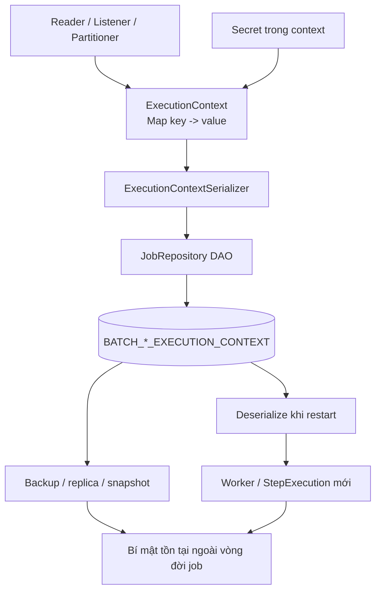
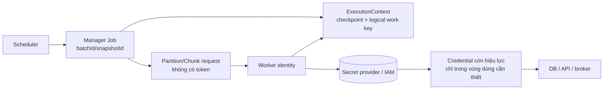
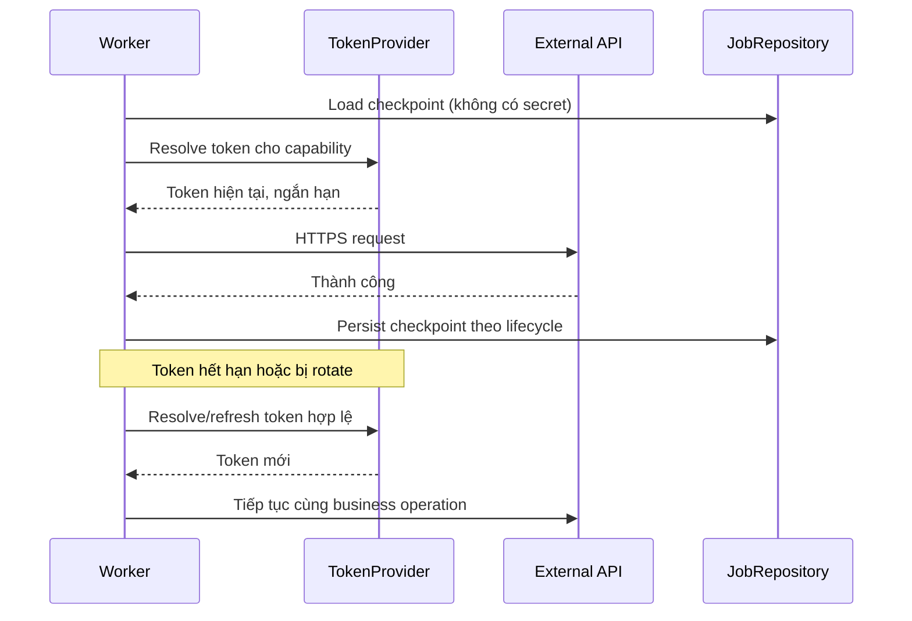
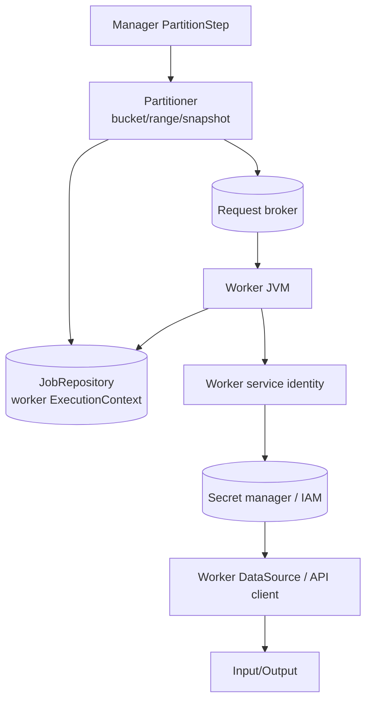
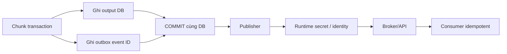

# Không ghi credential vào ExecutionContext trong Spring Batch

Một Spring Batch job có thể cần kết nối database, đọc file từ object storage, gọi API của đối tác hoặc gửi message qua broker. Các thao tác này thường đòi hỏi **credential** như mật khẩu database, API key, OAuth access token, refresh token, private key hoặc chuỗi kết nối có thông tin xác thực. Khi xây dựng job có khả năng restart, có người chọn cách đưa credential vào `ExecutionContext` để worker có thể “lấy lại khi chạy tiếp”.

**Đây là thiết kế không an toàn.** `ExecutionContext` là **metadata có thể được serialize và persist vào `JobRepository`**, không phải kho chứa bí mật. Credential được đặt trong context có thể tồn tại lâu hơn phiên chạy, đi vào bảng metadata, backup, bản sao database, dump phục vụ điều tra hoặc môi trường chạy của worker khác. Đổi serializer từ Java/Base64 sang JSON không làm chúng an toàn; và việc đặt secret trong `JobParameters` cũng không giải quyết vấn đề vì các tham số job có thể được lưu trong repository.

Bài thuộc chương **ExecutionContext**, module **SPRING_BATCH_SCALING_OPERATIONS**. Module hướng tới mở rộng Spring Batch cho workload dữ liệu lớn qua multi-threaded step, parallel steps, partitioning và các mô hình phân tán; học đo bottleneck, bảo đảm thread safety, retry/restart, vận hành job và chọn kiến trúc theo tài nguyên thực tế.

**Mục tiêu học tập:**

- Biết vì sao **không ghi credential vào `StepExecutionContext`, `JobExecutionContext` hoặc `JobParameters`**.
- Phân biệt metadata để **định danh tài nguyên** với bí mật để **xác thực truy cập tài nguyên**.
- Nắm đường rò rỉ qua `JobRepository`, serialization, backup, log, trace và remote worker.
- Chọn cơ chế lấy secret **tại thời điểm cần dùng**, thông qua cấu hình bảo mật, secret provider hoặc workload identity.
- Xử lý restart, secret rotation, token hết hạn, quyền truy cập và sự cố provider không khả dụng.
- Viết ví dụ Java/Spring Batch 5.x, kiểm thử không persist secret và thiết kế runbook khi phát hiện rò rỉ.

## 1. Phân biệt trạng thái batch với thông tin xác thực

`ExecutionContext` là kho key–value của Spring Batch dùng để lưu trạng thái cần thiết cho khôi phục, ví dụ vị trí reader và phạm vi partition. Credential là thông tin cấp quyền truy cập vào tài nguyên; hai loại dữ liệu có **mục đích và vòng đời khác nhau**.

| Loại dữ liệu | Ví dụ | Có phù hợp ExecutionContext? | Lý do |
| --- | --- | --- | --- |
| Checkpoint | `orders.reader.nextIndex=1500` | Có, nếu đúng commit boundary | Phục hồi tiến độ |
| Phạm vi partition | `startId=1001`, `endId=2001` | Có | Mô tả công việc logic |
| Snapshot | `snapshotId=B2026-11` | Có | Pin input để restart |
| Tên resource không bí mật | `sourceId=orders-v3` | Có điều kiện | Chỉ là tham chiếu và được kiểm soát quyền |
| Database password | Mật khẩu database nguồn/đích | **Không** | Có thể đọc từ metadata/backups |
| API key / bearer token | Khóa gọi API đối tác | **Không** | Có quyền truy cập và thường có thời hạn |
| OAuth refresh token | Token cấp lại access token | **Không** | Nhạy cảm cao; có thể tạo nhiều token mới |
| Private key / certificate secret | Khóa ký hoặc TLS private key | **Không** | Rủi ro nghiêm trọng nếu sao chép |
| Full connection URL có secret | JDBC URL chứa `user/password` | **Không** | Bí mật vẫn bị lưu dù nằm trong URI |
| Signed URL | Đường dẫn chứa chữ ký/expiry | **Thường không** | URL có thể là bearer credential |
| Secret alias/ID | `credentialProfile=orders-readonly` | **Có điều kiện** | Phải không chứa secret; không được tự cấp quyền |
| OAuth scope / role | Tên capability không bí mật | Có điều kiện | Chỉ mang yêu cầu nghiệp vụ, không thay thế authorization |

**Bài học:** Không phải tất cả chuỗi có chữ “credential” đều là secret, nhưng không được coi mọi tham chiếu là vô hại. Alias, đường dẫn kho bí mật, tenant ID hoặc role name có thể tiết lộ thông tin nội bộ; cần xác định độ nhạy cảm và giới hạn quyền theo threat model.

### Ví dụ an toàn về checkpoint

```java
import org.springframework.batch.item.ExecutionContext;

public final class OrdersCheckpoint {
    public void save(ExecutionContext ctx,
                     long resumeAfterId,
                     String snapshotId) {
        if (resumeAfterId < 0 || snapshotId == null
                || snapshotId.isBlank()) {
            throw new IllegalArgumentException("Invalid checkpoint");
        }

        ctx.putInt("orders.checkpoint.schemaVersion", 1);
        ctx.putLong("orders.reader.resumeAfterId", resumeAfterId);
        ctx.putString("orders.reader.snapshotId", snapshotId);
        // KHÔNG thêm dbPassword/apiKey/accessToken.
    }
}
```

Khi restart, reader mở lại nguồn theo `snapshotId` và `resumeAfterId`. Credential được cung cấp **riêng** bởi hạ tầng xác thực tại môi trường worker.

## 2. Vì sao ExecutionContext có thể lưu dữ liệu lâu dài?

Spring Batch thường có hai context:

- **`StepExecutionContext`**: thuộc một `StepExecution`, thường chứa checkpoint reader, dữ liệu phân vùng và state `ItemStream`.
- **`JobExecutionContext`**: thuộc một `JobExecution`, thường chứa metadata cần dùng giữa các Step.

Với JDBC `JobRepository`, các context được ghi vào các bảng như `BATCH_STEP_EXECUTION_CONTEXT` và `BATCH_JOB_EXECUTION_CONTEXT`. Các bản ghi này có thể còn tồn tại sau khi job `COMPLETED` hoặc `FAILED`, theo retention policy của hệ thống.



Một người có quyền vận hành metadata hoặc đọc backup có thể thấy dữ liệu nhiều thời điểm trước đó. Credential đã hết hạn vẫn có thể bị lộ, gây lộ cấu hình nội bộ hoặc được sử dụng lại ở nơi khác. Các bản sao metadata có thể nằm ngoài vùng kiểm soát của chủ sở hữu secret ban đầu.

**`ExecutionContext.putString(...)` không phải thao tác “chỉ giữ trong RAM”.** Khi framework persist context, giá trị có thể được ghi vào database, và không có bảo đảm nó sẽ tự biến mất sau khi job chạy xong.

## 3. Vì sao Base64, JSON và Java serialization không bảo vệ secret?

`ExecutionContextSerializer` chuyển dữ liệu context thành representation có thể lưu ở `JobRepository`. Trong Spring Batch 5.x, `DefaultExecutionContextSerializer` dùng Java object serialization và representation Base64; cấu hình khác có thể dùng JSON hoặc custom serializer.

- **Base64 là encoding, không phải encryption.** Người có bytes và công cụ phù hợp có thể giải mã.
- **JSON là format**, thường đọc trực tiếp được; không tự cung cấp confidentiality.
- **Java serialization** có thể khó đọc bằng mắt, nhưng không phải cơ chế bảo vệ bí mật; còn có rủi ro deserialization khi dữ liệu bị sửa bởi nguồn không đáng tin.
- **TLS** bảo vệ dữ liệu trên đường truyền đúng phạm vi, không xóa secret đã được lưu trong metadata.
- **Database encryption at rest** bảo vệ một số tình huống truy cập storage vật lý, nhưng người có quyền truy vấn hoặc ứng dụng có quyền đọc vẫn có thể xem nội dung sau giải mã.
- **Mã hóa riêng secret trước khi đặt vào context** có thể giảm một số rủi ro lưu trữ nhưng làm phức tạp quản lý khóa, rotation và recovery; không phải thay thế mặc định cho secret manager.

Nếu ứng dụng cần bí mật, hướng ưu tiên là **đừng đưa bí mật vào context ngay từ đầu**. Cấu hình đúng secret management, kiểm soát quyền và thời gian sống của credential hiệu quả hơn việc serialize nó rồi cố che giấu.

### Đừng dựa vào kiểm tra chuỗi thô

Vì credential trong metadata có thể đã được Base64 hóa hoặc mã hóa theo định dạng khác, phép `serializedText.contains(token)` trả `false` **không chứng minh** secret không có trong context. Kiểm thử đúng phải kiểm tra **các key và giá trị trước serialize**, đối chiếu contract cho phép, và khi cần dùng quy trình kiểm chứng trên dữ liệu thử nghiệm đã được kiểm soát.

## 4. Những nơi credential có thể xuất hiện ngoài dự kiến

Không chỉ có hai bảng context. Một chương trình có thể vô tình đưa secret ra các kênh khác:

| Nơi lưu/hiển thị | Đường rò rỉ thường gặp | Phòng vệ |
| --- | --- | --- |
| `StepExecutionContext` | `ctx.putString("apiToken", token)` | Chỉ lưu checkpoint/metadata không bí mật |
| `JobExecutionContext` | Listener promote secret sang Job context | Không promote/ghi credential |
| **`JobParameters`** | Chạy job với `password`/`accessToken` | Chỉ dùng identifying/nonsecret parameters |
| Bảng JobRepository và backup | Serialized metadata tồn tại lâu | Least privilege, retention, encryption at rest |
| `ExitStatus` / exception message | Thư viện HTTP in URL/header/token | Redaction; exception an toàn |
| Structured log/MDC | Log toàn bộ params/context/request | Allowlist field, không log secret |
| Metrics/tracing | Secret vô tình làm tag/span attribute | Chỉ tags không nhạy cảm, cardinality thấp |
| Message broker | Token được đưa vào header/payload remote | Dùng service identity của worker thay thế |
| Thread dump/heap dump | Secret còn trong heap, bean singleton/cache | Hạn chế dump, phân quyền/retention, không giữ token dài |
| Config/CI/CD | Password hardcode hoặc biến bị in ở pipeline | Secret injection, quyền truy cập, masking và audit |

Đặt token trong `jobParameters['apiToken']` rồi dùng `@StepScope` **không giải quyết** việc lưu trong JobRepository. `JobParameters` là metadata của lần chạy và có thể được persist trong các bảng tương ứng, không phải kênh phân phối secret.

## 5. Anti-pattern: ghi password vào StepExecutionContext

Đoạn mã cần tránh:

```java
// Sai: đưa mật khẩu vào metadata restartable.
ExecutionContext context = stepExecution.getExecutionContext();
context.putString("target.db.password", databasePassword);
context.putString("api.authorization", bearerToken);
```

Tại mỗi checkpoint mà context được persist, những giá trị này có thể được serialize và lưu vào repository. Nếu JobExecution có nhiều partition hoặc nhiều Step, nhiều bản sao có thể xuất hiện.

### Cách đúng hơn

```java
ExecutionContext context = stepExecution.getExecutionContext();
context.putString("input.snapshotId", snapshotId);
context.putLong("reader.resumeAfterId", committedKey);

// Worker lấy credential qua DataSource/SecretProvider được cấu hình
// cho môi trường thực thi, không qua ExecutionContext.
```

Khả năng restart dựa trên **dữ liệu mô tả vị trí và nguồn**, không dựa vào việc giữ nguyên mật khẩu cũ. Khi worker mới chạy, nó xác thực bằng credential còn hiệu lực được cấp đúng quyền.

## 6. Anti-pattern: credential trong JobParameters

Giả sử có Job `exportOrders`, launcher nhận:

```text
batchId=B2026-11
apiToken=<REDACTED>
```

Nếu code dùng:

```java
@Value("#{jobParameters['apiToken']}")
String apiToken;
```

thì dù bean là `@StepScope`, token vẫn xuất phát từ `JobParameters`. Các tham số này có thể được lưu lâu trong `JobRepository`, và có nguy cơ xuất hiện trong dashboard vận hành hoặc log khi operator truy vấn job.

**Thay bằng:**

```text
JobParameters:
  batchId=B2026-11
  snapshotId=orders-v3

Worker configuration:
  service identity / secret provider capability = orders-export
```

Ở đây `orders-export` là một **tên capability không bí mật**; worker vẫn phải được xác thực và có quyền truy cập secret thực. Không biến một alias không được kiểm tra thành quyền cấp secret tùy ý.

### Identifying parameters cũng cần sạch

`JobParameters` có identifying flag tham gia nhận diện `JobInstance`. Không đặt token làm identifying parameter vì:

1. Token rotation làm JobInstance identity thay đổi dù công việc nghiệp vụ không đổi.
2. Token có thể bị lưu lại ở metadata lâu dài.
3. Restart và audit trở nên khó hiểu vì cùng `batchId` có thể sinh nhiều instance ngoài ý muốn.

Một credential không phải **danh tính công việc batch**.

## 7. Mô hình an toàn hơn: lưu tham chiếu, lấy secret tại worker



Một luồng lý tưởng:

1. Job được khởi chạy với **metadata công việc** không bí mật.
2. Worker được cấp **service identity** qua hạ tầng (service account, workload identity, mTLS identity hoặc thông tin xác thực cấp theo chính sách).
3. Trước khi gọi nguồn/đích, worker dùng identity để lấy credential/token còn hiệu lực từ **secret provider** hoặc để xác thực trực tiếp nếu tài nguyên hỗ trợ.
4. Secret chỉ được sử dụng bởi client kết nối, không được đẩy vào `JobParameters`/`ExecutionContext`/header broker/log.
5. Worker lưu checkpoint tại commit boundary qua `ItemStream` và `JobRepository`.
6. Khi restart trên worker khác, identity mới lấy credential hợp lệ; checkpoint vẫn giữ nguyên vì **không phụ thuộc token**.

**Không đồng nhất “secret alias” và “secret content”.** Có thể lưu một key/ID tham chiếu nếu contract cho phép và alias không nhạy cảm; nhưng worker phải **authorize** alias đó theo job/tenant/role, không cho client chọn bất kỳ secret nào bằng cách sửa header/context.

## 8. Cấu hình DataSource: đặt credential ở đúng lớp

Với JDBC reader/writer, lựa chọn thông thường là cấu hình `DataSource` riêng bằng hạ tầng/secret injection, thay vì để reader tự lấy mật khẩu từ `ExecutionContext`.

Ví dụ cấu hình Spring Boot minh họa:

```yaml
spring:
  datasource:
    url: jdbc:postgresql://db.internal:5432/orders
    username: ${ORDERS_DB_USER}
    password: ${ORDERS_DB_PASSWORD}
```

Biến môi trường ở đây chỉ là **một phương án truyền secret qua cấu hình runtime**, không phải tuyên bố rằng environment variables luôn an toàn. Một số hệ thống có thể lộ env qua process inspection, debug endpoint, logging, shell history hoặc CI/CD. Với yêu cầu cao, ưu tiên cơ chế workload identity/secret manager hoặc integration được nền tảng hỗ trợ, với giới hạn quyền và audit.

`DataSource` được cấu hình và quản lý bởi Spring, có thể dùng connection pool, TLS và rotate credential theo cơ chế phù hợp. `ItemReader`/`ItemWriter` nhận `DataSource` đã thiết lập, không truyền password qua `JobParameters`.

### Cấu hình reader

```java
import javax.sql.DataSource;

import org.springframework.batch.core.configuration.annotation.StepScope;
import org.springframework.batch.item.database.JdbcPagingItemReader;
import org.springframework.batch.item.database.builder.JdbcPagingItemReaderBuilder;
import org.springframework.batch.item.database.support.PostgresPagingQueryProvider;
import org.springframework.batch.item.database.Order;
import org.springframework.beans.factory.annotation.Value;
import org.springframework.context.annotation.Bean;

import java.util.Map;

@Bean
@StepScope
public JdbcPagingItemReader<OrderRow> ordersReader(
        DataSource ordersDataSource,
        @Value("#{jobParameters['batchId']}") String batchId,
        @Value("#{stepExecutionContext['range.startId']}") Long startId,
        @Value("#{stepExecutionContext['range.endId']}") Long endId) {

    if (batchId == null || batchId.isBlank()
            || startId == null || endId == null
            || startId >= endId) {
        throw new IllegalArgumentException("Invalid worker input");
    }

    var query = new PostgresPagingQueryProvider();
    query.setSelectClause("SELECT id, amount");
    query.setFromClause("FROM staging_orders");
    query.setWhereClause(
            "WHERE batch_id = :batchId AND id >= :startId AND id < :endId");
    query.setSortKeys(Map.of("id", Order.ASCENDING));

    return new JdbcPagingItemReaderBuilder<OrderRow>()
            .name("ordersReader")
            .dataSource(ordersDataSource)
            .queryProvider(query)
            .parameterValues(Map.of(
                    "batchId", batchId,
                    "startId", startId,
                    "endId", endId))
            .rowMapper((rs, row) -> new OrderRow(
                    rs.getLong("id"), rs.getBigDecimal("amount")))
            .pageSize(200)
            .saveState(true)
            .build();
}
```

`OrderRow` là record/class ứng dụng tự định nghĩa. Đoạn này giả định `batchId` chốt input snapshot và `id` là sort key duy nhất trong tập được chọn; production cần xác minh source immutability và index. **Không có tham số nào chứa credential**, nhưng reader vẫn kết nối database qua `ordersDataSource` được hạ tầng cấu hình.

### Lưu ý về vòng đời pool

Nếu password của database bị rotate, các connection trong pool có thể tồn tại hoặc bị từ chối tạo mới tùy DB/provider. Cần có chiến lược refresh/rebuild pool, connection validation, retry hữu hạn và graceful restart phù hợp. **ExecutionContext không nên cố lưu password cũ để giữ connection pool hoạt động**; quyền truy cập phải được quản lý ở lớp infrastructure.

## 9. Ví dụ Java: API token được lấy tại thời điểm sử dụng

Một remote worker có thể phải gọi API đối tác, không có sẵn JDBC `DataSource`. Có thể xây một interface `TokenProvider` để trừu tượng hóa việc lấy token tại worker.

```java
public interface TokenProvider {
    // Tìm token cho capability đã được ủy quyền tại worker.
    // Provider phải áp dụng TTL/rotation/access control phù hợp.
    String currentToken(String capability) throws Exception;
}

public interface OrdersGateway {
    // Chịu trách nhiệm HTTPS, auth headers và log redaction.
    void submit(
            ExportOrder order,
            String bearerToken,
            String idempotencyKey) throws Exception;
}
```

Đây là interface minh họa, **không phải API có sẵn của Spring Batch**. Credential do implementation kết nối secret manager hoặc identity provider thực sự cung cấp.

### Writer không ghi token vào state

```java
import java.math.BigDecimal;
import java.util.Objects;

import org.springframework.batch.item.Chunk;
import org.springframework.batch.item.ItemWriter;

public record ExportOrder(
        String batchId, long orderId, BigDecimal amount) {}

public final class ExternalOrdersWriter
        implements ItemWriter<ExportOrder> {

    private final TokenProvider tokens;
    private final OrdersGateway gateway;

    public ExternalOrdersWriter(
            TokenProvider tokens, OrdersGateway gateway) {
        this.tokens = Objects.requireNonNull(tokens);
        this.gateway = Objects.requireNonNull(gateway);
    }

    @Override
    public void write(Chunk<? extends ExportOrder> chunk)
            throws Exception {
        // Token có thời hạn, chỉ giữ làm biến local cho lượt ghi.
        // Không đưa vào bean state, ExecutionContext hay JobParameters.
        String token = tokens.currentToken("orders-export");

        for (ExportOrder order : chunk) {
            String idempotencyKey = order.batchId()
                    + ":" + order.orderId() + ":export-v1";
            gateway.submit(order, token, idempotencyKey);
        }
    }
}
```

Trong project Java thực, `public record ExportOrder` và `public class ExternalOrdersWriter` phải được đặt trong các source file phù hợp. Nếu `OrdersGateway.submit` dùng HTTP, nó phải gửi token trong cơ chế Authorization chuẩn qua **HTTPS** và **không log giá trị token**.

**Quan trọng về giới hạn:**

- Token là `String`, nên Java không bảo đảm xóa hoàn toàn nội dung khỏi heap ngay sau callback. Giảm thời gian giữ tham chiếu và tránh cache/log vẫn hữu ích, nhưng **không hứa “zeroization”** cho `String`.
- `TokenProvider` không nên fetch token mỗi item nếu điều đó gây bottleneck; có thể dùng token ngắn hạn/caching có giới hạn, rotation và invalidation theo chính sách provider.
- Worker thất bại giữa chunk khi gọi HTTP có thể đã tạo side effect không rollback cùng transaction DB. `idempotencyKey` phải được API hỗ trợ đúng contract; nếu không, cân nhắc transactional outbox/saga.
- Một token hết hạn giữa các request cần cơ chế refresh/retry kiểm soát, không đưa token cũ vào context để “khôi phục”.
- Nếu provider không khả dụng, thất bại có kiểm soát và retry/backoff theo lỗi transient; không thay bằng token hardcode.
- Client HTTP và provider có thể chia sẻ giữa worker threads nếu implementation thread-safe; token tạm không được ghi vào biến mutable singleton.

### Tạo writer bean

```java
import org.springframework.batch.item.ItemWriter;
import org.springframework.context.annotation.Bean;

@Bean
public ItemWriter<ExportOrder> externalOrdersWriter(
        TokenProvider tokenProvider,
        OrdersGateway ordersGateway) {
    return new ExternalOrdersWriter(
            tokenProvider, ordersGateway);
}
```

`@StepScope` không bắt buộc chỉ để có token, vì worker này không dùng `StepExecutionContext` để cấu hình secret. Nếu cần bean theo StepExecution cho thông tin nghiệp vụ, chỉ late bind `batchId`/range/tenant đã được xác minh; **không late bind password từ context**.

## 10. Trường hợp cần refresh token giữa job

Một job có thể chạy lâu hơn thời hạn access token. Ví dụ token có TTL 30 phút nhưng Step xử lý bốn giờ. Lưu token ban đầu trong `ExecutionContext` sẽ vừa **rò rỉ** vừa **không giải quyết hết hạn**.



### Xử lý 401/403 cần phân loại

- `401 Unauthorized` có thể do token hết hạn, bị thu hồi hoặc credential sai. Có thể thử refresh **một cách giới hạn** nếu provider hỗ trợ và lỗi đủ rõ.
- `403 Forbidden` thường biểu thị thiếu quyền; không retry vô hạn và không tự nâng quyền. Cần kiểm tra policy/role/scope.
- Provider mất kết nối: có thể retry transient với backoff, jitter, giới hạn tổng attempts.
- Secret bị revoke vì sự cố bảo mật: **không tìm token cũ trong context để dùng lại**; phải tuân thủ quy trình revoke/rotate.
- Không log toàn bộ response/header từ identity provider nếu có token nằm trong body hoặc Authorization header.

Nếu TokenProvider cache theo TTL, cache thuộc lớp security/runtime, có giới hạn và cơ chế refresh; không dùng `ExecutionContext` làm cache token.

## 11. Credential rotation và khả năng restart

Bất biến cần có: **restart cùng JobInstance vẫn xử lý cùng business snapshot, nhưng có thể sử dụng credential mới hợp lệ**.

| Giá trị | Giữa JobExecution trước và sau restart | Tại sao |
| --- | --- | --- |
| `batchId` / identifying business params | Thường giữ nguyên | Cùng JobInstance |
| `snapshotId`, partition range | Giữ ổn định theo contract | Đọc đúng tập input |
| Checkpoint reader | Khôi phục từ context đã persist | Tiếp tục đúng commit point |
| `JobExecutionId`, `StepExecutionId` | Có thể thay | Lần chạy mới |
| **DB password / OAuth token** | **Có thể và thường cần đổi** | Rotation, expiry, revoke |
| Worker host/thread | Có thể đổi | Partition/remote scheduling |
| Secret provider identity policy | Phải cấp đúng quyền cho worker mới | Không gắn quyền vào checkpoint cũ |

Nếu restart bị lỗi vì token phiên bản trước đã hết hạn, **không đưa token vào JobParameters để cố tái sử dụng**. Sửa cơ chế resolve và quyền truy cập của worker, kiểm tra output đã commit, rồi restart qua Spring Batch.

### Credential snapshot không phải data snapshot

`snapshotId` có thể là tập đơn hàng tháng 11 được chốt. Nó có tính chất **bất biến theo công việc**. Access token chỉ là cách thực thi được quyền truy cập, có tính chất **xoay vòng/hết hạn**. Đưa cả hai vào một `ExecutionContext` với yêu cầu “restart phải giống hệt bytes” là sai mô hình.

## 12. Local partitioning: mỗi worker không cần mang password trong context

Local partitioning sử dụng `Partitioner` tạo `Map<String, ExecutionContext>` cho từng worker `StepExecution`. Context nên chứa **vùng input**, không chứa credential kết nối nguồn cho worker đó.

Ví dụ Partitioner:

```java
import java.util.LinkedHashMap;
import java.util.Map;
import org.springframework.batch.core.partition.support.Partitioner;
import org.springframework.batch.item.ExecutionContext;

public final class SimpleRangePartitioner implements Partitioner {
    @Override
    public Map<String, ExecutionContext> partition(int gridSize) {
        Map<String, ExecutionContext> result = new LinkedHashMap<>();
        int count = Math.max(1, gridSize);

        for (int i = 0; i < count; i++) {
            var context = new ExecutionContext();
            context.putInt("partition.bucketId", i);
            context.putInt("partition.bucketCount", count);
            context.putString("input.snapshotId", "B2026-11");
            result.put("bucket-" + i, context);
        }
        return result;
    }
}
```

Ví dụ chỉ thể hiện **metadata gọn**; production cần chốt `bucketCount` và hash algorithm cho cùng JobInstance, không tự thay mapping theo thread count khi restart. Worker reader dựa trên `bucketId/bucketCount` và snapshot; credential đến từ `DataSource`/provider trong môi trường worker.

**Rủi ro bảo mật khi chia sẻ bean:** một `DataSource` hoặc TokenProvider có thể là singleton được nhiều worker threads sử dụng. Phải đánh giá thread safety và phạm vi quyền. Không viết `currentPassword` hoặc `currentTenantToken` vào mutable field singleton để chuyển giữa các partition; có thể trộn credential của tenant/worker này sang worker khác.

## 13. Remote partitioning: quyền được cấp tại worker

Trong remote partitioning, manager tạo worker `StepExecution` và `ExecutionContext`, sau đó gửi request để worker ở JVM khác thực thi. Worker có thể đọc context từ `JobRepository` theo kiến trúc.



### Vì sao đặt token trong worker ExecutionContext đặc biệt nguy hiểm?

1. Manager có thể serialize credential để nhiều worker cùng tải, tạo **nhiều bản sao**.
2. Worker có thể ở host/namespace khác; ai có quyền đọc metadata có thể nhìn thấy credential.
3. Khi restart, credential cũ có thể hết hạn hoặc bị thu hồi.
4. Manager cần quyền để cấp secret cho worker dù thực tế chỉ worker mới cần biết secret.
5. Có nguy cơ cross-tenant nếu một partition/context bị gắn nhầm.

**Cách thiết kế phù hợp:** manager chỉ gửi mô tả công việc. Worker dùng workload identity của chính nó để lấy credential với **quyền tối thiểu**. Nếu tenant-specific, worker xác minh tenant/batch context theo policy trước khi chọn secret profile, không tin một alias tự khai báo là đủ quyền.

### Classpath/schema cũng là một phần rủi ro

Context chứa một custom `SecretBundle` Java object có thể khiến worker khác phiên bản không deserialize được. Metadata đơn giản `String/Long/Integer` ít rủi ro hơn, nhưng **không biến String thành nơi chứa password**. “Serializable” và “không nhạy cảm” là hai kiểm tra khác nhau.

## 14. Remote chunking: không bỏ token vào message header

Remote chunking điển hình có **manager đọc item và gửi `ChunkRequest`**, worker xử lý/ghi và trả `ChunkResponse`. Worker handler thường không có một worker StepExecutionReader context giống remote partitioning.

Một anti-pattern:

```java
// Minh họa điều không nên làm:
Message<?> requestWithSecret = MessageBuilder.fromMessage(request)
        .setHeader("x-api-key", apiKey)
        .build();
```

Đưa credential vào message header/payload của broker có thể làm nó xuất hiện trong queue, dead-letter queue, replay log, trace, dashboard hoặc bản sao message. Message broker cũng có vòng đời lưu trữ/retention và ACL khác JobRepository.

**Thiết kế tốt hơn:**

- Message chứa item hoặc business operation ID, correlation/Job/Step identity theo giao thức.
- Worker xác thực chính nó với secret provider hoặc API bằng quyền runtime được cấp.
- Broker dùng TLS, authentication/authorization, hạn chế quyền producer/consumer.
- Không dùng raw Authorization header của API làm metadata broker.
- Worker giữ transaction/idempotency riêng; broker redelivery có thể dẫn đến xử lý lại.
- Message retry/replay không yêu cầu token cũ, giúp rotation không phá workflow.

**Đừng nhầm execution identity với credential.** `JobExecutionId`, `StepExecutionId` và correlation ID giúp truy vết; không phải bằng chứng quyền truy cập hay bearer token.

## 15. Phân quyền tối thiểu cho batch worker

Không ghi secret vào context chỉ là **một lớp bảo vệ**. Khi worker có quyền lấy secret runtime, phải giới hạn quyền đó.

| Tài nguyên | Quyền nên cấp | Tránh |
| --- | --- | --- |
| Database nguồn | Chỉ read các schema/tables cần thiết | Superuser hoặc toàn bộ DB nếu không cần |
| Database đích | Insert/update đúng tables nghiệp vụ | DROP/DDL hoặc đọc secret tables |
| Secret provider | Get đúng secret/capability của service | Read/list toàn bộ secrets |
| JobRepository | Chỉ quyền framework cần | Công khai metadata cho mọi worker/job |
| Broker | Publish/consume đúng destination | Quyền admin hoặc access mọi queue |
| Object storage | Read đúng bucket/prefix/snapshot | Quyền toàn bucket nếu không cần |
| Monitoring | Log/traces đã redacted | Dashboard hiển thị headers/credential raw |

Trong multi-tenant job, service identity và quyền truy cập phải phù hợp tenant/workload. Không dựa vào một header `x-tenant-id` để cấp quyền cho database nếu header đó có thể bị thay đổi ở biên giao tiếp.

Khi nghi ngờ quyền rộng, giải pháp không phải che token trong `ExecutionContext` mà là **thu hẹp IAM/DB grants**, phân tách identity và audit khả năng truy cập.

## 16. Transaction, rollback và side effect với credential runtime

Credential giúp worker **được phép thao tác**, nhưng không liên quan trực tiếp đến **tính nguyên tử của thao tác**.

- JDBC writer dùng `DataSource` đã xác thực có thể tham gia chunk transaction nếu transaction manager/resource cấu hình đúng.
- HTTP API call dù dùng token hợp lệ vẫn **không rollback** khi worker JDBC transaction rollback.
- Message broker acknowledgement không tự commit cùng database.
- `ExecutionContext` ghi checkpoint không bảo vệ các side effect ngoài transaction.

Ví dụ writer gọi API cho 100 item rồi lỗi ở item cuối: retry có thể gửi lại 99 request đã thành công. Token không cần được persist, nhưng **idempotency key** cho từng business operation cần ổn định qua restart.

### Dùng outbox khi phải gửi event sau DB commit



Publisher lấy credential runtime cho broker/API; outbox lưu **business event payload và ID**, không lưu access token. Nếu publisher crash sau send trước khi đánh dấu published, event có thể phát lại; consumer cần idempotency.

**Không dùng `ExecutionContext` làm outbox chứa danh sách request cùng token.** Một transaction-aware outbox/bảng công việc bền vững giải quyết lifecycle event; context chỉ lưu metadata batch.

## 17. Lưu secret alias có thực sự an toàn?

Một số job xử lý nhiều đối tác cần chọn tài khoản kết nối. Có thể dùng nonsecret `credentialProfileId` trong metadata, nhưng phải xem nó là **tham chiếu**, không là quyền truy cập.

```text
JobParameters:
  batchId=B2026-11
  partnerId=partner-A

Job/Step metadata:
  sourceSnapshot=partner-A-orders-v3
  credentialProfileId=orders-import-readonly

Worker:
  service identity xác thực với provider
  policy kiểm tra partner-A được dùng orders-import-readonly
  provider trả secret ngắn hạn
```

**Rủi ro cần xử lý:**

1. Alias có thể tiết lộ tên khách hàng/địa chỉ hạ tầng; không lưu tên nhạy cảm không cần thiết.
2. Nếu job nhận alias do caller tự nhập, phải kiểm tra caller có quyền yêu cầu profile đó.
3. Worker không được đọc secret bất kỳ chỉ vì có một alias hợp lệ về mặt cú pháp.
4. Khi secret được rotate, alias vẫn có thể trỏ tới phiên bản mới — **không pin secret value** vào JobInstance.
5. Nếu cần tái hiện business result, pin **quy tắc xử lý/snapshot**, không pin credential cũ.
6. Nếu policy provider thay đổi, worker cần fail an toàn và báo lỗi vận hành, không tự hạ tiêu chuẩn xác thực.

Nhiều trường hợp không cần lưu alias trong context; nó có thể được xác định từ **config của service identity** hay mapping tenant được bảo vệ tại worker.

## 18. Secret manager không khả dụng: làm gì với restart?

Đặt secret ngoài context tạo ra dependency runtime lên hạ tầng cấp credential. Đây là dependency phải vận hành đúng, không phải lý do để persist token.

| Tình huống | Hành vi mong muốn | Điều cần tránh |
| --- | --- | --- |
| Secret provider timeout tạm thời | Retry hữu hạn với backoff/jitter, circuit breaker nếu phù hợp | Retry vô hạn làm bão hòa provider |
| Token hết hạn | Refresh/re-resolve theo policy | Lấy token cũ từ checkpoint |
| Secret bị revoke | Fail/đợi cấp quyền mới theo runbook | Sử dụng credential đã bị thu hồi |
| Worker đổi host/JVM | Dùng workload identity của host mới | Sao chép password qua request |
| Quyền tenant không hợp lệ | Reject có kiểm soát, audit | Chuyển sang secret của tenant mặc định |
| Rotation database password | Làm mới pool/connection theo hỗ trợ thực tế | Đẩy password mới vào JobRepository |
| Provider trả lỗi có message nhạy cảm | Redact/sanitize log, phân loại lỗi | Log nguyên response body/headers |
| Job cần restart sau nhiều ngày | Fetch credential còn hiệu lực mới | Pin token từ ngày khởi chạy |

**Tính restartable không yêu cầu bí mật y hệt lần chạy trước.** Nó yêu cầu một phương thức truy cập hợp lệ vào **cùng nguồn dữ liệu nghiệp vụ** với checkpoint/JobParameters đúng.

## 19. Log, exception và tracing là đường rò rỉ thứ cấp

Ngay cả khi không lưu secret vào context, code vẫn có thể làm lộ qua `logger.info("params={}", jobParameters)` hoặc log request HTTP có Authorization header.

### Anti-pattern

```java
// Sai: object có thể chứa secret hoặc metadata nhạy cảm.
log.info("Step context: {}", stepExecution.getExecutionContext());
log.info("Job params: {}", jobExecution.getJobParameters());
log.debug("HTTP headers: {}", httpHeaders);
```

### Chỉ log danh sách field cho phép

```java
import org.springframework.batch.core.StepExecution;

public void logStepProgress(StepExecution step) {
    // Chỉ log dữ liệu vận hành đã được xem xét.
    log.info(
        "stepName={} stepExecutionId={} read={} write={} commit={}",
        step.getStepName(),
        step.getId(),
        step.getReadCount(),
        step.getWriteCount(),
        step.getCommitCount());
}
```

`log` là logger do ứng dụng cung cấp. Không log `ExecutionContext` nguyên bản, token, connection URL có password hoặc response body từ identity provider.

### Khi exception chứa bí mật

Một số HTTP client có thể đặt URI query, headers hoặc body vào exception message. Nếu exception được Spring Batch ghi vào `ExitStatus.exitDescription`, metadata cũng có thể chứa bí mật **dù context sạch**. Vì vậy:

- Tránh credential trong query string/URL.
- Chỉ log exception đã qua chính sách redaction; không lặp lại full request headers/body.
- Không dùng `exception.toString()` không kiểm soát nếu thư viện gắn sensitive data vào message.
- Khi xây exception mới, chỉ giữ **error code, endpoint logical name, HTTP status, retryable flag**.
- Kiểm thử log/ExitStatus thực tế với token canary trong môi trường test.
- Không in raw secrets trong tracing span attributes hoặc metric labels.

## 20. Chuẩn hóa schema context theo allowlist

Regex tìm các key như `password`, `token` hay `secret` hữu ích khi kiểm tra sơ bộ nhưng **không đủ**: một key `configuration` vẫn có thể chứa JWT hoặc URL được ký. Thiết kế mạnh hơn là **allowlist chính xác các key và kiểu dữ liệu được phép**.

Ví dụ helper:

```java
import java.util.Map;
import java.util.Set;

import org.springframework.batch.item.ExecutionContext;

public final class SafeContextContract {
    private static final Set<String> KEYS = Set.of(
            "orders.checkpoint.schemaVersion",
            "orders.reader.resumeAfterId",
            "orders.reader.snapshotId",
            "partition.startId",
            "partition.endId");

    public void validate(ExecutionContext ctx) {
        for (Map.Entry<String, Object> entry : ctx.entrySet()) {
            String key = entry.getKey();
            Object value = entry.getValue();

            if (!KEYS.contains(key)) {
                // Không in key/value nếu chưa có chính sách log an toàn.
                throw new IllegalStateException(
                        "Unexpected ExecutionContext field");
            }
            if (!(value instanceof Integer)
                    && !(value instanceof Long)
                    && !(value instanceof String)) {
                throw new IllegalStateException(
                        "Unexpected ExecutionContext value type");
            }
            if (value instanceof String s && s.length() > 128) {
                throw new IllegalStateException(
                        "ExecutionContext string exceeds policy");
            }
        }
    }
}
```

**Phạm vi áp dụng:** helper chỉ phù hợp với **context thuộc schema ứng dụng trên đây**, không dùng trực tiếp để validate một StepExecutionContext đầy đủ có các key do **reader/writer Spring Batch tự tạo**. Trong production, cần whitelist các namespace/version thật hoặc kiểm tra **phần context do ứng dụng sở hữu** mà không xóa/chặn state chuẩn của framework.

Hơn nữa, một chuỗi ngắn 64 ký tự vẫn có thể là API key. Allowlist key + semantics, data classification và kiểm thử là quan trọng; limit độ dài chỉ giúp tránh payload quá lớn, **không chứng minh không có bí mật**.

### Đừng ghi toàn bộ context qua codec tiện lợi

```java
// Sai nếu object chứa secret:
context.put("config", entireApplicationConfiguration);

// Đúng hơn: chỉ ghi state checkpoint có contract rõ:
context.putInt("orders.checkpoint.schemaVersion", 1);
context.putLong("orders.reader.resumeAfterId", nextSafeId);
context.putString("orders.reader.snapshotId", snapshotId);
```

Không lưu Spring `Environment`, `DataSourceProperties`, `OAuth2AuthorizedClient`, token cache, DTO cấu hình có password hoặc `SecurityContext` vào `ExecutionContext`.

## 21. Unit test: ngăn credential lọt vào state

Ví dụ JUnit dùng một giá trị canary *không phải secret thật*. Test chỉ định rõ các key ứng dụng được phép, không phụ thuộc vào việc Base64 có làm giá trị trông khác đi hay không.

```java
import static org.junit.jupiter.api.Assertions.*;

import org.junit.jupiter.api.Test;
import org.springframework.batch.item.ExecutionContext;

class SafeContextContractTest {
    private final SafeContextContract contract =
            new SafeContextContract();

    @Test
    void acceptsCheckpointMetadata() {
        var ctx = new ExecutionContext();
        ctx.putInt("orders.checkpoint.schemaVersion", 1);
        ctx.putLong("orders.reader.resumeAfterId", 1200L);
        ctx.putString("orders.reader.snapshotId", "B2026-11");

        assertDoesNotThrow(() -> contract.validate(ctx));
    }

    @Test
    void rejectsTokenInContext() {
        var ctx = new ExecutionContext();
        ctx.putLong("orders.reader.resumeAfterId", 1200L);
        ctx.putString("apiToken", "TEST_CANARY_NOT_A_REAL_TOKEN");

        assertThrows(IllegalStateException.class,
                () -> contract.validate(ctx));
    }

    @Test
    void rejectsCredentialsHiddenUnderGenericKey() {
        var ctx = new ExecutionContext();
        ctx.putString(
                "options", "TEST_CANARY_NOT_A_REAL_TOKEN");

        assertThrows(IllegalStateException.class,
                () -> contract.validate(ctx));
    }
}
```

**Đây là unit test cấu trúc**, không chứng minh mọi library trong hệ thống sẽ không log credential, hay metadata thực không chứa bí mật trong `ExitStatus`. Phải test thêm JobRepository, remote message adapters và logging pipeline.

### Serializer round-trip với state an toàn

```java
import static org.junit.jupiter.api.Assertions.*;

import java.io.ByteArrayInputStream;
import java.io.ByteArrayOutputStream;
import java.util.LinkedHashMap;
import java.util.Map;

import org.junit.jupiter.api.Test;
import org.springframework.batch.core.repository.dao.DefaultExecutionContextSerializer;

class SafeStateSerializationTest {

    @Test
    void persistsOnlyExpectedBusinessState() throws Exception {
        var serializer = new DefaultExecutionContextSerializer();

        Map<String, Object> state = new LinkedHashMap<>();
        state.put("orders.checkpoint.schemaVersion", 1);
        state.put("orders.reader.resumeAfterId", 1200L);
        state.put("orders.reader.snapshotId", "B2026-11");

        var buffer = new ByteArrayOutputStream();
        serializer.serialize(state, buffer);

        var restored = serializer.deserialize(
                new ByteArrayInputStream(buffer.toByteArray()));

        assertEquals(state, restored);
        assertFalse(restored.containsKey("apiToken"));
        assertFalse(restored.containsKey("password"));
    }
}
```

Serializer unit test **không thay thế integration test** ghi/đọc `JobRepository` thật. Ở production, không cố dump toàn bộ context để kiểm tra secret nếu việc dump đó tạo thêm nơi rò rỉ; dùng bản sao được phân quyền, công cụ redaction và evidence tối thiểu.

## 22. Integration test: JobRepository không chứa credential

Một bài test end-to-end nên có JDBC JobRepository đại diện và secret provider giả chỉ trả về canary, sau đó chạy job qua nhiều chunk.

### Thiết kế test

1. Chuẩn bị JobInstance với `batchId`/snapshot không bí mật; tuyệt đối không tạo JobParameters có password.
2. TokenProvider giả trả chuỗi canary dành riêng cho test.
3. Chạy Step có reader, processor, writer, checkpoint state nhỏ.
4. Inject lỗi ở chunk thứ ba để Spring Batch persist metadata của các chunk đã commit rồi chuyển sang `FAILED`.
5. Đọc `StepExecutionContext`/`JobExecutionContext` **thông qua API hoặc truy vấn có kiểm soát**, xác minh chỉ có key/value được cho phép.
6. Kiểm tra `BATCH_JOB_EXECUTION_PARAMS`, exit description và log/trace kiểm thử không chứa canary.
7. Thử restart cùng JobInstance nhưng TokenProvider trả canary khác, xác minh pipeline tiếp tục đúng checkpoint.
8. Nếu chạy remote, kiểm tra message header/payload trên broker test không chứa canary.
9. Đối soát output không thiếu/trùng item và không có side effect ngoài transaction lặp sai.

### Truy vấn read-only phục vụ điều tra có kiểm soát

```sql
-- Không SELECT nguyên serialized context ra log/console phổ thông.
-- Các bảng/cột/prefix phụ thuộc schema JDBC JobRepository thực tế.
SELECT se.STEP_EXECUTION_ID,
       se.STEP_NAME,
       se.STATUS,
       se.READ_COUNT,
       se.WRITE_COUNT,
       se.COMMIT_COUNT,
       se.ROLLBACK_COUNT
FROM BATCH_STEP_EXECUTION se
WHERE se.JOB_EXECUTION_ID = :jobExecutionId
ORDER BY se.STEP_EXECUTION_ID;
```

Để kiểm tra nội dung context, ưu tiên API đọc metadata trong môi trường test được kiểm soát và dùng **assertions tại process**, không đưa raw `SHORT_CONTEXT` hoặc `SERIALIZED_CONTEXT` vào log công khai. Nếu cần forensic, chỉ người được phân quyền mới xử lý, tuân retention và kiểm soát evidence.

## 23. Kiểm thử kết hợp transaction, rotation và restart

| Kịch bản | Cách thử | Điều cần chứng minh |
| --- | --- | --- |
| Worker chạy lần đầu | Resolve token khi writer bắt đầu | Không có secret trong context/params |
| Token hết hạn giữa job | Provider trả token mới | Worker phục hồi đúng, không dùng token cũ từ metadata |
| Provider timeout | Giả lập lỗi transient | Retry hữu hạn/backoff; không fallback hardcode |
| Token bị revoke | Provider/API từ chối | Fail an toàn, không tái sử dụng secret cũ |
| Worker restart trên JVM khác | Kill worker và chạy host mới | Context chỉ mang state; identity mới lấy quyền đúng |
| DB password rotate | Đổi credential ở provider | Pool/connection mới hoạt động theo policy |
| Credential alias bị sửa | Thay partner/profile trái phép | Authorization ngăn truy cập secret khác |
| Batch Step dùng `@StepScope` | Thử JobParameters có token canary (test tiêu cực) | Contract/chính sách phát hiện giá trị không phù hợp |
| Exception HTTP chứa header | Mock client ném message nhạy cảm | Log/ExitStatus được redacted |
| Broker redeliver request | Giao cùng item hai lần | Không truyền credential trong broker; business idempotency đúng |
| DB output và JobRepository khác resource | Crash ngay sau commit output | Checkpoint có thể chậm hơn; replay không nhân đôi |
| Nhiều partition đồng thời | Tăng worker threads/process | Không trộn tenant token, không log token |
| Rollback deployment | Dùng code phiên bản trước | Không cần truy xuất credential cũ từ context |
| Backups/replicas metadata | Kiểm tra policy bằng audit/permissions | Không có secret ứng dụng bị persist |

Một checklist bảo mật chỉ kiểm tra “có log token không” mà bỏ qua **metadata, broker và exception descriptions** là chưa đủ.

## 24. Khi đã phát hiện credential trong context: xử lý thế nào?

Nếu secret từng được persist trong `ExecutionContext`, không nên chỉ xóa dòng code ghi secret rồi coi sự cố kết thúc. Secret có thể đã tồn tại trong database, bản sao, backup, logs và bản deploy cũ.

### Quy trình khắc phục có kiểm soát

1. **Ngăn ghi thêm:** chặn đường code đang đẩy secret vào context/JobParameters/log/message; tạm dừng job nếu cần giảm rủi ro.
2. **Đánh giá phạm vi:** loại credential, quyền của nó, thời gian tồn tại, JobExecution/StepExecution, các môi trường/replica/backup liên quan.
3. **Rotate/revoke** credential bị ảnh hưởng theo quy trình bảo mật; không chờ dọn metadata mới thu hồi quyền.
4. **Thu hẹp truy cập** `JobRepository` và backup, xem lại quyền operator, worker và CI/CD.
5. **Sửa thiết kế** để worker dùng runtime provider/identity và context chỉ giữ checkpoint.
6. **Lên kế hoạch xử lý metadata cũ**: cân nhắc việc job `FAILED`/`STOPPED` còn phải restart; dùng migration được kiểm chứng trên bản sao thay vì xóa key mù.
7. **Rà soát logs, message DLQ, traces, backups** theo retention và chính sách xử lý sự cố; tránh sao chép thêm secret khi điều tra.
8. **Kiểm tra correctness dữ liệu** trước/sau khi di chuyển state; không reset checkpoint vô tình làm mất/trùng output.
9. **Test lại restart/rotation** sau migration bằng credential mới.
10. **Theo dõi tái diễn** qua policy tests, code review, secret scanning có kiểm soát và audit.

**Không chỉnh trực tiếp `BATCH_STEP_EXECUTION_CONTEXT` hoặc `BATCH_JOB_EXECUTION_CONTEXT` bằng lệnh SQL tùy ý để xóa chuỗi.** Serialized state có thể là một blob/phụ thuộc serializer; sửa một phần có thể khiến `JobRepository` không deserialize được. Migration phải hiểu định dạng, lưu giữ các state hợp lệ và có phương án rollback.

### Tại sao rotation phải đi trước dọn backup?

Không thể đảm bảo mọi bản backup/replica/log chứa secret được thu hồi ngay. Việc revoke/rotate giảm khả năng sử dụng credential bị lộ. Xử lý dữ liệu lưu lâu dài vẫn cần theo retention/compliance, nhưng **đừng dựa duy nhất vào việc xóa từng bản sao** như biện pháp ngăn lạm dụng.

## 25. Observability: giám sát mà không giám sát cả secret

Các metric hữu ích cho phần vận hành credential:

| Metric / tín hiệu | Ý nghĩa | Cách giữ an toàn |
| --- | --- | --- |
| Secret resolve latency | Secret provider chậm | Chỉ tag capability/service class, không log token |
| Secret resolve errors | Provider unavailable, permission denied | Phân loại lỗi; không ghi response body nhạy cảm |
| Token refresh count | Mức độ rotation/expiry | Không tag token ID duy nhất vào mọi metric |
| API 401/403 rate | Authentication/authorization fail | Phân biệt nguyên nhân, không gửi secret vào logs |
| Worker Step restart count | Tần suất restart vì auth lỗi | Correlate bằng JobExecutionId trong logs |
| JobRepository update latency | Metadata bottleneck | Không dump serialized state |
| Broker redelivery count | Request được giao lại | Business idempotency, không log auth header |
| Failed output reconciliation | Công việc thực bị thiếu/trùng | Kiểm tra business key, không chứa secret |

**Tránh high-cardinality metric tags** như raw `accessToken`, JWT claims đầy đủ, JobExecutionId hoặc từng operation ID trên mọi time series. Dùng log có cấu trúc với trường được cho phép và phân quyền truy cập.

### Log hữu ích nhưng không chứa credential

```text
event=batch_worker_api_failure
jobExecutionId=1501
stepName=exportOrdersWorker
partition=range-003
capability=orders-export
httpStatus=401
retryable=true
tokenValue=<NOT_LOGGED>
```

Nếu capability/partition/tenant metadata cũng nhạy cảm trong threat model, cần giảm bớt hoặc pseudonymize theo chính sách.

## 26. Code review: các câu hỏi phải hỏi

Khi xem thay đổi về `ExecutionContext`, `@StepScope`, launcher hoặc worker messaging:

1. Có gọi `context.put(...)` với object có khả năng chứa credential không?
2. Có `@Value("#{jobParameters['password']}")`, `apiKey` hoặc `refreshToken` không?
3. Có logger nào in nguyên `JobParameters`/`ExecutionContext`/HTTP request hoặc exception message không?
4. Có step listener nào promote secret từ Step context lên Job context không?
5. Có writer nào dùng credential từ message header/payload trong remote chunking không?
6. Worker có service identity với quyền tối thiểu không?
7. Mật khẩu/token có bị cache dài hơn cần thiết trong singleton hoặc ThreadLocal không?
8. Secret rotation có cần restart worker/pool không, và có runbook không?
9. Retry/auth failure có làm phát lại side effect không idempotent không?
10. Có test cố tình đưa canary token vào context/params và chứng minh guard chặn không?
11. Có policy quản lý access, backup, retention và redaction của `JobRepository` không?
12. Có đường migration an toàn nếu phiên bản trước từng persist secret không?

**Không dựa vào tên biến:** một key `options` hoặc `connectionInfo` có thể che giấu secret. Cần xem nguồn dữ liệu và kiểu value thực sự, nhất là các object config lớn.

## 27. Các hiểu lầm phổ biến

| Hiểu lầm | Thực tế |
| --- | --- |
| “Context chỉ là RAM nên không có rủi ro lưu trữ” | `JobRepository` có thể persist và backup nó |
| “Token ở Step context an toàn hơn Job context” | Cả hai đều có thể lưu trong repository |
| “`@StepScope` làm password bí mật” | Scope không xóa giá trị đã lưu trong JobParameters/context |
| “`JobParameters` là nơi truyền secret hợp lý” | Tham số job thường được persist và có mặt trong dashboard |
| “Base64 là mã hóa bí mật” | Base64 chỉ là encoding |
| “DB có encryption at rest nên được lưu token” | Người có quyền đọc DB/app vẫn xem được giá trị |
| “Signed URL chỉ là đường dẫn file” | Nhiều signed URL hoạt động như bearer credential |
| “Restart phải giữ lại đúng token trước đây” | Credential nên được cấp mới theo identity/rotation |
| “Chỉ cần xóa key secret khỏi context sau khi dùng” | Giá trị có thể đã persist ở checkpoint trước và backup |
| “Không có secret trong context nghĩa là không thể rò rỉ” | Params, logs, exceptions, broker, heap dumps vẫn là kênh khác |
| “TokenProvider tự đảm bảo transaction API” | Credential khác atomicity; HTTP có thể side effect trước rollback |
| “Alias secret tương đương quyền truy cập secret” | Phải xác thực/ủy quyền worker theo policy |
| “Xóa SQL blob là xong” | Có thể phá deserialize/restart và không xử lý backup |
| “Người có quyền JobRepository là người nên biết mọi secret” | Least privilege; không đặt secret ở đó |
| “Token ngắn hạn không cần bảo vệ” | Token còn hiệu lực vẫn cấp quyền và có thể bị lạm dụng |

## 28. Checklist production: không ghi credential vào context

- [ ] `StepExecutionContext` chỉ lưu checkpoint/metadata công việc, không lưu password/token/API key/private key.
- [ ] `JobExecutionContext` không chứa credential, kể cả khi promotion từ Step context.
- [ ] `JobParameters` chỉ chứa business inputs không bí mật; không nhận password/token qua launcher.
- [ ] Không lưu connection URL có password hoặc signed URL mang quyền truy cập.
- [ ] Custom context values có allowlist key/type/semantics; không serialize `SecurityContext`/config bean lớn.
- [ ] `ItemStream.open/update/close` chỉ xử lý state cần restart, không ghi cache token.
- [ ] `JobRepository` được phân quyền, có encryption at rest/backup/retention theo chính sách.
- [ ] Không log toàn bộ `ExecutionContext`, JobParameters, request headers hoặc client exceptions chứa secret.
- [ ] `ExitStatus`/failure description đã được kiểm tra redaction khi lỗi client/API.
- [ ] Worker lấy credential từ secret provider/workload identity hoặc cấu hình runtime được bảo vệ.
- [ ] Worker chỉ được cấp quyền truy cập secret và dữ liệu cần thiết (least privilege).
- [ ] Tenant/credential alias được authorize trước khi resolve secret.
- [ ] Token refresh/expiry/revoke được xử lý, retry hữu hạn và có backoff.
- [ ] Restart cùng JobInstance vẫn dùng snapshot/partition mapping ổn định nhưng credential hiện hành.
- [ ] `DataSource`/connection pool có chiến lược refresh khi database secret rotate.
- [ ] Local partitioning không chia sẻ mutable token/tenant state giữa worker threads.
- [ ] Remote partitioning không gắn secret vào worker `ExecutionContext`.
- [ ] Remote chunking không gửi token qua `ChunkRequest` header/payload.
- [ ] Broker/queue/DLQ đã có ACL, TLS và chính sách retention/redaction.
- [ ] Side effect ngoài JDBC transaction có idempotency key/outbox hoặc quy trình bù trừ.
- [ ] Đã test canary secret không vào context/params/metadata/logs/message.
- [ ] Đã test worker restart ở JVM khác, token rotate/hết hạn, provider unavailable.
- [ ] Có kế hoạch rotate/revoke và migration khi secret đã từng bị persist.
- [ ] Sau retry/restart, dữ liệu được đối soát bằng business keys và giá trị, không chỉ `COMPLETED`.
- [ ] Chính sách secrets/metadata được rà soát định kỳ cùng thay đổi hạ tầng batch.

## 29. Câu hỏi thực hành và tự đánh giá

1. Vì sao `StepExecutionContext` và `JobExecutionContext` đều không phải nơi lưu API key?
2. Nếu một ứng dụng sử dụng `DefaultExecutionContextSerializer` và giá trị trong DB trông như Base64, token có được giữ bí mật không?
3. Một Job được khởi chạy bằng `JobParameters.password`. Dù writer không đưa password vào context, rủi ro metadata còn tồn tại ở đâu?
4. Phân biệt `snapshotId` bất biến với OAuth access token có TTL. Giá trị nào cần giữ nguyên qua restart?
5. Lưu `credentialProfileId` trong context có thể chấp nhận khi nào? Những authorization checks nào vẫn bắt buộc?
6. Một worker remote partitioning phải xử lý dữ liệu tenant A ở JVM mới. Nên nhận secret từ manager message hay tự lấy bằng service identity?
7. Khi API trả 401 sau nửa job, có nên đọc token cũ từ `ExecutionContext` không? Trình bày chiến lược refresh/retry.
8. Nếu `ExitStatus.exitDescription` chứa nguyên HTTP exception có Authorization header, vì sao context dù sạch vẫn có thể rò rỉ?
9. Một signed URL được lưu làm `fileUri`. Khi nào URI thực sự là credential cần bảo vệ?
10. Tại sao setting `token = null` sau khi gọi API không bảo đảm xóa `String` khỏi heap?
11. Khi broker redeliver một remote chunk worker request, cần phân biệt secret rotation với business idempotency như thế nào?
12. Hãy thiết kế integration test sử dụng canary token không phải secret thật và xác nhận không có secret trong JobRepository, logs, message headers hoặc exception descriptions.
13. Nếu credential từng được lưu trong metadata và backup, những bước khắc phục nào nên ưu tiên?
14. Tại sao xóa trực tiếp `SERIALIZED_CONTEXT` có thể phá restart?
15. Khi dùng nhiều worker threads, vì sao một singleton field `currentTenantToken` nguy hiểm?
16. Việc mã hóa token trước khi đưa vào context có phải giải pháp mặc định tốt hơn runtime secret provider không? Nêu các trade-off.

## Kết luận

**Không ghi credential vào `ExecutionContext`** là một nguyên tắc nền tảng để vận hành Spring Batch an toàn và restartable. `ExecutionContext`, `JobParameters` và `JobRepository` phục vụ nhận diện công việc, lưu tiến độ và checkpoint; chúng không phải kho bí mật. Base64/JSON/Java serialization, `@StepScope` hoặc encryption at rest không biến việc persist token thành lựa chọn mặc định phù hợp.

Với workload lớn và nhiều worker, hãy **lưu business state nhỏ, có schema ổn định**, để worker **lấy credential còn hiệu lực theo service identity và quyền tối thiểu tại thời điểm cần dùng**, không truyền secret qua context hay broker message. Kết hợp secret rotation, log redaction, idempotency, retry/restart và fault injection để bảo đảm cả **bảo mật lẫn tính đúng đắn của dữ liệu**.
