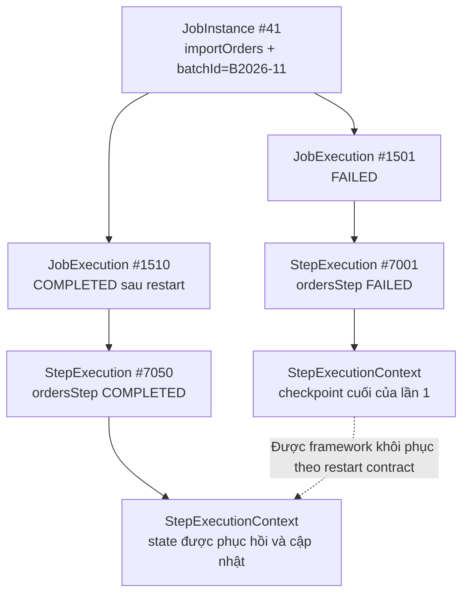
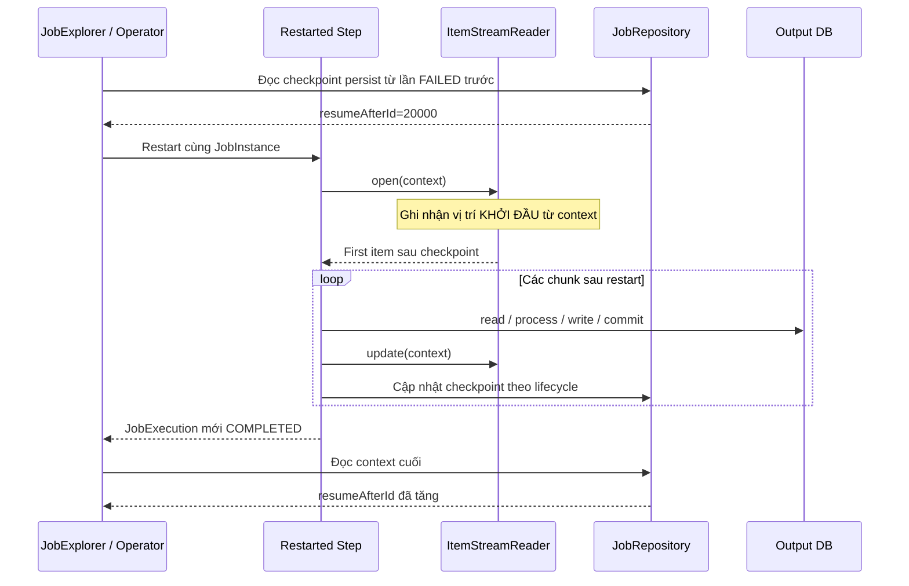
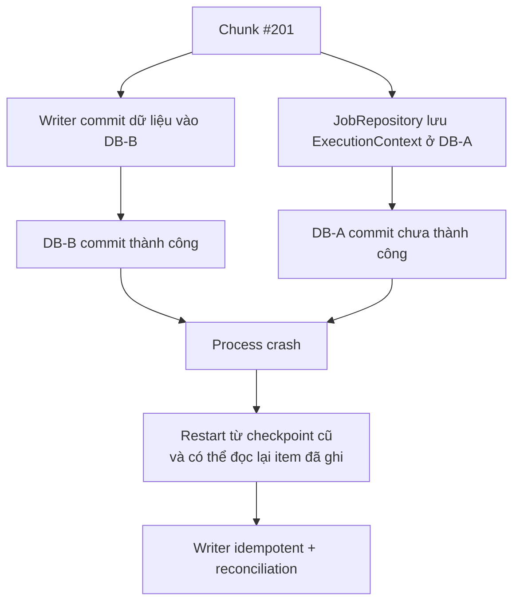
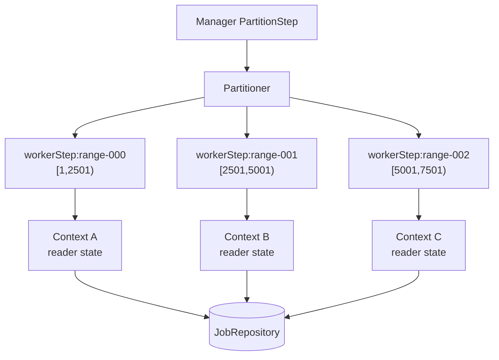
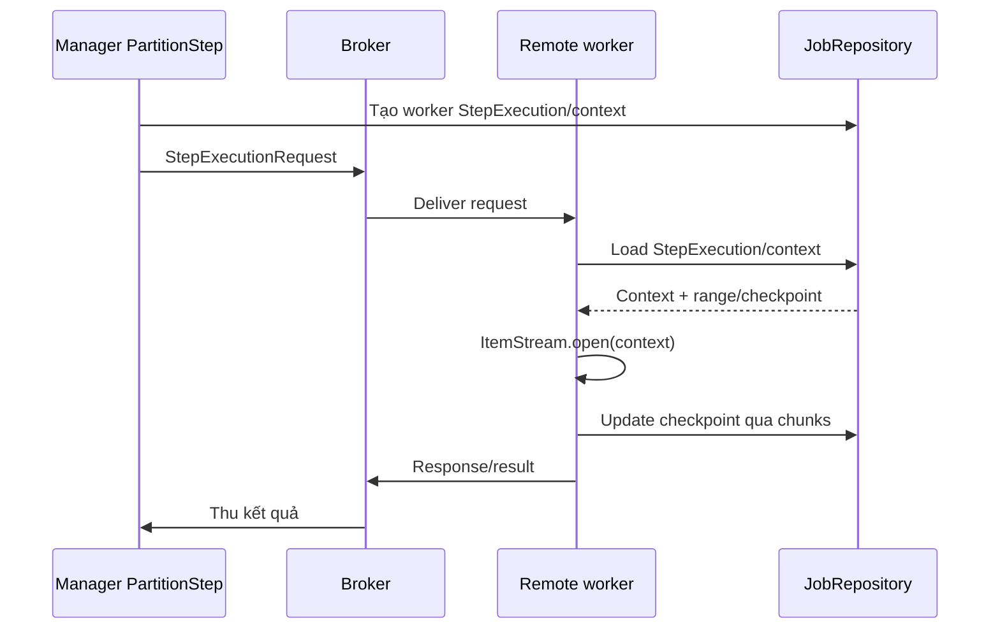
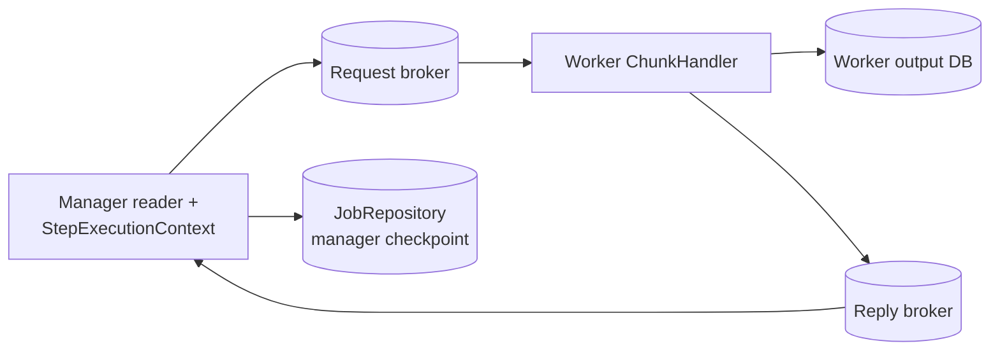

# Kiểm tra context sau restart trong Spring Batch

Một Spring Batch job xử lý 10 triệu bản ghi thường phải chạy nhiều giờ. Giả sử job đã commit 20.000 item thì worker mất kết nối, Step chuyển sang `FAILED`. Khi chạy lại cùng JobInstance, ứng dụng báo `COMPLETED`. **Làm thế nào chứng minh job đã phục hồi đúng checkpoint, không bỏ sót 20.001–20.100, không ghi trùng 1–20.000 và không lấy nhầm state của lần thực thi khác?**

Câu trả lời không phải chỉ in `ExecutionContext` một lần rồi thấy key `position` tồn tại. Cần kiểm tra theo ba lớp độc lập: **state đã persist của lần chạy trước**, **state thật sự được reader/worker phục hồi trong lần restart**, và **dữ liệu nghiệp vụ sau khi chạy lại**. Khi job sử dụng multi-threaded step, parallel steps, partitioning hoặc remote chunking, việc đối chiếu này còn phải tính đến nhiều `StepExecution`, giao dịch khác tài nguyên, message redelivery và thứ tự commit.

Bài thuộc chương **ExecutionContext** của module **SPRING_BATCH_SCALING_OPERATIONS**. Module tập trung mở rộng Spring Batch cho workload dữ liệu lớn bằng multi-threaded step, parallel steps, partitioning và các mô hình xử lý phân tán, học cách đo nút thắt, bảo đảm thread safety, retry/restart, vận hành job và lựa chọn kiến trúc theo tài nguyên thực tế.

**Sau khi học, bạn có thể:**

- Phân biệt `JobInstance`, `JobExecution`, `StepExecution` và context tương ứng trước/sau restart.
- Sử dụng `JobExplorer`, `JobRepository`, `ItemStream.open/update` và truy vấn metadata chỉ đọc để kiểm chứng checkpoint.
- Xác định **thời điểm** cần chụp giá trị context để tránh so sánh sai giữa checkpoint ban đầu và kết quả cuối job.
- Kiểm chứng bản ghi đầu tiên sau restart, số item đã commit, snapshot nguồn và business output.
- Điều tra các lỗi missing key, wrong type, serializer, reader name, partition mapping và remote message redelivery.
- Viết unit/integration test tạo lỗi có kiểm soát, restart cùng JobInstance và đối soát dữ liệu.
- Xây dựng checklist, metric và runbook để đưa kiểm chứng restart vào quy trình production.

## 1. Kiểm tra context sau restart thực sự là kiểm tra điều gì?

`ExecutionContext` là map chứa state được Spring Batch quản lý, thường được lưu trong `JobRepository` để hỗ trợ restart. Một reader có thể lưu số item đã đọc, khóa seek hoặc thông tin file; một `Partitioner` có thể cấp khoảng ID cho worker. Tuy nhiên **một giá trị có mặt trong context không tự chứng minh tiến độ tương ứng đã commit**.

Hãy tách ba câu hỏi:

| Câu hỏi | Bằng chứng cần lấy | Sai lầm dễ mắc |
| --- | --- | --- |
| **A. Trước restart, checkpoint đã persist đến đâu?** | `JobExplorer`/JobRepository đọc `StepExecutionContext` của lần trước sau khi thất bại | Lấy biến `lastSeenId` trong log rồi coi là checkpoint |
| **B. Lần restart thực sự đọc state nào?** | Log/đo tại `ItemStream.open(context)` hoặc listener phù hợp **trước khi đọc item**, theo đúng `StepExecution` mới | Chỉ nhìn context sau khi job chạy xong và suy ra vị trí ban đầu |
| **C. Kết quả sau restart có đúng không?** | Tập business keys, số lượng, tổng/checksum, output commit và external side effects | Chỉ kiểm tra `BatchStatus.COMPLETED` |

**Đạt A và B chưa đủ để đạt C.** Reader có thể mở đúng checkpoint nhưng nguồn đã thay đổi, hoặc writer đã commit trước khi metadata được cập nhật, làm cùng item được thực hiện lại.

**Đạt C cũng không tự chứng minh cơ chế checkpoint hiệu quả.** Một writer idempotent có thể giúp output đúng dù reader đọc lại toàn bộ từ đầu; khi đó throughput/restart cost vẫn có vấn đề. Cần phân biệt **correctness** với **hiệu năng phục hồi**.

## 2. Mô hình JobInstance và hai lần JobExecution

Spring Batch dùng `JobInstance` để đại diện một job logic xác định bởi job name và **identifying JobParameters**. Mỗi lần chạy/restart có một `JobExecution` riêng; Step thực thi trong từng lần chạy có `StepExecution` và context liên quan.



Các số ID là ví dụ minh họa, không phải chuỗi Spring Batch bắt buộc cấp.

| Thuộc tính | Trước lỗi | Sau restart cùng JobInstance | Dùng để xác minh |
| --- | --- | --- | --- |
| `JobInstanceId` | 41 | **41** | Cùng công việc logic |
| `JobExecutionId` | 1501 | **1510** | Hai lần chạy tách biệt |
| `StepExecutionId` của Step chạy lại | 7001 | **7050** | Metadata Step của lần chạy mới |
| `StepName` | `ordersStep` | `ordersStep` | Tên logic ổn định |
| Identifying `JobParameters` | `batchId=B2026-11` | **Không đổi** | Không tạo JobInstance mới ngoài ý muốn |
| Checkpoint nghiệp vụ | `resumeAfterId=20000` | Được reader phục hồi rồi tiếp tục tăng | Không bắt đầu sai |
| Input snapshot | `B2026-11-v3` | **Cùng snapshot** | Không áp checkpoint lên nguồn mới |

**Lưu ý về Step đã hoàn tất:** khi restart, một Step `COMPLETED` có thể được **bỏ qua**, trừ khi cấu hình cho phép chạy lại như `allowStartIfComplete(true)`. Vì vậy **không bắt buộc mỗi Step cũ đều có StepExecution mới** trong mỗi JobExecution restart. Chỉ so sánh cặp StepExecution ở những Step thực sự được thực thi lại.

### JobExecutionContext cũng có lifecycle riêng

`JobExecutionContext` của lần restart có thể chứa state dùng chung được framework khôi phục theo cơ chế repository, còn `StepExecutionContext` hỗ trợ checkpoint Step. **Không lấy một `JobExecutionContext` có key `position` rồi suy rằng reader của Step đang dùng nó**. Reader chuẩn thường lưu state ở **StepExecutionContext**; cần kiểm tra đúng cấp context và đúng instance.

## 3. Lưu ý quan trọng: thời điểm chụp context

Giá trị trong một StepExecutionContext có thể khác nhau tại các thời điểm:



Nếu trước restart context có `resumeAfterId=20000`, còn sau khi job hoàn tất có `resumeAfterId=100000`, **đó có thể là kết quả hoàn toàn đúng**. Không nên assert hai giá trị bằng nhau khi đối chiếu **cuối hai JobExecution**.

Muốn chứng minh reader **đã nhận đúng checkpoint đầu vào**, hãy capture tại `ItemStream.open(...)` hoặc ngay trước lần `read()` đầu tiên trong Step mới. Sau đó xác minh final state và business output riêng.

### Ba mốc nên ghi nhận

1. **Persisted-before-restart:** context của `StepExecution` trước sau khi transaction/metadata đã kết thúc.
2. **Restored-at-open:** các key mà reader thực sự nhận ở `open(context)` trong StepExecution mới.
3. **Persisted-after-restart:** context cuối cùng và trạng thái Step sau khi chạy lại hoàn tất hoặc thất bại.

Đây là ba loại bằng chứng khác nhau; đừng gộp chúng thành một log `context={}` không có thời điểm.

## 4. Checkpoint phải đại diện ranh giới commit

Giả sử chunk size 100 và reader xử lý các ID 1–1.000:

| Sự kiện | Reader đã thấy tới | Dữ liệu đã commit | Checkpoint restart hợp lệ trong mô hình tuần tự |
| --- | ---: | --- | --- |
| Bắt đầu | 0 | Chưa có | 0 |
| Commit chunk 1 | 100 | 1–100 | 100 |
| Commit chunk 2 | 200 | 1–200 | 200 |
| Đọc chunk 3, writer lỗi ở item 270 | 300 (có thể) | Chunk 3 rollback | **200** |
| Restart | Mở reader từ context đã persist | Tiếp tục phần còn lại | Bắt đầu sau 200 |

Bảng minh họa **reader với con trỏ khôi phục đúng, dữ liệu đầu vào bất biến, Step xử lý tuần tự và transaction được cấu hình đúng**. Một số reader dùng offset, last processed count hoặc key seek với ngữ nghĩa riêng; cần đối chiếu contract thực tế, không tự lấy `readCount` thay cho vị trí reader.

**`ItemStream.update(...)` không đồng nghĩa DB đã commit.** Framework gọi update để đưa state vào context ở commit point phù hợp, còn độ bền của metadata phụ thuộc `JobRepository` và transaction. State mới trong RAM có thể tiến xa hơn state đã persist khi xảy ra lỗi.

Nếu JobRepository và output writer tham gia **hai local transaction khác nhau**, có thể xảy ra output commit nhưng checkpoint chưa kịp persist. Khi đó restart có thể đọc lại output đã ghi; writer idempotent và reconciliation vẫn cần thiết.

## 5. Trước khi restart: lưu bộ nhận diện tối thiểu

Để đối chiếu đúng, cần ghi nhận:

- Job name, `JobInstanceId` và **identifying JobParameters** (chỉ những trường không bí mật).
- `JobExecutionId` trước khi restart, `BatchStatus` và `ExitStatus`.
- Tên Step, `StepExecutionId`, trạng thái và các count quan trọng.
- `StepExecutionContext` đã persist của Step lỗi: những **key checkpoint cho phép**.
- `snapshotId`, manifest version/checksum, range/bucket plan.
- Trạng thái output DB theo business keys đã commit, nếu cần đo mức replay.
- Phiên bản ứng dụng, reader name, serializer và JobRepository schema liên quan.

**Không chụp nguyên context nếu có khả năng chứa credential hoặc thông tin nhạy cảm.** Chỉ chọn những key đã được phân loại an toàn, ghi vào log có cấu trúc hoặc test assertion; JobParameters cũng có thể chứa dữ liệu cần bảo vệ.

### Mẫu ghi nhận có kiểm soát

```text
event=batch_checkpoint_before_restart
jobName=importOrders
jobInstanceId=41
jobExecutionId=1501
stepName=ordersStep
stepExecutionId=7001
batchStatus=FAILED
snapshotId=B2026-11-v3
checkpointSchemaVersion=1
resumeAfterId=20000
outputCommittedKeys=20000
secretValues=<NOT_LOGGED>
```

`outputCommittedKeys` là kết quả query nghiệp vụ, **không phải số liệu Spring Batch tự xác nhận từ context**. Nếu Step có filter/skip hoặc một input sinh nhiều output, cần thay cách đối soát.

## 6. Đọc metadata của JobExecution cũ bằng JobExplorer

`JobExplorer` cung cấp API **read-only** để tra cứu các JobInstance/JobExecution/StepExecution đã được `JobRepository` lưu. Ưu điểm của API là bạn không phải tự deserialize `SHORT_CONTEXT`/`SERIALIZED_CONTEXT` bằng SQL.

Ví dụ Java Spring Batch 5.x:

```java
import java.util.Comparator;

import org.springframework.batch.core.JobExecution;
import org.springframework.batch.core.StepExecution;
import org.springframework.batch.core.explore.JobExplorer;
import org.springframework.batch.item.ExecutionContext;

public final class PersistedCheckpointInspector {
    private final JobExplorer explorer;

    public PersistedCheckpointInspector(JobExplorer explorer) {
        this.explorer = explorer;
    }

    public void inspect(long jobExecutionId, String stepName) {
        JobExecution jobExecution =
                explorer.getJobExecution(jobExecutionId);
        if (jobExecution == null) {
            throw new IllegalArgumentException(
                    "Unknown JobExecutionId");
        }

        StepExecution step = jobExecution.getStepExecutions()
                .stream()
                .filter(s -> s.getStepName().equals(stepName))
                .max(Comparator.comparing(StepExecution::getId))
                .orElseThrow(() -> new IllegalStateException(
                        "Step was not executed in this JobExecution"));

        ExecutionContext ctx = step.getExecutionContext();

        // Chỉ đọc key ứng dụng đã được duyệt; không log cả context.
        if (!ctx.containsKey("orders.reader.resumeAfterId")
                || !ctx.containsKey("orders.reader.snapshotId")) {
            throw new IllegalStateException(
                    "Missing expected checkpoint keys");
        }

        long resumeAfterId =
                ctx.getLong("orders.reader.resumeAfterId");
        String snapshotId =
                ctx.getString("orders.reader.snapshotId");

        if (resumeAfterId < 0
                || snapshotId == null || snapshotId.isBlank()) {
            throw new IllegalStateException(
                    "Invalid persisted checkpoint");
        }

        System.out.printf(
            "jobExecutionId=%d stepExecutionId=%d "
            + "step=%s status=%s resumeAfterId=%d snapshotId=%s%n",
            jobExecution.getId(), step.getId(),
            step.getStepName(), step.getStatus(),
            resumeAfterId, snapshotId);
    }
}
```

**Giới hạn của ví dụ:**

- Các key `orders.reader.resumeAfterId` và `orders.reader.snapshotId` là **contract tùy chỉnh**, không phải key mặc định của tất cả reader Spring Batch.
- Dùng `getLong/getString` phải đúng kiểu đã persist; nếu serializer hoặc schema thay đổi, cần validate/migration.
- `System.out` chỉ minh họa việc xuất dữ liệu **không bí mật**; trong production nên dùng structured logger và ACL.
- Nếu Step đã `COMPLETED` nên bị skip ở lần restart, tìm StepExecution của tên đó trong JobExecution mới có thể không thấy. Đừng tạo fake StepExecution để “đối chiếu cho đủ”.
- Cần đọc lại bằng `JobExplorer` sau khi transaction metadata đã hoàn tất; đừng lấy một object StepExecution cũ giữ trong RAM và coi là snapshot DB mới nhất.

`JobExplorer` không dùng để cập nhật trạng thái hoặc xóa context; thay đổi metadata phải tuân API/lifecycle Spring Batch, không dựa vào việc mutate object lấy từ explorer.

## 7. Kiểm tra context ngay tại ItemStream.open

Kiểm tra `JobExplorer` sau khi restart hoàn tất chỉ cho biết checkpoint **cuối**. Nếu cần xác nhận reader đã resume từ đâu, thêm một probe tại `ItemStream.open(...)` trong môi trường test/diagnostic.

Mẫu decorator dưới đây **không ghi password, không thay đổi checkpoint và không thay đổi payload**:

```java
import java.util.Objects;
import java.util.function.LongConsumer;

import org.springframework.batch.item.ExecutionContext;
import org.springframework.batch.item.ItemStreamReader;

public final class CheckpointProbeReader<T>
        implements ItemStreamReader<T> {

    private final ItemStreamReader<T> delegate;
    private final LongConsumer onRestoredPosition;
    private final String key;

    public CheckpointProbeReader(
            ItemStreamReader<T> delegate,
            String checkpointKey,
            LongConsumer onRestoredPosition) {

        this.delegate = Objects.requireNonNull(delegate);
        this.key = Objects.requireNonNull(checkpointKey);
        this.onRestoredPosition =
                Objects.requireNonNull(onRestoredPosition);
    }

    @Override
    public void open(ExecutionContext context) {
        if (context.containsKey(key)) {
            onRestoredPosition.accept(context.getLong(key));
        } else {
            // Chỉ coi thiếu key là khởi chạy mới nếu contract xác nhận.
            onRestoredPosition.accept(-1L);
        }
        delegate.open(context);
    }

    @Override
    public T read() throws Exception {
        return delegate.read();
    }

    @Override
    public void update(ExecutionContext context) {
        delegate.update(context);
    }

    @Override
    public void close() {
        delegate.close();
    }
}
```

**Giải thích:**

1. Probe nhìn context **trước khi delegate.open(...)` có thể khôi phục và thay đổi state nội bộ**.
2. `-1L` là sentinel của **bản ghi diagnostic**, không phải một checkpoint có thể ghi vào DB.
3. Nó chỉ phản ánh key đã được cấu hình; nếu reader chuẩn dùng key riêng (theo `name`), phải xác định đúng contract trước khi dùng.
4. Đừng gọi `delegate.open` hai lần hoặc tự `context.put` chỉ để log; có thể phá lifecycle.
5. Nếu reader được bọc nhiều tầng (composite/decorator/proxy), bảo đảm `ItemStream` thực sự được đăng ký với Step để `open/update/close` chạy.
6. Ghi kết quả probe theo từng `StepExecutionId`, không dùng một mutable singleton field ghi đè dữ liệu giữa nhiều partition/threads.

Để kiểm tra **item đầu tiên thực sự được trả về sau open**, bạn có thể đo trong `read()` bằng probe riêng, nhưng phải phân biệt *item vừa đọc* với *item đã commit*. Chỉ log một business key đã được cho phép, không log nguyên object hay PII.

### Một lưu ý về Spring Batch reader chuẩn

`FlatFileItemReader` hoặc `JdbcPagingItemReader` có thể lưu state bằng các key/nội dung **khác với `resumeAfterId`**. Đừng lấy code probe trên áp mù vào các reader đó rồi kết luận key thiếu là lỗi. Có thể dùng test xác nhận `ItemStream.open` nhận context framework đã persist, hoặc viết adapter checkpoint có schema do ứng dụng sở hữu.

## 8. Validation phải kiểm tra kiểu, ý nghĩa và snapshot

Chỉ biết context có key là chưa đủ. Cần xác định:

- **Schema version:** reader mới có hiểu schema state cũ?
- **Data type:** `Long` hay `Integer`/`String`? Có thể đọc `getLong` đúng không?
- **Ngữ nghĩa:** `resumeAfterId` là ID cuối đã commit hay ID đầu tiên chưa đọc?
- **Boundary:** Query `id > checkpoint` hay `id >= checkpoint`? Có off-by-one?
- **Snapshot:** Input nguồn có giữ phiên bản và thứ tự như lần trước?
- **Range:** Key có thuộc đúng partition và không vượt `endId`?
- **Transaction:** Checkpoint có phản ánh phần output đã commit không?
- **Identity:** Context có thuộc đúng `StepExecution`, JobInstance và partition name không?

### Ví dụ validator cho reader ID tăng dần

```java
import org.springframework.batch.item.ExecutionContext;

public final class CheckpointContractValidator {
    private static final String VERSION =
            "orders.checkpoint.schemaVersion";
    private static final String AFTER =
            "orders.reader.resumeAfterId";
    private static final String SNAPSHOT =
            "orders.reader.snapshotId";

    public long verify(
            ExecutionContext ctx,
            String expectedSnapshot,
            long lowerInclusive,
            long upperExclusive) {

        if (ctx == null
                || expectedSnapshot == null
                || expectedSnapshot.isBlank()
                || lowerInclusive >= upperExclusive) {
            throw new IllegalArgumentException(
                    "Invalid expected checkpoint contract");
        }

        if (!ctx.containsKey(VERSION)
                || !ctx.containsKey(AFTER)
                || !ctx.containsKey(SNAPSHOT)) {
            throw new IllegalStateException(
                    "Missing required checkpoint fields");
        }

        if (ctx.getInt(VERSION) != 1) {
            throw new IllegalStateException(
                    "Unsupported checkpoint version");
        }

        if (!expectedSnapshot.equals(ctx.getString(SNAPSHOT))) {
            throw new IllegalStateException(
                    "Input snapshot changed since previous execution");
        }

        long lastCommittedId = ctx.getLong(AFTER);

        // Ở ví dụ này lowerInclusive-1 là sentinel ban đầu
        // và ID hợp lệ là số dương. Cần đổi nếu domain cho ID <= 0.
        if (lowerInclusive <= 0
                || lastCommittedId < lowerInclusive - 1
                || lastCommittedId >= upperExclusive) {
            throw new IllegalStateException(
                    "Checkpoint outside assigned partition");
        }

        return lastCommittedId;
    }
}
```

Ví dụ dùng **range nửa mở** `[lowerInclusive, upperExclusive)` và **semantics** “ID cuối đã hoàn tất”; reader tiếp tục bằng `WHERE id > :lastCommittedId AND id < :upperExclusive`. Với input có lỗ hổng ID, điều kiện seek theo `id > lastCommittedId` vẫn có thể đúng nếu thứ tự ổn định. Nhưng nếu dữ liệu có nhiều item cùng ID, phải có sort key tổng hợp và context chứa đủ tie-breaker.

**Không gọi validator này trên một StepExecutionContext trống của Job mới** mà không có nhánh khởi tạo tường minh. Một context không có key có thể là “job mới”, nhưng cũng có thể là “reader name đã đổi” hoặc “serializer làm mất state”. Phân biệt qua metadata JobInstance/StepExecution và schema contract, không mặc định mở từ đầu.

## 9. Việc restart có thực sự tạo một JobExecution mới?

Một restart đúng nghĩa thường chạy lại **cùng JobInstance** sau `FAILED` hoặc `STOPPED`, với một `JobExecution` mới. Nếu chỉ sửa `run.id` rồi chạy `JobParameters` khác, có thể bạn đang tạo **JobInstance mới**, không phải khôi phục context cũ.

### Mẫu assertion cho hai JobExecution

```java
import static org.junit.jupiter.api.Assertions.*;

import org.springframework.batch.core.JobExecution;

public final class RestartIdentityAssertions {
    public static void verifySameJobInstance(
            JobExecution first,
            JobExecution restarted) {

        assertNotNull(first.getJobInstance());
        assertNotNull(restarted.getJobInstance());

        assertEquals(
                first.getJobInstance().getInstanceId(),
                restarted.getJobInstance().getInstanceId(),
                "Restart phải giữ JobInstance");

        assertNotEquals(
                first.getId(),
                restarted.getId(),
                "Restart cần JobExecution riêng");

        assertEquals(
                first.getJobInstance().getJobName(),
                restarted.getJobInstance().getJobName());
    }
}
```

Đoạn code sử dụng JUnit assertions trong helper test; không phải production validation utility. Nó chưa chứng minh StepExecutionContext khôi phục đúng: đó là những assertions khác.

### Tránh chạy đè khi JobExecution cũ vẫn STARTED

Nếu execution cũ vẫn `STARTED` do trạng thái chưa được xử lý hoặc worker còn đang chạy, khởi chạy một job khác trên cùng dữ liệu có thể gây ghi chồng lấn. Chỉ restart qua API và runbook Spring Batch được hỗ trợ, sau khi xử lý trạng thái execution cũ, broker requests và side effects đang chờ.

## 10. So sánh StepExecution cũ và mới đúng cách

Với Step thực sự chạy lại, nên đối chiếu:

| Trường | Trước lỗi | Sau restart | Ý nghĩa |
| --- | --- | --- | --- |
| `StepName` | `ordersStep` | Cùng tên | Framework nhận đúng Step logic |
| `StepExecutionId` | ID cũ | **ID mới** | Đây là lần thực thi mới |
| `BatchStatus` | `FAILED`/`STOPPED` | `COMPLETED` hoặc trạng thái thực tế | Biết kết quả execution |
| `ExitStatus` | Mã lỗi | Mã mới | Chẩn đoán, không phải chứng cứ DB |
| Context tại `open` | Checkpoint persist cũ | **Phải tương thích checkpoint cũ** | Reader bắt đầu từ đúng vùng |
| Context cuối | Position cũ | Position mới sau các commit | Tiến độ thực tế |
| `readCount`, `writeCount` | Counts của execution cũ | Counts ở execution mới | Tham khảo; không dùng thay reconciliation |
| Partition range/snapshot | Vùng và snapshot đã chốt | **Không đổi** | Tránh bỏ sót/chồng lấn |

`readCount` và `writeCount` là các bộ đếm do Batch quản lý; quy tắc khởi tạo/tích lũy trong restart và fault-tolerant processing phụ thuộc lifecycle. **Không dùng phép trừ count của hai execution làm bằng chứng duy nhất** rằng đúng 100 item được xử lý thêm. Dùng tập business keys và output đã commit.

### Khi Step cũ COMPLETED nhưng Step mới không tồn tại

Đây có thể là hành vi bình thường: restart đã skip Step hoàn tất. Khi ấy chứng cứ đúng là:

- Step trước có `COMPLETED` trong repository.
- Chính sách restart của job cho phép skip đó.
- Dữ liệu đầu ra của Step vẫn tồn tại và đúng.
- Không có expectation rằng `ItemStream.open` của Step đó chạy lần hai.

Nếu Step có `allowStartIfComplete(true)`, cần kiểm tra đặc biệt writer idempotency và việc chạy lại toàn Step, vì “đã COMPLETED trước đó” không bảo vệ output khỏi thao tác lặp.

## 11. Xem context trực tiếp trong JobRepository

Với JDBC JobRepository, có thể dùng truy vấn **read-only** để xác định các execution và trạng thái của chúng:

```sql
SELECT
    je.JOB_INSTANCE_ID,
    je.JOB_EXECUTION_ID,
    je.STATUS AS JOB_STATUS,
    se.STEP_EXECUTION_ID,
    se.STEP_NAME,
    se.STATUS AS STEP_STATUS,
    se.READ_COUNT,
    se.WRITE_COUNT,
    se.COMMIT_COUNT,
    se.ROLLBACK_COUNT
FROM BATCH_JOB_EXECUTION je
JOIN BATCH_STEP_EXECUTION se
  ON se.JOB_EXECUTION_ID = je.JOB_EXECUTION_ID
WHERE je.JOB_INSTANCE_ID = :jobInstanceId
ORDER BY je.JOB_EXECUTION_ID, se.STEP_EXECUTION_ID;
```

Các bảng context điển hình:

```sql
-- Chỉ cho biết có row context và kích thước phần hiển thị.
-- Không SELECT nguyên serialized state ra log phổ thông.
SELECT
    se.STEP_EXECUTION_ID,
    se.JOB_EXECUTION_ID,
    se.STEP_NAME,
    LENGTH(ctx.SHORT_CONTEXT) AS short_context_length
FROM BATCH_STEP_EXECUTION se
JOIN BATCH_STEP_EXECUTION_CONTEXT ctx
  ON ctx.STEP_EXECUTION_ID = se.STEP_EXECUTION_ID
WHERE se.JOB_EXECUTION_ID IN (
    :previousJobExecutionId,
    :restartedJobExecutionId
)
ORDER BY se.JOB_EXECUTION_ID, se.STEP_EXECUTION_ID;
```

**Giới hạn:**

- Tên bảng, prefix, kiểu cột và hàm độ dài chuỗi có thể khác theo schema/database vendor.
- `SHORT_CONTEXT` không nhất thiết chứa toàn bộ context; state dài có thể nằm ở `SERIALIZED_CONTEXT`.
- Không cố parse Base64/JSON theo giả định nếu repository dùng serializer khác; `JobExplorer` hoặc tooling chuyên dụng an toàn hơn.
- Tránh `SELECT *` và sao chép `SERIALIZED_CONTEXT` ra logs/issue tracker vì có thể chứa thông tin nhạy cảm.
- **Không UPDATE `BATCH_STEP_EXECUTION_CONTEXT` thủ công** để “sửa vị trí” nếu chưa có migration plan đã kiểm chứng; làm vậy có thể phá serialization và restart.

### Nếu không thấy context của Step

Có thể do: Step chưa bắt đầu, Step được skip, `ItemStream` không được đăng ký, `saveState(false)`, key khác tên, metadata chưa commit, query nhầm JobExecution/StepExecution hoặc JobRepository cấu hình ở datasource khác. **Không kết luận ngay rằng framework đã làm mất checkpoint.**

## 12. Kiểm tra ItemStream lifecycle

Spring Batch Reader/Writer có state nên thực hiện `ItemStream` với:

```java
void open(ExecutionContext executionContext);
void update(ExecutionContext executionContext);
void close();
```

`open` khôi phục state từ context được framework cung cấp; `update` ghi state cần checkpoint vào context ở lifecycle phù hợp; `close` giải phóng resource. Nếu custom reader chỉ implement `ItemReader` nhưng không thực hiện `ItemStream`, framework không tự biết biến `currentIndex` cần được persist thế nào.

### Những bước kiểm tra thực tế

1. Reader có implement `ItemStreamReader<T>` hoặc được bọc đúng contract không?
2. Step builder có nhận đúng bean reader, hay một proxy/decorator làm mất interface `ItemStream`?
3. Nếu reader/writer là delegate trong composite, đã đăng ký qua `.stream(...)` khi cần chưa?
4. `open(context)` có được gọi **trước lần read() đầu tiên** không?
5. `update(context)` có được gọi ở checkpoint không, và key có đúng namespace?
6. `saveState(true)` được cấu hình nếu reader chuẩn cần lưu tiến độ?
7. Tên reader trong `name("...")` có bị thay đổi giữa hai lần chạy không?
8. `close()` có giải phóng resource và không ghi đè checkpoint sai không?

### Lỗi điển hình khi đổi tên reader

```text
Lần đầu:
  JdbcPagingItemReader.name = "ordersReader"
  Context key do reader tạo mang namespace ordersReader

Sau restart:
  JdbcPagingItemReader.name = "ordersPagingReader"
  Reader mới không thấy state dưới namespace cũ

Kết quả:
  Có thể đọc lại từ đầu hoặc fail tùy contract/config
```

Giữ cùng tên reader **không đủ** nếu đồng thời đổi thuật toán paging/cursor, query, order hoặc semantics checkpoint. Khi nâng cấp, test compatibility giữa serialized context cũ và `open` của reader mới.

## 13. Ví dụ reader theo ID và snapshot bất biến

Một cách giúp đối soát rõ ràng là dùng các business IDs có sort key duy nhất, snapshot cố định và interval partition nửa mở.

```java
import java.util.Map;
import javax.sql.DataSource;

import org.springframework.batch.core.configuration.annotation.StepScope;
import org.springframework.batch.item.database.JdbcPagingItemReader;
import org.springframework.batch.item.database.Order;
import org.springframework.batch.item.database.builder.JdbcPagingItemReaderBuilder;
import org.springframework.batch.item.database.support.PostgresPagingQueryProvider;
import org.springframework.beans.factory.annotation.Value;
import org.springframework.context.annotation.Bean;

@Bean
@StepScope
public JdbcPagingItemReader<OrderRow> ordersReader(
        DataSource dataSource,
        @Value("#{jobParameters['batchId']}") String batchId,
        @Value("#{stepExecutionContext['range.startId']}") Long startId,
        @Value("#{stepExecutionContext['range.endId']}") Long endId) {

    if (batchId == null || batchId.isBlank()
            || startId == null || endId == null
            || startId >= endId) {
        throw new IllegalArgumentException("Invalid range/batch");
    }

    var query = new PostgresPagingQueryProvider();
    query.setSelectClause("SELECT id, amount");
    query.setFromClause("FROM staging_orders");
    query.setWhereClause(
            "WHERE batch_id = :batchId AND id >= :startId AND id < :endId");
    query.setSortKeys(Map.of("id", Order.ASCENDING));

    return new JdbcPagingItemReaderBuilder<OrderRow>()
            .name("ordersReader")
            .dataSource(dataSource)
            .queryProvider(query)
            .parameterValues(Map.of(
                    "batchId", batchId,
                    "startId", startId,
                    "endId", endId))
            .pageSize(100)
            .rowMapper((rs, rowNum) -> new OrderRow(
                    rs.getLong("id"), rs.getBigDecimal("amount")))
            .saveState(true)
            .build();
}
```

`OrderRow` là DTO/record do ứng dụng định nghĩa. Snippet giả định `batchId` chốt tập dữ liệu không đổi và `id` tạo sort key duy nhất trong tập. Nếu staging table có nhiều phiên bản cùng batch, phải lọc bằng `snapshotId` thật; nếu input thay đổi trong lúc restart, một checkpoint hợp lệ theo số dòng vẫn có thể trỏ sai dữ liệu.

**Lưu ý:** `JdbcPagingItemReader` có cơ chế lưu state của framework; **không tự giả định nó dùng key `orders.reader.resumeAfterId` trong ví dụ validator**. Với reader chuẩn, kiểm tra contract state riêng hoặc dùng probe đọc vị trí đã phục hồi theo đúng implementation/version đang chạy.

### Phân biệt chunk size và page size

`chunk(100)` xác định số item trong giao dịch chunk theo thiết kế Step. `pageSize(100)` xác định số row SQL tải trong một page. Hai số có thể bằng nhau nhưng **không bắt buộc**, và chúng không đồng nghĩa “checkpoint mỗi page”. Checkpoint phụ thuộc `ItemStream.update` và transaction lifecycle.

## 14. Source snapshot là điều kiện để checkpoint có ý nghĩa

Giả sử context có `rowIndex=1000` trên file CSV. Nếu file được thêm 10 dòng ở đầu trước restart, `rowIndex=1000` có thể trỏ vào **dữ liệu khác**. Tương tự, SQL paging dựa trên `ORDER BY` không duy nhất hoặc nguồn biến động có thể bỏ sót/trùng item.

| Nguồn | State thường lưu | Điều cần xác minh trước restart |
| --- | --- | --- |
| CSV | Line number/offset, reader state | File path, checksum/version, encoding, parser |
| JDBC cursor | Vị trí logic trong kết quả đọc | Query, input snapshot, ordering |
| JDBC paging | Offset/page/sort key theo implementation | Sort key duy nhất, predicate, dataset không đổi |
| Object storage | URI và vị trí stream | Object version/ETag/checksum, retention |
| Work table | Work key/status/lease | Claim/dedupe transaction và trạng thái item |
| Partition hash | `bucketId`/`bucketCount`/hashVersion | Cùng cách chia dữ liệu trong JobInstance |

Một context `resumeAfterId=20000` chỉ đáng tin khi biết **20000 là khóa của item nào trong snapshot nào, với quy tắc so sánh nào**.

Nếu input không thể bất biến, cần thiết kế theo nghiệp vụ: watermark có thể tái lập, bảng công việc bền vững, dedupe theo business key hoặc reconciliation. **Không coi restart là đơn giản khi câu SQL đọc một tập dữ liệu thay đổi liên tục.**

## 15. Cơ chế commit và JobRepository có thể tạo khoảng lệch

`JobRepository` giữ metadata, còn writer có thể ghi dữ liệu đích vào resource khác. Có hai trường hợp:

### Cùng transaction DB

Nếu writer và metadata thực sự tham gia cùng transaction quản lý bởi transaction manager phù hợp, output và checkpoint có thể commit/rollback nhất quán theo ranh giới chunk.

### Khác resource/transaction



Không có local JDBC transaction mặc định bao cả DB-A và DB-B. Một số lỗi commit ở biên network có trạng thái không chắc chắn. Vì vậy:

- Nếu output đã commit nhưng checkpoint chưa persist, item có thể được **xử lý lại**.
- Nếu một thiết kế custom persist checkpoint trước khi output bền vững, có thể **bỏ sót item**.
- Một writer idempotent giúp chống side effect dữ liệu lặp, nhưng cần kiểm chứng giá trị, không chỉ số row.
- External HTTP/email/event không tự rollback theo JDBC chunk; cần idempotency key, outbox hoặc saga tùy nghiệp vụ.

**Kiểm tra context sau restart phải kèm đối soát dữ liệu đã commit** để bắt các cửa sổ lỗi này.

## 16. Multi-threaded Step: một pointer không đại diện mọi chunk

Trong một `StepExecution` chạy nhiều chunk threads, chúng có thể chia sẻ reader stateful và `StepExecutionContext`. Dù `ExecutionContext` được persist đúng bytes, **thứ tự commit có thể khác thứ tự đọc**.

```text
Worker A đọc item 1..100, xử lý chậm, chưa commit.
Worker B đọc item 101..200, xử lý nhanh và commit.
Checkpoint con trỏ đơn được ghi thành 200.
Worker A rollback, JVM crash.
Restart từ 201 -> có thể bỏ sót 1..100.
```

Đây là phản ví dụ cơ bản. `synchronized read()` giúp bảo vệ thao tác lấy item, nhưng không tự bắt hai chunk **commit theo thứ tự đọc**. `@StepScope` gắn với `StepExecution`, không phải mỗi thread.

### Khi kiểm chứng restart multi-threaded Step

1. Log **chunk identity/correlation** theo thread và StepExecutionId cho diagnostic, không ghi raw item nhạy cảm.
2. Inject một chunk chậm và một chunk nhanh để tạo **commit đảo thứ tự**.
3. Kill process sau khi chunk sau commit, chunk trước chưa commit.
4. Restart cùng JobInstance.
5. Đối soát **tập item keys**, không chỉ `position` hay count.
6. Nếu không thể chứng minh checkpoint cursor an toàn, cân nhắc partitioning theo range/hash hoặc work table, thay vì mở rộng bằng một reader stateful chung.

**Tắt `saveState(false)`** có thể được lựa chọn trong một số kiến trúc reread/idempotent, nhưng nó **loại bỏ checkpoint vị trí của reader** và không tự giải quyết vấn đề restart.

## 17. Partitioning: đối chiếu từng StepExecutionContext riêng

Với `PartitionStep`, manager tạo các context chứa `startId/endId/bucketId` cho worker. Mỗi worker thường là một `StepExecution` riêng có reader/writer và checkpoint của chính nó.



Khi restart, không chỉ kiểm tra manager Step `COMPLETED` hay `FAILED`; cần kiểm từng worker partition:

| Partition | Lần đầu | Sau restart | Cần xác minh |
| --- | --- | --- | --- |
| `range-000` | `COMPLETED` | Có thể skip | Output vùng 000 đúng, không ghi lại |
| `range-001` | `FAILED` | `COMPLETED` sau chạy lại | Context/range cũ được giữ, checkpoint đúng |
| `range-002` | `COMPLETED` | Có thể skip | Không bị gán vùng khác |
| `range-003` | Chưa hoàn tất/không có ở lần trước | Phụ thuộc plan | Không tự tạo range chồng lấn |

**Tên partition phải gắn với cùng logical data subset**. Đừng đổi hash function, `bucketCount` hoặc mapping tên partition → khoảng ID khi restart cùng JobInstance. Giữ tên nhưng đổi vùng dữ liệu có thể khiến framework skip một partition cũ `COMPLETED` trong khi phần dữ liệu mới chưa xử lý.

### Đối chiếu range và checkpoint

Đối với một worker context:

```text
stepName = workerStep:range-001
range.startId = 2501
range.endId = 5001
input.snapshotId = B2026-11-v3
reader checkpoint = <theo contract reader>
```

Cần xác nhận range có cùng giá trị **trước và sau restart**, reader checkpoint nằm trong range đúng, và dữ liệu output của riêng range không thiếu hoặc chồng lấn với partition kế bên.

Không đưa tất cả worker context vào một shared `JobExecutionContext` mutable với key trùng nhau; điều đó làm mất sự cô lập trạng thái và khó xác minh restart.

## 18. Remote partitioning: nơi đọc context không nhất thiết là manager

Ở **remote partitioning**, worker thường chạy **worker StepExecution** trong JVM khác. Worker có thể phải truy cập `JobRepository` và deserialize `StepExecutionContext` đã được tạo/ghi từ phía manager.



Khi remote worker restart, kiểm chứng thêm:

- Worker đang dùng **cùng JobRepository/schema/serializer tương thích** với manager, không đọc một local repository khác.
- `StepExecutionId` trong request/payload được gắn đúng worker StepExecution đã tồn tại; header chỉ là metadata bổ trợ.
- Worker được cấp quyền truy cập input snapshot đúng host/namespace.
- Job/Step/partition name, range và state đều khớp.
- Nếu message cũ được redeliver, không tạo một xử lý song song sai trên cùng StepExecution hoặc ghi output lặp; cần chính sách broker/lease/worker idempotency.
- Một worker không thể deserialize custom class từ context phải fail rõ, không tự tạo context trống và đọc từ đầu.

**Không dùng địa chỉ host hay thread name làm partition identity.** Worker mới có thể phục hồi cùng một phần việc trên JVM khác.

## 19. Remote chunking: checkpoint reader ở manager

Trong **remote chunking**, manager thường sở hữu `ItemReader` và gửi `ChunkRequest` chứa item qua broker. Worker nhận request, processor/writer xử lý, gửi `ChunkResponse`; worker handler **không mặc định có worker StepExecutionReader context riêng** như remote partitioning.

Vì vậy khi job remote chunking restart:

1. Kiểm **manager StepExecutionContext** để xác định reader đã checkpoint tới đâu.
2. Kiểm request/reply correlation và các chunk đang in-flight hoặc bị redeliver.
3. Kiểm output DB tại worker: request có thể đã commit nhưng manager chưa nhận reply.
4. Không dùng `JobExecutionId`, `request.sequence` hoặc broker delivery tag làm khóa nghiệp vụ duy nhất chống trùng xuyên restart.
5. Dùng business keys ổn định, unique constraints/idempotent writer và đối soát.
6. Không kỳ vọng secret/credential có trong context hoặc message để phục hồi kết nối worker.



**Một phản hồi timeout không chứng minh worker chưa commit.** Nếu manager đọc lại item sau restart, điều đó có thể đúng với mô hình at-least-once; kết quả dữ liệu vẫn phải idempotent.

## 20. Kiểm tra reader phục hồi đúng nhưng writer có thể xử lý lại

Một checkpoint có thể được đọc đúng trong Step mới, nhưng nếu metadata và output khác resource hoặc broker redelivery, item đã ghi có thể xuất hiện lần nữa.

Ví dụ output table:

```sql
CREATE TABLE processed_orders (
    batch_id varchar(80) NOT NULL,
    order_id bigint NOT NULL,
    normalized_amount numeric(18,2) NOT NULL,
    PRIMARY KEY (batch_id, order_id)
);
```

Một writer idempotent cho **trạng thái hiện tại**, nếu cùng input luôn cho cùng giá trị:

```sql
INSERT INTO processed_orders
    (batch_id, order_id, normalized_amount)
VALUES (:batchId, :orderId, :amount)
ON CONFLICT (batch_id, order_id)
DO UPDATE SET normalized_amount = EXCLUDED.normalized_amount;
```

**Cẩn trọng:** Đây không phải lời giải chung cho append-only ledger hoặc lệnh cộng tiền; các thao tác tích lũy cần operation ID/dedup. Với upsert trên, hai phiên bản input khác nhau có thể ghi đè nhau; cần snapshot/rule version và kiểm soát ordering.

Đừng chỉ đếm `COUNT(*)` rồi tuyên bố đã chính xác. Cần kiểm **tập business keys**, số tiền/checksum và side effects ngoài database.

## 21. SQL đối soát input và output sau restart

Giả sử mỗi input trong `staging_orders` phải tạo đúng một row ở `processed_orders`, cùng `batchId`:

```sql
-- Kiểm tra item bị thiếu sau restart.
SELECT s.id
FROM staging_orders s
LEFT JOIN processed_orders p
  ON p.batch_id = s.batch_id
 AND p.order_id = s.id
WHERE s.batch_id = :batchId
  AND p.order_id IS NULL;

-- Kiểm tra output không thuộc input snapshot.
SELECT p.order_id
FROM processed_orders p
LEFT JOIN staging_orders s
  ON s.batch_id = p.batch_id
 AND s.id = p.order_id
WHERE p.batch_id = :batchId
  AND s.id IS NULL;

-- Tổng số và giá trị nghiệp vụ đã commit.
SELECT COUNT(*) AS output_count,
       SUM(normalized_amount) AS output_sum
FROM processed_orders
WHERE batch_id = :batchId;
```

### Cần mở rộng phép kiểm khi nào?

- Processor có **filter**: một số input hợp lệ không tạo output.
- Job có **skip**: một số item không được ghi theo policy và cần audit.
- Một input sinh nhiều output: cần quan hệ mapping đúng chứ không `1:1`.
- Writer là append-only: kiểm tra operation ID, event count/dedup, không chỉ unique current-state key.
- Input nhiều snapshot/version: thêm điều kiện snapshot thật.
- Output có downstream HTTP/email/event: kiểm tra side effect ở hệ thống nhận hoặc outbox.
- Partitioning: đối soát cả **toàn tập** và **theo từng range/bucket** để phát hiện overlap/skew.

Một query đối soát dùng **đúng dataset snapshot** quan trọng hơn việc query bảng nguồn hiện tại nếu dữ liệu đã bị cập nhật sau lần chạy đầu.

## 22. Kiểm thử đầu vào và output qua một lần failure/restart

Một kịch bản integration nên chủ động làm hỏng chunk thứ ba:

```text
Input immutable: orderId 1..1000
Chunk size:      100
Reader:          stateful + ItemStream + saveState(true)
Writer:          transactional DB writer, business key (batchId, orderId)

Lần 1:
  chunk 1 commit -> output 1..100
  chunk 2 commit -> output 101..200
  chunk 3 đọc 201..300, writer ném lỗi
  Step FAILED

Chụp bằng JobExplorer:
  JobInstanceId, JobExecutionId, StepExecutionId
  context đã persist sau FAILED (tùy key reader)

Lần 2:
  Restart CÙNG JobInstance/identifying JobParameters
  Capture context tại ItemStream.open
  Verify snapshot/source/reader name
  Chạy tới COMPLETED
  Re-read metadata bằng JobExplorer
  Query output: đủ 1000 key, đúng giá trị, không duplicate effect
```

**Điểm đo quan trọng:** nếu reader dựa vào `nextIndex`, context sau lần 1 trong mô hình tuần tự/transaction đúng thường tương ứng chunk 2 đã commit. Nếu reader dùng implementation state khác, không áp chính xác số 200 khi chưa kiểm tra schema/semantics của nó.

### Test restart với JobLauncher

Mẫu dưới cho thấy cách giữ **identifying JobParameters** ổn định. Các bean `importOrdersJob` và `FailureSwitch` là thành phần ứng dụng/test phải được định nghĩa riêng; đoạn này là khung integration test, không phải project chạy độc lập.

```java
import static org.junit.jupiter.api.Assertions.*;

import org.junit.jupiter.api.Test;
import org.springframework.beans.factory.annotation.Autowired;
import org.springframework.batch.core.BatchStatus;
import org.springframework.batch.core.Job;
import org.springframework.batch.core.JobExecution;
import org.springframework.batch.core.JobParameters;
import org.springframework.batch.core.JobParametersBuilder;
import org.springframework.batch.core.launch.JobLauncher;

class OrdersRestartIntegrationTest {
    @Autowired
    JobLauncher jobLauncher;

    @Autowired
    Job importOrdersJob;

    @Autowired
    FailureSwitch failureSwitch;

    @Autowired
    OutputReconciler outputReconciler;

    @Test
    void restartSameInstanceAndReconcile() throws Exception {
        JobParameters params = new JobParametersBuilder()
                .addString("batchId", "B2026-11", true)
                .toJobParameters();

        failureSwitch.failOnceDuringThirdChunk();

        // Giả định test dùng synchronous JobLauncher.
        JobExecution first =
                jobLauncher.run(importOrdersJob, params);
        assertEquals(BatchStatus.FAILED, first.getStatus());

        failureSwitch.disableFailures();
        JobExecution restarted =
                jobLauncher.run(importOrdersJob, params);

        assertEquals(BatchStatus.COMPLETED,
                restarted.getStatus());
        assertEquals(
                first.getJobInstance().getInstanceId(),
                restarted.getJobInstance().getInstanceId());
        assertNotEquals(first.getId(), restarted.getId());

        // Kiểm tra tập khóa/giá trị, không chỉ BatchStatus.
        outputReconciler.assertCompleteAndIdempotent(
                "B2026-11");
    }
}
```

Trong triển khai thật, cần `@SpringBatchTest`/Spring test configuration, môi trường JDBC JobRepository riêng, dữ liệu fixture được reset và cơ chế đồng bộ job; `FailureSwitch`/`OutputReconciler` là abstractions test tự xây. Nếu JobLauncher là asynchronous, phải **chờ execution kết thúc bằng cơ chế test được hỗ trợ** trước khi assert; không suy trạng thái ngay khi `run` trả về.

**Quan trọng:** Test trên chỉ chứng minh identity và kết quả tổng thể; để chứng minh context được dùng, cần bổ sung `CheckpointProbeReader` hoặc record `ItemStream.open` cùng các assertions về checkpoint đã persist trước lỗi.

## 23. Unit test cho checkpoint contract

Ví dụ test một helper validate context và snapshot:

```java
import static org.junit.jupiter.api.Assertions.*;

import org.junit.jupiter.api.Test;
import org.springframework.batch.item.ExecutionContext;

class CheckpointContractValidatorTest {
    private final CheckpointContractValidator validator =
            new CheckpointContractValidator();

    @Test
    void acceptsCheckpointInsideSameSnapshotAndRange() {
        var ctx = new ExecutionContext();
        ctx.putInt("orders.checkpoint.schemaVersion", 1);
        ctx.putLong("orders.reader.resumeAfterId", 2500L);
        ctx.putString("orders.reader.snapshotId", "B2026-11-v3");

        long restored = validator.verify(
                ctx, "B2026-11-v3", 2001L, 3001L);

        assertEquals(2500L, restored);
    }

    @Test
    void rejectsSnapshotMismatch() {
        var ctx = new ExecutionContext();
        ctx.putInt("orders.checkpoint.schemaVersion", 1);
        ctx.putLong("orders.reader.resumeAfterId", 2500L);
        ctx.putString("orders.reader.snapshotId", "B2026-11-v2");

        assertThrows(IllegalStateException.class,
                () -> validator.verify(
                        ctx, "B2026-11-v3", 2001L, 3001L));
    }

    @Test
    void rejectsCheckpointOutsidePartition() {
        var ctx = new ExecutionContext();
        ctx.putInt("orders.checkpoint.schemaVersion", 1);
        ctx.putLong("orders.reader.resumeAfterId", 3500L);
        ctx.putString("orders.reader.snapshotId", "B2026-11-v3");

        assertThrows(IllegalStateException.class,
                () -> validator.verify(
                        ctx, "B2026-11-v3", 2001L, 3001L));
    }

    @Test
    void rejectsMissingContextKeys() {
        var ctx = new ExecutionContext();
        assertThrows(IllegalStateException.class,
                () -> validator.verify(
                        ctx, "B2026-11-v3", 2001L, 3001L));
    }
}
```

Đây là test **schema/semantics trong RAM**, không phải test persist/restart. Nó không phát hiện `ItemStream` chưa được đăng ký, JobRepository serializer lỗi hoặc output commit ở database khác. Cần chạy integration test cho các nguy cơ đó.

## 24. Ma trận fault injection cho kiểm chứng restart

| Kịch bản | Lỗi chủ động | Điều cần xác nhận |
| --- | --- | --- |
| Lỗi trước chunk đầu | Reader/processor fail ngay | Context không đánh dấu công việc chưa làm |
| Writer lỗi giữa chunk | Throw sau nhiều DML | Rollback đúng resource; checkpoint không vượt phần commit |
| JVM crash trước commit | Kill giữa chunk | Restart từ metadata bền vững, không bỏ sót |
| JVM crash sau commit | Kill ngay sau commit | Context/output idempotent, trạng thái không chắc chắn được kiểm |
| Metadata DB timeout | Làm `JobRepository` chậm/mất kết nối | Không coi state trong RAM đã persist |
| Output DB khác repository DB | Commit một bên rồi crash | Có thể replay an toàn, đối soát |
| Reader name đổi | Chuyển `ordersReader` sang tên mới | Detect missing key/compatibility |
| Snapshot nguồn đổi | Sửa CSV/SQL source trước restart | Fail-fast hoặc chính sách version/replay |
| Deserialize lỗi | Đổi serializer/class version | Không tự reset checkpoint |
| Multi-threaded commit đảo thứ tự | A chưa commit, B commit trước | Không mất item A khi restart |
| Partition mapping đổi | Thay hashVersion/bucketCount | Không reuse trạng thái COMPLETED sai |
| Partition worker fail riêng | B fail, A/C completed | B restart đúng range, A/C không bị chạy lại ngoài policy |
| Remote partition request redelivery | Giao message worker trùng | Step identity/metadata/idempotency đúng |
| Remote chunk reply mất | Worker DB commit, manager timeout | Manager checkpoint và worker output khớp sau replay |
| Retry/skip | Inject transient/permanent lỗi | Count và tập business output theo policy |
| Worker restart host khác | Tắt worker A, khởi worker B | State tải đúng và resource/credential mới hợp lệ |
| External event/API đã gửi | Crash sau side effect | Outbox/idempotency ngăn tác dụng lặp |
| JobLauncher đổi identifying param | Thêm run.id mới | Test phát hiện đây là JobInstance khác, không coi restart |

**Không được tự động đưa “restart PASS” chỉ vì test đã tạo JobExecution mới.** Phải kiểm cả StepExecutionContext tại open, commit boundary và business output.

## 25. Metric để theo dõi restart và context

| Tín hiệu | Nguồn | Ý nghĩa |
| --- | --- | --- |
| `BatchStatus` theo JobExecution | JobExplorer/JobRepository | Thành công/thất bại tổng thể |
| `StepExecutionId` và Step name | JobRepository | Ghép đúng Step trước/sau |
| `readCount/writeCount` | StepExecution | Tiến độ framework, không thay đối soát |
| `commitCount/rollbackCount` | StepExecution | Transaction và lỗi lặp |
| `readSkip/processSkip/writeSkipCount` | StepExecution | Kiểm tra chính sách skip |
| Context schema version | Allowlisted context key | Reader có hiểu state cũ? |
| Checkpoint age/gap | Context + input watermark | Bao nhiêu việc có thể replay? |
| Context deserialize/open failures | Logs có kiểm soát | Serializer, class, reader name mismatch |
| `JobRepository` update latency | Metrics DB/DAO | Checkpoint bị nghẽn |
| Serialized context bytes | Diagnostics không lộ payload | State phình, restart chậm |
| Restarted first business key | Diagnostic test, redacted | Reader đã phục hồi đúng? |
| Missing/extra business keys | SQL reconciliation | Correctness cuối cùng |
| Broker redelivery/duplicate reply | Middleware metrics | Rủi ro remote replay |

Đừng gắn `JobExecutionId`/`StepExecutionId`/từng item ID làm label của mọi time-series metric vì cardinality cao. Dùng structured logs và traces được phân quyền cho ID chi tiết; metric labels nên giới hạn vào job/step type, status, worker pool hoặc result class.

### Phân biệt metric framework và metric nghiệp vụ

`readCount` có thể bao gồm item được filter; `writeCount` là số item writer xử lý theo framework, không phải bằng chứng rằng resource ngoài DB đã commit cuối cùng; duplicate callback có thể phát sinh khi retry. **Business reconciliation** là nguồn xác nhận độc lập.

## 26. Những sai lầm khi kiểm tra context sau restart

| Sai lầm | Hậu quả | Cách kiểm tra phù hợp |
| --- | --- | --- |
| So context cũ và context cuối mới rồi đòi bằng nhau | Báo lỗi giả khi job đã tiến | So context cũ với state **tại open**, kết quả cuối riêng |
| Chỉ log `ExecutionContext.toString()` | Rò credential/PII, không chứng minh persisted | Log allowlisted keys theo thời điểm |
| Dùng object StepExecution trong RAM làm dữ liệu persisted | Đọc state chưa commit | Re-read `JobExplorer` sau transaction |
| Coi `JobExecutionId` mới là JobInstance mới | Nhầm semantics restart | So `JobInstanceId` và identifying params |
| Tạo `run.id` khác để “restart” | Bắt đầu JobInstance mới | Dùng cơ chế restart cùng params |
| Nghĩ mọi Step đều có StepExecution mới | Bị lỗi kiểm tra Step được skip hợp lệ | Kiểm trạng thái/policy Step |
| Dựa vào `readCount` để xác định offset reader | Reader có filter/retry/skip, semantics khác | Kiểm `ItemStream` và source snapshot |
| Thiếu key thì mặc định về 0 | Có thể chạy lại input đã commit | Phân biệt job mới và lỗi migration |
| Reader đổi name/type nhưng không test | Không đọc checkpoint cũ | Compatibility test theo version |
| Sort key không duy nhất | Paging có thể lặp/bỏ row | Dùng sort key xác định, snapshot ổn định |
| Coi `synchronized read()` đủ | Commit đảo thứ tự vẫn sai checkpoint | Fault injection concurrency |
| Gộp context mọi partition vào Job context | Ghi đè state giữa worker | Mỗi worker StepExecutionContext |
| Coi reply timeout là rollback worker | Có thể worker đã commit | Đối soát worker DB + idempotency |
| Chỉ kiểm `COMPLETED` | Data có thể thiếu/trùng hoặc sai giá trị | Query missing/extra/checksum |
| Sửa SQL metadata cho khớp số mong muốn | Phá restart invariants | Dùng API, migration có chứng minh |
| Lưu raw serialized context ra ticket | Lộ dữ liệu nhạy cảm | Truy vấn tối thiểu và ACL |
| Kiểm test lần đầu nhưng không test cross-version | Restart sau deploy có thể lỗi deserialize | Fixture metadata v1 → v2 |
| Không kiểm ngoài DB | HTTP/event có thể lặp | Outbox/idempotency/compensation |

## 27. Runbook khi restart đọc sai vị trí hoặc thiếu dữ liệu

1. **Ngăn replay thiếu kiểm soát:** không tạo JobInstance mới đè snapshot, không sửa `BATCH_*` metadata bằng SQL và không xóa context.
2. **Ghi nhận identity:** job name, identifying JobParameters, JobInstanceId, JobExecutionId cũ/mới, StepExecutionId, StepName, partition name.
3. **Xem trạng thái thật:** `FAILED`, `STOPPED`, `COMPLETED`, Step bị skip hay chạy lại, còn worker/message in-flight hay không.
4. **Đọc context đã persist** của execution cũ qua `JobExplorer`, chỉ các key an toàn. Kiểm schemaVersion, range, snapshot, reader name.
5. **Kiểm checkpoint thực nhận ở `ItemStream.open`** của Step mới (nếu có instrumentation); phân biệt open state với context cuối sau chạy.
6. **Kiểm source contract:** input snapshot, file checksum/object version, sort key, predicate, range/hash version và reader type.
7. **Xác minh transaction:** JobRepository và output DB cùng transaction hay resource khác? Có DB commit không chắc chắn, `REQUIRES_NEW` hoặc side effect ngoài DB?
8. **Đối soát output đã commit:** tập business keys thiếu/thừa, checksum/total, side effect external, DLQ/outbox nếu có.
9. **Chẩn đoán điểm hỏng:** không persist context, mất key khi đổi reader, serializer/class lỗi, commit đảo thứ tự, worker chạy nhầm partition hay remote reply timeout.
10. **Chọn phục hồi phù hợp:** sửa cấu hình, giữ runtime cũ, migration có kiểm thử hoặc replay idempotent; chạy trước trên bản sao metadata/dữ liệu.
11. **Restart theo API được hỗ trợ**, theo dõi StepExecution mới và broker/worker nếu phân tán.
12. **Đối soát lần cuối**, xác nhận dữ liệu đủ/đúng và cập nhật runbook/tests để ngăn tái diễn.

**Không coi việc chỉnh checkpoint về “giá trị nhìn có vẻ đúng” là một giải pháp.** State còn liên quan tới transaction, output đã commit, input snapshot và các bộ phận downstream; thay đổi thủ công có thể gây mất dữ liệu lâu dài.

## 28. Checklist production: xác minh ExecutionContext sau restart

- [ ] JobInstanceId cũ/mới được đối chiếu; identifying JobParameters không bị đổi ngoài chủ đích.
- [ ] JobExecutionId và StepExecutionId của lần restart được xác định đúng.
- [ ] Đã phân biệt Step thực chạy lại với Step `COMPLETED` được skip.
- [ ] Đã đọc **context persist của lần trước** qua JobExplorer/JobRepository, không dựa vào RAM.
- [ ] Đã capture **context tại ItemStream.open** hoặc phương án tương đương trước khi reader đọc.
- [ ] Context cuối sau restart được kiểm riêng, không đòi bằng giá trị trước restart.
- [ ] State có key/kiểu/schemaVersion/ý nghĩa checkpoint rõ.
- [ ] Tên reader/Step và namespace key ổn định qua restart.
- [ ] Source snapshot, checksum, sort key và query predicate được giữ đúng.
- [ ] Checkpoint không vượt ranh giới phần output đã commit theo contract.
- [ ] `ItemStream.open/update/close` được framework thực sự gọi, delegate đăng ký đúng.
- [ ] `saveState(true)` hoặc kế hoạch replay riêng đã được xác định.
- [ ] Transaction của JobRepository và writer được kiểm chứng theo datasource/resource thực.
- [ ] Writer idempotent hoặc có cơ chế chống tác dụng lặp khi cần.
- [ ] Đã thử rollback, crash trước/sau commit, metadata timeout và restart cùng JobInstance.
- [ ] Với multi-threaded Step, đã thử chunk commit đảo thứ tự.
- [ ] Với partitioning, range/bucket mapping, StepExecutionContext từng worker ổn định.
- [ ] Với remote partitioning, worker đọc đúng JobRepository và serializer/schema tương thích.
- [ ] Với remote chunking, manager reader checkpoint và worker DB commit/redelivery được đối soát.
- [ ] Không có secret/PII trong logs, JobParameters, context dump hoặc message header.
- [ ] `readCount/writeCount/commitCount` được xem cùng với business reconciliation.
- [ ] SQL đối soát missing/extra keys, checksum/total và side effects đã đạt.
- [ ] Có giám sát JobRepository latency, context deserialize/open errors và restart attempts.
- [ ] Có runbook/migration path khi context cũ không tương thích binary mới.

## 29. Câu hỏi và bài tập tự đánh giá

1. Vì sao context của JobExecution cũ sau `FAILED` và context của JobExecution mới sau `COMPLETED` không nhất thiết bằng nhau?
2. `JobInstanceId`, `JobExecutionId`, `StepExecutionId` có vòng đời khác nhau như thế nào qua restart?
3. Tại sao phải chụp context **tại `ItemStream.open`** nếu muốn chứng minh reader nhận đúng checkpoint?
4. Gọi `ExecutionContext.putLong(...)` đã chắc chắn ghi state vào JobRepository chưa?
5. Nếu Step đã `COMPLETED` ở lần trước, tại sao lần restart có thể không tạo StepExecution mới cho Step đó?
6. Nếu `JdbcPagingItemReader` đổi tên nhưng vẫn `saveState(true)`, có thể xuất hiện lỗi nào?
7. Một context có `position=2000` nhưng file nguồn bị chèn 20 dòng. Vấn đề nằm ở serialization hay input snapshot?
8. Tại sao không thể dùng `StepExecution.readCount` làm bằng chứng duy nhất rằng writer đã commit đủ output?
9. Nếu một chunk 100 item rollback, còn reader đã đọc tiếp, state nào nên được dùng khi restart?
10. Khi output DB khác JobRepository DB, có những cửa sổ commit không nguyên tử nào cần idempotency?
11. Vì sao `synchronized read()` không chứng minh checkpoint an toàn khi hai chunk commit đảo thứ tự?
12. Remote chunking và remote partitioning khác nhau thế nào về nơi lưu reader context?
13. Làm sao phân biệt broker reply timeout với worker chưa commit?
14. Với partition `range-003`, cần những giá trị nào để xác nhận restart không xử lý vùng dữ liệu khác?
15. Hãy viết một integration test tạo lỗi ở chunk 3, restart cùng JobInstance, capture state tại `open` rồi đối soát 1.000 business keys.
16. Nếu phiên bản mới không deserialize được context cũ, tại sao không được tự xóa metadata và bắt đầu lại?
17. Khi query output cho `COUNT(*)` đúng, những lỗi nào vẫn có thể tồn tại?
18. Đưa ra ba metric để phát hiện restart sai vị trí và hai loại bằng chứng nghiệp vụ độc lập để xác nhận correctness.

## Kết luận

**Kiểm tra `ExecutionContext` sau restart là kiểm chứng cả một hợp đồng phục hồi, không phải thao tác in một map.** Cần xác nhận **checkpoint cuối đã persist của lần thực thi trước**, **state thực sự được reader nhận khi `ItemStream.open` ở lần mới**, và **dữ liệu nghiệp vụ đã commit sau restart**. Phân biệt JobInstance với JobExecution/StepExecution, giữ source snapshot và partition mapping ổn định, đồng thời kiểm tra transaction/serialization/worker concurrency.

Trong workload Spring Batch lớn và phân tán, một checkpoint “trông hợp lệ” vẫn có thể đi kèm output thiếu/trùng nếu chunk commit đảo thứ tự, repository và writer khác transaction hoặc message bị giao lại. Vì vậy hãy kết hợp **JobExplorer + fault injection + business reconciliation**, log metadata được phép thay vì secrets và dùng kết quả kiểm chứng để quyết định restart đã thực sự an toàn.
