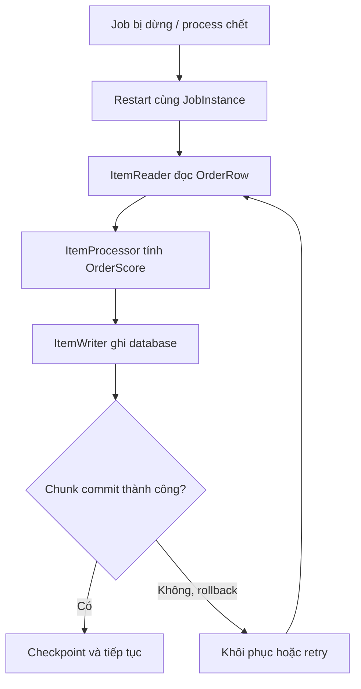

# Idempotent ItemProcessor trong Spring Batch

## 1. Vì sao ItemProcessor cần idempotent?

Hãy tưởng tượng một Spring Batch job đọc 10 triệu đơn hàng, tính điểm thưởng cho từng đơn và lưu kết quả vào PostgreSQL. Job chạy bằng **multi-threaded step** hoặc chia thành nhiều partition để đáp ứng cửa sổ xử lý đêm. Trong lúc chạy, một lần ghi có thể timeout, một chunk có thể rollback, hoặc máy chạy job có thể dừng trước khi trạng thái được checkpoint. Khi khôi phục, framework có thể **đưa một item qua `ItemProcessor` thêm lần nữa**.

Nếu lần gọi thứ hai trừ tiền, cộng điểm vào biến dùng chung, ghi log nghiệp vụ hoặc gọi API thanh toán thêm lần nữa, kết quả sẽ sai dù Spring Batch đã restart đúng cơ chế.

Mục tiêu bài học:

- Hiểu chính xác ý nghĩa của **idempotent `ItemProcessor`** trong luồng chunk, retry và restart của Spring Batch.
- Viết processor **thuần, ổn định theo đầu vào, không giữ trạng thái thay đổi theo item** để có thể gọi lại an toàn.
- Nhận diện giới hạn của idempotency ở processor: chỉ dùng processor tốt vẫn **chưa đủ** để chống ghi trùng ở writer, database hoặc hệ thống bên ngoài.
- Thiết kế khóa nghiệp vụ, unique constraint, UPSERT, retry và checkpoint phù hợp khi tăng concurrency qua multi-threading, parallel steps, partitioning hoặc remote processing.
- Xây dựng phép thử và chỉ số vận hành để phát hiện tác dụng phụ bị lặp, dữ liệu lệch và nút thắt tài nguyên.

> **Phạm vi:** bài thuộc chương **Idempotency** của module `SPRING_BATCH_SCALING_OPERATIONS`, tập trung vào **Idempotent ItemProcessor**. Ví dụ Java minh họa Spring Batch 5.x, Java 17+, PostgreSQL; các nguyên tắc áp dụng rộng hơn nhưng API hoặc cú pháp SQL cần điều chỉnh theo phiên bản/hệ quản trị dữ liệu.

## 2. Hiểu đúng từ “idempotent” trong ItemProcessor

Về mặt toán học, một phép biến đổi cùng kiểu `f` được gọi là idempotent khi `f(f(x)) = f(x)`. Tuy nhiên, trong Spring Batch, `ItemProcessor<I, O>` thường chuyển từ kiểu **đầu vào `I`** sang kiểu **đầu ra `O`**, nên biểu thức `f(f(x))` có thể **không có nghĩa về kiểu dữ liệu**.

Trong ngữ cảnh xử lý batch, yêu cầu thực dụng là: **cùng một item đầu vào và cùng phiên bản quy tắc xử lý, gọi `process(item)` nhiều lần phải tạo cùng kết quả nghiệp vụ, không tạo thêm tác dụng phụ không mong muốn**.

Một cách thiết kế mạnh hơn là **pure transformation** (phép biến đổi thuần):

1. Kết quả chỉ phụ thuộc đầu vào và các tham số nghiệp vụ đã được cố định cho lần chạy (ví dụ `ruleVersion`).
2. Không sửa trực tiếp đối tượng đầu vào; tạo kết quả mới khi có thể.
3. Không cập nhật cơ sở dữ liệu, gửi message, gọi API có hiệu ứng ghi, hoặc tăng bộ đếm nghiệp vụ trong `process`.
4. Không dựa vào thời gian hiện tại, random không seed, dữ liệu mutable toàn cục hoặc thứ tự thực thi giữa các thread.

| Đoạn xử lý | Có an toàn khi xử lý lại cùng item? | Lý do |
| --- | --- | --- |
| Tính `points = amountCents / 100` từ dữ liệu bất biến | **Có**, nếu quy tắc không đổi | Kết quả xác định, không có tác dụng phụ |
| `item.setAmount(item.amount * 0.9)` trên chính object đầu vào | **Không bảo đảm** | Nếu object bị truyền lại, giá trị có thể giảm thêm lần nữa |
| `total += item.amount()` trong trường của singleton processor | **Không** | Gọi lại cộng nhiều lần; nhiều thread còn gây race condition |
| `repository.save(...)` trong `process` | **Không tự bảo đảm** | Ghi dữ liệu có thể xảy ra trước khi chunk rollback/retry |
| `return null` khi một quy tắc lọc bất biến đúng | **Có**, ở mức quyết định lọc | Cùng item và cùng rule luôn bị lọc; `null` có nghĩa **filter item**, không phải lỗi |
| Lấy `Instant.now()` cho mỗi lần tính hạn | **Không ổn định** | Cùng item ở lần retry/restart có thể cho kết quả khác |

**Chốt ranh giới:** processor thuần bảo đảm *tính lại ra cùng dữ liệu*; writer idempotent bảo đảm *ghi lại không làm sai trạng thái đích*; một giao dịch và thiết kế restart tốt bảo đảm *tiến độ được khôi phục nhất quán trong giới hạn tài nguyên tham gia*. Không đồng nhất ba bảo đảm này với lời hứa “exactly once” cho toàn hệ thống.

## 3. Khi nào một item có thể bị xử lý lại?



Sơ đồ biểu diễn **khả năng tính lại item**, không cam kết mọi rollback đều đọc lại từ nguồn đúng cùng cách. Với Spring Batch, buffering item, reader có tham gia transaction hay không, fault-tolerant step, retry policy và `ItemStream` checkpoint quyết định cơ chế cụ thể. **Không nên giả định `process` chỉ chạy đúng một lần cho mỗi business ID**.

Trong môi trường mở rộng, xác suất gặp việc xử lý lại còn tăng khi:

- **Multi-threaded step:** nhiều chunk/worker có thể chạy đồng thời; thứ tự xử lý không còn như một Step tuần tự. Processor dùng chung phải an toàn khi bị gọi từ nhiều thread.
- **Partitioning:** mỗi partition có `StepExecution` và `ExecutionContext` riêng. Một partition lỗi có thể được khởi động lại trong khi các partition khác đã commit; không có transaction bao trùm tất cả partition.
- **Parallel steps:** các Step khác nhau có thể cùng chạm vào một khóa nghiệp vụ nếu ranh giới dữ liệu không được thiết kế rõ.
- **Remote partitioning / remote chunking:** lỗi mạng, timeout, gửi lại message hoặc worker chết có thể dẫn đến **at-least-once delivery** tùy tích hợp và hạ tầng; phải thiết kế chống lặp ở biên nghiệp vụ.

### Điểm dễ nhầm về retry và restart

**Retry** là thử lại thao tác trong một lần chạy khi có lỗi được cấu hình có thể phục hồi; **restart** là khởi động tiếp một `JobInstance` chưa hoàn tất, dựa vào metadata và checkpoint trong `JobRepository`. Cả hai đều có thể khiến dữ liệu được tính lại. Tạo `JobParameters` định danh mới thường tạo **JobInstance mới**, không phải “resume” đúng bản chạy cũ.

Trong một số cấu hình fault-tolerant chunk, Spring Batch có thể **cache kết quả processor** khi rollback để giảm số lần tính lại. Đây là chi tiết tối ưu của cách vận hành, không phải hợp đồng cho phép processor có side effect. Tính đúng đắn phải chịu được việc framework thực sự gọi lại `process`.

## 4. Anti-pattern: sửa đầu vào và giữ mutable state

```java
// Ví dụ SAI: có thể cộng dồn giảm giá và đếm lại trên retry.
public class UnsafeDiscountProcessor implements ItemProcessor<Order, Order> {
    private long totalDiscounted; // shared mutable state trong singleton

    @Override
    public Order process(Order order) {
        order.setNetAmount(
            order.getNetAmount().multiply(new BigDecimal("0.90"))
        );
        totalDiscounted++; // không thread-safe, không restart-safe
        return order;       // trả về chính object đã bị sửa
    }
}
```

Với đơn hàng ban đầu có `netAmount = 100`, lần gọi đầu cho `90`, lần gọi lại trên **cùng object** cho `81`. Trên nhiều thread, `totalDiscounted++` còn có thể mất cập nhật; nếu job restart sau khi process chết, biến đó lại trở về giá trị đầu. Kể cả đồng bộ hóa phép cộng bằng `AtomicLong`, bộ đếm vẫn sai về nghiệp vụ khi cùng item được xử lý lại nhiều lần.

Hướng sửa là đọc giá trị gốc bất biến (`grossAmount`, `amountCents`, snapshot...), tạo output mới và chỉ tổng hợp số liệu có ý nghĩa tại writer/bảng đích hoặc qua hệ thống đo lường có ngữ nghĩa rõ ràng.

## 5. Ví dụ ItemProcessor thuần: tính điểm từ số tiền gốc

Giả sử một bản ghi nguồn có `orderId`, `sourceVersion` và số tiền tính bằng **xu** (`amountCents`, không dùng `double`). Quy tắc `v1`: cứ 100 xu được một điểm, làm tròn xuống. Cùng một phiên bản đơn và cùng phiên bản quy tắc phải cho ra cùng số điểm.

```java
import java.util.Objects;
import org.springframework.batch.item.ItemProcessor;

// Có thể đặt các record package-private cùng file với class bên dưới.
record OrderRow(long orderId, long sourceVersion, long amountCents) {}

record OrderScore(
        long orderId,
        long sourceVersion,
        String ruleVersion,
        long points) {}

public final class OrderScoreProcessor
        implements ItemProcessor<OrderRow, OrderScore> {

    private final String ruleVersion;

    public OrderScoreProcessor(String ruleVersion) {
        this.ruleVersion = Objects.requireNonNull(ruleVersion);
        if (!"v1".equals(ruleVersion)) {
            throw new IllegalArgumentException("Unsupported ruleVersion: " + ruleVersion);
        }
    }

    @Override
    public OrderScore process(OrderRow item) {
        if (item.orderId() <= 0
                || item.sourceVersion() < 1
                || item.amountCents() < 0) {
            throw new IllegalArgumentException("Invalid order data: " + item.orderId());
        }

        // Tính từ số tiền GỐC: không sửa item, không dùng trạng thái chung.
        long points = item.amountCents() / 100L;
        return new OrderScore(
                item.orderId(), item.sourceVersion(), ruleVersion, points);
    }
}
```

Với `OrderRow(42, 3, 12345)`, mọi lần gọi cùng `ruleVersion = "v1"` đều cho `OrderScore(42, 3, "v1", 123)`. Không cần lock; `OrderScoreProcessor` chỉ chứa một `String` `final`, nên có thể chia sẻ khi xử lý song song. `record` tạo các carrier dữ liệu bất biến ở mức tham chiếu và cung cấp `equals/hashCode`, giúp đối chiếu kết quả dễ hơn.

Ví dụ quy tắc `v1` được **khóa cố định**. Khi thay đổi thuật toán điểm thưởng, hãy định nghĩa `v2` với logic riêng và xác định lại khóa lưu trữ; đừng giữ nhãn `v1` nhưng thay đổi kết quả. Khi đọc từ nguồn có thể cập nhật, cần xác định `sourceVersion` thực sự phản ánh phiên bản nghiệp vụ; không lấy `JobExecutionId` làm khóa của đơn hàng.

### Gắn tham số quy tắc vào Step

Nếu mỗi lần chạy chọn một phiên bản rule thông qua `JobParameters`, có thể late-bind nó trong Step scope:

```java
@Bean
@StepScope
public ItemProcessor<OrderRow, OrderScore> orderScoreProcessor(
        @Value("#{jobParameters['ruleVersion']}") String ruleVersion) {
    return new OrderScoreProcessor(ruleVersion);
}
```

Các import tương ứng: `org.springframework.context.annotation.Bean`, `org.springframework.batch.core.configuration.annotation.StepScope`, `org.springframework.beans.factory.annotation.Value`. Tham số `ruleVersion` phải được cung cấp và giữ ổn định cho việc restart **cùng JobInstance**. Đối với rule thay đổi theo ngày, nên truyền ngày chốt dữ liệu hoặc phiên bản bảng quy tắc làm tham số xác định, thay vì tự gọi ngày hiện tại trong `process`.

**`@StepScope` không tự động biến logic không an toàn thành thread-safe.** Nó tạo instance theo `StepExecution`, rất hữu ích khi cần binding ngữ cảnh partition. Trong multi-threaded step, một `StepExecution` vẫn có thể được nhiều thread xử lý, nên vẫn phải tránh mutable state cạnh tranh. Với processor hoàn toàn thuần, có thể dùng singleton nếu không cần step/job parameters.

## 6. Processor thuần vẫn cần writer idempotent

Giả sử writer nhận cùng `OrderScore` hai lần (vì retry, restart hoặc chạy lại job). Nếu writer dùng:

```sql
UPDATE accounts
SET total_points = total_points + :points
WHERE account_id = :accountId;
```

thì điểm có thể bị cộng **hai lần**, dù `OrderScoreProcessor` trả ra kết quả hoàn toàn giống nhau. Muốn kết quả đích an toàn, hãy xác định **business identity** của một lần tính điểm. Ví dụ: một hàng kết quả ứng với bộ `(order_id, source_version, rule_version)`.

### Schema và INSERT chống trùng (PostgreSQL)

```sql
CREATE TABLE order_scores (
    order_id        BIGINT NOT NULL,
    source_version  BIGINT NOT NULL,
    rule_version    VARCHAR(32) NOT NULL,
    points          BIGINT NOT NULL,
    PRIMARY KEY (order_id, source_version, rule_version)
);

-- Lần ghi đầu thành công, lần ghi lại đúng khóa không thêm hàng mới.
INSERT INTO order_scores (order_id, source_version, rule_version, points)
VALUES (42, 3, 'v1', 123)
ON CONFLICT (order_id, source_version, rule_version) DO NOTHING;
```

`PRIMARY KEY` là hàng rào chống trùng **có hiệu lực cả khi nhiều partition/node ghi đồng thời**. Kiểm tra tồn tại bằng `SELECT` rồi mới `INSERT` là không đủ an toàn vì hai worker có thể cùng đọc “chưa tồn tại” trước khi cùng ghi; cần ràng buộc duy nhất và thao tác atomic ở DB.

### Writer Spring Batch tương ứng

```java
@Bean
public JdbcBatchItemWriter<OrderScore> orderScoreWriter(DataSource dataSource) {
    return new JdbcBatchItemWriterBuilder<OrderScore>()
        .dataSource(dataSource)
        .sql("""
            INSERT INTO order_scores
                (order_id, source_version, rule_version, points)
            VALUES (?, ?, ?, ?)
            ON CONFLICT (order_id, source_version, rule_version)
            DO NOTHING
            """)
        .itemPreparedStatementSetter((item, ps) -> {
            ps.setLong(1, item.orderId());
            ps.setLong(2, item.sourceVersion());
            ps.setString(3, item.ruleVersion());
            ps.setLong(4, item.points());
        })
        .assertUpdates(false)
        .build();
}
```

Các import chính: `javax.sql.DataSource`, `org.springframework.batch.item.database.JdbcBatchItemWriter`, `org.springframework.batch.item.database.builder.JdbcBatchItemWriterBuilder`, `org.springframework.context.annotation.Bean`.

`assertUpdates(false)` **có chủ đích trong ví dụ này**: duplicate hợp lệ có thể làm `INSERT ... DO NOTHING` trả về 0 hàng bị ảnh hưởng. Nếu nghiệp vụ yêu cầu mỗi item bắt buộc thêm/cập nhật đúng một hàng, không nên tắt kiểm tra số hàng cập nhật. Với writer kiểu trên, `writeCount` của Spring Batch phản ánh item được chuyển đến writer; **không đồng nghĩa** số hàng mới thực sự được thêm vào bảng.

**Cảnh báo về xung đột dữ liệu:** `DO NOTHING` sẽ bỏ qua cả trường hợp **cùng khóa nhưng `points` khác nhau**. Điều đó che giấu lỗi không thuần, thay đổi đầu vào mà không tăng `sourceVersion`, hoặc đổi rule nhưng không tăng `ruleVersion`. Trong hệ thống yêu cầu kiểm toán, hãy giám sát/audit so sánh kết quả với bản ghi đã có, hoặc dùng chiến lược `ON CONFLICT` chỉ cho phép cập nhật theo điều kiện phiên bản nghiệp vụ đã xác định. Không dùng `DO NOTHING` để hợp thức hóa dữ liệu bất nhất.

### Trường hợp cộng vào số dư: cần ledger hoặc transaction idempotent

Nếu đích là **tổng điểm của một tài khoản**, đơn giản `UPDATE balance = balance + points` không idempotent. Một thiết kế thực dụng là lưu **ledger** với unique key theo sự kiện nghiệp vụ, sau đó chỉ cộng số dư khi việc tạo ledger row **thực sự thành công**, và thực hiện cả hai trong cùng một transaction DB. Hoặc tính lại số dư từ các ledger row duy nhất. Nếu số dư và ledger ở các hệ thống khác nhau, cần cơ chế đảm bảo nhất quán riêng; không thể tự suy ra giao dịch xuyên hệ thống từ một processor thuần.

## 7. Vì sao gọi API, gửi message trong process rất rủi ro?

```java
// Tránh đặt side effect không an toàn trong ItemProcessor.
public PaymentResult process(PaymentRequest request) {
    paymentGateway.charge(request); // gọi thành công nhưng chunk có thể rollback
    return new PaymentResult(request.id());
}
```

Giả sử API đã trừ tiền, nhưng sau đó DB commit hoặc metadata checkpoint bị lỗi. Khi restart, `process` có thể gọi `charge` lần nữa. Transaction cục bộ của Spring Batch **không tự hoàn tác** một request HTTP đã thành công.

Các giải pháp cần lựa chọn theo đặc tính hệ thống:

| Phương án | Sử dụng khi nào | Điều cần nhớ |
| --- | --- | --- |
| `Idempotency-Key` do API đích hỗ trợ | API thanh toán/đặt hàng có hợp đồng dedupe | Khóa phải lấy từ business identity, ổn định khi retry; tìm hiểu thời hạn lưu khóa |
| Unique constraint + trạng thái nghiệp vụ tại DB | Ghi vào cùng một database transactional | Phải thiết kế trạng thái/transaction để concurrent worker không xử lý cùng sự kiện |
| Transactional outbox | Cần phát sự kiện ra broker sau khi ghi DB | Ghi business row + outbox trong một DB transaction; consumer cũng phải xử lý message lặp |
| Inbox/deduplication ở consumer | Broker có thể gửi message lại | Unique key sự kiện và cập nhật kết quả trong cùng đơn vị transaction phù hợp |

Đối với side effect ngoại hệ thống, chỉ “ghi cờ đã gửi” **trước** hoặc **sau** lời gọi API đều có cửa sổ lỗi: ghi trước rồi chết có thể bỏ sót, gọi trước rồi chết có thể lặp. Giao thức idempotency từ hệ thống nhận, transactional outbox/inbox hoặc state machine có reconciliation thường cần thiết để có ngữ nghĩa an toàn. Không nên dùng `synchronized`, `@StepScope` hay bộ nhớ cache cục bộ như biện pháp chống ghi trùng xuyên process/node.

## 8. Lọc item, lỗi nghiệp vụ và quy tắc không xác định

`ItemProcessor.process` có thể trả về `null` để **lọc** item khỏi writer. Quyết định lọc nên ổn định theo dữ liệu đầu vào và rule đã chốt:

```java
@Override
public OrderScore process(OrderRow item) {
    if (item.amountCents() == 0) {
        return null; // filter theo điều kiện cố định
    }
    return new OrderScore(
        item.orderId(), item.sourceVersion(), "v1", item.amountCents() / 100);
}
```

Đoạn trên chỉ minh họa hành vi filter; có thể thay logic lọc theo nghiệp vụ. **`null` không phải cách báo lỗi.** Với dữ liệu sai cấu trúc hoặc vi phạm invariant, hãy ném exception rõ nghĩa và quyết định fail/skip/quarantine theo chính sách của Step. Khi dùng skip, cần ghi nhận bản ghi lỗi và cơ chế đối soát; không để skip im lặng che mất dữ liệu.

Các nguồn gây **không ổn định** thường bị bỏ sót:

- **Thời gian:** `now()`, ngày hệ thống, múi giờ hoặc lịch làm việc thay đổi giữa lần retry và restart.
- **Random/UUID:** tạo ID mới mỗi lần chạy `process` sẽ khiến unique key không còn chống trùng.
- **Tra cứu dữ liệu sống:** tỷ giá, bảng phân hạng, cấu hình feature flag hoặc thông tin khách hàng thay đổi giữa các lần chạy.
- **Mutable state:** cache nội bộ có thể bị sửa bởi một thread khác, kể cả khi dùng `ConcurrentHashMap`.
- **Cách làm tròn:** công thức tính tiền thay đổi, sai khác về precision/rounding, kiểu `double` hoặc định dạng locale.

Giải pháp thường là snapshot/phiên bản hóa các dependency nghiệp vụ, lấy thời điểm hiệu lực từ job parameters, dùng `BigDecimal` với rounding mode tường minh cho phép tính tiền, và đưa **phiên bản rule** vào identity của kết quả khi thích hợp.

## 9. Kết hợp ItemProcessor với chunk, retry và partitioning

Một cấu hình chunk step cơ bản có thể trông như sau (giả định reader đã được khai báo riêng và quản lý checkpoint đúng cách):

```java
@Bean
public Step scoreOrdersStep(
        JobRepository jobRepository,
        PlatformTransactionManager transactionManager,
        ItemReader<OrderRow> orderReader,
        ItemProcessor<OrderRow, OrderScore> orderScoreProcessor,
        ItemWriter<OrderScore> orderScoreWriter) {
    return new StepBuilder("scoreOrders", jobRepository)
        .<OrderRow, OrderScore>chunk(500, transactionManager)
        .reader(orderReader)
        .processor(orderScoreProcessor)
        .writer(orderScoreWriter)
        .faultTolerant()
        .retry(TransientDataAccessException.class)
        .retryLimit(3)
        .build();
}
```

Các import liên quan: `org.springframework.batch.core.Step`, `org.springframework.batch.core.repository.JobRepository`, `org.springframework.batch.core.step.builder.StepBuilder`, `org.springframework.batch.item.ItemReader`, `org.springframework.batch.item.ItemProcessor`, `org.springframework.batch.item.ItemWriter`, `org.springframework.transaction.PlatformTransactionManager`, `org.springframework.dao.TransientDataAccessException`.

Ví dụ chỉ retry **lỗi truy cập dữ liệu tạm thời**; không retry tùy tiện lỗi validate, tính toán sai hay ràng buộc nghiệp vụ. `retryLimit(3)` giới hạn **số lần thử tổng cộng trong retry context** theo cấu hình, không phải bảo đảm ba lần gọi lại bổ sung sau lần đầu. Thực tế cần xác định timeout, backoff, transaction và nguyên nhân gây lỗi trước khi tăng số lần retry.

### Các lớp bảo đảm phải phối hợp

| Lớp | Câu hỏi cần trả lời | Cơ chế ví dụ |
| --- | --- | --- |
| **Reader** | Đọc lại có đúng danh sách item cần thiết? | `ItemStream` checkpoint, sort key ổn định, nguồn snapshot |
| **Processor** | Gọi lại hoặc chạy song song có đổi kết quả không? | Pure function, immutable input/output, versioned rules |
| **Writer** | Ghi hai lần cùng business event có thay đổi sai đích không? | Unique key, UPSERT, ledger, transaction |
| **Step / JobRepository** | Khôi phục đúng tiến độ chunk/partition sau lỗi không? | Metadata bền vững, restart cùng JobInstance, `ExecutionContext` |
| **External system** | Side effect qua HTTP/message có chống lặp được không? | API idempotency key, outbox/inbox, reconciliation |

**Multi-threaded Step:** một processor singleton thuần như `OrderScoreProcessor` có thể được gọi từ nhiều thread an toàn, nhưng reader/writer và listener vẫn cần đánh giá riêng. `@StepScope` chỉ cô lập theo `StepExecution`, không có nghĩa “mỗi thread một instance”. Chia nhỏ mutable object đầu vào cho nhiều thread hoặc để processor giữ bộ đếm dùng chung vẫn nguy hiểm.

**Partitioning:** gán cho từng partition khoảng ID/file/shard không chồng lấn, dùng `ExecutionContext` để truyền biên. Mỗi partition là một worker `StepExecution` có retry/checkpoint riêng. Processor thuần hỗ trợ xử lý lại một partition mà không làm lệch phép tính; unique key ở writer là lớp bảo vệ quan trọng nếu hai partition vô tình cùng ghi một ID.

**Parallel flows:** hai Step chạy song song nhưng cùng cập nhật một `account_balance` có thể xung đột dù processor của từng Step thuần. Cần ownership dữ liệu, khóa/transaction và định nghĩa tổng hợp đầu ra; idempotency không thay thế concurrency control.

**Remote workers:** có thể gửi lại yêu cầu khi timeout vì manager không biết worker đã hoàn thành hay chưa. Khóa chống trùng phải có ý nghĩa **liên node và liên lần chạy**, lưu ở hệ thống có tính nhất quán phù hợp (thường là DB), không chỉ trong bộ nhớ worker.

## 10. Kế hoạch thử nghiệm idempotency thực tế

Chỉ unit test `process(x).equals(process(x))` chưa đủ chứng minh toàn bộ pipeline an toàn. Nên kiểm tra theo từng lớp với bộ dữ liệu nhỏ có ID và version rõ ràng.

| Kịch bản | Cách kích hoạt | Kỳ vọng |
| --- | --- | --- |
| Gọi processor lặp lại | `process` cùng `OrderRow` 2–10 lần | Cùng `OrderScore`, không sửa đầu vào, không phát side effect |
| Song song trên cùng input | Gọi processor từ nhiều thread | Mọi kết quả giống nhau, không race hoặc shared-state contamination |
| Ghi trùng cùng business key | Writer ghi cùng `OrderScore` hai lần | Đích chỉ có một row tương ứng; theo dõi số row thực tế |
| Cùng khóa nhưng nội dung khác | Cố tình ghi điểm khác cho cùng `(orderId, sourceVersion, ruleVersion)` | Phát hiện bằng audit/invariant, không âm thầm chấp nhận dữ liệu lệch |
| Lỗi writer giữa chunk | Inject lỗi DB trước commit, retry/restart | Không có điểm cộng hai lần; số hàng nghiệp vụ đúng |
| Crash sau side effect ngoài DB | Giả lập API thành công rồi worker chết trước checkpoint | API/key/outbox cho kết quả duy nhất hoặc có tiến trình reconciliation |
| Restart một partition lỗi | Cho một partition FAILED trong khi partition khác COMPLETED | Chỉ phần cần làm lại được chạy; dữ liệu đích không lặp |
| Tăng concurrency | Thử 1 → 2 → 4 → 8 worker với cùng bộ dữ liệu | Kết quả giống nhau; đo throughput, DB lock, connection usage |

Một unit test tối thiểu cho processor thuần:

```java
@Test
void sameInputAndRuleYieldTheSameOutput() throws Exception {
    var processor = new OrderScoreProcessor("v1");
    var input = new OrderRow(42L, 3L, 12_345L);

    var first = processor.process(input);
    var second = processor.process(input);

    assertEquals(new OrderScore(42L, 3L, "v1", 123L), first);
    assertEquals(first, second);
    assertEquals(12_345L, input.amountCents());
}
```

Test dùng JUnit Jupiter (`org.junit.jupiter.api.Test`, `org.junit.jupiter.api.Assertions.assertEquals`). Test này chỉ chứng minh tính xác định của ví dụ Java; các khẳng định về DB, restart và concurrent workers cần **integration test** với database/JobRepository thực và fault injection hợp lý.

### Quan sát khi vận hành

- Theo dõi `JobExecutionId`, `StepExecutionId`, partition, retry/rollback/skip count, throughput, latency xử lý và số lỗi theo business key.
- Đối chiếu **số item đọc, số item lọc, số item được gửi đến writer, số row thực sự tạo/cập nhật**. Các số đếm này có thể khác nhau do filter, skip và duplicate hợp lệ.
- Ghi metric `duplicate_suppressed`, `conflict_payload_mismatch` và `idempotency_key_reuse` tại writer hoặc dịch vụ đích; tránh log payload nhạy cảm.
- Khi tăng số worker, đo CPU, DB pool, lock wait, I/O và hạn mức downstream. Đừng mở concurrency chỉ vì processor không giữ trạng thái: writer/database mới có thể là nút thắt.
- Định kỳ đối soát theo bộ `(orderId, sourceVersion, ruleVersion)` giữa snapshot nguồn và bảng đích, đồng thời xác minh không có hai kết quả cho cùng khóa nghiệp vụ.

## 11. Tình huống suy luận

**Tình huống A — Tính lại kết quả theo ngày.** Một processor gọi `LocalDate.now()` để chọn bảng tỷ giá. Job lỗi lúc 23:59 và restart lúc 00:05. Cùng một giao dịch có thể được quy đổi theo hai tỷ giá khác nhau. Hãy sửa thiết kế để dùng `effectiveDate` và `rateTableVersion` được cố định trong lần chạy, sau đó chọn khóa chống trùng tương ứng.

**Tình huống B — Bốn partition cộng điểm vào tài khoản.** Mỗi partition có `OrderScoreProcessor` thuần, nhưng writer chạy `UPDATE accounts SET points = points + :points`. Một partition bị restart và cập nhật một số đơn lần nữa. Hãy thiết kế bảng ledger có unique key theo đơn hàng/phiên bản, nêu nơi cần transaction và giải thích tại sao khóa partition không đủ để bảo đảm tính đúng đắn của số dư.

**Tình huống C — Worker remote timeout.** Worker A gửi thành công yêu cầu tạo đơn trên API đích, nhưng message xác nhận về manager bị mất. Manager giao lại công việc cho worker B. Hãy mô tả `Idempotency-Key` ổn định, cách hệ thống đích ghi nhận yêu cầu và phương án kiểm tra/truy vết khi kết quả trả về không rõ ràng.

## 12. Ghi nhớ

Một `ItemProcessor` idempotent trong Spring Batch nên được thiết kế như **phép biến đổi thuần**: với cùng đầu vào và phiên bản quy tắc, nó có thể được gọi lại hoặc gọi đồng thời mà vẫn tạo cùng kết quả, không làm phát sinh tác dụng phụ nghiệp vụ. Nhưng idempotency của **toàn pipeline** còn phụ thuộc reader/checkpoint, transaction, writer, khóa nghiệp vụ, hệ thống ngoài và khả năng restart. Mục tiêu khi scale là **nhiều worker xử lý nhanh hơn mà kết quả cuối vẫn đúng**, kể cả khi có rollback, retry, restart hoặc message được gửi lại.

**Đọc thêm (tài liệu chính thức):**

- [Spring Batch Reference Documentation](https://docs.spring.io/spring-batch/reference/)
- [Spring Batch API — `ItemProcessor`](https://docs.spring.io/spring-batch/docs/5.2.x/api/org/springframework/batch/item/ItemProcessor.html)
- [Spring Batch API — `JdbcBatchItemWriterBuilder`](https://docs.spring.io/spring-batch/docs/5.2.x/api/org/springframework/batch/item/database/builder/JdbcBatchItemWriterBuilder.html)
