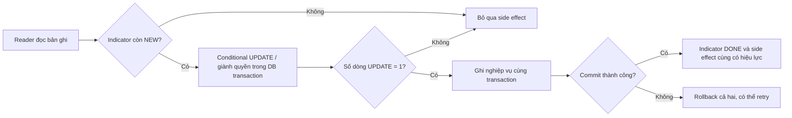
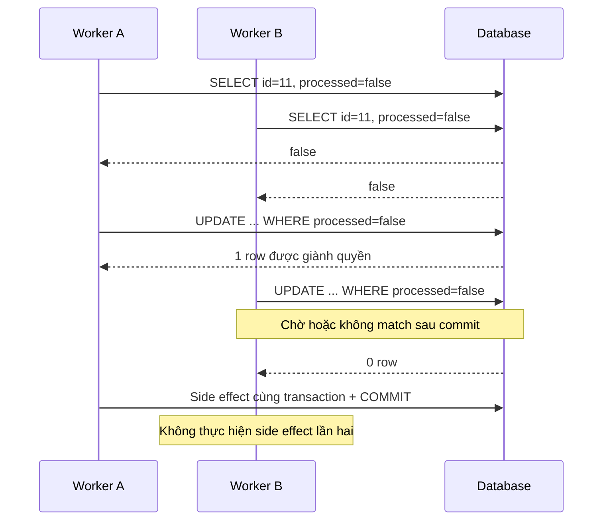

# Process indicator pattern: chống xử lý trùng khi mở rộng Spring Batch

Trong một hệ thống batch xử lý dữ liệu lớn, việc một bản ghi được **đọc hoặc xử lý nhiều lần** không phải lúc nào cũng là lỗi: retry, restart, worker crash, broker redelivery và nhiều thread có thể khiến cùng công việc xuất hiện lại. Lỗi thật sự xảy ra khi những lần thực thi đó tạo ra **side effect nghiệp vụ trùng**: cộng doanh thu hai lần, gửi hai hóa đơn hoặc ghi lặp giao dịch. **Process indicator pattern** là một kỹ thuật lưu **trạng thái xử lý ngay cùng dữ liệu công việc** để chương trình biết bản ghi nào chưa hoàn tất và có thể bỏ qua hoặc tiếp tục một cách có kiểm soát.

Bài thuộc chương **Idempotency** của module `SPRING_BATCH_SCALING_OPERATIONS`. Trong phạm vi mở rộng Spring Batch qua multi-threaded step, parallel steps, partitioning và các worker phân tán, ta sẽ phân biệt process indicator với checkpoint thông thường, xây dựng giao dịch chống trùng, xử lý cạnh tranh giữa worker, thiết kế restart sau lỗi và lựa chọn kiến trúc theo đặc tính database/broker. Ví dụ sử dụng Java/Spring Batch **5.x** và PostgreSQL; những SQL riêng của PostgreSQL sẽ được chỉ rõ.

## 1. Process indicator pattern là gì?

Một bản ghi công việc có **dấu hiệu đã xử lý** (*process indicator*) trong bảng nguồn hoặc một bảng trạng thái liên quan:

```text
incoming_invoice
+----+------------+----------+-----------+
| id | account_id | amount   | processed |
+----+------------+----------+-----------+
| 11 | 100        | 150.00   | false     |
| 12 | 100        | 80.00    | true      |
| 13 | 200        | 95.00    | false     |
+----+------------+----------+-----------+
```

Worker chỉ cần hoàn tất nghiệp vụ đối với các bản ghi `processed=false`; sau khi ghi kết quả thành công, nó chuyển `processed=true` **trong cùng transaction** với phần ghi dữ liệu mà nó cần bảo vệ. Nếu xử lý lại bản ghi đã hoàn thành, việc cập nhật cờ phải xác định được rằng công việc đã được tiếp nhận trước đó và **không áp dụng side effect thêm lần nữa**.

Pattern có hai biến thể phổ biến:

1. **Boolean indicator:** `processed=false/true`, thích hợp với nghiệp vụ chỉ có hai trạng thái cơ bản và không cần phân công worker dài hạn.
2. **Trạng thái có vòng đời:** `NEW → CLAIMED → DONE`, có `claimOwner`, `leaseUntil`, `attemptCount`, `lastError`; thích hợp khi cần nhiều worker tranh việc, khôi phục công việc bị bỏ dở và audit.

**Ý nghĩa của indicator phải rõ:** `DONE` nghĩa là **side effect nghiệp vụ được cam kết đúng cách**, không phải chỉ “đã lấy message từ queue” hoặc “đã bắt đầu gọi API”. Đánh dấu hoàn thành quá sớm sẽ làm hệ thống bỏ qua bản ghi chưa được xử lý thật.

## 2. Vì sao nó hữu ích trong workload phân tán?

Giả sử một triệu hóa đơn được xử lý trong đêm:

- Manager tạo 64 partition, mỗi partition được worker xử lý bằng các chunk.
- Worker A đã commit 100 bản ghi, nhưng crash trước khi gửi reply.
- Broker hoặc job restart khiến 100 bản ghi ấy được đọc lại.
- Worker B hoặc một thread mới nhận lại cùng việc.

Nếu business writer chỉ thực hiện `UPDATE account_total SET amount = amount + :value` thì việc lặp tạo tổng tiền sai. Nếu cùng DB lưu **indicator** và chỉ cộng sau khi “giành quyền xử lý” đúng một lần, worker B có thể thấy việc đã hoàn tất và bỏ qua.



Pattern có thể giảm sự phụ thuộc vào việc reader nhớ **vị trí cuối cùng**: trạng thái hoàn thành của công việc được lưu trong dữ liệu bền vững. Tuy nhiên, nó **không** tự giải quyết mọi vấn đề restart, concurrency hay delivery, đặc biệt khi dữ liệu và indicator nằm ở hai hệ thống khác nhau.

## 3. Ba lớp trạng thái không được đánh đồng

| Lớp | Ví dụ | Chứng minh điều gì? | Không chứng minh điều gì? |
| --- | --- | --- | --- |
| Spring Batch metadata | `JobExecution`, `StepExecution`, `ExecutionContext` | Tiến độ và checkpoint theo góc nhìn job/step | Mọi tác dụng ngoài transaction đã xảy ra đúng một lần |
| Process indicator | `incoming_invoice.processed=true` | Một business operation đã hoàn tất **theo contract thiết kế** | Broker đã gửi reply, manager đã ghi nhận step |
| Middleware delivery | Message ACK, offset commit, reply | Consumer/broker đã ghi nhận thông điệp ở tầng giao vận | DB write và API bên ngoài đã commit đúng |

Hai trạng thái “job `COMPLETED`” và “tất cả indicator đã `DONE`” cần được **đối chiếu**, không thay thế nhau. Nếu một transaction nghiệp vụ commit nhưng `JobRepository` ở database khác chưa cập nhật, job có thể xử lý lại. Indicator là lớp bảo vệ nghiệp vụ khi checkpoint và side effect không có chung atomic transaction.

## 4. Điều kiện cốt lõi: đánh dấu và ghi nghiệp vụ phải atomic

Giả sử có hai thao tác:

```text
A. Cộng 150.00 vào tổng tiền khách hàng
B. Đánh dấu hóa đơn #11 processed=true
```

Nếu A commit, B thất bại và hệ thống retry, tổng tiền có thể tăng thêm. Nếu B commit, A thất bại, worker bỏ qua hóa đơn chưa xử lý. Để indicator đại diện cho thành công, cần **A và B trong cùng transaction**, hoặc một giao thức có bảo đảm tương đương cho các hệ thống không dùng chung DB.

**Bất biến mong muốn:**

```text
processed = true  =>  nghiệp vụ đã được commit thành công
processed = false =>  nghiệp vụ chưa được xác nhận; có thể xử lý (hoặc retry)
```

Chiều ngược lại **không tuyệt đối đúng** nếu một thao tác đã phát side effect ra hệ thống bên ngoài trước khi giao dịch rollback. Ví dụ đã gửi email rồi DB rollback: `processed=false` nhưng email đã tới người nhận. Với API thanh toán, email và message publication, cần **idempotency key ở đích** hoặc transactional outbox và cơ chế phát lại phù hợp.

## 5. Schema tối thiểu: input và kết quả nghiệp vụ

Ví dụ PostgreSQL:

```sql
CREATE TABLE incoming_invoice (
    id             BIGINT PRIMARY KEY,
    account_id     BIGINT NOT NULL,
    amount         NUMERIC(18, 2) NOT NULL,
    processed      BOOLEAN NOT NULL DEFAULT FALSE,
    processed_at   TIMESTAMPTZ NULL
);

CREATE TABLE account_total (
    account_id     BIGINT PRIMARY KEY,
    total_amount   NUMERIC(18, 2) NOT NULL DEFAULT 0
);

CREATE INDEX ix_incoming_invoice_unprocessed
    ON incoming_invoice (id)
    WHERE processed = FALSE;
```

`ix_incoming_invoice_unprocessed` là **partial index của PostgreSQL**, hữu ích khi truy vấn bản ghi chưa xử lý và tỉ lệ `processed=true` rất lớn. DB khác có thể không hỗ trợ cùng cú pháp; phải lựa chọn index tương ứng với query pattern và workload thực.

Một hóa đơn có ID duy nhất là **một operation được phép tác động tổng tiền tối đa một lần**, theo ví dụ này. Nếu hóa đơn có thể được điều chỉnh, hoàn tiền hoặc có nhiều nghiệp vụ độc lập, không dùng đơn giản một cờ `processed` chung cho mọi operation; cần trạng thái hoặc idempotency key theo **loại operation và phiên bản nghiệp vụ**.

## 6. SQL chống xử lý lặp bằng conditional UPDATE

Mô hình quan trọng nhất là **không kiểm tra `processed` và ghi dữ liệu bằng hai giao dịch rời nhau**. Đặt điều kiện ngay trong câu `UPDATE`:

```sql
BEGIN;

UPDATE incoming_invoice
   SET processed = TRUE,
       processed_at = CURRENT_TIMESTAMP
 WHERE id = :invoiceId
   AND processed = FALSE;

-- Chỉ khi UPDATE trả đúng 1 row:
UPDATE account_total
   SET total_amount = total_amount + :amount
 WHERE account_id = :accountId;

COMMIT;
```

Đây là **sơ đồ SQL điều khiển luồng**: code ứng dụng phải kiểm tra số row được update và chỉ chạy câu sau khi được `1`. Nếu trả `0`, có thể bản ghi đã được xử lý, không tồn tại hoặc đã bị worker khác nhận; phải phân loại theo yêu cầu vận hành.

### Vì sao đánh dấu trước rồi mới cộng?

Trong **cùng transaction database**, bản ghi `incoming_invoice` được cập nhật sẽ bị khóa theo cơ chế DB. Nếu hai worker cùng xử lý ID 11, chỉ một worker có thể chuyển điều kiện `processed=false` sang `true` và tiếp tục side effect sau khi kiểm tra affected rows. Worker thứ hai chờ hoặc không còn match điều kiện; nó không được cộng thêm lần nữa.

Nếu phần cộng tiền hoặc commit thất bại, transaction rollback cả `processed=true` lẫn số tiền đã cộng. **Đánh dấu trước ở trong transaction không phải đánh dấu hoàn thành sớm**, vì không có gì được commit ra ngoài trước khi toàn bộ transaction thành công.

Ngược lại, nếu viết:

```sql
SELECT processed FROM incoming_invoice WHERE id = :invoiceId;
-- Hai worker cùng đọc FALSE.
UPDATE account_total SET total_amount = total_amount + :amount
WHERE account_id = :accountId;
UPDATE incoming_invoice SET processed = TRUE WHERE id = :invoiceId;
```

mà không bảo vệ điều kiện/khóa trong một transaction thích hợp, có **check-then-act race**: hai worker cùng thấy `false` rồi cùng cộng tiền.

**Phạm vi bảo đảm:** hai bảng phải tham gia **cùng database transaction** do một transaction manager điều phối. Nếu indicator ở DB A nhưng business write ở DB B hoặc API ngoài, kỹ thuật này **không tự tạo atomicity xuyên hệ thống**.

## 7. Cấu hình Spring Batch 5.x: writer có indicator gate

Ví dụ sau cố tình đặt **business update và indicator update trong cùng `ItemWriter`**. Spring Batch chunk-oriented step sẽ gọi writer bên trong transaction được cấu hình qua `PlatformTransactionManager`.

Định nghĩa DTO:

```java
import java.math.BigDecimal;

public record InvoiceWork(
        long id,
        long accountId,
        BigDecimal amount,
        boolean processed) {}
```

Writer Spring Batch 5.x:

```java
import org.springframework.batch.item.ItemWriter;
import org.springframework.context.annotation.Bean;
import org.springframework.context.annotation.Configuration;
import org.springframework.jdbc.core.JdbcTemplate;

@Configuration
class InvoiceBusinessWriterConfiguration {

    @Bean
    ItemWriter<InvoiceWork> invoiceWriter(JdbcTemplate jdbcTemplate) {
        return chunk -> {
            for (InvoiceWork item : chunk) {
                int acquired = jdbcTemplate.update(
                        """
                        UPDATE incoming_invoice
                           SET processed = TRUE,
                               processed_at = CURRENT_TIMESTAMP
                         WHERE id = ?
                           AND processed = FALSE
                        """,
                        item.id());

                if (acquired == 0) {
                    // Đã hoàn tất hoặc không còn hợp lệ; không cộng tiền.
                    // Nếu nghiệp vụ yêu cầu, đọc lại trạng thái và phân loại.
                    continue;
                }
                if (acquired != 1) {
                    throw new IllegalStateException("Indicator UPDATE không duy nhất");
                }

                int updated = jdbcTemplate.update(
                        """
                        UPDATE account_total
                           SET total_amount = total_amount + ?
                         WHERE account_id = ?
                        """,
                        item.amount(), item.accountId());

                if (updated != 1) {
                    throw new IllegalStateException(
                            "Không thể cập nhật account " + item.accountId());
                }
            }
        };
    }
}
```

**Điều kiện để ví dụ đúng:**

1. `JdbcTemplate` trỏ tới **cùng DataSource** được transaction manager của worker step quản lý; cả hai câu `UPDATE` tham gia **cùng transaction chunk**.
2. `account_total` có dòng sẵn cho mỗi `account_id`; nếu thiếu, ném exception để rollback indicator và các business writes trong chunk. Nếu cần tự tạo account, thiết kế `INSERT ... ON CONFLICT` đúng khóa unique.
3. Một hóa đơn tương ứng **đúng một lần cộng** vào `account_total`. Nếu có luồng khác chỉnh invoice/amount, phải có snapshot hoặc versioning.
4. `UPDATE processed` không được commit độc lập trước `UPDATE account_total`; không dùng `REQUIRES_NEW`, autocommit rời rạc hoặc hai DataSource không cùng transaction.
5. Nếu `acquired=0` do ID không tồn tại hay sai trạng thái, production có thể cần **báo lỗi** thay vì `continue`. Ví dụ chọn “bỏ qua đã được xử lý” cho mục đích giải thích.

**Đặc điểm đáng chú ý:** kết quả `WRITE_COUNT` của Spring Batch có thể tính số item đi vào writer theo cơ chế framework, **không đồng nghĩa số dòng thực sự cộng vào `account_total`** nếu writer chủ động bỏ qua duplicate. Hãy theo dõi thêm `businessOperationsApplied` và các counter deduplication do ứng dụng định nghĩa.

## 8. Reader phải tránh lỗi “bỏ sót” do tự thay đổi tập dữ liệu

Một cấu hình **dễ sai** là dùng `JdbcPagingItemReader` lọc `processed = FALSE`, đồng thời writer đổi nó thành `TRUE`. Vì paging reader có cơ chế chia trang, tập kết quả bị rút nhỏ sau từng chunk có thể khiến reader **nhảy qua** những bản ghi chưa xử lý.

Ví dụ minh họa với **offset paging**:

```text
Ban đầu chưa xử lý: 1, 2, 3, 4, 5, 6
Page size = 2

Lần đọc 1: OFFSET 0 -> 1, 2
Writer đánh dấu 1,2 = TRUE
Tập chưa xử lý bây giờ: 3,4,5,6

Lần đọc 2: OFFSET 2 -> 5,6
Kết quả: 3,4 bị bỏ sót!
```

Không khẳng định **mọi implementation database paging** đều luôn dùng `OFFSET` theo ví dụ; nhiều reader tối ưu bằng sort key hoặc keyset. Nhưng **lọc theo cột mà writer đang thay đổi là một rủi ro về tính ổn định của tập dữ liệu**, đặc biệt khi restart hoặc có nhiều worker. Không chọn `WHERE processed=FALSE` + paging chỉ vì câu SQL có vẻ đơn giản; phải kiểm tra chính xác SQL reader sinh ra và thử nghiệm với commit giữa các trang.

### 8.1. Cách an toàn để bắt đầu: đọc tập khóa ổn định

Một phương án đơn giản để giảng dạy là:

1. Reader lấy dữ liệu theo **dải primary key đã cố định**, không lọc cột `processed`.
2. Writer dùng `UPDATE ... WHERE processed=FALSE` để quyết định có áp dụng side effect.
3. Mỗi partition chỉ quản lý một dải khóa không chồng lấn.
4. Khi restart có thể đọc lại một số item nhưng business write không bị lặp.

Đổi lại, reader có thể đọc cả item đã xử lý; đây là **trade-off giữa chi phí đọc và tính đơn giản của restart**. Khi dataset rất lớn, cần thiết kế source query/claiming chuyên dụng có chứng minh không skip.

## 9. Ví dụ JdbcPagingItemReader theo khóa cố định

Với remote partitioning, manager giao `minId` và `maxIdExclusive` qua `ExecutionContext` của mỗi worker. Reader có thể đọc ổn định theo dải:

```java
import java.util.Map;
import javax.sql.DataSource;

import org.springframework.batch.core.configuration.annotation.StepScope;
import org.springframework.batch.item.database.JdbcPagingItemReader;
import org.springframework.batch.item.database.Order;
import org.springframework.batch.item.database.builder.JdbcPagingItemReaderBuilder;
import org.springframework.beans.factory.annotation.Value;
import org.springframework.context.annotation.Bean;
import org.springframework.context.annotation.Configuration;

@Configuration
class InvoiceWorkReaderConfiguration {

    @Bean
    @StepScope
    JdbcPagingItemReader<InvoiceWork> invoiceWorkReader(
            DataSource dataSource,
            @Value("#{stepExecutionContext['minId']}") Long minId,
            @Value("#{stepExecutionContext['maxIdExclusive']}")
                    Long maxIdExclusive) {

        if (minId == null || maxIdExclusive == null
                || minId >= maxIdExclusive) {
            throw new IllegalArgumentException("Khoảng partition không hợp lệ");
        }

        return new JdbcPagingItemReaderBuilder<InvoiceWork>()
                .name("invoiceWorkReader")
                .dataSource(dataSource)
                .selectClause("SELECT id, account_id, amount, processed")
                .fromClause("FROM incoming_invoice")
                .whereClause("WHERE id >= :minId AND id < :maxId")
                .parameterValues(Map.of(
                        "minId", minId,
                        "maxId", maxIdExclusive))
                .sortKeys(Map.of("id", Order.ASCENDING))
                .rowMapper((rs, rowNum) -> new InvoiceWork(
                        rs.getLong("id"),
                        rs.getLong("account_id"),
                        rs.getBigDecimal("amount"),
                        rs.getBoolean("processed")))
                .pageSize(200)
                .saveState(true)
                .build();
    }
}
```

SQL reader **không lọc `processed`**, nên việc writer thay đổi cờ không làm tập khóa reader chọn bị co lại. Tuy nhiên phải giữ snapshot/range và không để `id` thay đổi giữa lần chạy và restart. Trường `processed` reader trả về có thể đã cũ so với thời điểm writer chạy; **không dựa vào boolean được đọc trước đó để quyết định cuối cùng**. Conditional UPDATE trong writer mới là *atomic gate*.

`saveState(true)` cho phép paging reader lưu state phục vụ restart theo cơ chế Spring Batch. Điều này **không làm cho reader an toàn khi dùng đồng thời nhiều thread trên cùng một `StepExecution`**. Trong remote partitioning, mỗi partition có reader `@StepScope` riêng; với multi-threaded step cần thiết kế reader đặc thù hoặc đồng bộ an toàn theo tài liệu.

### 9.1. Wiring worker step

```java
import org.springframework.batch.core.Step;
import org.springframework.batch.core.repository.JobRepository;
import org.springframework.batch.item.ItemWriter;
import org.springframework.batch.item.database.JdbcPagingItemReader;
import org.springframework.batch.core.step.builder.StepBuilder;
import org.springframework.beans.factory.annotation.Bean;
import org.springframework.transaction.PlatformTransactionManager;

@Bean
Step processInvoicePartition(
        JobRepository repository,
        PlatformTransactionManager transactionManager,
        JdbcPagingItemReader<InvoiceWork> invoiceWorkReader,
        ItemWriter<InvoiceWork> invoiceWriter) {
    return new StepBuilder("processInvoicePartition", repository)
            .<InvoiceWork, InvoiceWork>chunk(200, transactionManager)
            .reader(invoiceWorkReader)
            .writer(invoiceWriter)
            .build();
}
```

Đây là method trong `@Configuration`. Các class/bean `InvoiceWork`, datasource, processor (nếu cần), job và manager partitioner được khai báo riêng. **Cần chắc chắn `transactionManager` phục vụ đúng datasource** của business writer và indicator. Nếu metadata `JobRepository` nằm ở một DB khác, không có transaction phân tán chung mặc định; process indicator gate giảm rủi ro xử lý trùng khi checkpoint chưa kịp cập nhật.

## 10. So sánh process indicator với checkpoint

| Khía cạnh | Checkpoint/`ExecutionContext` | Process indicator |
| --- | --- | --- |
| Vị trí lưu | `JobRepository` | Bảng nghiệp vụ/bảng inbox |
| Trạng thái thể hiện | Reader đã đọc/commit đến đâu | Business operation cụ thể đã hoàn thành chưa |
| Đơn vị | Vị trí, page, keyset hoặc item stream state | Thường theo row hoặc operation key |
| Thích hợp | Restart step với input có thứ tự, snapshot ổn định | Retry, replay, redelivery, nhiều worker tranh cùng việc |
| Nếu dữ liệu nguồn thay đổi | Có thể lệch vị trí/checkpoint | Indicator vẫn có thể chặn trùng theo key nhưng cần version/snapshot |
| Atomic với business write | Phụ thuộc transaction topology | Có thể atomic nếu cùng DB transaction |
| Chi phí | State nhỏ, update theo chunk | Thêm cột/index, row update/lock và vacuum |

**Hai cơ chế có thể bổ trợ nhau.** Checkpoint giảm lượng dữ liệu cần đọc lại; indicator bảo vệ business operation khi cùng ID bị thấy thêm lần nữa. Không cần tắt checkpoint để “chứng minh idempotency”.

### 10.1. saveState(false) khi nào có thể cân nhắc?

Một số thiết kế process indicator cho phép reader **không lưu vị trí** mà mỗi lần khởi động lại quét công việc chưa hoàn tất. Khi đó `saveState(false)` có thể có chủ đích nếu:

- Reader có chiến lược tìm `NEW` không bỏ sót khi dữ liệu thay đổi.
- Mọi side effect đều qua atomic/idempotent gate.
- Được chấp nhận rằng restart có thể quét lại nhiều bản ghi.
- Không có state reader khác cần phục hồi.

**Không dùng `saveState(false)` như cách sửa tùy tiện lỗi concurrent reader**. Một reader sử dụng mutable cursor/paging state không tự trở nên thread-safe chỉ vì tắt lưu checkpoint.

## 11. Nhiều worker cùng đọc: chỉ “SELECT WHERE NEW” là chưa đủ

Hai worker có thể đều đọc bản ghi 11 ở trạng thái `processed=false`:



Trong PostgreSQL với transaction isolation phổ biến `READ COMMITTED`, conditional update trên cùng primary key sử dụng row lock để cạnh tranh. **Ví dụ writer ở mục 7 kiểm tra affected rows** và chỉ cập nhật account khi giành được quyền. Phải kiểm thử trên database thực, transaction isolation và hạ tầng của bạn; không giả định mọi datastore dùng cùng semantics.

### 11.1. Vì sao không nên dùng Java synchronized?

`synchronized` chỉ giới hạn thread trong **một JVM**. Nếu có 8 worker process trên 8 máy, lock ở Worker A không biết lock của Worker B. **DB unique constraint, conditional mutation, row locking hoặc cơ chế leasing/fencing phân tán** mới tạo sự đồng bộ giữa các process.

### 11.2. Vì sao vẫn cần phân vùng không chồng nhau?

Atomic gate có thể ngăn cộng tiền trùng nhưng không loại bỏ chi phí đọc, DB locks và broker redelivery. Khi dùng partitioning theo ID, tenant hoặc file, vẫn nên tạo phạm vi không overlap để giảm contention. Cơ chế idempotency là **hàng rào cuối**, không phải lý do thiết kế partitioner tùy ý.

## 12. Claim–lease–complete cho hàng đợi công việc dài

Boolean `processed` phù hợp khi worker có thể giữ transaction trong thời gian ngắn. Nhưng một operation gọi API dài vài phút không nên giữ row lock/DB transaction mở suốt thời gian gọi. Khi ấy có thể dùng trạng thái:

```text
NEW -> CLAIMED(owner, claimVersion, leaseUntil) -> DONE
           |
           +-> FAILED_RETRYABLE -> NEW (theo backoff)
           +-> DEAD_LETTER (lỗi không thể phục hồi)
```

**Claim** xác lập ai đang sở hữu việc trong một khoảng thời gian; **lease** cho phép thu hồi việc khi worker chết; **fencing token** hoặc phiên bản claim ngăn worker cũ hoàn tất nhầm sau khi quyền sở hữu đã chuyển.

Schema minh họa PostgreSQL:

```sql
ALTER TABLE incoming_invoice
    ADD COLUMN process_status VARCHAR(20) NOT NULL DEFAULT 'NEW',
    ADD COLUMN claim_owner VARCHAR(100),
    ADD COLUMN claim_version BIGINT NOT NULL DEFAULT 0,
    ADD COLUMN lease_until TIMESTAMPTZ,
    ADD COLUMN attempt_count INTEGER NOT NULL DEFAULT 0;
```

Đây là **một biến thể mở rộng để minh họa**, không phải migration chạy trực tiếp lên production đã dùng cột `processed` mà không đối chiếu trạng thái cũ. Trong ứng dụng thật nên thống nhất `process_status` với indicator cũ, bổ sung ràng buộc/check constraint và cách backfill.

### 12.1. Claim một lô việc không tranh nhau

Ví dụ PostgreSQL với `FOR UPDATE SKIP LOCKED`:

```sql
WITH candidate AS (
    SELECT id
      FROM incoming_invoice
     WHERE process_status = 'NEW'
        OR (process_status = 'CLAIMED' AND lease_until < CURRENT_TIMESTAMP)
     ORDER BY id
     LIMIT :batchSize
     FOR UPDATE SKIP LOCKED
)
UPDATE incoming_invoice i
   SET process_status = 'CLAIMED',
       claim_owner = :workerId,
       claim_version = claim_version + 1,
       lease_until = CURRENT_TIMESTAMP + INTERVAL '5 minutes',
       attempt_count = attempt_count + 1
  FROM candidate c
 WHERE i.id = c.id
RETURNING i.id, i.account_id, i.amount,
          i.claim_owner, i.claim_version, i.lease_until;
```

Transaction claim nên **ngắn**: commit sau khi đã giành việc. Worker sau đó xử lý payload, thực hiện các side effect theo giao thức riêng và chuyển `DONE` nếu còn là owner hợp lệ. Khi lease hết hạn, worker khác có thể claim lại, nên **at-least-once processing vẫn xảy ra**.

### 12.2. Complete có fencing

```sql
UPDATE incoming_invoice
   SET process_status = 'DONE',
       processed = TRUE,
       processed_at = CURRENT_TIMESTAMP,
       claim_owner = NULL,
       lease_until = NULL
 WHERE id = :invoiceId
   AND process_status = 'CLAIMED'
   AND claim_owner = :workerId
   AND claim_version = :claimVersion;
```

Chỉ khi affected rows = `1`, worker vẫn có quyền hoàn tất theo **phiên bản claim**. `0` nghĩa là claim đã bị mất/chuyển chủ, ID sai hoặc việc đã hoàn thành. Cần kiểm tra trạng thái và xử lý kết quả đúng theo hợp đồng.

**Cảnh báo thiết kế:** nếu worker A hết lease sau khi đã gọi API bên ngoài, worker B claim và gọi lại API, câu `UPDATE ... claim_version` chỉ chặn A ghi trạng thái `DONE` sai, **không thu hồi được API call của A**. Cần **business idempotency key truyền tới downstream** hoặc fencing token được downstream thực thi; nếu không, lease chỉ giúp vận hành, không bảo đảm exactly-once.

## 13. Process indicator trong remote partitioning và remote chunking

### 13.1. Remote partitioning

Manager tạo `ExecutionContext` dải ID cho từng worker `StepExecution`. Reader scoped theo partition đọc tập ID ổn định, writer qua conditional indicator gate:

```text
Manager partition 00 -> [0, 100000)
Manager partition 01 -> [100000, 200000)
Manager partition 02 -> [200000, 300000)
```

Nếu `partition01` thất bại và job restart cùng `JobInstance`, các `StepExecution`/checkpoint hỗ trợ xử lý lại phần chưa xong; indicator giúp tránh tác dụng lặp khi có side effect đã commit nhưng checkpoint chưa kịp lưu. Điều kiện quan trọng là **partition keys, range, source snapshot và identifying JobParameters ổn định**.

### 13.2. Remote chunking

Manager gửi `ChunkRequest`, worker trả `ChunkResponse`. Nếu worker commit xong rồi crash trước reply, broker có thể redeliver cùng chunk. Tại worker, writer dùng operation key hoặc process indicator để bảo vệ nghiệp vụ; manager vẫn cần correlation đúng `jobId/sequence` để ghi nhận kết quả.

**Không dùng indicator để thay thế reply:** `processed=true` chứng minh công việc theo contract DB đã hoàn tất, nhưng manager vẫn có thể đang chờ `ChunkResponse`. Cần cơ chế recovery cho reply/ACK và đối chiếu pending requests. Nếu mỗi worker không có một `StepExecution` riêng như remote partitioning, đừng tìm trạng thái partition worker trong `JobRepository` rồi kết luận thiếu metadata.

## 14. Với side effect ngoài database: inbox và outbox

Nếu worker gửi email, publish event hoặc gọi cổng thanh toán, chỉ dùng `processed` trong DB không đủ bảo đảm:

```text
DB transaction A:  marked DONE
External API B:    có thể thất bại, timeout hoặc thành công nhưng mất reply
```

Hai phương án cần cân nhắc:

1. **Inbox/deduplication table:** lưu operation key duy nhất trong cùng transaction với cập nhật nghiệp vụ DB. Message được giao lại vẫn được nhận, nhưng business operation chỉ áp dụng một lần.
2. **Transactional outbox:** trong cùng DB transaction, tạo bản ghi event cần phát cùng cập nhật nghiệp vụ và indicator. Một publisher riêng phát event từ outbox; consumer downstream **vẫn phải idempotent** vì publisher có thể phát lại sau crash.

Ví dụ outbox tối giản:

```sql
CREATE TABLE business_outbox (
    event_id       UUID PRIMARY KEY,
    operation_key  VARCHAR(100) NOT NULL UNIQUE,
    event_type     VARCHAR(80) NOT NULL,
    payload        JSONB NOT NULL,
    published_at   TIMESTAMPTZ NULL
);
```

Trong cùng transaction ghi `account_total` + `incoming_invoice.processed`, ứng dụng thêm outbox event theo `operation_key` bền vững. Publisher có thể gửi ít nhất một lần; consumer dùng `event_id/operation_key` chống trùng. Không gọi API ngoài DB rồi tự coi `processed=true` là bảo đảm chính xác một lần.

## 15. Kiểm tra các cửa sổ lỗi

| Thời điểm sự cố | Process indicator sẽ thế nào nếu cùng DB transaction? | Phản ứng mong đợi |
| --- | --- | --- |
| Crash trước conditional update | `false` | Có thể xử lý lại |
| Crash sau update indicator nhưng **trước commit** | Transaction rollback, `false` | Có thể xử lý lại, không ghi trùng |
| Crash sau business update nhưng **trước commit** | Cả business và indicator rollback | Có thể xử lý lại |
| Commit thành công, worker crash trước reply/ACK | `true` | Broker redelivery có thể xảy ra, writer bỏ qua side effect |
| Reader đọc giá trị `false` cũ, worker khác đã commit | DB thực tế `true` | Conditional update trả `0`; không ghi lần hai |
| Lỗi dữ liệu khiến writer ném exception | Transaction rollback | Retry/skip theo policy, không mark `DONE` |
| API ngoài DB thành công nhưng transaction rollback | Indicator vẫn `false` | Phải dùng downstream idempotency/outbox; indicator một mình chưa đủ |
| Lease hết hạn nhưng worker cũ vẫn chạy | Claim đổi owner/version | Fencing chặn stale completion; external side effect vẫn cần chống trùng |

**Đừng bỏ qua trạng thái “không biết”:** database timeout có thể xảy ra sau khi server đã commit nhưng client không nhận ACK commit. Khi retry, conditional indicator gate và unique business key giúp đối chiếu quyết định đã commit thay vì luôn áp dụng side effect lần nữa.

## 16. Retry, skip và lỗi không thể phục hồi

Spring Batch có thể retry các exception tạm thời trong chunk-oriented step. Nhưng với process indicator:

- **Lỗi tạm thời:** deadlock, DB timeout, retry sau rollback với backoff hữu hạn.
- **Lỗi dữ liệu:** bản ghi không hợp lệ phải vào trạng thái `REJECTED/DEAD_LETTER` hoặc được ghi nhận theo skip policy có chủ đích; không đánh dấu `DONE` nếu chưa thực hiện side effect.
- **Lỗi không rõ commit:** kiểm tra indicator và outcome bằng business key trước khi gọi lại dịch vụ bên ngoài.
- **Lỗi schema/serializer:** có thể xảy ra **trước reader/processor/writer** khi remote messaging nhận payload, nên cần thêm monitoring và DLQ ở tầng broker.

Nếu một `ItemWriter` thực hiện nhiều câu lệnh có side effect và một câu ném exception, Spring Batch thường rollback chunk transaction theo chính sách được cấu hình. **Không dùng `noRollback(...)` một cách máy móc** cho các lỗi ảnh hưởng tới indicator, nếu không cờ có thể commit trong khi nghiệp vụ chưa xong.

Với skip policy, định nghĩa rõ sự khác nhau giữa **DONE**, **SKIPPED** và **FAILED**. Một bản ghi bị skip có thể không bao giờ được đọc lại nếu reader chỉ lọc `NEW`; phải có quy trình xử lý dữ liệu lỗi riêng.

## 17. Đo nút thắt khi indicator làm tăng contention

Indicator giúp correctness nhưng mỗi bản ghi cần ít nhất một mutation/lock để chuyển trạng thái. Khi tăng số worker, DB có thể trở thành nút thắt mới.

| Metric | Ý nghĩa |
| --- | --- |
| `rowsRead/sec` | Năng lực reader, có thể bao gồm bản ghi `DONE` được đọc lại |
| `businessOperationsApplied/sec` | Side effect hợp lệ đã commit, KPI năng suất chính |
| `duplicateGateRejected/sec` | Nhiều worker/restart đang thấy lại cùng operation |
| `indicatorUpdateLatency` p95/p99 | Chi phí lock/update process indicator |
| Lock wait/deadlock/rollback | Tranh chấp giữa worker |
| `NEW/CLAIMED/DONE` backlog và oldest age | Số việc chưa xong, lease kẹt |
| Retry/redelivery/DLQ | Mức độ mất ổn định ở broker và worker |
| `JobExecution`/`StepExecution` status | Sức khỏe tổng thể của batch step |
| Missing/duplicate business IDs | Tính đúng cuối cùng |

### 17.1. Sizing minh họa

```text
Input:                          2.000.000 invoices
Chunk size:                           200
Số chunk logic:                     10.000
4 worker x 2 consumer:                 8 đường xử lý đồng thời (lý thuyết)
```

Tăng thành 16 hoặc 32 consumer không có nghĩa throughput gấp đôi/bốn nếu tất cả cùng cập nhật một số ít `account_total.account_id`. Tại đây **row-lock hotspot** có thể khiến thời gian chờ lớn hơn lợi ích song song. Có thể phân vùng theo `account_id` để giảm tranh chấp, xử lý aggregate bằng staging rồi merge hoặc dùng thiết kế có thứ tự theo business key.

**Đánh giá throughput bằng số operation nghiệp vụ đã commit đúng, không chỉ bằng số item được reader trả ra hoặc số message ACK.**

## 18. Kiểm thử bắt buộc trước production

Một bài lab nên có PostgreSQL thật (hoặc DB tương đương), `JobRepository`, dataset đầu vào cố định và khả năng kill worker tại những mốc quan trọng. Thử với 1.000 invoice:

1. **Baseline:** chạy một worker, tất cả indicator chuyển `DONE`, tổng tiền theo `account_id` bằng phép cộng chính xác của input.
2. **Replay:** chạy lại cùng 1.000 bản ghi bằng reader không lọc `processed`; tổng tiền không thay đổi, chỉ số duplicate gate tăng đúng.
3. **Two workers same ID:** cố tình cho hai worker nhận cùng ID; sau commit, tổng tiền chỉ cộng một lần.
4. **Crash sau indicator update trước commit:** ép rollback; kiểm cả cờ và tổng tiền quay về trước transaction.
5. **Crash sau commit trước reply/ACK:** redeliver cùng request; marker không giúp reply tự về nhưng business side effect không lặp.
6. **Paging regression:** thử reader lọc `processed=false` và đổi flag giữa các trang để phát hiện skip; so với reader theo dải ID ổn định.
7. **Restart JobInstance:** giữ identifying parameters/snapshot, kiểm `ExecutionContext` và số operation thực sự áp dụng.
8. **Lỗi business update:** không có dòng `account_total`; đảm bảo writer throw và indicator rollback.
9. **Lease expiry:** worker A còn sống nhưng lease hết; B claim lại. Fencing loại stale completion, downstream vẫn phải idempotent.
10. **External side effect:** publish outbox rồi kill publisher trước mark published; consumer dedupe đúng khi event được gửi lại.
11. **Load test:** chạy concurrency 1, 2, 4, 8, 16 với input giống nhau; ghi throughput, lock waits, deadlocks, CPU/heap và DB pool.

### SQL đối soát dữ liệu

```sql
-- Việc chưa xử lý
SELECT COUNT(*) AS remaining
FROM incoming_invoice
WHERE processed = FALSE;

-- Đối chiếu tổng tiền đầu vào theo account với kết quả
SELECT i.account_id,
       SUM(i.amount) AS expected_total,
       a.total_amount AS actual_total
FROM incoming_invoice i
JOIN account_total a ON a.account_id = i.account_id
GROUP BY i.account_id, a.total_amount
HAVING SUM(i.amount) <> a.total_amount;
```

Truy vấn thứ hai chỉ đúng trong **bài lab** khi `account_total` ban đầu bằng `0` và chỉ có các invoice trong input được phép cộng. Trong hệ thống thật có số dư cũ, điều chỉnh/hủy giao dịch hoặc nhiều nguồn đóng góp, cần đối chiếu theo **snapshot, operation type và thời kỳ** thay vì lấy tổng toàn bảng.

### Unit/integration test writer cần xác minh gì?

Một ca test thiết yếu: mở transaction, gọi writer với `InvoiceWork(id=11, amount=150)`, xác nhận indicator được cập nhật và account tăng `150`. Commit, gọi writer lần hai với cùng ID, xác nhận account không đổi. Lặp lại trong hai transaction chạy đồng thời và thử rollback sau conditional update. **Unit test mock `JdbcTemplate` không chứng minh được tính atomic và row lock**; dùng integration test DB thật.

## 19. Khi nào không nên dùng process indicator?

Pattern không phải lúc nào cũng tối ưu:

| Hoàn cảnh | Bất lợi | Phương án cần cân nhắc |
| --- | --- | --- |
| Nguồn dữ liệu read-only hoặc từ bên ngoài | Không thể cập nhật cột trạng thái trên nguồn | Inbox/deduplication table riêng, staging DB |
| Hàng tỷ bản ghi immutable | Update flag gây write amplification, index churn, vacuum | Immutable event log + business idempotency key / checkpoint |
| Side effect chủ yếu là payment/API ngoài DB | Indicator không thể atomic với remote API | Idempotency key tại downstream, outbox/saga phù hợp |
| Nhiều worker cập nhật một hot row | Lock contention hạn chế mở rộng | Shard theo business key, staging/aggregate |
| Một input phải xử lý qua nhiều phiên bản workflow | Một boolean không diễn tả đủ trạng thái | Key theo operation + workflow version, state machine |
| Cần reset/reprocess một phần lịch sử | Đặt `processed=false` có thể lặp side effect | Chạy bù/compensating event, versioned operation key |

Nếu bài toán chỉ cần quét tuần tự một file immutable một lần mỗi ngày, có checkpoint ổn định và không có replay nguy hiểm, thêm cột indicator trên từng item có thể là overhead không cần thiết. Hãy chọn pattern dựa trên **điểm lỗi thực tế** và **bảo đảm dữ liệu mong muốn**.

## 20. Bài tập tự kiểm tra

**Câu 1.** Vì sao `if (!processed) { updateBalance(); markProcessed(); }` có thể sai khi có hai worker?

**Đáp án:** Đây là check-then-act race nếu không khóa/atomic update trong cùng DB transaction. Hai worker có thể cùng đọc `false` và cộng tiền hai lần. Dùng conditional `UPDATE ... WHERE processed=false`, kiểm affected rows và ghi business cùng transaction.

**Câu 2.** Có phải `processed=true` luôn chứng minh email đã được gửi chính xác một lần?

**Đáp án:** Không. Email nằm ngoài DB transaction; có thể gửi thành công nhưng DB rollback, hoặc DB commit mà email thất bại. Cần outbox/downstream idempotency và recovery.

**Câu 3.** `JdbcPagingItemReader` lọc `processed=false`, writer chuyển cờ `true` giữa các trang. Có thể có lỗi gì?

**Đáp án:** Tập dữ liệu được phân trang thay đổi, có thể skip hoặc đọc lặp tùy thuật toán paging/SQL/isolation. Đọc theo khóa ổn định, hoặc dùng chiến lược claim/reader được kiểm thử với mutation của indicator.

**Câu 4.** Vì sao `saveState(false)` không làm một `ItemReader` stateful trở nên thread-safe?

**Đáp án:** Nó chỉ thay đổi cách lưu trạng thái phục vụ restart, không bảo vệ mutable cursor/paging position khỏi truy cập đồng thời.

**Câu 5.** Worker A giữ lease tới 10:00, chậm đến 10:01. Worker B giành lại việc và gọi API. Fencing version có ngăn A đã gọi API ở 10:00:59 không?

**Đáp án:** Không. Fencing kiểm quyền hoàn thành ở DB hoặc downstream có hỗ trợ fencing; không thể đảo ngược external side effect đã xảy ra. API cần idempotency key hoặc cơ chế bù trừ phù hợp.

**Câu 6.** Tại sao broker ACK và `JobExecution=COMPLETED` vẫn chưa đủ chứng minh 1.000 invoice được ghi đúng một lần?

**Đáp án:** ACK là giao vận, JobRepository là trạng thái batch. Phải đối chiếu business keys, indicator, side effects và các cơ chế dedupe thực tế.

**Câu 7.** Nếu hai bảng `incoming_invoice` và `account_total` nằm ở hai database không có transaction chung, conditional update có tự đảm bảo atomic không?

**Đáp án:** Không. Cần cơ chế điều phối/consistency phù hợp như inbox/outbox, idempotency và reconciliation hoặc giao thức giao dịch phân tán được thiết kế riêng; không được giả định atomicity.

## 21. Tài liệu tham khảo

- [Spring Batch — Chunk-oriented Processing](https://docs.spring.io/spring-batch/reference/step/chunk-oriented-processing.html): transaction boundary và commit chunk.
- [Spring Batch — Configuring a Step](https://docs.spring.io/spring-batch/reference/step/chunk-oriented-processing/configuring.html): reader, writer, transaction manager và cấu hình step.
- [Spring Batch — ItemStream](https://docs.spring.io/spring-batch/reference/readers-and-writers/item-stream.html): `ExecutionContext`, `open`/`update`/`close` và checkpoint.
- [Spring Batch — Database ItemReaders and ItemWriters](https://docs.spring.io/spring-batch/reference/readers-and-writers/database.html): cursor/paging reader và yêu cầu sort key.
- [Spring Batch — Scaling and Parallel Processing](https://docs.spring.io/spring-batch/reference/scalability.html): multi-threaded step, partitioning, remote processing và thread safety.
- [Spring Framework — Transaction Management](https://docs.spring.io/spring-framework/reference/data-access/transaction.html): phạm vi transaction, rollback và datasource.
- [PostgreSQL — Explicit Locking](https://www.postgresql.org/docs/current/explicit-locking.html) và [`SELECT`](https://www.postgresql.org/docs/current/sql-select.html): row locking và `FOR UPDATE SKIP LOCKED`.

**Ghi nhớ:** **Process indicator pattern** gắn trạng thái `NEW/DONE` hoặc `processed=false/true` với từng **business operation**. Giá trị cốt lõi nằm ở **atomic conditional update + side effect trong cùng transaction**; checkpoint của Spring Batch vẫn là lớp điều phối riêng. Khi triển khai nhiều worker, phải tránh race, thiết kế reader không skip do cột lọc thay đổi, có claim/lease/fencing nếu cần, và dùng business idempotency/outbox cho tác động ngoài DB. Đo thành công bằng **operation nghiệp vụ được commit chính xác**, không chỉ bằng read count, ACK hoặc trạng thái `COMPLETED`.
