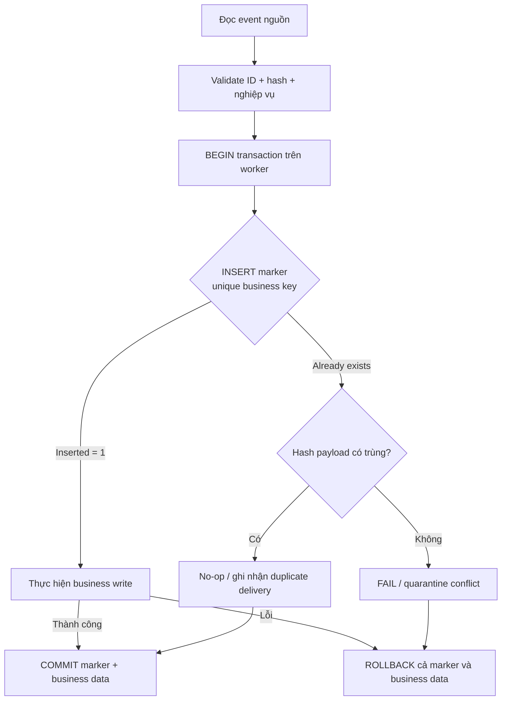
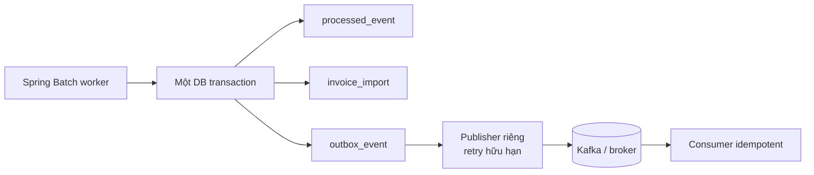

# Đánh dấu bản ghi đã xử lý trong Spring Batch: Idempotency và xử lý lại an toàn

> **Chương:** Idempotency  
> **Phạm vi:** Thiết kế dấu đã xử lý (*processed marker*) hoặc bảng ghi nhận xử lý (*processing ledger*) để tránh tác dụng nghiệp vụ lặp khi Spring Batch retry/restart, multi-threaded step, partitioning, remote chunking và remote partitioning. Ví dụ sử dụng **Spring Batch 5.2.x**, Java 17, Spring JDBC và PostgreSQL.

## 1. Vì sao cần đánh dấu bản ghi đã xử lý?

Một job nhận 1 triệu sự kiện hóa đơn từ file hoặc message queue, chuẩn hóa rồi ghi vào database. Trong lần chạy đầu:

1. Chunk A đã ghi thành công 100 hóa đơn và commit.
2. Chunk B gặp lỗi hạ tầng; step chuyển sang `FAILED`.
3. Khi restart, reader có thể đọc lại một số hóa đơn đã ghi trước đó, tùy nguồn, checkpoint, transaction và cách chia dữ liệu.
4. Nếu sử dụng remote chunking, một worker khác còn có thể nhận lại **đúng request chunk cũ** khi worker trước chết sau DB commit nhưng trước reply/ACK.

Nếu writer đơn thuần gọi `INSERT` với khóa mới mỗi lần hoặc thực hiện `UPDATE balance = balance + amount`, cùng dữ liệu nguồn có thể tạo **tác dụng lặp**. Cơ chế retry/restart của framework đảm bảo điều phối xử lý, **không tự bảo đảm exactly-once effect ở mọi nguồn và hệ thống đích**.

Giải pháp được học trong bài này là **đánh dấu một bản ghi/sự kiện nghiệp vụ đã xử lý**, đồng thời dùng dấu ấy để quyết định có nên thực hiện lại tác dụng ghi hay không.

Ví dụ:

```text
Sự kiện nguồn:  sourceSystem=ERP, eventId=INV-2026-00042
Lần xử lý #1:  chưa có marker → ghi hóa đơn → commit marker + dữ liệu
Lần xử lý #2:  thấy marker cùng nội dung → không ghi thêm lần nữa
Lần xử lý #3:  cùng eventId nhưng nội dung khác → báo lỗi xung đột
```

**Định nghĩa làm việc:** Một thao tác idempotent có thể được gọi nhiều lần với **cùng dữ liệu và cùng định danh logic** mà không nhân đôi **tác dụng nghiệp vụ**. Đây là tính chất của **kết quả**, không phải tính chất “writer được gọi đúng một lần”.

## 2. Phân biệt marker, checkpoint và metadata Batch

| Khái niệm | Chứa gì? | Phạm vi | Có đủ để chống ghi trùng? |
| --- | --- | --- | --- |
| **Processed marker** | Khóa nghiệp vụ ổn định, dấu đã áp dụng, fingerprint nội dung | Theo event/record ở hệ thống đích | Có thể, nếu transaction và dedup được thiết kế đúng |
| **`ExecutionContext`** | Vị trí reader, trạng thái restart, tham số partition | Theo `StepExecution` hoặc `JobExecution` | **Không**; không biết mọi side effect đã commit |
| **`StepExecution` counts** | `readCount`, `writeCount`, `skipCount`, `commitCount`... | Lượt thực thi step | **Không**; là số liệu tổng hợp |
| **`JobInstance`** | Danh tính một job theo identifying parameters | Một logical run của job | **Không**; input có thể replay ở instance mới |
| **Broker ACK / message ID** | Thông tin giao nhận message | Tầng middleware | **Không**; ACK và DB commit thường khác transaction |
| **Unique constraint** | Không cho hai row trùng cùng business key | Tầng database | Ngăn duplicate theo khóa; không tự chống mọi side effect |

Trong multi-threaded step, nhiều chunk có thể thuộc cùng một `StepExecution` nhưng commit độc lập. Trong partitioning, mỗi partition có `StepExecution` riêng và checkpoint riêng. Vì vậy **không dùng `stepExecutionId` làm khóa duy nhất để đánh dấu từng bản ghi**.

Tương tự, `JobExecution ID` thay đổi sau restart, nên khóa dạng `jobExecutionId + itemIndex` không nhận ra cùng record được xử lý lại trong JobExecution mới. Marker cần dựa trên **danh tính nghiệp vụ ổn định của event**, không dựa vào thread, partition hay lượt chạy.

## 3. Chọn khóa idempotency đúng trước khi viết code

Khóa phải trả lời: **Hai lần xuất hiện nào thực chất là cùng một thao tác nghiệp vụ?**

Ví dụ hệ thống đa tenant nhận hóa đơn từ hai nguồn:

```text
tenantId      = tenant-a
sourceSystem  = erp
sourceEventId = invoice-created-20261126-00042
```

Bộ ba `(tenantId, sourceSystem, sourceEventId)` có thể là khóa dedup phù hợp nếu upstream cam kết mỗi `sourceEventId` đại diện **đúng một sự kiện bất biến**.

Không nên mặc định dùng:

- `Thread.currentThread().getName()`: thread pool tái sử dụng thread.
- `StepExecution ID` hoặc `JobExecution ID`: thay đổi theo partition/restart.
- `System.currentTimeMillis()` hoặc UUID mới ở mỗi attempt: lần replay có khóa mới.
- Chỉ `invoiceId` nếu một invoice có nhiều sự kiện cập nhật hợp lệ.
- Hash của payload **mà không có danh tính nguồn** khi hai bản ghi trùng nội dung nhưng là hai sự kiện hợp lệ khác nhau.

### Khóa cho dữ liệu có phiên bản

Nếu cùng hóa đơn có các sự kiện `created`, `adjusted` và `cancelled`, một `invoiceId` cố định không thể đại diện cho toàn bộ lịch sử. Một số phương án:

| Loại nguồn | Khóa phù hợp | Điều kiện |
| --- | --- | --- |
| Event stream có event ID bất biến | `tenant + source + eventId` | Upstream không tái sử dụng event ID cho payload khác |
| Snapshot theo version | `tenant + source + businessId + version` | Version tăng đúng và không bị dùng lại |
| File CSV immutable | `sourceSnapshotId + recordIndex` hoặc business ID ổn định | Snapshot bất biến, record index được tính thống nhất |
| CDC/outbox event | `source + aggregateId + eventSequence` | Sequence là duy nhất trong aggregate |
| API có idempotency key | `tenant + operation + idempotencyKey` | Key ổn định qua retry, payload xung đột được phát hiện |

**Quyết định nghiệp vụ bắt buộc:** Đánh dấu “cùng **event** đã xử lý” khác với “invoice hiện ở trạng thái mới nhất”. Ledger theo event ngăn áp dụng lặp một event, nhưng **không tự giải quyết thứ tự** giữa event version 3 và version 4. Khi cần projection theo version, phải kiểm tra version tại bảng kết quả.

## 4. Kiến trúc: Marker và dữ liệu phải commit nguyên tử

Mẫu căn bản:



Dấu đã xử lý không nên được commit **trước** khi dữ liệu nghiệp vụ hoàn thành. Nếu marker và business write nằm **trong cùng transaction cùng database**, hai kết quả xảy ra cùng nhau:

- **Commit:** marker tồn tại **và** tác dụng dữ liệu đã được áp dụng.
- **Rollback:** marker không tồn tại **và** tác dụng dữ liệu chưa commit cũng bị hủy.

Điều này tạo một bất biến cần duy trì:

> Nếu marker cho biết event X đã xử lý thành công, phải có bằng chứng rằng toàn bộ tác dụng nghiệp vụ bắt buộc của X cũng được commit.

### Hai cách sai thường gặp

**Sai A — Đánh dấu trước trong transaction riêng:**

```text
INSERT marker(X); COMMIT;
writeBusinessData(X);    // lỗi, ROLLBACK

Khi retry: marker(X) đã có → bỏ qua
Kết quả: thất lạc tác dụng nghiệp vụ của X
```

**Sai B — Ghi dữ liệu rồi đánh dấu ở transaction khác:**

```text
writeBusinessData(X); COMMIT;
INSERT marker(X);          // process chết trước lệnh INSERT

Khi retry: chưa có marker(X) → thực hiện lại business write
Kết quả: có thể ghi trùng/cộng tiền hai lần
```

Nếu hai thao tác nằm ở **hai database hoặc hai transaction manager khác nhau**, không thể mặc định đạt tính nguyên tử. Phải chọn kiến trúc như transactional outbox, saga/compensation hoặc idempotent endpoint để xử lý cửa sổ lỗi.

## 5. Thiết kế schema processed marker trong PostgreSQL

Một schema tối thiểu cho các event bất biến:

```sql
CREATE TABLE batch_processed_event (
    tenant_id        VARCHAR(64)  NOT NULL,
    source_system    VARCHAR(64)  NOT NULL,
    source_event_id  VARCHAR(128) NOT NULL,
    payload_sha256   CHAR(64)     NOT NULL,
    processed_at     TIMESTAMPTZ  NOT NULL DEFAULT CURRENT_TIMESTAMP,

    PRIMARY KEY (tenant_id, source_system, source_event_id)
);

CREATE TABLE imported_invoice_event (
    tenant_id        VARCHAR(64)  NOT NULL,
    source_system    VARCHAR(64)  NOT NULL,
    source_event_id  VARCHAR(128) NOT NULL,
    invoice_id       VARCHAR(128) NOT NULL,
    amount           NUMERIC(18, 2) NOT NULL,

    PRIMARY KEY (tenant_id, source_system, source_event_id)
);
```

Trong bài này, mỗi event hợp lệ tạo **một row hiệu ứng** ở `imported_invoice_event`. Production có thể dùng nhiều bảng nghiệp vụ, nhưng tất cả các thao tác bắt buộc phải tham gia **cùng transaction** của marker nếu muốn bất biến nguyên tử.

**Tại sao dùng unique/primary key?** Bởi vì hai worker chạy song song có thể cùng thấy “chưa có marker” nếu chỉ kiểm tra bằng `SELECT` trước. Unique constraint là điểm đồng bộ ở database, có hiệu lực giữa nhiều thread/JVM.

`payload_sha256` được tính từ **biểu diễn canonical, ổn định** của nội dung nguồn có ý nghĩa nghiệp vụ (ví dụ chuẩn hóa field và thứ tự thuộc tính, encoding). Nó giúp phát hiện một ID xuất hiện lại với payload khác. Không dùng hash tự tạo bằng `String.hashCode()`, không đưa raw PII vào log và không giả định hash sửa được mọi lỗi upstream.

**Bảng không có cột `IN_PROGRESS`** vì ví dụ này chỉ lưu dấu **thành công** trong cùng transaction. Nếu dùng trạng thái `PENDING`/`PROCESSING` đã commit trước, cần thêm timeout, lease/fencing, cleanup và quy tắc phục hồi riêng — đây là kiến trúc khác.

### Tránh lưu payload quá lớn trong marker

Marker thường cần key, fingerprint, timestamp và metadata phục vụ audit. Không nên copy toàn bộ 10 KB–10 MB payload mỗi record vào bảng dedup vì:

- làm tăng kích thước index và I/O;
- gây khó quản trị PII/retention;
- khiến chi phí lookup/backup tăng;
- làm tăng contention trong workload lớn.

Nếu cần raw payload để replay, lưu ở kho nguồn hoặc quarantine riêng theo một tham chiếu có phân quyền.

## 6. Concurrent insert: Một worker thắng, worker kia được trả lời an toàn

Xét cùng event X được hai worker nhận gần như cùng lúc:

```mermaid
sequenceDiagram
    participant A as Worker A
    participant B as Worker B
    participant DB as PostgreSQL
    A->>DB: BEGIN
    B->>DB: BEGIN
    A->>DB: INSERT marker(X) ON CONFLICT DO NOTHING
    DB-->>A: 1 row inserted
    B->>DB: INSERT marker(X) ON CONFLICT DO NOTHING
    Note over B,DB: Có thể chờ kết quả transaction A
    A->>DB: INSERT business(X)
    A->>DB: COMMIT
    DB-->>B: Conflict; 0 row inserted
    B->>DB: SELECT hash marker(X)
    DB-->>B: Hash trùng
    B->>DB: COMMIT (no-op)
```

Nếu A **rollback**, B có thể được phép insert marker sau khi A rút lui và tự thực hiện business write. Nếu A commit nhưng B nhận conflict, B chỉ bỏ qua sau khi **kiểm tra marker cùng nội dung**.

Điểm cần hiểu:

1. `INSERT ... ON CONFLICT ... DO NOTHING` là thao tác nguyên tử ở database, khác với `SELECT EXISTS` rồi mới `INSERT`.
2. PostgreSQL có thể làm lần insert thứ hai **chờ** transaction đang giữ khóa unique conflict; không giả định cả hai đều chạy không chờ.
3. `SELECT` sau conflict nên đọc cùng primary database trong transaction phù hợp. Với isolation level cao, có thể xảy ra serialization/concurrent update failure và cần retry **toàn transaction** theo policy.
4. Nếu marker đã tồn tại nhưng business row bị xóa/sửa thủ công từ trước, việc bỏ qua có thể che giấu thiếu dữ liệu. Cần reconciliation.
5. Với các database khác PostgreSQL, dùng cú pháp và khóa thích hợp (`MERGE`, upsert, unique constraint) theo semantics thật, không sao chép nguyên `ON CONFLICT`.

## 7. Mã Java: ItemWriter đánh dấu và ghi trong cùng chunk transaction

Ví dụ Spring Batch **5.2.x** dùng `ItemWriter<InvoiceEvent>`. `JdbcTemplate` phải dùng `DataSource` mà `PlatformTransactionManager` của worker step đang quản lý.

**Quy tắc cho ví dụ:** `eventId` là duy nhất trong phạm vi tenant + source; payload bất biến; mỗi event tạo một bản ghi `imported_invoice_event`.

```java
package com.example.batch.idempotency;

import java.math.BigDecimal;
import java.util.Objects;

import org.springframework.batch.item.ItemWriter;
import org.springframework.context.annotation.Bean;
import org.springframework.context.annotation.Configuration;
import org.springframework.jdbc.core.JdbcTemplate;
import org.springframework.transaction.support.TransactionSynchronizationManager;

@Configuration(proxyBeanMethods = false)
public class IdempotentInvoiceWriterConfig {

    public record InvoiceEvent(
            String tenantId,
            String sourceSystem,
            String sourceEventId,
            String invoiceId,
            BigDecimal amount,
            String payloadSha256) {
    }

    public static class ConflictingEventException
            extends RuntimeException {
        public ConflictingEventException(String eventId) {
            super("Same event ID with different payload: " + eventId);
        }
    }

    @Bean
    public ItemWriter<InvoiceEvent> idempotentInvoiceWriter(
            JdbcTemplate jdbc) {

        return chunk -> {
            // Fail closed: ví dụ dựa vào transaction do Step mở.
            if (!TransactionSynchronizationManager
                    .isActualTransactionActive()) {
                throw new IllegalStateException(
                        "Writer requires an active chunk transaction");
            }

            for (InvoiceEvent event : chunk) {
                requireValid(event);

                int inserted = jdbc.update("""
                    INSERT INTO batch_processed_event
                        (tenant_id, source_system,
                         source_event_id, payload_sha256)
                    VALUES (?, ?, ?, ?)
                    ON CONFLICT
                        (tenant_id, source_system, source_event_id)
                    DO NOTHING
                    """,
                    event.tenantId(), event.sourceSystem(),
                    event.sourceEventId(), event.payloadSha256());

                if (inserted == 0) {
                    // Đã có marker: chỉ cho phép no-op
                    // nếu ID chỉ cùng một nội dung canonical.
                    String previousHash = jdbc.queryForObject("""
                        SELECT payload_sha256
                        FROM batch_processed_event
                        WHERE tenant_id = ?
                          AND source_system = ?
                          AND source_event_id = ?
                        """,
                        String.class,
                        event.tenantId(), event.sourceSystem(),
                        event.sourceEventId());

                    if (!Objects.equals(
                            previousHash, event.payloadSha256())) {
                        throw new ConflictingEventException(
                                event.sourceEventId());
                    }

                    // Duplicate delivery đã commit: không ghi lặp.
                    continue;
                }

                if (inserted != 1) {
                    throw new IllegalStateException(
                            "Unexpected marker insert count: " + inserted);
                }

                // Dấu và tác dụng nghiệp vụ dùng cùng JDBC transaction.
                jdbc.update("""
                    INSERT INTO imported_invoice_event
                        (tenant_id, source_system, source_event_id,
                         invoice_id, amount)
                    VALUES (?, ?, ?, ?, ?)
                    """,
                    event.tenantId(), event.sourceSystem(),
                    event.sourceEventId(), event.invoiceId(),
                    event.amount());
            }
        };
    }

    private static void requireValid(InvoiceEvent event) {
        if (event.tenantId() == null
                || event.sourceSystem() == null
                || event.sourceEventId() == null
                || event.invoiceId() == null
                || event.amount() == null
                || event.payloadSha256() == null
                || !event.payloadSha256().matches("[0-9a-f]{64}")) {
            throw new IllegalArgumentException(
                    "Missing/invalid identity, amount or hash");
        }
    }
}
```

**Lưu ý quan trọng về code:**

- `JdbcTemplate` là thành phần an toàn dùng chung sau cấu hình. Lambda writer không giữ bộ đệm mutable, phù hợp việc được gọi từ các partition/worker thread khác nhau nếu các dependency phù hợp.
- Spring Batch chunk step mở transaction trên worker thread; `TransactionSynchronizationManager` chỉ kiểm tra **thread hiện tại** có transaction imperative. Nó **không** chứng minh `JdbcTemplate` đang dùng đúng datasource — điều này phải được cấu hình và kiểm thử.
- Không đặt `@Transactional(REQUIRES_NEW)` quanh phần tạo marker; nó có thể làm marker commit trước transaction nghiệp vụ.
- Nếu `imported_invoice_event` insert thất bại, exception làm chunk rollback: marker vừa insert cũng rollback **nếu cùng datasource/transaction**.
- Nếu cùng event đã commit, writer bỏ qua tác dụng ghi mới. Trường hợp duplicate **không phải lỗi**, không làm tăng `writeSkipCount` của Spring Batch.
- Nếu cùng ID nhưng hash khác, exception fail chunk/step theo mặc định. Production nên đưa xung đột vào quarantine/alert và không skip một cách vô điều kiện.
- `payloadSha256` là giá trị **đã được tính/kiểm chứng trước khi writer nhận item**; ví dụ không trình bày thuật toán canonicalization. Hash phải thống nhất giữa các lần replay.
- Không dùng `ON CONFLICT DO NOTHING` trên bảng nghiệp vụ để che một lỗi khác rồi tự đánh dấu đã xử lý; phải kiểm tra đầy đủ điều kiện nghiệp vụ của từng effect.

### Một Step Spring Batch gắn writer

```java
import org.springframework.batch.core.Step;
import org.springframework.batch.core.repository.JobRepository;
import org.springframework.batch.core.step.builder.StepBuilder;
import org.springframework.batch.item.ItemReader;
import org.springframework.batch.item.ItemWriter;
import org.springframework.beans.factory.annotation.Qualifier;
import org.springframework.context.annotation.Bean;
import org.springframework.transaction.PlatformTransactionManager;

@Bean
Step invoiceImportStep(
        JobRepository repository,
        PlatformTransactionManager transactionManager,
        @Qualifier("invoiceEventReader")
                ItemReader<IdempotentInvoiceWriterConfig.InvoiceEvent> reader,
        @Qualifier("idempotentInvoiceWriter")
                ItemWriter<IdempotentInvoiceWriterConfig.InvoiceEvent> writer) {

    return new StepBuilder("invoiceImportStep", repository)
            .<IdempotentInvoiceWriterConfig.InvoiceEvent,
              IdempotentInvoiceWriterConfig.InvoiceEvent>
                    chunk(200, transactionManager)
            .reader(reader)
            .writer(writer)
            .build();
}
```

Đoạn bean step là **mảnh cấu hình** đặt trong class `@Configuration` của ứng dụng; cần có bean `invoiceEventReader`, `JobRepository`, transaction manager, nguồn dữ liệu, job launcher và database schema. Reader có con trỏ chia sẻ cần được cấu hình đúng scope nếu dùng concurrency.

**Quan trọng về remote chunking:** `RemoteChunkingWorkerBuilder` xử lý request qua Spring Integration flow; **không mặc định suy rằng worker đang có chunk transaction tương tự local step**. Nếu remote worker không có transaction-bound context, code writer trên sẽ báo lỗi. Phải đặt một transaction boundary thích hợp **trên worker**, ví dụ dùng `TransactionTemplate` bao trùm cả việc ghi marker và business data, và thiết kế ACK/reply của middleware riêng.

## 8. Vì sao không nên đánh dấu ở ItemProcessor hoặc ItemReader?

Nghe có vẻ tối ưu khi kiểm tra marker ngay ở reader/processor rồi trả `null` cho record đã xử lý. Có thể **tra cứu** để loại bớt chi phí, nhưng không nên dựa riêng vào “đã kiểm tra marker” để bảo đảm chống trùng.

### Thời điểm kiểm tra và thời điểm commit có thể cách xa nhau

```text
Worker A: SELECT marker(X) → chưa có
Worker B: SELECT marker(X) → chưa có
Worker A: ghi business(X), INSERT marker(X)
Worker B: ghi business(X), INSERT marker(X) → conflict quá muộn
```

Nếu tác dụng nghiệp vụ của B **không tham gia cùng transaction** hoặc đã gọi API bên ngoài, marker conflict không đảo ngược được tác dụng ấy.

Vì vậy **unique insert tại điểm transaction ghi** phải là tuyến phòng thủ cuối. Có thể preload marker để tối ưu nhưng cần coi kết quả preload là *advisory*, không thay thế khóa/transaction.

### Vì sao trả null từ processor chưa phải là skip?

Spring Batch xem `ItemProcessor.process(...)` trả về `null` là **filter**, không phải `skip` do exception. Do đó:

- `filterCount` có thể tăng, còn `skipCount` không tăng.
- Nếu muốn thống kê duplicate delivery, nên có metric/audit riêng.
- Không đánh dấu marker trước khi processor trả về `null` nếu thao tác xử lý nghiệp vụ chưa thật sự commit.
- Khi processor có side effect, việc gọi lại sau rollback/retry có thể tạo lặp.

**Khuyến nghị:** Với bài toán nhiều worker, quyết định final đã xử lý nên nằm **bên trong transaction thực hiện effect** tại writer/service, không nằm trong thao tác check-then-act đơn thuần.

## 9. Những cửa sổ crash và kết quả kỳ vọng

Bảng sau giả định marker + business write cùng transaction PostgreSQL:

| Worker chết ở đâu? | Trạng thái marker sau phục hồi | Trạng thái business effect | Retry nên làm gì? |
| --- | --- | --- | --- |
| Trước BEGIN | Chưa có | Chưa có | Thực hiện bình thường |
| Sau INSERT marker nhưng trước business write, **chưa commit** | Rollback → chưa có | Chưa có | Thực hiện lại |
| Sau business INSERT nhưng trước COMMIT | Rollback → chưa có | Rollback → chưa có | Thực hiện lại |
| **Ngay sau COMMIT** nhưng trước broker ACK/reply | Có marker | Có dữ liệu | Nhận lại và no-op nếu cùng hash |
| Sau khi ACK/reply hoàn tất | Có marker | Có dữ liệu | Không cần retry, duplicate vẫn no-op |
| Một phần side effect gọi API ngoài DB trước COMMIT | Phụ thuộc giao dịch DB | API có thể đã thành công | Cần idempotency API/outbox, không chỉ marker |

Một lỗi **timeout khi COMMIT** có thể khiến client không biết transaction đã commit hay rollback. Khi retry, unique marker + business key giúp xác định kết quả mà không cần tin vào thông báo lỗi đơn lẻ.

**Không kết luận** “job FAILED nghĩa là toàn bộ output chưa được ghi”. Nhiều chunk/partition đã commit trước đó có thể tồn tại khi job bị lỗi. Một marker đã commit cho biết effect gắn với nó được thực hiện, trong phạm vi transaction đã được thiết kế.

## 10. Retry, skip và restart: Marker có thay thế các cơ chế đó không?

**Không.** Marker chỉ giải quyết **tác dụng lặp** theo khóa đã chọn; Spring Batch vẫn cần lifecycle và chính sách fault tolerance.

| Tình huống | Cơ chế Spring Batch/middleware | Marker hỗ trợ thế nào? |
| --- | --- | --- |
| SQL deadlock hoặc timeout có thể phục hồi | `faultTolerant().retry(...)` hoặc retry hợp lý | Khi thao tác bị chạy lại, không tạo effect trùng |
| Item dữ liệu thật sự không hợp lệ | Skip policy có giới hạn, quarantine | Không nên tạo marker `SUCCESS` cho item bị skip nếu chưa tạo effect |
| Chunk đã commit, job crash trước khi hoàn tất metadata | Restart từ `JobRepository`, reader replay tùy thiết kế | Record đã commit gặp lại sẽ no-op |
| Remote request được broker redeliver | Redelivery/backoff/DLQ | Cùng event key ngăn tạo effect trùng |
| Partition bị giao lại sau timeout | Partition handler/restart protocol | Ngăn lặp effect; vẫn cần quản lý duplicate worker |
| Cùng business event ở hai JobInstance khác nhau | Identity của event độc lập với batch run | Marker vẫn nhận diện event trùng |
| Event mới cùng invoice nhưng version khác | Business event/version identity | Marker mới cho event mới, không chặn cập nhật hợp lệ |

### Không biến lỗi metadata thành skip

`OptimisticLockingFailureException` từ `JobRepository` không phải “event đã xử lý rồi”. Lỗi metadata báo có khả năng cạnh tranh/stale execution; cần điều tra ownership và restart. Marker trong DB nghiệp vụ không làm các bản `StepExecution` tự trở nên nhất quán.

### Restart phải dùng nguồn bất biến

Nếu file bị sửa giữa lần chạy và restart, cùng `sourceEventId` có thể mang nội dung khác. Khi đó marker phải **phát hiện conflict** thay vì bỏ qua bừa. Dùng manifest/snapshot ID, checksum và input version được lưu ổn định qua restart.

## 11. Ghi marker cho toàn chunk hay từng item?

Có hai mức hạt khác nhau:

| Tiêu chí | Marker theo **item/event** | Marker theo **chunk/request** |
| --- | --- | --- |
| Khóa | Stable business event ID | StepExecution ID + chunk sequence hoặc request ID |
| Phát hiện broker redelivery cùng chunk | Có, theo từng item | Có, nếu request ID ổn định |
| Phát hiện item được xếp vào chunk mới khi restart | **Có** | Không chắc, vì request/chunk ID mới |
| Chi phí lưu | Một row marker mỗi event | Một row marker mỗi chunk |
| Độ linh hoạt | Xử lý duplicate xen giữa item hợp lệ | Đơn giản cho whole-chunk atomic effect |
| Phù hợp với skip item lỗi | Dễ phân biệt đã xử lý từng item | Cần biết chunk nào hoàn tất và item nào bị skip |
| Khi thay chunk size | Vẫn nhận diện event cũ | Có thể thay identity và làm mất dedup |

**Mặc định thực tế cho workload có restart, replay hoặc nhiều nguồn:** Ưu tiên **business item/event key**. Chunk ledger hữu ích để tối ưu việc nhận lại **cùng request**, nhưng **không thay thế** item key nếu input có thể được chia chunk khác trong lần chạy mới.

Nếu dùng chunk ledger, marker và mọi effect của chunk phải commit nguyên tử; cần kiểm tra fingerprint của danh sách item, không chỉ sequence, và biết cách xử lý chunk chưa hoàn tất. Đừng sử dụng `chunkIndex` chỉ theo thứ tự đọc vì thứ tự này không chắc ổn định trong multi-threaded step.

## 12. Nhiều tài nguyên: DB, HTTP, Kafka và outbox

Một ví dụ nghiệp vụ cần vừa lưu invoice vừa phát event `InvoiceImported` ra Kafka:

```text
Worker:
  INSERT processed_event
  INSERT invoice_import
  publish Kafka event
  COMMIT database
```

Nếu publish Kafka trước DB commit, có thể phát event dù DB rollback. Nếu DB commit trước rồi publish, worker có thể chết và event không được phát. Marker trong DB **không tự làm Kafka publish nguyên tử**.

Mẫu **transactional outbox**:



Trong cùng DB transaction, worker lưu marker, effect và bản ghi outbox. Publisher độc lập đọc outbox rồi phát. Publisher có thể publish **lặp** khi chết sau publish nhưng trước cập nhật trạng thái; vì vậy consumer vẫn phải có dedup/idempotency.

Đối với HTTP payment API, cần end-to-end idempotency key do phía payment provider hỗ trợ hoặc quy trình reconciliation/compensation. **Không gọi charge hai lần chỉ vì marker transaction của Spring Batch rollback**.

Một số kiến trúc dùng saga hoặc distributed transaction (XA), nhưng đây là lựa chọn phức tạp cần đánh giá throughput và vận hành; không phải tính năng tự động của `StepBuilder.chunk(...)`.

## 13. Trạng thái PROCESSING/FAILED có nên lưu trong marker?

Có hai kiến trúc phải phân biệt.

### Mẫu A — Chỉ ghi dấu thành công trong cùng transaction

Đây là mẫu của bài:

```text
Không có row                 → chưa commit hiệu ứng
Có row, hash trùng           → đã commit hiệu ứng
Có row, hash khác            → xung đột dữ liệu
```

Ưu điểm: đơn giản, không phải dọn marker `IN_PROGRESS` bị kẹt. Nhược điểm: một giao dịch dài giữ unique-key contention; không phù hợp với công việc kéo dài hàng phút hoặc HTTP call bên trong transaction.

### Mẫu B — State machine với claim/lease

Với tác vụ dài hoặc chạy ngoài transaction, có thể thiết kế:

```text
NEW → CLAIMED(owner, leaseUntil, attempt) → APPLIED
                      ↓ timeout/failure
                 RETRYABLE / FAILED
```

Cần bổ sung:

1. `ownerId` và `leaseUntil` để xác định quyền xử lý tạm thời;
2. `fencingToken` đơn điệu để worker cũ không ghi sau khi mất lease;
3. Retry/backoff và quyết định thế nào là `FAILED` vĩnh viễn;
4. Reconciliation khi owner chết;
5. Contract để hoàn thành effect và cập nhật `APPLIED` mà không báo thành công giả;
6. Idempotency ở hệ thống đích khi không thể có một DB transaction bao trùm.

**Đừng nhầm:** Chỉ thêm cột `status='PROCESSING'` rồi commit trước khi chạy business logic **không giải quyết idempotency**. Nó tạo rủi ro marker mắc kẹt khi worker chết và cần recovery protocol nghiêm ngặt hơn.

## 14. Retention và dọn bảng marker đúng cách

Nếu job có 20 triệu events/ngày, bảng `batch_processed_event` có thể rất lớn. Không giữ mãi mọi marker mà không tính dung lượng, nhưng **xóa quá sớm cũng làm mất khả năng dedup**.

### Chọn retention từ cửa sổ replay thực tế

Cần xem:

- JobInstance có thể restart sau bao lâu?
- Broker giữ message tối đa bao lâu, có DLQ replay không?
- Đối tác có thể gửi lại file/event cũ sau bao lâu?
- Có yêu cầu audit và đối soát bao nhiêu ngày/năm?
- Dữ liệu đích có unique business key **vĩnh viễn** hay không?
- Nếu xóa marker, việc replay cũ có thể gây side effect không thể đảo ngược không?

Ví dụ nếu broker có thể phát lại event sau 90 ngày, xóa marker sau 7 ngày là không an toàn trừ khi tầng đích có cơ chế khác bảo vệ vĩnh viễn.

### Các chiến lược thường gặp

| Chiến lược | Lợi ích | Rủi ro/điều kiện |
| --- | --- | --- |
| Giữ marker dài hạn | Dễ phát hiện replay cũ | Tốn index/storage, cần privacy policy |
| Partition marker table theo ngày | Dễ quản trị retention | Khóa unique toàn cục có thể phức tạp tùy partition key |
| Archive marker và lookup tầng lạnh | Giảm nóng index | Lookup tăng latency, phải chống race giữa hot/cold |
| Dựa thêm unique key ở bảng nghiệp vụ | Bảo vệ bền vững hơn | Không chống mọi side effect ngoài bảng ấy |
| Xóa theo watermark đã xác nhận | Bounded retention có lý do | Phải chứng minh không còn replay cũ vượt watermark |

Không xóa marker đang cần cho job chưa hoàn tất, partition/restart hoặc các message còn ở DLQ. Trước cleanup, đối chiếu trạng thái source, queue và JobRepository.

## 15. Quan sát và đối soát: Marker đã đủ chứng minh thành công chưa?

Một marker là **cam kết nghiệp vụ theo thiết kế**, nhưng hệ thống vẫn cần đối soát để phát hiện lỗi cấu hình, cập nhật SQL thủ công hoặc các sự cố không thuộc transaction.

Ví dụ phát hiện marker không có row effect (với bài này giả định một marker phải đi kèm đúng một invoice effect):

```sql
SELECT p.tenant_id, p.source_system, p.source_event_id
FROM batch_processed_event p
LEFT JOIN imported_invoice_event i
       ON i.tenant_id = p.tenant_id
      AND i.source_system = p.source_system
      AND i.source_event_id = p.source_event_id
WHERE i.source_event_id IS NULL;
```

Nếu query trả về row, dữ liệu đã vi phạm invariant **marker ↔ effect** của ví dụ. Cần điều tra:

- writer có dùng hai datasource/transaction manager khác nhau không?
- ai đó đã xóa/sửa row nghiệp vụ thủ công?
- marker đã được insert bằng transaction riêng?
- job chuyển sang bước khác và ghi marker `SUCCESS` dù chưa có effect?
- bảng result có được archive/di chuyển theo quy trình mà reconciliation chưa biết không?

Tùy ứng dụng, một event có thể tạo **nhiều** effects hoặc một số event hợp lệ bị lọc; khi đó query phải phản ánh chính xác business contract, không mặc định mọi marker luôn tương ứng một row.

### Các số liệu nên theo dõi

| Tín hiệu | Ý nghĩa |
| --- | --- |
| `processed_new_total` | Event mới thật sự áp dụng effect |
| `duplicate_delivery_total` | Event replay có cùng ID và hash |
| `conflicting_event_total` | Cùng ID nhưng nội dung khác, cần điều tra |
| `marker_tx_rollback_total` | Transaction ghi marker/effect bị rollback |
| DB unique conflict wait/lock wait | Marker insert gây tranh chấp |
| Job/Step `readCount`, `writeCount` | Thống kê input/đầu ra theo semantics Batch |
| `commitCount`, `rollbackCount`, `skipCount` | Sức khỏe processing/retry |
| Quarantine/DLQ backlog | Đơn vị công việc chưa thể hoàn thành |
| Reconciliation mismatch count | Vi phạm invariant cần xử lý ngay |

**Lưu ý số liệu Batch:** `StepExecution.writeCount` không phải lúc nào cũng bằng số **row mới insert**. Một writer idempotent có thể nhận 200 item, bỏ qua 30 duplicate đã commit và chỉ insert 170 row. Framework vẫn có thể tính `writeCount=200` dựa trên số item được chuyển đến writer thành công. Vì vậy dùng counter **newlyApplied** riêng hoặc SQL reconciliation để biết chính xác số effect mới.

Đừng đưa `tenantId` có cardinality rất lớn, `sourceEventId`, `stepExecutionId` hoặc payload hash vào metric label kiểu Prometheus. Giữ các ID cần đối soát trong structured logs/traces có phân quyền, metric chỉ nên có tag ổn định như job, step, outcome.

## 16. Hiệu năng và bottleneck của bảng dấu xử lý

Đánh dấu từng event có chi phí:

- một unique index lookup/insert mỗi event;
- một số đọc thêm khi phát hiện duplicate;
- tăng WAL/redo log và storage;
- có thể gây hotspot nếu mọi worker tranh một dải key/index;
- tăng thời gian transaction khi marker và effect cùng được xử lý.

Ví dụ số liệu giả định với 100.000 events:

| Kịch bản | Worker threads | Duplicate rate | Thời gian giả định | Nhận xét |
| --- | ---: | ---: | ---: | --- |
| Chưa dedup, chỉ demo tuần tự | 1 | 0% | 90 s | Không chịu được replay an toàn |
| Ledger transaction | 1 | 0% | 125 s | Thêm chi phí ghi/index |
| Ledger transaction | 4 | 0% | 52 s | Có thể được lợi khi DB còn dư |
| Ledger transaction | 8 | 0% | 60 s | DB contention/pool trở thành nút thắt |
| Ledger transaction | 4 | 40% | 45 s | No-op giảm business write nhưng vẫn lookup |

Các số chỉ minh họa xu hướng, **không phải benchmark Spring Batch**. Không vì thấy duplicate nhiều mà bỏ unique constraint.

### Quy trình tuning có kiểm soát

1. Lấy baseline tuần tự và dữ liệu sạch, rồi thêm tỷ lệ duplicate mô phỏng 1%, 10%, 40%.
2. Đo transaction duration, insert latency, unique-conflict wait, DB pool pending, read/write throughput và job elapsed time.
3. Chọn chunk size 50/200/500 phù hợp bộ nhớ và chi phí rollback; chunk quá lớn có thể giữ transaction/lock lâu.
4. Tăng concurrency 1 → 2 → 4, giữ nguyên workload và phân bố key; dừng khi DB waits tăng nhanh.
5. Kiểm tra table/index bloat, auto-vacuum/analyze và retention theo chính sách DB thực tế.
6. Thử fault injection khi worker crash trước/sau commit, khi message redelivery và khi restart reader.
7. Đối chiếu tập business keys sau mỗi run, không chỉ nhìn `BatchStatus.COMPLETED`.

Khi xử lý rất nhiều item, cân nhắc **batching các marker inserts** hoặc staging merge có unique constraint, nhưng phải giữ invariant marker + effect trong cùng commit. Đừng gom nhiều worker cùng cập nhật một danh sách marker mutable trong RAM rồi hy vọng chống duplicate liên tiến trình.

## 17. Lỗi thường gặp và cách khắc phục

| Triệu chứng | Nguyên nhân | Hướng xử lý |
| --- | --- | --- |
| Marker tồn tại nhưng thiếu business row | Marker được commit trước effect hoặc transaction khác | Gộp cùng datasource/transaction, đối soát và sửa dữ liệu |
| Duplicate vẫn được ghi vào bảng đích | Khóa marker dùng `JobExecutionId` hoặc UUID mới mỗi lần | Chọn business event ID ổn định qua retry/restart |
| Hai worker cùng thực hiện side effect | Chỉ kiểm tra `SELECT EXISTS` rồi xử lý | Dùng unique insert/claim nguyên tử trước effect |
| Duplicate được bỏ nhưng payload khác | Không lưu/kiểm tra fingerprint hoặc version | Validate hash/version, báo conflict/quarantine |
| Duplicate rate tăng nhưng `skipCount=0` | Writer no-op không phải Batch skip | Đo riêng `duplicate_delivery_total` |
| Lỗi `DuplicateKeyException` tại business table | Marker uniqueness và business uniqueness có phạm vi khác hoặc dữ liệu mâu thuẫn | Kiểm tra constraint và nghiệp vụ trước khi retry |
| Remote worker nhận lại chunk và tạo row mới | Marker theo chunk ID thay đổi hoặc writer không idempotent | Dùng event key, kiểm thử redelivery/crash window |
| Sau restart event mới bị bỏ nhầm | Input thay đổi nhưng ID được tái sử dụng | Snapshot/version, so hash, không silent ignore |
| DB chậm khi tăng worker | Unique index/connection pool/lock contention | Đo waits, điều chỉnh concurrency/chunk và partition key |
| `IN_PROGRESS` tồn tại mãi | Claim được commit riêng, worker chết chưa release | Lease/fencing/recovery; hoặc chọn mẫu marker thành công nguyên tử |
| Chạy lại khiến email gửi hai lần | Email không thuộc DB transaction | Outbox + consumer idempotent, hoặc provider idempotency |
| Cleanup marker làm replay tạo effect cũ | Retention ngắn hơn replay window | Thiết kế retention theo nguồn/broker/DLQ và output uniqueness |
| Job COMPLETED nhưng số row ít hơn writeCount | Duplicate no-op hoặc filter/skip | Đối soát dữ liệu và đo newlyApplied riêng |
| Metadata optimistic lock lỗi | Hai updater ghi `StepExecution` stale | Xử lý quyền sở hữu JobRepository; marker không sửa được lỗi metadata |

## 18. Bài thực hành và kiểm thử phục hồi

**Bài A — Ghi lần đầu và replay.** Tạo 5 `InvoiceEvent` duy nhất, gọi writer qua chunk step. Sau khi commit, chạy lại đúng 5 event với cùng khóa/hash. Kiểm tra bảng effect còn đúng 5 row, bảng marker 5 row và không có event trùng được áp dụng lại.

**Bài B — Xung đột nội dung.** Gửi lại `sourceEventId=E-1` nhưng đổi `amount` và tạo hash tương ứng. Kiểm tra writer ném `ConflictingEventException`, không âm thầm ghi đè dữ liệu trước và transaction của chunk được rollback theo policy.

**Bài C — Rollback sau marker insert.** Cố tình tạo một constraint failure ở `imported_invoice_event` sau khi marker insert thành công. Kiểm tra transaction rollback và **không còn** marker cho event ấy. Sửa lỗi và retry; event phải được xử lý bình thường.

**Bài D — Hai worker đua cùng key.** Dùng hai thread độc lập, mỗi thread có transaction riêng và cùng xử lý event X. Bắt đầu gần như đồng thời; kiểm tra unique constraint chỉ cho phép **một** marker/effect commit. Worker thua conflict được no-op hoặc chờ/retry theo isolation phù hợp.

**Bài E — Crash sau commit trước ACK.** Với remote chunking test, kill worker ngay sau khi DB commit nhưng trước broker ACK/reply. Để broker redeliver cùng `ChunkRequest` cho worker mới. Kiểm tra output không tăng thêm, manager vẫn có recovery path hợp lệ.

**Bài F — Restart và chunk boundary khác.** Chạy job với chunk size 100, để job fail sau vài chunk; sau đó replay nguồn theo kịch bản có chunk boundary khác trong môi trường test cô lập. Đảm bảo marker theo **item ID** vẫn nhận diện dữ liệu đã xử lý, không phụ thuộc chunk sequence.

**Bài G — Hai phiên bản cùng invoice.** Gửi hai sự kiện hợp lệ `invoice-updated-v3` và `invoice-updated-v4`. Chứng minh ledger cho phép cả hai, nhưng phép ghi projection “trạng thái mới nhất” vẫn phải kiểm soát version/order, không chỉ dựa vào marker.

**Bài H — Side effect ngoài DB.** Giả lập worker gửi notification rồi chunk rollback. Quan sát notification có thể đã phát; chuyển notification sang outbox transactional và thiết kế consumer dedup.

**Bài I — Đối soát và retention.** Xây truy vấn left join phát hiện marker không có effect. Mô phỏng xóa marker quá sớm rồi replay event cũ; đưa ra retention tối thiểu dựa trên cửa sổ replay/SLA.

### Checklist nghiệm thu

- [ ] Khóa idempotency được chọn theo **event identity nghiệp vụ** và ổn định qua restart.
- [ ] Có unique constraint ở database làm điểm phân xử khi xử lý đồng thời.
- [ ] Marker `SUCCESS` và business effect tham gia **cùng transaction** khi cùng DB.
- [ ] Khi duplicate cùng ID, có kiểm tra fingerprint/version chứ không bỏ qua mọi conflict.
- [ ] Writer chịu được retry/restart và không nuốt exception nghiệp vụ quan trọng.
- [ ] Có phương án cho HTTP/Kafka/email ngoài DB: outbox hoặc idempotency độc lập.
- [ ] Reader/processor/writer phù hợp concurrency, partition và transaction boundary.
- [ ] `writeCount` không bị hiểu nhầm là số row mới insert sau dedup.
- [ ] Có đối soát marker ↔ effect, log/counter cho duplicate/conflict và cảnh báo.
- [ ] Retention marker dài hơn cửa sổ replay hoặc có tuyến phòng thủ bền vững khác.
- [ ] Đã diễn tập crash trước/sau commit, duplicate delivery, lost reply và restart.

## 19. Tài liệu tham khảo chính thức

- [Spring Batch 5.2 — Scaling and Parallel Processing](https://docs.spring.io/spring-batch/reference/5.2/scalability.html)
- [Spring Batch 5.2 — Chunk-Oriented Processing](https://docs.spring.io/spring-batch/reference/5.2/step/chunk-oriented-processing.html)
- [Spring Batch 5.2 — Configuring Retry Logic](https://docs.spring.io/spring-batch/reference/5.2/step/chunk-oriented-processing/retry-logic.html)
- [Spring Batch 5.2 — Configuring Skip Logic](https://docs.spring.io/spring-batch/reference/5.2/step/chunk-oriented-processing/configuring-skip.html)
- [Spring Batch 5.2 — Configuring a Step for Restart](https://docs.spring.io/spring-batch/reference/5.2/step/chunk-oriented-processing/restart.html)
- [Spring Batch 5.2 — ItemWriter interface API](https://docs.spring.io/spring-batch/docs/5.2.2/api/org/springframework/batch/item/ItemWriter.html)
- [Spring Batch 5.2 — Spring Batch Integration](https://docs.spring.io/spring-batch/reference/5.2/spring-batch-integration.html)
- [Spring Framework — Transaction Management](https://docs.spring.io/spring-framework/reference/data-access/transaction.html)
- [Spring Framework — JdbcTemplate API](https://docs.spring.io/spring-framework/docs/current/javadoc-api/org/springframework/jdbc/core/JdbcTemplate.html)
- [PostgreSQL — INSERT ... ON CONFLICT](https://www.postgresql.org/docs/current/sql-insert.html)
- [PostgreSQL — Transaction Isolation](https://www.postgresql.org/docs/current/transaction-iso.html)

> **Giới hạn phiên bản và kiến trúc:** Code dùng Spring Batch **5.2.x**, Spring transaction imperative và PostgreSQL. Cú pháp `ON CONFLICT` phụ thuộc PostgreSQL; API Spring Batch 6 có thể đổi package/builder. Mẫu này cung cấp **exactly-once effect có điều kiện trong phạm vi các business writes cùng transaction DB**, không hứa exactly-once end-to-end cho mọi nguồn, broker hoặc side effect bên ngoài. Cần xác minh bằng integration test trên datasource/transaction manager đang dùng.

**Ghi nhớ:** Đánh dấu bản ghi đã xử lý phải dựa vào **business event key ổn định**, có **unique constraint** và được commit **nguyên tử cùng tác dụng nghiệp vụ**. Sau retry, restart hoặc remote redelivery, marker cho phép nhận biết đã commit và no-op đối với cùng payload; marker khác nội dung phải được coi là xung đột. Đúng idempotency không chỉ là một cột `processed=true`: nó còn bao gồm transaction boundary, concurrency, xử lý lỗi, retention, reconciliation và bảo vệ side effect ngoài database.
